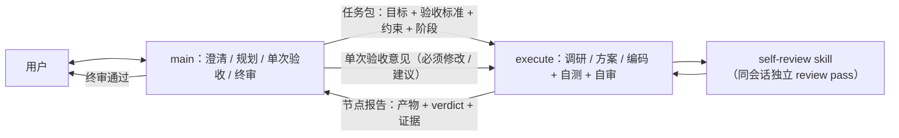

# AGENTS.md — dragon-quant

> 龙头战法量化筛选系统 · AI Agent 操作手册

---

## 这是什么

一套纯 Python 3 的 A 股龙头筛选系统。从当日涨停榜出发，评估涨停股的龙头质量并加权排名输出；同时支持日志查询、SQLite 持久化、龙头回测与 Web UI 可视化。

系统当前使用**五维「识别真龙」评分体系**，由 `scan` 命令触发：

- **五维「识别真龙」**：带动性 30% / 领涨性 25% / 抗跌性 15% / 流动性 20% / 资金承接 10%，**门槛+加权两段式聚合**（四大特征任一低于门槛即一票否决，资金承接不否决仅加权贡献）。详见 [评分规范](archived_md/score/评分器Refactor.md)。

> 为兼容历史数据，SQLite 物理表继续沿用 `*_v2`（如 `dragons_v2` / `scans_v2`），`scan_id` 继续使用 `v2_YYYYMMDD_topN`。`scan_v2` 命令保留为隐藏兼容别名，行为等同 `scan`；旧 `*_v1` 表不再由主流程写入，仅可通过显式 `--source v1` 查询历史记录。

> **v1 已废弃**：所有龙头/扫描/候选池相关逻辑只读 `dragons_v2`。`--source v1` 仅保留用于查询历史数据，**不再新增任何 v1 写入、分支或功能**；新命令（如 `auction`）一律固定 `source="v2"`。

数据源：**通达信 TDX（首选，`tmdx` 包，无 Cookie 无反爬）+ 同花顺（板块，回退）+ 雪球（个股 K 线/分时，回退）+ 腾讯（批量行情/收盘盘口，回退）**，不依赖任何付费行情接口。tdx 链路失败时自动回退老链路。

> **板块口径为「行业 + 概念 + 地区」三维融合总榜**（TDX `HY`/`GN`/`DQ`，按涨幅排序取前 8；THS 回退同样支持三类），**领跌 Top20 仍按行业**（资金承接「对手盘」语义不变）。板块身份为 `(source, category, code)`，缓存键按 `source:category:code` 命名空间隔离。

---

## 快速使用

```bash
cd ~/repo/dragon-quant

# 查看 Linux 风格帮助提示
python -m dragon_quant -h
python -m dragon_quant scan -h
# 不带子命令只打印帮助（exit 0），不会执行扫描
python -m dragon_quant

# 批量扫描（五维「识别真龙」评分器）
python -m dragon_quant scan --top 25 --candidates 5 --workers 2
# 读取历史扫描记录（不触网）
python -m dragon_quant scan --date 20260519 --top 5

# 强制执行（跳过交易时段拦截 + DB 缓存）
python -m dragon_quant scan --force

# 板块黑名单管理（拉取领涨/领跌板块时过滤）
python -m dragon_quant blacklist list
python -m dragon_quant blacklist add "次新股"
python -m dragon_quant blacklist remove "次新股"

# 原子数据查询 / Cookie
python -m dragon_quant data sector
python -m dragon_quant data cookie-status
python -m dragon_quant data cookie-fetch
python -m dragon_quant data cookie-set --cookie "xq_a_token=...; xq_is_login=1; u=..."

# 日志查询
python -m dragon_quant logs list
python -m dragon_quant logs tail -n 20

# 持久化数据管理
python -m dragon_quant storage status        # 查看存储状态
python -m dragon_quant storage size          # 磁盘占用
python -m dragon_quant storage clear --all   # 清理 cache+results+logs（不清理 .db）
python -m dragon_quant storage clear --cache --results --logs --days 7

# 回测 / 查看 UI（默认读取 dragons_v2）
python -m dragon_quant review --date 20260519
python -m dragon_quant review --ui-only

# 导出扫描物化的龙头（JSON，默认最新有数据的交易日）
python -m dragon_quant dragons
python -m dragon_quant dragons --date 20260519 --true-only

# 盘后复盘：采集原始数据资产(assets.db) + 计算主线/情绪温度/候选池快照（review-account 消费）
python -m dragon_quant prep
python -m dragon_quant prep --date 20260519
python -m dragon_quant prep --date 20260519 --recompute   # 用已存资产重算（算法升级重放）
python -m dragon_quant prep --date 20260519 --force       # 强制重采全部可采资产（不绕过 16:40 门禁）
python -m dragon_quant prep --json                        # 输出完整复盘 JSON（默认 4 行市场摘要 + 标的清单）

# 采集 T-1 prep 推荐标的（strong/light）的当日集合竞价盘口 + 行情，落原始资产并计算快照
python -m dragon_quant auction
# 推荐集为空/快照缺失时自动回退「最近 5 个有龙头数据的交易日」并集；--days 仅回退路径生效
python -m dragon_quant auction --days 3
# 强制旧口径（最近 N 日 dragons 并集）
python -m dragon_quant auction --pool legacy
# 输出完整 JSON（默认只展示参与竞价判断的标的强弱与汇总）
python -m dragon_quant auction --json
# 用已存原始资产重算某日竞价快照（不触网）
python -m dragon_quant auction --recompute 20260519

# 数据资产云端同步（门槛 A：R2/B2 连通性与元数据回环）
python -m dragon_quant assets doctor --profile r2 --samples 50
# 推送 / 拉取 / 差异 / 校验
python -m dragon_quant assets push
python -m dragon_quant assets pull --from 20261020 --to 20261022 --apply
python -m dragon_quant assets status
python -m dragon_quant assets verify --from 20261020 --to 20261022 --deep
# dragons_v2 → assets.db.dragons 幂等回填（本地，不触网）
python -m dragon_quant assets backfill-dragons --dry-run   # 体检：missing_rows / orphan_rows
python -m dragon_quant assets backfill-dragons [--from D] [--to D]
python -m dragon_quant assets backfill-dragons --prune     # 就地 pull 后收敛

# 因子层（P0-P2：只读迁移 + 财务链路 + 矩阵/评估 + 决策接入，默认不接入决策）
python -m dragon_quant factor list
python -m dragon_quant factor build --date 20260519
python -m dragon_quant factor build --from 20260501 --to 20260531
python -m dragon_quant factor build --date 20260519 --only five_dim_drive,vpa_breakout
# 全量构建 factor build --all（含默认关因子；与 --only 互斥；无财务数据时不加载 TDX 日历 = 不触网）
python -m dragon_quant factor build --date 20260519 --all
# P1.5 prep/auction 族默认关，必须显式 --only 才会产出
python -m dragon_quant factor build --date 20260519 --only prep_verdict,prep_composite,auction_strength
python -m dragon_quant factor query --date 20260519 --name five_dim_composite
python -m dragon_quant factor status
python -m dragon_quant factor export --from 20260501 --to 20260531 --name five_dim_composite --out /tmp/matrix.csv
python -m dragon_quant factor eval --name five_dim_composite --from 20260501 --to 20260831
```

### 前置条件

板块数据用**同花顺**，**无需 Cookie**（HTTP GET + GBK 直取，无 Playwright/反爬）。个股数据依赖雪球，需配雪球 Cookie：

```bash
# 查看状态
python -c "from dragon_quant.infra.provider.cookie import get_xq; print(f'雪球: {bool(get_xq())}')"

# 手动设置雪球 Cookie（推荐）
python -m dragon_quant.providers.cookie set --cookie "xq_a_token=...; xq_is_login=1; u=..." --source xq

# 自动获取（需要 playwright；首次运行自动下载 chromium 内核约 150MB，走国内镜像）
python -m dragon_quant.providers.cookie fetch --source xq
```

Cookie 文件位置（随平台而定，可用 `DQ_DATA_DIR` 覆盖）：
- macOS：`~/Library/Application Support/dragon-quant/cookies/xueqiu`
- Windows：`%APPDATA%\dragon-quant\cookies\xueqiu`

---

## 架构总览

```
dragon_quant/
├── __init__.py / __main__.py / _version.py / cli.py / app.py   # 入口 + Composition Root（app 不 import cli/commands）
├── commands/                    # 每个顶层命令一个薄 handler（COMMANDS + dispatch）
│   ├── __init__.py              # lazy `COMMANDS` 注册表 + `dispatch(name, args)` 唯一分发入口
│   ├── _shared.py               # CLI 纯 helper（策略 JSON / 日期 / 序列化）单一实现
│   ├── scan.py / logs.py / data.py / blacklist.py / review.py / review_account.py
│   └── dragons.py / prep.py / auction.py / assets.py / factor.py / buy_sell.py / vpa.py / storage.py
├── scan/                        # 扫描 feature（可调用包）
│   ├── __init__.py              # 可调用包：scan(...) → scan.orchestrator.main.scan
│   ├── sectors.py               # 板块身份 (source, category, code) + cache 键构造
│   ├── scores/                  # 五维「识别真龙」评分器
│   │   ├── __init__.py / main.py / aggregator.py / base.py / registry.py
│   │   └── drive.py / leadership.py / anti_drop.py / liquidity.py / absorption.py
│   ├── orchestrator/            # Phase A→F 编排
│   │   ├── __init__.py
│   │   └── main.py
│   ├── storage/                 # 扫描持久化仓储 + Phase F 收口
│   │   ├── __init__.py / main.py / scans.py / dragons.py / logs.py
│   │   └── blacklist.py / results.py
│   ├── cache/                   # ScanCache（通用 DataCache 在 infra.storage）
│   │   ├── __init__.py
│   │   └── main.py
│   └── logger/                  # 结构化日志 + 报告 + 查询
│       ├── __init__.py / main.py / events.py / report.py
│       └── query.py
├── review/                      # 龙头回测
│   ├── __init__.py
│   └── main.py                  # run_review / review_dragon
├── review_account/              # 账户级回测 + 策略 + 盘后复盘 + 竞价 + 实盘辅助
│   ├── __init__.py / main.py / service.py / simulator.py / engine.py / data.py
│   ├── market.py / indicators.py / evaluation.py / models.py / advice.py / verdicts.py
│   ├── storage.py               # review_account_* 五表仓储
│   ├── prep/                    # 盘后复盘
│   │   ├── __init__.py / main.py / service.py / collectors.py / compute.py
│   │   └── rebuild.py
│   ├── auction/                 # 集合竞价
│   │   ├── __init__.py / main.py / collect.py / recompute.py / scoring.py / dates.py
│   │   └── registry.py / strength.py / serialize.py / report.py / types.py
│   ├── strategy/                # 策略纯拆分（main.py 只门面重导出）
│   │   ├── __init__.py / main.py / common.py / buy.py / checks.py / sell.py
│   │   ├── execution.py / priority.py / risk.py
│   │   └── STRATEGY.md
│   └── live_trade/              # 实盘辅助 buy/sell（纯信号记账）
│       ├── __init__.py / main.py / service.py / trader.py / signal_engine.py / shadow.py
│       └── storage.py
├── vpa/                         # 量价分析
│   ├── __init__.py / main.py / engine.py / types.py / report.py / storage.py
│   └── factors/                 # vol_amount / trend_verify / breakout / divergence
│       ├── __init__.py / base.py / vol_amount.py / trend_verify.py
│       └── breakout.py / divergence.py
├── infra/                       # 叶子层：唯一连接/schema/路径/缓存/provider/资产/因子
│   ├── __init__.py / clock.py / models.py / market_calendar.py / module_proxy.py
│   ├── provider/                # 数据源适配
│   │   ├── __init__.py / main.py / base.py / bundle.py / data.py / rate_limit.py
│   │   ├── tdx.py / ths.py / xueqiu.py / tencent.py / macro.py
│   │   └── cookie.py / cookie_cli.py
│   ├── storage/                 # dragon.db 唯一连接 + 通用设施
│   │   ├── __init__.py / main.py / paths.py / identifiers.py / connection.py / schema.py
│   │   └── _base.py / dragons_rows.py / cache.py / manager.py
│   ├── factor/                  # 因子层（13 批准出口 + builtin）
│   │   ├── __init__.py / main.py / types.py / registry.py / engine.py / storage.py
│   │   ├── decision.py / evaluation.py / matrix.py / stats.py / service.py
│   │   ├── finance.py / sql.py / finance_store.py
│   │   └── builtin/             # five_dim / vpa / financial / prep / auction
│   │       ├── __init__.py / five_dim.py / vpa.py / financial.py
│   │       └── prep.py / auction.py
│   └── assets/                  # assets.db 独立库 + 云端同步
│       ├── __init__.py / main.py / db.py / schema.py / dragons_mirror.py
│       ├── ASSETS_ARCHITECTURE.md
│       └── sync/
│           ├── __init__.py / cli_service.py / service.py / sources.py / tables.py
│           ├── manifest.py / state.py / codec.py / models.py / credentials.py
│           ├── doctor.py / errors.py
│           └── backends/
│               ├── __init__.py / base.py / local.py / s3.py / signer.py
└── providers/                   # 唯一保留的旧路径例外
    ├── __init__.py              # 空包骨架
    └── cookie.py                # 仅 `python -m dragon_quant.providers.cookie` 入口委托

# 同级仓库包（不是 dragon_quant 的子包）
web_ui/                          # 回测结果 Web UI（Vite+React+TS+Mantine / stdlib HTTPServer；web_ui.start_server）
```

> **命令导航（M11B 起）**：`cli.py` 只做 argparse 解析，随后调用 `commands.dispatch(name, args)`；
> 每个顶层命令的实现在 `commands/<name>.py` 的 `handle(args, services)`（buy/sell 共用
> `commands/buy_sell.py` 的 `handle_buy`/`handle_sell`）。测试与脚本应直接走
> `commands.dispatch` 或命令模块的公共 helper，不存在第二个转发层。真实导航链是
> `cli → commands → feature 门面 → feature 用例 → 实现`；`app.py`（Composition Root）只是
> commands 按需调用的装配支路，不在链上多一跳。

> **入口事实（实测）**：`python -m dragon_quant`（不带子命令）与 `-h` 一样**打印帮助并 exit 0**，
> 不会执行扫描；实时扫描必须显式 `scan`。`scan --date YYYYMMDD` 只读取历史扫描记录，不触网。
> 旧的「无参数即 scan」说法与当前 parser 不符，不得据此调用。

> **模块公共入口**：`scan`（可调用包）；`review.main.run_review/review_dragon`；
> `review_account.main`（`run_review_account` + `StrategyConfig` / `MarketData`）；
> `review_account.prep.main`（`run_prep` + `format_advice_lines` / `format_candidate_lines`）；
> `review_account.live_trade.main.run_buy/run_sell`；
> `review_account.auction.main.run_auction/run_auction_recompute`；
> `infra.factor.main` 13 个批准出口（`build/list_factors/query/status/export_matrix/evaluate_factor/
> fin_sync/fin_calibrate/fin_status/parse_only/FactorModel/annotate_pool/CleanConfig`）；
> `infra.assets.main.run`；`vpa.main`（`analyze` + `render` / `upsert_vpa`）；
> `infra.storage.main`（`init_db`/`DataCache`/`StorageManager`）与 `scan.storage.main`
> （扫描/龙头/日志/黑名单持久化）为文档化公共契约，`infra/storage`、`scan/storage` 的
> `__init__.py` 不做急切重导出；`web_ui.start_server`。

> **刻意保留的兼容例外**（不随 CLI 兼容层清理移除）：
> - `infra/factor/main.py` 的 25 个 lazy 旧名：一轮迁移兼容，经 lazy 映射按需解析，**不 eager 绑定**；
> - `infra/storage/_base.py` 转发包装：保留 `connection._connect` 运行期 patch 语义（测试与既有脚本依赖）；
> - `infra/module_proxy.py`：`review` / `prep` 包门面的历史属性代理（批准设计 §4 的包 `__init__` 策略）；仅 stdlib 通用模块属性转发、无业务 import，与已删除的迁移期 `infra/compat.py`（含 `alias_module` 与旧路径别名）职责不同；
> - `review_account/prep` 的 `legacy()` 与活动导出：子模块在调用期经它反查 patch 目标；
> - `review_account/live_trade/trader.datetime` 模块级导入：测试按模块属性 patch 交易时钟；
> - `COMMANDS["scan"]` 的 provider 例外（`providers=None`）：保持 `api_stats` 与 M1 golden 口径。

---

## 执行流程

编排器 `scan.orchestrator.main.scan()` 分 6 个阶段（最近交易日判定 `_get_trade_date` 为 TDX 指数K线优先、雪球兜底，不依赖雪球 Cookie）：

| Phase | 做什么 |
|-------|--------|
| **A** 板块排行 | TDX/THS 三维板块榜（行业/概念/地区）融合取 Top8 + **行业**领跌 Top20，过滤 DB 黑名单；逐维度 TDX→THS 回退，单维度失败标 `degraded`、不中断扫描 |
| **B** 候选筛选 | 每个入选板块取当日所有涨停股(pct≥9.9)，过滤 ST+双创+北交所；跨板块同 code 去重，`primary_sector` = 总榜排名最高板块 |
| **C** 连板+排序 | TDX 日K 算连板天数（雪球回退），写 `Candidate.fived_pct`，按(连板,概念数)降序，候选池全部评分 |
| **D** 并发加载 | 板块历史10日5分K + 板块当日1分K + 大盘1分K + 全候选1分K + 腾讯批量行情 |
| **E** 打分 | `_score_one` 调 `scan.scores.main.evaluate()`，五维门槛+加权 → DragonVerdict |
| **F** 输出+持久化 | 所有候选保留诊断分与明细，仅通过者排名；Top N 真龙报告/入库 + 5日去重，保留原始排名 |

总耗时约 40-80 秒（取决于网络、并发数、v2 拉取量更大）。

---

## 数据模型

核心类型全部在 `infra/models.py`：

- **KBar** — 一根 K 线（timestamp, OHLCV, 涨跌幅, 换手率, 成交额）
- **StockInfo** — 股票基本信息 + 当日快照（含 `five_day_return`）
- **Quote** — 实时行情快照（现价/涨跌幅/换手率/市值/PE/量比…）+ **收盘盘口 `bid1_price`/`bid1_volume`/`ask1_volume`**（gtimg f[9]/f[10]/f[20]，单位手）
- **SectorPerformance** — 板块行情（代码/名称/涨跌幅/振幅）
- **Candidate** — 候选股（code, concepts, board_count, **fived_pct**, primary_sector, score）
- **ScoreResult** — 单维度评分结果（dim, score 0-100, weight, details）
- **DragonVerdict**（`scan/scores/base.py`）— 五维聚合产物（is_true_dragon, composite, rank, dims, reject_reason）

---

## 并发模型

`RateLimiter` 核心规则：
```
同一 provider（按 provider 名分组）→ 串行排队 + 随机延迟（防封 IP）
不同 provider 之间 → 自由并发
```
用法：`limiter.submit("ths", "ths", fn)` 之后 `limiter.wait_all()`。

---

## 反爬要点

### 同花顺（板块主数据源，无需 Cookie）
- **板块排行**：行业 `data.10jqka.com.cn/funds/hyzjl/...`、概念 `.../gnzjl/...`（同表结构），地区 `q.10jqka.com.cn/dy/`（单页，td[2]=涨跌幅）；HTTP GET + GBK 直取。
  - **铁律**：字段必须用 `zdf`（涨跌幅）。旧 `tradezdf` 是资金流字段，**无视 order/page**，永远返回固定 50 行资金流入板块（曾导致领跌榜全是正值的 bug）。
  - 单页 DOM **非严格有序**，必须抓多页后本地按 pct 排序。网关有 **403 频控**，已加退避重试 + 页间延迟。
- **成分股**：`q.10jqka.com.cn/thshy/detail/code/{881xxx}/`（GBK HTML 表格，列 td[1]=code/td[2]=name/td[4]=涨跌幅），翻页走非 ajax `/thshy/detail/order/desc/page/{p}/code/{code}/`。
- **板块当日1分K**：`d.10jqka.com.cn/v6/time/48_{inner}/last.js`（JSONP，原始1分，不聚合）。
- **板块历史5分K**：`d.10jqka.com.cn/v6/line/48_{inner}/30/last1000.js`（JSONP，**周期码 30=5分**，真实 OHLC）。
- innerCode：行业板块 `clid` 即 code 本身（881xxx）；概念板块为 885xxx 映射；地区板块 `clid` 即 code（882xxx）。统一解析对应维度详情页 `<input id="clid">`，进程内缓存键含维度。

### 雪球（个股，需 Cookie）
- `minute.json`（当日1分K）/ `kline.json`（日K）/ `quote.json`。Referer：`https://xueqiu.com/S/{SH/SZ}{code}`。
- 注意：`pankou.json` 盘后返回空体，**已弃用**，封单改用腾讯 gtimg 收盘盘口。

### 腾讯（零认证）
- `qt.gtimg.cn/q=` 批量行情（GBK）。封单量取 `f[10]`（买一量，手），与成交量 `f[36]`（手）同源同单位。

当前 Chrome UA：同花顺 120 / 雪球·腾讯 147。大面积失效时更新版本号即可。

---

## SQLite 表结构（`infra/storage/schema.py`）

| 表 | 用途 | 关键点 |
|----|------|--------|
| `scans_v2` | 每轮扫描元信息 | 含 `raw_output` 完整结果 JSON；`scan` 固定读写 v2 |
| `scan_stocks_v2` | 每轮全部评分结果 | scan_id 关联；填充 `dim_liquidity` / `is_true_dragon` / `reject_reason` |
| `dragons_v2` | 入选龙头（最终物化）| `UNIQUE(trade_date, code)`；`version`=包版本号；review 字段写回此表 |
| `scan_logs_v2` | 结构化日志 | `logs` 默认查询 v2 |
| `*_v1` | 历史旧表 | 不再由主流程写入，仅显式 `--source v1` 查询 |
| `vpa_analysis` | 量价分析 | 独立表，不复用 dragons |
| `sector_blacklist` | 板块黑名单 | 行业切换后默认种子为空 |
| `review_account_runs` | 账户级 review 批次 | 保存 UI 记录名称、策略参数、区间、初始资金、最终权益、收益率、最大回撤 |
| `review_account_snapshots` | 账户每日快照 | 保存现金、市值、总权益、收益曲线、当前持仓 |
| `review_account_trades` | 账户交割单 | 每笔买卖含 `reason_code` / `reason_text` / `signal_json` |
| `review_account_positions` | 已平仓持仓 | 保存买入/卖出价、退出原因、持有天数、实现收益；`post_exit_max_return` / `post_exit_max_drawdown` / `post_exit_window_days` 为清仓后 5 个交易日的窗口指标（事后评估，不参与交易决策；窗口可越出回测区间；旧记录三列为 NULL，不回溯重算） |
| `review_account_events` | 账户决策时间线 | 保存买入、卖出、持仓和空仓原因，供 UI 解释每日决策 |
| `buy_sell_signals` | 实盘辅助买卖信号 | buy 记录买入、sell 按规则平仓；未平仓 code 唯一（部分唯一索引 `idx_buy_sell_open`），含最高浮盈/价、`qty`（买入日冻结）、半仓腿（`half_exit_date/price/qty/reason_*/signal_json`）、平仓原因与持有天数 |
| **`assets.db`（独立库）** | 数据资产仓（prep + auction） | 与 dragon.db 物理隔离，防止不可再生资产被 `storage clear --all` 连带清理；`storage status` 展示 dragon.db / assets.db / 旧 prep.db 体积 |
| `dragons`（assets.db） | dragons_v2 全量镜像 | 列 schema 与 `dragons_v2` **完全一致**（含 `id`/`source`）；`UNIQUE(trade_date, code)` + 3 索引；权威仍是 dragon.db，存储门面**锁外 best-effort 双写**（失败只警告、可 `assets backfill-dragons` 自愈），供 prep / review-account / buy / sell / auction 的候选池读取；`volatile=True` 纳入 `infra/assets/sync`（`dragons:mirror`，date 分区，第 15 表） |
| **`factor_*`（assets.db）** | 因子层（P0） | `factor_values` 长表主键 `(trade_date, code, factor_name, factor_version)`，缺失=无行（绝不写 0/中性分）；`factor_registry` 元数据历史快照（`ON CONFLICT DO NOTHING`，重插旧版本不得刷新 `created_at`）；`factor_build_runs` 逐日审计；`factor_sector_snapshots` 主板块快照（`UNIQUE(trade_date, code, category)`，`category` 可能是 `gn`/`dq`，只有 `hy` 是真实行业）；`factor_model_snapshots` 供 P2 使用。M6 起纳入 `infra/assets/sync`（`factor` domain source，行级合并；派生数据可重算但一并备份） |
| `prep_assets`（assets.db） | 复盘原始数据资产 | `prep` 命令采集；`UNIQUE(trade_date, asset_type)`，单事务按键 UPSERT；资产类型 `dragons`/`ths_limit_up_pool`/`ths_block_top`/`market_breadth`/`fg_boards`/`fund_flow`/`cninfo_announcements`/`macro_global`/`collection_report`；`collection_report` 按条合并，语义为「该日期资产当前最佳状态」（未执行的键沿用存量，失败补采不覆盖健康状态）；每日落库=时间换历史 |
| `prep_snapshots`（assets.db） | 盘后复盘计算结果 | 单列 `result_json` 存完整复盘结果（`sentiment` 情绪/建议仓位 + `main_boards` 主线 + `macro` 宏观扰动 + `candidates` 候选池（含 `facts`/`verdict`/`dimensions`/`ignore_reason`） + `dragon_source` 血缘），`UNIQUE(trade_date, source)`，`source` 固定 `v2`；当前 `version=0.6`；加字段=加 JSON key，无需改表 |
| `auction_assets`（assets.db） | 集合竞价原始资产 | `auction` 命令产出；`items_json` 存当日竞价盘口明细（`time`/`price`/`matched`/`unmatched` 数组），`quote_json`（可空）存 `Quote` 行情快照（昨收/跌停价/流通市值等，旧行为 NULL），`UNIQUE(trade_date, code)`；`trade_date` 为竞价所属交易日（=当日）。仅当日 9:25 后可用、盘后仍可拉取、无历史回看 |
| `auction_snapshots`（assets.db） | 集合竞价强度计算结果 | `auction` 采集/`auction --recompute DATE` 写入；单列 `analysis_json` 存 `AuctionVerdict` 序列化结果（`version`/`code`/`is_weak`/`strength`/`direction`/`level`/`dims`/`reject_reason`/`unverified`/`rank`），`UNIQUE(trade_date, code, source)`、`source` 默认 `v2`；同日重跑整日原子替换，空结果不删旧快照。读接口 `assets_db.list_auction_snapshots` / `get_auction_snapshot`（逐行 JSON 损坏隔离）供候选池 A 维度消费 |

> **存储层重构（2026-10-20）**：旧 `prep.db`（`prep_assets`/`prep_snapshots`）与 dragon.db 的遗留 `auction_snapshots` 表保留但**不再读写、不自动迁移、不 DROP**。需要保留历史时按 README「持久化」段的手工迁移片段操作。

### v2 物理分表兼容
- 新扫描的缓存、扫描明细、日志、龙头物化全部读写 `*_v2` 表。
- `scan_id` 继续使用 `v2_YYYYMMDD_topN` 格式；不要假设 `scan_id[:8]` 是日期。
- 5 日去重只看 `dragons_v2`，兼容历史 v2 数据。
- 运行时不创建旧无后缀 `scans` / `scan_stocks` / `scan_logs` / `dragons` 表；`source` 仍是版本路由字段，默认 `v2`。

---

## 开发注意事项

### Agent Skill 包（npx 安装）

仓库内置单主 Agent Skill 与零运行时依赖的 npm 安装器，让 agent 不必读完整 `AGENTS.md` 就能完成命令路由、前置自检、输出解读、异常分流与写操作确认。

- **布局**：`skills/dragon-quant/SKILL.md`（薄路由层）+ `references/{commands,outputs,playbooks,operations,safety}.md`（按需加载）；根 `package.json`（`name=dragon-quant-skills`）+ `bin/dragon-quant-skills.mjs` + `lib/*.mjs`（安装器）；`test/*.test.mjs`（`node:test`，零依赖）；Python 侧 `tests/test_skill_{package,content,routes}.py`。
- **安装**：`npx dragon-quant-skills install` 默认写项目 `.claude/skills/dragon-quant`；`--global` 才写用户目录；`--target-dir DIR` 表示项目根；`--dry-run` 不写盘并打印最终绝对路径。`doctor` 检查安装完整性、CLI 版本、多 scope 遮蔽与外来源 lockfile；`uninstall` 只删 manifest 内文件。
- **状态机**：`absent/foreign/corrupt/clean/modified/up-to-date` 由 `lib/manifest.mjs` 单一分类，install/uninstall/doctor 共用。manifest（`.dragon-quant-skill.json`）记录内容 SHA-256、包版本与 `min_cli_version`；默认拒绝覆盖用户修改，`--force` 先整目录备份再替换；卸载不删用户新增文件。
- **版本策略**：npm `MAJOR.MINOR` 跟随 Python 包，`PATCH` 可独立；兼容性唯一契约是 `metadata.min-cli-version`，不是版本相等。测试校验 npm major.minor == pyproject major.minor、skill-version == package version。
- **安装与 CLI 解耦**：安装器只读探测 Python CLI（`--python` > `DQ_PYTHON` > PATH > `python3 -m` > `python -m`），绝不执行 pip；CLI 缺失/过低时 install 仍 exit 0 并警告，doctor exit 1 并给修复命令。
- **安全边界**：skill 安全矩阵覆盖全部 15 个顶层命令；T0 只读、T1 写本地/远端探针需确认、T2 外发/破坏性需 dry-run + 二次确认。`assets doctor` 会远端写探针（T1），`storage clear` 不删 `.db` 但属破坏性（T2）。
- **内容边界**：skill 只做路由/预检/解读/异常/门禁，**不复制评分权重、策略参数数值、SQLite 表结构**；`AGENTS.md` 与 `review_account/strategy/STRATEGY.md` 是权威。`tests/test_skill_content.py` 用禁用模式与 `StrategyConfig` 字段表强制校验。
- **兼容通道**：`npx skills add gitBingxu/dragon-quant` 与手工复制均不校验 CLI 版本、无 manifest；安装器会把无 manifest 的目录判为 `foreign`，不静默覆盖。远端通用安装与 Windows 路径本期未实测。
- **测试**：`npm test` 跑 Node 全量；`.venv/bin/python -m pytest tests/test_skill_package.py tests/test_skill_content.py tests/test_skill_routes.py` 跑内容/路由对齐。`test/packaging.test.mjs` 做 `npm pack` 白名单与本地 tarball `npm exec` E2E（隔离 HOME/目标目录）。
- **发布**：npm 包 `dragon-quant-skills` 已发布，可通过 `npx dragon-quant-skills install` 安装；官方 registry 与 npmmirror 的仓库外 dry-run 已实测。未配置 provenance/Trusted Publishing，不自动提交 git。方案与残余风险见 `docs/solutions/2026-10-24-agent-skills-design.md`。

### 龙头回测
```bash
python -m dragon_quant review                        # 自动筛 5~20 交易日内 pending 票全回测
python -m dragon_quant review --date 20260519 --top 5
python -m dragon_quant review --date 20260519
python -m dragon_quant review --ui                    # 回测后启动 Web UI，默认展示 v2
python -m dragon_quant review --ui-only               # 仅看结果
```
回测逻辑：默认从 `dragons_v2` 读 pending → 找入选后第一个非一字板日（`high != low`）最低价买入 → 算 `max_return_5d` / `max_return_hold_days` → 按买入日至峰值窗口算 `max_drawdown_5d` → 写回 `dragons_v2`。`--source v1` 仅用于历史旧表。

### 账户级模拟交易
```bash
python -m dragon_quant review-account --from 20260501 --to 20260601
python -m dragon_quant review-account --from 20260501 --to 20260601 --capital 200000 --ui
python -m dragon_quant review-account --ui-only --source v2
```
`review-account` 不替代 `review`。统一实现位于 `review_account/`：`market.py` 负责候选与时间/指标切片，`data.py` 校验日K和完整5分钟K，`strategy/` 产生信号（`buy.py` 买点、`checks.py` 诊断、`sell.py` 责任链、`execution.py` 撮合/仓位/费用），`engine.py` 顺序推进账户。`simulator.py` 与 `review_account/live_trade/signal_engine.py` 必须复用同一 `evaluate_buy`/`evaluate_sell`/`fill_price`/`fee`，不得复制买卖/成交规则。

- 候选池优先读**盘后复盘快照**（`prep_snapshots`，`prep` 命令产出：主线龙头 + 最高标 + 晋级者 + 情绪温度/建议仓位）；快照消费仅对 `source=="v2"` 生效。默认 `prep_verdict_filter_enabled=True`：`verdict=ignore` 出池，`strong/light/unrated` 保留（unrated 仅 P=False 排序垫底）；推荐集（strong/light）为空/快照缺失/读取异常/无资格时回退旧逻辑——取之前 **5** 个真实交易日的**全部真龙**并集（`assets.db.dragons` 镜像经 `candidate_loader("v2")`；`--source v1` 例外读 `dragons_v1`），共享层过滤否决/低于50分，按 code 去重保留综合分更高者。回退池**不再应用 ignore 过滤**，P 按快照 verdict 如实标注（ignore→False、无该 code→Unknown），输出 `fallback_reason`。回测额外加载区间前交易日，首日可开仓。**研究基线声明**：`candidate_lookback_days` 默认 3→5 是策略默认参数变更，历史 run 与本基线**不可直接比较**；复现旧基线请显式 `candidate_lookback_days=3`（prep 命中路径不受该参数影响）。
- Asia/Shanghai 时序：开盘MA5承接仅用上日指标和量能；突破前高改为**首根5分钟K完成后确认**，要求首根5分钟K换手≥`turn_strong_bar_turnover_min`（默认0.5%）带量，日K兜底日不触发；分歧买龙要求连续缩量一字板后完整6根5分钟K未破昨收且企稳；不允许用未来信号倒选。
- 择优（P/A 三值）：**tier(A,P) → 五维综合分降序 → 买点得分(priority)降序 → 代码**；三值序为 True < Unknown < False。排序键由 `review_account/strategy/priority.rank_key` 单一实现，`TradingEngine` 与 `SignalEngine` 共用。`buy` 保持 buy-all，排序只影响 pending 顺序。仅 `auction_ranking_enabled=True` 时 A 参与排序；`auction_veto_enabled=True` 时 verified ∧ is_weak 否决（按 `auction_veto_exempt_signals` 豁免）。两者皆默认 False；关闭时零竞价读取、零否决、A 恒 Unknown（AC8'）。
- 信号待下一可执行事件成交，实时需更晚的新鲜报价；封死涨跌停不假定成交，跳空不能补填止损或成本线。T+1不卖当日仓，但跟踪买入后峰值；同一根K的高点不能反向激活该根K内的保护。
- 卖出为 10 条 `SellRule` 责任链（`strategy/sell.py` `_SELL_RULES`，顺序即优先级、命中短路，`late_only` 承载「phase!=late 即跳过」阶段门）：**首日止损 `first_day_stop`（默认关）** → 首个可卖日-3.5%/以后-5%止损 → 已有峰值8%后回撤3.5%移动止盈（可选分级/ATR 化）→ 已有峰值6%后完整成本保护 → 高开7%/5%的5/30分钟窗口 → 14:55弱势/MA5 → 次日涨停半仓 → 放量；新增 `soft_time_stop`（N日未创新高）与 `hard_time_stop`（持有超 `max_hold_days` 封板豁免）两条时间止损，默认关。`sell_rule_toggles` 逐条开关（空=存量开/新增关）供消融实验。15:00只估值与更新峰值，不以最终收盘价补成交。
- **首日止损 `first_day_stop`（D3 首日浮亏减半，默认关）**：`sell_rule_toggles={"first_day_stop": true}` 开启；仅 `hold_days==1` 生效，盘中 `bar_low` 触及 `first_day_stop_loss_pct`（-3.5%）先卖**一半**（`first_day_stop_half`），剩余半仓 T+2 起回归 -5% 硬止损；`first_day_disaster_stop_pct`（默认 `0`=关闭，须 `<= first_day_stop_loss_pct`）为灾难线，**灾难段优先且不带半仓守卫**（首次击穿即整仓，`first_day_disaster_stop`）。开启时 `hard_stop` 让位、只处理 `hold_days>=2`。**同一信号仅一条半仓腿**：`first_day_stop_half` 与 `next_day_limit_up_half` 共用 `took_profit_half`（首日已减半→次日封板不再减半）。`risk_per_trade_pct>0` 时首日风险距离改用 `StrategyConfig.first_day_risk_distance_pct()` = `(half + (disaster or stop_loss_pct))/2` 保守上界。兜底日只有 open/late 两帧，灾难线无法提前退出；跨日 pending 按成交日行重算价与量。**运维契约：开启后 T+1 必须至少运行一次 `sell`**（`buy` 不评估卖出），否则首日窗口静默错过。方案见 `archived_md/review_account/2026-10-22-first-day-stoploss-redesign.md`，规则细节与状态机见 `review_account/strategy/STRATEGY.md` §1.1。
- 当天卖出后不买入；不因下午卖出而取消早上交易。默认每日最多买一次，仓位基线仍使用可用现金；共享配置可开启单票25%/风险1%、MA5距离/趋势、ATR移动止盈实验，未验证参数不自动推广。
- `--config` JSON 原样传给共享 StrategyConfig；滑点0.2%、佣金0.03%、卖出印花税0.05%、每笔最低佣金5元。`evaluation.compare_strategies` 按60/20/20时间划分、最少交易数与双倍滑点验证，不自动换默认参数。
- 择时与仓位改造（除龙回头默认开启外，其余 default-off，向后兼容）：`sentiment_sizing_enabled`/`sentiment_ban_enabled` 消费盘后复盘快照 `sentiment.position_pct`（情绪→仓位→禁买；历史快照为补跑时点近似，以前向验证为主）；`strategy/risk.py` 组合风控（日级熔断/净值回撤降仓/连续亏损降仓）；`entry_veto` 为**当前无调用方的通用前置买入否决钩子**（默认放行）；竞价否决实现在 `evaluate_buy` 信号后置闸门（`reason_code=auction_veto`，可按买点豁免、detail 带 `vetoed_signal` 供影子统计）；龙回头买点 `dragon_comeback_enabled`（**默认开启**；显式 `false` 可复现旧基线，默认开启后历史回测结果不可直接与旧基线比较）；验证基建 `plateau_scan`/`ablation`/`drawdown_decomposition`/`trial_count`。分叉声明见 `review_account/strategy/STRATEGY.md`。
- 数据分级：历史交易日按 code 三态判定——有完整48根5分钟K → 严格盘中撮合；无分时但当日日K有效 → 整日**日K兜底**（开盘价买、当日OHLC判卖，分时相关规则自然跳过）；当日日K缺行或 `volume`/`amount` 双零且无分时 → **停牌**，不进 `rows`、不评估买卖、按最近可得收盘价估值。剔除停牌 code 后再判断整日兜底；分时可用但当日日K缺行的标的在兜底日记 `daily_unavailable`（不建行、不静默消失）。日K完全无历史/预热不足/无效OHLC仍报 DataCoverageError，不持久化部分结果。当日（盘中与收盘后）不做停牌分类（日K缓存按写入日命名、不校验新鲜度），保持旧契约硬报错。兜底成交价保守近似，结果标 `data_quality`（strict_5min/mixed/daily_fallback）、`fallback_days` 与 `suspended_days`/`suspended_codes`/`suspended_days_count`/`unavailable_days`/`data_degraded`；停牌候选仍在 `details` 中带 `reason_code=suspended`。行情按日期/周期/不复权口径隔离缓存；SH000001用于交易日历，个股000001仍是平安银行。
- `/account` 生成/删除和历史批次查询保持不变；API可传 `strategy_params`，快照增量补 `positions_json` 存全部持仓（查询返回 `positions`），旧数据仍可读取；已平仓表保持原语义。完整规则见 `review_account/strategy/STRATEGY.md`。
- **清仓后窗口指标**：回测结束后由 `service.run_review_account` 调用 `simulator.annotate_post_exit`（**不在 `AccountSimulator.run()` 内**，回测核心保持纯 as-of），对每条已平仓记录按 code 取一次日K计算 `post_exit_max_return` / `post_exit_max_drawdown` / `post_exit_window_days`，失败逐条降级为 NULL/0、不中断回测。窗口为清仓日**之后**的 5 根有效日K（停牌占位行不计入、不足按实际、无 bar 为 NULL/0 天），允许越出 `date_to`（事后评估）；最高盈利 =（窗口最高−卖出）/卖出×100，最大回撤 = min(0,（窗口最低−卖出）/卖出×100)。旧 run 不回溯，三列为 NULL。
- **买点统计**：`evaluation.entry_reason_stats(positions, initial_cash)` 按 `BUY_SIGNAL_CODES` 四类（开盘回踩MA5/弱转强/分歧买龙/龙回头，0 笔也输出）+ 未知 code + 合计行，输出笔数/盈利笔数/胜率/平均每笔收益/累计贡献；胜率与 `_result()["win_rate"]` 同源（`realized_return > 0`）。累计贡献为近似值 `Σ(realized_return/100×entry_price×qty)/initial_cash×100`（忽略买入佣金）。`GET /api/account/positions` 返回 `{"data": [...], "stats": {...}}`（只增键），旧 run 也可实时聚合。
- `/account` 前端：`AccountStats` 之后新增「买点统计」卡片；「单票收益汇总」新增「清仓5日内最高盈利」「清仓5日内最大回撤」两列（NULL 显示 `—`，窗口不足 5 根标注实际天数，表头提示可能含回测区间外数据）。

### Web UI 前端构建
源码 `web_ui/frontend/`（Vite+React+TS+Mantine），产物 `web_ui/dist/`（已入库随包分发）。运行期仅靠 Python stdlib 托管，**不需要 Node**；改前端时才需 `npm run build`。

**服务器入口（B2）**：`web_ui.start_server(port=8765, open_browser=True, default_source="v2", default_page="review", *, block=True) -> HTTPServer`（`web_ui.server.start_server` 的包级重导出）是唯一公共入口。`python -m web_ui.server`、`review --ui*`、`review-account --ui*` 保持既有阻塞行为（默认 `block=True`）；`--port 0` 由操作系统分配端口，日志与浏览器 URL 取 `server.server_address` 的真实端口（永不为 0），浏览器仅在明确开启且真实 URL 已知后打开。测试/嵌入传 `block=False` 立即拿到已绑定的 `HTTPServer`，自行 `serve_forever` / `shutdown` / `server_close`；启动失败、键盘中断与 serve 循环异常都会关闭 server 并释放端口。

### 实盘辅助交易（buy / sell）
```bash
python -m dragon_quant buy --date 20260907 --at 10:00
python -m dragon_quant buy --json        # 完整 JSON（details[].checks 含四类买点诊断）
python -m dragon_quant sell --date 20260908 --at 14:55
python -m dragon_quant buy --force      # 非交易时段强制跑当日回放（09:30 前仍拒绝）
python -m dragon_quant sell --force
```
`buy/sell` 底层与 `review-account` 完全复用同一 `review_account` 策略与成交函数（`evaluate_buy`/`evaluate_sell`/`fill_price`/`fee`/`apply_sell_fill`/`track_peak` 等），只做信号记账、**不维护真实账户**：只要候选池标的触发买点就记一条买入（buy-all，不再择优取第一只）；`sell` 从 `buy_sell_signals` 筛出「买入日之前且 as-of 未平仓」的信号，回放当日行情判定卖出。策略调参只需改 `review_account` + 回测，`buy/sell` 自动跟随。`buy` 与 `review-account` 共用 P/A 三值排序与否决；输出 `ranking_mode`（`auction`/`auction_unverified`/`prep_only`/`legacy`）、`fallback_reason`，被否决但本可买入的标的在 `details` 中带 `vetoed_signal`。

- **四类买点诊断（checks）**：`buy` 对每个候选（买入与未买入）逐条输出 ① 开盘回踩MA5 / ② 弱转强 / ③ 分歧买龙 / ④ 龙回头 的状态与带数值原因；同一 code 只输出一次，取最后一条带 checks 的 detail（买入标的的命中买点用 `buys[].reason_code` 回填）。状态枚举 `passed`/`failed`/`pending`/`window_closed`/`unavailable`/`skipped`：09:30 的 ②③ 为 `pending`，窗口已过未通过为 `window_closed`，日K兜底 ②③ 为 `unavailable`，情绪禁买/综合分不足/非真龙为 `skipped`（不伪造失败）。决策与诊断共用 `strategy._rule_*`（阈值只有一份）；`checks` 为 detail 的只增字段，不写入 `buy_sell_signals`。`buy --json` 的 `details[].checks` 每项含 `rule`/`label`/`window`/`status`/`selected`/`reason`，detail 另带 `observed_at`/`phase`。风控/已卖出导致买点未评估时，输出 `buy_eval_skipped` + 四条 `skipped`；买点命中但未成交（不可成交价/超时/预算不足/回放结束）仍展示四类并标 `selected`。
- `SignalEngine`（`review_account/live_trade/signal_engine.py`）复刻 `TradingEngine.step` 的「决策 → 下一可执行事件成交」两段式与峰值跟踪，去掉资金/仓位/次数限制；卖出数量用 `notional_quantity`（`initial_cash × max_position_pct`，与回测首仓同口径）落库冻结，保证 `break_even_price` 与回测精确一致；买入不足一手时与回测一样不建仓。卖出/半仓的仓位记账经共享 `apply_sell_fill`，峰值经共享 `track_peak`，两引擎不复制规则。
- **半仓记账**：`next_day_limit_up_half` 或 `first_day_stop_half` 触发时 `half_close_signal` 冻结 `half_exit_qty/price/reason_*`（`half_exit_reason_code` 区分止盈/止损减半）且保持 `status='open'`，剩余半仓继续跟踪；后续规则可再次触发 `close_signal` 全清。`took_profit_half` 是「该信号已完成一条半仓腿（不分盈亏）」的唯一性守卫，两条半仓原因码共用 → 同一信号不会出现两条半仓腿。
- **影子风控**：`review_account/live_trade/shadow.py` 从 `buy_sell_signals` 全量记录按回放时点（`as_of=target`）重建 `AccountState`，逐事件调用同一 `risk_governor`；日级熔断/连亏熔断跟随，`equity<=0` 额外触发破产闸；delevel 降仓在无 sizing 场景不适用。`build_shadow_state` 的 `cash` 是净值轧差项（不是现金主张），run 内买入同步扣减。
- 数据分级：buy/sell 的 `codes` 均为「候选 ∪ as-of 持仓」，任一分时缺失即整日走日K兜底；结果带 `data_quality` 与 `degraded` 提示。历史交易日停牌标的（当日日K缺行或双零量且无分时）按 code 跳过：停牌持仓冻结（不评估卖出、按最近可得收盘价保持净值），结果带 `suspended_codes`，`degraded` 增加停牌说明；当日不做停牌分类。
- 历史日期必须同时传 `--date YYYYMMDD --at HH:MM`（重放当日截至该时点的5分钟K，as-of 过滤也以该时点为准）；实时今日回放截至当前已完成的5分钟K。绝不使用当前腾讯报价。
- **非交易时段 `--force`**：`buy`/`sell` 均支持，放行「午间休市（11:30–13:00）」与「已收盘（≥15:06）」两个时段闸门；**09:30 前仍拒绝**（无完整5分钟K，强制无意义，保留原「当前尚未开盘」报错）。15:00–15:06 属既有收盘宽限窗口（本来就允许运行），`--force` 在该窗口不生效，日K兜底仍按收盘价成交。`--force` 不解除任何数据/日期校验（非交易日、历史日期缺 `--at`、无完整5分钟K 照常报错）；与 `--at` 同给时 `--at` 优先、force 静默无效。强制模式的事件流截断到最后一个已完成5分钟K（午休=11:30、收盘=15:00），影子状态 as-of 仍取真实当前时点，**不伪造收盘价成交**（日K兜底日的 15:00:00.001 收盘成交腿被截断，15:00 的 late 决策事件仍执行但不成交）。强制运行照常写 `buy_sell_signals`：`signal_json` 带 `"forced": true` 便于事后辨认，人读输出打印一行强制模式提示（交易时段内加 `--force` 不打印、不标记）。
- 信号表 `buy_sell_signals`：`insert_signal` 对同一未平仓 code 幂等（部分唯一索引 `idx_buy_sell_open`），返回 `(id, created)`；`list_open_signals(before_date=...)` 只取买入日早于目标日的持仓，`list_all_signals` 供影子重建；峰值经 `update_signal_peaks` 跨日写回供移动止盈/保本判定。
- 运维契约：峰值新鲜度依赖每个交易日至少运行一次 `buy` 或 `sell`（buy 也会写回既有持仓峰值）；历史重放会写库，幂等命中时输出标注「未落库」。
- 同输入/参数/信号状态下买卖决策与回测一致；实时延迟与成交条件仍可能导致结果不同，不保证收益。
- `buy` 输出首行显示**建议仓位**（来自盘后复盘快照 `sentiment.position_pct`，`load_market_sentiment` 读取，缺失时显示 `—`）。该值**仅供人工参考，不参与下单**：`SignalEngine` 不维护真实账户（仅有影子状态），只把它用于禁买判定（`sentiment_ban_enabled` 开启且 `position_pct==0` 时否决买入）。`sell` 不显示仓位。

### 盘后复盘 `prep`（两段式 + 增量采集 + 独立资产库）
```bash
python -m dragon_quant prep                              # 最新有龙头数据的交易日
python -m dragon_quant prep --date 20260519
python -m dragon_quant prep --date 20260519 --recompute   # 用已存资产重算快照
python -m dragon_quant prep --date 20260519 --force       # 强制重采全部可采资产
python -m dragon_quant prep --json                        # 完整复盘 JSON（默认 4 行摘要）
```
- **两段式 + 默认增量**：采集段按 `ASSET_COLLECTORS` 注册表逐类采集 → 单事务写 `assets.db/prep_assets`；计算段只从 `prep_assets` 读回（快照=资产纯函数）→ 写 `prep_snapshots`。默认先读存量资产 + `collection_report` 做健康判定：**全部健康则零采集**（含 dragons 本地读取）直接重算；否则只补采不健康且可采的 asset_type。`dragons` 重采且候选 **code 集合变化**时级联补采 `fund_flow`/`cninfo_announcements`；`fund_flow`/`cninfo` 另做 code 覆盖 diff（`quotes`/`items` 未覆盖当前龙头并集 codes → 补采）。新增因子 = 注册一行 + 一个 collector，不动流水线骨架。
- **collection_report 语义**：「该日期资产当前最佳已知状态」，**不是**本次运行的遭遇。`save_prep_assets` 只按键合并本次实际执行的 collector 条目（`BEGIN IMMEDIATE` 单事务），零采集时 report 完全不动。补采失败**不覆盖**既有健康状态（保留原条目并写 `last_attempt`）；采集成功但 `empty_suspicious` 仍按新状态覆盖（payload 与状态自洽）。
- **可采性矩阵**：`same_day_only` 资产（`market_breadth`/`fg_boards`/`fund_flow`）仅 `trade_date == today` 可采；历史日缺失 = 永久降级，**不尝试采集、不写 report**，compute 按缺失降级。旧版本遗留的 `unavailable` 若同 payload 的 `as_of==trade_date` 且自检为 `ok`，在下一次普通运行中窄口径修复为 `ok`（不采集、不扩散到 `error`/`empty_suspicious`）。`macro_global` 不在 `same_day_only` 之列（日 K canonical 可历史重建）。
- **`--force`**：重采全部可采资产（历史日 `same_day_only` 仍不采，但窄口径修复照常生效）；**不绕过** 16:40 当日门禁与交易日校验（与 `scan --force` 语义不同）。`--recompute` 零检测零采集（现状不变）。
- **复盘窗口**：含 T 的最近 5 个交易日 `[T-4 … T]`（按交易日历）。窗口日期在**采集段**解析并写入 `dragons` 资产（`window_days` / `window_trade_dates` / `window_source` / `days` 逐日 scan_id/version/count/status），compute 段仍是资产纯函数、`--recompute` 可重放。窗口内缺日跳过并标 `dragons_partial`；日历不足以填满窗口标 `dragons_window_short`；**窗口并集为空**才算 `empty`；并集无行且存在 error 日 → collector 抛错（不把取数故障伪装成无龙头）。**口径落后**（`window_days < 5`，含旧单日资产）标 `dragons_window_stale` 并触发本地重读自动升级。窗口降级只触发 dragons 本地重读（`collection_health`），**不把 dragons 从 usable 中剔除**（`asset_health` 仍判可用，candidates 正常产出）。窗口加宽使新入候选缺 fund_flow/cninfo 覆盖时标 `dragons_window_widened_dependents_stale`（显式降级，不伪造资金数据）。
- **候选池**：窗口真龙并集，同 code 按 `(-composite_score, rank)` 去重、完全同分取较新入选日；每只保留真实 `trade_date`（下游 `candidate_trade_date` 血缘）。`fund_flow` / `cninfo_announcements` codes 取并集（按 code 去重）。THS 归因字段只对 T 日入选候选填充，跨日候选为 `null`；主力净额/公告是 T 日时点信息，对所有候选附加。
- **dragons 读源**：prep 采集器、review-account / buy / sell 回退池、auction legacy 池、prep 默认日期解析全部读 **`assets.db.dragons` 镜像**（`infra/assets/dragons_mirror.py`）。镜像写失败是锁外 best-effort，因此必须**逐日对账**（`stale_dates`，单向下限）：目标日源库有行而镜像缺行 → 先 200ms 短重试一次（并发窗口），仍缺 → `DragonsMirrorStale`；历史日缺行 → 该日 `status=error` + `dragons_mirror_missing_day`，与真实空日区分。`ensure_populated` / 池 loader 对空镜像 fail-fast 并给出回填命令。**显式例外**：`--source v1` 经 `market.candidate_loader` 分派回 `dragon.db.dragons_v1`（镜像只承载 v2）；review 回测 / `dragons` CLI / Web UI 仍读 dragon.db。
- **对账是单向下限**：`stale_dates` 只发现「源有镜像无」；**孤儿行（镜像有、源无）**不会被对账发现，靠 `assets backfill-dragons --dry-run` 的 `orphan_rows` 或 `--prune` 清除。
- **运维契约**：prep 不与 scan/rebuild 并发运行（fan-out 在锁外，主库已提交而镜像未写完的毫秒级窗口）；开启镜像后 T 日 prep 前建议先 `assets backfill-dragons --dry-run`。
- **数据源**（tmdx 优先、THS 次之、**排除东财**）：`dragons`（dragons_v2 按窗口逐日冻结）/ `ths_limit_up_pool`（涨停原因/板型/炸板次数/连板高度，THS dataapi，T 日）/ `ths_block_top`（题材主线，THS dataapi，T 日）/ `market_breadth`（全 A 扫描五合一：红盘率/涨停/炸板/跌停/成交额）/ `fg_boards`（昨日涨停溢价/晋级交叉/龙虎榜名单）/ `fund_flow`（并集候选股 `main_net_amount`）/ `cninfo_announcements`（并集候选公告标记）/ `macro_global`（宏观扰动：日经225期指/A50期指/美债 10Y/黄金）。
- **宏观扰动 `macro_global`**：品种与口径由 `MACRO_SPECS` 声明，逐品种字段 `same_day_close` 决定 canonical：
  - `jp_nikkei`（日经225期指，`INTL_INDEX/NK0Y`）与 `cn_a50`（富时A50期指，`INTL_INDEX/CNY0`）：`same_day_close=True`，取日 K 中**日期 `<= trade_date` 的最后一根**（同日收盘）；priority 只有 `tdx`，**无回退**。
  - `ust10y`（`MACRO_INDICATOR/8_ATY`）与 `gold`（`COMEX_FUTURES/GC00W` → `SH_GOLD/Au99.99`）：保持 `< trade_date`（上一已完成 bar）；回退 Yahoo chart 日 K（best-effort，可能 429）。
  - 夜盘归属下一交易日 bar，故 T 日 bar 一旦发布即定型、T+1 bar 被 `day > trade_date` 排除；发布延迟由 `macro_same_day_missing` 显式标记。逐品种记录 `caliber`（`same_day_daily_bar`/`previous_daily_bar`），**无顶层 caliber**。任一外围指数 `session_kind != "same_day"` 时标 `macro_same_day_missing`（只影响复盘展示，不触发 buy/auction 的补跑提示）。
  - `get_macro_quotes` transport 失败抛异常 → `source_errors`；单品种缺失只降级。宏观**不设** `same_day_only`（日 K 可确定性历史重建），`as_of=trade_date`，不做 `_AS_OF_CHECKED`。期指连续存在换月 roll 跳变，label 固定「期指」，涨跌幅在换月日可能失真；美债为两位小数日频快照，bp 变动标「近似」且只展示、不进仓位公式。腾讯/雪球 provider 的宏观方法保留历史契约但当前规格未路由。
- **逐只参与判定**：`compute_candidates` 为每只候选写 `facts` 块（`in_pool_today` 与入选日解耦、`t_pct`/`t_turnover`/`t_amount`/`open_num`/`high_days`/`limit_up_type`/`limit_up_suc_rate`/`flow_available`/`announcements_available`/`risk_announcement`）；`review_account/verdicts.py` 按有序规则链产出 `strong`（强烈建议）/`light`（轻仓博弈）/`ignore`（忽略）/`unrated`（未评级）与 2-3 行维度明细。忽略原因优先级：数据不足 → HARD 公告 → 高位炸板 → 非涨停+主力流出 → 退出涨停梯队 → 综合分不足 → 兜底；SOFT 公告（减持/质押/担保等）只降档不忽略。verdict **仅展示**，不过滤 review-account 消费的 candidates。
- **快照口径**：`version=0.6`；顶层 `macro`（`available`/`session`/`instruments`/`degraded`/`sources`，`session` ∈ `same_day`/`previous_session`/`mixed`/`null`（外围指数组不可用时为 null），口径血缘在逐品种 `caliber`）；`candidates[].facts/verdict/verdict_label/dimensions/ignore_reason`。`dragon_source` 含 `window_days` / `dates`（逐日血缘）/ `version_mixed`。`window_days` 语义：`0`=dragons 资产不可用（血缘未知）、`1`=旧版单日口径重算、`5`=当前五日窗口。**`--recompute` 回写语义**：先用 `assets.db.dragons` 镜像本地重建五日窗口并回写 dragons 资产（`window_source="local"` + 只增审计键 `rebuilt_at` / `rebuilt_from_window_days`），**不写 collection_report**；旧单日资产（无 `days[]`）不重建，按单日口径重放（`window_days=1`）。资产行 `created_at` 语义 = **该资产行最后刷新时间（采集或本地重建）**。旧宏观资产中的 `us_*` 会被过滤（degraded/sources 同步），缺失的新 key 进 degraded，无 `macro_global` 时标 `macro_global` 降级。
- **CLI 输出**：默认 4 行市场摘要（是否建议买入/仓位/等级/理由，理由内含外围/美债/黄金片段）+ 空行 + 逐只标的清单（✅ strong/light 在前，组内综合分降序；忽略在后每只一句原因；未评级最后）；候选为空显示「无参与复盘标的」。等级 0.8→强烈买入、0.5→一般、0.3→轻仓博弈、0.0→不建议买入、None→不建议买入（数据不足）；降级信息并入理由。`--json` 输出完整 JSON（`--verbose` 已删除，传旧参数由 argparse 以 exit 2 拒绝）；默认模式错误写 stderr 并以非零码退出，`--json` 模式错误保持原 JSON error 到 stdout。
- **时点门禁**：`same_day_only` 资产（`market_breadth`/`fg_boards`/`fund_flow`）仅当日采集，补跑历史日**不采集、不写 report**（compute 按缺失降级）；`macro_global` 不在此列（日 K canonical 可历史重建）。当日运行须 ≥16:40（A50 期指日盘 16:30 收盘 + 缓冲；15:30–16:40 时段硬拒绝）。日期校验用 TDX 指数日K（不依赖雪球 Cookie），「非交易日」与「日历数据源失败」报错严格区分。`_collect_all` 入口对不可采类型直接 `ValueError`，防止误把 T 日数据写到历史日。
- **错误契约**：新增采集 provider 方法在 transport 失败时**抛异常**（存量方法「返回空」契约不变，如 `get_sector_ranking` 用 `_fetch_with_retry(raise_on_exhaust=False)`）；采集段逐 collector 隔离、计算段逐因子隔离，**任何单点失败不中断 prep**，失败原因落 `collection_report` 与 `sentiment.factor_errors`/`degraded`。collector 失败/返回非 dict/分类异常时不写 payload；若存量资产健康则保留其 report 状态并写 `last_attempt`，不因一次补采失败降级快照。依赖 dragons codes 的采集器在 dragons 未就绪时不执行（记 error，避免空 payload 覆盖存量）。
- **情绪口径**：`limit_up_cnt` 主口径为 THS T 日精确值（`limit_up_cnt_ths`），FG T-1 交叉值并列保存（`limit_up_cnt_t1_fg`）且不进公式；THS 缺失时显式回退 FG 并标 `degraded`+`position_input` 血缘。`position_advice` 阈值（80/5/30/10）不变。
- **只观察不进公式**：`broken_rate`/`yesterday_premium_pct`/`promotion_rate`/`max_board_height`/`lhb_cnt` 等 v0.2 因子先落 JSON 供观察与回测，**不改仓位阈值**（未验证参数不推广）。
- `prep --source` 已移除（固定 v2）。

### 集合竞价采集 `auction`
- **候选池**：默认 `--pool prep`，读取**严格 T-1** 的 `prep_snapshots`，取 eligible（真龙 + `min_score`）中 `verdict != ignore` 的 code（strong/light/unrated/缺 verdict 保留；推荐集为空则回退）。与 `buy`/`review-account` 共用 `market.collect_candidates_ex`，保证 code 集合一致。
- **回退**：T-1 快照缺失/读取异常/无资格/推荐集为空 → 回退最近 N 日 `dragons_v2` 并集，输出 `pool_source="legacy"` + `fallback_reason`（`no_snapshot`/`snapshot_read_error`/`empty_snapshot`/`no_eligible`/`all_ignored`/`calendar`）。回退池不再应用 `ignore` 出池；P 按快照 verdict 如实标注。
- **空池**：仅当 legacy 也为空时正常结束（exit 0），不触发行情/盘口请求；输出 ignore 原文样本 + `prep_degraded` 提示。
- **参数**：`--pool {prep,legacy}`（默认 prep）；`--days` 仅在 legacy/回退路径生效（默认 5，显式传入且 prep 成功时输出 `days_ignored`）；`--json` 输出完整 JSON。
- **输出**：默认人读摘要——标题（日期/参与只数/池来源，含回退原因）+ 逐只「排名/代码/名称/等级/强度/方向」（未验证 `?`、否决 `-`，`｜否决：原因｜未验证` 可叠加）+ 汇总（强/中/弱/其他计数、未验证数、采集失败数）；空池/采集层全失败/评分层全失败/全空盘口分别单行提示。JSON 契约（collect 25 个顶层 key、空池 16 个、recompute 15 个）与字段顺序在 `--json` 下逐字段不变。默认模式错误写 stderr + 非零退出；`--json` 错误保持原 JSON 到 stdout，退出码语义不变。
- `--recompute` 不变（零采集，用已存资产重算）；默认人读摘要（标题标「重算」），`--json` 输出完整 JSON。

### 数据资产云端同步（`assets`）
```bash
python -m dragon_quant assets doctor --profile r2 --samples 50
python -m dragon_quant assets push [--from D] [--to D] [--all] [--dry-run] [--allow-shrink]
python -m dragon_quant assets pull --from D --to D [--apply] [--force] [--pick latest] [--target-dir DIR]
python -m dragon_quant assets status [--all] [--orphans]
python -m dragon_quant assets verify [--from D --to D | --samples N] [--deep] [--md5]
```
- 目标（**M6 全表同步**）：把 `assets.db` **全部 15 张表**的行级数据资产备份到 S3 兼容对象存储（Cloudflare R2 主选 / Backblaze B2 备选），粒度到行/身份键，不做整库文件直传；`dragon.db` 不同步，旧 `prep.db` 与 dragon.db 遗留竞价表不自动纳入（需先按 README 手工迁移）。行情缓存 / Cookie 不同步。
- **dragons 镜像同步（`dragons:mirror`）**：date 分区、`volatile=True`（review 回写只 UPDATE 不刷新 `created_at`，水位不前进），push 每次强制重读、内容哈希判等保证无变化时零 blob PUT；`status.summary.tables` 覆盖 15 表，`not_synced` 保持 `{}`。
- **恢复与收敛（`dragons` 专属）**：唯一受支持的恢复路径是 `assets pull --target-dir`（隔离恢复）；若确需就地 pull，收敛命令是 `assets backfill-dragons --prune`（**不是**裸 backfill）。`--prune` 只删「`dragon.db.dragons_v2` 中不存在」的镜像行——源库是权威、dragons 行可重建，不存在误删不可再生资产的风险。`--dry-run` 区分 `missing_rows`（源有镜像无）与 `orphan_rows`（源无镜像有）。主库 `pull --force` 禁令继续适用。
- **同步单元注册表**：`infra/assets/sync/tables.py` 的 `TableSpec` 驱动 13 张新表（`prep_snapshots` / `auction_snapshots` / `dragons` / 5 张 `factor_*` / 5 张 `fin_*`；`fin_report_files` 拆成元数据 `fin:report_files` 与原始 blob `fin:report_raw` 两个单元）；`prep_assets` / `auction_assets` 两个既有适配器行为零变化。
- **分区模型**：`YYYY-MM-DD`（date，交易日）/ `fin-YYYY-MM-DD`（period，报告期）/ `finraw-YYYY-MM-DD`（period_raw，报告期原始 blob）/ `static-<domain>`（static，维度表：`static-factor` / `static-fin`）。处理顺序固定 `date → period → period_raw → static`。date 分区 manifest 写 **schema 1**（旧客户端可读），其余写 **schema 2**。
- **status / verify**：`status` 逐分区比较本地与云端，默认最近 30 个 date + 全部 period/period_raw/static；新增 `summary.dates_drift`（仅追加式单元 `factor:build_runs` / `fin:observed` / `fin:records` / `fin:xdxr`、本地行数严格更多，`reason=row_count_only`，**弱信号不计失败**）与 `summary.tables` 覆盖图；`not_synced` 恒为 `{}`（**breaking 值变更**）。`verify` 默认以 HEAD `manifest-id` 为锚点 + body 自洽校验，`--deep` 下载解压校验 blob，**不做 drift 豁免**；`--from/--to` 必须成对（单边退出码 2）。`status --orphans` 在远端 manifest 缺失的分区把 `orphan_blobs` 置 `null` 并附 `orphan_reason`。
- 本地是权威副本；云端只作异地备份。资产不可再生（`same_day_only` 与 `auction` 仅当日可取）。
- 云端布局：`blobs/<partition>/<source>_<type>.<content_sha256>.json.gz` + `manifests/<partition>.json`（每分区一份，重采覆盖）。哈希身份用**未压缩规范化 JSON** 的 sha256/md5，压缩字节另算传输哈希；`created_at` / `computed_at` / `calibrated_at` 是旁路字段，**不进入 manifest_id**；`captured_at` / `first_seen_at` / `available_at` 参与 PIT，**必须进内容哈希**。
- 上传单元：prep 按 `(trade_date, asset_type)`；auction 按日聚合为 `{trade_date, items:[{code,name,items,quote}]}`；新表每「分区 × 单元」一个分片，payload = `{schema, table, partition, columns, rows}`（JSON 列以解析后对象入列，`raw_blob` base64）。
- **push 幂等**：`state.json` **schema 2** 按 **(分区, 来源)** 记录水位（`max(clock)|行数|字节数`）与条目键集合；水位一致 + 远端条目集合 ⊇ 上次集合 + `codec==2` → **复用远端条目（0 本地读）**；volatile 单元（`prepsnap` / `auctionsnap` / 全部 `fin`）每次强制重读，用内容哈希精确判定；`--all` 全量重读。`x-amz-meta-manifest-id` 一致 → 零远端 PUT；仅采集时间变化 → 只重写 manifest（0 blob PUT）；严格子集需 `--allow-shrink`；分区本地整块丢失（state 曾记录）报 `local_empty_remote_present`。schema 1 state 在线迁移为 schema 2（`dates` → `partitions`）。
- **pull 恢复**：默认 dry-run；`--apply` 全量下载并校验后才写库。**新表按行级合并**（缺则补、已存在且不同 → conflict，`--force` 才更新语义列并保留本地旁路列）；prep/auction 保持分片级门禁。`fin:report_raw.raw_blob` 走 **NULL-fill**：本地 NULL 直接补（空库 `--target-dir --apply` 无需 `--force`），本地非空且不同才冲突；元数据行缺失 → `deferred`（不失败）。dry-run 对行级合并以 `merge_pending` 标注，**不伪造行级冲突**；人读输出区分「已判定冲突」与「未判定（需 `--apply`）」。`--target-dir` 写入 `<DIR>/assets.db`，不读写主 state。
- **`--from/--to` 语义**：date 分区 = 交易日；period / period_raw 按**报告期末日期**比较（跨年报告期需放宽 `--from`）；static 分区**始终参与**。显式给区间且排除了报告期分区时，人读输出打印一行提示（不失败、不改退出码）。
- **收敛契约**：就地 pull 是 append-only 补缺，不承诺与源端收敛；`status` 对本地行数更多判 `drift`（退出 0），其余差异 `mismatched`；定性用 `verify`；权威恢复走 `--target-dir`。**禁止在主库执行 `pull --force`**（恢复侧不刷新 prep/auction 的 `created_at`，会造成下次 push 水位盲区）。
- 回滚提示：旧版本读 date 分区 manifest 会把新表条目当作「本地缺失」，`status` 持续 `mismatched`；**回滚期间不得用 status 判断健康**（旧版 push 仍受收缩保护）。
- 分片阈值：未压缩 > 16 MiB 记 `shard_large` 告警（仍上传）；> 32 MiB 该分区失败（`shard_too_large`，不写 manifest）。`raw_blob` 独立 `finraw-*` 分区，超限不阻断账本。
- 进程锁：`<DQ_DATA_DIR>/assets_sync.lock`（并发 push/restore 第二个进程退出码 1）。退出码：0 成功/无差异/仅 drift、1 部分失败/收缩被拒/冲突、2 配置/网络/manifest 不可读/参数错误。
- 凭据：`<DQ_DATA_DIR>/secrets/assets_sync.json`（POSIX 0600），`default_profile + profiles{r2,b2}`；环境变量 `DQ_ASSETS_*` 只覆盖当前 profile。凭据不进入仓库、日志、manifest、state。
- 当前里程碑：M1 `doctor`、M2 数据层、M3 同步层、M4 CLI、**M6 全表同步 + 行级恢复**已完成；**M5（launchd / `assets_daily.sh` / 门槛 B）待做**。门槛 A 的 R2 通道已实测通过，B2 profile 未配置（v1 以 R2 为主通道，B2 待补验）。
- 方案与风险记录：`archived_md/assets_sync/2026-10-23-assets-db-full-sync-design.md`（M6 已落地）、`docs/solutions/2026-10-18-assets-cloud-sync-design.md`（M5 待做，未归档）、`archived_md/assets_sync/2026-10-22-assets-sync-m2-m4-implementation.md`、`archived_md/assets_sync/2026-10-18-assets-cloud-storage.md`、`archived_md/assets_sync/2026-10-22-assets-sync-m2-m4-reality-check.md`；配置样例 `docs/assets_sync.example.json`。

### 评分器接口约定
评分器统一签名，是 **cache 消费者**（只读 `cache.get(key)`，不发请求）：
```python
def score(code: str, cache: DataCache, **kwargs) -> ScoreResult
```
- `scan/scores/main.evaluate()` 统一调度五维 + 门槛聚合，产出 `DragonVerdict`；四大特征异常必须否决，资金承接异常降级 50 分且不否决。
- 所有候选保留诊断综合分，但 `rank_verdicts()` 只给通过者赋真龙排名（同分按代码排序），否决票 `rank=None`；`raw_output.ranking` 与 `scan_stocks_v2` 保存全部诊断结果，`dragons_v2` 和最终报告只收 Top N 真龙。无真龙仍保存扫描，不用否决票补位；五日去重后不重排 rank。
- `rebuild_dragons_for_date` 仅使用非明确否决、rank 非空且不超原扫描 Top N 的贡献；不改旧表名与 ID，不自动重算历史记录。盘后重新取数评分需 `scan --force --no-cache`。
- cache 键：`kline:1min:{code}` / `kline:1min:SH000001`（上证指数）/ `kline:1min:sector:{source}:{category}:{code}` / `kline:5min:sector:{source}:{category}:{code}`（10日历史）/ `quotes:batch`（`list[Quote]`，含盘口）/ `sector:components:{source}:{category}:{code}` / `sector:ranking:{source}:{category}`。板块键的 `category` ∈ `hy/gn/dq`、`source` ∈ `tdx/ths`，由 `dragon_quant/scan/sectors.py` 的 `sector_key`/`components_key`/`sector_1min_key`/`sector_5min_key` 统一构造（评分器通过 `primary_sector_key` 读取）。裸代码 `000001` 是平安银行，不得用于指数请求或缓存。
- 腾讯行情按代码排序、每批最多 200 只获取并合并，不截断成分股总数；封板池只用同板块主板涨停候选，记录有效样本与缺失情况。
- 稳定封板按最后开板后持续封至最后有效分钟的起点排名，同分钟并列；脉冲使用局部峰抑制，每次匹配只能判带动或跟风之一，同步启动不判方向；相关性 bonus 仅看首次触板前。分时缺失或全程平线时带动子项 40 分降级。
- 抗跌反弹必须确认基准及个股实际回升，个股横盘不获反弹奖励；分钟时序窗口不跨午休、隔夜或双方缺点区间。
- 封单强度需确认现价涨停且买一价在涨停价附近；未涨停买一量不能当封单，从未触板的完整分时稳定性为 0。价格容差统一为涨停价的 0.1%。
- 承接对手盘是扫描日领跌 Top20 行业；六根五分钟 K 必须同连续交易时段，允许累计缓跌达标，不设单根跌超 0.5% 隐藏门槛；每个出逃板块独立通过不晚于拉升且间隔不超十分钟的检查，至少两个有效板块。
- 承接单事件强度/广度/持续性为 60%/20%/20%，拉升满分参考 3%、出逃规模参考 10；重叠窗口（含链式重叠）同交易时段内合并，保留最高分代表，同分取较新窗口，取消次数奖励。按目标 K 线日期计算年龄，事件分 `50+(原始分-50)*2**(-年龄/3)` 向中性衰减，取最强的最多三个独立事件均值。details 保存原始窗口数、独立事件数、所选事件及原始分/年龄/衰减系数/调整分；不保留无效 multi_event_bonus 字段，不重算历史数据。
- 阈值/权重集中在 `scan/scores/registry.py`，便于回测调参。

### 因子层（P0/P0.5/P1/P1.5/P2：只读迁移 + 财务链路 + 矩阵导出/评估 + prep/auction 因子化 + 决策接入，默认零影响）
```bash
python -m dragon_quant factor list
python -m dragon_quant factor build --date 20260519
python -m dragon_quant factor build --from 20260501 --to 20260531
python -m dragon_quant factor query --date 20260519 --name five_dim_composite
python -m dragon_quant factor status

# 矩阵导出（P1）：长表 → date × code，CSV/JSON + <out>.meta.json sidecar
python -m dragon_quant factor export --from 20260501 --to 20260531 \
    --name five_dim_composite --name vpa_breakout --out /tmp/matrix.csv
python -m dragon_quant factor export --from 20260501 --to 20260531 \
    --name five_dim_composite --clean --winsorize mad --normalize rank \
    --format json --out /tmp/matrix.json

# 因子评估（P1）：RankIC / ICIR / NW-t / 2-3 分组 / 换手 / 覆盖率 / PIT 口径
python -m dragon_quant factor eval --name five_dim_composite --from 20260501 --to 20260831
python -m dragon_quant factor eval --name fin_roe --from 20260101 --to 20260930 \
    --pit-policy research --groups 3 --json

# 财务原始链路（assets.db 的 fin_* 五表）
python -m dragon_quant factor fin sync --snapshot            # 当日观测（same_day_only）
python -m dragon_quant factor fin sync --backfill --from-period 20250331
python -m dragon_quant factor fin calibrate --sample 20      # 恒等式 + 层级不等式锚定字段
python -m dragon_quant factor fin status
```

- **边界**：五维评分仍是唯一决策基线。因子层只读复制既有产物（`scan_stocks_v2` / `vpa_analysis`），**不重算**、不改写源表；因子层**不加过滤、不加否决**，唯一允许的写入方向是 `rank_key` 的 tier 内排序分量（P2，单开关 `factor_ranking_enabled`，默认关）。
- **缺失 = 无行**：`is_true_dragon IS NULL`、维度分 NULL、vpa 因子名缺失/重复都不写行，绝不写 0 / 50 / 中性分（与五维异常写 `ABS_NEUTRAL=50` 刻意不同）；源整体不可用（无扫描/读取失败）**不删旧行**，源可用但当日无值才删除该因子当日行。
- **PIT 时点**：每行带 `available_at`（Asia/Shanghai，`YYYY-MM-DDTHH:MM:SS`），由 `infra/factor/engine.resolve_available_at` 唯一实现按 `pit_rule` 分派：`recorded` = `max(phase, created_at)` + 跨日拒绝；`derived` = phase；`asof` = phase + 账本可用性硬门禁（P0.5 财务用）。全程 aware datetime 比较，禁止字符串比较。
- **canonical scan**：同日多扫描按 `created_at DESC, top_n DESC, id DESC` 归并为唯一观测；`factor_values.source_scan_id` 留血缘。
- **主板块快照**：从 `scans.raw_output.ranking` 解析 `primary_sector` / `primary_sector_category`，`category` 如实记录（`hy`/`gn`/`dq`），缺失不猜；本期不给 `scan_stocks` 加列。
- **vpa 跨日回填**：`review/main.py` 用运行当天 K 线写历史 `trade_date` 的行，`created_at.date() != trade_date` 一律整行 skip，计 `skipped_backfilled`（源限制不在本期修复）。
- **CLI 契约**：`--json` 输出稳定顶层键（build: `ok/mode/dates/build_ids/reports/warnings`）；默认模式错误写 stderr + 非零退出（参数错误 exit 2，运行时失败 exit 1）。
- **默认启用集**：`factor build` 不带 `--only` 只构建 `default_enabled=True` 的因子（P0.5 的 6 个 `fin_*`、P1.5 的 15 个 `prep_*`/`auction_*` 全部默认关，必须显式 `--only` 才计算）；显式 `--only` 不受影响。
- **`factor build --all`**：构建**全部注册因子**（含默认关的 `prep_*` / `auction_*` / `fin_*`），`--all` 展开为**显式全量名单**传给 `resolve_specs`；与 `--only` **互斥**（argparse 后校验 → `ValueError` → exit 2），`enabled_only` 只在未给名单时生效；区间 `--all --from/--to` 逐日展开。**触网边界**：只有本地已存在财务原始数据（`storage.finance.has_any_fin_data()` 预检 `fin_observed_snapshots` / `fin_report_records`，任一有行）时才加载 TDX 交易日历做 stale 逾期判定；无财务数据时 fin 因子 fail-closed（`missing_source`）且 **不触网**、`build_date.ok` 不置 false（exit 0）。该收敛同样影响 `--only fin_*`（无数据时不再出现 `stale_calendar_missing`）。
- **prep / auction 因子族（P1.5）**：`builtin/prep.py` 7 个（`prep_verdict` 档位序 strong=3/light=2/ignore=0、`prep_composite`、`prep_high_days`（`(\d+)天(\d+)板` 取板数）、`prep_t_pct`、`prep_t_turnover`、`prep_limit_up_suc_rate`（0-1 比率）、`prep_in_pool_today`）+ `builtin/auction.py` 8 个（`auction_strength` / `auction_is_weak` / `auction_direction` / `auction_rank` + 四维子分），**全部 `default_enabled=False`**、`pit_rule=derived`、`available_phase` 分别为 `prep`（T@16:40）/ `auction`（T@09:25）。源适配在 `infra/factor/engine.py` 的 `_load_prep_source` / `_load_auction_source`（只读 `assets.db`，`create=False`），`builtin/*` 零 I/O、不 import `review_account/*`（含 `review_account/auction/*`）。因子行 `trade_date` = **观测日 T**（不按候选入选日拆行，避免前视），候选自身日期只进 `source_meta_json` 血缘；`source_meta_json` 另含 `snapshot_version` / `snapshot_created_at`（回填重算时 `snapshot_backfilled=true`）。
- **prep/auction 缺失语义**：`unrated` 不写行（≠ ignore=0）；`ignore` 写 0；`facts` 缺失时 facts 族不写；`prep_in_pool_today` 仅 `facts.pool_available is True` 时写行；auction 族公共门槛 `_usable_row` = 无 `error` 键 + `unverified is False`（缺键 fail-closed）+ `reject_reason != "竞价明细缺失"`。真实否决路径只写 `auction_strength=0` / `auction_is_weak=1`，**`auction_direction`、四维子分、`auction_rank` 不写行**（否决分支的 `direction="neutral"` 是占位值）。`rank=None` 只缺 `auction_rank`；子维度稀疏不填 0。`prep_snapshots` 单列 JSON 损坏 → 整族 `missing_source` 不删旧行；`candidates=[]` 仅在 dragons 血缘健康（`window_days>=1`、逐日 `status=ok`、`sentiment.degraded` 不含 dragons 标记）时按真实空 DELETE，否则 `empty_degraded_source` 保留旧行。
- **auction 族当前零产出（预期）**：`review_account/auction/registry.SEMANTICS_VERIFIED=False` 使正常路径恒 `unverified=True`，因子层 fail-closed 不写行；build 报告以 `unverified_rows` 计数（不报 `empty_unexpected`）。语义实测固化后需 `auction --recompute DATE` → `factor build --date DATE --only auction_*` 补历史。竞价空池与命令未运行在库中不可区分（R33），旧行可能滞留，需人工确认后清理。
- **重复计数警告（P1.5，刻意不加互斥检测）**：`auction_*` ↔ A 维（`auction_ranking_enabled`）/竞价否决同源，开 A 时**不要**把任何 `auction_*` 放进模型快照；`auction_strength` = 四个 `auction_dim_*` 的线性组合，只取聚合分**或**子分（推荐子分），不要并存；`auction_is_weak` / `auction_rank` 是 `strength` 的确定性派生，只作诊断；`prep_verdict` ↔ `prep_composite` / P 维单调编码，二选一（推荐 `prep_composite`），生产快照不含 `prep_verdict`；`prep_composite` ↔ `five_dim_composite`（同一 `composite_score` 的中转）需从快照排除；`prep_high_days` ↔ `five_dim_leadership`、`prep_t_pct`/`prep_t_turnover` ↔ 带动性/流动性存在部分重复。**`auction_*` 存在结构性零覆盖**（竞价池取严格 T-1，而候选在自己的因子日 09:25 几乎不在池内），仅用于 `factor eval` / 研究，**不得进入任何生产模型快照**；`prep_*` 决策按 `candidate_trade_date` 读取，值是入选日当天的观测（混合 vintage），不要按决策日截面解释 IC。
- **版本过滤**：`factor query` / `get_series` 在 `--version` 缺省时先按 `factor_registry` 解析默认版本，再由 SQL 按 `(factor_name, factor_version)` 精确过滤；所有输出携带 `resolved_versions`，绝不把同名多版本混成多行/静默取字典序末位。
- **财务链路（P0.5）**：`infra/provider/tdx.py` 新增 `get_finance_info` / `get_financial_files` / `get_financial_records` / `get_financial_file` / `get_xdxr_info`（独立 `TdxClient` 第二连接，transport 失败抛异常，零 `import pandas`）。`infra/factor/finance_store.py` 承载 `fin_observed_snapshots`（日度观测，`updated_date` 回退只刷新 `captured_at`）/ `fin_report_files`（`(period, md5)` 身份）/ `fin_report_records`（**追加式 vintage**，修订新行、缺 code 记 `retracted_at`、空 records 不删行）/ `fin_field_calibrations` / `fin_xdxr_records`。`factor fin sync --snapshot` 仅当日可采；`--backfill` 默认只处理最近 12 个报告期（`--from-period` 显式扩大），按 md5 幂等、md5 变化追加 vintage、新 vintage 可用时刻以首次下载为下界；**值未变的 code 不产新行、也绝不撤销**（撤销仅针对新文件里已不存在的 code）。字段未校准 → 财务因子 fail-closed（`field_map_unverified`）；未校准布局原始 float 以 gzip blob 存 `raw_blob`。
- **财务 PIT（§6.4）**：法定截止日 23:59:59（一季/年报 04-30、半年 08-31、三季 10-31，年报次年）；三桶 `observed`（观测值哈希与首版相等且早于首版写入）/ `statutory_backfilled`（从未观测，研究级近似）/ `revised`（修订，可用时刻 ≥ 首次下载）；`builtin/financial.py` 的 6 因子（bps/roe/net_margin/net_profit_yoy/revenue_yoy/net_assets）按 as-of 逐日展开，严格众数报告期 cohort（非众数不写行 + `cohort_excluded_profile` 含综合分分位/规模代理），分母 ≤0 / 营收=0 / 缺 P-4Q / 负基数均不写行并区分 `invalid_denominator` 与 `missing_field`；`valid_from` 由 build 运行期派生（`fin_earliest_available`）；布局未校准丢弃计入 `layout_unverified`。stale 逾期判定注入真实交易日历（`finance.load_trade_calendar` → `utils.trading.tdx_trade_dates`），缺失时警告 `stale_calendar_missing` 并退化为工作日近似。
- **矩阵导出（P1）**：`factor export` 为派生视图（不写因子表），CSV/JSON + `<out>.meta.json`（`dates`/`codes`/`resolved_versions`/`clean`/`missing_rate_by_factor`/`coverage_by_date`/`build_ids`/`generated_at`/`pipeline_version`）。默认原始值，`--clean` 才清洗；清洗**只在当日截面内**：MAD=`median ± 3×1.4826×MAD`（MAD=0 跳过并记 `winsorize_skipped="mad_zero"`）、quantile 按 `--limits`、rank=`(平均名次/n−0.5)×3.46`（并列取平均）、zscore 标准差 0 跳过。
- **因子评估（P1）**：`factor eval` 主指标 Spearman RankIC（Pearson 附加）、ICIR、`nw_lag=max(horizon−1,0)` 的 Newey-West 修正 t、2/3 分组（`5` 直接 ValueError，某日某组 <3 只跳过）、换手（分组成员变化）、覆盖率、`effective_independent_days≈days/horizon`；样本不足返回 `insufficient_data`。标签从 `available_at` 之后第一个可成交日开盘起算（开盘→开盘），停牌剔除；`data` 以参数注入（不 import review_account）。`1q` 额外输出 `effective_independent_observations`、报告期 block bootstrap t、IC 一阶自相关，日频 naive t 标 `pseudo_independent`；财务额外输出 `by_report_period`/`finance_data_versions`/`pit_basis_mix`/`retracted_count`/`restatement_unverifiable`/`pit_policy_samples`。`--pit-policy strict`（默认）只统计 `observed`/`revised`，`research` 纳入 `statutory_backfilled` 但结论禁止写入模型快照。
- **决策接入（P2）**：`infra/factor/decision.py` 提供 `FactorModel` 协议 + `EqualWeightRankModel` + `annotate_pool`；模型快照存 `factor_model_snapshots`（JSON，禁止 pickle），`factor_model_version=""` 取最新快照，**无快照 → 整日 `degraded(model_snapshot_missing)`，不隐式兜底**。归一分组 = 同一候选入选日 cohort，组内 rank 归一后跨日可比；任一必需因子缺值 → 该候选不得分；可评分 cohort < 3 → 整组缺失并记 `small_cohorts`。
- **算法演进约定（新增/修改选股、打分、排序、买卖规则时必读）**：①动手前先 `python -m dragon_quant factor list` 查注册表，已有因子可复用就复用，不在策略代码里重复造信号；②新信号**优先注册为因子**（`builtin/` 一个 FactorSpec + 纯函数 compute），而不是写死在策略里——注册即获得版本管理、`factor eval` IC 评估与「缺失≠中性」语义；③新因子默认 `default_enabled=False`，先评估证明增量（`factor eval` / `compare_strategies` A/B），再考虑进模型快照；④消费决策只经 `rank_key` 单注入点 + `factor_ranking_enabled` 开关，不在别处读因子表；⑤注意上文的重复计数警告，同一信号只进模型一次。
- **排序注入点**：`review_account/strategy/priority.key_components` 是因子分量的唯一归零/缺失判定处，`rank_key` 只消费。关闭时 `factor_rank=0 / factor_score=0.0 / factor_mode="off"`，排序与旧实现逐位等价；开启时 `(A, P, factor_rank, -factor_score, -composite, -priority, code)`，缺失候选进 `factor_rank=1` 桶排在有分者之后。6 个调用点（engine×2 / strategy×2 / signal_engine / priority 内部）共用同一实现，禁止复制。
- **读取日期与降级**：`market.collect_candidates_ex(factor_loader=None)` 只在开关开启时读取，按**每只候选自己的 `trade_date`** 读因子值（按决策日读会恒缺 T 日盘中值）。快照/读取异常、候选缺日期、覆盖率 `< factor_min_coverage`（默认 0.6）→ 整日 `degraded`，排序完全回退，绝不中断回测/buy；`ctx` 只增 `factor_mode/factor_model/factor_coverage/factor_degraded`，不改 `ranking_mode` 枚举。
- **StrategyConfig**：`factor_ranking_enabled`（默认 False）/ `factor_model_name`（`equal_rank_v1`）/ `factor_model_version`（空 = 最新）/ `factor_min_coverage`（0.6，`from_dict` 校验非法值报错）。
- **组合指标（P2）**：`evaluation.metrics` 只增 `sharpe`（日频权益年化；样本 <2 / std=0 / 非有限 → None，不伪造 0）；`evaluation.industry_exposure` 只统计 `category="hy"`，归属日用 `entry_date` 的 `factor_sector_snapshots`，其余计入 `unattributed_ratio` + `unattributed_reasons`（`non_hy_primary`/`no_snapshot`）。`compare_strategies` 的因子 variant 先检查区间内 build 完成率 ≥ 95%，否则 `insufficient_data`，`trial_count` 照常计入。
- **`factor eval` 退出码**：`insufficient_data` 是有效结论，进程 exit 0（`ok=true`）；只有参数错误 exit 2、运行时失败 exit 1。
- **未实现（P3）**：替换五维评分、行业中性化/风险平价、ML 模型、财务原始资产云端同步。

### 必须遵守的约束
- **存储惰性初始化（B1）**：`import dragon_quant` / `import dragon_quant.infra.storage.paths` / `-h` / `-v` **不得创建**任何数据目录、`dragon.db` / `assets.db`、WAL/SHM、缓存、报告或 Cookie 文件；包根 `scan` / `run_review` 为 PEP 562 惰性导出。首次真实存储访问（`infra.storage.connection._connect`、`infra.assets.db._connect(create=True)`、`app.ensure_storage`、扫描报告写入、`DataCache` 落盘）才按 `DQ_DATA_DIR` 幂等建目录与 schema；`connection._connect` 首次连接带锁建 schema（失败不置 ready，可重试），`init_db()` 保持公开幂等 API。
- **运行时依赖**：`playwright`（Cookie 自动获取 + 浏览器辅助；chromium 内核首次 `cookie-fetch` 时自动下载，走国内镜像）为必选；`tmdx`（通达信 TDX 首选数据链路）为**默认依赖**（`pip install dragon-quant` 自动安装；缺失时每次 CLI 命令除 -h/--help/-v/--version 在 stderr 提示补装）。新增第三方依赖不受限，但须满足：许可证与 MIT 兼容、包仍活跃维护、引入时同步更新本段与 README 的依赖说明。注意 `tmdx` 自身已硬依赖 pandas/numpy（传递安装在 venv 中，项目代码不直接 import）。项目要求 Python≥3.10。
- **跨平台**：数据目录用 `DQ_DATA_DIR` 覆盖，默认按平台存。
- **线程安全**：DataCache 操作持 `threading.Lock`；DB 每次操作独立连接 + WAL。
- **历史兼容**：旧 `*_v1` 表可显式查询；新扫描固定使用 `scan/scores/` 与 `*_v2` 表，不再保留旧四维评分代码。
- **因子分层依赖（强制）**：`infra/factor/*` **禁止 import** `scan/scores/*`、`infra/provider/*`、`review_account/*`（P0.5 仅 `infra/factor/finance.py` 允许 import provider）；`infra/storage/*` / `scan/storage/*` / `vpa/storage.py` 禁止 import `infra/factor/*`；因子层读五维/vpa/prep/auction 产物只走既有只读仓储 API（函数内 lazy import）。项目代码零 `import pandas`（tmdx 传递依赖，仅经 `df.to_dict("records")` 适配）。
- **provider 接口兼容**：`StockProvider` 新增板块 K 线方法用默认 `raise NotImplementedError`（非 `@abstractmethod`），否则 `create_providers()` 一次实例化全部 4 个 provider 时会崩。

### 需求落地标准工作流（§4）

#### 概述

采用两角色、阶段门禁工作流（阶段 0 → 1 → 2 → 3 → 3.5）。**main** 负责需求澄清、任务拆分、验收标准、各阶段单次验收与终审；**execute** 每个会话闭环一个阶段节点：执行调研 / 方案 / 编码，并在**本会话内**加载同名 self-review skill 完成独立 review pass，再回报 main。主路径**不派生任何 subagent**。



阶段流转：`阶段0(main × 用户) → 阶段1(execute 调研 + research-self-review → main 单次验收) → 阶段2(execute 方案 + solution-self-review → main 单次验收) → 阶段3(execute 编码 + 自测 + code-self-review → main 单次验收) → 阶段3.5(main 终审 → 用户)`。不触发调研时阶段 0 直进阶段 2。

**角色与委派**：

- **main**：目标、框架、验收标准、单次节点验收、阶段 3.5 终审与最终汇报。不亲手调研 / 写方案细节 / 编码 / 跑测试（唯一例外见「快速通道」）。
- **execute**：无状态新会话，**一个会话只闭环一个节点**；main 委派必须携带完整上下文（需求拆解、已验收产物、验收意见、文件范围）。自审必须加载对应 skill；Skill 工具不可用时 Read `~/.claude/skills/<name>/SKILL.md` 降级执行。
- **禁止派生 subagent**：execute 不得调用 reviewer、general-purpose 或测试类 subagent。唯一例外：用户显式要求独立审查时，由 main 调用对应 reviewer。

#### main 阶段验收规则（阶段 1/2/3 通用）

- **时机**：execute 完成自审并回报节点报告后，main 做**单次验收**。
- **视角**：对照任务包与阶段 0 验收标准做方向性把关；不逐行重审（细节信任 self-review）。
- **单次性**：每阶段只验收一次，一次性给出「必须修改」与「建议」两级意见。
- **必须修改不可拒绝**：execute 直接执行，不讨论；修订完毕自动进入下一阶段，main 不复审。仅当与高优先级约束冲突或客观不可行时，才以 `NEED_DECISION` 上报。
- **留痕**：execute 在交付报告 `main_acceptance` 中逐条记录处置；「必须修改」必须落实，「建议」级可不采纳并记录理由；阶段 3.5 核对。
- 自审触发的 `NEED_DECISION` 上报不受单次限制。

#### 阶段 0：需求澄清与验收标准

**触发条件**：所有非快速通道需求，尤其是模糊需求。

main 把需求拆解为用户故事、可测试验收标准、约束、明确非目标；主动发散边界场景、隐含假设、扩展可能、与现有系统冲突和风险；**必须获得用户确认**后才能进入阶段 1 / 2。

#### 阶段 1：技术调研（execute + research-self-review）

**触发条件**：引入新技术、评估第三方库或重大架构变更。

1. 按任务包范围调研；优先查代码 / 文档 / 项目记录，必要时外部取证。由 execute 自行完成，不派生搜索 subagent。
2. 产出调研报告后加载 `research-self-review`，在同一会话完成独立 review pass。
3. 门禁：`APPROVE` → 回报 main 单次验收；`REVISE`（仅含 CRITICAL）→ 按 CRITICAL 返工，最多「首审 + 1 次复审」，复审只核 delta；MAJOR / MINOR 记入 `known_issues` 不阻塞。`REJECT` 表示根本性错误，停止执行并以 `NEED_DECISION` 上报（不计入普通返工轮次）。

#### 阶段 2：技术方案（execute + solution-self-review）

**触发条件**：调研通过（未触发调研时直接基于任务包）。

1. 方案必须包含：架构设计（架构 / 事件流 / 数据流 / 状态机 / 多模块交互**必须附 Mermaid 图**）、接口定义、数据模型、错误处理、测试策略、风险与缓解。
2. **发散要求**：≥2 个候选设计（至少 1 个非常规 / 反直觉路径）并给出推荐理由；主动指出需求方未考虑的边界、隐含假设、扩展性与系统冲突；采用设计模式时点明模式与动机。
3. 加载 `solution-self-review` 自审；门禁同阶段 1（APPROVE / REVISE / REJECT，CRITICAL / MAJOR / MINOR）。

#### 阶段 3：代码实现（execute + code-self-review）

**触发条件**：技术方案通过。

1. 按已批准方案实现；偏离方案必须在提交信息说明原因并登记交付报告 `deviations`。
2. **自测前置**：自行运行相关测试 / 构建，保留真实命令与输出摘要。
3. 加载 `code-self-review` 自审，必须附自测证据；无证据首条 finding 为 BLOCKER。
4. 门禁：`SAFE_TO_MERGE` → 回报 main 单次验收；`NEEDS_CHANGES` / `BLOCK` 仅在含 BLOCKER 时返工，最多「首审 + 1 次复审」；WARNING / NIT 记入 `known_issues`。

#### 阶段 3.5：轻量终审（main）

1. 核对节点报告：无未解决 CRITICAL / BLOCKER、自测证据齐全、偏离已登记且理由成立。
2. 核对 `main_acceptance`：「必须修改」意见均已落实；未落实 → 附指示打回。
3. 裁决 `known_issues` 与 `rejected_findings`（后者仅指 execute 对**自审** finding 的不采纳说明）。
4. 逐条核对「验收标准 → 实现位置（文件 / 函数）→ 验证方式（测试 / 命令输出 / 人工确认）」；缺失 → 打回补齐。
5. 通过后交付用户；产生的调研 / 方案文档在合入 / 提 PR 前询问是否归档。

#### 自审与收敛规则

- **项目检查清单注入**：自审前从项目 `AGENTS.md` / `CLAUDE.md` 提取硬性要求（文档同步、Mermaid 配图、提交规范、依赖约束），作为附加审查维度。
- **刻度**：调研 / 方案用 CRITICAL / MAJOR / MINOR；代码用 BLOCKER / WARNING / NIT。先高级别后低级别；门禁只卡 CRITICAL / BLOCKER。
- **轮次**：每道自审最多 2 轮（首审 + 1 次复审）；复审只验证上轮高级别 finding 是否解决及修复引入的新问题，禁止重复已解决项或补提旧存低级别问题。
- **提前收敛**：高级别 finding 清零即通过，剩余低级别转 `known_issues`。
- **硬上限**：复审后仍有未解决高级别 finding → 停止执行，以 `NEED_DECISION` 上报 main。
- `rejected_findings` 只用于自审 finding；main 的「必须修改」不可拒绝。

| 阶段 | 自审 skill | 严重级 | 最大轮次 | 超限动作 |
|------|-----------|--------|---------|---------|
| 调研 | research-self-review | CRITICAL / MAJOR / MINOR | 2 | NEED_DECISION |
| 方案 | solution-self-review | CRITICAL / MAJOR / MINOR | 2 | NEED_DECISION |
| 代码 | code-self-review | BLOCKER / WARNING / NIT | 2 | NEED_DECISION |
| main 单次验收 | main | 必须修改 / 建议 | 1 | 未落实 → 阶段 3.5 打回 |

#### 节点报告（精简）

每个 execute 会话回报：产物路径、self-review verdict、高级别 findings 摘要、自测证据、`known_issues`、`deviations`、验收标准映射、`main_acceptance` 处置。不强制 artifact 哈希 / sidecar / 交付回执机制。

#### 快速通道

以下情况可跳过完整工作流，由 main 直接动手：

- **单行修改**（typo、注释修正、日志级别调整）：免审。
- **小范围修改**（单文件 / 单函数逻辑调整、非安全配置）：main 修改后加载 `code-self-review` 自审。
- 判断标准：不涉及新接口、新依赖、数据模型变更或安全边界。
- **治理配置例外**：`~/.claude/**`、全局 `AGENTS.md` / `CLAUDE.md` 等工作流治理配置**禁止**快速通道，必须走 execute + 自审 + main 验收。

### AI Agent 协作规范
> **任何代码修改或破坏性操作前，先输出技术方案（改动范围、涉及文件、风险点），等待用户确认后再执行。** 纯查询类操作（读文件、查数据库、搜索代码）不受此限。
> **技术方案必须配图**：涉及架构、事件流、数据流、状态机或多模块交互时，用 **Mermaid** 代码块（`flowchart`/`sequenceDiagram`/`stateDiagram` 等）画出架构图/流程图，随方案一并输出并写入文档。不用 ASCII 图。

### Cookie 失效处理
板块数据用同花顺（无需 Cookie）。个股依赖雪球 Cookie（有效期几天到数周），返回空/403 先查雪球 Cookie 状态。

### 测试与 E2E 门禁
```bash
# M0 harness 自检（不跑业务用例）
.venv/bin/python tests/e2e/harness/runner.py --self-check
.venv/bin/python -m pytest tests/e2e/test_harness_safety.py tests/e2e/test_architecture_rules.py -q

# 全量离线 E2E（真实 CLI 子进程 + golden）
.venv/bin/python -m pytest tests/e2e -q

# 单元 / 集成测试（排除 e2e 与需要真实网络的 smoke）
.venv/bin/python -m pytest tests -q --ignore=tests/e2e --ignore=tests/smoke

# Node 安装器测试（隔离 HOME/TMPDIR/npm cache，不访问 registry）
npm test
```
- **安全边界**：`tests/e2e` 永不打开真实 `dragon.db` / `assets.db` / `prep.db`，只对目录/文件做 `os.stat` 哨兵比对；每个业务命令在独立临时根下运行，隔离 `DQ_DATA_DIR` / `HOME` / `TMPDIR`，注入 fake provider/backend/Playwright/固定时钟与 socket/DNS 拦截，禁止真实网络、Cookie、R2/B2。真实目录元数据变化即失败，不得重跑淡化。
- **覆盖映射**：`tests/e2e/coverage-map.json` 固定 51 个 parser 节点 / 15 个顶层命令 / 隐藏别名 / 无参数实际帮助 / 独立入口，`test_coverage_map.py` 强制每个节点映射到真实测试，新增命令必须同步更新。
- **golden 纪律**：E2E golden 只在批准的行为变更时更新；结构重构不得改 golden。

### Git 规范
- 仓库：`gitBingxu/dragon-quant`；main 合入需 CODEOWNERS 审批。
- Commit 风格：中文 + emoji 前缀（见 git log）。
- **文档同步（强制）**：每次提交涉及功能/命令/接口/数据源/表结构变更时，**必须在同一 commit 内同步更新 `AGENTS.md` 与 `README.md`**，保证文档与代码一致；纯文档或纯内部重构可酌情豁免。
- **代码结构导航**：模块结构/调用链/数据流由 codebase-memory 索引承担（`.codebase-memory/graph.db.zst`，经 `query_graph`/`trace_path`/`get_architecture` 查询）；较大调整后重跑 `index_repository` 刷新。

---

## 当前状态

### ✅ 已完成
- **整仓结构重构 M0-M12**：`cli_commands.py` 删除，命令拆入 `commands/`（lazy `COMMANDS` + `dispatch`）；新增 `app.py` Composition Root、`infra/clock.py` + `infra/provider/bundle.py`、`review_account/auction/`、`review_account/prep/` 包、`infra/assets/sync/cli_service.py`、`infra/provider/cookie_cli.py`；`infra/factor` 包根收窄为 13 个批准出口（lazy 旧名兼容一轮）；`infra/storage` 惰性初始化、Web `start_server` 可 `block=False`/`port=0`；离线 E2E harness（51 节点）/ 单测 / npm 门禁全绿
- 五维「识别真龙」评分器 `scan/scores/`（带动/领涨/抗跌/流动/资金承接 + 门槛加权聚合），由 `scan` 命令触发
- 集合竞价强度评分器 `review_account/auction/`（方向/供需/量价/末段抢筹四维加权 + 否决闸门，纯函数）；`auction` 采集与 `auction --recompute DATE` 已接线，结果写 `assets.db/auction_snapshots`（原始资产含 `items_json` + `quote_json`，快照 = 原始资产纯函数）
- 数据资产独立库 `assets.db`（`prep_assets`/`auction_assets` 原始资产 + `prep_snapshots`/`auction_snapshots` 结果），与 dragon.db 物理隔离
- 数据资产云端同步 M1-M4 + M6：`assets doctor`（门槛 A）+ `assets push/pull/status/verify` + `assets backfill-dragons`（分区水位、manifest 覆盖写、逐片校验、隔离恢复 `--target-dir`、进程锁）；M6 覆盖 assets.db 全部 15 张表（`TableSpec` 注册表 + date/period/period_raw/static 分区 + 行级合并 + drift 弱信号 + `not_synced={}`）；集成测试全部走 `LocalDirBackend`
- prep 宏观扰动 `macro_global`（日经225期指/A50期指同日 + 美债10Y/黄金 T-1，TDX 扩展行情日 K canonical + Yahoo 仅美债/黄金回退）与窗口内龙头逐只参与判定（`facts` → `strong/light/ignore/unrated` + CLI 标的清单），快照 `version=0.6`
- 3 个 Provider（同花顺/雪球/腾讯）含完整反爬；同花顺**行业/概念/地区板块**数据源（排行 HTTP GET+多页+本地排序+403退避、成分股、当日1分K、历史5分K）
- 封单数据走腾讯 gtimg 收盘盘口（`Quote.bid1_volume`）
- DB 板块黑名单表 + CLI `blacklist` 管理
- v2 物理分表（`scans_v2` / `scan_stocks_v2` / `scan_logs_v2` / `dragons_v2`）+ `review --source v1` 历史兼容 / Web UI source 切换
- 量价分析 `vpa/`、结构化日志 `scan/logger/`、统一持久化 `infra/storage/` + 领域仓储、交易日历 `infra/market_calendar.py`、龙头回测 `review/`、Web UI
- CLI `dragons` 命令：导出某交易日扫描物化的龙头 JSON（`--date` 默认最新有数据交易日，`--true-only` 仅真龙）
- 全量单测覆盖 `tests/test_scorers.py`、`tests/test_storage.py` 等核心路径
- 因子层 P0：`infra/factor/`（types/registry/engine/storage/service + builtin/five_dim、vpa）与 `assets.db` 五张 `factor_*` 表；`factor build/list/query/status` CLI；12 个因子只读迁移（五维 7 + vpa 5）、`canonical_scan` 同日归并、三套 `pit_rule` PIT 解析、整日整因子原子替换、主板块快照；新增 `tests/test_factors_registry.py` / `test_factors_storage.py` / `test_factors_engine.py` / `test_factors_integration.py`
- 因子层 P0.5：`infra/provider/tdx.py` 财务方法（独立 `TdxClient` 第二连接）、`infra/factor/finance_store.py`（`fin_*` 五表、观测 UPSERT、追加式 vintage、as-of）、`infra/factor/finance.py`（`fin sync/calibrate/status`、法定截止日/三桶 PIT/字段校准）、`builtin/financial.py`（6 个财务因子、严格 cohort、分母保护）；新增 `tests/test_finance_provider.py` / `test_finance_storage.py` / `test_factors_pit.py` / `test_factors_gaps.py`
- 因子层 P1：`infra/factor/matrix.py`（`factor export`，CSV/JSON + sidecar、当日截面清洗）、`infra/factor/evaluation.py` + `infra/factor/stats.py`（RankIC/ICIR/Newey-West/分组/换手/覆盖率、PIT `strict|research`、1q block bootstrap）、`infra/factor/sql.py` 区间读取；`assets status` 的 `not_synced` 恒为 `{}`（M6 起 `factor_*` / `fin_*` 已纳入同步）；新增 `tests/test_factors_matrix.py` / `test_factors_evaluation.py` / `test_p1_main_acceptance.py`
- 因子层 P2：`infra/factor/decision.py`（FactorModel 协议 / EqualWeightRankModel 按候选入选日 cohort rank 归一 / annotate_pool / 模型快照读写 / build 完成率）、`priority.key_components`+`rank_key` 因子分量（默认关、缺失桶、逐位等价）、`market.collect_candidates_ex` 因子注解、`StrategyConfig` 四字段、`evaluation.sharpe_ratio` + `industry_exposure`、`compare_strategies` 因子 variant 门禁；新增 `tests/test_factors_decision.py` / `test_priority_factor.py` / `test_p2_integration.py` / `test_factors_p1_gaps.py`
- 因子层 P1.5：`infra/factor/builtin/prep.py`（7 个）+ `infra/factor/builtin/auction.py`（8 个）默认关因子；`infra/factor/engine.py` 新增 `_load_prep_source` / `_load_auction_source`（只读 assets.db、逐行/整族损坏隔离、全量 unverified 抑制 empty 告警）；`assets_db.get_prep_snapshot` / `list_auction_snapshots` 增加 `with_meta` 只增参数；新增 `tests/test_factors_prep_auction.py`（映射 / unrated / 缺失规则 / derived PIT / 源故障不删行 / AST 隔离 / 默认快照零影响 / 注册表 / 报告告警）

### ⚠️ 待完成/观察
- 因子层后续里程碑：P3（替换五维需满足方案 §1.3-D1 五条准入条件、行业中性化、ML 模型）；财务真实网络冒烟（少量 code）待补，方案见 `archived_md/factor_framework/2026-10-22-factor-framework-design.md`
- 同花顺数据网关 403 频控：高频访问会临时封 IP（已加退避重试，正常每日一两次扫描不触发）
- 数据资产同步 M5：launchd / `assets_daily.sh` 调度与门槛 B 记录待做；B2 profile 未配置，v1 以 R2 为主通道（需用户豁免 B2 补验）

### 📝 已知修复
- 同花顺排行字段 `tradezdf`→`zdf`，修复领跌榜全为正值的 bug
- v2 领涨性涨幅分位样本由「成分股」改为「候选池」，杜绝未拉日K成分股的 0 值污染
- v2 归一化涨幅曲线改用 `KBar.pct`，避免用首分钟价误当昨收
- v2 资金承接强度改为正向口径（出逃规模越大 + 拉升越高 → 分越高）
