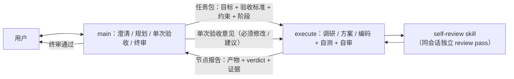

# AGENTS.md — dragon-quant

> 龙头战法量化筛选系统 · AI Agent 操作手册
> 根宪法：跨模块硬约束 + 完整工作流 + 模块文档索引。模块细节按索引**按需读取**（不预读全部）；人读命令大全见 [README](README.md)。

---

## 这是什么

一套纯 Python 3 的 A 股龙头筛选系统：从当日涨停榜出发，评估涨停股龙头质量并加权排名输出；同时支持日志查询、SQLite 持久化、龙头回测、盘后复盘、集合竞价、数据资产云端同步、因子层与 Web UI 可视化。

系统当前使用**五维「识别真龙」评分体系**（由 `scan` 触发）：带动性 30% / 领涨性 25% / 抗跌性 15% / 流动性 20% / 资金承接 10%，**门槛+加权两段式聚合**（四大特征任一低于门槛即一票否决，资金承接不否决仅加权贡献）。数值细则以 [评分规范](archived_md/score/评分器Refactor.md) 为准，流程见 [scan](docs/agent/scan.md)。

数据源：**TDX（首选，`tmdx`）+ 同花顺（板块）+ 雪球（个股 K 线/分时）+ 腾讯（批量行情/收盘盘口）**，均不依赖付费接口，tdx 失败自动回退老链路。**板块口径为「行业 + 概念 + 地区」三维融合总榜**（取涨幅前 8），**领跌 Top20 仍按行业**（资金承接「对手盘」语义不变）。

> **v1 已废弃**：所有龙头/扫描/候选池逻辑只读 `dragons_v2`（物理表沿用 `*_v2`，`scan_id` 为 `v2_YYYYMMDD_topN`）。`--source v1` 仅用于查询历史数据，**不再新增任何 v1 写入、分支或功能**；新命令一律固定 `source="v2"`。

---

## 常用入口

```bash
python -m dragon_quant -h                 # 帮助提示（exit 0）
python -m dragon_quant                    # 不带子命令只打印帮助（exit 0），不会执行扫描
python -m dragon_quant scan --top 25 --candidates 5 --workers 2
python -m dragon_quant scan --date 20260519 --top 5   # 只读历史扫描记录，不触网
python -m dragon_quant prep               # 盘后复盘
```

完整命令手册（15 个顶层命令与全部参数/示例）只维护在 [README](README.md)，本文不重复第二份。

**前置条件（一句版）**：板块数据走同花顺**无需 Cookie**；个股依赖雪球 Cookie；数据目录可用 `DQ_DATA_DIR` 覆盖。Cookie 路径与设置方式、数据源与反爬最小提示见 [scan](docs/agent/scan.md)。

---

## 必须遵守的约束

- **存储惰性初始化（B1）**：`import dragon_quant` / `import dragon_quant.infra.storage.paths` / `-h` / `-v` **不得创建**任何数据目录、`dragon.db` / `assets.db`、WAL/SHM、缓存、报告或 Cookie 文件；包根 `scan` / `run_review` 为 PEP 562 惰性导出。首次真实存储访问（`infra.storage.connection._connect`、`infra.assets.db._connect(create=True)`、`app.ensure_storage`、扫描报告写入、`DataCache` 落盘）才按 `DQ_DATA_DIR` 幂等建目录与 schema；`connection._connect` 首次连接带锁建 schema（失败不置 ready，可重试），`init_db()` 保持公开幂等 API。
- **运行时依赖**：`playwright`（Cookie 自动获取 + 浏览器辅助；chromium 内核首次 `cookie-fetch` 时自动下载，走国内镜像）为必选；`tmdx`（通达信 TDX 首选数据链路）为**默认依赖**（`pip install dragon-quant` 自动安装；缺失时每次 CLI 命令除 -h/--help/-v/--version 在 stderr 提示补装）。新增第三方依赖不受限，但须满足：许可证与 MIT 兼容、包仍活跃维护、引入时同步更新本段与 README 的依赖说明。注意 `tmdx` 自身已硬依赖 pandas/numpy（传递安装在 venv 中，项目代码不直接 import）。项目要求 Python≥3.10。
- **跨平台**：数据目录用 `DQ_DATA_DIR` 覆盖，默认按平台存。
- **线程安全**：DataCache 操作持 `threading.Lock`；DB 每次操作独立连接 + WAL。
- **历史兼容**：旧 `*_v1` 表可显式查询；新扫描固定使用 `scan/scores/` 与 `*_v2` 表，不再保留旧四维评分代码。
- **因子分层依赖（强制）**：`infra/factor/*` **禁止 import** `scan/scores/*`、`infra/provider/*`、`review_account/*`（P0.5 仅 `infra/factor/finance.py` 允许 import provider）；`infra/storage/*` / `scan/storage/*` / `vpa/storage.py` 禁止 import `infra/factor/*`；因子层读五维/vpa/prep/auction 产物只走既有只读仓储 API（函数内 lazy import）。项目代码零 `import pandas`（tmdx 传递依赖，仅经 `df.to_dict("records")` 适配）。
- **provider 接口兼容**：`StockProvider` 新增板块 K 线方法用默认 `raise NotImplementedError`（非 `@abstractmethod`），否则 `create_providers()` 一次实例化全部 4 个 provider 时会崩。

---

## 模块文档索引

按「触发」命中即读**最相关的 1 份**；跨模块改动再读第 2 份。**不要预读全部 8 份。**

| 文档 | 触发（命中即读） | 本文权威（事实域） |
|------|-----------------|-------------------|
| [architecture](docs/agent/architecture.md) | 定位模块或文件、公共入口、命令导航链、兼容例外、并发模型、新增或调整 SQLite 表 | 目录树 / 导航链 / 公共入口 / 兼容例外 / RateLimiter / 表清单 |
| [scan](docs/agent/scan.md) | 改 `scan` 编排或五维评分器、cache 键、板块口径、数据源与回退、扫描侧表 | Phase A–F / 数据模型 / 评分器契约 / cache 键 / v2 分表 |
| [review](docs/agent/review.md) | 改龙头回测、双口径、严格口径侧表、回测 Web UI 的 API 与指标卡片 | 双口径规则 / 严格侧表 / Web UI 汇总契约 |
| [trading](docs/agent/trading.md) | 改 `review-account` / `buy` / `sell`、候选池消费、数据分级、信号表、`/account` API、费用与评估 | 账户与实盘的产品/运维契约 |
| [prep-auction](docs/agent/prep-auction.md) | 改 `prep` 复盘、`auction` 竞价、快照口径、`prep_*` / `auction_*` 资产 | 两段式 / 时点门禁 / 资产类型 / 快照与竞价口径 |
| [assets](docs/agent/assets.md) | 改 `assets push/pull/status/verify`、分区与水位、恢复回填、`dragons` 镜像 | 同步运维语义 / 分区 / 水位 / 恢复 / 退出码 |
| [factor](docs/agent/factor.md) | 改因子层、财务与 PIT、矩阵导出/评估、决策接入、新增或修改因子 | 因子层契约 / 财务 PIT / 矩阵与评估 / 排序注入 |
| [development](docs/agent/development.md) | 改 Agent Skill 包、Web UI 前端构建、E2E 安全边界 / golden / 覆盖图、打包边界 | 开发与发布流程 |

**已有权威（本文与模块文档只引用、不复制正文）**：

| 内容 | 权威文件 |
|------|---------|
| 策略规则、买卖参数、卖出链、P/A、买点诊断 | [`review_account/strategy/STRATEGY.md`](dragon_quant/review_account/strategy/STRATEGY.md) |
| 资产架构、组件关系、双向同步流程图 | [`infra/assets/ASSETS_ARCHITECTURE.md`](dragon_quant/infra/assets/ASSETS_ARCHITECTURE.md) |
| 五维评分细则与数值 | [`archived_md/score/评分器Refactor.md`](archived_md/score/评分器Refactor.md)（实现阈值在 `scan/scores/registry.py`） |

### 阅读与路由协议

1. **先路由后动手**：先按上表选最相关的 1 份模块文档 Read；跨模块再读第 2 份，不预读全部。
2. **策略/架构优先**：涉及买卖规则或参数先读 `STRATEGY.md`；涉及资产架构或同步流程先读 `ASSETS_ARCHITECTURE.md`。
3. **无法归属**：先用 `docs/agent/architecture.md` 的目录树定位模块，再读对应文档；仍无法归属按「跨模块硬约束」处理，并在交付报告说明。
4. **冲突处理**：文档与代码/测试冲突以代码与测试为准，并在**同一 commit** 修正 owner 文档；根硬约束与模块文档冲突以根为准，且必须删掉模块文档里的旧说法（不允许两份并存）。
5. **任务包约定**：main → execute 任务包应列出需读的模块文档；未列出时按索引自行读取，并在节点报告注明读了哪些文档。
6. **索引唯一**：根只维护这一份索引，不得新增第二份路由表；模块细节只进 owner 文档。

---

### 需求落地标准工作流（§4）

#### 概述

采用两角色、阶段门禁工作流（阶段 0 → 1 → 2 → 3 → 3.5）。**main** 负责需求澄清、任务拆分、验收标准、各阶段单次验收与终审；**execute** 每个会话闭环一个阶段节点：执行调研 / 方案 / 编码，并在**本会话内**加载同名 self-review skill 完成独立 review pass，再回报 main。主路径**不派生任何 subagent**。



阶段流转：`阶段0(main × 用户) → 阶段1(execute 调研 + research-self-review → main 单次验收) → 阶段2(execute 方案 + solution-self-review → main 单次验收) → 阶段3(execute 编码 + 自测 + code-self-review → main 单次验收) → 阶段3.5(main 终审 → 用户)`。不触发调研时阶段 0 直进阶段 2。

**角色与委派**：

- **main**：目标、框架、验收标准、单次节点验收、阶段 3.5 终审与最终汇报。不亲手调研 / 写方案细节 / 编码 / 跑测试（唯一例外见「快速通道」）。
- **execute**：无状态新会话，**一个会话只闭环一个节点**；main 委派必须携带完整上下文（需求拆解、已验收产物、验收意见、文件范围）。自审必须加载对应 skill；Skill 工具不可用时 Read `~/.claude/skills/<name>/SKILL.md` 降级执行。
- **禁止派生 subagent**：execute 不得调用 reviewer、general-purpose 或测试类 subagent。唯一例外：用户显式要求独立审查时，由 main 调用对应 reviewer。

#### main 阶段验收规则（阶段 1/2/3 通用）

- **时机**：execute 完成自审并回报节点报告后，main 做**单次验收**。
- **视角**：对照任务包与阶段 0 验收标准做方向性把关；不逐行重审（细节信任 self-review）。
- **单次性**：每阶段只验收一次，一次性给出「必须修改」与「建议」两级意见。
- **必须修改不可拒绝**：execute 直接执行，不讨论；修订完毕自动进入下一阶段，main 不复审。仅当与高优先级约束冲突或客观不可行时，才以 `NEED_DECISION` 上报。
- **留痕**：execute 在交付报告 `main_acceptance` 中逐条记录处置；「必须修改」必须落实，「建议」级可不采纳并记录理由；阶段 3.5 核对。
- 自审触发的 `NEED_DECISION` 上报不受单次限制。

#### 阶段 0：需求澄清与验收标准

**触发条件**：所有非快速通道需求，尤其是模糊需求。

main 把需求拆解为用户故事、可测试验收标准、约束、明确非目标；主动发散边界场景、隐含假设、扩展可能、与现有系统冲突和风险；**必须获得用户确认**后才能进入阶段 1 / 2。

#### 阶段 1：技术调研（execute + research-self-review）

**触发条件**：引入新技术、评估第三方库或重大架构变更。

1. 按任务包范围调研；优先查代码 / 文档 / 项目记录，必要时外部取证。由 execute 自行完成，不派生搜索 subagent。
2. 产出调研报告后加载 `research-self-review`，在同一会话完成独立 review pass。
3. 门禁：`APPROVE` → 回报 main 单次验收；`REVISE`（仅含 CRITICAL）→ 按 CRITICAL 返工，最多「首审 + 1 次复审」，复审只核 delta；MAJOR / MINOR 记入 `known_issues` 不阻塞。`REJECT` 表示根本性错误，停止执行并以 `NEED_DECISION` 上报（不计入普通返工轮次）。

#### 阶段 2：技术方案（execute + solution-self-review）

**触发条件**：调研通过（未触发调研时直接基于任务包）。

1. 方案必须包含：架构设计（架构 / 事件流 / 数据流 / 状态机 / 多模块交互**必须附 Mermaid 图**）、接口定义、数据模型、错误处理、测试策略、风险与缓解。
2. **发散要求**：≥2 个候选设计（至少 1 个非常规 / 反直觉路径）并给出推荐理由；主动指出需求方未考虑的边界、隐含假设、扩展性与系统冲突；采用设计模式时点明模式与动机。
3. 加载 `solution-self-review` 自审；门禁同阶段 1（APPROVE / REVISE / REJECT，CRITICAL / MAJOR / MINOR）。

#### 阶段 3：代码实现（execute + code-self-review）

**触发条件**：技术方案通过。

1. 按已批准方案实现；偏离方案必须在提交信息说明原因并登记交付报告 `deviations`。
2. **自测前置**：自行运行相关测试 / 构建，保留真实命令与输出摘要。
3. 加载 `code-self-review` 自审，必须附自测证据；无证据首条 finding 为 BLOCKER。
4. 门禁：`SAFE_TO_MERGE` → 回报 main 单次验收；`NEEDS_CHANGES` / `BLOCK` 仅在含 BLOCKER 时返工，最多「首审 + 1 次复审」；WARNING / NIT 记入 `known_issues`。

#### 阶段 3.5：轻量终审（main）

1. 核对节点报告：无未解决 CRITICAL / BLOCKER、自测证据齐全、偏离已登记且理由成立。
2. 核对 `main_acceptance`：「必须修改」意见均已落实；未落实 → 附指示打回。
3. 裁决 `known_issues` 与 `rejected_findings`（后者仅指 execute 对**自审** finding 的不采纳说明）。
4. 逐条核对「验收标准 → 实现位置（文件 / 函数）→ 验证方式（测试 / 命令输出 / 人工确认）」；缺失 → 打回补齐。
5. 通过后交付用户；产生的调研 / 方案文档在合入 / 提 PR 前询问是否归档。

#### 自审与收敛规则

- **项目检查清单注入**：自审前从项目 `AGENTS.md` / `CLAUDE.md` 提取硬性要求（文档同步、Mermaid 配图、提交规范、依赖约束），作为附加审查维度。
- **刻度**：调研 / 方案用 CRITICAL / MAJOR / MINOR；代码用 BLOCKER / WARNING / NIT。先高级别后低级别；门禁只卡 CRITICAL / BLOCKER。
- **轮次**：每道自审最多 2 轮（首审 + 1 次复审）；复审只验证上轮高级别 finding 是否解决及修复引入的新问题，禁止重复已解决项或补提旧存低级别问题。
- **提前收敛**：高级别 finding 清零即通过，剩余低级别转 `known_issues`。
- **硬上限**：复审后仍有未解决高级别 finding → 停止执行，以 `NEED_DECISION` 上报 main。
- `rejected_findings` 只用于自审 finding；main 的「必须修改」不可拒绝。

| 阶段 | 自审 skill | 严重级 | 最大轮次 | 超限动作 |
|------|-----------|--------|---------|---------|
| 调研 | research-self-review | CRITICAL / MAJOR / MINOR | 2 | NEED_DECISION |
| 方案 | solution-self-review | CRITICAL / MAJOR / MINOR | 2 | NEED_DECISION |
| 代码 | code-self-review | BLOCKER / WARNING / NIT | 2 | NEED_DECISION |
| main 单次验收 | main | 必须修改 / 建议 | 1 | 未落实 → 阶段 3.5 打回 |

#### 节点报告（精简）

每个 execute 会话回报：产物路径、self-review verdict、高级别 findings 摘要、自测证据、`known_issues`、`deviations`、验收标准映射、`main_acceptance` 处置。不强制 artifact 哈希 / sidecar / 交付回执机制。

#### 快速通道

以下情况可跳过完整工作流，由 main 直接动手：

- **单行修改**（typo、注释修正、日志级别调整）：免审。
- **小范围修改**（单文件 / 单函数逻辑调整、非安全配置）：main 修改后加载 `code-self-review` 自审。
- 判断标准：不涉及新接口、新依赖、数据模型变更或安全边界。
- **治理配置例外**：`~/.claude/**`、全局 `AGENTS.md` / `CLAUDE.md` 等工作流治理配置**禁止**快速通道，必须走 execute + 自审 + main 验收。

### AI Agent 协作规范
> **任何代码修改或破坏性操作前，先输出技术方案（改动范围、涉及文件、风险点），等待用户确认后再执行。** 纯查询类操作（读文件、查数据库、搜索代码）不受此限。
> **技术方案必须配图**：涉及架构、事件流、数据流、状态机或多模块交互时，用 **Mermaid** 代码块（`flowchart`/`sequenceDiagram`/`stateDiagram` 等）画出架构图/流程图，随方案一并输出并写入文档。不用 ASCII 图。

---

### Cookie 失效处理

板块数据用同花顺（无需 Cookie）。个股依赖雪球 Cookie（有效期几天到数周），返回空/403 先查雪球 Cookie 状态。

### 测试与 E2E 门禁

```bash
# M0 harness 自检（不跑业务用例）
.venv/bin/python dragon_quant/tests/e2e/harness/runner.py --self-check
.venv/bin/python -m pytest dragon_quant/tests/e2e/test_harness_safety.py dragon_quant/tests/e2e/test_architecture_rules.py -q

# 全量离线 E2E（真实 CLI 子进程 + golden）
.venv/bin/python -m pytest dragon_quant/tests/e2e -q

# 单元 / 集成测试（排除 e2e 与需要真实网络的 smoke）
.venv/bin/python -m pytest dragon_quant/tests -q --ignore=dragon_quant/tests/e2e --ignore=dragon_quant/tests/smoke

# Node 安装器测试（隔离 HOME/TMPDIR/npm cache，不访问 registry）
npm test
```
- **E2E 安全边界**：永不打开真实 `dragon.db` / `assets.db` / `prep.db`，每命令在独立临时根下运行并隔离网络 / Cookie / 云端；真实目录元数据变化即失败，不得重跑淡化。
- **覆盖映射与 golden**：`coverage-map.json` 固定 51 个 parser 节点 / 15 个顶层命令，新增命令必须同步；golden 只在批准的行为变更时更新，结构重构不得改 golden。
- 细则（哨兵比对、fake provider 注入、打包边界）见 [development](docs/agent/development.md)。

### Git 规范

- 仓库：`gitBingxu/dragon-quant`；main 合入需 CODEOWNERS 审批。
- Commit 风格：中文 + emoji 前缀（见 git log）。
- **文档同步（强制）**：功能/命令/接口/数据源/表结构变更时，同一 commit 更新**对应 owner 文档**（`docs/agent/<module>.md`，必要时 `STRATEGY.md` / `ASSETS_ARCHITECTURE.md`）与 `README.md`（人类手册）。**仅当新增跨模块硬约束时才修改根 `AGENTS.md`**；根体量受 20 KB / 240 行门禁约束。纯文档或纯内部重构可酌情豁免。
- **代码结构导航**：模块结构/调用链/数据流由 codebase-memory 索引承担（`.codebase-memory/graph.db.zst`，经 `query_graph` / `trace_path` / `get_architecture` 查询）；较大调整后重跑 `index_repository` 刷新。

### 维护规则（防止根文件再膨胀）

1. 新增事实先判 owner：已有 owner → 改 owner 文档；单模块 → 对应 `docs/agent/*.md`；跨模块硬约束 → 才进根。
2. 能从代码或 `-h` 直接得出的内容不写文档；纯实现细节留代码注释与 Git 历史（反爬 URL / DOM / UA 等）。
3. 根不写目录树、逐表清单、反爬实现、完整命令手册、里程碑历史与「当前状态」。
4. 根超 20 KB / 240 行时**优先合并同类条目**，不得删 §4；确实无法容纳以 `NEED_DECISION` 上报。
