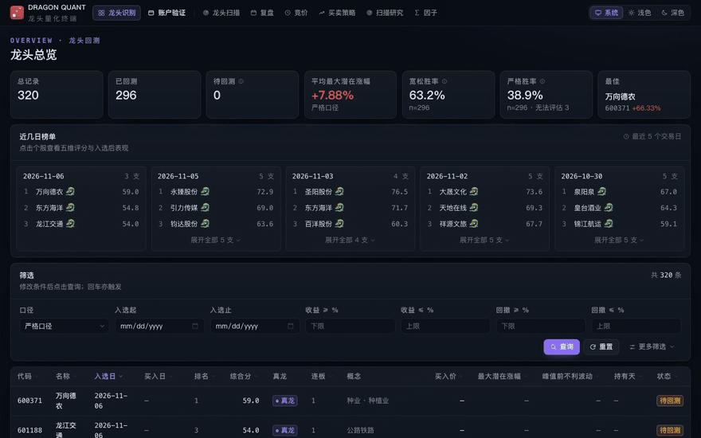
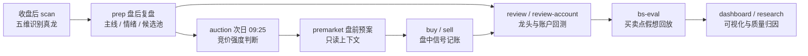
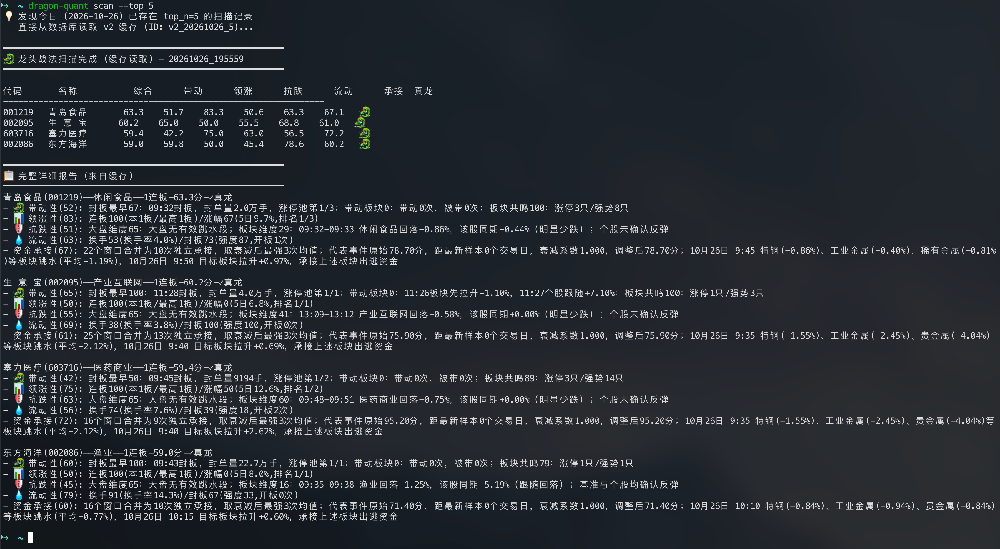

<p align="center">
  
</p>

<h1 align="center">dragon-quant 缅A龙头识别工具</h1>

<p align="center">
  <a href="https://pypi.org/project/dragon-quant/"></a>
  <a href="https://pypi.org/project/dragon-quant/">= 3.10"></a>
  <a href="https://github.com/gitBingxu/dragon-quant/blob/main/LICENSE"></a>
  <a href="https://pypi.org/project/dragon-quant/"></a>
  <a href="https://github.com/gitBingxu/dragon-quant"></a>
  
</p>

从当日涨停榜出发，用五维量化评分识别市场**真龙**，并把复盘、竞价、盘前预案、模拟交易与回测归因串成完整的交易日闭环。数据全部来自免费公开源，本地 SQLite 优先，AI Agent 就绪。



## 交易日闭环



## 快速开始

要求 **Python ≥ 3.10**，推荐 `pipx`（或 `pip install "dragon-quant[web]"` 一次装好面板依赖）：

```bash
pipx install dragon-quant

dragon-quant scan --top 5     # 收盘后识别当日真龙
dragon-quant dashboard        # 本地可视化面板 http://localhost:8765
dragon-quant prep             # 盘后复盘：主线、情绪温度、候选池
dragon-quant auction          # 次日 09:25 后的集合竞价强度
```

[scan 模块文档](docs/agent/scan.md)。所有命令细节以 `dragon-quant -h` 为准。

## 让 AI Agent 替你使用（强烈推荐）

不用记命令：装上仓库内置的「交易日助手」Agent Skill，让 Claude Code、Codex 等 Agent 直接
替你跑全流程。安装器零运行时依赖：

```bash
npx dragon-quant-skills install                    # 交互式多选目标 harness（默认 claude-code）
npx dragon-quant-skills install --agent all        # 六个 harness 一次装齐
npx dragon-quant-skills doctor                     # 检查安装完整性与 CLI 版本
```

在 Agent 对话里，一句话一个场景：

| 你说 | Agent 做 |
|------|----------|
| 「今天有什么真龙？」 | `scan` 五维扫榜 → 汇报榜单、评分与否决原因 |
| 「帮我复盘今天」 | `prep` → 主线、情绪温度、建仓建议一屏简报 |
| 「竞价怎么样？」 | `auction` → 近期真龙竞价强度分级与方向判断 |
| 「给我盘前预案」 | `premarket`（只读）→ 盘前作战卡 |
| 「回测一下这批龙头」 | `review` → 双口径回测统计，打开面板 |
| 「跑 5 月账户回测」 | `review-account` → 权益、回撤、买点统计与逐笔交易 |
| 「识别质量最近有改善吗？」 | `research scan-quality` + 回测证据 → 口径与归因 |
| 「写个自己的因子/策略」 | `workspace init` → 用户因子 build/query → `strategy validate` → 账户回测 |
| 「买卖点胜率如何？」 | `bs-eval` 假想回放 → `/bs` 页面数据 |

安全边界：Agent 只开放**十一类白名单能力**，遵守时点门禁（如 `scan` 15:00 后才跑），写操作
必须先经你确认，不提供投资建议。自定义策略/用户因子的完整流程见
[workspace 指南](skills/dragon-quant/references/workspace.md)。安装矩阵与交互协议详见
[development 模块文档](docs/agent/development.md)。

## Web 面板

`dragon-quant dashboard` 启动本地面板（上方 GIF 即真实运行画面）：

| 页面 | 看什么 |
|------|--------|
| `/` 龙头识别 | 总览指标、近几日榜单、全部真龙明细 |
| `/account` 账户验证 | 权益与回撤曲线、买点统计、当前持仓 |
| `/prep` `/auction` | 复盘与竞价的年度日历、核心结果、判断准确率 |
| `/bs` 买卖策略 | 四类买点 × 十条卖出规则的假想回放 |
| `/scans` `/research` `/factors` | 扫描日志、识别质量归因、因子 |

面板**默认只读**：浏览页面不会触发任何命令；扫描/复盘/竞价运行入口显式点击，并按交易日
与时间窗判定可用性。

## 方案设计

### 五维「识别真龙」（scan）

**龙头不是预判出来的，而是根据盘面证据识别出来的。** 收盘后扫描涨停候选股，按五个维度评分：

| 维度 | 权重 | 回答的问题 |
|------|------|-----------|
| 带动性 | 30% | 板块上涨是否由它带动 |
| 领涨性 | 25% | 它是不是板块内最强 |
| 抗跌性 | 15% | 板块回调时它是否跌得少 |
| 流动性 | 20% | 大资金能否进出 |
| 资金承接 | 10% | 谁承接了对手盘出逃的资金 |

聚合采用**门槛 + 加权两段式**：四大核心维度任一低于门槛即一票否决，资金承接不否决、仅加权
贡献，避免单一高分掩盖明显短板。细则与数值见
[评分器规范](archived_md/score/评分器Refactor.md)，流程见 [scan 模块文档](docs/agent/scan.md)。



### 盘后复盘与竞价强度（prep / auction / premarket）

`prep` 收盘后复盘市场：识别主线板块、量化情绪温度、生成候选池与次日计划快照；`auction` 在
次日 09:25 后采集近期真龙的集合竞价盘口，给出强度分级与方向判断；`premarket` 把两者拼成
只读盘前上下文。方法论来自对公开复盘/竞价知识的调研沉淀，见
[prep-auction](docs/agent/prep-auction.md) 与 [premarket](docs/agent/premarket.md)。

### 交易策略与 BS 假想回放（buy / sell / bs-eval）

策略层定义了四类买点（开盘回踩 MA5、弱转强、分歧买龙、龙回头）与十条卖出规则（移动止盈、
硬止损、保本止盈等），`buy` / `sell` 盘中给出信号并记账；`bs-eval` 在历史真龙上离线回放
这套规则，按宽松/严格双口径统计信号触发后 5 日表现，供 `/bs` 页消费。规则数值唯一权威是
[STRATEGY.md](dragon_quant/review_account/strategy/STRATEGY.md)，回放口径见
[bs_eval 模块文档](docs/agent/bs_eval.md)。

### 自定义策略与 Workspace

只装 PyPI 包也能在独立 workspace 里写 Python 策略，复用内建或自定义因子：

```bash
dragon-quant workspace init ~/my-workspace          # 生成模板 + agent 说明
dragon-quant strategy list --workspace ~/my-workspace
dragon-quant strategy use user:example_momentum --workspace ~/my-workspace
dragon-quant review-account --from 20260101 --to 20260201 --strategy user:example_momentum
```

用户策略放在 `strategies/<slug>/`，通过 `dragon_quant.strategy_sdk` 的只读
`StrategyContext` / `StrategyIntent` 决策；成交、费用、T+1、手数与风控仍由系统处理。
切换只影响新开仓，旧持仓按开仓时冻结的版本退出。CLI 与 Web `/strategies` 页共读同一保存
选择，`--strategy` 只覆盖单次命令；未初始化 workspace 时 Web 仍展示内建策略但保持只读。Web 策略页按 descriptor 元数据动态生成参数表单（标签/
说明/单位/范围），保存前就地校验，无需手写 JSON。Web 默认只读；需要在本机面板选择/执行用户策略时用
`dragon-quant dashboard --workspace-writes`（或 `DQ_DASHBOARD_WORKSPACE_WRITES=1`）显式启用，
用户代码在独立本地 worker 进程执行。安全边界与冻结语义见 [workspace](docs/agent/workspace.md)。

### 双口径回测（review / review-account）

`review` 回测入选龙头：宽松口径按入选后首个非一字板交易日最低价买入，统计第 2~5 个交易日
最大潜在涨幅；严格口径另存侧表。`review-account` 则用统一候选池、买卖规则、费用与仓位约束
做账户级模拟交易，输出权益曲线、回撤与买点统计——目标不是展示选股收益，而是让决策链可
回放、可验证。见 [review](docs/agent/review.md) 与 [trading](docs/agent/trading.md)。

### 数据与存储

行情链路 **TDX（`tmdx`，首选，个股 K 线/分时）+ 同花顺（板块）+ 腾讯（批量行情）**，`scan`
与 `data` 命令无需 Cookie；雪球仅老链路（账户/复盘）使用。本地 SQLite 持久化
（惰性初始化、WAL、线程安全），数据资产支持云端双向同步。
架构见 [architecture](docs/agent/architecture.md)，同步见 [assets](docs/agent/assets.md)。

## 每日自动化

盘后 `scan` → `prep`，次日盘前 `auction` → `premarket` 是跨时点的依赖链，适合用
cron/launchd 定时运行（时间窗与模板见 [schedule.md](skills/dragon-quant/references/schedule.md)）。
用 Claude Code / Codex 的用户在会话里说「每天自动跑」，agent 会按 skill 生成配置；
资金操作（`buy`/`sell`）不做无人值守。

## 稳定性状态

| 功能 | 状态 | 预期稳定时间 |
|------|------|--------------|
| `scan` 龙头扫描 | 稳定 | — |
| `review` 龙头回测 | 稳定 | — |
| `prep` 盘后复盘 / `auction` 集合竞价 / `premarket` 盘前预案 | 快速迭代中 | 2026 年 12 月初 |
| `review-account` 账户模拟交易与回测 | 快速迭代中 | 2026 年 12 月初 |
| `bs-eval` BS 假想回放 / `dashboard` 面板 / `research` 研究读回 | 快速迭代中 | 2026 年 12 月中 |
| `agent-skill` 交易日助手 | 快速迭代中 | 2026 年 12 月中 |

## 目录结构

```text
dragon_quant/
├── commands/        # CLI 命令入口
├── scan/            # 龙头扫描、五维评分与结果持久化
├── review/          # 龙头回测
├── review_account/  # 盘后复盘、集合竞价、模拟账户与交易策略
├── bs_eval/         # BS 策略假想回放（bs-eval / bs_* 表 / /api/bs）
├── vpa/             # 量价分析
├── infra/           # 行情数据源、SQLite、缓存、因子与资产同步
└── tests/           # 单元、集成与离线 E2E 测试
web_ui/              # 可视化面板（FastAPI + React，dist 入库）
assets/              # 图标与 README 截图 / GIF
docs/                # 模块与开发文档
archived_md/         # 已落地的调研与技术方案
```

## 免责声明

本工具仅供学习交流，不提供任何个股买卖建议。评分、回测与模拟交易的所有输出均为技术研究结果，不构成投资建议；据此操作产生的盈亏由使用者自行承担。

## 欢迎共建

欢迎通过 Issues 分享使用反馈、讨论策略与提出改进，也欢迎提交 PR 参与共建。

## License

[MIT](LICENSE)
