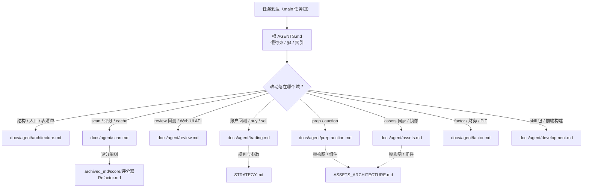
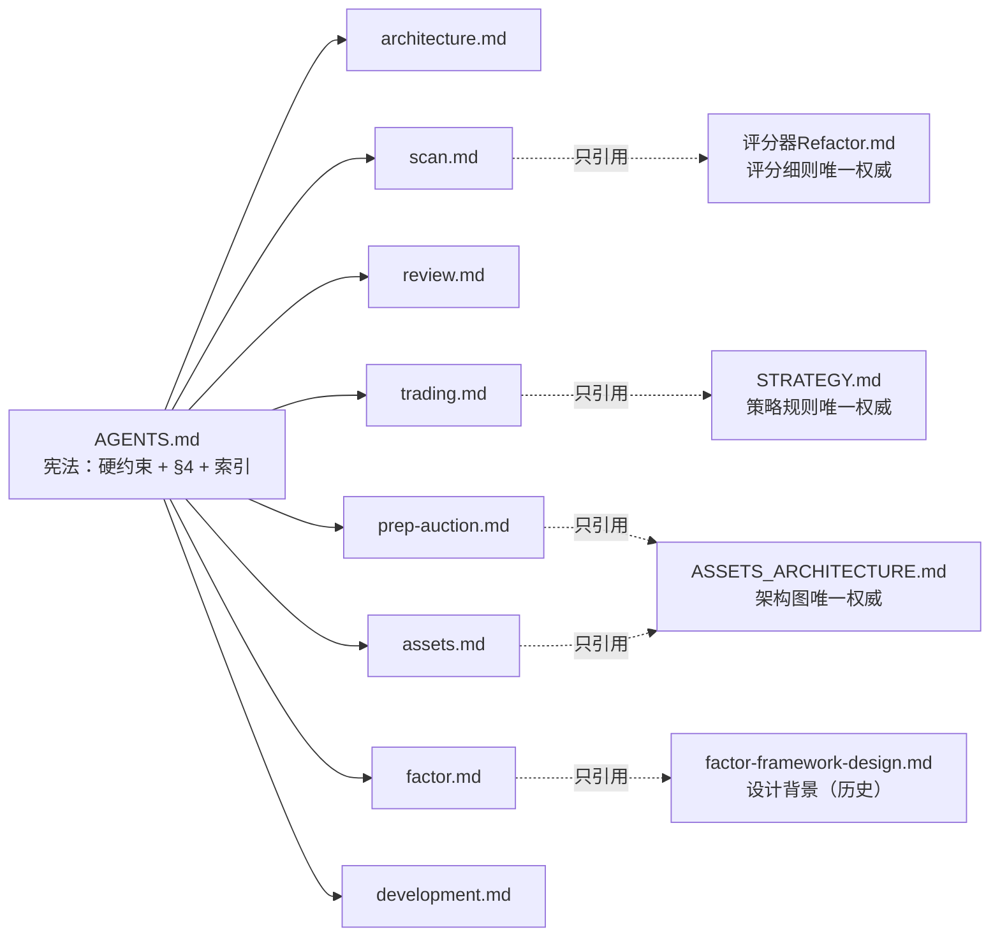
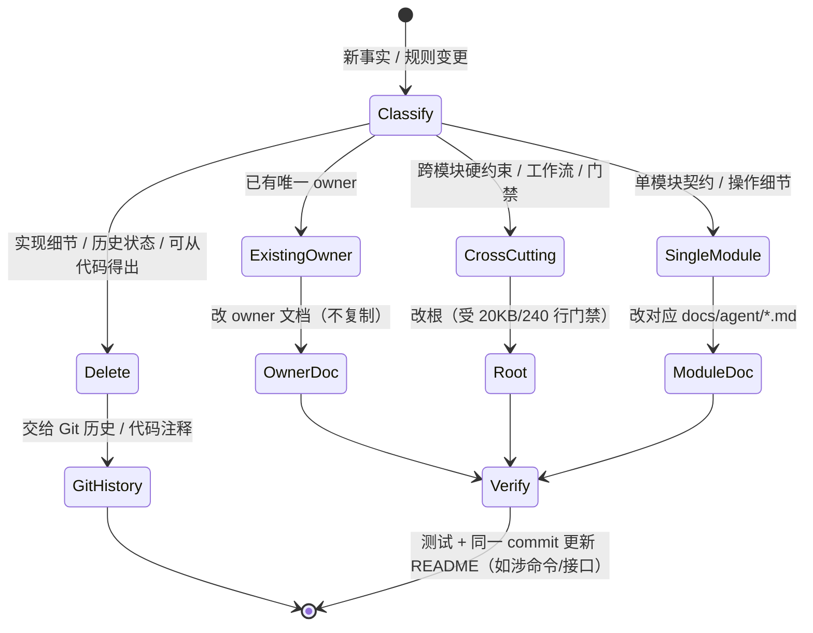

# 技术方案：AGENTS.md 渐进式披露拆分（根宪法 + 模块文档索引）

- 日期：2026-10-27
- 版本：v1（solution-self-review: APPROVE，待实施）
- 阶段：阶段 2（技术方案）
- 分支基线：`feat/refactor-archi`（工作树含未提交的 Web UI 指标联动改动，见 §2）
- 关联任务包：根 `AGENTS.md` 瘦身为「常驻硬规则 + 按需模块文档索引」，降低每会话自动注入上下文
- 验收标准：AC1–AC7（见 §1.2）

---

## 1. 意图、目标与非目标

### 1.1 用户故事

作为在本仓库工作的 AI Agent / 维护者，我希望**每次会话自动注入的项目规则只包含跨模块硬约束、完整工作流与路由索引**，以便：

- 会话启动成本从约 109 KB 降到 20 KB 以内；
- 改扫描时只读扫描文档、改因子时只读因子文档，不被无关的逐表说明、反爬实现和里程碑历史淹没；
- 规则仍有明确、唯一、可测试的权威位置，不会因为「拆出去」而失效。

### 1.2 验收标准（来自阶段 0，原样）

| # | 验收标准 |
|---|---------|
| AC1 | 根 `AGENTS.md` ≤20 KB、≤240 行，减少约 80% 以上。 |
| AC2 | 每个功能模块有明确触发条件和唯一文档入口，无需每次加载全部细节。 |
| AC3 | 现行规则不丢，尤其当前未提交 Web UI 指标联动说明与全局硬约束。 |
| AC4 | 根文件不含反爬实现细节、逐表说明、完整命令手册和里程碑历史。 |
| AC5 | Markdown 本地链接有效，README/Skill 与拆分后的权威关系一致。 |
| AC6 | 文档相关测试通过，不修改产品行为，不碰当前其他未提交改动。 |
| AC7 | 不改 subagent 协作机制、全局配置和业务代码，不执行 commit。 |

### 1.3 非目标

- 不修改 `~/.claude/CLAUDE.md`、`/Users/bing/AGENTS.md`（父目录）及任何全局治理配置。
- 不修改 `§4 需求落地标准工作流` 正文（D1 要求三份逐字一致，见 §2 证据 E5）。
- 不修改产品代码、E2E golden、`coverage-map.json`、Web UI 源码/dists。
- 不为拆分引入运行时加载器、构建生成器、新依赖或 CI 服务。
- 不批量重写 `docs/solutions/`、`archived_md/` 的历史设计记录正文；**唯一例外**是 `archived_md/README.md:6` 的「当前状态」一行指针（阶段 0 附录/本轮 main 验收明确纳入必做，见 §7.6）。
- 不修改 `skills/dragon-quant/references/*.md`（skill 运行时路由层保持不动，只改 `SKILL.md` 的权威引用）。
- 不做 commit / push / PR。

---

## 2. 现状证据（已核实）

| # | 事实 | 证据 |
|---|------|------|
| E1 | 根文件 760 行 / 109323 字节 | `wc -l -c AGENTS.md` |
| E2 | README 708 行 / 73819 字节；`SKILL.md` 149 行 / 12055 字节 | `wc -l -c README.md skills/dragon-quant/SKILL.md` |
| E3 | 根章节体量高度不均：架构总览 8.6 KB、因子层 14.9 KB、prep 11.5 KB、账户模拟 9.5 KB、§4 8.0 KB、SQLite 表 6.1 KB、当前状态 6.4 KB | 逐段字节统计（§5.1 表） |
| E4 | 文档一致性测试直接读取 AGENTS.md 的树、`version=0.6`、五日回退句、无参数行为、canonical 入口、已删模块 | `dragon_quant/tests/test_docs_consistency.py:82,101,113,122,189,217,233,261` |
| E5 | D1 要求项目 AGENTS.md 保留完整 §4，「拒绝仓库仅留指针」；三份 §4 正文逐字一致 | `docs/solutions/2026-10-24-self-review-workflow-design.md:86,88`；`/Users/bing/AGENTS.md:25`、`/Users/bing/.claude/CLAUDE.md:25` 均为 138 行 / 约 10.9 KB |
| E6 | 工作树唯一 AGENTS.md 未提交 delta 是「Web UI 指标联动」两行（含 `GET /api/dragons` `{data,count,summary}`、`summarize_review_rows`、`derived_completed/derived_pending`、请求序号） | `git diff -- AGENTS.md` |
| E7 | README 另有独立的未提交 delta：第 361 行起「Web UI 指标卡片同源」段（与 AGENTS delta 内容相近但更简） | `git diff -U0 README.md` 仅 `@@ -360,0 +361,2 @@` |
| E8 | `docs/agent/` 尚不存在 | `ls docs/agent` → absent |
| E9 | README 自带完整目录树（`525-618`），测试同时校验 README 与 AGENTS 的树 | `test_docs_consistency.py:32,86` |
| E10 | 已有策略权威 `STRATEGY.md`（168 行 / 19905 字节）覆盖卖出链、首日止损、开关、风控、P/A、买点诊断、候选池 | `dragon_quant/review_account/strategy/STRATEGY.md` 标题结构 |
| E11 | 已有资产架构权威 `ASSETS_ARCHITECTURE.md`（140 行 / 5931 字节，含 Mermaid 组件图与双向同步） | `dragon_quant/infra/assets/ASSETS_ARCHITECTURE.md` |
| E12 | 评分规范权威为 `archived_md/score/评分器Refactor.md`（含评分细则） | 根文件第 13 行显式引用 |
| E13 | `SKILL.md` 把 AGENTS.md 当规则权威：第 17 行、141 行、147 行 | `grep -n AGENTS skills/dragon-quant/SKILL.md` |
| E14 | `test_skill_content.py:52` 断言 `SKILL.md` 必须包含字符串 `AGENTS.md`（改文案时不能删掉该 token） | `dragon_quant/tests/test_skill_content.py:47-54` |
| E15 | README 第 75、617 行引用 AGENTS.md 作为权威 / 「刻意保留的兼容例外」位置 | `grep -n AGENTS README.md` |
| E16 | `archived_md/README.md:6` 的「当前状态」导引仍指向 `AGENTS.md「架构总览」`（拆分后该章节不存在） | `grep -n AGENTS archived_md/README.md` |
| E17 | `CHANGELOG.md` 的 AGENTS.md 引用是历史记录，不应改写 | 第 23/43/51/240 行均为变更日志语义 |
| E18 | 当前没有任何测试校验 markdown 链接有效性或根文件体量 | `grep -rn "docs/" dragon_quant/tests/*.py` 无相关断言 |
| E19 | 按 Claude Code 约定，只有仓库根 `AGENTS.md` 作为项目指令自动注入；`docs/**` 下的文件必须显式 Read（本会话 system context 只出现根 AGENTS.md） | 平台注入行为 |

**结论**：根文件的主要膨胀源是「模块实现细节 + 逐表说明 + 命令手册 + 状态历史」，而不是硬约束或工作流。拆分必须同时解决三件事：**内容搬迁**、**权威去重**、**测试强度平移**；否则拆分会让规则失效或文档重新膨胀。

---

## 3. 内容权威矩阵（单一所有权）

原则：**同一事实只能有一个 owner**。其余位置只能放「触发 + 指针」，不得复制正文。层级不做事先的全局排序，冲突时以该内容域的 owner 为准。

| 内容域 | 唯一 owner（拆分后） | 支撑/引用文档（不复制正文） | 冲突裁决 |
|--------|---------------------|---------------------------|----------|
| 跨模块硬约束（v1 废弃、存储惰性初始化、依赖方向、零 pandas、provider 接口兼容、线程/跨平台） | `AGENTS.md` | — | 根优先 |
| 需求落地工作流 §4、AI 协作规范、测试/E2E 门禁、Git 与文档同步 | `AGENTS.md` | self-review skill 文件（执行细则） | 根优先 |
| 目录树、命令导航、公共入口、兼容例外、并发/RateLimiter、SQLite 表清单 | `docs/agent/architecture.md` | `pyproject.toml`、`coverage-map.json` | architecture.md 优先 |
| 扫描 Phase A–F、数据模型、评分器契约、cache 键、板块口径、数据源回退 | `docs/agent/scan.md` | 评分规范 `archived_md/score/评分器Refactor.md`（评分细则数值）；`scan/scores/registry.py`（阈值实现） | 细则数值以评分规范/registry 为准；流程以 scan.md 为准 |
| review 回测双口径、严格侧表、Web UI API/指标联动 | `docs/agent/review.md` | `review/main.py`、`web_ui/server.py` | review.md 优先 |
| review-account / buy / sell 的产品与运维契约（候选池、数据分级、信号表、CLI 语义、/account API） | `docs/agent/trading.md` | — | trading.md 优先 |
| 策略规则、买卖参数、卖出链、P/A、买点诊断、回退池窗口 | `dragon_quant/review_account/strategy/STRATEGY.md` | `docs/agent/trading.md` 只放指针与产品层契约 | STRATEGY.md 优先 |
| prep / auction 两段式、时点门禁、资产类型、快照/竞价口径 | `docs/agent/prep-auction.md` | `ASSETS_ARCHITECTURE.md` §2/§3（流程图） | prep-auction.md 优先（流程细节） |
| 资产架构、组件关系、双向同步流程图 | `dragon_quant/infra/assets/ASSETS_ARCHITECTURE.md` | `docs/agent/assets.md` 只放运维契约 | 图/组件以 ASSETS_ARCHITECTURE.md 为准 |
| assets push/pull/status/verify 语义、分区、水位、恢复、镜像、退出码 | `docs/agent/assets.md` | — | assets.md 优先 |
| 因子层、财务链路、PIT、矩阵/评估、决策接入 | `docs/agent/factor.md` | `archived_md/factor_framework/*.md`（设计背景，历史） | factor.md 优先 |
| Agent Skill 包安装/状态机/发布、Web UI 前端构建 | `docs/agent/development.md` | `skills/dragon-quant/SKILL.md`、`package.json` | development.md 优先 |
| 反爬 URL/DOM/UA、逐表列清单、完整命令手册、里程碑历史 | **无 owner（删除）** | Git 历史、provider 实现、README CLI 手册 | 不得在根重建 |

**去重红线**：

1. 模块文档引用 `STRATEGY.md` / `ASSETS_ARCHITECTURE.md` / 评分规范时，只写「读了能行动的最小摘要 + 指针」，不得整段复制参数表。
2. 根文件不复制模块文档的规则；模块文档不复制根的硬约束，只写「见 AGENTS.md」。
3. 新增事实先判断 owner：已有 owner → 改 owner；没有 → 单模块进模块文档，跨模块硬约束才进根。

---

## 4. 目标布局与文档契约

### 4.1 目标文件布局

```text
AGENTS.md                          # 根宪法（≤20 KB / ≤240 行）
docs/agent/
├── architecture.md                # 目录树 / 导航 / 公共入口 / 兼容例外 / 并发 / 表清单
├── scan.md                        # 扫描编排 / 数据模型 / 评分器与 cache 契约
├── review.md                      # 龙头回测双口径 / 严格侧表 / Web UI 指标联动
├── trading.md                     # review-account + buy/sell 产品与运维契约
├── prep-auction.md                # 盘后复盘 / 集合竞价 / 快照口径
├── assets.md                      # 资产同步运维 / dragons 镜像 / 恢复
├── factor.md                      # 因子层 / 财务 / PIT / 决策接入
└── development.md                 # Agent Skill 包 / Web UI 前端构建 / 测试细则（E2E 安全边界、golden、覆盖图）
```

保持不动的现有权威与记录：

```text
dragon_quant/review_account/strategy/STRATEGY.md         # 策略规则权威
dragon_quant/infra/assets/ASSETS_ARCHITECTURE.md          # 资产架构图权威
archived_md/score/评分器Refactor.md                        # 评分细则权威
archived_md/factor_framework/*.md                          # 因子设计背景（历史）
docs/solutions/*.md                                        # 设计记录（含本文件）
README.md                                                  # 人类手册 / 完整 CLI 命令大全
```

### 4.2 模块文档头契约（新增接口）

每份 `docs/agent/*.md` 必须以固定头开始，供人、agent 与测试共同消费：

```markdown
# <module> — <一句话职责>

> 触发：<什么时候必须读本文>
> 本文权威：<本文唯一拥有的事实域>
> 上游权威：AGENTS.md（硬约束与工作流）/ <STRATEGY.md 等>
```

约定：

- 第一行必须是一级标题；`触发` 与 `本文权威` 是机器可检字段（测试断言）。
- 文档内引用其他文档用**相对当前文件**的链接（解析基准 = 包含链接的文件）：`AGENTS.md` 写 `[scan](docs/agent/scan.md)`，`docs/agent/scan.md` 写 `[策略规则](../dragon_quant/review_account/strategy/STRATEGY.md)`。不使用中文锚点深链（GitHub/编辑器 anchor slug 规则不稳定）。
- 文档内不写「当前状态 / 已完成 / 已知修复」类历史块；未完成里程碑以「未实现（见 design doc 路径）」一行表达，避免第二次拆分。

### 4.3 根索引行模型（数据模型）

根文件中的索引表每行对应一个模块文档：

| 字段 | 说明 | 示例 |
|------|------|------|
| `文档` | 仓库相对路径，必须真实存在且全仓库唯一 | `docs/agent/scan.md` |
| `触发` | 命中即读的关键词/动作（扫描、评分、cache、板块、数据源…） | 「改 scan 编排 / 评分器 / cache 键」 |
| `边界` | 本文拥有的事实域（一句） | 「扫描流程与评分契约」 |

约束：每个 `docs/agent/*.md` **恰好出现一次**；索引中的链接目标必须存在；根不写索引之外的第二份路由表。

索引区还必须固定给出 3 条「已有权威」指针，否则只读根文件的 agent 不知道策略/架构/评分细则该去哪：

| 内容 | 权威文件 |
|------|---------|
| 策略规则、买卖参数、卖出链、P/A、买点诊断 | `dragon_quant/review_account/strategy/STRATEGY.md` |
| 资产架构、组件关系、双向同步流程图 | `dragon_quant/infra/assets/ASSETS_ARCHITECTURE.md` |
| 五维评分细则与数值 | `archived_md/score/评分器Refactor.md`（实现阈值在 `scan/scores/registry.py`） |

测试只校验 `docs/agent` 行集合与链接；这 3 条权威指针由人工/链接测试保证。

### 4.4 文档路由与阅读规则（可执行约定）

这不是运行时懒加载机制，而是**agent 行为契约**：

1. **先路由后动手**：接到任务后先按 §4.3 索引选择**最相关的 1 份**模块文档 Read；跨模块改动再读第 2 份。**不预读全部 8 份**。
2. **策略优先**：任何涉及买卖规则/参数的改动，先读 `STRATEGY.md`；涉及资产架构/同步流程，先读 `ASSETS_ARCHITECTURE.md`。
3. **无法归属**：读 `architecture.md` 的目录树定位模块，再读对应文档；仍无法归属 → 按「跨模块硬约束」处理，并在交付报告中说明。
4. **冲突处理**：文档与代码/测试冲突时以代码与测试为准，并在**同一 commit** 修正 owner 文档；根硬约束与模块文档冲突时以根为准，且必须删除模块文档中的旧说法，不允许两份并存。
5. **任务包约定**：main → execute 的任务包**应列出需读的模块文档**（如「需读 `docs/agent/trading.md` 与 `STRATEGY.md`」）；任务包未列出时，execute 按索引自行读取并在节点报告注明读了哪些文档。该约定**不修改 §4 正文**。
6. **reviewer/main 抽查**：阶段 3.5 核对交付报告时，检查「读过的文档」与改动范围是否匹配；漏读导致规则错误时按普通返工处理。

### 4.5 路由示意



### 4.6 所有权与引用关系（不复制）



实线 = 索引路由；虚线 = 单向引用、不得复制正文。任何双向正文复制都视为缺陷（§8.4 再膨胀防线会检测）。

---

## 5. 逐章节迁移 / 删除映射

### 5.1 迁移总表（以当前工作树 760 行为准）

| 现行章节（行号） | 体量 | 目标 | 处理方式 |
|-----------------|------|------|---------|
| 标题 + 导语（1–6） | 94 B | 根 | 重写为「宪法 + 索引」版本 |
| 这是什么（7–22） | 1797 B | 根（压缩）+ `scan.md` | 根保留：五维权重一句、v1 废弃、数据源链路、板块口径一句；下钻细节进 scan.md |
| 快速使用（25–137） | 5419 B | README（已存在）+ 根 3 行入口 | 根只留 `-h` / 无参数事实 / `scan` / `prep` 示例 + README 指针；完整命令手册只留 README |
| 前置条件（118–135） | 含上行 | 根（3 行）+ `scan.md` | 根：THS 无 Cookie、XQ 需 Cookie、`DQ_DATA_DIR`；Cookie 路径表进 scan.md |
| 架构总览 目录树（139–221） | 8622 B | `architecture.md` | 整段搬迁（目录树作为该文件第一个 fenced block，见 §7.3 约束） |
| 命令导航 / 入口事实（223–232） | 含上行 | `architecture.md` + 根 1 行 | 无参数事实同时保留在根（测试要求） |
| 模块公共入口（234–244） | 含上行 | `architecture.md` | 整段搬迁 |
| 刻意保留的兼容例外（246–252） | 含上行 | `architecture.md` | 整段搬迁；README 第 617 行改为指向该文件 |
| 执行流程 Phase A–F（256–271） | 1239 B | `scan.md` | 整段搬迁 |
| 数据模型（273–285） | 805 B | `scan.md` | 整段搬迁 |
| 并发模型（287–296） | 266 B | `architecture.md` | 跨模块基础设施，随架构文档 |
| 反爬要点（298–318） | 1813 B | **删除** | URL / DOM / 字段 / UA 全删；只在 `scan.md` 留 3 条必要提示（THS 403 退避、XQ Cookie、TDX→THS→XQ→腾讯回退） |
| SQLite 表结构（320–355） | 6115 B | `architecture.md`（清单）+ 各 owner（细节） | 清单保留「表名 / 用途 / owner 文档」三列；逐表详细契约按 §5.2 拆分，避免双份 |
| v2 物理分表兼容（348–355） | 含上行 | `scan.md` | 搬迁；根保留「v1 废弃 / 固定 v2」硬约束 |
| Agent Skill 包（358–372） | 3295 B | `development.md` | 整段搬迁（不复制数值到 skill 本身） |
| 龙头回测（373–392） | 3469 B | `review.md` | 整段搬迁 |
| **Web UI 指标联动（未提交 delta）** | +2 行 | `review.md` | **逐字迁移**，见 §5.4 |
| 账户级模拟交易（393–415） | 9518 B | `trading.md` + `STRATEGY.md` | 产品/运维契约搬迁；策略规则与参数去重为指针，见 §5.3 |
| Web UI 前端构建（416–422） | 1670 B | `development.md` | 整段搬迁 |
| 实盘辅助 buy/sell（423–444） | 6482 B | `trading.md` | 产品/CLI/信号表契约搬迁；策略细节指向 STRATEGY.md |
| 盘后复盘 prep（445–476） | 11523 B | `prep-auction.md` | 整段搬迁（图引用 ASSETS_ARCHITECTURE.md） |
| 集合竞价 auction（477–484） | 1816 B | `prep-auction.md` | 整段搬迁 |
| 数据资产云端同步（485–512） | 7603 B | `assets.md` | 整段搬迁；架构图引用 ASSETS_ARCHITECTURE.md §1/§4 |
| 评分器接口约定（513–529） | 3294 B | `scan.md` | 整段搬迁；权重数值指向评分规范/registry |
| 因子层（530–583） | 14944 B | `factor.md` | 整段搬迁；「未实现 P3」一行保留 |
| 必须遵守的约束（584–592） | 2322 B | 根 | **原样保留**（全局硬约束） |
| 需求落地标准工作流 §4（593–694） | 8004 B | 根 | **原样保留**（D1；不得懒加载/指针化） |
| AI Agent 协作规范（695–698） | 528 B | 根 | 原样保留 |
| Cookie 失效处理（699–701） | 173 B | 根 1 行 + `scan.md` | 根保留一句「返回空/403 先查雪球 Cookie」 |
| 测试与 E2E 门禁（702–720） | 1453 B | 根（命令 + 摘要）+ `development.md`（细则） | 根保留 4 条命令与「E2E 不碰真实 DB / golden 只随批准变更 / 覆盖图 51 节点」一句话摘要；安全边界、覆盖映射、golden 纪律细则进 `development.md` |
| Git 规范（721–728） | 648 B | 根 | 保留；「文档同步」条款改为 §7.5 的新口径 |
| 当前状态 已完成/待完成/已知修复（729–760） | 6410 B | **删除** | 未完成事项已在 `factor.md`（P3）与 `assets.md`（M5）中有一行；已知修复进 Git 历史 |

### 5.2 表清单拆分（architecture.md 只留 inventory）

| 表 | 详细契约 owner |
|----|----------------|
| `scans_v2` / `scan_stocks_v2` / `dragons_v2` / `scan_logs_v2` / `*_v1` / `vpa_analysis` / `sector_blacklist` | `scan.md` |
| `dragon_review_strict` | `review.md` |
| `review_account_*` 五表 / `buy_sell_signals` | `trading.md` |
| `prep_assets` / `prep_snapshots` / `auction_assets` / `auction_snapshots` | `prep-auction.md` |
| `dragons`（assets.db 镜像） | `assets.md` |
| `factor_*` 五表 | `factor.md` |

`architecture.md` 的表清单只写：表名、一句话用途、owner 文档链接。**禁止**在三处以上重复列定义；测试用 token 所有权检查兜底（§7.3）。

### 5.3 去重映射（重点：不能复制 STRATEGY.md）

`trading.md` 从原 393–444 行搬迁时，按下表处置：

| 原内容 | 处置 |
|--------|------|
| 候选池优先 T-1 prep 快照、回退 5 日真龙并集、`fallback_reason` | 保留摘要 + 指向 `STRATEGY.md §9`。**必须原样保留测试依赖的原句**「之前 **5** 个真实交易日的**全部真龙**并集」，其余细节交 STRATEGY §9 |
| Asia/Shanghai 时序、四类买点、突破确认、分歧买龙、不允许未来信号 | 摘要一句 + 指向 `STRATEGY.md §8` 与 `review_account/strategy/STRATEGY.md` |
| 择优 `tier(A,P) → factor_rank → ...`、三值语义、竞价否决/排序开关 | 指向 `STRATEGY.md §7`；`trading.md` 只保留「`buy`/`review-account` 共用排序，输出 `ranking_mode`/`fallback_reason`」 |
| 10 条卖出规则、`sell_rule_toggles`、首日止损半仓/灾难线、T+1、峰值跟踪 | 指向 `STRATEGY.md §1/§2/§5`；保留运维契约「开启 `first_day_stop` 后 T+1 必须至少跑一次 `sell`」（该句在 STRATEGY §5 已有，可仅指针） |
| 每日最多买一次、仓位基线用可用现金、当天卖出后不买入、不因下午卖出取消早上交易 | **保留在 `trading.md`**（已 grep 验证 STRATEGY.md 未覆盖这些句子） |
| 择时/仓位/风控/`entry_veto`/龙回头默认开 | 指向 `STRATEGY.md §3/§4/§5`，保留「除龙回头外 default-off；默认开启后历史基线不可比」这一**基线声明** |
| `--config` 滑点/佣金/印花税/最低佣金 | **保留在 `trading.md`**（STRATEGY.md 未覆盖费用参数，grep 已验证） |
| `evaluation.compare_strategies` 60/20/20、最少交易数、双倍滑点 | **保留完整口径在 `trading.md`**（STRATEGY §6 只列函数，不含 60/20/20 参数） |
| 数据分级（strict/mixed/daily_fallback、停牌三态） | 保留产品可见语义 + 指向 `STRATEGY.md §5` 末段 |
| `/account` API、`positions_json` 兼容、清仓后窗口指标、买点统计、Web UI 两张新列 | **保留在 `trading.md`**（API/产品契约，STRATEGY 未覆盖） |
| `buy/sell` 的 `--force` 时段矩阵、as-of、`forced` 标记、信号表幂等、影子风控 | **保留在 `trading.md`**（运维契约） |

> **去重判定标准是 grep，不是印象**：凡事实在 `STRATEGY.md` 中 grep 不到，就必须原文保留在 `trading.md`。实施时逐条执行（如 `grep -c "滑点\|佣金\|印花税" STRATEGY.md`、`grep -c "60/20/20" STRATEGY.md`），结果写入交付报告。`post_exit` / `entry_reason_stats` / `positions_json` / Web UI 两列同理（已确认 STRATEGY.md 未覆盖，必须保留）。

同理：

- `prep-auction.md` 保留采集/计算/门禁/快照 schema；两段式与消费流**图**引用 `ASSETS_ARCHITECTURE.md §2/§3`，不复制图。
- `assets.md` 保留 CLI 语义、分区/水位/manifest、行级合并、恢复/回填、退出码、镜像读源；组件图与双向同步流程引用 `ASSETS_ARCHITECTURE.md §1/§4`。
- `scan.md` 保留 Phase/模型/契约/cache 键；评分权重与细则指向 `archived_md/score/评分器Refactor.md`（唯一数值权威）。

### 5.4 未提交 Web UI delta 的零丢失要求

1. 实施开始时先保存证据：
   ```bash
   cp AGENTS.md /tmp/agents-before.md
   git diff -- AGENTS.md > /tmp/agents-uncommitted.patch
   ```
2. 将「Web UI 指标联动」段**逐字**写入 `review.md` 的 review 子章节之后（不得压缩掉以下 token）。
3. 迁移后断言（实施时命令，非新增产品行为）：
   ```bash
   for t in "GET /api/dragons" "summarize_review_rows" "derived_completed" "derived_pending" "derived_status" "请求序号"; do
     grep -q "$t" docs/agent/review.md || echo "MISSING $t"
   done
   ```
4. 不改 README 第 361 行附近的未提交段；只改第 75、617 行两处权威引用。

### 5.5 根文件行数/字节预算

| 区块 | 目标行数 | 目标字节（估） |
|------|---------|----------------|
| 标题 + 元信息 | 6 | 120 |
| 简介 / 主链路 / 数据源 / 板块口径 | 10 | 1300 |
| 常用入口（`-h`、无参数事实、scan/prep 示例、README 指针） | 8 | 600 |
| 全局硬约束（9 条原样） | 12–17 | 2400 |
| 模块文档索引 + 已有权威指针 | 15–17 | 2100 |
| 阅读与路由协议 | 8–10 | 900 |
| §4 工作流（原样） | 102 | 8004 |
| AI Agent 协作规范 | 5–6 | 550 |
| 测试 / E2E 门禁（命令 + 摘要） | 7–8 | 800 |
| Git + 文档同步（新口径） | 6–7 | 700 |
| Cookie / 前置提示 | 3 | 250 |
| 维护规则（防再膨胀） | 4–5 | 400 |
| 空行与分隔线 | ≤25 | 25 |
| **合计** | **约 211–224** | **约 17.5–18.2 KB** |

余量：约 16–30 行 / 1.8–2.8 KB（§4 占 102 行是硬占用）。若新增跨模块硬约束导致超限，**优先合并同类条目**；不得删 §4；确实无法容纳时以 `NEED_DECISION` 上报，不静默抬高门限。

---

## 6. 新规则落位决策（状态机）



判定口径：

- 「能从代码/`-h` 直接得出」→ 不写文档（如具体参数列表）。
- 「仅实现细节」→ 代码注释 + Git 历史（反爬 URL、DOM、UA）。
- 「单模块但影响调用方」→ 模块文档 + README（如 CLI 参数）。
- 「跨模块」→ 根硬约束一条，细节仍在模块文档。

---

## 7. README / Skill / 测试同步方案

### 7.1 README.md（仅两处小改）

| 行 | 现状 | 改为 |
|----|------|------|
| 75 | 「**`AGENTS.md` 与 `review_account/strategy/STRATEGY.md` 仍是规则权威**」 | 「**`AGENTS.md`（硬约束与工作流）+ 其索引的 `docs/agent/*.md`（模块细节）与 `review_account/strategy/STRATEGY.md`（策略规则）仍是规则权威**」 |
| 617 | 「见 `AGENTS.md`「刻意保留的兼容例外」」 | 「见 `docs/agent/architecture.md`「刻意保留的兼容例外」」 |

- 第 361 行附近的未提交段**不动**。
- README 的完整 CLI 命令大全继续作为唯一命令手册（`test_every_parser_node_has_a_readme_command` 保障）。

### 7.2 `skills/dragon-quant/SKILL.md`（仅三处文案）

| 行 | 改为 |
|----|------|
| 17 | `1. AGENTS.md（硬约束/工作流）+ 其索引的 docs/agent/*.md（模块细节）：项目规则、命令语义、运维契约的权威。` 需保留字面 token `AGENTS.md`（`test_skill_content.py:52`） |
| 141 | 「不要要求用户先读完整 `AGENTS.md` 或全部模块文档才能完成 `scan`；本 skill 已覆盖路由、预检与解读。」 |
| 147 | 「不要复制或推断评分权重、策略参数、表结构；需要时引用 `AGENTS.md`、对应 `docs/agent/*.md` 或 `STRATEGY.md`。」 |

约束：不新增数值、表结构、参数；`SKILL.md` 仍 ≤300 行（当前 149 行）；`references/*.md` 不改。

### 7.3 `dragon_quant/tests/test_docs_consistency.py` 改造

核心原则：**断言强度只增不减**，从「只读 AGENTS.md」升级为「读根 + 全部模块文档」，并新增体量/链接/所有权门禁。

新增模块级接口（测试内部契约）：

```python
DOCS_DIR = REPO_ROOT / "docs" / "agent"
ARCHITECTURE = DOCS_DIR / "architecture.md"
AGENT_DOCS = sorted(DOCS_DIR.glob("*.md"))
ROOT_MAX_BYTES = 20_000        # AC 写「20KB」；用十进制口径，20*1024 会放过 20.4KB 的文件
ROOT_MAX_LINES = 240
CRITICAL_TOKEN_OWNERS = {"summarize_review_rows": "review.md", ...}   # token → owner
```

新增辅助：

```python
def _agents_documents() -> dict[Path, str]      # AGENTS + docs/agent/*.md
def _docset_text() -> str                        # 拼接全文，供跨文档断言
def _root_index_links() -> list[str]             # 解析根索引中的 docs/agent/*.md
def _local_links(text: str) -> list[str]         # 解析本地 .md 链接（忽略 http/https/纯锚点；同时尝试原始路径与 unquote 后路径）
```

现有测试的替换规则：

| 现有测试 | 改动 |
|---------|------|
| `test_documented_tree_paths_exist` | 遍历 `(ARCHITECTURE, README)`；`_tree_block` 收紧为「首行以 `dragon_quant/` 开头」，避免把 Mermaid 误判为树 |
| `test_documented_snapshot_version_matches_production` | **不得弱化为 doc set 任意一处命中**。改为三组独立断言：① `docs/agent/prep-auction.md` 必须含 `version=0.6`（owner 迁移后的新责任方）；② `README.md` 必须含 `version=0.6`（原有断言不变）；③ `AGENTS.md + docs/agent/*.md + README.md` 全集合不得出现 `version=0.5`。即「owner 从 AGENTS 迁到 prep-auction.md，但各保留 owner 的断言强度不降低」 |
| `test_documented_fallback_window_is_five_days` | 精确句 `之前 **5** 个真实交易日的**全部真龙**并集` 改为在 `trading.md` 中断言；README 断言不变 |
| `_documented_tree_paths` | 改为 `(ARCHITECTURE, README)` |
| `test_task12/13_canonical_entrypoints_are_documented` | 改用 architecture.md 的树 |
| `test_current_navigation_has_no_removed_modules` | 需要 `_tree_block` 的断言只遍历 `(ARCHITECTURE, README)`；禁用子串（`cli_commands` 等）断言遍历整个 doc set。不能把无树的模块文档传给 `_tree_block`（会抛 `no dragon_quant tree block`） |
| `test_docs_describe_the_new_tree_first` | 遍历 `(ARCHITECTURE, README)` |
| `test_new_architecture_packages_are_documented` | 改用 architecture.md 的树 |
| `test_no_argument_behavior_is_documented_truthfully` | 保持对 `AGENTS + README`（根必须保留该事实） |
| `test_every_parser_node_has_a_readme_command` / `test_pyproject_*` / `test_scan_date_*` | 不变 |

新增门禁（AC1/AC2/AC4/AC5）：

| 新测试 | 断言 |
|--------|------|
| `test_agents_root_size_gate` | `len(bytes) <= ROOT_MAX_BYTES`（20_000）且 `splitlines() <= ROOT_MAX_LINES`（240） |
| `test_agents_index_covers_all_module_docs` | 根索引链接集合 == `docs/agent/*.md` 集合；每个链接目标存在；无重复行 |
| `test_module_docs_have_routing_header` | 每个模块文档第一行 `# `，且含 `> 触发：`、`> 本文权威：` |
| `test_agents_has_no_deferred_content` | 根不含以 `dragon_quant/` 开头的 fenced block（目录树）、`10jqka.com.cn`、`gtimg`、`Chrome UA`、`## 反爬要点`、`## 当前状态`、`### ✅ 已完成`、`### 📝 已知修复`、`\| 表 \| 用途` |
| `test_local_markdown_links_resolve` | 根与全部模块文档中的本地 `.md` 链接目标存在（忽略 fragment）；不校验中文 anchor |
| `test_web_ui_summary_contract_preserved` | `review.md` 含 `GET /api/dragons`、`summarize_review_rows`、`derived_completed`、`derived_pending`、`derived_status` |
| `test_critical_tokens_have_single_owner` | 每个 token 在 owner 文档存在，且在根不存在（防止规则回流/双份） |

`CRITICAL_TOKEN_OWNERS` 建议（可随实施微调）：

```python
CRITICAL_TOKEN_OWNERS = {
    "summarize_review_rows": "review.md",
    "version=0.6": "prep-auction.md",
    "collection_report": "prep-auction.md",
    "factor_ranking_enabled": "factor.md",
    "idx_buy_sell_open": "trading.md",
    "pull --force": "assets.md",
    "dragon_review_strict": "review.md",
}
# 硬约束（存储惰性初始化、零 import pandas 等）保留在根，不进入本表。
```

注意：硬约束（如「存储惰性初始化」「零 import pandas」）的 token **必须留在根**，不得进入「根不得出现」的清单。

### 7.4 §4 逐字一致的实施期校验（不新增环境耦合测试）

D1 要求三份 §4 一致，但测试不应依赖仓库外路径（CI 无 `/Users/bing`）。因此：

- 实施时一次性校验（写入交付报告证据）。**注意**：两份文件的 §4 标题不同（`### 需求落地标准工作流（§4）` vs `### 4. 需求落地标准工作流`），D1 允许标题差异，因此比较前必须去掉标题行并归一化空行，否则会恒报 DIFF：
  ```bash
  python3 - <<'EOF'
  import re, pathlib
  def body(p, pattern):
      t = pathlib.Path(p).read_text(encoding='utf-8')
      m = re.search(pattern, t, re.S)
      assert m, f"section not found in {p}"
      lines = m.group(0).splitlines()[1:]          # 去掉标题行，兼容 D1 的标题差异
      return "\n".join(line.rstrip() for line in lines).strip()
  a = body('/Users/bing/Repo/dragon-quant/AGENTS.md',
           r'### 需求落地标准工作流.*?(?=\n### |\n## |\Z)')
  b = body('/Users/bing/AGENTS.md',
           r'### 4\. 需求落地标准工作流.*?(?=\n### |\n## |\Z)')
  print('same' if a == b else 'DIFF')
  if a != b:
      import difflib
      print("\n".join(difflib.unified_diff(a.splitlines(), b.splitlines(), lineterm="")))
  EOF
  ```
- 常驻测试只断言关键锚点存在（`阶段 0：需求澄清与验收标准`、`阶段 3.5：轻量终审`、`禁止派生 subagent`、`自审与收敛规则`、Mermaid 块），避免误报。

### 7.5 文档同步规则（根内条款改写）

现行（第 726 行）：「必须在同一 commit 内同步更新 `AGENTS.md` 与 `README.md`」。

改为：

> **文档同步（强制）**：功能/命令/接口/数据源/表结构变更时，同一 commit 更新**对应 owner 文档**（`docs/agent/<module>.md`，必要时 `STRATEGY.md` / `ASSETS_ARCHITECTURE.md`）与 `README.md`（人类手册）。**仅当新增跨模块硬约束时才修改根 `AGENTS.md`**；根体量受 20 KB / 240 行门禁约束。纯文档或纯内部重构可酌情豁免。

这是防止拆分后规则回流根文件的核心机制。

### 7.6 `archived_md/README.md:6` 的指针修正（阶段 3 必做）

该行当前写「当前结构与命令以 `AGENTS.md`「架构总览」为准」，拆分后该章节不存在。**阶段 3 必须在同一 commit 做一行修正**为 ``docs/agent/architecture.md``（保留其余正文与历史语义不变）。

边界说明：这**不是**批量重写 archive 历史正文，只修正一条当前状态指针；除此之外 `archived_md/**`、`docs/solutions/**` 的正文一律不改。

---

## 8. 错误处理

| 故障 | 检测方式 | 处理 |
|------|---------|------|
| 断链（索引/文档内链接目标缺失） | `test_local_markdown_links_resolve` + `test_agents_index_covers_all_module_docs` | 同一 commit 修复；若目标被合法删除，先改链接再删文件 |
| 漏读（agent 没读模块文档就改） | main 阶段 3.5 抽查「读过的文档 vs 改动范围」；`test_critical_tokens_have_single_owner` 只能证明内容存在，不能证明被读 | 任务包显式列文档；漏读导致错误按普通返工；文档头「触发」字段降低歧义 |
| 规则冲突（两份说法） | 所有权 token 测试 + 人工 review | 以 owner 为准，删除另一处正文改为指针；不允许保留两份 |
| 根再膨胀 | 20 KB / 240 行门禁；`test_agents_has_no_deferred_content` | 新内容先落模块文档；超限优先合并同类条目；不得删 §4 |
| 部分迁移（根已瘦身但文档缺失） | 索引链接存在性测试；`test_agents_root_size_gate` 只保证根，链接测试保证目标 | 单个 commit 原子完成；中断时不得提交 |
| 迁移丢内容 | 逐段迁移表 + 一次性 token 审计（§9 步骤 7）+ Web UI token 断言 | 发现缺失立即从 `/tmp/agents-before.md` 回填 |
| Mermaid/树块误判 | `_tree_block` 收紧为「首行以 `dragon_quant/` 开头」；architecture.md 中树必须是第一个 fenced block | 测试失败即调整文档顺序 |
| 中文锚点失效 | 不使用 `#中文锚点` 深链；只校验文件级链接 | 需要章节引用时写「见 X.md 的 Y 章节」文本 |
| 文档编码/损坏 | 所有读取使用 UTF-8；测试失败时直接暴露 | 以仓库现有文件为源复制，禁止重新手打长段 |
| 单文档过大（>25 KB） | 实施时 `wc -c` | 先合并/精简重复；仍超限则 `NEED_DECISION`（超出批准的 8 文件布局） |

---

## 9. 候选设计对比

### 9.1 方案 A（推荐）：根宪法 + 模块文档 + 索引路由

- 根 ≤20 KB：硬约束 + §4 + 测试/Git + 索引/阅读协议。
- 8 份模块文档承载细节，内容来自现有章节搬迁并按权威矩阵去重。
- 路由靠「索引触发表 + 任务包声明 + 阅读协议」，无运行时依赖。
- 测试把断言平移到 doc set，并新增体量/链接/所有权门禁。

**成本**：一次性迁移与去重；后续维护需遵守 owner 规则。
**收益**：上下文降约 83%（109.3 KB → 约 18 KB）；规则仍有唯一权威；可测试、可渐进收敛。

### 9.2 方案 B（反直觉）：极简根 + 只靠代码 / `--help` / Git 历史

- 根只留 §4 与 3 条红线（约 120 行），模块细节**完全不写**，需要时读代码、`-h`、`git log`。
- 优点：上下文最小、零同步成本。
- 致命缺陷：
  1. `--help` 不表达运维契约（16:40 门禁、`pull --force` 禁令、PIT 口径、`first_day_stop` 的 T+1 运行契约）；
  2. 隐性知识只能靠读实现，agent 极易误用（如把 `unverified`/`degraded` 当确定结论）；
  3. 仍然违反 D1 的「项目规则自洽」精神（虽然 §4 保留，但其余规则消失）；
  4. 回归成本高：每次都要重新发现规则。
- 结论：不可接受，仅作为「最小上下文」压力测试。

### 9.3 方案 C（工程化）：单一 YAML 源 + 生成根与模块文档

- 用一份结构化源生成 `AGENTS.md` 与模块文档（模板方法 + 生成器）。
- 优点：单一源、格式一致。
- 缺陷：
  1. 引入生成器与 CI 步骤，违反「不引入运行时/构建依赖」；
  2. agent 可能直接改生成物，产生漂移；
  3. 生成物仍需人工阅读，不减少上下文，只增加工具链；
  4. 中文长段落在 YAML 中可读性差。
- 结论：过度工程，否决。

### 9.4 对比与推荐

| 维度 | A 根宪法+索引 | B 极简根 | C 生成式 |
|------|--------------|----------|----------|
| 上下文降幅 | 高（约 83%） | 最高 | 高 |
| 规则可发现性 | 高（索引+触发） | 低 | 中 |
| 运维契约保留 | 完整 | 大量丢失 | 完整 |
| 工具链成本 | 无 | 无 | 中高 |
| 可测试性 | 高 | 低（无内容可测） | 中 |
| 维护复杂度 | 低（owner 规则） | 低但知识流失 | 中 |
| 与 D1/现有权威兼容 | 兼容 | 冲突 | 兼容 |

**推荐 A**。设计模式与动机：

- **Facade（门面）**：根文件是稳定入口，暴露硬约束与路由，隐藏模块细节；动机是降低每次会话的认知/注入成本。
- **Registry + Strategy（注册表 + 策略分派）**：索引表把「触发信号 → 文档」做成显式路由表；动机是让选择文档成为查表而非猜测。
- **Single Source of Truth + Information Hiding**：每个事实只有一个 owner；动机是消除重复与漂移。
- **刻意不用**：不做自动文档加载器（避免为假设的未来需求引入抽象），路由是 agent 行为契约而非运行时机制。

---

## 10. 阶段 0 未考虑的边界 / 隐含假设 / 系统冲突

1. **README 也有树**：E9 表明测试同时校验 README 与 AGENTS 的树。拆分后树在 `architecture.md` 与 README 各一份：**agent 的结构权威是 `architecture.md`**，README 树是面向人的同构视图（不自动注入），允许措辞不同但不得出现不存在路径（测试保障）。不能只改 AGENTS 侧。
2. **父目录与全局文件仍注入**：`/Users/bing/AGENTS.md`（138 行 / 10.9 KB）与 `~/.claude/CLAUDE.md` 也会进入会话。本任务的收益上限被这两份文件限制；它们不在范围内，需作为残留风险记录，后续单独治理。
3. **execute/main 不会自动读 `docs/`**：只有根 AGENTS.md 自动注入（E19）。「渐进式披露」不是机制而是行为契约；必须把触发规则写进根，并让任务包声明需读文档，否则规则会静默失效。
4. **未提交 delta 有两个文件**：E6/E7 表明 AGENTS.md 与 README.md 各有未提交 Web UI 段。实施必须以**工作树**为源，不能 `git show HEAD:AGENTS.md` 或 `git checkout`，否则丢失用户改动；README 只改 75/617 两行。
5. **文档同步规则本身会反噬**：若仍写「同 commit 更新 AGENTS.md」，新规则会继续塞回根，拆分一年内失效。必须同步改写为「owner 文档优先」（§7.5），并用体量门禁兜底。
6. **测试强度平移不是删断言**：`test_docs_consistency.py` 的 8 个测试直接读 AGENTS.md；若简单改为「找不到就跳过」，等于删除门禁。必须改为 doc set 搜索并保留原断言。
7. **`version=0.6`、五日回退句的 owner 会变**：测试不能继续固定读 AGENTS.md，也不能退化成「doc set 任意一处命中」。前者会随 owner 迁移误报，后者会把「新 owner 缺失」掩盖成通过。必须**按 owner 分别断言**（`prep-auction.md` 与 `README.md` 各自必须含 `version=0.6`；五日回退原句必须在 `trading.md`），再用全集合断言旧口径 `version=0.5` 不存在。
8. **`SKILL.md` 有字符串断言**：E14 要求 `AGENTS.md` 字样仍在；改权威文案时不能把该 token 删掉。Skill 仍必须薄、不得复制数值/表结构。
9. **中文锚点不可靠**：GitHub 的中文标题 slug 与编辑器预览可能不一致。方案只做文件级链接校验，章节引用用文本描述。
10. **反爬知识删除是可接受损失**：URL/DOM/UA/字段名删除后，bug 知识（如 THS 必须用涨跌幅字段）留在代码与 Git 历史。需在 scan.md 留一行「THS 排行字段口径见 provider 实现，403 需退避」的最小提示，避免未来重写时重犯。
11. **`archived_md/README.md:6` 是活指针**：不属于历史正文，拆分后会指向不存在的章节；**阶段 3 必须做一行修正**（§7.6），除此之外不批量改写 archive 正文。
12. **体量预算与 §4 的张力**：§4 占 102 行 / 8 KB，剩余预算约 100 行；未来硬约束增长空间有限。方案要求「合并同类项、不删 §4、超限上报」，避免用删规则换门禁通过。
13. **docs/solutions 的归档惯例**：本文件是设计记录，按项目惯例留在 `docs/solutions/`；若用户要求归档，按全局 §6 在合入意图明确后处理。本阶段不移动。
14. **打包边界**：npm 安装器的白名单明确禁止 `docs/`（`test/packaging.test.mjs`），Python wheel 的 `packages.find` 也只含 `dragon_quant` / `web_ui`。新增 `docs/agent/` **不会**进入任何发布物，`npm test` 与打包 E2E 不受影响；这也是把 agent 文档放在 `docs/` 而非包内的理由之一。

---

## 11. 实施步骤（阶段 3，单 commit 原子完成）

| 步骤 | 动作 | 产出/校验 |
|------|------|-----------|
| 0 | 取证：`cp AGENTS.md /tmp/agents-before.md`；保存 `git diff -- AGENTS.md`；记录 SHA-256 与 `git status` | 不改任何文件 |
| 1 | 创建 `docs/agent/architecture.md`：目录树（第一个 fenced block）、导航/入口事实、公共入口、兼容例外、并发、表清单 | `wc -c`；树首行=`dragon_quant/` |
| 2 | 创建 `scan.md` / `review.md` / `trading.md` / `prep-auction.md` / `assets.md` / `factor.md` / `development.md`，按 §5.1 搬迁 + §5.3 去重 | 每份含路由头；指针指向现有权威文件 |
| 3 | 逐字迁移 Web UI delta 到 `review.md`，执行 §5.4 token 断言 | 6 个 token 全部命中 |
| 4 | 改写根 `AGENTS.md`：分块 `Edit` 删除/压缩，保留硬约束与 §4 原文，插入索引/阅读协议/维护规则 | `wc -l -c` ≤240 行 / ≤20 KB |
| 5 | README 两处、`SKILL.md` 三处小范围 `Edit`；**必做** `archived_md/README.md:6` 一行指针修正（只改该行，不动其余正文） | `git diff` 仅预期 hunk；`grep -n "docs/agent/architecture.md" archived_md/README.md` |
| 6 | 改造 `test_docs_consistency.py`（§7.3） | 新门禁全部落地 |
| 7 | 一次性内容审计：从 `/tmp/agents-before.md` 提取所有反引号 token 与 `- **` 条目，确认每个 token 在 doc set 或**显式已删除白名单**中（白名单：反爬 URL/DOM/UA/字段名如 `10jqka.com.cn`、`gtimg`、`f[10]`、`tradezdf`、`pankou.json`；历史状态条目如 `cli_commands.py`、里程碑标题；`version=0.5` 旧口径；仅代码可见的列名） | 输出 missing 列表为空；白名单外无遗漏 |
| 8 | 运行测试（§12）；`git diff --stat` 确认未触碰 Web UI/业务代码 | 全绿；`git status` 无意外文件 |
| 9 | 不 commit；交付报告记录迁移完成度、尺寸、测试输出、deviations | 待 main 验收 |

**顺序理由**：先建文档再瘦身根，任何中断点都不会出现「根已删、内容还没搬」的不可恢复状态；测试改造最后做，避免中途测试红掩盖真实问题。

**禁止操作**：`git checkout -- AGENTS.md`、`git restore`、整文件 `Write` 覆盖 AGENTS.md、修改 `web_ui/**`、修改 `dragon_quant/scan/storage/dragons.py`、执行 commit/push。

---

## 12. 测试策略

### 12.1 必跑命令

```bash
.venv/bin/python -m pytest dragon_quant/tests/test_docs_consistency.py -q
.venv/bin/python -m pytest dragon_quant/tests/test_skill_content.py dragon_quant/tests/test_skill_routes.py dragon_quant/tests/test_skill_package.py -q
.venv/bin/python -m pytest dragon_quant/tests -q --ignore=dragon_quant/tests/e2e --ignore=dragon_quant/tests/smoke
```

E2E 与 golden 不需要跑（不涉及产品行为）；如改动了 `coverage-map` 相关文档才需跑 `dragon_quant/tests/e2e`（本方案不改）。

### 12.2 新增门禁覆盖

| 验收 | 门禁 |
|------|------|
| AC1 | `test_agents_root_size_gate` |
| AC2 | `test_agents_index_covers_all_module_docs` + `test_module_docs_have_routing_header` |
| AC3 | 逐段迁移表 + `test_web_ui_summary_contract_preserved` + `test_critical_tokens_have_single_owner` + `test_documented_snapshot_version_matches_production`（`prep-auction.md` 与 `README.md` 双 owner 各自含 `version=0.6`；全集合无 `version=0.5`）+ §4 锚点断言 |
| AC4 | `test_agents_has_no_deferred_content` |
| AC5 | `test_local_markdown_links_resolve` + `test_skill_content`（skill 文案）+ `archived_md/README.md:6` 指针 grep |
| AC6 | 上述 pytest 全绿 + `git diff --stat` 仅文档/测试 |
| AC7 | §4 逐字校验脚本 + `git diff` 无 `~/.claude` / 父目录 / 业务代码 |

### 12.3 人审清单（阶段 3 交付报告）

1. 8 份模块文档均存在、均有路由头、均被根索引引用一次。
2. 根文件没有树、没有逐表清单、没有反爬 URL/DOM/UA、没有状态历史。
3. Web UI 段逐字存在于 `review.md`。
4. `STRATEGY.md` / `ASSETS_ARCHITECTURE.md` 未被修改，且模块文档只引用不复制。
5. `docs/agent/prep-auction.md` 与 `README.md` 各自含 `version=0.6`，全集合无 `version=0.5`。
6. `archived_md/README.md:6` 已指向 `docs/agent/architecture.md`，其余 archive 正文未改。
7. 尺寸与链接测试输出真实附上。

---

## 13. 风险与缓解

| # | 风险 | 可能性 | 影响 | 缓解 |
|---|------|--------|------|------|
| R1 | 规则被拆到模块文档后 agent 漏读 | 中 | 高 | 索引触发表 + 任务包声明 + 阶段 3.5 抽查；残留风险显式接受 |
| R2 | 根文件再次膨胀 | 中 | 中 | 20 KB/240 行门禁 + 禁止内容测试 + 文档同步改口径 |
| R3 | 迁移过程覆盖未提交 Web UI delta | 低 | 高 | 先备份 + `git diff` 取证 + token 断言 + 小范围 Edit |
| R4 | 文档一致性测试被弱化 | 中 | 高 | 断言平移到 doc set、只增不减；新增 7 项门禁 |
| R5 | 与 `STRATEGY.md` / `ASSETS_ARCHITECTURE.md` 形成双份权威 | 中 | 中 | 权威矩阵 + §5.3 去重映射 + token 单 owner 测试 |
| R6 | 中文锚点/相对链接失效 | 低 | 低 | 只用文件级链接；测试校验文件存在；章节引用用文本 |
| R7 | 反爬细节删除导致未来重犯 | 低 | 低 | scan.md 保留 3 条最小提示；细节在代码/Git |
| R8 | 父目录/全局文件仍注入，收益被高估 | 确定 | 中 | 记录为残留风险；后续单独治理，不在本任务扩大范围 |
| R9 | 单文档过大（factor/prep）难以维护 | 低 | 低 | 以 ≤25 KB 为软上限；超限先去重；仍超限上报 |
| R10 | `SKILL.md` 文案改动触发测试失败 | 低 | 低 | 保留 `AGENTS.md` token；改后跑 skill 三件套测试 |

---

## 14. 验收映射

| 验收 | 实现位置（拆分后） | 验证方式 |
|------|-------------------|---------|
| AC1 ≤20 KB / ≤240 行 | `AGENTS.md` 根宪法 | `wc -l -c AGENTS.md`；`test_agents_root_size_gate` |
| AC2 每模块触发 + 唯一入口 | 根索引表 + 8 份模块文档路由头 | `test_agents_index_covers_all_module_docs`；`test_module_docs_have_routing_header` |
| AC3 现行规则不丢 | §5.1 迁移表；`review.md` Web UI 段；`prep-auction.md` 的 `version=0.6`；根硬约束/§4 | `test_web_ui_summary_contract_preserved`；`test_critical_tokens_have_single_owner`；`test_documented_snapshot_version_matches_production`（双 owner 各自断言，全集合无 0.5）；§4 逐字校验脚本；一次性 token 审计 |
| AC4 无反爬/逐表/命令手册/历史 | 删除清单 §5.1；`architecture.md` 仅表清单 | `test_agents_has_no_deferred_content`；人工核对 |
| AC5 链接有效、README/Skill 一致 | README 75/617；`SKILL.md` 17/141/147；模块文档链接；`archived_md/README.md:6` | `test_local_markdown_links_resolve`；skill 测试三件套；`grep -n "docs/agent/architecture.md" archived_md/README.md` |
| AC6 文档测试通过、不改产品行为 | 仅 `AGENTS.md` + `docs/agent/*` + README/Skill 文案 + `archived_md/README.md` 一行 + 测试 | `.venv/bin/python -m pytest ...` 全绿；`git diff --stat` |
| AC7 不改机制/全局/业务、不 commit | 根 §4 原样；未触碰 `~/.claude`、父目录、业务代码 | §4 diff 脚本；`git status`；无 commit |

---

## 15. 自审记录

**Round 1 · verdict: APPROVE**（0 CRITICAL / 5 MAJOR / 8 MINOR；MAJOR 与 MINOR 已在本轮修正并回落为已解决）。

| # | 级别 | 维度 | 问题 | 处置 |
|---|------|------|------|------|
| F1 | MAJOR | 可维护性 | §7.3 曾写「`test_current_navigation_has_no_removed_modules` 遍历整个 doc set」，但该测试对每个文档调用 `_tree_block`；无树的模块文档会抛 `no dragon_quant tree block`，实施即失败 | 已拆分为「树相关断言只遍历 `(ARCHITECTURE, README)`；禁用子串遍历 doc set」 |
| F2 | MAJOR | 一致性 | 去重规则曾把候选池整体指向 STRATEGY §9，会丢掉测试依赖的原句「之前 **5** 个真实交易日的**全部真龙**并集」 | 已要求该原句在 `trading.md` 原文保留 |
| F3 | MAJOR | 一致性 | 去重假设「STRATEGY.md 覆盖全部交易规则」不成立：实测 `滑点/佣金/印花税`、`每日最多`、`现金`、`60/20/20`、`post_exit`、`entry_reason` 均为 0 命中，按原方案会丢规则 | 已新增 grep 验证的保留行与「grep 不到即原文保留」判定规则 |
| F4 | MAJOR | 可维护性 | §7.4 的 §4 逐字校验直接比较整段，两份标题不同（`### 需求落地标准工作流（§4）` vs `### 4. …`），会恒报 DIFF | 已改为去掉标题行 + 归一化空行 + diff 输出 |
| F5 | MAJOR | 一致性 | 根索引只列 `docs/agent/*.md`，只读根文件的 agent 不知 `STRATEGY.md` / `ASSETS_ARCHITECTURE.md` / 评分规范在哪，路由规则 2 无法执行 | 已在索引区固定 3 条「已有权威」指针 |
| F6 | MINOR | 一致性 | 20KB 门禁写成 `20*1024`，会放过 20.4KB，与 AC 的十进制 20KB 有歧义 | 已改为 `ROOT_MAX_BYTES = 20_000` |
| F7 | MINOR | 一致性 | 链接解析基准写成「相对仓库根」，示例却是相对当前文件的 `../dragon_quant/...` | 已改为「相对当前文件」并给出根/模块两种写法 |
| F8 | MINOR | 一致性 | token 常量同时出现 `CRITICAL_TOKENS` 与 `CRITICAL_TOKEN_OWNERS` 两个名字 | 已统一为 `CRITICAL_TOKEN_OWNERS` |
| F9 | MINOR | 可审计性 | 一次性 token 审计只说「已删除清单」，未定义白名单，实施时无法判定 missing 是否合理 | 已在实施步骤 7 给出白名单类别与示例 |
| F10 | MINOR | 一致性 | README 与 architecture.md 双树未说明谁是 agent 权威 | 已明确 agent 以 `architecture.md` 为准，README 为人类同构视图 |
| F11 | MINOR | 精确性 | 「上下文降约 84%」；按 109.3KB → 约 18KB 实为约 83% | 已改为 83% |
| F12 | MINOR | 可维护性 | 根预算表初版合计与分项不自洽；测试细则留在根会挤压预算 | 已重算（约 211–224 行）并把 E2E 安全边界/golden/覆盖图细则下沉 `development.md` |
| F13 | MINOR | 一致性 | 未说明 `docs/agent` 是否进入发布物 | 已确认 npm 白名单禁止 `docs/`、wheel 只含 `dragon_quant`/`web_ui`，不会打包 |

**未触发返工**：无 CRITICAL；上述 MAJOR 均可在原方案结构内修正，不改变推荐方案 A。

**保留的已知权衡（不阻塞）**：

- 根行数余量 16–30 行偏紧（§4 固定 102 行），未来跨模块硬约束增长空间有限；缓解为合并同类条目、必要时 `NEED_DECISION`，见 §5.5/§10.12。
- 「渐进式披露」依赖 agent 按索引 Read，而非运行时机制；残留风险已登记 §8/§13-R1。

### main 阶段 2 单次验收（处置记录）

main 方向通过，提出 2 项「必须修改」；均已按原意落实，未进入编码：

| # | main 意见 | 处置 |
|---|-----------|------|
| M1 | 将 `archived_md/README.md:6` 的一行指针修正纳入阶段 3 必做范围，不再写可选/残留 | §1.3 非目标改为「唯一例外」；§7.6 标题与正文改为必做；§10.11、§11 步骤 5、§12.3 清单、§14 AC5/AC6 全部同步为必做 |
| M2 | `test_documented_snapshot_version_matches_production` 不得弱化为 doc set 任意一处命中 | §7.3 改为三组独立断言：`prep-auction.md` 含 `version=0.6`、`README.md` 含 `version=0.6`、全集合无 `version=0.5`；§12.2 AC3、§12.3 清单、§14 AC3 同步更新 |
| S1（建议） | 头部版本与 §15 自审状态不一致 | 已采纳：头部改为「v1（solution-self-review: APPROVE，待实施）」 |

main 不复审；阶段 2 至此闭环，阶段 3 由新的 execute 会话承接。
