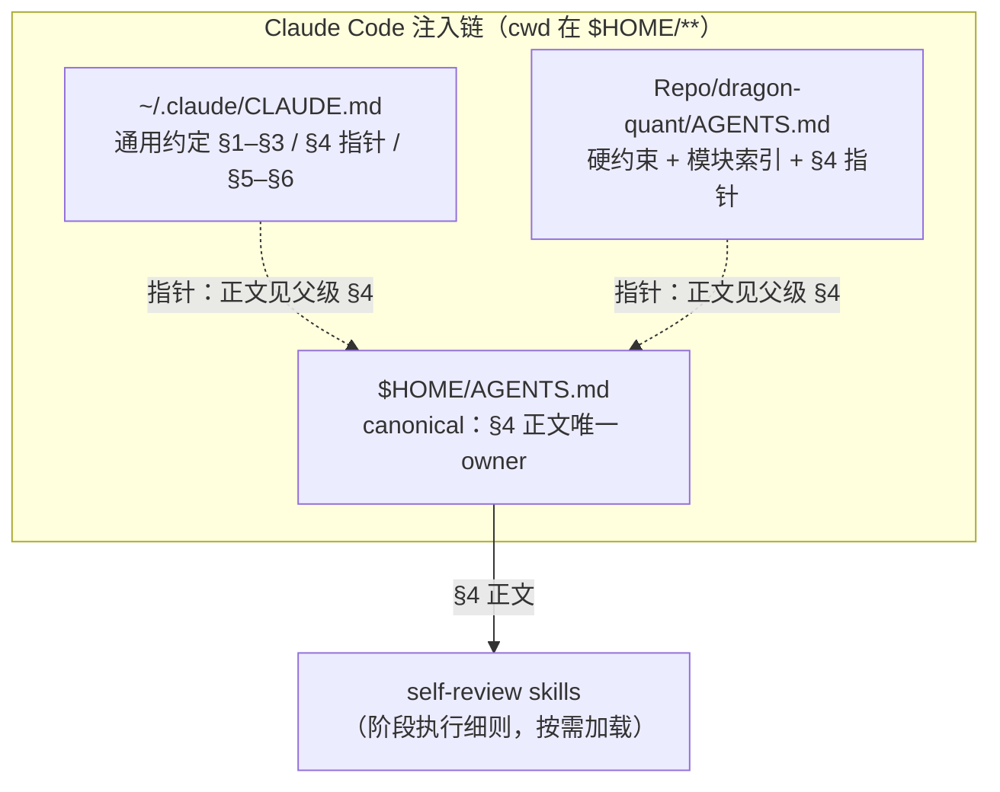
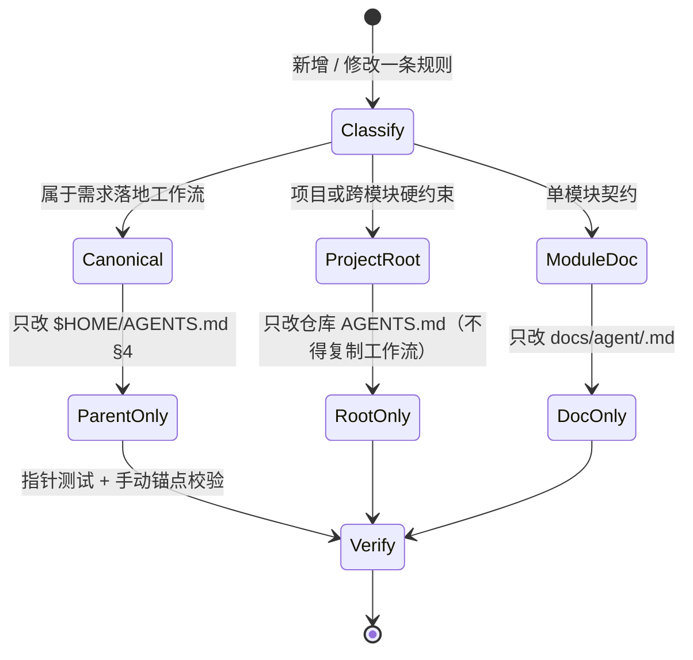
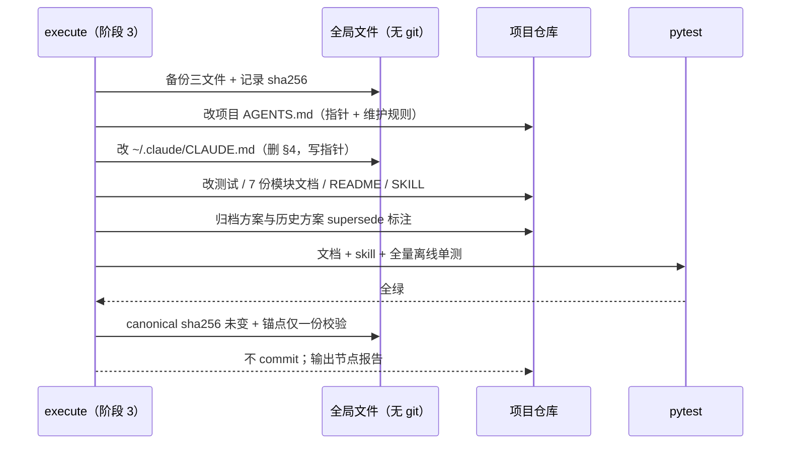

# 技术方案：需求落地工作流单一 owner（消除三份注入）

- 日期：2026-10-27
- 版本：v1（阶段 2，待 solution-self-review 与 main 验收）
- 分支基线：`feat/refactor-archi`（工作树 clean，HEAD `902ace0`）
- 关联任务包：用户已批准——工作流正文完整且唯一保存在 `$HOME/AGENTS.md`；从 `~/.claude/CLAUDE.md` 与项目 `AGENTS.md` 删除重复正文；同步调整测试与归档说明
- 范围性质：治理配置（`~/.claude/**`、父级 `AGENTS.md`、项目 `AGENTS.md`），**禁止快速通道**；不改产品代码，不执行 commit / push / `sync.sh`

---

## 1. 意图、目标与非目标

### 1.1 用户故事

作为同时使用 Claude Code 与 Codex 的维护者，我希望**需求落地工作流（阶段 0–3.5）只有一份正文**，这样：

- 每次会话不再把同一份约 8 KB 的 §4 注入三次（当前 `~/.claude/CLAUDE.md`、`$HOME/AGENTS.md`、项目 `AGENTS.md` 各一份）；
- 修改工作流只改一处，不会出现三份漂移；
- Claude Code / Codex 等按目录层级读取 `AGENTS.md` 的工具，仍能共用父级规则；
- 项目仓库仍能自解释「工作流在哪里」，但不再复制正文。

### 1.2 验收标准（任务包原样展开）

| # | 验收标准 |
|---|---------|
| AC1 | 精确文件范围与 section 边界；保留 canonical 的证据与验证方式 |
| AC2 | 项目根 `AGENTS.md` 删除后保留清晰的路由 / 维护措辞（允许 ≤1 行非复制指针，优先简单） |
| AC3 | 测试从「§4 必须常驻项目根」改为「项目根不得复制工作流」，且不依赖仓库外文件；其他文档门禁强度不降 |
| AC4 | 新归档方案（`archived_md/agents/2026-10-27-…`）与 `docs/solutions/2026-10-24-self-review-workflow-design.md` 的历史 D1 决策做最小 supersede 标注 |
| AC5 | 全局文件无 git 仓库时的验证与交付方式；项目文件不 commit |
| AC6 | ≥2 个候选设计（至少 1 个非常规）；多文件治理流程附 Mermaid；风险与缓解 |
| AC7 | 测试策略：canonical 存在且正文仅一份、两个目标文件无正文、项目 pytest 文档 / Skill 测试（必要时全量离线单测）；真实证据，不虚构 |
| AC8 | 输出本方案到 `archived_md/agents/2026-10-27-workflow-single-owner-design.md` |

### 1.3 非目标

- 不修改 `$HOME/AGENTS.md` 的 canonical 正文（除非发现客观错误，此时以 `NEED_DECISION` 上报）。
- 不合并 `~/.claude/CLAUDE.md` 与 `$HOME/AGENTS.md`：二者在 §5 本就分叉（`.claude` 同步 vs `.Codex` 同步），只处理重复的 §4。
- 不执行 `~/claude-config/sync.sh`、`~/Codex-config/sync.sh`；不 commit / push / 开 PR。
- 不批量重写 `docs/solutions/**`、`archived_md/**` 的历史正文；只做 supersede 标注与活指针修正。
- 不改产品代码、E2E golden、`coverage-map.json`、`README` 命令手册正文。
- 不新增运行时加载器、生成器、CI 服务或外部依赖（否则回到候选设计 C）。

---

## 2. 现状证据（已核实，命令可复现）

| # | 事实 | 证据 |
|---|------|------|
| E1 | 三份文件当前均注入同一工作流：`~/.claude/CLAUDE.md` 10893 B / 138 行；`$HOME/AGENTS.md` 10887 B / 138 行；项目 `AGENTS.md` 19470 B / 226 行 | `wc -l -c` |
| E2 | 两份全局文件的 §4 行区间为 25–126（下一标题 `### 5.` 在 127 行）；项目 §4 为 82–182（下一标题 `### AI Agent 协作规范` 在 184 行） | `awk 'NR>=…'` + `grep -n '^#'` |
| E3 | 全局两份 §4 行区间（含标题行）md5 完全相同（`33ba616e…`），差异仅在 §5 主题（`.claude` / `.Codex`） | `sed -n '25,126p' … | md5`；`diff -u ~/.claude/CLAUDE.md "$HOME/AGENTS.md"` |
| E4 | 项目 §4 与全局 §4 正文相同，唯一差异是标题行（`### 需求落地标准工作流（§4）` vs `### 4. 需求落地标准工作流`）与末尾空行 | `diff -u`（仅 2 处 hunk） |
| E5 | 项目测试 `WORKFLOW_ANCHORS` + `test_workflow_section_is_resident_in_root` 断言 §4 常驻根、且根含 Mermaid | `dragon_quant/tests/test_docs_consistency.py:86-97,479-484` |
| E6 | 测试文件 docstring 仍称根宪法「含完整 §4」，并把布局契约指向已归档路径 `docs/solutions/2026-10-27-agents-progressive-disclosure-design.md`（实际在 `archived_md/agents/`） | 同文件 9–16 行 |
| E7 | 归档方案含 D1「根 §4 原样保留、不得懒加载/指针化」等旧决策，分布在 §1.3、§3 矩阵、§5.1、§5.5、§7.4、§10.12、§11 步骤 4、§14 | `archived_md/agents/2026-10-27-agents-progressive-disclosure-design.md` |
| E8 | 历史方案 D1 写明「三份配置的 §4 正文逐字一致…拒绝仓库仅留指针」 | `docs/solutions/2026-10-24-self-review-workflow-design.md:84,87` |
| E9 | 7 份模块文档路由头写「上游权威：AGENTS.md（硬约束与工作流）」；README:75、`SKILL.md:17` 同样把「工作流」归给项目 `AGENTS.md` | `grep -rn "（硬约束与工作流）" docs/agent README.md skills/` |
| E10 | 除 `test_docs_consistency.py` 外，仓库内无测试依赖 §4 正文（`test_skill_content.py:52` 只要求 `SKILL.md` 出现 `AGENTS.md` token） | `grep -rn "需求落地\|WORKFLOW_ANCHORS" dragon_quant/tests` |
| E11 | `$HOME/AGENTS.md` 与 `~/.claude` **都不在 git 仓库内**；`~/claude-config/sync.sh` 只 `cp ~/.claude/CLAUDE.md`（及其它可移植目录），**不备份父级 AGENTS.md** | `git -C "$HOME" rev-parse` → not a git repository；`sync.sh:10` |
| E12 | `~/claude-config/CLAUDE.md` 是 `~/.claude/CLAUDE.md` 的同步镜像（当前 md5 相同），删除 §4 后会在用户下次执行 sync 时传播到私有仓 | `md5` 两文件一致 |
| E13 | 当前基线：`pytest dragon_quant/tests/test_docs_consistency.py -q` → 21 passed | 本会话实跑 |
| E14 | 归档索引 `archived_md/README.md:102` 已登记该归档方案 | `grep -n "progressive" archived_md/README.md` |

**结论**：项目 §4 与全局 §4 无内容差异，删除项目副本零信息损失；真正的 canonical 是两份全局文件中任意一致的一份，用户已指定 `$HOME/AGENTS.md`。风险不在「删内容」，而在**取证（不可版本化的文件）**与**历史决策反转后的文档一致性**。

---

## 3. 内容权威矩阵（本次变更后）

| 内容域 | 唯一 owner | 其他位置允许的形态 | 冲突裁决 |
|--------|-----------|-------------------|---------|
| 需求落地工作流（阶段 0–3.5、自审收敛、节点报告、快速通道） | `$HOME/AGENTS.md` §4 | 两处 ≤1 行**非链接指针** | canonical 优先 |
| 自审执行细则（维度 / 证据 / 输出契约） | `~/.claude/skills/{research,solution,code}-self-review/SKILL.md` | 工作流内提及技能名 | skill 优先（细则）；工作流优先（门禁） |
| 通用约定 §1–§3、§5–§6 | `~/.claude/CLAUDE.md`（`~/.claude` 侧）与 `$HOME/AGENTS.md`（父级侧，§5 为 Codex 同步） | — | 各自文件内自治 |
| 项目/跨模块硬约束、模块索引、E2E 门禁、Git 规范 | 项目 `AGENTS.md` | — | 项目根优先 |
| 单模块契约与实现细节 | `docs/agent/<module>.md` | — | owner 文档优先 |

去重红线：**任何位置都不得复制 §4 正文**；指针只写「owner 在哪 + 缺失时怎么办」。

### 3.1 关键决策记录

| # | 决策 | 备选 | 理由 |
|---|------|------|------|
| D1 | canonical 固定为 `$HOME/AGENTS.md` §4，正文不再出现第二份 | 项目仓库为 canonical；`~/claude-config` 为 canonical | 用户指定；父级文件在 Claude Code / Codex 的目录层级上都能覆盖本机所有项目 |
| D2 | 两个目标文件各留 **1 行级指针**，不彻底留白 | 完全删除、不留任何字样 | 保留可发现性（从 GitHub / 新机器也能知道正文在哪）与缺失时的处置指引；指针成本约 150–300 B。若 main 要求彻底留白：删掉两个指针小节即可，测试同步改为只断言「无正文锚点」，不影响其余设计 |
| D3 | `~/.claude/CLAUDE.md` 保留 `### 4.` 编号，§5/§6 不重编号 | 重排为 §4/§5 | 减少 diff 面，避免误伤相邻章节；编号缺位可接受，指针标题已说明原因 |
| D4 | 项目根测试从「§4 常驻」改为「不得复制 + 指针存在」 | 维持常驻；doc set 任意命中 | 前者与用户决策一致且可测；后者会掩盖「新 owner 缺失」 |
| D5 | 归档 / 历史方案做 supersede 标注，不重写正文 | 重写历史正文；不标注 | 保留「当时为何这样决策」的可追溯性，同时阻止未来按旧指引恢复三份正文 |
| D6 | 不引入生成器 / symlink / 运行时加载 | 模板生成（候选 C） | 「正文只存一份」后手工同步面已归零，工具链只增加漂移与失败模式 |
| D7 | 本次不顺带收紧 `ROOT_MAX_BYTES` / 不加全局 hook | 收紧到 15 KB；加 pre-commit 校验 | 变更聚焦；收紧门禁与全局 hook 属独立治理项，避免夹带 |

---

## 4. 目标状态与精确变更

### 4.1 多文件治理流程



> 收益边界：canonical 仍注入一次；节省的是另外两份副本（约 8 KB × 2），不是「工作流零成本」。

### 4.2 变更后的判定状态机



### 4.3 文件级变更清单

| # | 文件 | 边界 | 动作 | 目标体量 |
|---|------|------|------|---------|
| F1 | `$HOME/AGENTS.md` | 全文件 | **不改**（canonical）；仅记录 sha256 | 10887 B / 138 行（不变） |
| F2 | `~/.claude/CLAUDE.md` | 替换 25–126 行 | 删除 §4 正文，写入 4 行指针；**保留 §5/§6 编号** | 约 3.1 KB / 约 40 行 |
| F3 | `AGENTS.md`（项目） | 替换 82–182 行 | 删除 §4 正文，写入 1 个小节指针 | 约 11.8 KB / 约 130 行 |
| F4 | `AGENTS.md`（项目） | 第 226 行 | 维护规则 #4 从「不得删 §4」改为「不得把工作流抄回根」 | — |
| F5 | `dragon_quant/tests/test_docs_consistency.py` | docstring 9–16；常量 86–97；测试 479–484 | 布局契约改写；`WORKFLOW_ANCHORS` → `WORKFLOW_BODY_ANCHORS` + 指针断言 | — |
| F6 | `docs/agent/*.md`（7 份） | 第 5 行 | `（硬约束与工作流）` → `（硬约束与项目路由）` | — |
| F7 | `README.md` | 第 75 行 | 权威句补「父级 `AGENTS.md` §4（工作流，本项目不复制）」 | — |
| F8 | `skills/dragon-quant/SKILL.md` | 第 17 行 | 同上口径；保留 `AGENTS.md` token | — |
| F9 | `archived_md/agents/2026-10-27-agents-progressive-disclosure-design.md` | 头部 + 10 处（文本锚点见 §4.6） | supersede 说明 + 逐处失效标记 | — |
| F10 | `docs/solutions/2026-10-24-self-review-workflow-design.md` | 头部 + D1 + §6.4 | supersede 说明 + 2 处失效标记 | — |
| F11 | `archived_md/agents/2026-10-27-workflow-single-owner-design.md` | 新文件 | 本方案 | — |

**刻意不动**：`ROOT_MAX_BYTES = 20_000` / `ROOT_MAX_LINES = 240`（删 §4 后余量更大，门禁保持原强度，不为本次变更顺带收紧）；`archived_md/README.md`（索引行仍准确）；`CHANGELOG.md`（历史语义）；`docs/superpowers/plans/**`（历史计划）。

### 4.4 指针文本契约（精确）

**F2 — `~/.claude/CLAUDE.md`（替换 25–126 行）：**

```markdown
### 4. 需求落地标准工作流（正文见父级 `AGENTS.md` §4）

本文件**不复制**工作流正文：唯一 owner 是 `$HOME/AGENTS.md` 的 §4（在 `$HOME/**` 下工作时由目录层级规则自动注入）。若当前工作目录不在其下，先 Read 该文件再执行，不得凭记忆重建。
```

**F3 — 项目 `AGENTS.md`（替换 82–182 行）：**

```markdown
### 需求落地标准工作流（指针）

阶段 0–3.5 的两角色门禁工作流正文**不在本仓库维护**；唯一 owner 是父级 `AGENTS.md` §4（Claude Code / Codex 按目录层级自动注入）。本文件只遵守、不复制。父级文件缺失时（其他机器、CI、其他目录），不得凭记忆重建工作流，须先向用户确认或 Read 父级文件。
```

约束：

1. **不得写成 Markdown 链接**（如 `[../AGENTS.md](../AGENTS.md)`）——`test_local_markdown_links_resolve` 会把它当本地 `.md` 链接，在 CI 或克隆路径下必然断链。
2. 指针正文不得包含 `WORKFLOW_BODY_ANCHORS` 中任何一个锚点（见 §4.5），否则「未复制」判定失真。
3. `~/.claude/CLAUDE.md` 保留 `### 4.` 编号，§5/§6 不重编号：减少 diff 面，避免误伤相邻章节。
4. 指向本机 home 的绝对路径（如 `$HOME/AGENTS.md`）只允许出现在 `~/.claude/CLAUDE.md`（本机私有配置，经 `sync.sh` 进入私有仓 `gitBingxu/claude-config`）；项目 `AGENTS.md`、`README.md`、`SKILL.md` 属公开仓库，一律写「父级 `AGENTS.md` §4」，不得写入用户名路径。

**F4 — 项目 `AGENTS.md` 维护规则 #4（第 226 行）改为：**

```markdown
4. 根超 20 KB / 240 行时**优先合并同类条目**；**不得把工作流正文抄回根**（唯一 owner 为父级 `AGENTS.md` §4，根只保留一行指针）。
```

### 4.5 测试契约（F5）

```python
# §4 正文由父级 AGENTS.md 单点拥有（2026-10-27 用户决策）：项目根只留指针。
WORKFLOW_BODY_ANCHORS = (
    "阶段 0：需求澄清与验收标准",
    "阶段 1：技术调研",
    "阶段 2：技术方案",
    "阶段 3：代码实现",
    "阶段 3.5：轻量终审",
    "main 阶段验收规则",
    "自审与收敛规则",
    "禁止派生 subagent",
    "节点报告（精简）",
)
WORKFLOW_POINTER = "父级 `AGENTS.md` §4"


def test_workflow_body_is_single_owned_outside_project_root():
    """§4 正文由父级 AGENTS.md 拥有；项目根只保留指针，不复制正文。"""
    text = _read(AGENTS)
    for anchor in WORKFLOW_BODY_ANCHORS:
        assert anchor not in text, (
            f"AGENTS.md must not duplicate the §4 workflow body (found {anchor!r}); "
            "the body is owned by the parent AGENTS.md"
        )
    assert WORKFLOW_POINTER in text, (
        "AGENTS.md must keep a one-line pointer to the parent AGENTS.md §4"
    )
```

- 删除旧 `test_workflow_section_is_resident_in_root` 与 `WORKFLOW_ANCHORS`；
- **不新增任何读取仓库外路径的测试**（CI 无 `$HOME/AGENTS.md`，也不该有该假设）；
- 其余门禁（体量、索引、链接、token 单 owner、skill、parser 覆盖）逐条保留，不弱化；
- docstring 的布局契约同步改为「根宪法=项目硬约束/路由/跨模块门禁；§4 正文由仓库外父级唯一拥有，本仓库只做不复制断言」，并把契约链接修正为 `archived_md/agents/2026-10-27-agents-progressive-disclosure-design.md`。

### 4.6 归档方案的 supersede 处理（F9）

在归档方案头部（现第 5 行后）插入以下引用块：

```markdown
> **2026-10-27 决策变更（supersede）**：本文 D1（"仓库根必须常驻完整 §4、拒绝指针"）已被用户新决策取代：工作流正文唯一 owner 为父级 `AGENTS.md` §4，本仓库 `AGENTS.md` 不再保存正文，只保留一行指针。因此 §1.3、§3 矩阵、§5.1、§5.5、§7.4、§8、§10.12、§11 步骤 4、§14 中与 D1 相关的表述**均以新方案 `archived_md/agents/2026-10-27-workflow-single-owner-design.md` 为准**；本文其余记录（模块拆分、路由、门禁、实施步骤）保持历史原样。
```

**定位方式**：插入头部后行号整体下移，实施时必须按**文本片段**定位（下表为 2026-10-27 的原文片段），逐处追加 `（D1 已于 2026-10-27 被取代，见文首说明）`。该引用块与下方标记都会写入**公开仓库**文件：文案不得出现指向本机 home 的绝对路径，canonical 一律写「父级 `AGENTS.md` §4」（§4.4 约束 4）。

| # | 原文片段（锚点） | 所在位置 |
|---|-----------------|---------|
| 1 | ``不修改 `§4 需求落地标准工作流` 正文（D1 要求三份逐字一致`` | §1.3 非目标 |
| 2 | `| 需求落地工作流 §4、AI 协作规范、测试/E2E 门禁、Git 与文档同步 |` | §3 权威矩阵 |
| 3 | `**原样保留**（D1；不得懒加载/指针化）` | §5.1 迁移表 |
| 4 | `| §4 工作流（原样） | 102 | 8004 |` | §5.5 预算表 |
| 5 | `余量：约 16–30 行 / 1.8–2.8 KB（§4 占 102 行是硬占用）` 所在整句 | §5.5 余量段 |
| 6 | `### 7.4 §4 逐字一致的实施期校验（不新增环境耦合测试）` 小节首段 | §7.4 |
| 7 | `不得删 §4` | §8 错误处理表「根再膨胀」行 |
| 8 | `方案要求「合并同类项、不删 §4、超限上报」` | §10.12 |
| 9 | `保留硬约束与 §4 原文` | §11 步骤 4 |
| 10 | `根 §4 原样；未触碰` | §14 AC7 |

不改写原论证、表格数值与候选方案描述（§9.2 的「根只留 §4」是当时候选 B 的描述，属历史记录，不加标记）。同理，§2 证据 E5 与 §4.4/§4.5 的架构图保留原样。

### 4.7 历史方案的 supersede 处理（F10）

`docs/solutions/2026-10-24-self-review-workflow-design.md` 状态行后插入：

```markdown
> **2026-10-27 更新（supersede）**：D1「三份 §4 逐字一致、拒绝仓库仅留指针」已被用户决策取代——工作流正文唯一 owner 为父级 `AGENTS.md` §4，`~/.claude/CLAUDE.md` 与项目 `AGENTS.md` 不再复制正文。本文其余内容保持 2026-10-24 的历史记录；现行规则见 `archived_md/agents/2026-10-27-workflow-single-owner-design.md`。
```

并在 D1 决策条与 §6 第 4 条各追加 `（已于 2026-10-27 取代，见文首）`。不批量重写正文。

### 4.8 模块文档 / README / Skill 措辞（F6–F8）

已核实的精确命中（`grep -n "（硬约束与工作流）"`，全部在第 5 行路由头）：

| 文件 | 现措辞 | 改为 |
|------|--------|------|
| `docs/agent/architecture.md` | `AGENTS.md（硬约束与工作流）` | `AGENTS.md（硬约束与项目路由）` |
| `docs/agent/scan.md` | 同上 | 同上 |
| `docs/agent/review.md` | 同上 | 同上 |
| `docs/agent/trading.md` | 同上 | 同上 |
| `docs/agent/prep-auction.md` | 同上 | 同上 |
| `docs/agent/assets.md` | 同上 | 同上 |
| `docs/agent/factor.md` | 同上 | 同上 |

`docs/agent/development.md` 的上游权威写作 `AGENTS.md（硬约束与测试门禁命令）`，**不含**「工作流」字样，不改。工作流指针已由根 `AGENTS.md` 承担，模块文档不重复。

**README:75** 改为：

```text
**`AGENTS.md`（硬约束与项目路由）+ 父级 `AGENTS.md` §4（需求落地工作流，本项目不复制）+ 其索引的 `docs/agent/*.md`（模块细节）与 `review_account/strategy/STRATEGY.md`（策略规则）仍是规则权威**
```

**`skills/dragon-quant/SKILL.md:17`** 改为：

```text
1. `AGENTS.md`（硬约束/项目路由）+ 父级 `AGENTS.md` §4（工作流）+ 其索引的 `docs/agent/*.md`（模块细节）：项目规则、命令语义、运维契约的权威。
```

两处均保留 `AGENTS.md` token（`test_skill_content.py:52`），且「父级 `AGENTS.md` §4」用 code span 而非 Markdown 链接——公开仓库不写本机绝对路径，也不触发 `test_local_markdown_links_resolve`。

---

## 5. 全局文件（无 git）的取证与交付

`$HOME/AGENTS.md` 与 `~/.claude/CLAUDE.md` 都不在版本控制内（E11），改动不可回滚。因此阶段 3 必须按以下顺序执行：

```bash
TS=$(date +%Y%m%d-%H%M%S)
REPO=${REPO:-$PWD}                  # 在 dragon-quant 仓库根执行
mkdir -p /tmp/workflow-single-owner-$TS
cp "$HOME/AGENTS.md"               /tmp/workflow-single-owner-$TS/parent-AGENTS.md
cp "$HOME/.claude/CLAUDE.md"       /tmp/workflow-single-owner-$TS/claude-CLAUDE.md
cp "$REPO/AGENTS.md"               /tmp/workflow-single-owner-$TS/project-AGENTS.md
shasum -a 256 "$HOME/AGENTS.md" "$HOME/.claude/CLAUDE.md" "$REPO/AGENTS.md"
```

编辑后（阶段 3 一次性校验，**不提交为测试**）：

```bash
CANON="$HOME/AGENTS.md"
REPO=${REPO:-$PWD}                  # 在 dragon-quant 仓库根执行
# 1. canonical 字节级未变：与备份目录中的 parent-AGENTS.md 比对
shasum -a 256 "$CANON" /tmp/workflow-single-owner-*/parent-AGENTS.md
#（2026-10-27 记录值：4db336f7cd685df3fe164d68e59dee65db719f39b00977ec056bbb5bb1298a29；
#  若阶段 3 开始时该值已不同，说明期间有人改过 canonical，先停下确认，不得直接覆盖）
# 2. canonical 仍含全部正文锚点
for t in "阶段 0：需求澄清与验收标准" "阶段 1：技术调研" "阶段 2：技术方案" "阶段 3：代码实现" "阶段 3.5：轻量终审" "main 阶段验收规则" "自审与收敛规则" "禁止派生 subagent"; do
  grep -q "$t" "$CANON" || echo "CANON MISSING: $t"
done
# 3. 两个目标文件无任何正文锚点
for f in "$HOME/.claude/CLAUDE.md" "$REPO/AGENTS.md"; do
  for t in "阶段 0：需求澄清与验收标准" "阶段 1：技术调研" "阶段 2：技术方案" "阶段 3：代码实现" "阶段 3.5：轻量终审" "main 阶段验收规则" "自审与收敛规则" "禁止派生 subagent"; do
    grep -q "$t" "$f" && echo "DUPLICATED in $f: $t"
  done
done
# 4. 注入链中每个锚点恰好出现一次
for t in "阶段 0：需求澄清与验收标准" "阶段 3.5：轻量终审"; do
  echo "$t -> $(grep -c "$t" "$HOME/AGENTS.md" "$HOME/.claude/CLAUDE.md" "$REPO/AGENTS.md" | awk -F: '{s+=$2} END{print s}')"
done
# 5. 相邻章节存活
grep -q '^### 5\. .claude 配置同步' "$HOME/.claude/CLAUDE.md" && echo "CLAUDE §5 OK"
grep -q '^### 6\. 调研 / 方案文档归档' "$HOME/.claude/CLAUDE.md" && echo "CLAUDE §6 OK"
grep -q '^### AI Agent 协作规范' "$REPO/AGENTS.md" && echo "project AI 协作规范 OK"
grep -q '^### 测试与 E2E 门禁' "$REPO/AGENTS.md" && echo "project E2E 门禁 OK"
```

交付约定：

- 三份全局 / 项目文件都**不 commit**；项目改动留在工作树，由用户决定何时提交。
- 在节点报告记录三份文件的 before/after sha256、备份目录、以及上述校验输出。
- 校验脚本按交互式 shell 执行，**不要加 `set -e`**：`grep` 未命中是预期的「无重复」信号，不是脚本失败。
- `$HOME/AGENTS.md` 无任何版本控制副本（E11）→ 作为残留风险登记，建议后续由用户决定是否纳入私有备份仓；本任务不扩大范围。
- 本方案已于 2026-10-27 归档到 `archived_md/agents/`；F9/F10 中的方案路径已同步修正为归档位置（归档 ≠ 冻结）。

---

## 6. 错误处理

| 故障 | 检测方式 | 处理 |
|------|---------|------|
| canonical 被误改 | 编辑前后 sha256 比对 | 从 `/tmp/workflow-single-owner-*/parent-AGENTS.md` 恢复；不得继续 |
| 误删相邻 §5/§6 / `AI Agent 协作规范` | `grep '^### 5\.'` 等存活检查 | 用备份恢复后重做，按精确行区间替换 |
| 指针被写成 Markdown 链接 | `pytest test_docs_consistency.py` 的 `test_local_markdown_links_resolve` | 改为纯 code span |
| 指针里混入正文锚点 | 新增 `test_workflow_body_is_single_owned_outside_project_root` | 精简指针措辞，不复制锚点句 |
| 测试被弱化成「doc set 任意命中」 | 人审 + 断言逐条对齐 §4.5 | 恢复逐文件断言，禁止「找不到就跳过」 |
| 归档 / 历史方案仍教「三份一致」 | supersede 标记清单逐项核对 | 补标；已被取代的表述不得留成现行指引 |
| 其他机器 / 目录无父级文件 | 会话注入观察（E1 级别的现状） | 指针含绝对路径 + 「先 Read」；登记残留风险 R1 |
| `~/.claude/CLAUDE.md` 被 sync.sh 传播到旧机器 | 用户后续执行 sync 时 | 旧机器拉取后同样只有指针；需同步维护该机器的父级 AGENTS，登记 R8 |
| 删除后项目根仍 > 20 KB | `test_agents_root_size_gate` | 不应发生（预计约 11.8 KB）；若发生说明替换区间错误，回滚重做 |

---

## 7. 测试策略

### 7.1 必跑命令（阶段 3）

```bash
# 1. 文档一致性（改动核心门禁）
.venv/bin/python -m pytest dragon_quant/tests/test_docs_consistency.py -q

# 2. Skill 包三件套（README/SKILL 文案改动）
.venv/bin/python -m pytest dragon_quant/tests/test_skill_content.py dragon_quant/tests/test_skill_routes.py dragon_quant/tests/test_skill_package.py -q

# 3. 全量离线单测（排除 e2e / smoke）
.venv/bin/python -m pytest dragon_quant/tests -q --ignore=dragon_quant/tests/e2e --ignore=dragon_quant/tests/smoke
```

### 7.2 预期证据

| 检查 | 期望 |
|------|------|
| `test_workflow_body_is_single_owned_outside_project_root` | 新测试存在且通过 |
| 旧 `test_workflow_section_is_resident_in_root` | 已删除（`grep -c WORKFLOW_ANCHORS` 为 0） |
| `test_agents_root_size_gate` | ≤ 20 000 B / 240 行（预计约 11.8 KB） |
| 21 项既有文档测试 | 全部仍通过（当前基线 21 passed） |
| skill 三件套 | 全绿 |
| 全量离线单测 | 全绿（若基线本身有既有失败，如实报告并区分） |
| 全局校验脚本（§5） | 无 `CANON MISSING` / 无 `DUPLICATED`；注入链每个锚点计数 = 1 |

### 7.3 明确不做的测试

- 不新增读取 `$HOME/**` 的 pytest（CI / 他人克隆必失败）。
- 不新增「两个全局文件 §4 一致」的测试：§4 将只存在一份，该断言失去对象。
- 不为全局文件引入 pre-commit / hook（超出范围）。

---

## 8. 候选设计对比

### 8.1 方案 A（推荐）：父级 canonical + 两处 ≤1 行指针

- 正文只存 `$HOME/AGENTS.md` §4；`~/.claude/CLAUDE.md` 与项目 `AGENTS.md` 各留一句指针。
- 测试只断言「项目根不复制正文 + 指针存在」，不读仓库外文件。
- 无工具链、无生成器；修改工作流只改一处。

**成本**：两处指针各约 150–300 B；`~/.claude` 无 git，需人工备份取证。
**收益**：每次会话少注入约 16 KB；三份漂移风险归零；Claude Code / Codex 仍走目录层级。

### 8.2 方案 B（反直觉：反向单一 owner）：正文搬进版本控制仓库

把 canonical 放进 `dragon-quant/AGENTS.md`（或 `~/claude-config/AGENTS.md`），父级与 `~/.claude` 只留指针。

- 优点：正文终于有 git 历史、diff review、备份；回滚容易。
- 致命缺陷：
  1. 工作流是**跨项目**约定，绑定到单一业务仓库后，`~/Repo` 下其他仓库与任意目录失去规则；
  2. 项目 `AGENTS.md` 从「业务硬约束」变成「全局治理载体」，违反刚完成的渐进式披露设计（项目根只放业务规则）；
  3. `~/claude-config` 虽在 git 内，但它不在工具注入链上，仍要靠父级/`~/.claude` 指针转接，等于多一跳。
- 结论：不推荐；但其「canonical 应有版本控制」的诉求成立，登记为 R2 的后续建议。

### 8.3 方案 C（工程化）：模板生成 / 单一源分发

在 `~/claude-config` 建 `workflow.md` 单一源，扩展 `sync.sh` 渲染并写入 `~/.claude/CLAUDE.md` 与父级 `AGENTS.md` 的 §4 区段。

- 优点：零手工同步，理论上永不漂移。
- 缺陷：
  1. Markdown 无 include，只能靠脚本拼接生成；Codex 侧还有独立 `~/Codex-config/sync.sh`，需要两套生成器同步演进；
  2. agent 直接改生成物会立刻漂移，还需要「生成物只读」的额外纪律；
  3. 引入构建步骤与失败模式，成本大于「只保留一份正文」的收益；
  4. 本任务明确禁止执行 `sync.sh` / 新增工具链。
- 结论：过度工程，否决。

### 8.4 对比与推荐

| 维度 | A 父级 + 指针 | B 反向 owner | C 生成式 |
|------|--------------|-------------|----------|
| 正文副本数 | 1 | 1 | 1（+生成物） |
| 跨项目可用 | 是（`$HOME/**`） | 否 | 是 |
| 版本控制 | canonical 无 git（风险） | 有 | 有 |
| 工具链成本 | 无 | 无 | 中 |
| 漂移风险 | 低（单正文） | 低 | 低但新增生成漂移 |
| 与现有约定冲突 | 无 | 与项目宪法定位冲突 | 与「不引入构建器」冲突 |

**推荐 A**。设计模式与动机：

- **Single Source of Truth（单一真源）**：同一事实只允许一个 owner，消除三份正文的漂移面；动机是「消除重复」。
- **Facade / Reference（门面式指针）**：`~/.claude/CLAUDE.md` 与项目根仍是稳定入口，但只暴露「去哪找正文」，隐藏正文细节；动机是降低每次会话的注入成本，同时保留可发现性。
- **刻意不做**：不做模板引擎、不做运行时加载、不做 symlink 合文件（两份全局文件在 §5 本就不同，合并会破坏 `.claude` / `.Codex` 同步语义）。

---

## 9. 风险与缓解

| # | 风险 | 可能性 | 影响 | 缓解 |
|---|------|--------|------|------|
| R1 | 其他机器 / 非 `$HOME/**` 目录没有父级 AGENTS → 工作流静默消失 | 确定 | 中 | 两处指针写清「唯一 owner + 先 Read」；登记为已知边界，后续可考虑把父级 AGENTS 纳入备份仓（不在本任务） |
| R2 | canonical 无版本控制，误删不可恢复 | 低 | 高 | 阶段 3 先备份 + sha256；建议后续由用户决定纳入私有仓 |
| R3 | 工具加载差异（某工具只读项目根 AGENTS，不爬父级） | 低 | 中 | 本项目根保留指针；Claude Code 现状已由本会话注入链证实；Codex 按目录层级读取属工具契约，阶段 3 记录为假设 A1 |
| R4 | 删 §4 时误伤相邻 §5/§6 或「AI Agent 协作规范」 | 低 | 高 | 精确行区间替换 + 章节存活 grep + 备份恢复路径 |
| R5 | 测试从「常驻」改「不复制」时被弱化 | 中 | 高 | 新测试逐锚点断言 + 指针断言；其余 20 项门禁不动；人审对照 §4.5 |
| R6 | 归档 / 历史方案继续教「三份一致」 | 中 | 中 | 文首 supersede + 10 处 / 2 处失效标记，并在新方案交叉引用 |
| R7 | 项目自洽性下降（新人从 GitHub 读不到工作流） | 中 | 低 | 项目根指针 + README/SKILL 补「父级 §4」；说明缺失时的处理方式 |
| R8 | 用户后续 sync 后旧机器只有指针 | 中 | 中 | 文档记录；旧机器需同步维护自己的父级 AGENTS |
| R9 | token 收益被高估 | 低 | 低 | 明确只省两份副本（约 16 KB/会话），canonical 仍注入 |
| R10 | `~/.claude/CLAUDE.md` 与父级 AGENTS 的 §1–§3/§6 未来再次分叉 | 中 | 中 | 本次不顺带合并（超出范围）；指针只指向 §4，不宣称整文件一致 |

**需求方未考虑的边界（本方案已纳入）**：

1. 指针不能写成 Markdown 链接，否则触发本地链接测试失败（§4.4）。
2. 测试文件 docstring 指向了已归档路径，本次一并修正（F5）。
3. 保留 §4 编号而非重排 §5/§6，减少误伤面。
4. 归档方案的 supersede 不能只在文首写一句，否则读者停在 §7.4 时会继续照旧执行——必须加行内失效标记。
5. `$HOME/AGENTS.md` 无 git（E11）是本次最大交付风险，不是内容风险。

---

## 10. 阶段 3 实施顺序



顺序理由：先备份（不可版本化文件先兜底）→ 先改注入面（项目/全局）→ 再改引用面（测试/文档/归档）→ 最后统一验证，避免中途红测掩盖真实问题。

禁止操作：`git checkout` / `git restore` 覆盖工作树；整文件 `Write` 覆盖 `AGENTS.md`；执行 `sync.sh`、commit、push；修改 `~/.claude/agents/**`、skills 的 SKILL.md 正文（本次只改 `skills/dragon-quant/SKILL.md` 第 17 行，属于项目 skill 包而非 `~/.claude/skills`）。

---

## 11. 验收映射

| 验收 | 实现位置 | 验证方式 |
|------|---------|---------|
| AC1 精确边界 + canonical 证据 | §2 E1–E4、§4.3 F1–F3、§5 | `wc`/`diff`/`shasum` 输出；canonical sha256 前后一致 |
| AC2 项目根路由 / 维护措辞 | §4.4 F3/F4 | 双反引号代码 span：``grep -F "父级 `AGENTS.md` §4" AGENTS.md`` 命中；维护规则 #4 含「不得把工作流正文抄回根」 |
| AC3 测试改为「不得复制」且不依赖外部路径 | §4.5 | 新测试 + 旧测试删除；`test_local_markdown_links_resolve` 通过 |
| AC4 归档 / 历史方案 supersede | §4.6、§4.7 | `grep "supersede"` 两文件；10 处 / 2 处标记 |
| AC5 全局无 git 的验证与交付 | §5 | 备份目录、sha256、校验脚本输出；`git status` 无 commit |
| AC6 ≥2 候选 + Mermaid + 风险 | §4.1、§4.2、§8、§9、§10 | 本文件 |
| AC7 测试策略与真实证据 | §7、§10 | 阶段 3 实跑输出；本方案阶段 2 基线证据 `21 passed` |
| AC8 输出路径 | 本文件 | `archived_md/agents/2026-10-27-workflow-single-owner-design.md` |

---

## 12. 自审记录

**Round 1 · verdict: APPROVE**（0 CRITICAL / 0 未解决 MAJOR / 3 MINOR 转 known_issues；7/7 维度通过）

项目检查清单（摘自项目 `AGENTS.md`）：方案必须配 Mermaid（本文 3 张）、≥2 候选含 1 个非常规（A/B/C，B 为反向 owner）、点明设计模式与动机（§8.4）、文档同步（阶段 3 同批修改，§4.3）、禁止快速通道与 commit（§1.3、§10）、不改产品代码（全文无产品文件）。

```yaml
review_type: solution
round: 1
verdict: APPROVE
summary: "工作流单一 owner 的边界、指针、测试替代与历史 supersede 均已闭环；无 CRITICAL，剩余 MINOR 转 known_issues"
findings:
  - severity: MAJOR
    dimension: "可维护性"
    location: "§3 / §4.4"
    finding: "方案直接给出指针措辞，却没有显式记录『为什么保留指针而非彻底留白』『为什么保留 §4 编号』『测试口径为何是三段式』，main 验收与未来维护者无法判断这些是可调整项还是硬约束"
    evidence: "任务包要求『是否保留指针』作为待决点；原稿仅在正文隐含处理"
    recommendation: "新增决策表 D1–D7，逐条写明备选、理由与可回退方式（D2 已给出完全留白的替代做法）"
    change_my_mind: "若用户已在阶段 0 明确批准『保留一行指针』且不需要备选记录，则此条可降为 MINOR"
  - severity: MAJOR
    dimension: "一致性"
    location: "§4.6"
    finding: "原稿称归档方案有『8 处』需标记，实际逐条核对为 10 处；且按行号定位会在头部插入说明后整体漂移，实施时必然漏标或错标"
    evidence: "grep 归档方案：§1.3、§3、§5.1、§5.5×2、§7.4、§8、§10.12、§11、§14 共 10 处涉及 D1"
    recommendation: "改为『文本锚点表 + 插入后行号会漂移』的明确告警，逐行给出可 grep 的原文片段"
    change_my_mind: "若归档方案在阶段 3 已被大幅重写、行号不再成立，则需重新生成锚点，但『按文本定位』的结论不变"
  - severity: MAJOR
    dimension: "一致性"
    location: "§4.8 / F6"
    finding: "原稿用通配写法 `docs/agent/{architecture,…}.md` 覆盖 7 份路由头，未给出实际命中证据，也未说明 development.md 是否在范围内，实施者可能漏改或误改"
    evidence: "grep 结果：7 份文档第 5 行命中『（硬约束与工作流）』；development.md 第 5 行为『（硬约束与测试门禁命令）』"
    recommendation: "改为逐文件表格 + 明示 development.md 不改"
    change_my_mind: "若实施时 grep 命中集合与该表不一致，以 grep 为准并回写本表"
  - severity: MAJOR
    dimension: "一致性"
    location: "§4.8 精确措辞"
    finding: "README / SKILL 的目标措辞写在单反引号 inline code 里并转义反引号，Markdown 不会还原转义，复制即得到带反斜杠的文本，实施后会污染文档"
    evidence: "原稿第 226–227 行与 AC2 校验命令均出现 \\`"
    recommendation: "改用 fenced block 或双反引号 span，去掉所有反斜杠"
    change_my_mind: "若编辑器预览确认转义被还原（本项目使用标准 CommonMark，不会），则此条不成立"
  - severity: MINOR
    dimension: "可维护性"
    location: "§5"
    finding: "canonical sha256 硬编码在方案里，若 canonical 期间被合法修改，阶段 3 会误判为『被篡改』；校验脚本在 `set -e` 下会因预期中的 grep 未命中而提前退出"
    evidence: "校验脚本依赖 `grep -q … && echo` 的失败语义"
    recommendation: "改为与备份文件比对 + 记录『若当前值已不同先停下确认』；明示不加 `set -e`"
    change_my_mind: "若阶段 3 紧接本方案执行且 canonical 不可能变动，可视为无风险，但脚本健壮性仍应保留"
  - severity: MINOR
    dimension: "一致性"
    location: "§2 E3"
    finding: "原稿称『归一化后 md5』，实际哈希包含标题行，措辞与证据不符"
    evidence: "sed -n '25,126p' | md5 未做归一化"
    recommendation: "改为『含标题行的行区间 md5』"
    change_my_mind: "若补充归一化脚本并重算，可恢复原措辞，但无必要"
  - severity: MINOR
    dimension: "可维护性"
    location: "§5 / §4.6"
    finding: "本方案将来归档后，F9/F10 中指向 docs/solutions/… 的链接会失效，而项目规则要求归档后同步维护"
    evidence: "项目归档约定：归档 ≠ 冻结，feat 再修改需同 commit 同步归档文档"
    recommendation: "在 §5 交付约定中写明归档时同步改路径"
    change_my_mind: "若本方案不归档（长期保留在 docs/solutions），则无此问题"
  - severity: MINOR
    dimension: "安全性"
    location: "§4.4"
    finding: "原稿未限制绝对路径的出现范围，实施时可能把本机绝对路径写进公开仓库文件"
    evidence: "README 与 SKILL.md 随 npm 包发布"
    recommendation: "新增约束 4：绝对路径只允许出现在 ~/.claude/CLAUDE.md"
    change_my_mind: "若仓库本身不公开且无发布物，则泄露面为零"
  - severity: MINOR
    dimension: "精确性"
    location: "§4.3 / §4.6"
    finding: "行数估算与『插入 5 行』措辞与实际不符"
    evidence: "按 138/226 行基数重算为约 40 / 约 130 行；引用块为 1 段"
    recommendation: "已修正估算与措辞"
    change_my_mind: "无（纯数值校正）"
scorecard:
  critical: 0
  major: 0
  minor: 3
  dimensions_passed: "7/7"
```

**已在本轮修正**：MAJOR ×4（决策记录、归档标记锚点、F6 逐文件证据、精确措辞转义）、MINOR ×5（sha256 校验方式、E3 措辞、归档链接维护、绝对路径边界、体量估算）。

**转 known_issues（不阻塞）**：

1. 指针措辞与测试精确串绑定：未来改指针必须同 commit 改测试，否则 `test_workflow_body_is_single_owned_outside_project_root` 失败。这是有意的契约，不是缺陷。
2. 删除项目 §4 后，「治理配置禁止快速通道」等规则只存于 canonical；父级缺失场景（CI / 其他机器 / 非 `$HOME/**` 目录）与整个工作流一同不可见——已在 R1/R3 登记。
3. `$HOME/AGENTS.md` 无版本控制（E11），建议后续纳入私有备份仓；本任务不执行。

**未触发返工**：无 CRITICAL；无未解决 MAJOR。

### main 阶段 2 单次验收（处置记录）

| # | main 意见 | 处置 |
|---|-----------|------|
| 方向 | 通过：采用 D2（两个目标文件各留一行指针）；父级 canonical 备份纳入残留风险，不扩大范围 | 已确认，D2 为实施方案；R2/E11 维持残留风险登记 |
| M1（必须修改） | §4.6 F9 的 supersede 引用块把 canonical 写成公开归档文档中的绝对路径 `$HOME/AGENTS.md`，违反 §4.4 约束 4 | 已改为「父级 `AGENTS.md` §4」；同时复核 F10 文案：仅含 `~/.claude/CLAUDE.md`（home 相对，非用户名路径），无泄露；并在 §4.6 增加「公开仓库文案不得出现 `$HOME/**`」的硬约束句 |
| S1（建议） | F4.3 F9 与 R6 写「头部 + 8 处 / 8 处标记」，与 §4.6 表格实际 10 处不一致 | 已将 F9 行、R6、AC4 验证列统一为 10 处；§12 自审 finding 中的「原稿称 8 处」保留为历史问题记录，不作为实施指引 |

修订后不进入编码、main 不复审；阶段 2 闭环，阶段 3 由新 execute 会话承接。
