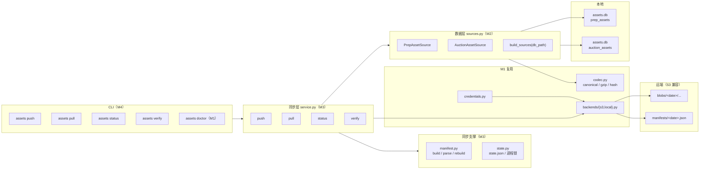
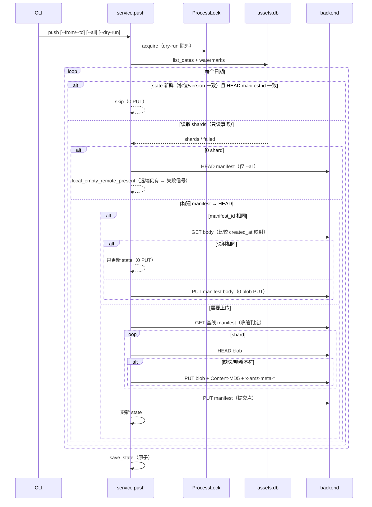
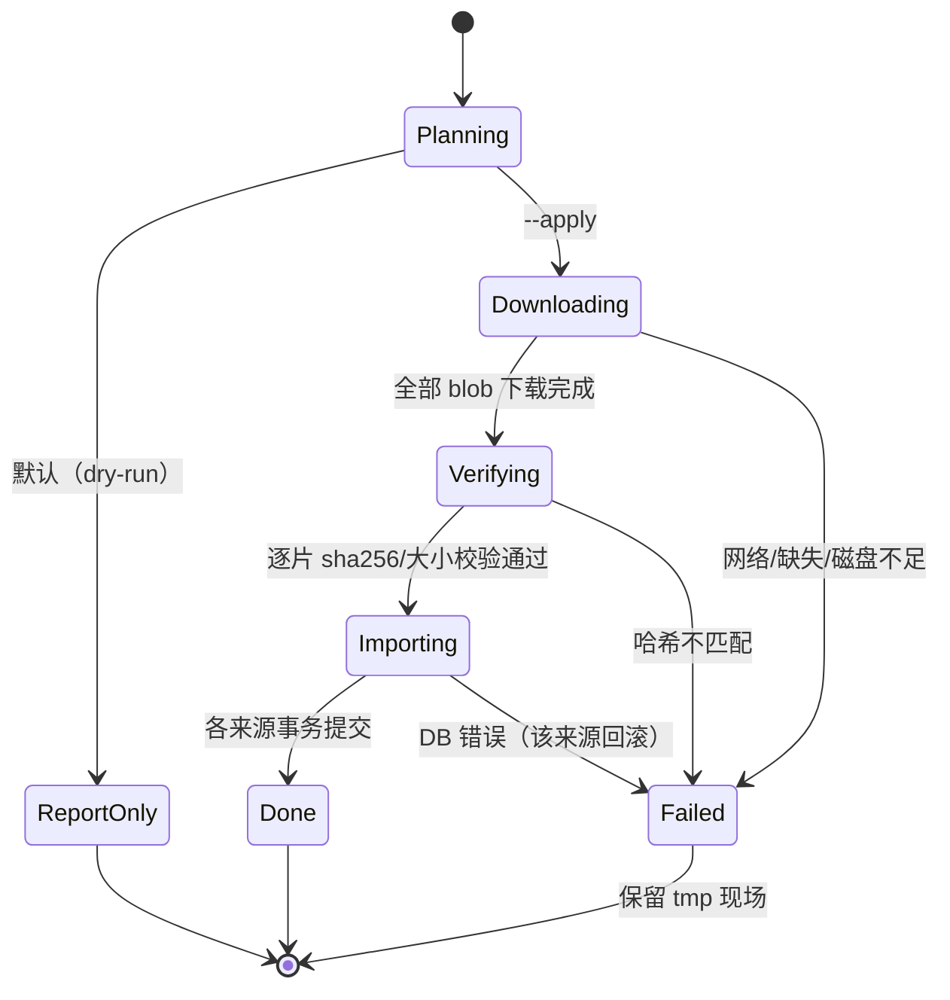

# 数据资产云端同步 M2-M4 实现方案（v2）
> **当前状态（2026-10-25 整仓结构重构 M0–M12）**：本文中的 `dragon_quant/cli_commands.py` / `dragon_quant/review_account/prep.py` 等实现位置已迁移：命令入口在 `dragon_quant/commands/<command>.py`（经 `commands.dispatch`），prep 在 `dragon_quant/review_account/prep/` 包（service/collectors/compute/rebuild），auction 编排在 `dragon_quant/auction/service.py`，assets CLI 装配在 `dragon_quant/assets_sync/cli_service.py`。历史设计正文保留原样；当前结构与命令以 `AGENTS.md`「架构总览」为准。


> 日期：2026-10-22
> 输入：`docs/research/2026-10-22-assets-sync-m2-m4-reality-check.md`（阶段 1，research APPROVE）
> 基准：`docs/solutions/2026-10-18-assets-cloud-sync-design.md`（v3）
> 范围：M2 数据层 + M3 同步层 + M4 CLI；**不含 M5 调度**（launchd / `assets_daily.sh` / 门槛 B）
> 约束：零新增运行时依赖（标准库 + 自研 SigV4）；集成测试只用 `LocalDirBackend`；凭据文件不读不打印不入库
> v2 修订：根据 solution-reviewer 第 1 轮（3 MAJOR / 9 MINOR）重写接口注入、push 两档跳过、auction 内容身份与报告/退出码契约。

## 0. 结论

采用**方案 A：分层 Adapter + 每日覆盖 manifest + 每源水位 state**。M1 的 `codec` / `backends` / `credentials` 全部复用；新增 `sources.py`（数据层）、`manifest.py` + `state.py` + `service.py`（同步层）、CLI 四命令（M4）。

三个关键定稿：

1. **注入契约**：sources 由 `build_sources(db_path=None)` 工厂按调用期数据目录构造；state/锁/临时目录由 `SyncPaths` 显式传入；**任何路径都不在 import 期绑定**。
2. **push 两档跳过**：state 水位新鲜 + HEAD manifest-id 一致 → 0 PUT；state 过期但 HEAD id 一致 → GET body 比较 `created_at` 映射，仅映射不同才重写 manifest body（0 blob PUT）。
3. **内容身份与采集时间分离**：`created_at` / `created_at_map` 只作为旁路字段随 manifest 传输，**不进入任何 sha256 身份**；auction payload 不再内嵌 `created_at`，避免 pull 冲突永不收敛。

## 1. 目标与非目标

### 目标

1. `assets push`：把 `assets.db` 中 `prep_assets` / `auction_assets` 的原始资产按 `blobs/<date>/<source>_<type>.<sha>.json.gz` + `manifests/<date>.json` 上传；重复执行幂等。
2. `assets pull`：按日期范围把云端资产恢复本地（默认 dry-run，`--apply` 落库），逐片校验，支持 `--target-dir` 隔离恢复。
3. `assets status`：本地/云端差异、体积、缺失/不一致日期、可选孤儿 blob。
4. `assets verify`：manifest 哈希校验 + `--deep` 分片内容校验，能发现篡改。
5. 进程锁防止并发 push/restore；日志与输出不泄露凭据。

### 非目标

- M5 调度（launchd / schtasks / cron、`assets_daily.sh`、门槛 B 记录）。
- 多版本 manifest / 按版本回放、孤儿 blob 清理、本地文件镜像、云采集。
- 同步 `prep_snapshots` / `auction_snapshots` / `dragons_v2` / 行情缓存 / Cookie。
- 修改 `prep` / `auction` 的采集与评分逻辑。

## 2. 候选设计与推荐

### 方案 A（推荐）：分层 + 每日覆盖 manifest + 每源水位 state

- 数据层 `sources.py` 适配 `assets.db`；同步层 `service.py` 以普通函数编排 push/pull/status/verify，共用 `_hash_shards` / `_transfer_blobs` / `_write_manifest` helper；`manifest.py` 负责构建/解析/重建；`state.py` 负责 `state.json` 与进程锁。
- 幂等两级：`state` 水位 + 远端 `manifest-id` 元数据；无变化时 0 次远端 PUT。
- 优点：与已评审设计一致；分片、本地 diff、原子提交点、单资产恢复全部满足；M1 代码零废弃。
- 缺点：需维护 state 与 manifest 两套一致性规则（由「远端 LIST 是权威、state 只是缓存」兜底）。

### 方案 B（最简）：每日整包单对象

- 远端只放 `days/<date>.json.gz`，内含当日全部资产。
- 优点：实现量最小，恢复只需一次 GET。
- 缺点：任一资产变化要重传整日；无法单资产恢复；不满足「分片 + 本地 diff」。**不选**。

### 方案 C（反直觉）：无 manifest 的纯内容寻址镜像，远端 LIST 即索引

- 只上传自描述 blob，不写任何 manifest；push 用 `LIST blobs/<date>/` + HEAD 去重；pull 用 LIST 重建每日清单，同日多候选按 `LastModified` 取最新。
- 优点：没有提交点、没有 manifest 覆盖/收缩/元数据回环问题；天然保留多版本；实现代码更少。
- 缺点：**没有「一日完整」的原子标记**——上传中途 pull 会看到半日数据；同日重采多候选必须人工裁决；`status` 需逐日 LIST；**AC2 明确要求「verify 对 manifest 做哈希校验」**，纯 LIST 方案没有 manifest 可比对。**不选**。

### 推荐理由

只有方案 A 同时满足：分片上传、本地差量、原子完成标记、单资产恢复、AC2 的 manifest 校验语义；方案 C 的「无提交点」在故障恢复上是倒退。

### 设计模式与动机

| 模式 | 落点 | 动机 |
|---|---|---|
| Strategy | `ObjectStorage` 后端（S3 / LocalDir） | R2/B2/测试目录只差配置 |
| Adapter | `PrepAssetSource` / `AuctionAssetSource` | 把两种表形状统一为 `AssetShard`，同步层不感知 SQL |
| Factory + Registry | `SOURCE_CLASSES` + `build_sources(db_path)` | 注册表只声明 `name -> 类`；路径按调用期注入，支持 `--target-dir` 与测试隔离 |
| Facade | `_cmd_assets` | CLI 只做参数/输出/退出码，隐藏 manifest 与签名 |
| Value Object | `AssetShard` / `Manifest` / `ShardBatch` | 不可变，哈希与测试稳定 |
| 明确不用的模式 | Template Method 抽 push/pull 骨架 | 方向相反、提交点不同，会退化为多 flag 万能函数（继承设计 §4 结论） |

## 3. 架构



### 模块职责

| 文件 | 变更 | 职责 |
|---|---|---|
| `assets_sync/models.py` | 扩展 | `AssetShard.created_at/created_at_map`、`ManifestEntry.created_at/created_at_map`、`ShardBatch`、报告字段 |
| `assets_sync/codec.py` | 扩展 | blob 元数据 `created-at`；manifest 序列化 `created_at/created_at_map`；**manifest 解析校验 blob 指针** |
| `assets_sync/sources.py` | 新增 | `AssetSource` 协议 + prep/auction 实现 + `build_sources` 工厂 + 注册表断言 |
| `assets_sync/manifest.py` | 新增 | 构建、manifest 元数据、远端读取、`LIST` 重建、歧义判定 |
| `assets_sync/state.py` | 新增 | `state.json` 原子读写、调用期路径解析、`ProcessLock` |
| `assets_sync/service.py` | 新增 | push/pull/status/verify 编排 + 共享 helper + 统一返回 dict |
| `assets_sync/errors.py` | 扩展 | `LockBusyError`（退出码 1） |
| `storage/assets_db.py` | 扩展 | 导出/水位/恢复事务（可选 `db_path`） |
| `cli.py` / `cli_commands.py` | 扩展 | 四子命令、日期规范化、JSON 信封、退出码、摘要 |
| `docs/assets_sync.example.json` | 新增 | 配置样例（占位符，无真实凭据） |

## 4. 数据模型与接口

### 4.1 值对象扩展

```python
@dataclass(frozen=True)
class AssetShard:
    trade_date: str
    asset_type: str
    source: str
    content: bytes
    sha256: str
    md5: str
    schema: int = 1
    created_at: str = ""                         # prep：行级采集时间；auction：当日 max（仅元数据）
    created_at_map: dict[str, str] = field(default_factory=dict)  # auction：code -> created_at

@dataclass(frozen=True)
class ManifestEntry:
    # ... 既有字段 ...
    created_at: str = ""
    created_at_map: dict[str, str] = field(default_factory=dict)

@dataclass(frozen=True)
class ShardBatch:
    shards: list[AssetShard]
    failed: list[dict]        # {source, trade_date, asset_type, reason}
```

- `manifest_id` 口径不变：`source/asset_type/sha256/md5/size/schema`；`created_at` / `created_at_map` **一律不参与身份**。
- **内容身份 = 剥离采集时间后的规范化 JSON**。对 prep 原本如此（payload 不含 created_at）；对 auction，payload 显式**不含** `created_at`（见 §4.2），因此「只重采、内容未变」不会改变 sha256，也不会制造 pull 冲突。

### 4.2 资产源（Adapter）

```python
SOURCE_CLASSES = (PrepAssetSource, AuctionAssetSource)     # 注册表只声明类

def build_sources(db_path: Path | None = None) -> tuple[AssetSource, ...]:
    return tuple(cls(db_path=db_path) for cls in SOURCE_CLASSES)

class AssetSource(Protocol):
    name: str                                    # "prep" / "auction"，不得含 "_"
    db_path: Path | None
    def list_dates(self) -> list[str]: ...
    def read_date(self, trade_date: str) -> ShardBatch: ...
    def local_index(self, trade_date: str) -> dict[str, str]: ...  # "src:type" -> sha256
    def watermarks(self) -> dict[str, str]: ...  # date -> 不透明水位 token
    def restore(self, trade_date: str, shards: list[AssetShard],
                *, force: bool = False) -> RestoreReport: ...
```

- **注入**：source 实例持有 `db_path`（默认 `None` → `assets_db` 调用期落到 `ASSETS_DB_PATH`）；`build_sources(db_path)` 是唯一构造入口。
- `PrepAssetSource`：每个 `(trade_date, asset_type)` 一个 shard；`created_at` 取该行。
- `AuctionAssetSource`：每日聚合一个 shard，`asset_type="assets"`，键为 `auction_assets.<sha>.json.gz`；payload：

```json
{
  "trade_date": "2026-10-21",
  "items": [
    {"code": "600000", "name": "浦发银行", "items": [...], "quote": {...}}
  ]
}
```

  按 `code` 升序；`quote` 保留 `quote_json` 原值（可为 `null`）；**payload 不含 `created_at`**，逐 code 采集时间放 `created_at_map`（进 manifest，不进内容哈希）。
- `AuctionAssetSource` 的 `created_at`（shard 级）= 当日 `max(created_at)`，只写入 blob 元数据（重建时的 best-effort；逐 code 映射只存在 manifest）。
- **损坏行拦截**：任一行的 `items_error` / `quote_error` 非空 → 该 shard 记 `failed`，该日不写 manifest，不得降级为空 payload。
- 注册表启动断言：`name` 唯一、不含 `_`；`asset_type` 匹配 `[a-z0-9_]+`。

### 4.3 存储层新增 API（`storage/assets_db.py`）

全部接受可选 `db_path`（默认 `None` → 调用期 `ASSETS_DB_PATH`）：

```python
def export_prep_assets(trade_date, *, db_path=None) -> list[dict]
def export_auction_assets(trade_date, *, db_path=None) -> list[dict]
def list_prep_asset_dates(*, db_path=None) -> list[str]
def list_auction_asset_dates(*, db_path=None) -> list[str]
def prep_watermarks(*, db_path=None) -> dict[str, str]      # date -> token
def auction_watermarks(*, db_path=None) -> dict[str, str]
def restore_prep_assets(trade_date, rows, *, force=False, db_path=None) -> dict
def restore_auction_assets(trade_date, rows, *, force=False, db_path=None) -> dict
```

- **`_connect(create=True, path=None)`**：`path` 为 `None` 时才读 `ASSETS_DB_PATH`；保持既有测试 patch `_connect(*args, **kwargs)` 的隔离套路有效。
- **水位 token**（防止同秒重采漏检）：`"{max_created_at}|{row_count}|{total_payload_bytes}"`，由 SQL 聚合一次算出；state 与短路比较都只当作不透明字符串。
- 导出：`_connect(create=False)` + `BEGIN` 只读事务（WAL 快照），逐行 JSON 解析失败只标 `*_error`，不中断整批。
- 恢复：`BEGIN IMMEDIATE` 单事务（**prep 与 auction 各自独立事务**，保留来源级失败隔离，见 §11 D7）；**插入新行时写入源端 `created_at`**；同键已存在时：内容相同 → `skipped`；不同且未 `force` → `conflicts`；`force` → prep 只更新 `payload_json`、auction 更新 `name+items_json`，**保留本地 `created_at`**。
- **auction quote 合并**：`quote_json = COALESCE(远端 quote, 本地 quote_json)`，即远端 `quote=null` 时**即使 `--force` 也不得抹掉本地已有行情**。
- 返回 `{"restored": n, "skipped": n, "conflicts": [...], "failed": [...]}`；源级异常（DB 打不开/表不可读）直接抛，由 service 让该日失败。

### 4.4 Manifest 模块

```python
def build_manifest(trade_date, shards, *, generated_at, generator_version) -> Manifest
def manifest_metadata(manifest) -> dict[str, str]        # {"manifest-id", "schema"}
def remote_manifest_id(backend, trade_date) -> tuple[str | None, bool]  # (id, metadata_supported)
def read_remote_manifest(backend, trade_date) -> Manifest | None
def rebuild_manifest(backend, trade_date, *, pick_latest=False) -> tuple[Manifest, bool]
```

- `remote_manifest_id`：HEAD 读 `x-amz-meta-manifest-id`；缺失时 GET body + `manifest_from_bytes` 重算（`metadata_supported=False`）。
- `rebuild_manifest`：`LIST blobs/<date>/` → 解析 `<source>_<type>.<sha>.json.gz` → 同 `source:type` 多候选：默认 `AmbiguousError`；`pick_latest=True` 按 `last_modified` 取最新并 `degraded=True`。
- 元数据优先：HEAD 的 `sha256/md5/size/schema/blob-sha256/source/asset-type/trade-date/created-at`；缺失时 GET + gunzip + 重算；键内 sha 与元数据/内容不一致 → `IntegrityError`。
- **`created_at` 回环**：`manifest_to_bytes` 写出 `created_at` 与 `created_at_map`，`manifest_from_bytes` 保真解析（缺省 `""` / `{}`）；重建时从 blob 元数据 `created-at` 得到 shard 级值，逐 code 映射缺失 → `{}`（restore 回落到 DB 默认时间，显式降级）。
- **指针校验（零 I/O）**：`manifest_from_bytes` 断言
  `entry.blob == f"blobs/{trade_date}/{source}_{asset_type}.{sha256}.json.gz"` 且键 == `f"{source}:{asset_type}"`；不一致 `IntegrityError`。这样默认 verify 也能发现 blob 指针篡改，pull 不会被指到别的日期对象。
- 重建 manifest 标 `manifest_source="rebuilt"`，**不用于 push 幂等 skip**。

### 4.5 State、路径与进程锁

```python
@dataclass(frozen=True)
class SyncPaths:
    state_path: Path | None   # push 用；pull 不写 state
    lock_path: Path
    tmp_dir: Path

def default_paths(data_dir: Path | None = None) -> SyncPaths:
    # 调用期解析：data_dir or paths.DATA_DIR（不在 import 期绑定）
    ...

def load_state(path) -> dict
def save_state(path, state) -> None       # mkdir parents + tmp + os.replace
class ProcessLock:                        # lock_path 由 SyncPaths 显式传入
    def __enter__/__exit__(...)
```

- 默认：state `<DQ_DATA_DIR>/assets_sync/state.json`；锁 `<DQ_DATA_DIR>/assets_sync.lock`；临时区 `<DQ_DATA_DIR>/tmp/assets_sync`。
- `pull --target-dir DIR`：`db_path=DIR/assets.db`、`lock_path=DIR/assets_sync.lock`、`tmp_dir=DIR/tmp/assets_sync`；**pull 永不读/写 state**（state 是 push 水位，隔离恢复写主 state 会让后续 push 静默 skip）。
- state 每日条目：`{manifest_id, codec, pushed_at, sources: {name: {watermark, max_created_at}}}`；`codec` 为规范 JSON 口径版本（当前 `1`）。
- **锁陈旧判定**：
  - `sys.platform == "win32"`：**禁止 `os.kill(pid, 0)`**（会终止进程），一律按目录年龄 > 6 小时判陈旧；
  - POSIX 同 host：`os.kill(pid, 0)` 探活，活着 → `LockBusyError`（不因年龄抢占）；不存在 → 清理；
  - 跨 host：年龄 > 6 小时清理。
  - 同 host PID 被复用的极小概率列入 §10 风险，文档给出人工删除锁目录的恢复步骤。

### 4.6 同步服务

```python
def push(backend, sources, *, date_from=None, date_to=None, all_dates=False,
         dry_run=False, allow_shrink=False, paths=None, now=None) -> dict
def pull(backend, sources, *, date_from, date_to, apply=False, force=False,
         pick_latest=False, paths=None, now=None) -> dict
def status(backend, sources, *, all_dates=False, orphans=False, paths=None, now=None) -> dict
def verify(backend, sources, *, date_from=None, date_to=None, samples=None,
           deep=False, show_md5=False, paths=None, now=None) -> dict
```

统一返回 dict：`{"ok": bool, "fatal": bool, "failed": [...], "summary": {...}}`。

- `AssetSource.restore` 内部返回 `RestoreReport`，service 在边界转 dict（`restored/skipped/conflicts/failed/degraded`）。
- **`fatal` 判定**：存在 `kind in {"config","transport","manifest_unreadable"}` 的失败 → `fatal=True`；部分日期/分片失败、收缩被拒、pull 冲突 → `fatal=False`。
- 退出码：`fatal` → 2；`ok=False` → 1；否则 0。锁占用单独映射 1（设计 §7.3）。

## 5. 核心流程

### 5.1 push



关键规则：

1. **第一档跳过（AC1）**：state 水位 token、codec 版本、HEAD `manifest-id` 三者一致 → 0 次 PUT（HEAD 是只读调用）。
2. **第二档（时间戳刷新）**：state 过期/缺失但 HEAD id 相同 → GET body，比较 `created_at` / `created_at_map`；相同 → 只更新 state；不同 → 只 PUT manifest body（0 blob PUT）。
3. **提交点**：manifest 最后写；blob 失败 → 该日不写 manifest，已传 blob 保留。
4. **收缩保护**：新 `source:type` 集合是远端 manifest 的严格子集 → 拒绝，`SyncReport.shrunk` 记录被删键；`--allow-shrink` 才写。
5. **本地整日缺失**：`--all` 仍只扫**本地日期**（保持调研 I6）。整日丢失用「state 曾推送过的日期 − 当前本地日期」检测（零远端 LIST）：命中 → 报 `local_empty_remote_present` 并退出 1（本地权威的回退记录缺失）；纯远端独有日期（新机器/只拉过部分区间）**不失败**，由 `status` 报告。0 shard 且无 state 记录 → 直接跳过，不写空 manifest。
6. **收缩判定失败**：远端 manifest 404 = 无基线放行；GET/解析失败 = 该日失败、不覆盖，`fatal=True`。
7. **失败隔离**：`read_date` 的 `failed` 非空 → 该日失败；源级异常同样只让该日失败（其他日期继续）。
8. **dry-run**：只做只读调用（HEAD/GET），不 PUT、不写 state。

### 5.2 pull



- manifest：优先 HEAD/GET 正式 manifest；缺失/损坏 → `rebuild_manifest`；歧义默认失败，`--pick latest` 才降级选择。
- **未知来源**：manifest 中出现注册表没有的 `source:type` → 记 `unsupported` 并跳过该分片，不使整日失败（前向兼容）。
- 本地对比：`local_index(trade_date)` 与 entry.sha256；缺失 → 下载；相同 → `skipped`；不同 → `conflicts`，`--force` 才覆盖。
- **磁盘预检**：`shutil.disk_usage(tmp_dir).free` < 待下载字节 × 2 + 16MB → `ConfigError`（退出 2），不写库。
- 临时目录：`<data_dir>/tmp/assets_sync/<date>/`（`mkdir(parents=True)`）；**全部下载 + 校验完成后**才导入；成功清理，失败保留。
- 导入：逐来源独立事务；同一来源内逐行/逐 code 冲突按 §4.3 处理。
- 恢复后 `created_at`：prep 用 `entry.created_at`；auction 用 `entry.created_at_map[code]`（缺失 → DB 默认）；已存在行保留本地时间（§11 D2）。
- 逐键比对口径：**解析后语义相等 + 内容 sha256 相等**，不做 DB 文本逐字节断言。
- **pull 不写 state**。

### 5.3 status / verify

- `status`：
  - 日期集合 = 本地资产日期 ∪ 远端 `manifests/`（默认最近 30 个，`--all` 全部）。
  - 逐日比较本地计算 `manifest_id` 与远端 HEAD 元数据（缺失降级 GET body）。
  - 输出 `dates_missing` / `dates_mismatched` / `bytes_local` / `bytes_remote` / `last_state` / `metadata_supported`；`--orphans` 才 LIST blobs 并输出 `orphan_blobs`（manifest 为 rebuilt/缺失时 `null` + `reason`）。
- `verify`：
  - **默认范围**：未给 `--from/--to` 时沿用 status 的「最近 30 个 manifest 日期」；`--samples N` 与范围可组合。
  - 默认路径：**HEAD `x-amz-meta-manifest-id` 为锚点** → GET body → `manifest_from_bytes`（含指针校验 + id 自洽）重算 id → 与 HEAD 元数据 id 比对；本地存在该日资产时再与本地 id 比对，本地无资产记 `local_absent`（informational，不算失败）。元数据缺失时降级为 body 自洽校验并标 `metadata_supported=false`。
  - `--deep`：逐个 entry GET blob → gunzip → 校验 `blob_sha256` / `sha256` / `size`（`--md5` 额外展示 md5）；`--samples N` 确定性抽样；`--deep` 未给范围时也必须给 samples（否则退出 2）。
  - 故障注入预期：改 body（不改 id）→ 退出 1；同时改 body 与 id → HEAD 锚点不匹配，退出 1；改 blob 指针 → 解析期 `IntegrityError`，退出 1；改/截断 blob → `--deep` 退出 1；删 blob → `--deep` 退出 1。
  - 退出码：一致 0，发现差异 1，配置/网络错误 2。

## 6. 错误处理与退出码

| 场景 | 行为 | 退出码 |
|---|---|---|
| 凭据缺失/权限 403 | 不重试，只打印键名/endpoint | 2 |
| LIST/HEAD/manifest GET 网络耗尽 | 该操作无法完成 → `fatal` | 2 |
| blob PUT 网络耗尽 | 该日不写 manifest；已传保留 → 非 fatal | 1 |
| 单分片序列化失败 / 损坏行 | 记 `failed`，该日不写 manifest | 1 |
| 收缩被拒 | 该日不写 manifest，报告 `shrunk` | 1 |
| 远端 manifest 不可读（5xx/403/解析失败） | 该日失败、不覆盖 → `fatal` | 2 |
| 本地整日缺失（state 曾记录该日） | 报 `local_empty_remote_present`，不写 | 1 |
| 进程锁占用 | 不执行 | 1 |
| 日期非法 / `--from > --to` / 未来日 | **网络调用前**退出 | 2 |
| pull 冲突未 `--force` | 只补缺失，报告冲突 | 1 |
| blob 哈希不匹配 | 该日不导入，tmp 保留 | 1 |
| manifest 重建歧义且无 `--pick` | 该日失败并列出候选 | 1 |
| 临时区磁盘不足 | 预检后退出，不写库 | 2 |
| 非交易日/无资产 | 空报告 | 0 |

`fatal` 规则见 §4.6；参数校验（日期、范围、`--samples`、`--deep` 约束）一律在 `load_config` / 网络调用之前完成。

## 7. 安全与脱敏

- 凭据只经 `load_config()`；不读 `secrets/assets_sync.json` 原文、不打印、不入 manifest/state。
- 错误与摘要只输出 `endpoint / bucket / key / status`；异常链只保留 HTTP 状态与对象键（M1 已如此）。
- 单测断言：`repr(config)` 不含 secret；CLI 的 stdout/stderr/summary 均不含 `access_key_id` / `secret_access_key`。
- 进程锁防止并发 push/restore 破坏 manifest/state。

## 8. CLI 定义

```
dragon-quant assets push   [--from D] [--to D] [--all] [--dry-run] [--allow-shrink] [--profile NAME]
dragon-quant assets pull   --from D --to D [--apply] [--force] [--pick latest] [--target-dir DIR] [--profile NAME]
dragon-quant assets status [--all] [--orphans] [--profile NAME]
dragon-quant assets verify [--from D] [--to D] [--samples N] [--deep] [--md5] [--profile NAME]
dragon-quant assets doctor [--profile NAME] [--samples N]
```

- 日期接受 `YYYYMMDD` / `YYYY-MM-DD` / `YYYY/MM/DD`，统一输出 `YYYY-MM-DD`；未来日期拒绝。
- `--target-dir DIR`（仅 pull）：恢复写入 `<DIR>/assets.db`，临时区 `<DIR>/tmp/assets_sync`，锁 `<DIR>/assets_sync.lock`；**不读写 state**。
- stdout 统一 JSON 信封 `{"ok","command","failed","summary"}`（`summary.fatal` 供排障）；人类摘要写 stderr。与 M1 `doctor` 保持一致。

## 9. 测试策略

### 单元

| 对象 | 用例 |
|---|---|
| `codec`（扩展） | `created_at`/`created_at_map` 不进 `manifest_id`；manifest 往返保留；blob 指针校验（改指针 → `IntegrityError`）；blob 元数据含 `created-at` |
| `sources` | prep/auction 日期与 shard；auction payload **不含** created_at；`created_at_map` 正确；坏 JSON 行 → 失败；`local_index`/`watermarks`；`build_sources(db_path)` 隔离 |
| `assets_db` 恢复 | 新插入还原 `created_at`（prep 行级 / auction 逐 code）；相同 → skipped；不同未 force → conflicts；force 覆盖但保留本地 `created_at`；远端 quote=null 不抹本地 |
| `manifest` | 构建/解析；元数据读取；LIST 重建；同日多候选歧义；键解析约束；重建 `created_at` 降级 |
| `state` | 原子写；损坏重建；水位 token；陈旧锁清理；并发锁互斥；win32 分支不调用 `os.kill` |

### 集成（临时 `assets.db` + `LocalDirBackend`）

1. **AC1**：3 个 prep 日 + 1 个 auction 日 push → 第二次执行 PUT 计数为 0（含 HEAD 只读）。
2. **AC2**：status 报告 missing/mismatched；改 body 不改 id → verify 失败；**同时改 body+id** → HEAD 锚点失败；**改 blob 指针** → 解析失败；改 blob → `--deep` 失败。
3. **AC3**：push → 空库 `pull --apply --target-dir` → 逐键 payload 相等 + prep/auction `created_at` 还原；目标目录外无 state/锁/资产库新增。
4. 删除 blob → pull 失败且目标库不变。
5. 删除远端 manifest → pull/status 用 LIST 重建成功。
6. 同日两个候选 blob → 默认失败；`--pick latest` 成功且 `degraded=true`。
7. 删除本地某资产行 → `push --all` 被收缩保护拒绝；`--allow-shrink` 后成功。
8. **删除本地整日资产**（state 曾记录该日）→ `push --all` 报 `local_empty_remote_present` 退出 1，远端不变；**纯远端独有日期**（无 state 记录）→ 不失败。
9. `FailingBackend` 在「blob 之后、manifest 之前」失败 → 重跑只补 manifest。
10. 远端 manifest 不可读 → push 不覆盖（退出 2）。
11. skip 同步 state：远端内容相同但 state 过期 → 0 次远端 PUT，state 更新。
12. 并发：持锁时第二次 push 退出码 1。
13. **仅 created_at 变化**：显式 SQL 改 created_at、内容不变 → 0 次 blob PUT；映射不同 → 1 次 manifest PUT；pull 还原新时间。
14. **auction 损坏行**：`quote_json` 损坏 → 该日 push 失败、不写 manifest；pull 不覆盖本地。
15. **quote 合并**：远端 `quote=null` + 本地有值 → pull `--force` 后本地 `quote_json` 保留，`items` 更新；再次 pull 不产生新冲突（身份不含 created_at）。
16. **来源级失败隔离**：注入 auction 写入失败 → prep 已提交、auction 回滚；重跑收敛。
17. **AC3 口径**：恢复后按「解析语义 + 内容 sha256」比对。
18. **dry-run**：push `--dry-run` 0 PUT、不写 state；pull 默认不下载。
19. **元数据缺失**：模拟 HEAD 无 `manifest-id` → verify/status 降级 GET body 且 `metadata_supported=false`。
20. **未知来源**：manifest 注入未知 `source:type` → pull 记 `unsupported` 跳过，不失败。
21. **磁盘不足**：mock `disk_usage` → pull 退出 2 且不写库。
22. **目标目录**：`--target-dir` 父目录不存在 → 自动创建；恢复后无主 state 变更。

### CLI

- 非法日期 / `from > to` / 未来日 → 退出 2 且后端未被调用（patch backend 断言）。
- 四命令退出码 0/1/2（含 fatal vs 部分失败）。
- `--profile` 传递；stdout/stderr/summary 不含 AK/SK。
- `push -h` / 子命令帮助可用。

### 验收映射

| AC | 覆盖用例 |
|---|---|
| AC1 | 集成 1、11、13、18 |
| AC2 | 集成 2、5、6、10、19 |
| AC3 | 集成 3、4、15、17、22 |
| AC4 | `pytest tests/ -x -q` 全量 |
| AC5 | 文档同 commit；方案 §11 偏离登记 |
| AC6 | CLI secret 断言（stdout/stderr/summary）+ 集成 12 |

## 10. 风险与缓解

| 风险 | 缓解 |
|---|---|
| `created_at` 为无时区本地时间，跨机器可比性弱 | 单写者水位比较；恢复只透传不解释 |
| 水位 token 同秒同量同长内容变更漏检 | token 含 max/count/bytes；单写者每日一次节奏；残留风险文档化 |
| `--target-dir` 新增接口偏离设计 | §11 登记；默认行为不变 |
| auction 日聚合使单 code 变化重传整日 | 体积 KB 级；换取恢复原子性 |
| 重建 manifest 丢失逐 code `created_at` | 显式降级为 DB 默认时间；只影响重建路径 |
| 大范围 status/verify 逐日 GET manifest | 默认限 30 个日期；`--all` 显式触发 |
| 同 host PID 复用导致锁永久占用 | 概率极低；文档给出人工删除锁目录步骤 |
| 同秒重采漏检 | token 含 count/bytes；`push --all` 兜底 |
| 恢复时目标库被其他进程写 | `BEGIN IMMEDIATE` + 进程锁；WAL busy_timeout |
| 远端元数据不支持 | 降级 GET body，报告 `metadata_supported=false` |

## 11. 实现偏离登记（相对 2026-10-18 设计）

| 编号 | 偏离 | 原因 |
|---|---|---|
| D1 | auction shard payload 增加 `quote`；逐 code `created_at` 放 manifest `created_at_map` | 设计成文后新增不可再生的 `quote_json`；采集时间必须可恢复但不能进入内容身份 |
| D2 | restore 新插入行写入源端 `created_at`（设计原文为新行取默认值）；AC3 比对口径为「解析语义 + 内容 sha256」 | 任务 AC3 要求隔离恢复还原 `created_at`；已存在行仍保留本地时间 |
| D3 | pull 新增 `--target-dir DIR` | AC3 的 `--to <scratch>` 与设计 `--to <DATE>` 冲突；保留已评审日期语义 |
| D4 | `AssetSource.max_created_at()` → `watermarks()`；`local_index()` → 按日期；注册表改 `build_sources(db_path)` 工厂 | 调用期注入路径；减少全量扫描 |
| D5 | `read_date()` 返回 `ShardBatch(shards, failed)` | 落实设计 §9「单分片失败隔离、该日不写 manifest」；源级异常仍直接抛 |
| D6 | `state.json` 路径定为 `<DQ_DATA_DIR>/assets_sync/state.json`；锁 `<DQ_DATA_DIR>/assets_sync.lock` | 设计未固定路径；与锁同域便于备份/清理 |
| D7 | 设计 §6.3「prep.db 与 dragon.db 分别开事务」改为 `assets.db` 两表**各自独立事务** | 存储层已统一到 `assets.db`（2026-10-20 重构）；保留来源级失败隔离 |
| D8 | auction 读路径的 `items_error` / `quote_error` 必须判为分片失败 | 存储层逐行隔离会回落空 payload；不拦截会把有损数据上传并覆盖本地 |
| D9 | manifest schema 扩展 `created_at` / `created_at_map`（不进入 `manifest_id`）；解析期校验 blob 指针 | AC3 需要采集时间；指针校验让默认 verify 覆盖指针篡改 |
| D10 | 仅采集时间变化时重写 manifest body（0 blob PUT） | 同时满足 AC1「无变化零上传」与 AC3「还原最新采集时间」 |
| D11 | `pull` 永不读/写 state | 隔离恢复到主库时若写 state 会污染 push 水位，导致后续 push 静默 skip |
| D12 | 水位改为不透明 token `(max_created_at, row_count, bytes)` | 降低同秒重采漏检 |
| D13 | 整日缺失检测基于「state 曾推送日期 − 当前本地日期」；`--all` 仍只扫本地日期（保持调研 I6） | 避免把「本地是远端子集」的正常状态误判为失败；零远端 LIST |
| D14 | 报告统一为 dict 边界 + `fatal` 判据 | 避免两套报告形状与退出码歧义 |

## 12. 实施顺序

1. M2：`assets_db` 导出/水位/恢复 API（含 `db_path`）+ `models`/`codec` 扩展 + `sources.py` + 单测。
2. M3：`manifest.py` → `state.py` → `service.py` push → pull → status/verify + 集成测试。
3. M4：CLI 四命令 + 日期校验 + 配置样例 + README/AGENTS/设计文档同步。
4. 自测：`pytest tests/ -x -q` + `LocalDirBackend` 端到端；真实 R2 冒烟留 main 终审。
