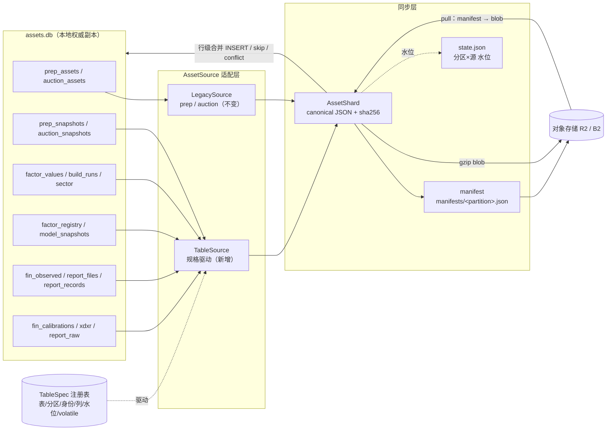
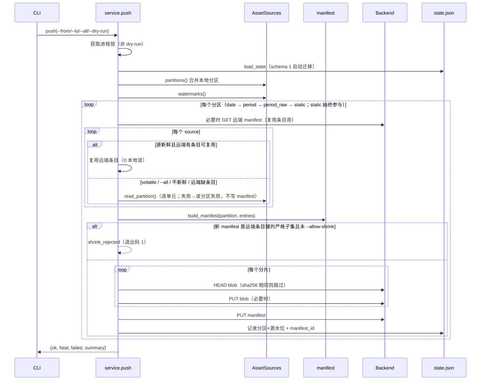
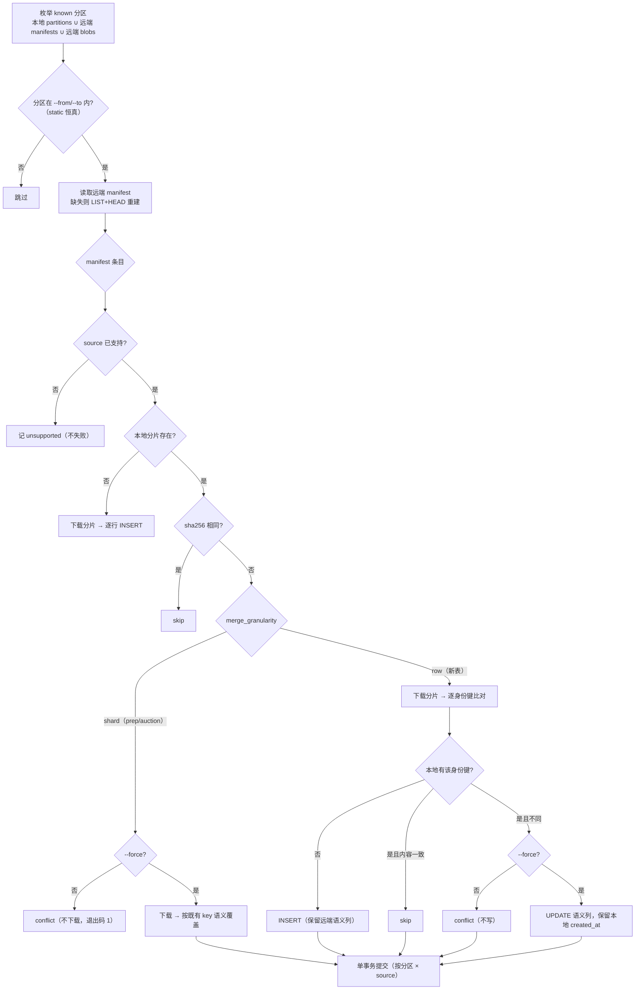
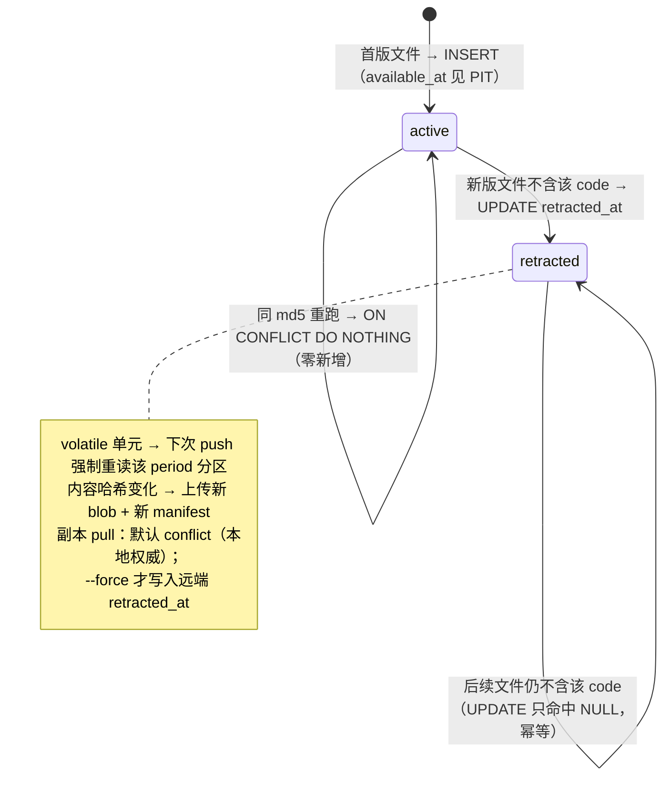

# assets.db 全表云端同步技术方案（M6）
> **当前状态（2026-10-25 整仓结构重构 M0–M12）**：本文中的 `dragon_quant/cli_commands.py` / `dragon_quant/review_account/prep.py` 等实现位置已迁移：命令入口在 `dragon_quant/commands/<command>.py`（经 `commands.dispatch`），prep 在 `dragon_quant/review_account/prep/` 包（service/collectors/compute/rebuild），auction 编排在 `dragon_quant/auction/service.py`，assets CLI 装配在 `dragon_quant/assets_sync/cli_service.py`。历史设计正文保留原样；当前结构与命令以 `AGENTS.md`「架构总览」为准。


> 状态：已归档（M6 已落地，2026-10-23）
> 前置方案：[`2026-10-18-assets-cloud-sync-design.md`](../../docs/solutions/2026-10-18-assets-cloud-sync-design.md)（M1-M4 已落地，M5 调度未开始）
> 实现进度记录（M2-M4）：[`archived_md/assets_sync/2026-10-22-assets-sync-m2-m4-implementation.md`](2026-10-22-assets-sync-m2-m4-implementation.md)
> 范围：`dragon_quant/assets_sync/` + 只读访问 `dragon_quant/storage/assets_db.py`

---

## 0. 决策速览

| # | 决策 | 结论 |
|---|---|---|
| D1 | 同步粒度 | **行级**（规范化 JSON + manifest），不做整库 `.db` 直传 |
| D2 | 本地与云端权威关系 | **本地为权威副本**；pull = 本地有则跳过、缺则补；`--force` 才覆盖 |
| D3 | 同步范围 | assets.db 的 14 张表；**不含 dragon.db**；旧 `prep.db` / dragon.db 遗留竞价表仍不纳入 |
| D4 | 远端布局 | 把「交易日 manifest」泛化为**分区 manifest**，扩展到 date / period / period_raw / static 四类分区 |
| D5 | 同步单元 | 新增**表规格注册表**（`TableSpec`）驱动 12 张新表（`fin_report_files` 拆成元数据 + raw 两个单元）；`prep_assets` / `auction_assets` 两个既有适配器行为不变 |
| D6 | 可变行 | **volatile 单元强制重读**（不信任水位跳过），用内容哈希精确判定；**按 (分区, source) 收窄**，不牵连其它源 |
| D7 | 行级 pull | 新表采用**行级合并**（下载分片后逐身份键 INSERT/skip/conflict）；既有 prep/auction 保持分片级门禁（行为零变化） |
| D8 | 收敛语义 | 就地 pull 是 **append-only 补缺**，不承诺与源端收敛；`status` 仅对 `drift_ok` 的追加式单元、且本地行数严格大于远端时判 `drift`（弱信号，不报错） |
| D9 | raw_blob 隔离 | `fin_report_files.raw_blob` 拆到独立分区 `finraw-<period>`，超大 blob 只影响自身，不阻断账本 |
| D10 | 兼容 | 既有 date 分区 manifest 仍写 **schema 1**（旧客户端可读）；新分区用 **schema 2**；state.json 升 schema 2 并**在线迁移** |

---

## 1. 目标与非目标

### 1.1 目标

1. `assets push / pull / status / verify` 覆盖 assets.db 全部 14 张表，粒度到行/身份键，不做整库文件直传。
2. 保持既有 M2-M4 的全部运维契约：内容哈希身份、manifest 覆盖写、`state.json` 增量水位、pull 默认 dry-run、`--target-dir` 隔离恢复、进程锁、退出码 0/1/2、凭据不入仓。
3. 对**追加式 vintage 表**（`fin_report_records`）的「已同步行后来被 UPDATE（补 `retracted_at`）」提供可感知、可传播的路径，且感知手段是**内容哈希而非水位猜测**。
4. 旧 manifest（schema 1、只含 prep/auction）与新代码双向兼容；新 manifest 对旧客户端最多表现为 `unsupported`，不产生破坏；回滚期间的已知误报显式声明。
5. 不改变 `prep` / `auction` / `factor` / `factor fin` 任何命令的读写行为；同步层是纯读取方（pull 只做插入/`--force` 更新）。

### 1.2 非目标

- **dragon.db 不同步**（本期明确排除）。
- 不做整库 `.db` 文件直传（无法行级合并、无法跨版本冲突检测）。
- 不做云端多版本回放 / `--manifest-id` 回放（前案 §13 既有非目标）。
- 不做 pull 端删除传播（本地权威 → 副本永不删除行；删除只在 push 端通过 manifest 收缩检测 + `--allow-shrink` 表达）。
- 不新增表、不改任何表的列 / 约束 / 索引。
- 不实现 `--tables` 白名单、不做分片槽位（slot）拆分（预留触发条件，见 §14.3）。
- M5 调度（launchd / `assets_daily.sh` / 门槛 B）仍独立待做，本方案不接管。

### 1.3 验收标准 → 设计落点

| 验收标准 | 设计落点 |
|---|---|
| 14 张表全部可 push/pull，行级身份明确 | §5 同步单元注册表（逐表身份键/分区/水位） |
| fin_* 无统一交易日也可同步 | §6 分区模型（date / period / period_raw / static） |
| 撤销（retracted_at）可感知、可传播 | §7.2 volatile 强制重读 + §9 可变行 + pull `--force` |
| 旧 manifest / state 不报孤儿或冲突 | §13 向后兼容（schema 1/2 双读、state 迁移、回滚误报声明） |
| 不改变既有命令行为 | §10 行为矩阵 + §15 回归（prep/auction 分片哈希金样本） |
| 体积与开销可接受 | §14 体积估算、volatile 作用域收窄、分片阈值 |
| 运维不因副本漂移长期 exit 1 | §8.3 status `drift` 判定 + §9.3 收敛契约 |

---

## 2. 现状与代码事实

### 2.1 已落地的同步层（M2-M4）

- `sources.py`：`PrepAssetSource` / `AuctionAssetSource` 两个适配器；`build_sources(db_path)` 按调用期路径构造；`read_date()` 返回 `ShardBatch(shards, failed)`；`watermarks()` 返回 `{trade_date: "<max_created_at>|<count>|<bytes>"}`。
- `codec.py`：`canonical_json`（键排序 + 紧凑分隔符 + `allow_nan=False`）+ 内容 sha256/md5 + 确定性 gzip；blob 键 `blobs/<date>/<source>_<type>.<sha>.json.gz`，manifest 键 `manifests/<date>.json`；`manifest_id` 只对条目逻辑身份字段求哈希。
- `manifest.py`：`build_manifest` / `read_remote_manifest` / `rebuild_manifest`（LIST + HEAD 重建，同候选默认歧义，`--pick latest` 才选最新并标 degraded）。
- `state.py`：`state.json` 只由 push 写；水位 `dates.<date>.sources.<name>.watermark`；目录进程锁。
- `service.py`：`push/pull/status/verify` 统一返回 `{ok, fatal, failed, summary}`；pull 默认 dry-run，分片级「缺则下载、哈希不同则 conflict（`--force` 覆盖）」；status/verify 按日期逐条对齐。

### 2.2 需要纳入的表（assets.db）

权威定义：`dragon_quant/storage/assets_db.py`（`BASE_SCHEMA`）——因子/财务表虽由 `storage/factors.py`、`storage/finance.py` 提供读写 API，但**物理建表集中在 `assets_db.BASE_SCHEMA`**。

| 表 | 主键 / 唯一键 | 关键列 | 写入侧可变性 |
|---|---|---|---|
| `prep_assets` | `UNIQUE(trade_date, asset_type)` | `payload_json` | 重采覆盖（ON CONFLICT 刷新 payload + created_at） |
| `auction_assets` | `UNIQUE(trade_date, code)` | `items_json`, `quote_json` | 重采覆盖（quote COALESCE 保留） |
| `prep_snapshots` | `UNIQUE(trade_date, source)` | `result_json` | **原地 UPSERT**（`assets_db.py:471-479`，刷新 result_json + created_at） |
| `auction_snapshots` | `UNIQUE(trade_date, code, source)` | `analysis_json` | 整日 DELETE+INSERT（`assets_db.py:707-733`） |
| `factor_values` | `UNIQUE(trade_date, code, factor_name, factor_version)` | `value`, `available_at`, `source_meta_json` | 整日整因子 DELETE+INSERT（`factors.py:63-105`） |
| `factor_registry` | `PK(factor_name, factor_version)` | `spec_hash`, 元数据 | ON CONFLICT DO NOTHING（语义不可变） |
| `factor_build_runs` | **无唯一键**（`id` AUTOINCREMENT） | `trade_date`, `report_json` | 仅追加 |
| `factor_sector_snapshots` | `UNIQUE(trade_date, code, category)` | `industry_*`, `category` | 整日 DELETE+INSERT |
| `factor_model_snapshots` | `PK(model_name, model_version)` | `params_json` | 语义不可变 |
| `fin_observed_snapshots` | `UNIQUE(trade_date, code)` | `values_json`, `values_hash`, `updated_date`, `captured_at` | **原地 UPSERT**（`finance.py:63-118`；回退分支只刷新 captured_at） |
| `fin_report_files` | `PK(report_period, md5)` | `status`, `records_count`, `raw_blob`, `error` | **原地 UPDATE**（`finance.py:243-270`） |
| `fin_report_records` | `PK(report_period, code, file_md5)` | `values_json`, `available_at`, `retracted_at` | 追加 vintage + **撤销 UPDATE**（`finance.py:356-420`） |
| `fin_field_calibrations` | `PK(layout_key)` | `mapping_json`, `status`, `calibrated_at` | **原地 UPDATE**（`finance.py:582-608`） |
| `fin_xdxr_records` | `UNIQUE(code, ex_date, category)` | `payload_json` | **UPSERT 改 payload，created_at 不变**（`finance.py:652-682`） |

### 2.3 现状缺口

1. 同步单元 = 「日 + (source,type)」，`prep_snapshots` / `auction_snapshots` / 全部 `factor_*` / `fin_*` 完全不上传（`status` 硬编码 `not_synced`）。
2. 水位模型假设「按交易日聚合 + 时钟列单调」；但 **`prep_snapshots`、`fin_observed_snapshots` 是原地 UPSERT，`fin_report_records` 撤销是原地 UPDATE**，三者都会出现「行数不变 + 长度可能不变」的内容变化。水位是启发式，无法作为 PIT 关键表的唯一守卫。
3. pull 的「分片哈希不同 → conflict，不下载」门禁对新表不成立：新表一个分片聚合多行，副本只要缺一行，分片哈希就不同，按旧门禁永远补不上缺失行。
4. `factor_build_runs` 无业务唯一键，跨实例自增 `id` 不可作为身份；且构建报告里嵌入了本机自增 `build_ids`（`factors/service.py:106`），不能直接拿整份 report 求内容身份。
5. `fin_report_files.raw_blob` 是 BLOB，无法直接进 JSON；且与账本同分区会把「单条超大 blob」的失败放大成「整期账本不备份」。

---

## 3. 候选设计

### 3.1 方案 A（推荐）：分区 manifest 扩展 + 表规格注册表 + 行级合并

**做法**：把「交易日 manifest」泛化为「分区 manifest」。分区键分四类：`YYYY-MM-DD`（交易日，与既有完全一致）、`fin-YYYY-MM-DD`（报告期）、`finraw-YYYY-MM-DD`（报告期原始 blob）、`static-<domain>`（维度表）。每张表 = 一个同步单元，由数据化 `TableSpec` 描述（表名 / 分区列 / 身份键 / 列清单 / 排序 / 旁路列 / 水位表达式 / 是否 volatile / 合并粒度）。分片 = 「分区 × 单元」一个，payload 为 `{schema, table, columns, rows}`。push 按 **(分区, source)** 判定新鲜度并复用远端条目；pull 对新表做行级合并。

**优点**：复用全部既有机制（codec / manifest_id / 重建 / 锁 / 退出码）；date 分区 manifest 保持 schema 1，旧客户端兼容；新增表 = 注册一行规格；身份键单点定义；volatile 只重读小型源，增量特性保留。
**缺点**：一个分区内任一行变化 → 该分片整体重传；pull 下载粒度为分片（当前体积下可接受）。

### 3.2 方案 B（非常规）：每表独立命名空间 + 行级内容寻址（Merkle 对账）

**做法**：`tables/<table>/manifest.json` 维护 `row_key -> row_sha256` 全表映射（或两级 Merkle 树）；行（或行批）单独存 `rows/<table>/<row_sha>.json.gz`，跨分区去重。同步 = 比较 Merkle 根，只取缺失行哈希。无分区、无日期 manifest。

**优点**：真正的最小增量（改一行只传一行）；跨日/跨期天然去重；天然支持行级删除传播。
**缺点**：manifest 随行数线性增长（`fin_report_records` 一年 6 万行以上，全表映射 5-10MB 每次都要 GET/解析）；`--from/--to` 日期语义需在客户端重建；与既有 manifest/state/verify 全部推翻重做；R2 请求数与读放大显著；实现与测试成本是 A 的数倍。当前总量（§14）远未到需要行级去重的规模。

### 3.3 方案 C（折中）：分区 manifest + 分片槽位（slot）

在 A 基础上允许一个分区内同表切成多个分片（按 `factor_name`、`file_md5` vintage 等），manifest 键扩展为 `<source>:<asset_type>#<slot>`，blob 键加槽位段。

**优点**：变更爆炸半径更小（改一个因子只传该因子分片）。
**缺点**：blob 键自描述/指针校验、重建歧义判定、pull 决策、`--pick latest` 全部要支持槽位维度。当前规模不需要。

### 3.4 推荐与理由

**采纳 A**，并把 C 作为「分片体积超阈值」时的**预留升级路径**（§14.3），本期不实现。

理由：
1. 用户已拍板「沿用现有规范化 JSON + manifest 架构」；B 等于重写，C 超出当前规模需求。
2. A 的 manifest 条目数只与「表数量」相关（每日 ≤ 19 条），与行数无关；分片体积由分区自然上界（一天 / 一个报告期）约束。
3. A 对旧客户端最友好：date 分区 manifest 仍是 schema 1，新表条目只是多出来的 `unsupported`。
4. 行级语义由 pull 的**行合并**保证，而不是由传输粒度保证——匹配「本地权威 + 缺则补」。
5. 为解决「水位启发式 vs 原地 UPDATE」的矛盾，A 用 **volatile 强制重读 + 按源收窄**：只让小表的源每次都读，增量特性不被拖垮。

---

## 4. 架构设计

### 4.1 数据流



### 4.2 模块职责

| 模块 | 变更 | 职责 |
|---|---|---|
| `assets_sync/tables.py`（新） | 新增 | `TableSpec` 数据类 + `TABLE_SPECS` 注册表 + `CompositeTableSource`（规格驱动的读/水位/恢复/行级合并） |
| `assets_sync/sources.py` | 扩展 | 注册表加入新源；协议新增 `partitions()` / `read_partition()` / `volatile_partitions()`；保留 `read_date()` 兼容别名 |
| `assets_sync/codec.py` | 扩展 | 分区键校验与解析、表分片 envelope、manifest schema 1/2 序列化与解析、blob 键（不变） |
| `assets_sync/manifest.py` | 扩展 | `build_manifest(partition, ...)`、按分区重建、schema 2 解析、条目 `rows` 诊断字段 |
| `assets_sync/state.py` | 扩展 | `STATE_SCHEMA=2`（`partitions`）+ schema 1 在线迁移 |
| `assets_sync/service.py` | 扩展 | 分区循环、按源新鲜度与条目复用、行级 pull、status/verify 分区化与 drift 判定 |
| `assets_sync/sources.py`（既有两个类） | **零变化** | prep/auction 分片字节与恢复语义不动（回归测试用金样本锁定） |
| `dragon_quant/cli_commands.py` | 小改 | 人读摘要、`not_synced`/`tables` 口径、drift 展示 |

### 4.3 设计模式与动机

- **注册表模式（Registry）**：`TABLE_SPECS` 是唯一事实源，新增表 = 加一行规格；与 `prep.ASSET_COLLECTORS`、`scorers.registry` 的既有约定一致。动机：消除「表 × 生命周期阶段」的重复代码。
- **模板方法（Template Method）**：`CompositeTableSource` 固定「枚举分区 → 读取 → 组 shard → 水位 → 恢复 → 行合并」骨架，差异点（分区表达式、列/身份、特殊编码）由 `TableSpec` 与少量 hook（`_encode_cell` / `_decode_cell`）提供。动机：避免 12 份近似实现漂移。
- **策略（Strategy）**：`partition_kind` 决定分区枚举与 `--from/--to` 过滤策略；`merge_granularity`（shard / row）决定 pull 决策策略；`volatile` 决定新鲜度策略。
- **适配器（Adapter）**：DB 行 → 规范化 JSON 分片；对象存储后端已有 `S3Backend` / `LocalDirBackend` 实现同一协议。
- **组合（Composite）**：一个 domain source（`factor` / `fin`）聚合多张表，对外仍表现为一个 `AssetSource`，service 无需感知表数量。

> 不做过度抽象：不引入通用 ORM/反射式表映射；`TableSpec` 只描述同步所需的字段；特殊表（auction quote COALESCE、build_runs 内容身份、raw_blob base64）用显式 hook，而不是给所有表加开关。

---

## 5. 同步单元注册表

### 5.1 `TableSpec` 定义

```python
@dataclass(frozen=True)
class TableSpec:
    source: str                 # 不含 '_'，如 prep / auction / prepsnap / factor / fin
    asset_type: str             # manifest 键第二段
    table: str                  # assets.db 表名
    partition_kind: str         # "date" | "period" | "period_raw" | "static"
    partition_column: str | None  # date: trade_date/ex_date；period(_raw): report_period；static: None
    static_partition: str | None  # static 分区键（如 "static-factor"）
    columns: tuple[str, ...]    # 语义列（进内容哈希），顺序即 payload 列序
    identity: tuple[str, ...]   # 行身份键（恢复时比对）
    side_columns: tuple[str, ...]  # created_at / computed_at：不传、不哈希、不还原
    json_columns: tuple[str, ...]  # 文本列，导出时解析为对象、导入时序列化
    order_by: tuple[str, ...]   # 确定性排序（决定内容哈希）
    volatile: bool              # True：push 时跳过水位短路，强制重读
    clock_column: str | None    # 水位 max 列
    size_expr: str              # 水位字节表达式（SQL 表达式）
    merge_granularity: str      # "row" | "shard"
    filter_sql: str = ""        # 可选 WHERE（如 report_raw: raw_blob IS NOT NULL）
    identity_hook: str | None = None   # "build_run_uid"
    drift_ok: bool = False      # 仅追加式单元：status 允许把「本地行数更多」判 drift
    null_fill_columns: tuple[str, ...] = ()  # 本地 NULL 时允许由远端补齐的列（raw_blob）
```

### 5.2 逐表定义

| # | 表 | source | asset_type | 分区 | 分区列 | 身份键 | 排序 | 旁路列 | volatile | 水位 clock / bytes |
|---|---|---|---|---|---|---|---|---|---|---|
| 1 | `prep_assets` | `prep` | 动态（dragons…） | date | `trade_date` | `(trade_date, asset_type)` | `asset_type` | `created_at` | 否 | 既有实现（不变） |
| 2 | `auction_assets` | `auction` | `assets` | date | `trade_date` | `(trade_date, code)` | `code` | `created_at` | 否 | 既有实现（不变） |
| 3 | `prep_snapshots` | `prepsnap` | `snapshots` | date | `trade_date` | `(trade_date, source)` | `source` | `created_at` | **是** | `MAX(created_at)` / `LENGTH(result_json)` |
| 4 | `auction_snapshots` | `auctionsnap` | `snapshots` | date | `trade_date` | `(trade_date, code, source)` | `source, code` | `created_at` | **是** | `MAX(created_at)` / `LENGTH(analysis_json)` |
| 5 | `factor_values` | `factor` | `values` | date | `trade_date` | `(trade_date, code, factor_name, factor_version)` | `factor_name, factor_version, code` | `computed_at` | 否 | `MAX(computed_at)` / `LENGTH(source_meta_json)+LENGTH(COALESCE(source_scan_id,''))` |
| 6 | `factor_build_runs` | `factor` | `build_runs` | date | `trade_date` | **`run_uid`**（内容哈希，剔除本机 `id`/`build_ids`） | `started_at, run_uid` | `created_at`（`id` 不进分片） | 否 | `MAX(created_at)` / `LENGTH(report_json)` |
| 7 | `factor_sector_snapshots` | `factor` | `sector` | date | `trade_date` | `(trade_date, code, category)` | `code, category` | `created_at` | 否 | `MAX(created_at)` / `LENGTH(industry_code)+LENGTH(industry_name)+LENGTH(COALESCE(scan_id,''))` |
| 8 | `factor_registry` | `factor` | `registry` | static | — | `(factor_name, factor_version)` | `factor_name, factor_version` | `created_at` | 否 | `MAX(created_at)` / 全列长度和 |
| 9 | `factor_model_snapshots` | `factor` | `model` | static | — | `(model_name, model_version)` | 同名 | `created_at` | 否 | `MAX(created_at)` / `LENGTH(params_json)+LENGTH(factor_versions_json)` |
| 10 | `fin_observed_snapshots` | `fin` | `observed` | date | `trade_date` | `(trade_date, code)` | `code` | —（`captured_at` 是 PIT 语义，进内容） | **是** | `MAX(captured_at)` / `LENGTH(values_json)` |
| 11 | `fin_report_files`（元数据） | `fin` | `report_files` | period | `report_period` | `(report_period, md5)` | `md5` | —（`first_seen_at` 是 PIT 语义） | **是** | `MAX(first_seen_at)` / `LENGTH(status)+records_count+LENGTH(COALESCE(error,''))` |
| 12 | `fin_report_files.raw_blob` | `fin` | `report_raw` | period_raw | `report_period` | `(report_period, md5)` | `md5` | — | **是** | 同表；`WHERE raw_blob IS NOT NULL` |
| 13 | `fin_report_records` | `fin` | `records` | period | `report_period` | `(report_period, code, file_md5)` | `file_md5, code` | — | **是** | `MAX(available_at)` / `LENGTH(values_json)+LENGTH(COALESCE(retracted_at,''))` |
| 14 | `fin_field_calibrations` | `fin` | `calibrations` | static | — | `(layout_key)` | `layout_key` | `calibrated_at` | **是** | `MAX(calibrated_at)` / `LENGTH(mapping_json)+LENGTH(confidence_json)` |
| 15 | `fin_xdxr_records` | `fin` | `xdxr` | date | `ex_date` | `(code, ex_date, category)` | `ex_date, code, category` | `created_at` | **是** | `MAX(created_at)` / `LENGTH(payload_json)` |

说明：

- **source 命名隔离**：`prepsnap` / `auctionsnap` 独立于 `prep` / `auction`，避免未来 `prep_assets` 出现名为 `snapshots` 的 asset_type 时 manifest 键 `prep:snapshots` 冲突。blob 名 `prepsnap_snapshots.<sha>.json.gz` 与既有 `prep_<type>` 天然不冲突。
- **volatile 集合（8 个单元）**：`prepsnap` / `auctionsnap` / `fin:observed` / `fin:report_files` / `fin:report_raw` / `fin:records` / `fin:calibrations` / `fin:xdxr`。共同点是存在**原地 UPSERT/UPDATE**，或写入行数极小、强制重读成本可忽略。非 volatile 的因子表全部依赖「DELETE+INSERT 必然刷新时钟列」这一事实。
- **非 volatile 的残余风险（显式声明，适用于所有非 volatile 单元）**：
  - `factor_values` / `factor_sector_snapshots` 的 `computed_at` / `created_at` 是 `datetime('now','localtime')`（秒精度）。若同一秒内重跑、行数与序列化长度完全一致但值不同，水位 token 可能不变而被短路。二者是**可重算的派生数据**，登记在 §16，不作为 PIT 事实来源。
  - `prep_assets` / `auction_assets` 的写入侧（`save_prep_assets`）会刷新 `created_at`，但**恢复侧**（`restore_prep_assets` / `restore_auction_assets` 的 `--force` 分支）只 `UPDATE payload_json/items_json`、**不刷新 `created_at`**。因此在主库上执行过 `pull --force` 的日期，随后 push 时若内容等长变化，水位可能不感知。**运维契约：禁止在主库对 prep/auction 执行 `pull --force`；恢复一律走 `--target-dir`。若已发生，下次 push 对该日期用 `--all` 或显式 `--from/--to` 重推。**
  - 结论：水位只是短路优化，不是内容一致性证明；关键 PIT 表已全部 volatile，其余非 volatile 单元的盲区见 §7.3 对照表与 §16 风险表。**不采用**「不存在等长原地更新」的绝对表述。
- **`fin_xdxr_records` 按 `ex_date` 分区**：`ex_date` 本身是事实日期，落在 `YYYY-MM-DD` 分区，`--from/--to` 语义自然；代价是可能产生「某日只有 xdxr 一个条目」的小 manifest（体积可忽略）。当前代码中 `insert_xdxr_records` 尚无调用方，实际为空表；一旦接入，该源在所有 date 分区为 volatile（按源收窄，见 §7.2）。
- **`fin_report_files` 拆两个单元**（D9）：
  - `fin:report_files` = 元数据（`filename/filesize/first_seen_at/status/records_count/error`），落 `fin-<period>` 分区；
  - `fin:report_raw` = `raw_blob_b64`，落 `finraw-<period>` 分区，`filter_sql = "raw_blob IS NOT NULL"`。
  这样单条超大 `raw_blob` 只让 `finraw` 分区失败，**不会阻断同报告期账本（`fin:records`）与元数据的备份**，也不必引入槽位机制。
- **`captured_at` / `first_seen_at` / `available_at` 必须进内容**：它们参与 PIT 判定（`factors/finance.py` 的 observed 证明、vintage 可用时刻），丢失会让副本产生错误的时点语义。相对地，`created_at` / `computed_at` / `calibrated_at` 只作观测，按既有 D10 约定旁路。
- **`factor_build_runs` 身份**：`run_uid = sha256(canonical_json({trade_date, started_at, finished_at, report_stable}))`，其中 `report_stable` = report 剔除本机自增 `build_ids`（`factors/service.py:106`）后的规范化对象。`id` 不进分片；恢复后的审计行携带的是**源机 build_ids**，只作参考，不得当作本地 id 使用；同一秒内两次内容相同的 build 会被去重为一行（已知限制，记录在 §16）。
- **`fin_report_raw` 的恢复前提与 NULL-fill**：raw 只作用于既有 `fin_report_files` 元数据行；pull 处理顺序保证 `fin-*` 分区先于 `finraw-*` 分区；若元数据行缺失（跨范围拉取或元数据恢复失败），记 `deferred` 而不是失败。
  `raw_blob` 是该单元唯一的语义列，且典型场景正是「元数据行刚由本次 pull 插入、本地 `raw_blob` 为 NULL」。因此为该单元定义 **COALESCE NULL-fill**（`null_fill_columns=("raw_blob",)`，与 `auction_assets.quote_json` 的既有 COALESCE 语义对齐）：
  - 本地 `raw_blob IS NULL` → 直接写入远端值（**无需 `--force`**，保证 `--target-dir` 权威恢复可用）；
  - 本地非空且与远端不同 → 默认 `conflict`，`--force` 才覆盖；
  - 本地非空且相同 → `skip`。

### 5.3 单元 → 源 → 分区

| source | 包含单元 | 参与的分区 |
|---|---|---|
| `prep` | prep_assets | date |
| `auction` | auction_assets | date |
| `prepsnap` | prep_snapshots | date |
| `auctionsnap` | auction_snapshots | date |
| `factor` | values / build_runs / sector | date |
| `factor` | registry / model | static-factor |
| `fin` | observed / xdxr | date |
| `fin` | report_files / records | fin-`<period>` |
| `fin` | report_raw | finraw-`<period>` |
| `fin` | calibrations | static-fin |

`CompositeTableSource.read_partition(p)` 只返回「该源在此分区有对应规格」的分片；无对应规格或表为空 → 返回空 `ShardBatch`（不是错误）。

---

## 6. 分区模型与远端布局

### 6.1 分区键

| kind | 正则 | sort_date（`--from/--to` 依据） | 示例 |
|---|---|---|---|
| date | `^\d{4}-\d{2}-\d{2}$` | 键本身 | `2026-10-22` |
| period | `^fin-\d{4}-\d{2}-\d{2}$` | 键去掉 `fin-` | `fin-2026-06-30` |
| period_raw | `^finraw-\d{4}-\d{2}-\d{2}$` | 键去掉 `finraw-` | `finraw-2026-06-30` |
| static | `^static-[a-z]+$` | `""`（**不受日期区间过滤**，始终参与） | `static-factor` |

- 远端只认这四类；`manifests/` 下的其他文件名在列举时忽略（不致命），`blobs/` 下无法解析的分区前缀同样忽略。
- 处理顺序固定为 `date → period → period_raw → static`（保证 raw 的元数据先行、日期区间语义一致）。排序键：`(kind_rank, sort_date, partition)`。
- 分区键全局唯一；date 分区可容纳多个 source 的分片（与现状一致），其余分区按 §5.3 归属单一 source。

### 6.2 远端键布局（与旧版同构）

```
<root>/blobs/<partition>/<source>_<asset_type>.<content_sha256>.json.gz
<root>/manifests/<partition>.json
```

`parse_blob_key` 语义不变（source 不含 `_`，asset_type 可含 `_`）。

### 6.3 Manifest schema 1 / 2

- **date 分区**：继续写 **schema 1**，字段与旧版完全一致（`trade_date` = 分区键）。新增表只是多出条目；旧客户端读到不认识 `source` 时走既有 `unsupported` 分支。
- **period / period_raw / static 分区**：写 **schema 2**：

```json
{
  "schema": 2,
  "partition": "fin-2026-06-30",
  "partition_kind": "period",
  "sort_date": "2026-06-30",
  "manifest_id": "<64 hex>",
  "generated_at": "2026-10-23T20:00:05+08:00",
  "generator_version": "0.7.x",
  "manifest_source": "push",
  "assets": {
    "fin:records": { "source": "fin", "asset_type": "records", "sha256": "...", "md5": "...",
                     "size": 123, "rows": 4821,
                     "blob": "blobs/fin-2026-06-30/fin_records.<sha>.json.gz",
                     "blob_sha256": "...", "blob_size": 45, "schema": 1 }
  }
}
```

- 读取端接受 schema 1 与 2；`expected_trade_date` 参数保留为兼容别名，新参数名 `expected_partition`。校验规则：schema 1 → `trade_date` 必须等于请求分区且分区 kind 必须是 date；schema 2 → `partition` 必须相等，`partition_kind`/`sort_date` 必须与键一致。
- `manifest_id` 仍只对条目逻辑身份字段求哈希 → 同一组条目在 schema 1/2 下 id 相同，**schema 升级不改变幂等语义**。
- 条目键仍为 `<source>:<asset_type>`，同一分区内唯一。
- 新增 `rows` 字段：行级分片的行数，**不进入 identity**（不影响 `manifest_id`），只供 status 判定 drift；旧 manifest 缺该字段时按 `None` 处理。

### 6.4 表分片 payload

```json
{
  "schema": 1,
  "table": "factor_values",
  "partition": "2026-10-22",
  "columns": ["trade_date","code","factor_name","factor_version","value",
              "available_at","source","source_scan_id","source_meta_json"],
  "rows": [
    ["2026-10-22","600172","five_dim_drive","v1",78.5,
     "2026-10-22T15:05:00","scan","v2_20261022_25",{"coverage":0.82,"skipped":3}]
  ]
}
```

- `columns` 为权威列序；`rows` 为与列序对应的数组（紧凑、稳定）。
- `json_columns` 以**解析后的对象**入列（如 `source_meta_json` / `report_json` / `values_json` / `mapping_json`），保证不同机器上原始文本键序差异不影响内容哈希。
- `side_columns` 不出现在 `columns` 中。
- 行按 `order_by` 升序；空分区不产出分片（与既有「不写空条目」一致）。
- **schema 漂移容错按列可空性分派**：
  - 缺失的**身份列** → 该分片 integrity 失败（不写、不半写）。
  - 缺失的**非身份列**：读取本地表 `PRAGMA table_info(<table>)` 的 `notnull` / `dflt_value`——
    - 可空（`notnull=0`）→ 按 `null` 处理，计 `schema_drift` 告警；
    - `NOT NULL` 且**有默认值** → 从 INSERT 列清单中省略，由 SQLite 默认值补齐；
    - `NOT NULL` 且**无默认值** → 该分片 integrity 失败（绝不用 null 触发约束错误或静默丢行）。
  - 多余列忽略。

### 6.5 哈希与确定性

沿用既有口径（前案 §5.4）：内容 sha256/md5 对**未压缩规范化 JSON**计算；gzip `mtime=0`；传输哈希另算。新增约束：

- **两档阈值**（未压缩、单分片）：
  - `WARN_SHARD_BYTES = 16 MiB`：记 `shard_large` 警告（不失败），提示考虑槽位拆分；
  - `MAX_SHARD_BYTES = 32 MiB`：该分区失败、不写 manifest，报告 `shard_too_large`。
- `raw_blob` 已拆独立分区（§5.2），超限只影响 `finraw-<period>`，不阻断账本。

---

## 7. state.json 与水位

### 7.1 新结构（`STATE_SCHEMA = 2`）

```json
{
  "schema": 2,
  "hostname": "host-a",
  "updated_at": "2026-10-23T20:00:10+08:00",
  "last_success_trade_date": "2026-10-23",
  "partitions": {
    "2026-10-23": {
      "kind": "date", "codec": 2,
      "manifest_id": "<id>", "pushed_at": "...",
      "sources": {
        "prep": {"watermark": "...|9|223227", "max_created_at": "...",
                 "entries": ["prep:dragons", "prep:collection_report"]},
        "auction": {"watermark": "...", "max_created_at": "...", "entries": ["auction:assets"]},
        "factor": {"watermark": "...", "max_created_at": "...",
                   "entries": ["factor:values", "factor:build_runs", "factor:sector"]}
      }
    },
    "fin-2026-06-30": {"kind": "period", "codec": 2, "manifest_id": "...", "sources": {"fin": {...}}},
    "static-factor": {"kind": "static", "codec": 2, "manifest_id": "...", "sources": {"factor": {...}}}
  }
}
```

- `last_success_trade_date` 只在 **date 分区**成功推送时推进。
- `codec` 升为 **2**（新表分片语义 + 分区化），旧值 1 视为不新鲜 → 每个分区首次 push 重读一次。
- **在线迁移**：`load_state` 读到 schema 1 时，把 `dates` 原样映射为 `partitions`（`kind="date"`，保留原 `codec`/`sources`），不丢历史水位；`save_state` 一律写 schema 2。state 只是缓存，迁移失败也可退回空骨架（现有容错）。
- **`sources.<name>.entries`**：上次成功推送时该源在该分区的**条目键集合**。仅用于「复用守卫」（§7.2），不参与 manifest_id；schema 1 迁移来的旧记录没有 `entries` → 该源视为不新鲜、重读一次后补齐。

### 7.2 新鲜度：**按 (分区, source)** 判定 + 远端条目复用

水位 token 不变：`"<max_clock>|<row_count>|<sum_bytes>"`。`watermarks()` 返回 `{partition: token}`（跨该 source 在该分区的所有单元聚合：clock 取最大、count 相加、bytes 相加）。

**为什么不能是分区级**：若 volatile 判定落在分区级，`fin:xdxr`（date 分区 volatile）会迫使该日期所有 source（prep 9 类、auction、factor、其它）全量重读，日更 push 退化为 O(全历史)。因此新鲜度必须按源计算，并允许**复用远端 manifest 中未变化源的条目**。

push 单分区算法：

```
p = 当前分区
remote = read_remote_manifest(p)          # 仅当存在时才可能复用
entries = {}
for source in sources:
    if remote is not None and source_fresh(source, p, remote):
        entries.update({k: remote.assets[k] for k in remote.assets if k.startswith(source.name + ":")})
    else:
        batch = source.read_partition(p)
        if batch.failed: → 该分区失败，不写 manifest（终止）
        entries.update(build entries from batch)

built = manifest_from_entries(p, entries)

source_fresh(s, p, remote):
    p not in s.volatile_partitions()                                  # volatile 永不短路
    and state.partitions[p].codec == CODEC_VERSION                    # codec 升级后首次必重读
    and s.name in state.partitions[p].sources                         # 迁移/新源首推必读
    and state.partitions[p].sources[s.name].watermark == s.watermarks()[p]
    and set(state.partitions[p].sources[s.name].entries or []) \
        <= {k for k in remote.assets if k.startswith(s.name + ":")}    # 远端条目集合 ⊇ 上次推送集合
```

（最后一个条件是**条目完整性守卫**：不能只要求「远端还有该源任一条件」（那样远端部分条目丢失会被永久固化）。必须要求远端现存条目集合包含 state 记录的上次成功集合；任一缺失 → 重读重建。state 无 `entries`（schema 1 迁移）→ 重读一次后补齐。）

- `volatile_partitions()`：由 `volatile=True` 的单元反推。**作用域 = 该 source 的分区**：`fin` 在全部 date 分区 volatile（xdxr/observed）、在全部 `fin-*` / `finraw-*` / `static-fin` 分区 volatile；`prepsnap` / `auctionsnap` 各自只在自己参与的 date 分区 volatile。**不污染同一分区的其它 source**。
- volatile 分期每次 push 都读取并重算内容哈希，只在哈希未变时跳过上传（0 blob PUT；必要时仅刷新 manifest 的旁路字段）。
- 非 volatile 源按水位短路；`--all` 对所有源强制重读。
- 代价：volatile 源每次 push 全量读取本地行。per-check：`prep_snapshots` 1 行/日、`auction_snapshots` ~10 行/日、`fin:observed` ~候选数/日、`fin:records` ≤ 数千行/期（仅 4-8 个期）、`finraww` ≤ 数行/期、`fin:xdxr` 当前为空。SQLite 本地读取在毫秒级。

### 7.3 为什么水位不能单独承担「已同步行后来被 UPDATE」

三类原地变化的水位盲区：

| 表 | 变化 | 水位能否感知 |
|---|---|---|
| `prep_snapshots` | UPSERT 覆盖 `result_json` | 写路径必刷新 `created_at`；同一秒内等长覆盖仍可能漏 |
| `fin_observed_snapshots` | UPSERT 覆盖 `values_json/values_hash/updated_date`；回退分支只刷 `captured_at` | 可能漏（`captured_at` 由调用方传入，同一 sync 内相同） |
| `fin_report_records` | UPDATE `retracted_at`（行数、`available_at` 不变） | 基本不能 |
| `fin_report_files` | UPDATE `status/records_count/raw_blob/error` | 基本不能 |
| `fin_field_calibrations` | UPDATE 映射/状态（`calibrated_at` 刷新） | 同 `prep_snapshots` |
| `fin_xdxr_records` | UPSERT `payload_json`（`created_at` **不变**） | **不能** |

结论：对这些表一律 **volatile 强制重读**，用内容哈希给出确定性判定；水位仅用于「非 volatile 派生表」的短路优化，且其残余风险显式登记（§16）。

---

## 8. 核心流程

### 8.1 push



要点：

- 分区枚举 = 各 source `partitions()` 并集；`--from/--to` 用 `sort_date` 过滤；**static 分区不受过滤**。
- 复用远端条目是「按源收窄 volatile」的前提：只有被判定新鲜的源才复用，被重读的源用新分片；两者合并成新 manifest。
- `read_partition` 抛源级异常 → 该分区 fatal；`ShardBatch.failed` 非空 → 该分区失败但不写 manifest（沿用既有语义）。
- 收缩保护只针对**条目键集合**（整表/整来源消失），不针对行数减少；行删除通过内容哈希自然产生新 blob。
- 首次全量推送（state 无记录/迁移后 codec 变化）不会有复用，等同 M4 的全量读。

### 8.2 pull（行级合并）



要点：

- `known` 分区来源：本地适配器分区、远端 manifest 键、远端 blob 分区前缀；无效名称忽略。处理顺序固定（§6.1）。
- **dry-run（默认）**：只报告 `download` / `skip` / 可判定的分片级 `conflict`。行级合并的逐行冲突必须下载后才能判定，dry-run 以 `merge_pending: true` 标注；**人读输出必须区分「已判定 0 冲突」与「未判定（需 `--apply`）」**，不得让用户把 pending 当成干净结果。
- `--apply`：逐分区下载 → 校验（大小/传输哈希/内容哈希，沿用 `_load_blob`）→ 按 (分区, source) 单事务恢复。
- 本地权威：默认**只插入缺失行**；已存在但不同的行一律 conflict；`--force` 才更新语义列（`created_at` 等旁路列保留本地值）。
- **NULL-fill 例外（仅 `null_fill_columns`）**：`fin:report_raw.raw_blob` 在本地为 NULL 时直接写入远端值（无需 `--force`），本地非空且不同才 conflict / `--force` 覆盖。这与 `auction_assets.quote_json` 的既有 COALESCE 语义一致，保证「空库 + `--target-dir --apply`（不带 `--force`）」能完整恢复不可再生 raw_blob。
- `fin:report_raw` 恢复：仅更新既有 `fin_report_files` 行的 `raw_blob`；行不存在 → `deferred`（不失败），正常情况下 `fin-*` 分区先于 `finraw-*` 处理。
- pull 永不读写 state（沿用 D11）。

### 8.3 status / verify

- **默认窗口（注意排序陷阱）**：不能沿用 `sorted(...)[-30:]`——`'fin-'/'stat'` 在字符串序里落在 `'2026-'` 之后，直接取尾会丢掉最近日期分区。实现按 kind 分桶：`date` 取最近 30 个、`period`/`period_raw` 全取、`static` 全取，合并输出；`--all` = 全部分区。
- **对齐与 drift 判定**（新）：
  - 本地区分片缺失 → `dates_missing`（错误）；
  - 本地与远端条目键集合不同 → `dates_mismatched`（错误）；
  - sha 相同 → `ok`；
  - sha 不同，且**同时满足**：该键属于 row 合并单元、`TableSpec.drift_ok=True`（仅追加式：`fin:records` / `fin:observed` / `fin:xdxr` / `factor:build_runs`）、manifest 条目带 `rows`、本地分片行数 **严格大于** 远端 `rows` → `drift`（**弱信号**，`reason="row_count_only"`，不计入 `ok=false`，退出码不受影响）。
  - 其余 sha 不同（含 `factor_values` / `factor_sector_snapshots` 这类 DELETE+INSERT 派生表、snapshot、report_files/raw、registry/model）→ 一律 `mismatched`（错误）。**只有数量比较、没有身份键子集校验**，所以 drift 只能当提示，定性必须用 `verify`。
  - 新增 `summary.dates_drift`（与 `dates`、`dates_missing`、`dates_mismatched` 并列），每条带 `reason`。
- `orphans`：按分区 `LIST blobs/<partition>/`；manifest 缺失的分区仍整体置 `null` 并给 `orphan_reason`（沿用既有语义）。
- `verify --from/--to`：date 分区按自然日展开 + 范围内 period/period_raw 分区 + 全部 static；`--deep` 校验 blob；`--samples` 跨分区抽样。`verify` 不做 drift 豁免——它是字节级校验，差异即报告。
- `status.summary.not_synced` 置空 `{}`（**breaking 值变更**，见 §10/§13），新增 `tables` 覆盖图。

### 8.4 变更感知闭环（fin_report_records 撤销）



---

## 9. 可变行与追加式 vintage 的处理

| 场景 | 感知机制 | 传播路径 |
|---|---|---|
| 行新增（vintage / build_run / observed） | 分区内容哈希变化（或非 volatile 表的 count/clock 变化） | push 新 blob；副本 pull INSERT |
| 行删除（factor day 清理、prep 资产移除） | 内容哈希变化；整表消失 → manifest 条目收缩 | push 受 `--allow-shrink` 保护；副本 pull **不删除** |
| 行 UPDATE（`retracted_at`、`status`、`raw_blob`、`payload_json`、校准、observed） | volatile 表强制重读 + 内容哈希 | push 新 blob；副本 pull 默认 conflict，`--force` 更新 |
| 仅旁路列变化（`computed_at` / `created_at` / `calibrated_at`） | 不进内容哈希 → 不重传 blob；必要时仅刷新 manifest 旁路字段 | 无数据变化 |

### 9.3 收敛契约（显式）

1. **就地 pull = append-only 补缺**，只保证「远端有、本地缺」的行被补齐；不保证与源端收敛（不删除、不覆盖）。
2. 源端删除或修订行后，就地副本会与远端产生差异。`status` 对此分两类：本地行数严格多于远端 → `drift`（预期，退出 0）；否则 `mismatched`（需处理）。`verify` 与 `status --all` 仍如实列出差异。
3. **权威恢复路径**：需要与源端完全一致时，用 `pull --target-dir <新目录> --apply` 重建空库，而不是就地 pull。空库路径下 `raw_blob` 通过 NULL-fill 自动补齐，**不需要 `--force`**。
4. **运维契约**：禁止在主库执行 `pull --force`（恢复侧 UPDATE 不刷新 prep/auction 的 `created_at`，会造成下一次 push 的水位盲区）；恢复一律走 `--target-dir`。若已在主库 force 恢复过，下次 push 对受影响日期用 `--all` 或显式 `--from/--to`。
5. 若未来需要「只补不退」的弱传播，可增加按列的 `--fill-null`（仅把本地 `NULL` 补为远端非 `NULL`，不覆盖非空值）；本期**不做**（`raw_blob` 除外，见上）。
6. `factor_values` 的「缺失 = 无行」语义要求删除也是合法状态；副本保留源端已删除行属于预期漂移，不做自动清理。

---

## 10. 命令行为变化矩阵

| 命令 / 场景 | 现状 | 本方案 | 兼容性 |
|---|---|---|---|
| `push` 默认 | 只扫本地 date 分区；prep/auction | 扫本地全部分区；14 张表 | 多传数据；prep/auction 分片字节不变 |
| `push --from/--to` | 过滤 date | date/period/period_raw 按 `sort_date` 过滤；**static 始终参与** | 文档写明 static 不受区间影响 |
| `push --all` | 忽略水位，全量读 | 同（并覆盖 period/period_raw/static）；`local_empty_remote_present` 覆盖所有分区 | 键名不变 |
| `push --dry-run` | 输出日期/分片数/manifest_id | 输出分区 → action/shards/manifest_id | 仅字段语义扩展 |
| `push` 收缩保护 | 条目键严格子集才拒 | 同（现在可能因某表整体消失触发） | 行为不变，触发面变大 |
| `push` 复用远端条目 | 无 | 新鲜源不再本地读，直接复用远端条目 | 输出 `action=reuse` 可观测 |
| `pull` 默认 | 分片级：缺→下载；异→conflict | 新表行级：异→下载并合并；prep/auction 不变 | 新表冲突在 `--apply` 后才可知（`merge_pending`） |
| `pull --force` | 覆盖既有分片 | 新表逐行 UPDATE 语义列（保留本地旁路列）；`raw_blob` 仍走 NULL-fill、不覆盖非空值 | 更强，但不删除本地多出的行 |
| `pull`（空库 / `--target-dir`） | 逐分片下载 | 行级 INSERT；`raw_blob` NULL-fill，无需 `--force` | 权威恢复路径 |
| `pull --target-dir` | 隔离恢复 | 同，含全部分区 | 静态分区始终恢复；权威恢复路径 |
| `status` | 日期对齐；`not_synced` 硬编码 | 分区对齐；`tables` 覆盖图；`dates_drift`（仅 `drift_ok` 追加式单元、行数更多，弱信号） | `not_synced` 变为 `{}`：**breaking 值变更** |
| `status --orphans` | 按日期 | 按分区 | 语义不变 |
| `verify` | 按日期/抽样 | 分区；`--from/--to` 含 period/period_raw/static | 退出码不变 |
| `verify --from/--to` 单边 | 退出 2 | 同 | 不变 |
| `doctor` | 连通性/元数据回环 | 不变 | — |
| 退出码 | 0/1/2 | 不变（drift 不算失败；冲突/部分失败 1；配置/网络/manifest 不可读 2） | 不变 |
| `--json` 顶层 | `ok/command/failed/summary` | 不变 | `summary` 增键 + `not_synced` 值变更 |

---

## 11. 接口定义

### 11.1 Python 协议（增量）

```python
class AssetSource(Protocol):
    name: str

    # 既有（prep/auction 保持；新源实现为 read_partition 的兼容包装）
    def list_dates(self) -> list[str]: ...
    def read_date(self, partition: str) -> ShardBatch: ...
    def local_index(self, partition: str) -> dict[str, str]: ...
    def watermarks(self) -> dict[str, str]: ...
    def restore(self, partition: str, shards: list[AssetShard], *, force: bool = False) -> RestoreReport: ...

    # 新增
    def partitions(self) -> list[str]: ...                 # 本源涉及的分区键
    def partition_kind(self, partition: str) -> str: ...   # date/period/period_raw/static
    def read_partition(self, partition: str) -> ShardBatch: ...
    def volatile_partitions(self) -> set[str]: ...         # 必须强制重读的分区（源级作用域）
```

- **`AssetShard` 新增 `partition` 字段**（非 date 分区不能塞进 `trade_date`）：
  - `partition` 是唯一权威字段；`trade_date` 保留为只读属性（`kind=="date"` 时等于 `partition`，否则 `""`），既有调用方零改动；
  - `codec.blob_key` / `blob_key_parts` / `blob_metadata` / `service._put_manifest` / `manifest_key` 的参数统一改名为 `partition`（位置兼容），对象头 `trade-date` 改为 `partition` 并保留 `trade-date` 旧键（date 分区时写，双写兼容）。
- `Manifest` 增加 `partition` / `partition_kind` / `sort_date`；`trade_date` 变为只读属性（`kind=="date"` 时返回分区键，否则返回 `""`）。
- `ManifestEntry` 增加 `rows: int | None`（非身份字段，不进 `manifest_id`）。
- `ShardBatch` / `SyncReport` 结构不变；`RestoreReport` 新增可选计数 `rows_inserted` / `rows_skipped` / `rows_conflict` / `deferred`，并按需新增 `drift`（status 用）。

### 11.2 CLI

命令形态不变；语义扩展见 §10。无新增必填参数。可选新增（本期不做）：`--tables NAME[,NAME]`。

### 11.3 退出码

| 场景 | 码 |
|---|---|
| 全部成功 / 无差异 / 无冲突 / 仅 drift | 0 |
| 部分分区失败、收缩被拒、pull 冲突（含行级 conflict） | 1 |
| 参数错误、配置/凭据、网络、正式 manifest 不可读、进程锁 | 2 |
| 锁被占用 | 1（沿用现状） |

---

## 12. 错误处理与冲突语义

- **源级异常**（表不可读 / `_connect` 失败 / schema 形状不匹配）→ 分区 fatal（退出 2），不继续写该分区 manifest。
- **分片级失败**（单行 JSON 损坏、`allow_nan` 拒绝、身份列缺失、`NOT NULL` 无默认列缺失、超过 `MAX_SHARD_BYTES`）→ 该分区 `failed`，**不写 manifest**（与 M3 约定一致，避免把有损数据当最佳状态）。`WARN_SHARD_BYTES` 超限只告警。
- **下载校验失败**（大小 / 传输哈希 / 内容哈希 / 解压）→ 该分片 integrity 失败，该分区跳过恢复（不半写）。
- **行级冲突**：不回滚同分区其它行的插入（每条行独立决策），最终 `ok=false`、退出 1；`--force` 才覆盖。
- **恢复事务**：按 (分区, source) 分组 `BEGIN IMMEDIATE` 单事务；异常 → 回滚该组并记 `db` 失败。
- **schema 漂移**：按 §6.4 的可空性分派；`NOT NULL` 无默认列缺失必须判 integrity 失败，绝不以 null 触发约束错误或静默丢行。
- **NULL-fill 例外**：`null_fill_columns`（当前仅 `fin:report_raw.raw_blob`）在本地为 NULL 时直接写远端值，不算冲突也不要求 `--force`；本地非空且不同才冲突。其余列一律「本地权威」。
- **`fin:report_raw` 前置缺失**：`deferred`（不失败、不计冲突），报告中单列；正常情况下 `fin-*` 先于 `finraw-*` 处理。
- **不伪造**：dry-run 不假报行级冲突；`status` 在 manifest 缺失时不报「无孤儿」；drift 不计入失败。

---

## 13. 向后兼容

### 13.1 远端/manifest

| 场景 | 行为 |
|---|---|
| 新代码读旧 schema 1 manifest（仅 prep/auction） | 正常读取；本地若有新表数据 → 键差异 → `mismatched`（提示需 push），**不报孤儿/损坏** |
| 旧代码读新 schema 1 date manifest（含新表条目） | 未知 source → `unsupported` 列表；不失败 |
| 旧代码读新 schema 2 period/period_raw/static manifest | `不支持的 manifest schema: 2` → 该分区 fatal；但旧代码只按 ISO 日期枚举 manifest/blob，**实际不会枚举到这些分区** |
| 旧代码 push 到已有新表条目的 date 分区 | 新 manifest 是远端严格子集 → `shrink_rejected`（需 `--allow-shrink`），天然阻止旧版本静默抹掉新表条目 |
| **旧代码 `status` 读到含新表条目的 date manifest** | **已知误报**：旧版把新表条目当作「本地缺失」，该日期持续 `mismatched`、退出 1。**回滚期间不得用 `status` 判断健康**，应升级或改用 `verify`；旧版 push 仍受收缩保护，不会破坏远端 |
| 回滚后 `verify` | 只看两端共有键的哈希；新表条目在旧版本地缺失 → `local_absent`/diff 报告，不会误删 |

> 结论：**回滚是「读安全、写受保护」但不适合日常健康检查**的操作；方案明确不支持「回滚后用 status 判定同步状态」。

### 13.2 state.json

- 升 schema 2；读 schema 1 自动迁移（`dates` → `partitions`，`kind=date`），不丢水位。
- 新代码写的 `codec=2` 使旧版本读到后 `_state_fresh` 恒 false → 旧版本会重读并重新推送（幂等，0 新 blob），可接受。

### 13.3 日期参数语义

- date 分区：`--from/--to` = 交易日，语义完全不变。
- period / period_raw 分区：`--from/--to` 与**报告期末日期**比较（如 `fin-2026-06-30`、`finraw-2026-06-30` 都视为 `2026-06-30`）。按自然年拉取通常覆盖该年报告期；跨年报告期（如 2025-12-31 年报在 2026 年才产出）需把 `--from` 放宽到上一年。文档必须写明。
- static 分区：不受日期过滤，始终参与 push/pull/status/verify。

---

## 14. 体积与性能估算

### 14.1 单日/单期规模（基于现有代码路径与本地样本）

| 数据 | 行/单位 | 未压缩 | gzip | 说明 |
|---|---|---|---|---|
| prep_assets | 9 类/日 | ~220-320 KB | ~30-60 KB | 实测本地 2026-10-20~22 样本 |
| auction_assets | 3-10 只/日 | ~10-40 KB | ~3-8 KB | |
| prep/auction_snapshots | 1 + ~10 行/日 | ~5-30 KB | ~1-5 KB | volatile，重读成本可忽略 |
| factor_values（默认 12 因子） | 候选×因子 ≈ 300-700/日 | ~100-250 KB | ~20-40 KB | 全 33 因子约 3 倍 |
| factor_build_runs / sector | 1-3 + 候选行/日 | ~5-30 KB | ~1-5 KB | |
| fin_observed_snapshots | 候选 codes/日 | ~20-50 KB | ~3-8 KB | 只覆盖候选集 |
| fin_report_records | 每报告期全部 A 股 ≈ 5k 行 × vintage | ~2-6 MB/期 | ~0.3-1 MB/期 | 一年 4 期，多 vintage 翻倍 |
| fin_report_files（元数据） | 每期 1-3 行 | < 5 KB | — | 已剥离 raw_blob |
| fin_report_raw（raw_blob） | 每期 1-3 行 | 典型 < 2 MB（base64 ×1.33）；上限由 `raw_blob` 决定 | — | 独立分区，超限不阻断账本 |
| manifest | 15-19 条目/date 分区；1 条目/period 分区 | ~3-4 KB | — | 一年 ~1 MB |

**年增量粗估（gzip）**：日常表 ~20-40 MB；`fin_report_records` 按 1-2 个 vintage/期 ~3-8 MB；`fin_report_raw` 取决于布局未校准文件，通常 < 5 MB。合计**每年几十 MB**，R2/B2 免费额度（10 GB 级）完全覆盖。

### 14.2 开销

- **逐行哈希？不做**。身份 = 分片规范化 JSON 的 sha256，行级比对在 restore 时用 SQLite 主键/唯一键查表完成。省掉「每行 sha + 每行一次 GET」的读放大。
- push：非 volatile 源按 (分区, source) 水位短路（0 读）；volatile 源只读自身小表（§7.2），**不牵连同分区其它源**；每个分片 1 次 HEAD，必要时 1 次 PUT。复用路径每个分区 1 次 GET manifest。
- **volatile 累计成本**：`push` 默认遍历本地全部分区，单次读取量 ≈ Σ(分区数 × 该分区 volatile 单元行数)。例如 200 个 date 分区 × `fin:observed`（~500 行/日）≈ 10 万行/次，虽仍是本地 SQLite 毫秒级读，但随着历史累积会线性增长。**调度建议：日更用 `push --from <最近 N 天> --to <今天>`，周期性（如每周）跑一次 `push --all`。**
- pull：按分片下载；行级合并一次 SELECT（取分区内身份键与内容）+ 批量 INSERT。
- status：默认 30 个 date 分区 + 全部 period/period_raw/static；本地读取按分区过滤，索引 `idx_factor_values_date_name` / `idx_fin_records_code_period` 等生效。

### 14.3 分片槽位预留（不实现）

触发条件（任一）：单分片未压缩 > 16 MiB 告警持续出现；单分区 push 耗时 > 5 s；单日 `factor_values` 行数 > 20 万。升级路径：manifest 键 `<source>:<asset_type>#<slot>`，blob 名 `<source>_<asset_type>~<slot>.<sha>.json.gz`；槽位由 `TableSpec.slot_by`（如 `factor_name` / `report_period|file_md5`）决定。读取端需同时支持无槽位（旧）与分槽（新），schema 2 已预留 `slot` 可选字段位。

---

## 15. 测试策略

### 15.1 单元测试

- `tests/test_assets_sync_tables.py`（新）：`TableSpec` 注册表完整性（source 名不含 `_`、分区 kind 合法、身份列 ⊆ 列集、static 分区唯一、volatile 分类显式、`filter_sql` 合法）；表分片 envelope 编解码（JSON 列、REAL、NULL、base64 blob）；`run_uid` 确定性（同内容跨进程同 uid、剔除 `build_ids` 后跨机稳定、不同 report 不同 uid）；schema 漂移分派（可空 → null+告警；NOT NULL 无默认 → integrity 失败；有默认 → 省略列由 DB 补）。
- `tests/test_assets_sync_codec.py`（扩展）：分区键解析（date/period/period_raw/static、非法键拒绝、kind_rank 排序）；manifest schema 1/2 互读；schema 2 自洽校验；`manifest_id` 跨 schema 不变；`rows` 字段不进 identity。
- `tests/test_assets_sync_state.py`（扩展）：schema 1 → 2 迁移；`last_success_trade_date` 只受 date 分区影响；损坏 state 回退空骨架。

### 15.2 集成测试（临时 SQLite + `LocalDirBackend`，零网络）

新建 `tests/test_assets_sync_full_sync.py`：

1. **全表往返**：14 张表的代表性行 → push → 新 `--target-dir` 空库 pull --apply → 逐表逐列比对（含 JSON 列、`raw_blob`、`retracted_at`）。
2. **行级补缺**：副本已有同分区部分行 → pull --apply 只插入缺失行，已存在行不被修改（本地权威）。
3. **行级冲突**：本地行与远端不同 → 默认 conflict（退出 1、本地不变）；`--force` 更新语义列且保留本地 `created_at`。
4. **撤销传播**：源端 `retracted_at` UPDATE → push 生成新 blob（manifest_id 变化）→ 副本 pull --force 写入。
5. **volatile 按源收窄**：给适配器打调用计数——某日有 xdxr 行时，push 只重读 `fin` 源，`prep`/`factor` 源复用远端条目（0 次 `read_partition`、0 blob PUT）；清空 state 后首次 push 全量读。
6. **volatile 精确检测**：把 `retracted_at` 改为等长值且行数不变 → 仍必须检测到并上传。
7. **period/period_raw/static 分区**：`fin-2026-06-30`、`finraw-2026-06-30`、`static-factor` 各自 manifest；`--from/--to` 过滤 period、不过滤 static；pull 处理顺序保证 raw 在元数据之后；元数据缺失时 `deferred`。
8. **旧 manifest 兼容**：手工构造 schema 1 旧 manifest（仅 prep/auction）→ status 报 `mismatched` 不报损坏；push 后为超集，不触发 shrink。
9. **回滚保护**：远端 manifest 含新表条目 → 用仅 prep/auction 的 sources 构建 manifest → 严格子集 → `shrink_rejected`。
10. **drift 判定**：追加式单元（如 `fin:records`）本地行数 > 远端 `rows` → `dates_drift` + `reason=row_count_only`、退出 0；行数相等但内容不同 → `mismatched`、退出 1；`factor_values` 等 `drift_ok=False` 单元即使本地行数更多也必须 `mismatched`。
11. **raw NULL-fill**：空库 `--target-dir --apply`（不带 `--force`）能完整恢复 `raw_blob`；本地非空且不同 → 默认 conflict、`--force` 才覆盖；元数据行缺失 → `deferred`。
12. **复用条目完整性守卫**：人为从远端 manifest 删除该源的**部分**条目（state 仍命中）→ push 不得复用缺条目集合，必须重读并补回；`codec=1` + 水位命中 → 仍重读。
13. **分片失败不写 manifest**：注入坏 JSON 行 / NaN → 该分区 failed，远端 manifest 保持原样。
14. **`--target-dir` 隔离**：主库 state 不变、主库不写入；静态与 period 分区也恢复。
15. **build_runs 去重**：同一 `run_uid` 重复 pull 不产生第二行；不同 `started_at` 产生两行；`build_ids` 不同但其余相同视为同一 build。
16. **超限与告警**：构造 >16 MiB 分片 → `shard_large` 仍上传；>32 MiB → `shard_too_large`、不写 manifest；超大 `raw_blob` 只影响 `finraw` 分区，账本分区照常成功。

### 15.3 回归

- 既有 **8 个** `tests/test_assets_sync_*.py`（backends/cli/codec/manifest/service/signer/sources/state）全绿。
- **prep/auction 金样本**：对固定 payload 断言分片 sha256 与改造前一致；`created_at` 旁路语义不变。
- 全量 `pytest tests/ -x -q` 零回归。
- `factor` / `prep` / `auction` 命令的现有测试保持不变（同步层不改它们的写入路径）。

---

## 16. 风险与缓解

| 风险 | 影响 | 缓解 |
|---|---|---|
| volatile 源全量重读 | push 变慢 | 按源收窄 + 只读小表；实测毫秒级；`--all` 已是全量 |
| 非 volatile 水位启发式的残余盲区 | 极少数等长原地变化漏推 | 关键 PIT 表已全部 volatile；因子表为可重算派生数据；prep/auction 禁止在主库 `pull --force`（恢复走 `--target-dir`），已发生时该日期 `--all` 重推 |
| 复用守卫漏条目 | 备份缺口被固化 | state 记录每分区每源上次条目集合，要求远端集合 ⊇ 上次集合；不满足重读重建；schema 1 迁移无 entries → 必重读一次 |
| raw_blob 恢复被误判冲突 | 权威恢复缺不可再生数据 | `null_fill_columns` COALESCE：本地 NULL 直接补，无需 `--force`；本地非空不同才冲突 |
| 单期 `fin_report_records` 分片过大 | 上传/下载慢、内存峰值 | `WARN 16 MiB` 告警 + `MAX 32 MiB` 快速失败 + 槽位拆分预留（§14.3） |
| `raw_blob` base64 膨胀 | 体积 ×1.33 | 独立分区 `finraw-*`，超限只影响自身；典型 < 2 MB |
| 就地副本永久漂移 | status 反复提示 | drift（仅 `drift_ok` 追加式单元、行数更多、`reason=row_count_only`）/ mismatched 二分；drift 是弱信号，定性用 `verify`；`--target-dir` 权威恢复 |
| 行级冲突误报（副本独立补采） | pull 退出 1 | 默认不覆盖（本地权威）；文档明确「副本勿本地补采」；未来 `--fill-null` |
| manifest 条目增长 | LIST/HEAD 次数增加 | 每分区 ≤ 19 条目；period/static 分区数量有界 |
| `blobs/` 全量 LIST 超限 | pull known 枚举失败 | 已有 `tolerate_errors=True` 降级；manifest 与本地分区仍可枚举 |
| schema 漂移（表加 NOT NULL 列） | 分片列不一致 | §6.4 可空性分派（无默认 → integrity 失败）；`TableSpec.columns` 与建表同 commit 更新 + `schema_drift` 告警 |
| 旧客户端回滚 | status 误报 | 收缩保护防写破坏；文档声明回滚期间不用 status 判健康 |
| `factor_build_runs` 同秒重复 build 去重 | 审计行丢失 | 已知限制；`started_at` 精度秒；如需保留改用内容 + 纳秒时间戳（后续） |
| 报告期语义误用 `--from/--to` | 漏拉某期 | 文档写明按报告期末过滤；`status` 展示分区 kind |
| 时钟/时区 | 水位与日期错位 | `sort_date` 一律 Asia/Shanghai 的 `YYYY-MM-DD`；水位仅作短路提示 |
| 本地 sqlite 并发写 | `database is locked` | 沿用 WAL + `busy_timeout=5000` + 进程锁；恢复事务短小 |

---

## 17. 落地里程碑与文件清单

**M6 全表同步扩展**（一条提交链，按阶段验收）：

1. **M6.1 规格与编解码**：`assets_sync/tables.py`（`TableSpec` + `TABLE_SPECS`）、`codec.py` 分区键/表分片/schema 2/`AssetShard.partition`、`manifest.py` 双版本读取与 `rows` 字段；单测。
2. **M6.2 读写适配**：`CompositeTableSource`（导出/水位/恢复/行合并）、`sources.py` 注册；`tests/test_assets_sync_tables.py`。
3. **M6.3 服务编排**：`service.py` 分区循环、按源新鲜度与远端条目复用、行级 pull、status drift/verify 分区化；`state.py` schema 2 + 迁移。
4. **M6.4 CLI 与文档**：`cli_commands.py` 摘要与 `not_synced`/`tables`/drift；同 commit 更新 `AGENTS.md` 与 `README.md`。
5. **M6.5 验证**：`tests/test_assets_sync_full_sync.py` 全绿 + 全量回归；真实 R2 只读 `status/verify` 冒烟。

**改动文件**：

| 文件 | 类型 |
|---|---|
| `dragon_quant/assets_sync/tables.py` | 新增 |
| `dragon_quant/assets_sync/codec.py` | 修改（分区/分片/schema 2/AssetShard.partition） |
| `dragon_quant/assets_sync/manifest.py` | 修改（分区化、双版本、rows） |
| `dragon_quant/assets_sync/state.py` | 修改（schema 2 + 迁移） |
| `dragon_quant/assets_sync/service.py` | 修改（分区编排、按源复用、行级 pull、drift） |
| `dragon_quant/assets_sync/sources.py` | 修改（注册新源、协议方法） |
| `dragon_quant/cli_commands.py` | 修改（摘要/覆盖图/drift） |
| `tests/test_assets_sync_tables.py`、`tests/test_assets_sync_full_sync.py` | 新增 |
| `tests/test_assets_sync_{codec,manifest,state,service,sources}.py` | 扩展 |
| `AGENTS.md`、`README.md` | 同 commit 更新 |

**明确不改**：`storage/assets_db.py` / `storage/factors.py` / `storage/finance.py` 的既有写入与查询行为；`prep.py` / `auction/` / `factors/` / `review_account/`。

---

## 18. 需求方未考虑、但影响设计的点（供终审确认）

1. **pull 的「缺则补」与分片门禁冲突**：新表分片聚合多行，旧门禁（哈希不同即冲突、不下载）会让副本永远补不上缺失行。方案改为「新表：下载后行级合并」，prep/auction 保持旧门禁。**这是对既有 pull 语义的分层扩展，不是全局替换。**
2. **撤销只能单向传播且需要 `--force`**：默认 pull 不会覆盖本地非空值。若期望「撤销自动同步到副本」，需要额外策略（如 §9.3 的 `--fill-null`），本期未做。
3. **删除不会传播到副本**：pull 只增不删。方案用 `status` 的 `drift`（仅 `drift_ok` 追加式单元、行数更多、弱信号）/`mismatched` 二分与 `--target-dir` 权威恢复来管理预期；drift 不能替代 `verify` 定性。
4. **`--from/--to` 对 fin 表按报告期解释**，跨年报告期需要拓宽区间；对 static 表不生效。这一点最容易被误用，文档必须显著标注。
5. **`factor_build_runs.id` 不可跨机**：已用剔除 `build_ids` 的 `run_uid` 取代；副本上的 id 与源端不同是预期行为；恢复行内的 `build_ids` 是源机引用，不可当本地 id 用。
6. **`status.not_synced` 值变更（breaking）**：从 `{factor_*: not_synced, fin_*: not_synced}` 变为 `{}`；依赖该键判断的脚本会看到相反语义，必须在 AGENTS.md/README 与 CLI 帮助中标注。
7. **manifest 数量增加**：每年新增 4 个 period + 4 个 period_raw + 2 个 static manifest；`blobs/` 前缀同步增长，但每分区独立，LIST 压力分散。
8. **首次全量推送成本**：历史日期首次 push 会重建 manifest（新表条目只出现在有数据的日期），行级数据只在对应分区存在时上传；一次性成本约等于本地表体积的 gzip 和。
9. **备份完整性边界**：`factor_*` / `fin_*` 中真正不可再生的是 `fin_report_files.raw_blob`、`fin_observed_snapshots`（same_day_only）与 `fin_report_records` 的 vintage 时刻；其余可由源重算。方案不区分「可再生/不可再生」（全部同步），如需节省体积可后续加白名单（本期不做）。
10. **报告期分区与原「一致性检查」动机的解耦**：`fin_report_files` 与 `fin_report_records` 已分别落在 `fin-<period>`（元数据 + 账本）与 `finraw-<period>`（大 blob），单条超大 blob 不再阻断账本备份。
11. **`raw_blob` 需要 NULL-fill 才能被权威恢复**：它作用在同一次 pull 刚插入的元数据行（本地为 NULL），通用「本地权威、不同即冲突」规则会把它永久挡在门外。方案用 `null_fill_columns` 的 COALESCE 例外解决，并明确「空库恢复不需要 `--force`」。
12. **按源复用的条目完整性**：只判断「远端还有该源任一条件」会固化部分条目丢失。state 必须记录每分区每源的条目键集合并做超集校验；`codec` 升级也必须强制重读一次。
