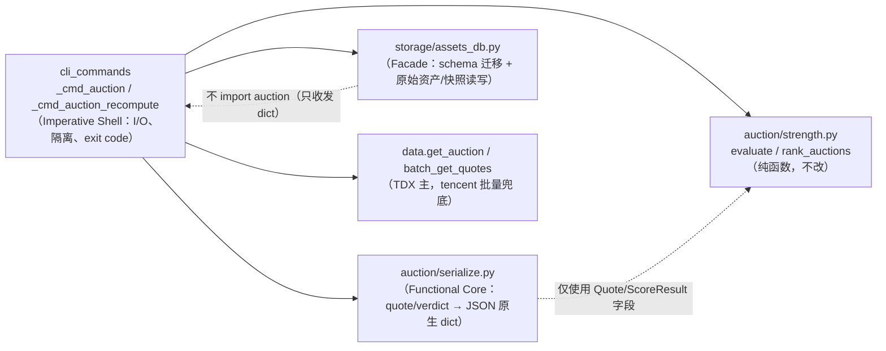
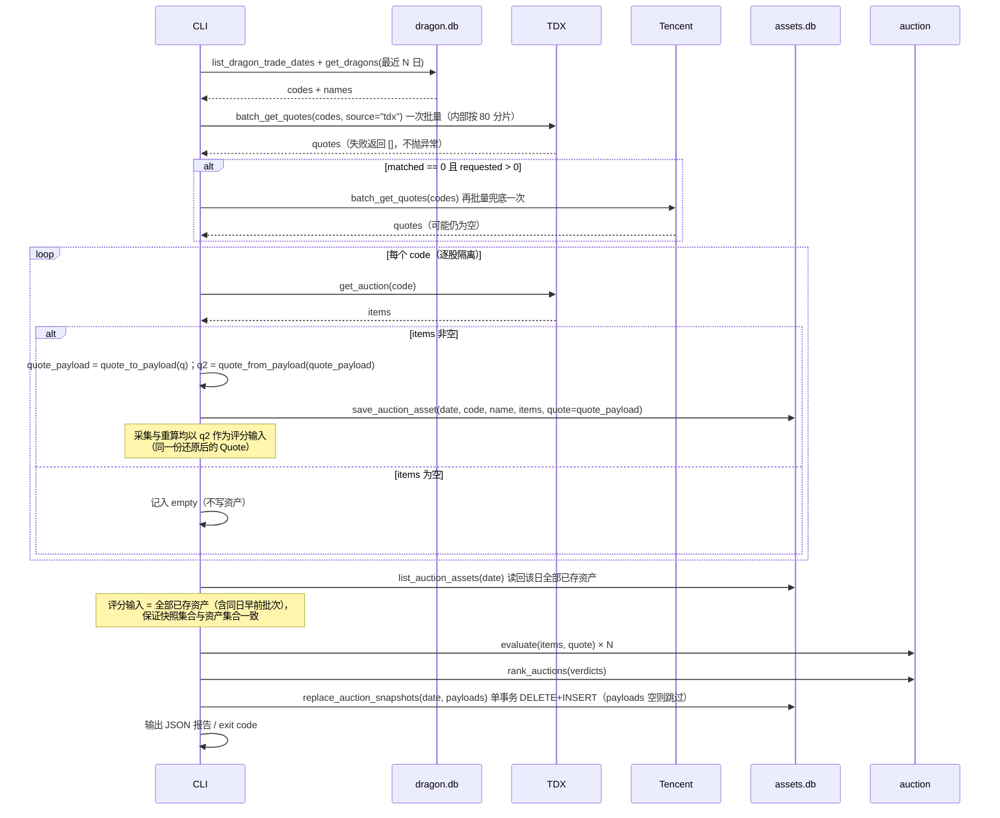
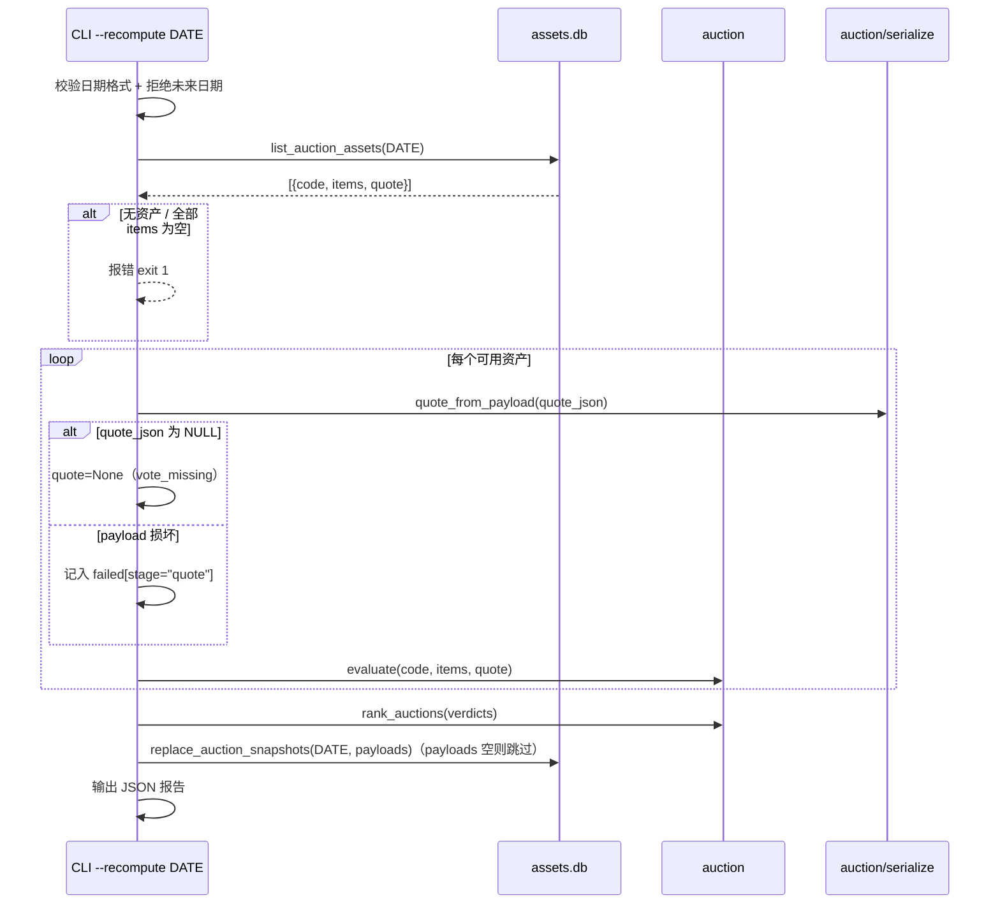
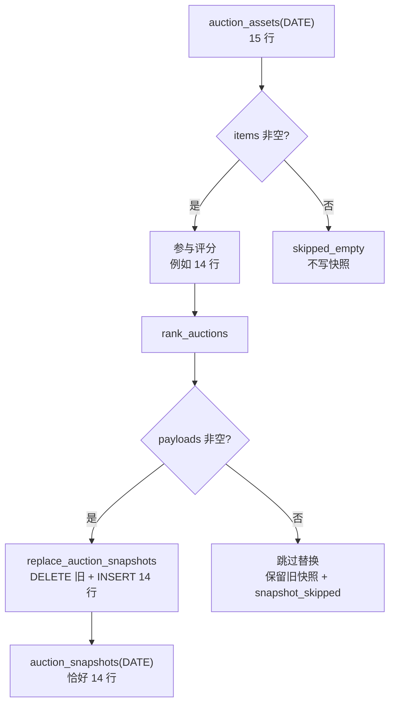

# 集合竞价快照接线技术方案（auction_snapshots + quote_json + --recompute）

- 日期：2026-10-20
- 分支：`feat/reviewa-account-op`
- 基线：`03ff5dc`（存储层统一重构 prep.db → assets.db）
- 状态：v2（已按首轮 solution-review 的 7 MAJOR / 4 MINOR 修订）

---

## 0. 首轮审查修订记录

| Finding | 级别 | 修订 |
|---------|------|------|
| F1 TDX 行情失败不抛异常，`degraded` 不可达 | MAJOR | 改为**结果导向**判定：`matched < requested` 即 `degraded=true`；TDX 返回空时用 tencent **批量**兜底一次；显式 `source="tdx"`；T9 用「返回空列表不抛异常」构造 |
| F2 空 payload 会删光既有快照 | MAJOR | `replace_auction_snapshots({})` 变 no-op，不执行 DELETE；报告 `snapshot_skipped="no_payloads"`；补测试 |
| F3 exit code 可能掩盖快照零产出 | MAJOR | 显式写死解释：exit 1 只反映「原始资产」零写入（保留既有语义）；新增 `snapshot_ok` 与 stderr 告警，快照零产出不可静默；补组合测试 |
| F4 读路径迁移有跨进程竞态/只读风险 | MAJOR | **迁移只走写路径**；读路径探测列是否存在，缺列返回 `quote=None`；`ALTER` 捕获 duplicate column 后复查 |
| F5 `quote_json` 排除出形状探针理由不成立 | MAJOR | 拆成 `_REQUIRED_COLUMNS`（wrong-DB 识别，读路径）与 `_WRITE_REQUIRED_COLUMNS`（含 `quote_json`，写路径迁移后断言） |
| F6 `quote_from_payload` 混淆损坏与缺失 | MAJOR | 定义必填字段（`code`/`prev_close`/`limit_down`/`float_market_cap`）；损坏 payload 抛 `QuotePayloadError` 进 `failed[stage="quote"]`，不混入 `quote_missing`；可空数值按 `0.0` 还原 |
| F7 非有限 strength/score/weight 写 null 与契约矛盾 | MAJOR | 契约数值字段非有限 → `verdict_to_payload` 抛错 → 该股不写快照；只有 `details` 内 NaN 清洗为 null |
| F8 未使用的快照读 API | MINOR | 删除 `get_auction_snapshot` / `list_auction_snapshots`；测试直接用 sqlite3 读表 |
| F9 serialize/rank 顺序可能丢 rank | MINOR | 固定 `evaluate → rank_auctions → verdict_to_payload`；补 monkeypatch `SEMANTICS_VERIFIED=True` 的 rank 断言 |
| F10 退出码/日期格式与项目惯例不一致 | MINOR | 非法格式与未来日期统一 exit 1（与 `prep` 一致）；补时区边界测试 |
| F11 quote code 映射未归一化 | MINOR | 明确「去前缀、取末 6 位数字、zfill(6)」；补带前缀用例与「不调用 `get_quote`」断言 |
| 模式命名过度包装 | MINOR | 「Template Method（轻量）」改为「共享纯函数（Shared Helper）」 |
| M1 日期格式收窄造成新的惯例分叉（复审新增） | MINOR | 改为复用 `_normalize_cli_date`（三种格式全收）+ `strptime` 严格校验，输出统一 `YYYY-MM-DD` |
| M2 采集/重算评分输入不同源（复审新增） | MINOR | 采集模式先 `quote_to_payload → quote_from_payload` 往返，用还原后的 Quote 同时评分与落库 |
| M3 `quote.source` 语义歧义（复审新增） | MINOR | `quote.source` 定义为**实际生效来源**：`tdx` / `tencent` / `none` |

---

## 1. 背景与目标

上一里程碑把存储层统一到 `assets.db`，`auction_snapshots` 只建表未接线；`auction` 命令只写原始竞价明细 `auction_assets`。本方案把「原始资产 → 纯函数评分 → 快照」链路接通，并让历史资产可在不触网的前提下重算。

### 1.1 目标

| 编号 | 目标 |
|------|------|
| G1 | `auction_assets` 增加可空 `quote_json`，原始资产 = `items` + `quote` 二元组 |
| G2 | 旧 `assets.db` 在**写路径**首次访问时自动补列；旧行 `quote=None`；错库仍抛 `AssetsDbSchemaError` |
| G3 | `auction` 采集模式：批量取行情（禁止逐股请求）→ 落原始资产 → 逐股评分 → 整批 rank → 落快照 |
| G4 | `auction --recompute DATE`：不触网，用已存原始资产重算并覆盖该日快照 |
| G5 | 失败隔离：行情缺失降级不静默、单股失败不中断、写入/评分分开统计、保留既有 exit code 语义 |
| G6 | JSON 严格原生类型 + NaN/inf 清洗，不放宽 `allow_nan=False` |
| G7 | 文档同步（AGENTS.md / README.md / assets_db docstring） |

### 1.2 非目标

- 不改 `auction/` 评分算法、`registry.py` 常量、`SEMANTICS_VERIFIED`（保持 `False`）。
- 不实现策略消费竞价结果、历史补采、行情历史回补、竞价语义实测。
- 不实现 `assets_sync` 的 M2 raw adapter（快照仍不进云同步）。
- 不改 `prep` 流程与 dragon.db 任何表。
- 不 commit / push。

---

## 2. 设计模式与动机

| 模式 | 落在哪里 | 动机 |
|------|----------|------|
| **Facade（门面）** | `storage/assets_db.py` | 存储层只收发原始 dict/基础类型，不 import `auction` 域对象，保持依赖方向单向（CLI → auction + storage） |
| **Functional Core / Imperative Shell** | `auction/serialize.py` + `cli_commands._cmd_auction*` | 评分与序列化是纯函数；I/O、异常隔离、退出码集中在 CLI 外壳，便于单测 |
| **共享纯函数（Shared Helper）** | `_score_assets(assets)` | 采集/重算的差异只在「资产从哪来」，评分 → rank → payload 完全复用；**不引入抽象基类或类层次** |
| **表驱动迁移（Registry）** | `_COLUMN_MIGRATIONS` | 新增列 = 注册一行，写路径统一幂等执行，避免散落 `ALTER TABLE` |

权衡原则：不为假设的未来需求引入抽象。`quote` 与 `items` 是 1:1 关系，不拆独立表；两个模式共享一个 helper，不建类层次；本期不提供无消费方的快照读 API。

---

## 3. 候选设计

### 3.1 方案 A（推荐）：`quote_json` 可空列 + 整日原子替换快照

- `auction_assets` 增加 `quote_json TEXT NULL`，与 `items_json` 同生命周期、同 UPSERT 语义。
- 快照写入用 `replace_auction_snapshots(trade_date, payloads, source)`：**payloads 非空时**单事务 `DELETE` 该日该 source 的旧行 + 批量 `INSERT`；**payloads 为空时直接返回 0，不执行 DELETE**（防止行情/评分全面失败时清空既有快照）。
- 采集与重算共享纯 helper `_score_assets(assets) -> (payloads, failures, summary)`，内部顺序固定为 `evaluate → rank_auctions → verdict_to_payload`。

**优点**：原始资产自包含，重算不触网；1:1 关系不拆表；`UNIQUE(trade_date, code)` 与既有 UPSERT 兼容；迁移面最小。
**缺点**：旧库首次写入会触发一次补列；读路径需容忍缺列（见 §5.3，读路径不执行列迁移）。

### 3.2 方案 B（反直觉）：把 quote 塞进 `items_json` 信封

`items_json` 存 `{"items": [...], "quote": {...}}`，零 schema 变更，「天然原子」。

**否决理由**：破坏既有 `items_json = [...]` 契约；所有读者（含 README 迁移 SQL、旧测试）都要解信封；原始明细与元数据混在一列，历史行无法区分「旧数组」与「新信封」；`_REQUIRED_COLUMNS` 形状探针也失去意义。省一次迁移换来长期歧义，不划算。

### 3.3 方案 C（反直觉）：不持久化 quote，重算时实时再取

`--recompute` 时重新批量拉行情，快照始终「最新」。

**否决理由**：历史日重算会拿到今天（或未来）的 `prev_close` / `limit_down`，结果与采集日不一致，直接违反「快照 = 原始资产的纯函数」；同时 `--recompute` 变成必须触网，与「不触网重算」的需求冲突；资产不可再生的原则也被破坏。

### 3.4 方案 D：独立 `auction_quote_assets` 表

按 `(trade_date, code)` 1:1 关联。

**否决理由**：永远 1:1 的关系拆表只增加 JOIN、迁移与事务面，没有独立生命周期收益；与现有 `auction_assets` 的 UPSERT 幂等也不在同一事务内。

### 3.5 推荐

**方案 A**。它在「原始资产自包含」「迁移最小」「不破坏既有契约」三者间最优。

---

## 4. 架构与数据流

### 4.1 模块职责



依赖方向：`cli_commands` 同时依赖 `auction` 与 `storage`；`storage` 不反向依赖 `auction`。

### 4.2 采集模式时序



### 4.3 重算模式时序



### 4.4 快照集合一致性



采集模式同理：只有 `save_auction_asset` 成功的 code 才参与评分。**空 payload 从不触发 DELETE**，因此「清空快照」在本期没有任何隐式路径。

---

## 5. 数据模型

### 5.1 `auction_assets`（新增列）

```sql
CREATE TABLE IF NOT EXISTS auction_assets (
    id           INTEGER PRIMARY KEY AUTOINCREMENT,
    trade_date   TEXT NOT NULL,
    code         TEXT NOT NULL,
    name         TEXT,
    items_json   TEXT NOT NULL,
    quote_json   TEXT,                 -- 新增，可空；Quote 快照
    created_at   TEXT DEFAULT (datetime('now','localtime')),
    UNIQUE(trade_date, code)
);
```

`quote_json` payload（`dataclasses.asdict(Quote)` 全字段，snake_case；非有限浮点清洗为 `null`）：

```json
{
  "code": "600172", "name": "黄河旋风",
  "price": 10.5, "prev_close": 10.0, "open_px": 10.2,
  "high": 10.6, "low": 9.9, "pct": 5.0, "chg": 0.5,
  "turnover_rate": 1.2, "amplitude": 7.0,
  "volume": 123456.0, "amount": 1.3e8,
  "market_cap": 5.0e9, "float_market_cap": 3.2e9,
  "volume_ratio": 2.1, "pe": 35.0,
  "limit_up": 11.0, "limit_down": 9.0, "avg_price": 10.4,
  "bid1_price": 10.5, "bid1_volume": 800.0, "ask1_volume": 120.0,
  "timestamp": 0, "main_net_amount": null
}
```

评分器实际消费的 quote 字段：`prev_close`、`limit_down`、`float_market_cap`（见 `strength.py` `_score_direction` / `_reject_0_4` / `_score_vol_price`）。其余字段按原样留档，便于未来因子扩展与人工审计。

UPSERT 语义：`items_json` 以本次为准；`quote_json` 使用
`COALESCE(excluded.quote_json, auction_assets.quote_json)`——本次行情缺失（NULL）时
**保留**该行已有行情快照。行情不可再生，同日重采的瞬时故障不应抹掉上次成功采集的上下文。

### 5.2 `auction_snapshots`（schema 不变）

```sql
CREATE TABLE auction_snapshots (
    id            INTEGER PRIMARY KEY AUTOINCREMENT,
    trade_date    TEXT NOT NULL,
    code          TEXT NOT NULL,
    source        TEXT NOT NULL DEFAULT 'v2',
    analysis_json TEXT NOT NULL,
    created_at    TEXT DEFAULT (datetime('now','localtime')),
    UNIQUE(trade_date, code, source)
);
```

`analysis_json` 严格遵循 `assets_db.py` 现有契约，不新增字段：

```json
{
  "version": "1",
  "code": "600172",
  "is_weak": false,
  "strength": 72.5,
  "direction": "bull",
  "level": "强",
  "dims": {
    "direction": {"dim": "direction", "score": 70.0, "weight": 0.25, "details": {}},
    "supply":    {"dim": "supply",    "score": 80.0, "weight": 0.30, "details": {}},
    "vol_price": {"dim": "vol_price", "score": 65.0, "weight": 0.25, "details": {}},
    "tail_grab": {"dim": "tail_grab", "score": 60.0, "weight": 0.20, "details": {}}
  },
  "reject_reason": null,
  "unverified": true,
  "rank": null
}
```

> `SEMANTICS_VERIFIED=False`，因此 `rank_auctions` 的 `usable` 恒为空，`rank` 恒为 `null`。这是预期行为，本方案不改。

### 5.3 迁移、读兼容与形状探针

职责拆分：

- **`_REQUIRED_COLUMNS`（读路径 / wrong-DB 识别）**：只含 NOT NULL 核心列；旧库缺 `quote_json` 也能读。
- **`_WRITE_REQUIRED_COLUMNS`（写路径 / 迁移完整性）**：核心列 + `quote_json`；迁移后断言，补列失败立即以 `AssetsDbSchemaError` 暴露。

```python
_COLUMN_MIGRATIONS = {
    "auction_assets": (("quote_json", "TEXT"),),
}

def _columns(conn, table) -> set[str]:
    return {row[1] for row in conn.execute(f"PRAGMA table_info({table})")}

def _apply_column_migrations(conn):
    for table, columns in _COLUMN_MIGRATIONS.items():
        for name, decl in columns:
            if name in _columns(conn, table):
                continue
            try:
                conn.execute(f"ALTER TABLE {table} ADD COLUMN {name} {decl}")
            except sqlite3.OperationalError:
                # 跨进程竞态：另一进程已完成补列 → 复查后视为成功
                if name not in _columns(conn, table):
                    raise

def _ensure_schema(conn, migrate: bool = True):
    conn.executescript(BASE_SCHEMA)      # 新库直接带 quote_json；旧库为 no-op
    if migrate:
        _apply_column_migrations(conn)
    _assert_schema_shape(conn, full=migrate)
    conn.commit()
```

- **写路径**（`save_auction_asset` / `replace_auction_snapshots`）：`_ensure_schema(conn)` → 迁移 + 全量断言。
- **读路径**（`get/list_auction_assets`）：`_ensure_schema(conn, migrate=False)` → 不执行列迁移（不 ALTER 既有表；`BASE_SCHEMA` 的 `CREATE TABLE IF NOT EXISTS` 与 WAL PRAGMA 仍会执行）；随后探测列：
  ```python
  has_quote = "quote_json" in _columns(conn, "auction_assets")
  quote_expr = "quote_json" if has_quote else "NULL"
  SELECT trade_date, code, name, items_json, {quote_expr} ...
  ```
  旧库读路径返回 `quote=None`，且**不会**在只读文件系统/并发读时触发 `ALTER TABLE`。
- 旧行 `quote_json IS NULL`，读取时 `quote=None`。
- 错库（如旧 dragon.db 改名）仍因核心列缺失抛 `AssetsDbSchemaError`。

---

## 6. 接口定义

### 6.1 存储层（`storage/assets_db.py`）

```python
def save_auction_asset(
    trade_date: str, code: str, name: str,
    items: list[dict],
    quote: Optional[dict] = None,
) -> None: ...

def get_auction_asset(trade_date: str, code: str) -> Optional[dict]:
    # {"trade_date", "code", "name", "items": list, "quote": dict | None}

def list_auction_assets(trade_date: str) -> list[dict]:
    # 同上，按 code 升序

def replace_auction_snapshots(
    trade_date: str, payloads: dict[str, dict], source: str = "v2",
) -> int:
    """payloads 非空：单事务 DELETE 该日该 source 旧快照 + 批量 INSERT，返回行数。
    payloads 为空：直接返回 0，不执行 DELETE（保留旧快照）。"""
```

本期**不提供**快照读 API（无消费方）；测试直接用 `sqlite3` 读表，沿用 `test_assets_db.py` 既有做法。

兼容性：`save_auction_asset` 前 4 个位置参数顺序不变，`quote` 作为第 5 个可选参数追加；CLI 以关键字 `quote=` 传入，既有 `save.call_args.args[1] == "600172"` 断言不受影响。

### 6.2 序列化（`auction/serialize.py`，新增）

```python
class QuotePayloadError(ValueError):
    """quote_json 存在但无法还原为 Quote（损坏/关键字段缺失）。"""

def sanitize_json(value: Any) -> Any:
    """递归清洗：非有限 float → None；dict/list 递归；其余原样返回。"""

def quote_to_payload(quote: Optional[Quote]) -> Optional[dict]: ...

def quote_from_payload(payload: Optional[dict]) -> Optional[Quote]:
    """None → None；损坏/必填缺失 → 抛 QuotePayloadError；未知键忽略。"""

def verdict_to_payload(verdict: AuctionVerdict) -> dict:
    """按 assets_db 契约序列化；version 固定 "1"；契约数值字段非有限 → ValueError。"""
```

`quote_from_payload` 规则：

| 情况 | 行为 |
|------|------|
| `payload is None` | 返回 `None`（行情缺失，对应 `quote_missing`） |
| 不是 dict / JSON 解析失败 | 抛 `QuotePayloadError` |
| 缺必填 `code` / `prev_close` / `limit_down` / `float_market_cap` | 抛 `QuotePayloadError` |
| 必填字段值为 `None` | 数值字段按 `0.0` 还原（与 TDX `_f` 口径一致），`code` 为空则抛错 |
| 必填数值字段为非数值字符串或非有限值 | 抛 `QuotePayloadError`（不静默补 0） |
| 其余字段缺失或 `None` | 按类型默认值还原（数值 `0.0`、字符串 `""`、`main_net_amount=None`、`timestamp=0`） |
| 未知键 | 忽略（前向兼容） |
| 非有限值 | 按 `0.0` 还原（采集侧已清洗为 null，此处兜底） |

`verdict_to_payload` 规则：

- `version`、`code`、`is_weak`、`strength`、`direction`、`level`、`dims`、`reject_reason`、`unverified`、`rank` 十项齐全。
- `strength` 与每个 `dims[*].score` / `dims[*].weight` 必须是有限数值；否则抛 `ValueError`（**不写 null**，该股不落快照，由 CLI 隔离为 `failed[stage="serialize"]`）。
- `dims[*].details` 经 `sanitize_json`；其中 NaN/inf 清洗为 `null`（details 是自由诊断区，不属于契约数值字段）。
- `rank` 为 `int | None`。

### 6.3 CLI

```
dragon-quant auction [--days N]
dragon-quant auction --recompute DATE
```

- `--recompute` 取值为日期字符串，不是布尔开关；带该参数时忽略 `--days`，先于任何 dragon.db 读取执行。
- 日期处理：复用 `_normalize_cli_date`（与 `prep`/`review` 一致，接受 `YYYYMMDD` / `YYYY-MM-DD` / `YYYY/MM/DD`），再以 `datetime.strptime(d, "%Y-%m-%d")` 做真实日期严格校验（该 helper 对未知格式静默透传，严格校验必须独立存在），输出统一 `YYYY-MM-DD`。
- 非法格式/未来日期均按参数错误处理，`exit 1`（与 `prep` 的退出码惯例一致）。
- 未来日期判断：与 `_resolve_trade_date(None)`（Asia/Shanghai 当日）比较。

---

## 7. 错误处理与失败隔离

### 7.1 行情获取（结果导向，不依赖异常）

| 条件 | 行为 | 报告 |
|------|------|------|
| `batch_get_quotes(codes, source="tdx")` 返回全部匹配 | 正常 | `matched == requested`，`degraded=false`，`source="tdx"` |
| TDX 返回空（**不抛异常**）且 `requested > 0` | 用 `batch_get_quotes(codes, source="tencent")` 批量兜底一次 | `fallback_used=true` |
| 兜底后 `0 < matched < requested` | 缺失 code 用 `quote=None`，继续评分 | `degraded=true`, `reason="partial"`, `missing=[...]` |
| 兜底后 `matched == 0` | 全部 `quote=None`，继续评分（结果保守否决） | `degraded=true`, `reason="empty"`, `source="none"` |
| 批量调用抛异常（兜底） | 捕获，`quote_map={}`，继续 | `degraded=true`, `reason="error"`, `error=...` |
| 返回 code 与候选不匹配 | 按 §6.4 归一化后仍不匹配 → 视为 missing | `missing=[...]` |

`quote.source` 语义 = **实际生效来源**：TDX 有命中 → `"tdx"`；TDX 为空、tencent 兜底有命中 → `"tencent"`；两者皆空 → `"none"`。`fallback_used` 仅表示是否尝试过兜底。

> 关键事实：TDX `batch_get_quotes` 内部吞异常并 `return []`，因此**不能**用「是否抛异常」判断降级。`degraded` 必须由 `matched < requested` 结果推导。
> 兜底仍是整批请求，不违反「禁止逐股请求」；测试断言不调用 `data.get_quote`。

### 7.2 采集模式

| 场景 | 行为 | 报告字段 |
|------|------|----------|
| `get_auction` 返回空 | 记入 `empty`，不写资产、不评分 | `empty` |
| 同日早前批次已存资产 | 读回 `list_auction_assets` 一并评分，保证两表 code 集合一致 | `scored_count` 可大于 `saved_count` |
| `list_auction_assets` 读取失败 | 回退本轮内存资产继续评分 | `asset_read_error`、`failed[stage="asset_read"]` |
| 已存资产无 `quote_json` | `quote=None` 继续评分 | `quote_missing` |
| 单股 `save_auction_asset` 异常 | 记入 `failed`，跳过该股评分，继续 | `failed[{code, stage:"asset", error}]` |
| 单股 `evaluate` 异常 | 记入 `failed`，继续 | `failed[{code, stage:"score", error}]` |
| `verdict_to_payload` 异常 | 记入 `failed`，继续 | `failed[{code, stage:"serialize", error}]` |
| `replace_auction_snapshots` 异常 | 捕获，事务回滚保留旧快照 | `snapshot_error`, `snapshot_ok=false` |
| `payloads` 为空且 `saved` 非空或 `failed` 非空 | **不调用** replace（不删旧快照） | `snapshot_skipped="no_payloads"`, `snapshot_ok=false` |
| `payloads` 为空且 `saved==0 && failed==[]`（无写入尝试） | 不调用 replace；空跑不算失败 | `snapshot_skipped="no_payloads"`, `snapshot_ok=true`, `ok=true` |
| 单行 `items_json`/`quote_json` 非法 JSON | 读路径逐行隔离，该股记失败并跳过 | `failed[stage="asset"/"quote"]` |
| 无龙头 / 无候选 | 保持现状 | `error`, `exit 1` |

**exit code（显式契约）**：

- `exit 1` 当且仅当 `saved_count == 0 and (failed or snapshot_error)`。
- 这里的「一条都没写成功」按**原始资产**解释，保留既有语义；快照零产出通过 `snapshot_ok=false` + stderr 一行告警显式暴露，**不改变退出码**。
- 全部 `empty`（无写入尝试）不退出 1。
- `ok = not failed and snapshot_error is None and snapshot_ok`。

### 7.3 重算模式

| 场景 | 行为 | exit |
|------|------|------|
| 日期格式非法（含 `YYYY/MM/DD`） | JSON error，不触库 | 1 |
| 未来日期 | JSON error，不触库 | 1 |
| 该日无资产 | JSON error | 1 |
| 有资产但全部 `items` 为空 | JSON error（无可计算资产） | 1 |
| 单股 `quote_json` 损坏 | 记入 `failed[stage="quote"]`，该股不评分 | — |
| 单股评分/序列化异常 | 记入 `failed`，继续 | — |
| 全部评分失败（`payloads={}`） | 跳过 replace（保留旧快照），JSON error | 1 |
| `replace_auction_snapshots` 异常 | JSON error，事务回滚 | 1 |

### 7.4 JSON 安全

- 所有写入仍走 `_dumps(..., allow_nan=False, sort_keys=True)`，不放宽。
- `quote_to_payload` 用 `sanitize_json` 把 NaN/inf 变 `None`。
- `verdict_to_payload` 对契约数值字段做 `math.isfinite` 校验，非有限直接抛错（不写 null）。
- `details` 内的 NaN/inf 清洗为 `null`，不伪造 0。

---

## 8. 报告格式

### 8.1 采集模式（保留既有顶层键 + 新增统计）

```json
{
  "ok": true,
  "mode": "collect",
  "trade_date": "2026-10-20",
  "source": "v2",
  "lookback_dates": ["2026-10-16", "2026-10-19", "2026-10-20"],
  "candidate_codes": 5,
  "saved_count": 5,
  "saved": [{"code": "600172", "name": "黄河旋风", "n": 41}],
  "empty": [],
  "failed": [],
  "quote": {"source": "tdx", "fallback_used": false, "requested": 5,
            "matched": 5, "missing": [], "degraded": false,
            "reason": null, "error": null},
  "quote_missing": [],
  "asset_read_error": null,
  "scored_count": 5,
  "snapshot_saved_count": 5,
  "snapshot_ok": true,
  "snapshot_skipped": null,
  "snapshot_error": null,
  "snapshots": [{"code": "600172", "is_weak": false, "strength": 72.5,
                 "direction": "bull", "level": "强", "unverified": true,
                 "rank": null, "reject_reason": null}]
}
```

### 8.2 重算模式

```json
{
  "ok": true,
  "mode": "recompute",
  "trade_date": "2026-10-20",
  "source": "v2",
  "asset_count": 5,
  "usable_count": 5,
  "skipped_empty": [],
  "quote_missing": [],
  "scored_count": 5,
  "snapshot_saved_count": 5,
  "snapshot_ok": true,
  "snapshot_skipped": null,
  "failed": [],
  "snapshots": [{"code": "600172", "is_weak": false, "strength": 72.5,
                 "direction": "bull", "level": "强", "unverified": true,
                 "rank": null, "reject_reason": null}]
}
```

`quote_missing` 只列出 `quote_json IS NULL` 的 code；JSON 损坏/必填缺失的 code 进 `failed[stage="quote"]`，两者不混淆。

---

## 6.4 行情 code 归一化

```python
def _norm_code(code) -> str:
    s = str(code or "").strip().upper()
    if "." in s:                      # 600172.SH / SH.600172
        parts = s.split(".")
        s = next((p for p in parts if p.isdigit()), parts[-1])
    digits = "".join(ch for ch in s if ch.isdigit())
    return digits[-6:].zfill(6) if digits else s
```

行情 map 与候选 code 均经 `_norm_code` 后匹配；返回带 `SH`/`SZ` 前缀的行情也能命中。测试覆盖带前缀与 6 位两种形态。

---

## 9. 测试策略

| 编号 | 类型 | 用例 |
|------|------|------|
| T1 | 存储 | `save_auction_asset(..., quote=...)` → `get/list` 返回同一 payload；不传 quote → `None` |
| T2 | 存储 | 旧 schema：**读路径**返回 `quote=None` 且不新增列；**首次写**后列存在、旧行 `quote=None`；连续写两次幂等 |
| T3 | 存储 | 错库（旧 dragon.db 形状）读/写均抛 `AssetsDbSchemaError` |
| T4 | 存储 | `replace_auction_snapshots` 首次插入、同日重跑替换并删除过期 code；**空 payloads 不 DELETE**（旧行仍在）；用 sqlite3 断言 |
| T5 | 存储 | 快照写入 NaN → `ValueError`（`allow_nan=False` 未被放宽） |
| T6 | 序列化 | `quote_to_payload` 对 NaN/inf → `None`；`quote_from_payload` 往返一致；未知键忽略；缺失可选字段补默认；缺必填/非 dict → `QuotePayloadError` |
| T7 | 序列化 | `verdict_to_payload` 契约十项齐全、`version="1"`、`dims` 四项结构、`rank=None`；`strength` 非有限 → `ValueError`；details 内 NaN → `null` |
| T8 | CLI 采集 | 批量行情只调用一次（`batch_get_quotes` 调用 1 次、`get_quote` 0 次）；带前缀 code 能匹配；资产与快照均写入 |
| T9 | CLI 采集 | TDX 返回 `[]`（不抛异常）→ tencent 兜底一次；兜底成功时 `quote.source="tencent"`；仍空时 quote 全 None、仍评分、`degraded=true`、`reason="empty"`、`source="none"` |
| T10 | CLI 采集 | 单股资产写失败/评分失败 → 隔离，其余继续；资产全失败 `exit 1` |
| T11 | CLI 采集 | 快照批量写失败 → `ok=false`、`snapshot_error` 非空、exit 0；资产全成功但快照零写入 → `snapshot_ok=false` + stderr 告警 |
| T12 | CLI 重算 | 正常重算覆盖快照；空 items 跳过；无资产 `exit 1`；未来日期（固定 +08:00 now）`exit 1`；`YYYYMMDD` / `YYYY-MM-DD` / `YYYY/MM/DD` 均可并统一输出 `YYYY-MM-DD`；非法格式 `exit 1` |
| T13 | CLI 辅助 | `--recompute` 分支不读取 dragons_v2、不调用任何网络函数 |
| T14 | 序列化/排名 | monkeypatch `R.SEMANTICS_VERIFIED=True` + 构造可排名 verdict → payload `rank` 非空（防 serialize/rank 顺序回归） |
| T14b | 一致性 | 采集模式对含 NaN 的 Quote 先往返再评分：同一份资产在采集与重算下 `strength`/`is_weak` 一致 |
| T16 | 一致性 | 同日早前批次已存资产参与采集评分，快照 code 集合 = 该日全部非空 assets |
| T15 | 回归 | 全量 `unittest discover` 通过（基线 500 + 新增） |

测试改造说明：`tests/test_cli.py::TestCmdAuctionStorage._run` 需新增 patch `dragon_quant.data.batch_get_quotes` 与 `assets_db.replace_auction_snapshots`，避免真实写库与网络；保留 `save.call_args.args[1] == "600172"` 断言。

---

## 10. 风险与缓解

| 风险 | 影响 | 缓解 |
|------|------|------|
| 旧库首次写入触发 `ALTER TABLE` | 并发 prep/auction 时短暂 BUSY | 仅写路径迁移；`ALTER` 捕获 duplicate column 后复查；`busy_timeout=5000` + WAL |
| 读路径只读库/并发读 | 旧设计会因 ALTER 失败 | 已改为读路径不执行列迁移（不 ALTER），缺列返回 `quote=None` |
| 行情快照采集时点晚于竞价（如盘后运行） | `price` 等字段是收盘值 | 评分只消费 `prev_close` / `limit_down` / `float_market_cap`，三者日内稳定；文档写明 quote 是「采集时点快照」 |
| TDX 行情失败静默返回空列表 | 误判为「无缺票」 | `degraded` 由 `matched < requested` 推导 + tencent 批量兜底 + `reason` 显式 |
| 全量行情缺失 + 全量评分失败 | 快照零产出但 exit 0 | `snapshot_ok=false` + stderr 告警；报告 JSON 完整可见（退出码语义按需求保留） |
| 旧资产无 `quote_json` | 重算全部 `unverified` 且大概率 `is_weak` | `quote_missing` 显式报告；文档说明需重新采集才有行情上下文 |
| `SEMANTICS_VERIFIED=False` | 所有 `rank` 恒为 `null` | 预期行为，不改常量；T14 用 monkeypatch 守护顺序 |
| 快照整日替换会删除失败 code 的旧快照 | 失败 code 失去历史结果 | 仅当本次 `payloads` 非空时替换；失败 code 在报告中可见，重算可恢复 |
| `quote_json` 体积（约 1 KB/行） | 库体积增长 | 单日候选量级为数十，可忽略；与 items 同量级 |
| 未来日期判断依赖 Asia/Shanghai | 跨时区误判 | 复用 `_resolve_trade_date(None)` 的 +08:00 口径；T12 固定时区构造 |

---

## 11. 实施清单

| 文件 | 变更 |
|------|------|
| `dragon_quant/storage/assets_db.py` | 新列 + 迁移 registry（写路径）+ 读路径兼容 + `_WRITE_REQUIRED_COLUMNS` + 读写 API 带 quote + 快照批量替换 + docstring 更新 |
| `dragon_quant/auction/serialize.py`（新增） | `sanitize_json` / `quote_to_payload` / `quote_from_payload` / `verdict_to_payload` / `QuotePayloadError` |
| `dragon_quant/cli_commands.py` | 采集模式改造 + `_cmd_auction_recompute` + 共享 `_score_assets` + code 归一化 |
| `dragon_quant/cli.py` | `--recompute DATE` 参数 + usage/epilog |
| `tests/test_assets_db.py` | 迁移、读兼容、quote 往返、快照替换（含空 payload）、NaN |
| `tests/test_auction_serialize.py`（新增） | 序列化契约、损坏 payload、NaN 清洗、rank 顺序 |
| `tests/test_cli.py` | 采集/重算/行情降级/失败隔离/exit code/日期边界 |
| `AGENTS.md` | `auction_assets` 增 `quote_json`（可空、旧行 NULL、重算降级）；`auction_snapshots` 改为采集/重算已接线；命令示例含 `--recompute DATE` |
| `README.md` | 命令段、持久化表说明、迁移 SQL 注释与读/写迁移策略一致 |

---

## 12. 验收标准映射

| 验收 | 实现位置 | 验证 |
|------|----------|------|
| C1 | `assets_db.save_auction_asset/get/list` | T1 |
| C2 | `_ensure_schema` + `_apply_column_migrations` + 读路径兼容 | T2、T3 |
| C3 | `_cmd_auction` + `replace_auction_snapshots` + `verdict_to_payload` | T7、T8、T14 |
| C4 | `replace_auction_snapshots` 整日替换（空 payload 跳过）；`skipped_empty` | T4、T12 |
| C5 | 逐股 try/except + 报告字段 + `snapshot_ok` + exit 规则 | T9、T10、T11 |
| C6 | `_cmd_auction_recompute` + 日期校验 | T12、T13 |
| C7 | `sanitize_json` + 存储层 NaN 拒绝 | T5、T6、T7 |
| C8 | 全量 unittest | T15 |
| C9 | AGENTS.md / README.md / assets_db docstring | 人工核对 |
