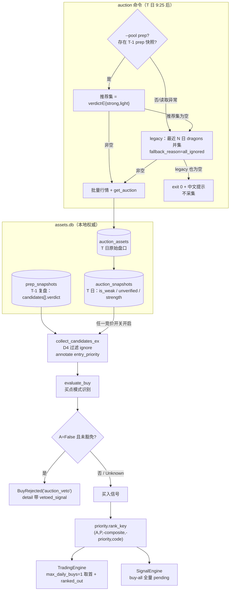
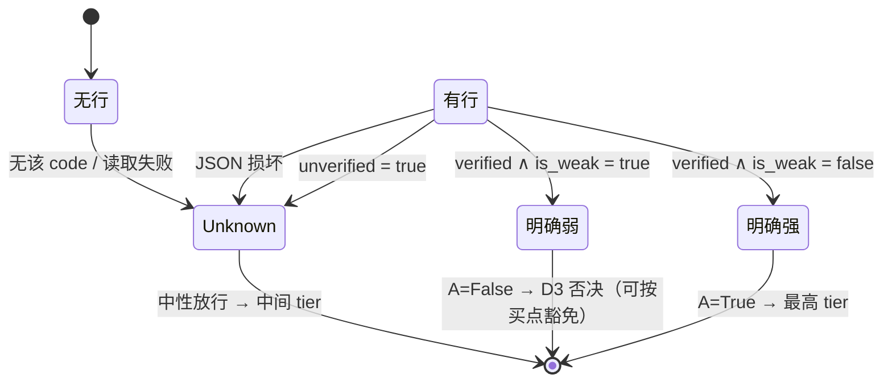
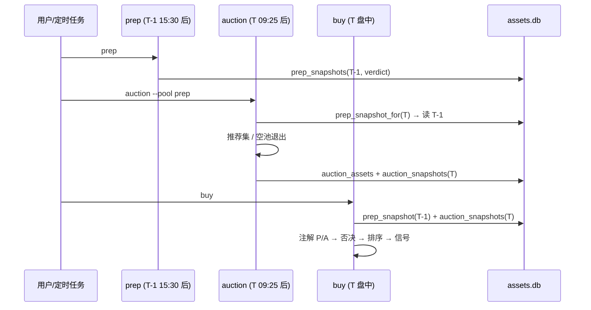
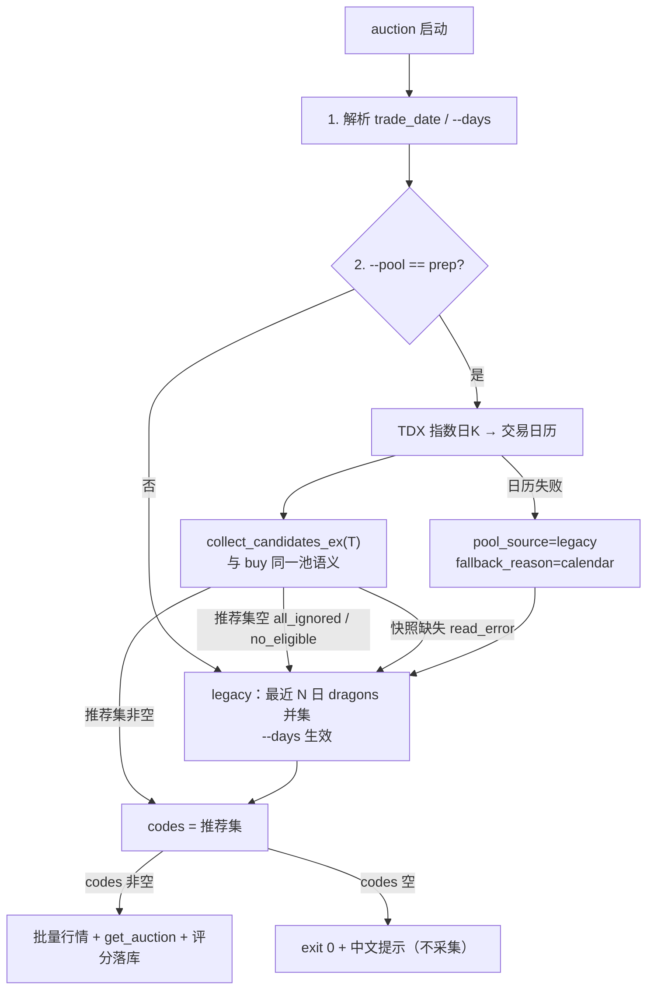

# auction 候选池改为 prep 推荐 + buy/review-account 的 P/A 优先级排序 — 技术方案
> **当前状态（2026-10-25 整仓结构重构 M0–M12）**：本文中的 `dragon_quant/cli_commands.py` / `dragon_quant/review_account/prep.py` 等实现位置已迁移：命令入口在 `dragon_quant/commands/<command>.py`（经 `commands.dispatch`），prep 在 `dragon_quant/review_account/prep/` 包（service/collectors/compute/rebuild），auction 编排在 `dragon_quant/auction/service.py`，assets CLI 装配在 `dragon_quant/assets_sync/cli_service.py`。历史设计正文保留原样；当前结构与命令以 `AGENTS.md`「架构总览」为准。


日期：2026-10-21 · 分支：feat/reviewa-account-op · 状态：v4（main 已放行；用户三项裁决已回写，进入阶段 3）
v2 修订：吸收 solution-reviewer 首轮 findings（0 CRITICAL / 5 MAJOR / 12 MINOR），逐条处理见 §16.1。
v3 修订：吸收第 2 轮 findings（0 CRITICAL / 1 MAJOR / 6 MINOR），逐条处理见 §16.2。方案审查用满 2 轮，按门禁上报 main。
v4 修订：main 条件式放行后，用户三项裁决落地（AC8' 正式化；D7 空推荐集改为回退 legacy；D8 拆双开关），见 §16.3。v4 不再送 solution-reviewer，由 main 在阶段 3.5 终审覆盖。
范围：阶段 2（技术方案）。阶段 0 已由 main 与用户确认；阶段 1 调研已完成并核实，本方案不重开调研结论。

---

## 1. 背景与问题定性

两个关联需求：

1. **`auction` 的候选池**当前是「最近 N 个有龙头数据的交易日 → `dragons_v2` 并集」，与盘后复盘结论无关。盘后复盘已经给出每只候选的参与评级（`verdict`），竞价采集应优先采集**复盘认为值得买**的标的，而不是机械回看历史龙头。
2. **`buy` / `review-account` 的买入决策**当前只按买点得分（`priority`）→ 五维综合分 → 代码排序，完全没有消费「盘后复盘是否推荐」（P）与「当日竞价是否走强」（A）。需要把 P/A 纳入排序，并让「已实测的竞价弱」成为一票否决。

### 1.1 关键前提（已核实，不重开）

候选池构造时已过滤 `is_true_dragon is False`，`orchestrator` 也只物化真龙，因此 **T（真龙）在池内恒为真，不是有效排序维度**。需求 2 实际是：

- **P/A 两维排序**（P = prep 推荐，A = 竞价强度）；
- **A 的否决门控**（verified ∧ weak → 不产生买入信号）。

### 1.2 现状证据（函数级定位）

| 位置 | 现状 |
|------|------|
| `review_account/market.py::collect_candidates` | 读 T-1 `prep_snapshots`，只滤 `is_true_dragon is False` 与 `composite_score < min_score`；**不滤 verdict**；快照缺失/空走 `_legacy_candidates` |
| `review_account/market.py::candidate_key` | `(-composite, rank, code)` |
| `review_account/engine.py::TradingEngine.step` | 择优 `(-priority, -composite, code)`，`signals[0]`；`max_daily_buys=1` |
| `live_trade/signal_engine.py::SignalEngine.step` | 同一 key，但 buy-all（排序不影响选择，只影响 pending 顺序） |
| `review_account/strategy.py::evaluate_buy` | `entry_veto` 前置钩子恒返回 `None`；买点常量 400/300/250/200 |
| `review_account/verdicts.py` | `_is_strong` / `_is_light`；`VERDICT_STRONG/LIGHT/IGNORE/UNRATED` |
| `auction/registry.py::SEMANTICS_VERIFIED` | `False` → `strength.evaluate` 对所有未否决 verdict 置 `unverified=True`；`rank_auctions` 只给 verified 赋 rank（当前恒 `None`） |
| `auction/strength.py::evaluate` | items 空 → `is_weak=True` 但 `unverified` 走 dataclass 默认 **False**；quote 缺失（`_reject_0_4` 返回 `("0.4 数据不足…", True)`）→ `unverified=True`。写路径目前跳过空 items，但**读路径不能假设该不变式** → 必须用 `unverified` + `reject_reason` 区分「明确弱」与「数据不足」 |
| `storage/assets_db.py` | 只有 `replace_auction_snapshots` 写接口，**无竞价快照读接口**；prep 侧有 `get_prep_snapshot` |
| `cli_commands.py::_cmd_auction` | 池 = 最近 N 日 dragons 并集，与 prep 无关 |
| `data.py::get_auction` | 仅当日 9:25 后可用，无历史回看 |

---

## 2. 已确认决策（不得偏离）与本文补充释义

| # | 决策 | 本文落点 |
|---|------|----------|
| D1 | P = prep verdict ∈ **{strong, light}**（ignore/unrated → P=False） | §6.1 `prep_state` |
| D2 | A = `有行 ∧ not unverified ∧ not is_weak`；**不加 strength 阈值** | §6.1 `auction_state` |
| D3 | A=False（verified 且 is_weak）→ **否决，不产生买入信号** | §6.4 信号后置否决 |
| D4 | P=ignore → **出池**（不进买卖判定） | §6.2 候选池过滤 |
| D5 | `buy` **保持 buy-all**，只改排序不改选择语义 | §6.5、§7.3 |
| D6 | 排序 tie-break：tier → **composite desc** → priority → code | §6.5 `rank_key` |
| D7 | prep snapshot 存在但推荐集为空 → **空池正常结束**，不兜底；`--days` 仅兜底路径生效 | §6.3 auction 池 |
| D8 | A 维度（含 D3 否决）默认关闭；需求 1 默认 True | §6.7 配置（**v4 用户裁决拆为 `auction_ranking_enabled` + `auction_veto_enabled` 两个开关**） |

### 2.1 本文补充决策（复审后已闭环，不再作为「待裁决」）

- **C1（D4 的边界）**：只把 `verdict == "ignore"` 移出候选池；`unrated` 保留在池内但 P=False（最低 tier）。理由：unrated 是「评级字段异常 / 数据不足」，直接剔除等于让数据故障变成不交易；保留但降级更保守。旧快照缺 `verdict` 字段 → P=None（Unknown），**不**被 D4 剔除，避免历史快照被整池清空。
- **C2（D7 修订：空推荐集回退 legacy）**：prep 快照存在但推荐集（`verdict ∈ {strong,light}`）为空 → **回退**最近 N 日 dragons 并集，不再「空池正常结束」。约束：
  1. 上下文标 `pool_source="legacy"`、`fallback_reason="all_ignored"`；`--days` 在该回退路径生效；
  2. **回退池不再应用 D4 的 ignore 出池**（否则回退后又被滤空）；
  3. P 仍如实标注：快照中该 code `verdict=ignore` → P=False，快照中无该 code → P=None；**留在池内但排序垫底，不剔除**；
  4. 该回退**同时适用于 `auction` 采集池与 `buy`/`review-account` 候选池**（C5：两路径共用同一池语义）；
  5. 输出显式回显 `fallback_reason`；
  6. 与既有「min_score/真龙过滤清空仍回退」不冲突：两类清空都回退，但回退后都不再应用 ignore 过滤。
- **C3（AC8' 正式化，用户已确认）**：原 AC8 作废，正式表述为：

  > **AC8'**：`auction_ranking_enabled=False` 且 `auction_veto_enabled=False` 时，零竞价读取、零否决、A 恒 Unknown，排序只由 P 维决定（层内仍是 composite → priority → code）。

  旧行为复现路径：`prep_verdict_filter_enabled=false` + 旧版本基线重跑（§10.5）。不引入 `legacy_ranking_enabled`。
- **C4（否决挂载点）**：D3 否决不挂在 `entry_veto` 前置位，而挂在 `evaluate_buy` 的**信号后置位**。原因：`auction_veto_exempt_signals` 按买点类型豁免，前置位尚不知道买点类型（`buy_open_ma5_pullback` / `buy_open_turn_strong` / `buy_divergence_first_break` / `buy_dragon_comeback`）。后置位同时天然满足风险 2 的「本可买入但被否决」可观测性。否决仅在 `auction_veto_enabled=True` 时生效；`entry_veto` 保留为「当前无调用方的通用前置否决钩子」。
- **C5（快照口径唯一规则）**：`auction` 的池与 `buy/review-account` 的候选池**共用同一 helper** `collect_candidates_ex`（其内部 `prep_snapshot_for(day, source, calendar)` 只消费严格 T-1 快照）。T-1 快照缺失/读取失败/推荐集为空 → 两条路径都回退 legacy；auction 通过同一 helper 取池，**不重复实现池语义**。`load_market_sentiment` 同步使用 `prep_snapshot_for`。
- **C6（`ranking_mode` 事实驱动）**：`auction`（有行且有 verified 行）/ `auction_unverified`（有行但全部 unverified）/ `prep_only`（有 prep 快照、无竞价行）/ `legacy`（无 prep 快照、无竞价行）。`pool_source` / `fallback_reason` 独立暴露，不靠模式反推。
- **C7（旧快照无 verdict 的兼容）**：若快照候选**完全不含 `verdict` 键**（旧版快照），视为「评级不可得」：使用快照候选、P 全 Unknown、不触发 D4/D7 回退；避免旧快照被整池替换为 legacy。只要有一只候选带 `verdict`，即按 D1/D4/D7 处理。

---

## 3. 候选设计

### 候选 A（推荐）：候选注解 + 共享 `rank_key` + 信号后置否决

在候选池构造阶段把 P/A 三值状态**一次性注解到候选 dict**（`candidate["entry_priority"]`），并提供纯函数模块 `review_account/priority.py` 作为三值语义与排序键的**唯一来源**；两个引擎共用同一个 `rank_key`；否决作为 `evaluate_buy` 的信号后置闸门。

- 优点：
  - 三值语义只有一处（`priority.py`），两个引擎不可能各写一套；
  - 候选构造是唯一需要读 `assets.db` 的地方，引擎/策略保持纯函数、可单测；
  - 后置否决天然拿到买点类型，豁免与影子统计无额外机制；
  - `entry_priority` 随信号 JSON 落库，AC7 的决策记录几乎零成本。
- 缺点：
  - `collect_candidates` 需要新增一个返回上下文的变体（`collect_candidates_ex`），调用方各改一行；
  - `evaluate_buy` 需要把「算信号」与「返回」之间加一道闸门（小重构）；
  - 候选 dict 变胖（可接受，快照候选本就携带 facts/verdict）。

### 候选 B（非常规）：池前置否决

在 `collect_candidates` 就把 A=False 的候选从池中删除，引擎完全零改动。

- 优点：实现最省事，引擎不改一行。
- 缺点（否决理由）：
  - **直接违背风险 2 的可观测要求**——被否决的候选根本没进决策流，无法记录「本可买入但被否决」；
  - 无法按买点类型豁免（池阶段不知道买点）；
  - 竞价快照必须在候选构造前就绪，实盘中 `buy` 与 `auction` 的执行顺序被强耦合。
- 结论：不推荐。

### 候选 C（非常规）：事件层排序/否决

保持 `collect_candidates` 与两个引擎不动，在 `historical_events` 生成 `MarketEvent` 时对 `event.candidates` 排序，并对 A=False 的候选直接从事件里剔除。

- 优点：引擎零改动，回测/实盘共用事件生成器。
- 缺点（否决理由）：
  - 把「决策语义」塞进数据层，`MarketEvent` 变成策略对象，破坏现有数据/策略分层；
  - buy-all 引擎本身不做选择，事件层排序只能影响 pending 顺序，无法表达「否决后不产生信号」的语义；
  - 否决证据无法进入 `explain_buy_candidate` 的 reason 链，和现有「reason_code 可解释」契约冲突。
- 结论：不推荐。

### 3.1 推荐结论

采用 **候选 A**。理由：只有 A 同时满足「三值单一来源」「两引擎同键」「否决可豁免 + 可观测」「引擎保持纯函数」四项硬约束，且改动面集中在候选构造与两处排序键，不触碰评分算法、撮合、风控。

---

## 4. 总体架构与数据流



### 4.1 A 的三值状态机（单一语义）



> 注意：`SEMANTICS_VERIFIED=False` 期间所有真实快照都会落到 `Unknown`，A 维实际上处于**休眠接线**状态。这是预期行为，不是 bug（见 §11 R1）。

### 4.2 T 日时序



---

## 5. 三值逻辑：单一语义来源

新模块 `dragon_quant/review_account/priority.py`（纯函数，无 I/O、无存储依赖）：

```python
# 三值 = True / False / None(Unknown)，禁止在别处重复定义映射
_ORDER = {True: 0, None: 1, False: 2}   # True 最优，Unknown 中性，False 最差

def prep_state(candidate: dict) -> Optional[bool]:
    """strong/light → True；ignore/unrated → False；缺字段/未知值 → None。"""

def auction_state(record: Optional[dict]) -> Optional[bool]:
    """无行/损坏/unverified/reject_reason==AUCTION_ITEMS_MISSING → None；
       verified ∧ is_weak → False；否则 True。"""

def tri_order(value: Optional[bool]) -> int: ...

def key_components(signal: dict, candidate: dict,
                   auction_ranking_enabled: bool = False) -> dict:
    """{"auction_order", "prep_order", "composite", "priority", "code"}。
    auction_ranking_enabled=False 时 auction_order 恒为 Unknown(1)。"""

def rank_key(signal: dict, candidate: dict,
             auction_ranking_enabled: bool = False) -> tuple:
    """由 key_components 派生的排序元组，二者唯一来源。"""

def ranking_mode(*, prep_snapshot_date, auction_rows, auction_verified_rows) -> str:
    """"auction" | "auction_unverified" | "prep_only" | "legacy"（事实驱动）。"""

def auction_veto_reason(cfg, candidate, signal) -> Optional[str]:
    """D3 否决的唯一实现；仅 cfg.auction_veto_enabled 时生效（含 exemption）。"""

def would_veto(candidate: dict) -> bool:
    """影子标记：auction_state(candidate) is False（不改变决策）。"""

RANKING_MODE_LABELS = {
    "auction": "A/P 已启用（竞价快照已验证，参与排序与否决）",
    "auction_unverified": "已读竞价快照，但语义未实测 → A 中性（不参与排序/否决）",
    "prep_only": "无当日竞价行 → A 中性",
    "legacy": "无 T-1 prep 快照 → 3 日真龙兜底",
}
```

约束：

- `market.py` 只调用 `prep_state` / `auction_state` / `ranking_mode`，不重写映射；
- `strategy.py` 只调用 `auction_veto_reason` 与 `key_components`，不重写判定/分量；
- `engine.py` / `signal_engine.py` 只 import `rank_key`，不各自拼 key；
- 测试断言 `engine.rank_key is signal_engine.rank_key`（同一函数对象）+ 同一 `MarketEvent` 喂两引擎的决策顺序一致（防调用点漂移）；
- 买点类型名唯一来源：`models.BUY_SIGNAL_CODES`（`strategy._buy` 与配置校验共用，见 §6.7）。
- 空 items 哨兵唯一来源：`auction/registry.py::AUCTION_ITEMS_MISSING = "竞价明细缺失"`（不改 `strength.py`，只读引用）；`priority.py` import 该常量。联动测试断言 `strength.evaluate([], None).reject_reason == AUCTION_ITEMS_MISSING`，生产者改文案时立即失败，避免 A 静默从 Unknown 变 False 重新触发 D3 误杀。

---

## 6. 详细设计

### 6.1 候选注解（`market.py`）

新增：

```python
def prep_snapshot_for(day: str, source: str, calendar: list[str] | None
                      ) -> tuple[Optional[dict], Optional[str], Optional[str]]:
    """(snapshot, snapshot_date, unavailable_reason)。只读严格前一交易日 T-1；
    calendar 缺失/不足 → (None, None, "calendar")；无行 → (None, None, "missing")；
    读取异常 → (None, None, "read_error")。"""

def collect_candidates_ex(calendar, day, cfg, loader, auction_loader=None
                          ) -> tuple[list[dict], dict]
def collect_candidates(calendar, day, cfg, loader) -> list[dict]:  # 兼容包装
```

`collect_candidates(...)` 退化为返回 `[0]` 的兼容包装（现有调用/测试零改动）。

流程：

1. **池选择**（T-1 口径）：
   - `cfg.source == "v2"` 且 `prep_snapshot_for(day, source, calendar)` 返回快照 → 走快照；
   - 快照行缺失 / 读取异常 / `candidates` 为空 → `_legacy_candidates`，并记 `fallback_reason`：
     `"no_snapshot"` / `"snapshot_read_error"` / `"empty_snapshot"`。
2. **快照过滤与 D7 回退**（顺序固定）：
   1. `eligible` = 剔除 `is_true_dragon is False` 与 `composite_score < cfg.min_score`；
   2. 若 `eligible` 为空 → `_legacy_candidates`（`fallback_reason="no_eligible"`）；
   3. `has_verdict_info = any("verdict" in c for c in eligible)`；若为 False（旧快照）→ 直接使用 `eligible`，P 全 Unknown，不触发 D4/D7（C7）；
   4. `recommended = [c for c in eligible if c.get("verdict") in PREP_RECOMMENDED]`；
   5. 若 `cfg.prep_verdict_filter_enabled` 且 `recommended` 为空 → `_legacy_candidates`
      （`fallback_reason="all_ignored"`；**回退池不再应用 ignore 过滤**，C2）；
   6. 若 `cfg.prep_verdict_filter_enabled` 且 `recommended` 非空 → 池 = `[c for c in eligible if verdict != "ignore"]`
      （strong/light 保留；unrated 保留但 P=False；缺 verdict 保留但 P=None）；
   7. 若 `prep_verdict_filter_enabled=False` → 池 = `eligible`（消融路径）。
3. **P 注解**：每只候选写
   ```python
   candidate["entry_priority"]["prep"] = {
       "state": prep_state(candidate),
       "source_date": snapshot_date,
       "verdict": candidate.get("verdict"),
       "verdict_label": candidate.get("verdict_label"),
       "ignore_reason": candidate.get("ignore_reason"),
   }
   ```
   - 快照路径：`state = prep_state(candidate)`；
   - **回退路径但快照存在**（`all_ignored` / `no_eligible`）：按 `code → snapshot_candidate` 映射取该 code 的 verdict，`ignore/unrated → False`、`strong/light → True`、无该 code → `None`；`source_date=快照日`（C2 第 3 条）；
   - 无快照路径：`state=None, source_date=None, verdict=None`。
4. **A 注解**（读取触发 = `auction_ranking_enabled or auction_veto_enabled`，且 `cfg.source == "v2"`；**两者皆 False → 零读取**）：
   - 一次性读 `assets_db.list_auction_snapshots(day, source="v2")`（每日一条 SQL，不是逐股）；
   - 异常 → 全部 A=None，上下文 `degraded` 追加一条中文原因，**绝不中断**；
   - 每只候选写 `entry_priority.auction = {state, source_date: day, strength, level, is_weak, unverified, reject_reason}`；
   - `auction_state` 对 `reject_reason == AUCTION_ITEMS_MISSING` 返回 None（防御：items 空行的 `unverified` 默认 False，不能让它变成 D3 否决）；
   - `would_veto_count` = 加载后 `state is False` 的候选数（影子观察，不改变决策）。
5. **T 注解**（审计用，不参与排序）：`entry_priority.t = {"state": candidate.get("is_true_dragon")}`。
6. **上下文（事实驱动，不反推）**：
   ```python
   {
     "ranking_mode": "auction" | "auction_unverified" | "prep_only" | "legacy",
     "pool_source": "prep" | "legacy",
     "fallback_reason": "no_snapshot" | "snapshot_read_error" | "empty_snapshot"
                        | "no_eligible" | "all_ignored" | None,
     "pool_empty": bool,
     "prep_snapshot_date": "YYYY-MM-DD" | None,
     "prep_unavailable_reason": "calendar" | "missing" | "read_error" | None,
     "auction_ranking_enabled": bool,
     "auction_veto_enabled": bool,
     "auction_rows": int,
     "auction_verified_rows": int,
     "would_veto_count": int,
     "filtered_ignore": int,
     "degraded": ["竞价快照读取失败（A 全中性）：..."]
   }
   ```

`ranking_mode` 判定（C6）：`auction_verified_rows > 0` → `auction`；否则 `auction_rows > 0` → `auction_unverified`；否则 `prep_snapshot_date` 非空 → `prep_only`；否则 `legacy`。空池与 D7 回退都不改变模式，池来源由 `pool_source` / `fallback_reason` 单独表达。

> `market.py` 现有惰性 import `assets_db` 的模式保持不变，避免模块级循环依赖。`prep_snapshot_for` 是该语义的唯一来源：`collect_candidates_ex`、`load_market_sentiment`、`_cmd_auction` 均调用它。

### 6.2 排序（两个引擎共用）

`rank_key(signal, candidate)`：

```python
a_state = entry_priority.auction.state if auction_ranking_enabled else None
return (
    tri_order(a_state),                 # 仅 auction_ranking_enabled 时表达真实 A
    tri_order(entry_priority.prep.state),
    -(candidate.get("composite_score") or 0),
    -(signal.get("priority") or 0),
    candidate.get("code", ""),
)
```

- tier 严格按 **A 优先、P 次之**（D6 的「三条件排序」在 T 恒真后退化为 A→P）；
- `signals.sort(key=lambda x: rank_key(x[0], x[1], cfg.auction_ranking_enabled))` 在两个引擎各写一次调用，但 key 函数同一；
- **仅否决模式**（`auction_veto_enabled=True, auction_ranking_enabled=False`）：A 已读取但 `auction_order` 恒 1，排序不受 A 影响；
- 两个开关都关时第一分量恒 1，排序退化为 P→composite→priority→code（AC8'）。

### 6.3 `auction` 命令候选池（需求 1）

`cli.py` 新增 `auction --pool {prep,legacy}`，默认 `prep`。

`_cmd_auction` 的**执行顺序重排**（复审 M5）：原实现第一道门是「无 `dragons_v2` 交易日 → exit 1」，早于任何池决策；`assets.db` 与 `dragon.db` 物理隔离（`storage clear --all` 不清 `assets.db`），因此「prep 快照在、dragons_v2 被清空」时 prep 池会被误杀。新顺序：



- **池语义复用**：prep 分支直接调用 `review_account.market.collect_candidates_ex(calendar, T, cfg, db.get_dragons_by_date)`，其中 `cfg = StrategyConfig(source="v2", candidate_lookback_days=(args.days or 3))`；这样 `--days` 在 D7 回退路径自动生效，且 auction 与 buy 的 code 集合**由同一函数保证一致**（C5）。两个竞价开关默认 False，auction 池构造不会读取 `auction_snapshots`。
- **T-1 日历**：新增 `utils/trading.py::tdx_trade_dates(tdx, days=120) -> list[str]`（把 `prep._trading_dates` 的实现上移为共享函数）。**异常契约**：`tdx_trade_dates` 在数据源失败/为空时抛中性 `ValueError`（不 import `review_account.prep`，避免依赖倒置）；`prep._trading_dates` 负责把它包装成既有 `PrepError`，保持「非交易日 vs 日历源失败」的现有报错区分；`utils/trading.py` 模块 docstring 同步改为「雪球日K + TDX 指数日K 双来源」。`TdxProvider` 由 `_cmd_auction` **惰性直接构造**（`TdxProvider()`，不复用 `create_providers()` 四 provider 工厂）。日历不可用 → `fallback_reason="calendar"` + 回退 legacy 并在 stderr 说明，输出必须体现 `pool_source="legacy"`。
- **快照选择（N1）**：`collect_candidates_ex` 内部调用 `prep_snapshot_for(T, source="v2", calendar=calendar)`。**入参是消费交易日 T；T-1 是返回值 `snapshot_date`，不是入参**。禁止在调用方先算 `dates[-1]` 再传入，否则会读成 T-2。
- **推荐集为空（D7 修订）**：`collect_candidates_ex` 自动回退 legacy（`fallback_reason="all_ignored"`），`--days` 生效；回退池**不再应用 ignore 过滤**；P 仍按快照 verdict 标注（ignore→False、无该 code→None），只排序垫底不剔除。**只有 legacy 也为空**才正常结束。
- 空池：`{"ok": true, "mode": "collect", "pool_source": <ctx>, "fallback_reason": <ctx>, "pool_empty": true, "candidate_codes": 0, "recommended_count": 0, "ignore_reason_count": N, "ignore_reason_samples": ["...最多 3 条原文..."], "prep_degraded": bool, "message": "prep 与 legacy 均无可用候选，本次不采集竞价数据"}`，`return`（exit 0），**不调用** `_fetch_auction_quotes` / `get_auction`。stderr 追加：
  - **不做自由文本分桶**（N7）：只输出 `ignore_reason_count` + 前 3 条**原文**；
  - `prep_degraded = bool(sentiment.degraded or sentiment.factor_errors)`；为真时强提示「本次未采集竞价原始资产（**不可再生**），可能因 prep 数据降级，请先补跑 prep」。
- 任何回退都输出 `pool_source="legacy"` + `fallback_reason`（`no_snapshot` / `snapshot_read_error` / `empty_snapshot` / `no_eligible` / `all_ignored` / `calendar`），便于复盘识别「prep 说都别买但系统仍按三日真龙买」。
- **dragons 交易日检查只保留在 legacy 分支**；prep 分支不再要求 `dragons_v2` 非空。
- `--pool prep` 且显式传 `--days` 且**未回退**（`pool_source=="prep"`）：stderr 提示「--days 仅在 legacy 路径生效，本次已忽略」，输出 `days_ignored: true`。回退时 `--days` 已生效，不提示。**实现方式（N6）**：`cli.py` 的 `--days` 默认值由 `3` 改为 `None`（哨兵）；legacy 分支把 `None` 解析为 3。
- legacy 路径行为与输出字段保持现状。
- `--recompute` 完全不受影响。

输出新增（向后兼容，仅加不删）：`pool_source` / `fallback_reason` / `prep_snapshot_date` / `prep_unavailable_reason` / `pool_empty`（可选）/ `recommended_count` / `days_ignored`（可选）；legacy 时 `lookback_dates` 保持原样。

### 6.4 D3 否决（`strategy.py`）

`evaluate_buy` 重构为「前置门 → 计算信号 → 后置闸门」：

```python
def evaluate_buy(...):
    # 1) 现有前置门：情绪禁买 → entry_veto → 真龙/分数
    # 2) 现有买点计算（open / bar / dragon_comeback）
    signal = _compute_buy_signal(...)
    return _apply_entry_priority_gate(cfg, candidate, signal)
```

`_apply_entry_priority_gate`：

```python
if signal is None:
    return None
# 证据写入信号 payload（落库用）
from dragon_quant.review_account.priority import key_components
signal["signal"]["entry_priority"] = candidate.get("entry_priority")
signal["signal"]["priority_key"] = key_components(
    signal, candidate, getattr(cfg, "auction_ranking_enabled", False))   # 唯一分量来源
if not getattr(cfg, "auction_veto_enabled", False):
    return signal                      # 仅排序模式：不否决
reason = auction_veto_reason(cfg, candidate, signal)   # priority.py
if reason:
    raise BuyRejected("auction_veto", reason, signal=signal)
return signal
```

`auction_veto_reason` 语义（唯一实现）：

1. `auction_veto_enabled=False` → `None`（**仅排序模式不否决**）；
2. `entry_priority.auction.state is not False`（True 或 Unknown）→ `None`；
3. `signal["code"] in cfg.auction_veto_exempt_signals` → `None`（豁免；仅 veto 开启时生效）；
4. 否则返回中文原因，含 `reject_reason`、`strength`、`level`。

**`would_veto` 影子标记**：只要 auction 数据被读取（任一开关 True），`explain_buy_candidate` 的 detail 就写 `would_veto = auction_state(candidate) is False`（不改变决策）；两个开关都关时不读取、不记录。用于前向观察「如果开启否决会杀掉哪些单」。

`BuyRejected` 增加可选 `signal` 属性；`explain_buy_candidate` 捕获后返回：

```python
{
  ..., "passed": False, "reason_code": "auction_veto",
  "reason_text": "...", "vetoed_signal": signal,      # 本可买入的证据
  "entry_priority": candidate.get("entry_priority"),
  "priority_key": {...},
}
```

这样风险 2 的「本可买入但被否决」在 `details` 中**天然可查**（code、买点类型、A 状态、否决原因），并随 review-account 事件 / buy 输出 / 信号 JSON 持久化。

> `entry_veto` 保持原样（恒 None）。理由见 C4；不引入第二条否决路径。

### 6.5 决策记录与落选原因

**detail 统一增强**（`explain_buy_candidate`，无论 passed 与否）：

```python
{
  "code", "name", "rank", "passed", "reason_code", "reason_text",
  "entry_priority": {
      "t": {"state": ...},
      "prep": {"state", "source_date", "verdict", ...},
      "auction": {"state", "source_date", "strength", "level", "is_weak",
                  "unverified", "reject_reason", ...},
  },
  "priority_key": {
      "auction_order": int, "prep_order": int,
      "composite": float, "priority": int, "code": str,
  },
}
```

**落选原因**：

- `TradingEngine`（`max_daily_buys=1`）：同一事件内除 `signals[0]` 外的信号追加 detail：
  `reason_code="ranked_out"`，`reason_text="排序第 N（A=…, P=…），当日仅买入 1 只"`；
- 当日买入次数已满时，为未持仓候选追加 `reason_code="daily_buy_limit"`。**每日只产出一次**：用 `state.evaluated[f"limit:{day}"]` 作为当日标记（`evaluated` 是 str→int 的通用去重表，不新增 `AccountState` 字段、不影响 shadow 反序列化），避免在后续 ~48 个事件里重复追加；
- `SignalEngine`（buy-all）：全部信号都下单，无 `ranked_out`；`details` 仍带完整证据。

**持久化路径**：

- `buy`：`_fill_signal` 已把信号 payload 写入 `buy_sell_signals.signal_json`，`entry_priority` / `priority_key` 随之落库；
- `review-account`：`Trade.signal` → `review_account_trades.signal_json`；每日事件 signal 合并
  `{"ranking_mode": ..., "details": [...]}`（见 §7.4），旧字段不变。

### 6.6 存储读接口（`storage/assets_db.py`）

只加读接口，不改 schema：

```python
def list_auction_snapshots(trade_date: str, source: str = "v2") -> list[dict]:
    """返回 [{trade_date, code, analysis, error?}]；逐行 JSON 损坏 → error 字段，
       不抛异常、不中断整批；无库/无表 → []。"""

def get_auction_snapshot(trade_date: str, code: str,
                         source: str = "v2") -> Optional[dict]:
    """单行读取，同上；无记录 → None。"""
```

- 读路径沿用 `_connect(create=False)` + `_ensure_schema(migrate=False)`，不建库、不迁移；
- `list_auction_snapshots` 一次 SQL 取该日全部 code（避免 N 次查询）；
- 单行损坏不影响其他行；调用方把 `error` 行当作 A=Unknown。

### 6.7 配置（`review_account/models.py`）

| 字段 | 默认 | 语义 |
|------|:---:|------|
| `auction_ranking_enabled` | `False` | A 维度参与排序（A=True 层在前）；本身即触发读取 |
| `auction_veto_enabled` | `False` | D3 否决（verified ∧ is_weak → 不产生买入信号）；本身即触发读取 |
| `prep_verdict_filter_enabled` | `True` | D4：`verdict=ignore` 出池；设为 False 用于消融复现旧候选池 |
| `auction_veto_exempt_signals` | `[]` | 豁免的买点类型；**仅 `auction_veto_enabled=True` 时生效** |

**开关组合矩阵**：

| ranking | veto | 读取 auction | 排序受 A 影响 | 实际否决 | would_veto |
|:---:|:---:|:---:|:---:|:---:|:---:|
| ✗ | ✗ | 否 | 否 | 否 | 不记录 |
| ✓ | ✗ | 是 | 是 | 否 | 记录 |
| ✗ | ✓ | 是 | 否 | 是 | 记录（同时生效） |
| ✓ | ✓ | 是 | 是 | 是 | 记录（同时生效） |

`from_dict` 校验：

- bool 字段沿用现有布尔校验；
- list 字段新增分支：必须是 list，元素为非空 str 且 ∈ `models.BUY_SIGNAL_CODES`。**买点类型名的唯一来源是 `models.BUY_SIGNAL_CODES`**（`strategy._buy` 的四处调用与配置校验共用），避免 models/strategy 各写一份导致拼错静默 fail-open；strategy 已 import models，无循环依赖；
- 测试断言四个买点分支都能被构造出来，且配置里的每个合法名都能命中；
- `to_json_dict` 对 list 做拷贝（与 `sell_rule_toggles` 同处理）。

### 6.8 调用方接线

| 调用方 | 改动 |
|--------|------|
| `review_account/simulator.py` | 调 `collect_candidates_ex`，保存逐日上下文（ranking_mode / pool_source / fallback_reason / prep_snapshot_date / auction_rows）；每日决策 details **统一合并进该日第一条事件**（见 §7.4）；`result` 增 `ranking_mode` / `ranking_modes` / `pool_sources` / `fallback_reasons` / `prep_snapshot_date` / `auction_rows` / `priority_degraded` |
| `live_trade/trader.py` | 调 `collect_candidates_ex`，`buy` 结果增 `ranking_mode` / `pool_source` / `fallback_reason` / `pool_empty` / `prep_snapshot_date` / `auction_rows` / `priority_degraded` |
| `review_account/service.py` | `_print_summary` 增加一行排序模式，文案来自**共享映射**（见下），不写条件判断 |
| `live_trade/service.py` | `_print_buy` 增加排序模式行（同一共享映射）+ 竞价否决影子统计行 |
| `review_account/engine.py` | `rank_key` + `ranked_out` / `daily_buy_limit` detail |
| `live_trade/signal_engine.py` | `rank_key`（buy-all 语义不变） |

输出示例：

```
【买入建议 · 2026-10-21】
  建议仓位 50%（盘后复盘情绪温度，仅参考不代下单）
  排序模式：auction（A/P 三值已启用）
  ⛔ 竞价否决 1 只（本可买入）：某某（600xxx）· buy_open_ma5_pullback · 高位绿柱递增
  🟢 买入 ...
```

`ranking_mode` 文案（事实驱动，C6；**四模式显式映射，buy 与 review-account 共用同一 dict**）：

| mode | 文案 |
|------|------|
| `auction` | `A/P 已启用（竞价快照已验证，参与排序与否决）` |
| `auction_unverified` | `已读竞价快照，但语义未实测 → A 中性（不参与排序/否决）` |
| `prep_only` | `无当日竞价行 → A 中性` |
| `legacy` | `无 T-1 prep 快照 → 3 日真龙兜底` |

`pool_empty` 与模式正交，单独提示（`prep_only` + `pool_empty` = 复盘明确无推荐标的）。

---

## 7. 接口与数据契约

### 7.1 候选 `entry_priority`（JSON 原生）

```json
{
  "t": {"state": true},
  "prep": {
    "state": true,
    "source_date": "2026-10-20",
    "verdict": "strong",
    "verdict_label": "强烈建议",
    "ignore_reason": null
  },
  "auction": {
    "state": null,
    "source_date": "2026-10-21",
    "strength": 62.14,
    "level": "中",
    "is_weak": false,
    "unverified": true,
    "reject_reason": null
  }
}
```

`state` 三值：`true` / `false` / `null`。**不得**用字符串 `"unknown"` 表示未知（避免两套表示）。

### 7.2 `priority_key`

```json
{"auction_order": 1, "prep_order": 0, "composite": 82.0, "priority": 300, "code": "600xxx"}
```

### 7.3 排序不变量

- 同一事件内，`rank_key` 是全序（code 兜底唯一）；
- `SignalEngine` 对 `signals` 排序后**全部**下单（D5）；
- `TradingEngine` 只取第一个，其余记 `ranked_out`；
- 关闭 A 时，`auction_order` 恒 1（Unknown），不影响可比性。

### 7.4 review-account 结果新增字段

```python
{
  "ranking_mode": "auction" | "auction_unverified" | "prep_only" | "legacy" | "mixed",
  "ranking_modes": {"2026-10-20": "prep_only", ...},
  "pool_sources": {"2026-10-20": "prep" | "legacy", ...},
  "fallback_reasons": {"2026-10-20": null | "all_ignored" | ...},
  "prep_snapshot_dates": {"2026-10-20": "2026-10-19", ...},
  "auction_rows": {"2026-10-20": 0, ...},
  "priority_degraded": ["..."],
  # 既有字段不变
}
```

**事件 signal 合并规则（复审 M4，写死）**：

- 每日 `details`（按 `(code, reason_code)` 去重）**统一合并到该日第一条事件**的 `signal`，无论该事件是 BUY / SELL / HOLD / IDLE；
- 当天无成交时沿用现有 IDLE/HOLD 事件；**有成交时不再丢弃 details**；
- 不把 details 回写 `review_account_trades.signal_json`（保持成交时点快照语义）；
- `event.signal = {**event.signal, "ranking_mode": mode, "details": day_details}`；
- 若当日事件尚未创建（理论上不会：无成交必有 IDLE/HOLD），才补一条 IDLE。

测试：构造「当日有成交 + 存在 `auction_veto`」的回测日，断言 `review_account_events.signal_json` 中能查到 `vetoed_signal.code`。

---

## 8. 错误处理与降级契约

| 失败点 | 行为 | 主流程 |
|--------|------|--------|
| `prep_snapshot_for` 读取失败/JSON 损坏 | `_cmd_auction` stderr 警告 + 回退 legacy；buy 走既有 legacy 回退 | 不中断 |
| T-1 交易日历（`tdx_trade_dates`）失败 | `_cmd_auction` stderr 警告 + 回退 legacy | 不中断 |
| prep 快照存在但推荐集为空 | **回退 legacy 并采集**（`fallback_reason=all_ignored`，`--days` 生效）；仅 legacy 也为空才 exit 0 | 正常继续 |
| legacy 也为空 | exit 0 + 中文提示 + ignore 原文样本 + 降级强提示，不采集 | 正常结束 |
| `list_auction_snapshots` 读失败 | 全部 A=Unknown，`degraded` 记录；`ranking_mode` 降为 prep_only/legacy | 不中断 |
| 单行 `analysis_json` 损坏 | 该 code A=Unknown，其他行不受影响 | 不中断 |
| 快照行 `reject_reason == AUCTION_ITEMS_MISSING` | A=Unknown（防御空 items 行 `unverified=False`）；常量与 `strength.evaluate` 输出有联动测试 | 不中断 |
| `entry_priority` 字段缺失/畸形 | `prep_state`/`auction_state` 返回 None（Unknown），否决放行 | 不中断 |
| `auction_veto_reason` 内部异常 | 视为 Unknown（放行），detail 记 `degraded` | 不中断 |
| `auction_veto_exempt_signals` 非法 | `StrategyConfig.from_dict` 启动期拒绝（未知参数风格） | 运行前失败 |
| `--pool legacy` | 完全走旧路径 | 不读 prep |

**硬约束**：新增读接口失败不得让 `prep` / `auction` / `buy` / `review-account` 抛错退出；单只/单行失败隔离。

---

## 9. 测试策略（unittest；`python -m unittest discover -s tests -q`）

| AC | 测试文件 | 用例 |
|----|---------|------|
| AC1 | `tests/test_auction_pool.py` | 有快照 → codes = strong/light；无快照 → legacy（`--days` 生效）；legacy 行为与现状一致（含输出字段） |
| AC2 | 同上 | 快照存在但推荐集空 → **回退 legacy 并采集**（`pool_source=legacy`、`fallback_reason=all_ignored`、`--days` 生效、`get_auction` 被调用）；仅当 legacy 也为空才 exit 0 且不采集 |
| AC3 | `tests/test_priority.py` | `auction_veto_enabled=True` 时 verified ∧ weak → `BuyRejected("auction_veto")`；unverified → 放行；无该 code → 放行；switch off → 放行；豁免买点 → 放行 |
| AC4 | 同上 | **9 种** (A,P) 组合（三值 × 三值）的 `rank_key` 严格全序；同 tier 下 composite/priority/code 三层 tie-break；显式覆盖 P=None（旧快照缺 verdict） |
| AC5 | 同上 | `engine.rank_key is signal_engine.rank_key`；**同一 `MarketEvent` 分别喂两引擎**，断言 pending 顺序 / details 顺序一致（防调用点漂移，不止符号同一） |
| AC6 | 同上 + `test_review_account` | 无竞价行：A 全 None、`ranking_mode in {"prep_only","legacy"}`、零否决、排序只随 P |
| AC7 | `tests/test_priority.py` + `test_review_account` | detail 含 `entry_priority`（三值 + 证据字段）、`priority_key`、`would_veto`；engine 产生 `ranked_out`；veto detail 含 `vetoed_signal.code`；**有成交日**的 `review_account_events.signal_json` 仍能查到 veto 证据 |
| AC8' | 同上 | 两个开关都关：auction loader 零调用、零否决、`ranking_mode=prep_only/legacy`、排序与「A 全 Unknown」的 `rank_key` 结果逐项一致；**4 种开关组合**矩阵逐项断言（读取/排序/否决/would_veto） |
| 回归 | `tests/test_prep.py` / `test_verdicts.py` / `test_review_account.py` / `test_live_trade.py` | 旧用例全绿；`test_snapshot_all_filtered_falls_back` 保持（min_score 清空仍回退） |
| 存储 | `tests/test_assets_db.py` | 新读接口：无库 → None/[]；损坏行隔离；`get_auction_snapshot` 命中/未命中 |

**必须补齐的边界用例（复审 m6）**：

1. C2（D7 修订）：`ignore` 过滤清空推荐集 → **回退 legacy**、`fallback_reason=all_ignored`、回退池不应用 ignore 过滤、`--days` 生效；legacy 也为空才 `pool_empty=True`；
2. C1：`unrated` 保留且 P=False；旧快照缺 `verdict` → P=None 且不被剔除；
3. prep 读取异常 → legacy + `fallback_reason=snapshot_read_error`；
4. 非法 `auction_veto_exempt_signals`（不是 list / 含未知买点名）→ `from_dict` 抛 `ValueError`；
5. `dragons_v2` 为空 + prep 快照有 strong → `auction --pool prep` 正常采集（M5）；
6. 空 items 行（`reject_reason="竞价明细缺失"`）→ A=Unknown、不否决（m1）；
7. `--pool prep` 显式 `--days` → stderr 提示 + `days_ignored=True`（m7；`--days` 默认 None 哨兵）；
8. **跨路径快照口径一致性（N1）**：同一 `(T, calendar)` 下，`_cmd_auction` 的池解析与 `collect_candidates_ex` 得到的 `prep_snapshot_date` **必须相等**（钉住「入参是 T、T-1 是返回值」不变式；只测「空 dragons + prep strong」不足以发现 T-2 陷阱）；
9. **哨兵联动（N2）**：`strength.evaluate([], None).reject_reason == registry.AUCTION_ITEMS_MISSING`；`auction_state` 对该值返回 None；
10. **模式文案完整性（N4）**：四种 `ranking_mode` 均有文案映射，buy / review-account 引用同一 dict；
11. **开关组合矩阵（用户裁决 3）**：4 组（全关 / 仅排序 / 仅否决 / 全开）分别断言：`list_auction_snapshots` 调用次数、`rank_key` 的 A 分量、是否抛 `auction_veto`、`would_veto` 是否记录；
12. **D7 回退 + P 标注（用户裁决 2）**：快照全 ignore、legacy 有 3 只 → 回退后 3 只全部保留（不因 ignore 再滤），其中快照内 ignore 的 code P=False、快照外的 P=None，排序垫底。

**测试替身改动**：`tests/test_live_trade.py:610-646` 现在 patch `dragon_quant.live_trade.trader.collect_candidates`；trader 改用 `collect_candidates_ex` 后，patch 目标须同步改为 `trader.collect_candidates_ex`（或保留 `collect_candidates` 调用再取上下文），实现时二选一并保持用例语义。

测试替身：`MagicMock` patch `dragon_quant.storage.assets_db.get_prep_snapshot` / `list_auction_snapshots` / `get_auction_snapshot` 与 `dragon_quant.utils.trading.tdx_trade_dates`；不触网、不建真实 DB（沿用现有测试风格）。

数据构造：`auction_snapshots` 行用 `verdict_to_payload` 的契约字段（`is_weak`/`unverified`/`strength`/`level`/`reject_reason`）手工构造，确保与写路径同构。

---

## 10. 消融与回测边界

1. **A 维度不可回测**：历史日几乎全缺 `auction_snapshots`，回测永远走 Unknown。方案显式输出 `ranking_mode`（`auction_unverified` 可与 `prep_only` 区分），并在 `review-account` 结果里按日记录 `ranking_modes` / `prep_snapshot_dates` / `auction_rows`，便于对照「本次回测是否真的启用了 A」。结论：**回测/实盘排序必然不同**，不得用回测结果宣称 A 有效。
2. **候选池收窄**：D4 默认开启会减少候选（ignore 出池）。消融方式：
   - `--config '{"prep_verdict_filter_enabled": false}'` 复现旧候选池；
   - 同一区间分别跑开/关，比较 `trade_count` / `total_return` / `max_drawdown`，但**不自动**改变任何既有回测结论或默认参数。
3. **A 开关消融（4 种组合）**：`auction_ranking_enabled` / `auction_veto_enabled` 默认均 False；实盘对照时分别开启，观察 `ranking_mode=auction` 的日子。仅排序组用于隔离「A 改变先后顺序」的影响，仅否决组用于隔离「A 杀单」的影响。
4. **弱开误杀**：新增影子统计（`auction_veto` detail）可直接统计「被否决的 `buy_open_ma5_pullback` 后续表现」；需要豁免时配置 `auction_veto_exempt_signals=["buy_open_ma5_pullback"]`，无需改代码。
5. **D6 排序不可独立消融（复审 m9）**：这是产品决策而非参数，本方案**不提供** `legacy_ranking_enabled`。任何与改造前回测结论的对比，必须：
   - 先用旧版本或 `git show <base>:...` 的基线重跑同一区间；
   - 在交付报告中登记「既有结论失效面」（priority 首键 → 第三键、P 维新增、A 维可能启用）；
   - 不得直接把新旧结果混在同一张成绩单里。
6. **空池的数据不可再生风险（复审 m15 / N7）**：D7 的「推荐集空 → 不采集」不改变，但必须输出 `ignore_reason_count` + 前 3 条原文 + `prep_degraded` 强提示（§6.3），避免「prep 数据源降级导致全池 ignore」被误当成「今天确实没有可买标的」而永久丢失当日竞价原始资产。不做自由文本分桶（无稳定 reason_code，易漂移）。

---

## 11. 风险与缓解

| # | 风险 | 缓解 |
|---|------|------|
| R1 | `SEMANTICS_VERIFIED=False` → A 全 Unknown，功能实际休眠 | 明确文档化为「接线完成、待实测」；测试用合成 payload 覆盖；实盘开关默认关 |
| R2 | 弱开回踩买点被误杀 | 后置否决保留 `vetoed_signal` 影子统计；`auction_veto_exempt_signals` 预留；默认不豁免（D3） |
| R3 | D4 收窄候选导致成交下降 | `prep_verdict_filter_enabled` 消融开关；不自动改结论；文档记录 |
| R4 | 竞价快照早于 `buy` 未产出 → A=Unknown | 输出 `ranking_mode` 明确提示；时序文档化（先 auction 后 buy） |
| R5 | auction 与 buy 消费不同 prep 快照导致 code 对不上 | C5：统一 `prep_snapshot_for` 严格 T-1；T-1 缺失双方都走 legacy；输出回显 `prep_snapshot_date` |
| R10 | 空 items 行 `unverified=False` 被误判 A=False | `auction_state` 对 `AUCTION_ITEMS_MISSING` 返回 Unknown；常量联动测试（生产者改文案即红） |
| R11 | 有成交日 details 丢失 | §7.4 写死合并到该日第一条事件；补回测用例 |
| R6 | 候选 dict 变胖、事件 JSON 变大 | 只加必要字段；`details` 按 `(code, reason_code)` 去重 |
| R7 | 历史快照缺 `verdict` 被误判 P=False | 缺字段 → None；D4 只滤显式 `"ignore"` |
| R8 | 两引擎排序漂移 | 同一 `rank_key` 函数 + 对象同一性测试 |
| R9 | 排序变化被误读为「策略改进」 | 文档明确 priority 降级为第三键；回测结论不自动重述 |

**非目标（重申）**：不改 `auction/strength.py` 与 `SEMANTICS_VERIFIED`；不回填历史竞价；不改 prep verdict 规则；不改资金/仓位/风控/撮合；不把 `buy` 改成择优；不新增表/列。

---

## 12. 兼容性与文档同步

- **行为兼容**：`collect_candidates` 签名与返回值不变；两个引擎的 buy-all / 每日一次买入语义不变；无 prep 快照时排序退化为 A=Unknown、P=Unknown，仅 `priority` 与 `composite` 的顺序按 D6 调整（这是本次需求本身）。
- **配置兼容**：三个新字段均有默认值；旧 `--config` 文件不需修改；未知字段仍拒绝。
- **数据兼容**：不动 schema；旧快照/旧信号 JSON 缺新键时按 None 处理。
- **文档（同一批改动）**：
  - `AGENTS.md`：`auction` 池口径（`--pool prep` / T-1 / 空池）、P/A 排序与否决、三个配置项、「verdict 仅展示不过滤候选」改为 D4 语义、`buy`/`review-account` 输出；**并把 `entry_veto` 的表述改为「当前无调用方的通用前置否决钩子；竞价否决实现在 `evaluate_buy` 信号后置闸门（`reason_code=auction_veto`，可按买点豁免、可观测）」**，避免两套否决语义误读；
  - `README.md`：`auction` 段（`--pool` / 空池 / `--days` 仅 legacy；`--days` 默认值改为 `None` 哨兵、legacy 解析为 3，用户侧行为不变）、`review-account` 择优段（D6 新排序 + 四模式）、`buy/sell` 段、配置说明；
  - `dragon_quant/review_account/STRATEGY.md`：新增 §「P/A 优先级与竞价否决」分叉声明；
  - `dragon_quant/review_account/ASSETS_ARCHITECTURE.md`：prep/auction 快照的消费方新增 review-account/buy 与 auction 池。

---

## 13. 设计模式与「不过度抽象」

| 模式 | 落点 | 动机 |
|------|------|------|
| **Strategy（策略）** | `prep_state` / `auction_state` 各自封装「证据 → 三值」规则 | 两个维度可独立演进，排序键只消费统一输出 |
| **Null Object / 三值中性** | Unknown 作为显式中性态（不是异常、不是 False） | 数据不足不得等同于「弱」，避免静默误杀 |
| **Template Method（模板方法）** | `collect_candidates_ex` 固定「选池 → 过滤 → 注解 → 上下文」骨架，快照/legacy 是骨架内的分支 | 池来源可替换，调用方契约稳定 |
| **Chain of Responsibility（责任链）** | 现有 `evaluate_buy` 前置门与卖出规则链保持；竞价否决作为链尾的「信号后置闸门」 | 否决顺序可解释、reason_code 可回显 |
| **Composition over inheritance** | `entry_priority` 是候选上的纯数据块，不引入新类层次 | 序列化直接、测试简单 |

**明确不做**：不引入评分器注册表、不为 P/A 建类继承体系、不把排序做成可插拔引擎（当前只有一个 key 函数，三行代码即可，抽象成本大于收益）。

---

## 14. 变更文件清单

**新增**

- `dragon_quant/review_account/priority.py`（三值/排序/否决唯一来源）
- `docs/solutions/2026-10-21-auction-prep-buy-priority-design.md`（本文）
- `tests/test_priority.py`
- `tests/test_auction_pool.py`

**修改**

- `dragon_quant/review_account/market.py`（`collect_candidates_ex`、过滤、注解、上下文）
- `dragon_quant/review_account/strategy.py`（信号后置否决、detail 增强、`BuyRejected.signal`）
- `dragon_quant/review_account/engine.py`（`rank_key`、`ranked_out`/`daily_buy_limit`）
- `dragon_quant/live_trade/signal_engine.py`（`rank_key`）
- `dragon_quant/review_account/simulator.py`（上下文、`ranking_modes`、事件决策记录）
- `dragon_quant/live_trade/trader.py`（上下文、`ranking_mode`）
- `dragon_quant/review_account/service.py` / `dragon_quant/live_trade/service.py`（输出）
- `dragon_quant/storage/assets_db.py`（三个读接口）
- `dragon_quant/cli_commands.py`（`_cmd_auction` 池选择/空池退出）
- `dragon_quant/cli.py`（`auction --pool`）
- `dragon_quant/review_account/models.py`（三个配置字段 + `BUY_SIGNAL_CODES` + 校验）
- `dragon_quant/utils/trading.py`（`tdx_trade_dates`：由 `prep._trading_dates` 上移，prep 改为委托并包装 `PrepError`；docstring 改双日历源）
- `dragon_quant/auction/registry.py`（仅新增 `AUCTION_ITEMS_MISSING` 常量；不改 `strength.py` 评分算法与 `SEMANTICS_VERIFIED`）
- `AGENTS.md` / `README.md` / `dragon_quant/review_account/STRATEGY.md` / `dragon_quant/review_account/ASSETS_ARCHITECTURE.md`

---

## 15. 阶段 3 前置确认项（仅一项）

**AC8'（见 §2.1 C3）已由 main 在方案确认点转呈用户确认（v4，见 §16.3 U1），本项关闭。** 记录其背景：

- 原文 AC8「关闭开关时排序与现状等价」在 D6 下不可实现（priority 已从首键降为第三键）；
- 本方案建议以 AC8'（关闭 A = 零竞价读取 + 零否决 + A 恒 Unknown + 排序只由 P 维决定）验收；
- 若用户坚持字面等价，则必须重新裁决 D6 或引入 `legacy_ranking_enabled`，本方案不自行选择。

其余 C1/C2/C4/C5/C6 已在 §2.1 闭环为方案内的正式决策，不再是待裁决项。

---

## 16. review findings 处理对照

### 16.1 首轮（v1 → v2）

| # | severity | 处理 |
|---|:---:|------|
| M1 AC8 未闭合 | MAJOR | §2.1 C3 改为正式 AC8' 并列为阶段 3 唯一前置确认项；§9 回归测试钉住完整新 key；§10.5 声明 D6 不可独立消融 |
| M2 快照口径双规则 | MAJOR | §2.1 C5 + §6.1 `prep_snapshot_for` + §6.3 严格 T-1；auction/buy/情绪共用；日历失败都回退 legacy |
| M3 ranking_mode 反推 | MAJOR | §2.1 C6 + §6.1 上下文事实驱动；新增 `auction_unverified`；结果暴露 `prep_snapshot_date` / `auction_rows` |
| M4 review-account 决策记录丢失 | MAJOR | §7.4 写死「合并到该日第一条事件」；补有成交日 veto 可查用例 |
| M5 `_cmd_auction` 前置 dragons 门 | MAJOR | §6.3 重排：先解析 trade_date → 选池；dragons 检查只留 legacy；补空 dragons 用例 |
| m1 空 items unverified | MINOR | §1.2 修正事实；`auction_state` 对 `reject_reason="竞价明细缺失"` 返回 Unknown；补用例 |
| m2 entry_veto 文档措辞 | MINOR | §12 AGENTS 明确「通用前置钩子无调用方；竞价否决在后置闸门」 |
| m3 key_components 分处两模块 | MINOR | §5 提升为 `priority.key_components`；`rank_key` 复用；strategy 只调用 |
| m10 买点名第二来源 | MINOR | §6.7 收敛到 `models.BUY_SIGNAL_CODES`，strategy `_buy` 共用；补可达性测试 |
| m4 AC4/AC5 测试不足 | MINOR | §9 AC4 改 9 种；AC5 增加「同一 MarketEvent 两引擎顺序一致」 |
| m6/m14 边界用例与 patch 目标 | MINOR | §9 列 7 条边界用例 + trader patch 目标说明 |
| m7 --days 静默失效 | MINOR | §6.3 stderr 提示 + `days_ignored` |
| m8 daily_buy_limit 重复 | MINOR | §6.5 `state.evaluated[f"limit:{day}"]` 每日一次 |
| m9 D6 无消融 | MINOR | §10.5 显式声明 + 基线重跑口径 |
| m15 空池不可再生数据风险 | MINOR | §6.3 ignore 分布 + prep 降级强提示；§10.6 |
| 未核实项（evaluation/plateau_scan/ablation/trial_count） | — | 实现阶段确认这些入口是否消费 `AccountSimulator` 结果；若是，交付报告登记基线重跑影响 |

### 16.2 第 2 轮（v2 → v3）

| # | severity | 处理 |
|---|:---:|------|
| N1 `prep_snapshot_for` 入参语义矛盾 | MAJOR | §6.3 改为 `prep_snapshot_for(T, ...)` 并明确「T-1 是返回值 snapshot_date，不是入参」；禁止调用方先算 `dates[-1]`；§9 新增跨路径一致性测试（auction 与 buy 解析出的 `prep_snapshot_date` 必须相等） |
| N2 中文哨兵跨模块耦合 | MINOR | `auction/registry.py::AUCTION_ITEMS_MISSING` 常量；`priority.py` 引用；联动测试断言 `strength.evaluate([], None).reject_reason == 常量` |
| N3 `tdx_trade_dates` 异常契约 | MINOR | §6.3 明确：utils 层抛中性 `ValueError`，`prep._trading_dates` 包装为 `PrepError`；docstring 改双日历源；`TdxProvider()` 惰性直接构造，不用四 provider 工厂 |
| N4 四模式文案错位 | MINOR | §6.8 改为四模式显式映射表，buy/review-account 共用同一 dict |
| N5 TdxProvider 来源与回退可见性 | MINOR | §6.3 写明惰性 `TdxProvider()`；日历失败 → `pool_source="legacy"` + `prep_unavailable_reason="calendar"`，不静默换池 |
| N6 `--days` 无法判定显式传入 | MINOR | `cli.py --days` 默认值改 `None` 哨兵；legacy 解析 `None→3`；prep 仅在 `days is not None` 时提示；§12/§14 同步 |
| N7 ignore 原因分桶漂移 | MINOR | 放弃分桶，改为 `ignore_reason_count` + 前 3 条原文 + `prep_degraded`；§10.6 同步 |

**门禁状态**：方案审查已用满 2 轮（首轮 5 MAJOR / 12 MINOR → v2；第 2 轮 1 MAJOR / 6 MINOR → v3）。按全局工作流硬上限，停止迭代并以 `NEED_DECISION` 上报 main，不发起第 3 轮。第 2 轮 reviewer 的结论是「无 CRITICAL、架构可实施，N1 是唯一阻塞项，建议条件式 APPROVE」。v3 已按最小修订集完成 N1–N7，请 main 核对两条即可放行：

1. §6.3 与 §6.1 的 `prep_snapshot_for` 参数语义一致（传 T，返回 T-1）；
2. §9 存在跨路径 `prep_snapshot_date` 一致性测试。

另：AC8' 仍需 main 在方案确认点转呈用户确认（§15）。

### 16.3 v4：main 放行后的用户三项裁决（来源=用户确认，非 reviewer finding）

| # | 裁决 | 落点 |
|---|------|------|
| U1 | AC8 作废，正式采用 AC8'（双开关全关 = 零读取/零否决/A 恒 Unknown/排序只由 P 维决定） | §2.1 C3、§6.2、§6.7、§9 AC8' |
| U2 | D7 修订：推荐集为空 → **回退 legacy 并采集**；`fallback_reason=all_ignored`；回退池不应用 ignore 出池；P 如实标注（ignore→False、无该 code→None）、排序垫底不剔除；auction 与 buy 同语义；输出回显 `fallback_reason` | §2.1 C2、§4、§6.1、§6.3、§8、§9 AC2/边界 1/12、§7.4 |
| U3 | D8 拆分：`auction_ranking_enabled`（排序）/ `auction_veto_enabled`（否决），均默认 False；任一开启才读；豁免仅 veto 生效；`would_veto` 仅在已读取时记录；4 种组合测试 | §2.1 C3、§5、§6.1 step 4、§6.2、§6.4、§6.7、§9 AC3/AC8'/边界 11 |

**v4 未再送 solution-reviewer**（已达 2 轮上限；本次为用户裁决的增量修订，由 main 在阶段 3.5 终审覆盖）。
