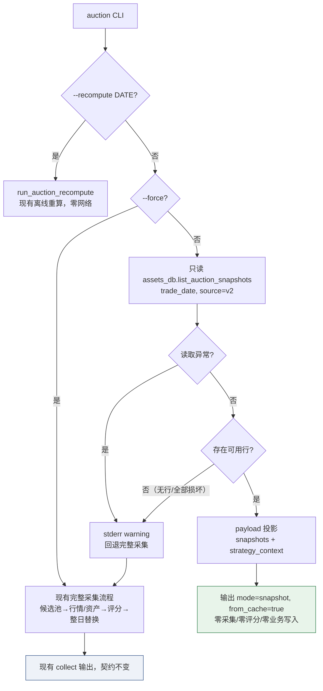
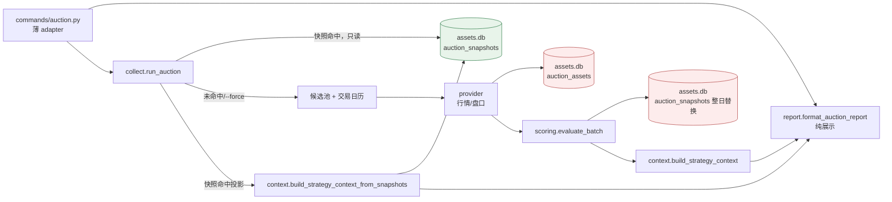

# auction 快照优先 + `--force` 技术方案

> 状态：阶段 2 设计（2026-10-29 main 单次验收通过，见 §13）
> 范围：`dragon-quant auction` 默认读取当日已存快照；新增 `--force` 强制重采。
> 不改评分、因子、buy/sell、历史快照内容与 schema。

## 1. 背景与已确认行为（阶段 0）

当前 `auction` 每次运行都会重新走「T-1 候选池 → 交易日历 → 行情 → 逐股盘口 → 评分 → 整日替换快照」，即使当日已经产出过完全相同的快照。重复运行既浪费 provider 配额，也把「再次查看结果」误写成「再次采集」。

用户已确认的行为：

1. 普通 `auction`（非 `--recompute`）当日存在**可解析**的 `auction_snapshots`（`source=v2`）→ 直接输出已存快照：**零 provider 请求、零采集、零评分、零业务写入**；候选池与 `--days` 不再求值，输出标注来自快照。
   - 口径澄清：dispatch 层仍按既有架构 pin 构造 provider bundle（纯对象、无网络 I/O，与本次改动前完全一致），本条约束的是**零 provider 方法调用 / 零网络请求**。
2. 新增 `--force`：绕过快照缓存，走现有完整流程（候选池 → 行情/资产 → 评分 → 整日快照替换）。
3. 无可用快照（无行 / 全部损坏）→ 自动走完整流程，不需要额外参数。
4. `--recompute` 行为不变；`--force` 与 `--recompute` 互斥，冲突 exit 2。
5. 不改评分/因子/`buy`/历史快照。

**非目标**：不新增表/列；不改变 `auction_assets` / `auction_snapshots` 的写入语义；不把快照命中伪装成新采集；不改 `recompute` 的离线重算契约；不改 `strategy_context` 既有版本号（仍 `auction_sc_v1`）。

## 2. 候选设计

### 候选 1（推荐）：Cache-Aside 在 `run_auction` 入口短路 + 单一投影适配器

在 `run_auction` 最前面做只读缓存查询；命中则用新增的「payload 投影」函数构造输出与 `strategy_context`，否则原样落入现有采集流程。缓存读取只调用既有 `assets_db.list_auction_snapshots(trade_date, source="v2")`。

- 优点：短路点唯一，天然早于 `_resolve_collect_services`、交易日历、候选池、行情与评分；采集逻辑零复制；`commands/auction.py` 保持薄 adapter。
- 缺点：`collect.py` 增加约 60–80 行；需要新增一个 payload → position/summary 投影并重构既有 verdict 投影以避免两份实现。

### 候选 2（反直觉）：命令层独立只读用例 `auction/snapshot.py`，`handle` 先分流

`commands/auction.handle` 先查快照，命中则调用独立只读用例，不再进入 `run_auction`。

- 优点：`collect.py` 不膨胀，语义最纯。
- 缺点（不采用）：**编排上移到命令层**，违反既有架构 pin（`commands/auction.py` 必须是 ≤120 行薄 adapter，且不得直接编排 auction 工作）；命令层要自己解析日期、组装输出与退出码；`--force/--recompute` 的分流散落两处；测试面重复。此外 dispatch 仍会构造 provider bundle，收益不足以抵消边界破坏。

### 候选 3：从 `analysis_json` 反序列化重建 `AuctionVerdict`，完全复用现有 report/context

- 优点：投影代码为零，report/context 一行不改。
- 缺点（不采用）：需要把 `dims`/`risk_events`/`actions`/`data_quality` 等全部还原为 dataclass 才能复用；这条「反向序列化」本身是新的易错层，且容易在字段缺失时伪造默认值，违背「不得编造」；还违背 main 框架 E「不重实例化评分器」的收敛意图。

### 推荐与设计模式

采用候选 1。模式选择与动机：

- **Cache-Aside（旁路缓存）**：读路径先查缓存、命中即返回，写入仍由原流程负责；用显式 `--force` 作为 bypass 开关，避免「隐式失效」带来的不可控。动机：把「读结果」与「再生产」解耦，且不引入缓存失效复杂度。
- **Adapter / Projection（单向投影）**：新增 `snapshot_summary(payload)` 与 `position_from_payload(payload)`，让「已存 payload → 展示/上下文」只有一份实现；既有 `_snapshot_summary(verdict)`、`_position_from_verdict(verdict)` 改为委托同一投影。动机：消除重复映射，保证缓存命中与采集路径的输出逐字段一致。
- 不引入 Strategy/Factory 等额外抽象：分支只有一个固定判定，三行 if 足够，不为假设的未来缓存后端付费。

## 3. 分支流程



**短路位置（硬约束）**：在 `run_auction` 内、`_resolve_collect_services()` 之前；不读交易日历、不读 dragons 镜像、不构造候选池、不取行情、不评分、不调用 `replace_auction_snapshots`。

### 3.1 模块与读写边界



绿色为只读表访问；红色为完整采集路径才发生的业务写入。快照命中路径不经过红色节点。

## 4. 模块与接口设计

### 4.1 文件改动清单

| 文件 | 改动 |
|------|------|
| `dragon_quant/cli.py` | auction parser 增加互斥组：`--force`（store_true）与 `--recompute DATE`；更新 usage/epilog |
| `dragon_quant/commands/auction.py` | `run_auction(..., force=getattr(args, "force", False))`；`_render_report` 的 mode 改为 `outcome.mode`（快照模式复用现有 kwargs） |
| `dragon_quant/review_account/auction/collect.py` | `run_auction` 新增 `force` 参数与入口短路；新增 `_load_snapshot_rows` / `_split_snapshot_rows` / `_snapshot_outcome` |
| `dragon_quant/review_account/auction/scoring.py` | 新增 `snapshot_summary(payload)`；`evaluate_batch` 改用它生成 `snapshots[]` |
| `dragon_quant/review_account/auction/context.py` | 新增 `position_from_payload` / `build_strategy_context_from_snapshots`；抽出 `_finalize_context`；`_position_from_verdict` 委托 payload 投影；`failed.stage="snapshot"` 映射 |
| `dragon_quant/review_account/auction/report.py` | `format_auction_report` 增加 `mode="snapshot"` 标题分支 |
| `dragon_quant/tests/**` + `tests/e2e/**` + goldens + `coverage-map.json` | 见 §8 |
| `README.md` / `docs/agent/prep-auction.md` / `skills/dragon-quant/references/*` | 见 §9 |

不新增模块、不改 schema、不改 `recompute.py`。

### 4.2 公共入口签名

```python
def run_auction(*, pool: str = "prep", days=None, services=None,
                today: str | None = None, force: bool = False) -> AuctionOutcome
```

- `force=False`（默认）：先尝试快照短路。
- `force=True`：完全跳过缓存读取，行为与此前 `run_auction` 等价。
- `pool` / `days` 在命中时**不参与求值**；在未命中或 `--force` 时语义不变。

内部辅助（`collect.py`）：

```python
_SNAPSHOT_USABLE_KEYS = ("version", "is_weak", "strength", "direction",
                         "level", "dims", "reject_reason", "unverified",
                         "rank", "data_quality")

def _load_snapshot_rows(trade_date: str) -> list[dict]      # 只读既有接口
def _split_snapshot_rows(rows) -> tuple[dict[str, dict], list[dict]]
def _snapshot_outcome(trade_date, usable, failures) -> AuctionOutcome
```

可用行判定（逐行隔离，不中断整批）：

1. `row` 为 dict 且不含 `error` 键（`list_auction_snapshots` 对损坏 JSON 已写 `error`）；
2. `row.get("code")` 非空；
3. 至少含一个 `_SNAPSHOT_USABLE_KEYS` 键（排除 `{}` / 仅 code 的空壳）。

损坏/空壳行进入 `failures`：`{"code", "stage": "snapshot", "error"}`，`error` 为接口原始异常文本或 `snapshot_incomplete: analysis_json 无可用字段`。

### 4.3 `--force` 与 `--recompute` 互斥

argparse：

```python
group = auction_p.add_mutually_exclusive_group()
group.add_argument("--force", action="store_true", help="...")
group.add_argument("--recompute", metavar="DATE", default=None, help="...")
```

冲突由 argparse 在 dispatch 前以 exit 2 拒绝（不构造 services、不触库）。`--force` 与 `--pool/--days/--json` 可组合；`--force` 不改变 16:40/09:25 等既有门禁。

## 5. 输出契约

### 5.1 快照命中 payload（新增 `mode="snapshot"`）

键序固定（collect 键序 + `from_cache` 紧随 `source`，`strategy_context` 仍居末）：

```
ok, mode, trade_date, source, from_cache, pool_source, fallback_reason,
prep_snapshot_date, prep_unavailable_reason, recommended_count, days_ignored,
lookback_dates, candidate_codes, saved_count, saved, empty, failed, quote,
quote_missing, asset_read_error, scored_count, snapshot_saved_count,
snapshot_ok, snapshot_skipped, snapshot_error, snapshots, strategy_context
```

| 键 | 值 | 语义 |
|----|----|------|
| `ok` | `not failures` | 部分损坏 → `false`，但退出码仍 0 |
| `mode` | `"snapshot"` | 明确不是 collect/recompute |
| `source` | `"v2"` | 快照表 source |
| `from_cache` | `true` | 新增标记；collect 无此键（缺省即 false） |
| `pool_source` | `"snapshot"` | 候选池未求值 |
| `fallback_reason` | `null` | 没有走回退池 |
| `prep_snapshot_date` / `prep_unavailable_reason` | `null` | **不编造 prep 血缘** |
| `recommended_count` | `0` | 未读取 prep |
| `days_ignored` | `false` | `--days` 未求值（不发「已忽略」告警） |
| `lookback_dates` | `[]` | 未读交易日历 |
| `candidate_codes` | 可用行数 | 本次展示的参与只数 |
| `saved_count` / `saved` | `0` / `[]` | 没有新采集 |
| `empty` | `[]` | 无「无盘口」判定 |
| `failed` | 损坏/空壳行 | `stage="snapshot"` |
| `quote` | 全零报告 | `{"source":"none","fallback_used":false,"requested":0,"matched":0,"missing":[],"degraded":false,"reason":null,"error":null}` |
| `quote_missing` / `asset_read_error` | `[]` / `null` | 未取行情 |
| `scored_count` | 可用行数 | 直接来自已存快照，非本次评分 |
| `snapshot_saved_count` | `0` | **不得写成新快照** |
| `snapshot_ok` | `true` | 语义 = 「已存快照可用」，不代表本次写入了快照 |
| `snapshot_skipped` | `"cache_hit"` | 显式原因 |
| `snapshot_error` | `null` | — |
| `snapshots` | 14 键摘要列表 | 与 collect 同形，来自 `snapshot_summary(payload)` |
| `strategy_context` | 见 §5.3 | 只读投影 |

退出码：命中即 0（含部分损坏）；无可用行不会返回 snapshot 模式。

注：命中时若显式传入 `--pool legacy` 或 `--days N`，该参数**不求值也不告警**（避免污染既有 stderr 契约）；「来自快照」由 `from_cache`、`pool_source="snapshot"` 与人读标题共同表达，需要重采时用 `--force`。

### 5.2 人读输出

```text
📊 2026-10-29 集合竞价强度（快照｜来自缓存｜参与 3 只）
1. 600001 中 69.9 中性｜开+0.0% 换手6.56% 末段匹配×3.6｜数据 ok
...
汇总：强 0 / 中 2 / 弱 1；否决 1
ℹ️ validation_status=baseline_unvalidated（阈值为待验证基线，不构成投资建议）
```

- 新增 `mode="snapshot"` 分支：头部 token 依次为「快照」「来自缓存」「参与 N 只」；`failed_count > 0` 时追加「快照损坏 K 行」。
- 快照内容没有人名，命中路径 `render_names={}`，人读行只显示代码（不为了补名字去读候选池，保持只读边界）。
- `--json` 输出 §5.1 完整结构；默认模式错误仍走 stderr + 非零码。

### 5.3 `strategy_context`（仍 `auction_sc_v1`）

- `positions[]` **只**来自已存 payload 的只读投影，覆盖可用行 ∪ 损坏行；不读候选池、不补 `unknown`。
- 损坏行映射为 `status="failed"`、`unknown_reason="snapshot_corrupt"`、`actions=[{"kind":"request_data","text":"已存竞价快照损坏，无法投影","requires":"auction_snapshot"}]`。
- 旧 schema（缺 `data_quality`，如 `version="1"` payload）：显式降级 `status="unavailable"`、`data_quality.status="unavailable"`、`reason_codes=["snapshot_legacy_schema"]`；已存 `strength/level/direction/rank/is_weak` 原样带出，不重算。
- `pool`：

```json
{
  "source": "snapshot",
  "coverage": "assets_only",
  "candidate_codes": 3,
  "snapshot_config_versions": ["auction_v2_baseline"]
}
```

  `snapshot_config_versions` 为已存行 `config_version` 的去重排序列表（v1 行无此键则不出现；混合版本如实列出）。
- 顶层 `config_version` / `config_hash` 仍是**当前投影 registry** 的值（context 契约字段），不冒充已存快照的配置；已存配置血缘通过 `pool.snapshot_config_versions` 与 `snapshots[].config_version` 暴露。
- `as_of` 仍由 `trade_date` 推导；`prep` 相关字段不出现、不伪造。
- **强度不重算**：不调用 `evaluate` / `rank_auctions`，不重实例化评分器。

### 5.4 未命中 / `--force` 输出

完全沿用现有 `collect` 载荷与金标（键序、退出码、告警均不变）；`--force` 不新增字段，避免污染既有消费方。

## 6. 错误处理

| 场景 | 行为 |
|------|------|
| `assets.db` 不存在 | `list_auction_snapshots` 返回 `[]`（`_connect(create=False)`），无目录/库创建；走完整采集 |
| 快照读取抛异常（锁/磁盘/schema） | `warnings` 追加稳定文案并回退完整采集，不中断命令 |
| 无行 / 全部损坏 / 全部空壳 | 自动走完整采集；正常首次运行不额外告警 |
| 部分损坏 | 返回可用行 + `failed`；`ok=false`、exit 0；**不删除/不改写**损坏行 |
| `--force --recompute` | argparse exit 2，未触库、未构造 provider |
| 单行 JSON 非对象 | 既有接口写 `error`，本设计按损坏行隔离 |

只读边界说明：`list_auction_snapshots` 既有实现会执行 `PRAGMA journal_mode=WAL` 与 `CREATE TABLE IF NOT EXISTS`（读路径既有行为），可能产生瞬时 `-wal/-shm`，但**不写任何业务行**；本设计不新增写操作。provider bundle 仍在 dispatch 层按架构 pin 构造（纯对象、无网络），快照命中**不调用任何 provider 方法**。

## 7. 一致性与兼容性

- `COLLECT_KEYS` / `RECOMPUTE_KEYS` / `EMPTY_KEYS` 不变；现有 E2E 金标无需修改。
- `snapshots[]` 摘要改用 payload 投影后，与 `evaluate_batch` 原 verdict 投影逐字段一致（v2 下字段一一对应）；E2E A2 的 `snapshot_summaries(auction_snapshots(box)) == payload["snapshots"]` 仍成立。
- `context._position_from_verdict` 改为委托 `position_from_payload(verdict_to_payload(...))`，既有 `auction_sc_v1` 结构、键序、动作枚举不变；由现有 context 测试 + E2E 金标兜底。
- 因子层 / `priority.auction_state` / `buy` / `decision-review` 只读快照表，不受本改动影响。
- `--force` 仅 bypass 缓存；`recompute` 仍零网络、只读资产重算。

## 8. 测试策略

### 8.1 单元测试

`dragon_quant/tests/test_auction_service.py::TestSnapshotCacheContract`（patch `dragon_quant.infra.assets.db.list_auction_snapshots` 与既有 `_CollectHarness`）：

1. 命中：返回 2 条 v2 payload → `mode="snapshot"`、键序如 §5.1、`from_cache=true`、`saved_count=0`、`snapshot_saved_count=0`、`snapshot_skipped="cache_hit"`；factory/calendar/quotes/get_auction/save/replace **零调用**。
2. 部分损坏：1 可用 + 1 JSON 损坏 → `ok=false`、`failed=[(code,"snapshot")]`、exit 0、`snapshots` 只含可用行。
3. 全部损坏：落入 collect harness → `mode="collect"`，采集照常。
4. 读取异常：回退 collect 且 `warnings` 含稳定文案。
5. `force=True`：不调用 `list_auction_snapshots`，采集照常。
6. `pool="legacy", days=3` 命中：仍是 snapshot、无 `days_ignored` 告警、零日历调用。

`dragon_quant/tests/test_auction_context.py`：

- `build_strategy_context_from_snapshots` 的 positions 与 `build_strategy_context(evaluations=[verdict])` 逐字段一致（用 `verdict_to_payload` 构造输入）。
- 旧 schema payload → `unavailable` + `snapshot_legacy_schema`，不伪造 `data_quality`。
- 损坏行 → `failed` + `snapshot_corrupt`；`pool.source="snapshot"`、`coverage="assets_only"`、无 prep 血缘。

`dragon_quant/tests/test_auction_scoring.py`：`snapshot_summary(payload)` 与既有 v2 摘要 14 键一致；`evaluate_batch` 的 `snapshots` 不变。

`dragon_quant/tests/test_auction_report.py`：snapshot 标题与损坏计数。

`dragon_quant/tests/test_commands.py`：live parser 与 `coverage-map.json` 的 auction flags 同步（既有测试自动校验）。

### 8.2 E2E（真实 CLI 子进程 + golden）

在 `dragon_quant/tests/e2e/test_auction.py` 追加：

| 用例 | 断言 |
|------|------|
| `test_a15_repeated_auction_returns_the_stored_snapshot_with_zero_calls` | 先 `auction` 采集；第二次 `auction`：`transport_since == []`、`mode=snapshot`、`from_cache=true`、`snapshot_skipped=cache_hit`、`auction_assets`/`auction_snapshots` 行内容与 `created_at` 不变、第二次 `snapshots[]` 与第一次逐字段一致、JSON/human 新 golden |
| `test_a16_force_bypasses_the_snapshot_cache` | 已有快照时 `auction --force`：provider 调用恢复、`mode=collect`、键序仍为 `COLLECT_KEYS`（无 `from_cache`）、`saved_count=3`、`snapshot_saved_count=3` |
| `test_a17_all_corrupt_snapshots_fall_back_to_full_collection` | 只种损坏快照 → `mode=collect`、采集成功、损坏行被整日替换 |
| `test_a18_partially_corrupt_snapshots_return_valid_rows` | 1 可用 + 1 损坏 → exit 0、`mode=snapshot`、`failed` 含损坏 code、可用行输出、损坏行原样保留 |
| `test_a19_force_and_recompute_conflict_exits_two` | exit 2、无 provider 调用、无库创建 |
| `test_a20_snapshot_hit_does_not_evaluate_pool_or_days` | `--pool legacy --days 3` 命中：`pool_source=snapshot`、无「--days 已忽略」stderr、零日历调用 |

`--recompute` 不变由既有 A7–A12 继续覆盖（A7 在快照已存在时重算，必须仍走 recompute）。

新 golden：`golden/auction/json_snapshot.json`、`golden/auction/stdout_snapshot.txt`。

### 8.3 覆盖图

- `dragon_quant/tests/e2e/coverage-map.json`：auction 节点 `flags` 追加 `--force`（节点数仍 52），`tests` 追加 a15–a20；`parser_snapshot` 的 `sha256`/`source` 为外部 stage-1 dump 的溯源信息，不重造（既有测试只校验格式与 hermetic），但 flags 必须与 live parser 一致。
- `dragon_quant/tests/test_docs_consistency.py` 无新增词表要求；README/prep-auction 的既有 token 断言不得破坏。

## 9. 文档同步（同一 commit）

| 文件 | 更新 |
|------|------|
| `README.md` | auction 命令示例加 `--force`；**醒目提示「普通 auction 永远优先最新快照，想更新必须 `--force`；想按当前算法重算用 `--recompute`」**；说明 `--pool/--days` 命中时忽略、JSON 新增 `mode=snapshot`/`from_cache`、`snapshot_skipped=cache_hit`、互斥 exit 2；「写安全」段注明命中快照时本次运行只读、`--force` 才写库 |
| `docs/agent/prep-auction.md` | auction 节新增缓存短路语义、只读边界、`--force` 与互斥、snapshot payload/`strategy_context` 投影、部分损坏与回退口径 |
| `skills/dragon-quant/references/commands.md` | 路由表 auction `key_flags` 加 `--force`，notes 加「命中即只读」 |
| `skills/dragon-quant/references/safety.md` | auction 行 flags 加 `--force`；说明命中时为只读语义但命令仍属 T1 |
| `skills/dragon-quant/references/outputs.md` | auction 节补充 `mode=snapshot`/`from_cache`/`pool_source=snapshot`/快照标题；说明 `ok=false + exit 0` = 部分快照损坏但可用行已返回；`snapshot_config_versions` 为已存快照配置血缘 |
| `skills/dragon-quant/references/operations.md` | 「次日竞价」补充：重复运行返回快照；需重采加 `--force` |

## 10. 风险与缓解

| 风险 | 缓解 |
|------|------|
| 投影两套实现漂移（verdict vs payload） | 统一为 `snapshot_summary(payload)` / `position_from_payload`，verdict 侧委托；E2E A2 逐字段等值兜底 |
| 缓存掩盖「数据已更新」的直觉 | 输出显式 `from_cache=true` + 「来自缓存」标题 + 文档；`--force` 为唯一 bypass |
| 旧 schema 快照被误读为完整强度 | 显式 `snapshot_legacy_schema` 降级，不补默认分 |
| 命中路径被未来改动插入 provider 调用 | 短路位于 `run_auction` 首段；单测以「零调用」断言 + 架构 pin 保护 |
| 读接口的 WAL/建表副作用被误判为写 | 方案与测试明确以「业务行不变 + provider 零调用」为验收口径 |
| 人名缺失导致人读信息变少 | 文档标注；不越界读候选池 |

## 11. 验收映射

| 阶段 0 验收标准 | 实现位置 | 验证 |
|----------------|----------|------|
| 普通 auction 命中当日快照：零 provider/零采集/零评分/零业务写 | `collect.run_auction` 入口短路 + `_snapshot_outcome` | 单测 1、E2E a15 |
| 命中输出标 `mode=snapshot`/`from_cache=true`，标题标「快照」 | `collect._snapshot_outcome`、`report.format_auction_report` | 单测 1、E2E a15 golden |
| `--force` 绕过缓存走完整流程 | `cli` 互斥组、`commands/auction.handle`、`run_auction(force=)` | E2E a16 |
| 无快照/全部损坏自动回退完整流程 | `_split_snapshot_rows` 空结果 → 原流程 | 既有 A3/A4、E2E a17 |
| 部分有效 + 部分损坏返回有效行并带错误 | `failed` + `ok=false` + exit 0 | 单测 2、E2E a18 |
| `--force` 与 `--recompute` 冲突 exit 2 | argparse 互斥组 | E2E a19 |
| 命中时 `pool`/`days` 不求值 | 短路早于候选池/日历 | 单测 6、E2E a20 |
| `--recompute` 不变 | `recompute.py` 零改动 | 既有 A7–A12 |
| `strategy_context` 不伪装重采、不编造 prep 血缘 | `build_strategy_context_from_snapshots` + `position_from_payload` | 单测 context、E2E a15 |
| 快照内容不改、真实 DB 零修改 | 只读接口 + 不调用 replace | E2E a15/a18 行比对 |
| 文档/Skill/覆盖图同步 | §9、§8.3 | `test_docs_consistency` / `test_skill_routes` / `test_coverage_map` / `test_commands` |

## 12. 实施顺序（阶段 3 参考）

1. `scoring.snapshot_summary` + `context` 投影重构（先保持现有 collect 输出不变）。**闸门**：既有 `test_auction_context` / `test_auction_scoring` / `test_auction_report` 与 E2E A1/A2 必须全绿、`payload["snapshots"]` 与 golden 逐字段一致，才继续第 2 步；若出现任何逐字段差异，先修正投影而非放宽 golden。
2. `collect` 短路与 `_snapshot_outcome`，新增单测。
3. `report` 标题分支 + `commands/auction.py` 传参 + `cli.py` 互斥组，跑 parser 测试。
4. E2E 新用例与 golden，更新 `coverage-map.json`。
5. README / owner 文档 / Skill 引用同步。
6. 全量自测：`pytest dragon_quant/tests -q --ignore=.../e2e --ignore=.../smoke`、`pytest dragon_quant/tests/e2e -q`。

## 13. main 单次验收（2026-10-29）

结论：**通过，无「必须修改」项，不需要复审。**

接受项：

- 短路位置与「provider 仅零方法调用 / 零网络」口径；
- snapshot payload 键序与 `ok=false + exit 0`（部分损坏）；
- `pool.snapshot_config_versions`；
- `--pool/--days` 命中时静默不求值；
- 人名不回查；
- 缓存不随 `config_hash` 失效（`--force` 负责显式刷新）；
- WAL / 标准 schema 既有读行为以「业务行不变」验证。

建议（已落实）：文档保持醒目提示「**普通 auction 永远优先最新快照，想更新必须 `--force`；想按当前算法重算用 `--recompute`**」，避免用户误以为盘中会自动刷新。不新增 stderr warning，不调整 E2E 编号。

## 14. 阶段 3 main 单次验收（2026-10-29）

结论：**通过，无「必须修改」项；不需复审。**（仅留痕，不再改代码）

已核对并接受：

- 快照短路早于 provider / 候选池；`mode="snapshot"` / `from_cache=true`；`--force` 走原完整流程。
- 无快照 / 全部损坏自动回退完整流程；部分损坏返回可用行 + `failed`（`ok=false`、exit 0）。
- `--force` 与 `--recompute` 互斥（argparse exit 2）；命中时 `pool` / `days` 不求值。
- `strategy_context` 只读投影（`pool.source="snapshot"`、`coverage="assets_only"`、不伪造 prep 血缘）；`recompute` / `buy` 行为不变。
- 接受设计文档头状态行同步为此前通过（§3 状态行）。
- 接受自测证据：单元/集成 `2381 passed, 2 skipped`（1413 subtests）；全量 E2E `318 passed`；定向 `159 / 60 / 23 passed`。

裁决：

- 全部 NIT / `known_issues` 接受，不阻塞。
- legacy schema 快照行的 E2E 端到端渲染补充测试仅作后续建议，不阻塞。
- `deviations`：无行为偏离（仅文档状态行同步）。

下一步：进入阶段 3.5 产品与方案符合性终审。

