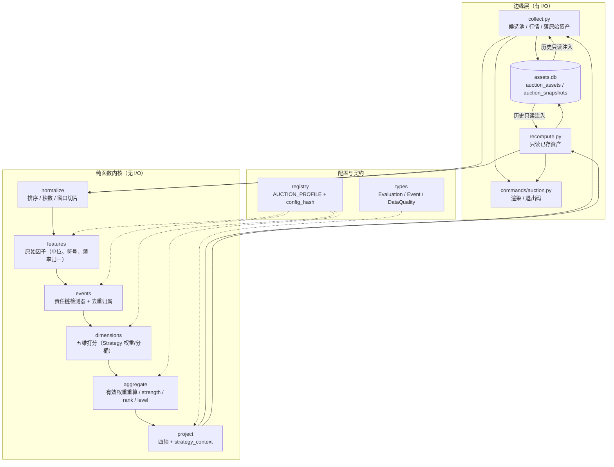
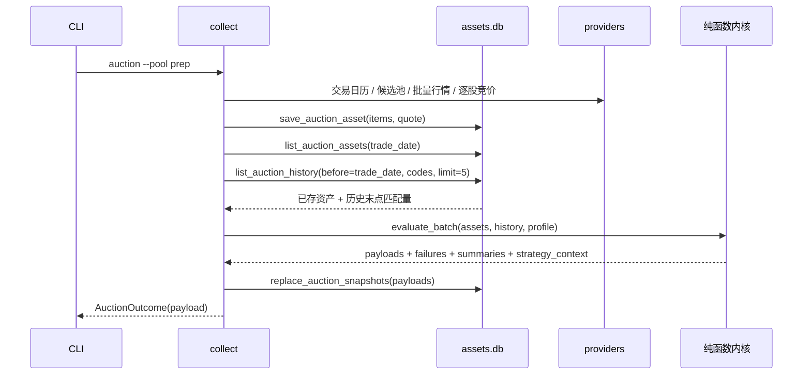
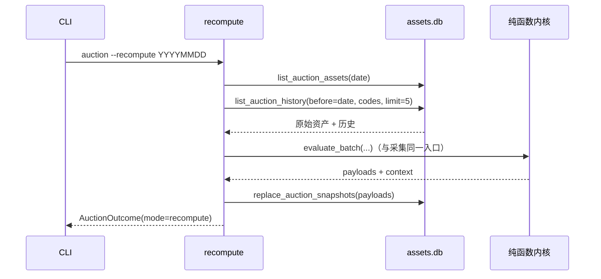
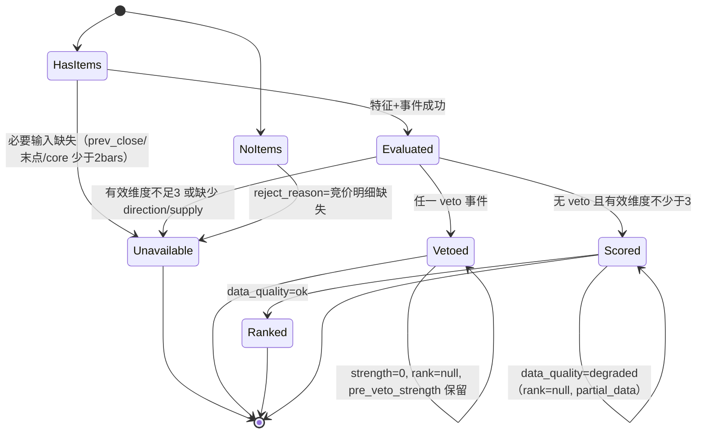

# auction 集合竞价强度升级 · 技术方案

> 日期：2026-10-29｜阶段：2（技术方案）｜状态：solution-self-review **APPROVE** + main 单次验收**通过**（见 §24）
>
> 上游：阶段 1 调研 `archived_md/auction/2026-10-29-auction-strength-research.md`（APPROVE）；
> 阶段 0 验收标准（用户已批准，后续无需审批连续推进）。
>
> 范围：只重建 `auction` 的语义、评分、输出与 `auction_*` 因子，以及 Agent Skill 的竞价输入。
> **不修改** `buy` 的规则、参数、功能，不修改 `review_account/strategy/priority.py` 或任何 buy 相邻代码（含展示文案）。
>
> **本文所有权重、阈值、分桶均为待验证产品基线**（`validation_status=baseline_unvalidated`），
> 不代表收益承诺，也不构成任何买卖建议。

---

## 0. 结论摘要

- 采用**证据化重建**（调研方向 B）：先固化字段语义，再以 09:20–09:25 不可撤单窗口为核心，
  用「特征 → 事件 → 五维分 → 四轴投影」的纯函数流水线重建评分，最后在边缘做存储与 CLI。
- 旧快照 JSON 的顶层键、`dims` 的四个旧键、`is_weak/strength/direction/level/reject_reason/unverified/rank`
  全部保留；`version` 升为 `"2"`，新增键只增不改。`strength/level` 允许为 `null`（数据不足），
  不允许再用 50 分或 0 分冒充。
- 四轴分离：`strength`（可算时 0–100）、`risk_events`（含 veto）、`data_quality`
  （`ok/degraded/unavailable` + 稳定原因码 + `completeness`）、`validation_status=baseline_unvalidated`。
- `is_weak` 只来自真实风险 veto；空明细/缺行情只进入 `data_quality.unavailable`，
  legacy `unverified=true` 表示「本次评价不可用」，不再表示「模型未回测」。
- 采集与 `--recompute` 共用同一评分入口；历史竞价资产由存储层**只读注入**；零网络、确定性可重放。
- 新增版本化 `strategy_context`（`auction_sc_v1`），逐只覆盖 `scored/vetoed/unavailable/empty/failed/unknown`，
  只给 `observe/await_confirmation/flag_risk/request_data` 四类条件化动作。
- 因子层：8 个旧 `auction_*` 以新 `impl_key`/`config_hash` 升级语义，新增 9 个高价值因子
  （含第五维），全部 `default_enabled=False`、缺失=无行、不 import `review_account`。
- 本期**不做**全市场广度、订单级主力身份、09:30 后实盘确认、ML、胜率断言。

---

## 1. 阶段 0 验收标准与阶段 1 硬输入

### 1.1 验收标准（逐条落位到本文）

| # | 验收标准 | 本文落位 |
|---|---|---|
| AC1 | CLI 逐只输出简短强度/等级/方向/关键证据/具体数据状态，且无买卖建议 | §12.2、§12.4 |
| AC2 | 真实语义验证，而非翻转常量 | §6、§8、§14.3、§18.2 |
| AC3 | JSON 含原始因子、维度贡献、事件、窗口、数据质量 | §12.1、§12.3 |
| AC4 | 六篇资料采用/拒绝可追溯 | §4 |
| AC5 | `recompute` 零网络且确定 | §10、§13.2 |
| AC6 | Skill 可生成简短盘中预案且不编造 | §12.5 |
| AC7 | 单测 + 离线 E2E | §18 |
| AC8 | 不改 `buy` 代码/规则/参数；新因子 `default_enabled=False` | §13.3、§15 |
| AC9 | 不承诺胜率 | §0、§12.3、§12.5 |

### 1.2 阶段 1 硬输入（全部承接）

调研 §7 的 11 条硬输入逐条对应 §6.2（正式开盘/指示价分离）、§6.1/§7/§8（单位与窗口）、
§7.2（频率归一）、§9.4/§11.2（缺失语义与四轴）、§12.3（版本化上下文）、§12.4（CLI 简短）、
§15（因子默认关与去重）、§18（真实语义测试）、§0/§13.1（权重为基线）、§16（风险与兼容边界）、
§10（纯函数与共用入口）、§14.1（消费方清单）。

---

## 2. 候选方案比较

> 要求：≥2 个候选，至少 1 个非常规路径。下表 4 个候选，A/B 为常规，C/D 为非常规。

| 候选 | 做法 | 优点 | 代价 / 风险 | 结论 |
|---|---|---|---|---|
| **A. 最小修补** | 翻转 `SEMANTICS_VERIFIED`，修 `open_px` 与 ×100，保留四维/否决/中性 50 | 改动最小、上线最快 | 全窗未匹配求和与采样放大仍在；缺失仍写 50/弱；无逐只证据；达不到 AC3/AC6；无法解释「为什么强」 | 拒绝（调研已判） |
| **B. 分层纯函数流水线（推荐）** | `normalize → features → events → dims → aggregate → project` 六段纯函数；配置集中 registry；存储/CLI 在边缘；四轴分离 | 每段可单测、可重放；语义可追溯；新增维度/事件只加函数与注册项；无 DI/Observer | 文件数增加 3–4 个；需要一次性重写评分器与 golden | **采用** |
| **C. 基线冻结 + 双跑影子（非常规）** | 旧评分器保留为 challenger，每次同时跑新旧两套，生产 JSON 存 `shadow` 差异，差异未解释则拒绝切换 | 零静默翻转，迁移证据最强 | 双倍计算与 JSON 体积；生产快照长期膨胀；影子本身也需要维护 | **部分采纳**：只在测试/离线对账中双跑，不进入生产 JSON（§14.3） |
| **D. Tape-first 物化重放（非常规）** | 把归一化逐笔 tape 落成派生表，评分全部由 SQL/读模型计算 | 任意窗口可重算、跨股票查询方便 | 需要新表与迁移、存储膨胀；纯函数性下降；本期收益不足 | 拒绝（§17 暂缓） |

**推荐 B + C 的子集**：生产走 B；用离线双跑对账（旧四维 vs 新五维）生成一次性差异报告，
证明每处差异都能由「单位错误 / 全窗求和 / 中性 50 / 采样放大」四类原因解释，作为 AC2 的验收证据，
不把影子字段写进生产快照。

---

## 3. 设计原则与设计模式

### 3.1 原则

1. **纯函数内核**：特征提取、事件识别、维度打分、聚合、上下文投影全部无 I/O、无 wall clock、
   无随机、无环境读取；存储与 CLI 只在边缘。
2. **缺失即缺失**：任何缺失都不写 0/50/中性；用 `null` + 稳定原因码表达。
3. **单入口**：采集与重算必须调用同一个 `evaluate_batch`，禁止复制评分循环。
4. **证据优先于结论**：先产出可审计的原始因子与事件，再聚合成 `strength`。
5. **简单优先**：不引入 DI 容器、Observer、插件加载；新增一个维度 = 一个纯函数 + 注册表一行。

### 3.2 采用的设计模式及动机

| 模式 | 落位 | 动机 |
|---|---|---|
| **Strategy（策略）** | `registry.AUCTION_PROFILE`：权重、分桶、窗口、最小样本、历史目标；`config_version/config_hash` | 权重与阈值是唯一会随研究变化的「策略参数」；集中后换 profile 即可做消融，不会散落在公式里 |
| **Template Method（模板方法）** | `scoring.evaluate_one` 固定骨架 `normalize → features → events → dims → aggregate → project`，各段由独立函数实现 | 保证所有股票走同一条不可绕过的路径（数据质量、veto、去重都在骨架里），防止某个维度「偷偷」跳过缺失语义 |
| **Chain of Responsibility（责任链）** | `events.detect` 按固定顺序执行检测器链；链**不短路**（收集全部证据），veto 是事件属性而非中断 | 既要一次拿到全部风险与上下文证据，又要 veto 有确定优先级与首个 `reject_reason`；与旧「首个命中短路」兼容（取链中第一个 `veto=True` 的原因作为 `reject_reason`） |
| **Registry（注册表）** | `FEATURES`/`EVENT_DETECTORS`/`DIMENSIONS`/`FACTOR_SPECS` 四张表 | 新增因子/事件不改流水线骨架；测试可直接遍历注册表做覆盖断言 |
| **Facade（门面，沿用）** | `review_account/auction/main.py` 稳定重导出 | 保持 `commands/auction.py` 与测试的导入面不变 |
| **Adapter（适配器，沿用）** | `infra/factor/engine._load_auction_source` 把快照行适配为纯 dict | 因子层零 I/O、零 `review_account` 依赖的既有边界不变 |

**明确不用**：DI 容器、事件总线、Observer、异步队列。当前是单进程、单只股票 O(n) 的纯计算，
引入这些只会增加理解成本（全局约定「优先简单」）。

---

## 4. 六篇参考资料的可追溯映射

| 资料 | 采纳 | 落位（本文/代码） | 拒绝/暂缓 | 理由 |
|---|---|---|---|---|
| 用了半年的集合竞价战法 | 同价位此消彼长、弱转强/强转弱、量价提升/背离、5 日量比 | §8 `weak_to_strong/strong_to_weak`、§7.3 同价转换事件、§9 供需/量价维、§15 `auction_volume_ratio_5d` | 8%「主力行为」阈值、主力身份、竞价格子、胜率 | 订单无账户身份；阈值无样本 |
| 开盘前 15 分钟定输赢 | 09:20 后核心窗口、末段抢筹、沪深频率差异、开盘金额/换手、prep 血缘 | §5 窗口、§6 单位、§7 频率归一、§12.3 候选血缘 | 09:30 后支撑压力、盘中大单流、全市场榜单 | 需要开盘后数据/全市场快照 |
| 看见这些信号立马跑 | 高位卖压、匹配量与排队卖单同步增长、低价格发现诊断 | §7.2 风险事件 `high_position_green_increasing`、`sell_pressure_acceleration`；数据质量诊断 | 把下方柱颜色当独立卖出信号、9:24:50 交易指令、无数据高位标签 | 颜色是未匹配方向的投影，重复计数；本项目不输出指令 |
| 一个公式早盘抓涨停 | 竞价量比、流通规模归一、热点板块作为上下文 | §8.2 量比 + §9 流动性维 + prep 主线只读透传 | 「开盘前/开盘 15 分钟」歧义、固定 3–5%/换手阈值、净利润混入 | 时点与口径不唯一；阈值无验证 |
| 集合竞价强弱转换 | 09:20 后红绿转换、临近 09:25 的方向切换、翻转时匹配增量 | §7.3 转换事件（最小样本 + 幅度规则） | 「逐步/突然/大量」无定义硬编码 | 需要可测试的数值定义，本文给出基线值 |
| 通过竞价判断大盘 | 全市场广度、板块联动 | 仅保留为后续方向（§17） | 用候选池冒充全市场 | 样本选择有偏 |

**资料内部冲突的处理**（与调研一致）：
- 匹配量颜色不单独计分；颜色来自未匹配方向，事件层只记一次。
- 09:15–09:20 只作低信任上下文，不进入核心维度分，只用于 `cancel_spoof_pre20` 与
  data_quality 的 `pre20_activity` 证据；`cancel_spoof_pre20` **不得 veto**（见 §7.3、§9.5）。
- 不输出「主力已控盘/已出货」；统一命名「盘口估计事件」。
- 高开只是价格表态之一，不能覆盖强转弱、卖压、量价背离风险。

---

## 5. 总体架构



**依赖方向**：`commands → review_account.auction (facade) → 纯函数模块`；
`infra.assets.db` 只被 `collect/recompute` 调用；纯函数模块**不 import** `infra.assets`、
`infra.provider`、`infra.factor`、`review_account.strategy`。因子层只经
`infra.factor.engine._load_auction_source` 读 JSON，**不 import** `review_account.auction`。

### 5.1 文件布局（新增/改动）

```
dragon_quant/review_account/auction/
  types.py        # 扩展：Evaluation、RiskEvent、DataQuality、DimensionScore（保留 AuctionVerdict 兼容字段）
  registry.py     # 重写：AUCTION_PROFILE、阈值/分桶/窗口/原因码/语义版本；保留旧常量别名
  normalize.py    # 新增（或并入 features）：时间/窗口/市场识别/增量序列
  features.py     # 新增：原始因子提取（纯函数）
  events.py       # 新增：事件检测器链 + 去重归属表
  dimensions.py   # 新增：五维打分
  scoring.py      # 扩展：唯一批量入口 evaluate_batch（含历史注入、失败隔离、上下文）
  strength.py     # 保留 evaluate/rank_auctions 门面，委托 scoring
  serialize.py    # 扩展：v2 序列化、允许 null、quote PIT 白名单
  context.py      # 新增：strategy_context 投影
  collect.py      # 扩展：历史读取、候选覆盖、strategy_context
  recompute.py    # 扩展：同入口 + 历史读取 + strategy_context
  report.py       # 扩展：逐只证据摘要
dragon_quant/infra/assets/db.py          # 新增只读历史查询（不改 schema）
dragon_quant/infra/factor/builtin/auction.py  # 8 个升级 + 9 个新增
```

> `normalize` 可以并入 `features.py`；若独立成文件，需同步 `docs/agent/architecture.md` 的目录树。
> 建议独立，便于 normalize 的单测直接锁定窗口与频率语义。

---

## 6. 字段语义契约（AC2 的核心）

### 6.1 已固化语义（写入每份快照的 `semantics` 块）

| 字段 | 语义 | 单位 | 证据 | 本方案处理 |
|---|---|---|---|---|
| `items[].time` | 竞价明细时点 | `HH:MM:SS` | easy_tdx `SymbolAuctionCmd` | 转秒数；只信任 09:15:00–09:25:00 |
| `items[].price` | 该时点虚拟撮合价 | 元 | 协议/真实样本 | 末点为 `last_indicative_price`，**不是**官方开盘价 |
| `items[].matched` | **虚拟匹配量（累计）** | **手** | eltdx/EasyTDX 协议 + 真实样本（09:20 前可下降，09:20 后不下降） | 命名 `matched_lots`；核心差分只在 09:20–09:25；金额/换手 ×100 |
| `items[].unmatched` | **带符号未匹配量快照** | 手 | 正=买方剩余，负=卖方剩余 | `final_unmatched_lots_signed`；**禁止全窗口求和** |
| `quote.open_px` | 09:25 后官方开盘价 | 元 | 真实样本 36/36 可用（与末点价常不同） | `official_open_gap_pct` 的**唯一**价格来源；缺失才降级 |
| `quote.prev_close/limit_up/limit_down/float_market_cap` | 静态/09:25 前确定 | 元/% | PIT 白名单 | 允许入模 |
| `quote.price/amount/volume/pct/turnover_rate/main_net_amount` | 可能是 09:25 之后的值 | — | 调研 F10 | **禁止**进入竞价评分（唯一例外见下） |

**唯一例外**：`quote.price` 允许用于**单位换算恒等式** `float_shares = quote.float_market_cap / quote.price`
（同一行情快照内的市值/价格比，与盘中涨跌无关），不得作为任何特征或分数输入。
`float_market_cap` 在 tdx/tencent 都是「抓取时刻的流通市值」，若用竞价价去除会引入盘中收益偏差
（见 §16 R14），因此必须与同一快照的 `price` 配对换算，并在 `evidence.float_shares_source` 记录来源。

每份快照写：

```json
"semantics": {
  "semantics_version": "auction_sem_2026_10_29",
  "matched_unit": "lots",
  "matched_kind": "cumulative_virtual_match",
  "unmatched_sign": "positive_is_buy_remainder",
  "core_window": ["09:20:00", "09:25:00"],
  "pre_window": ["09:15:00", "09:20:00"],
  "price_source": "official_open_px",
  "confidence": "protocol_plus_real_sample"
}
```

**AC2 的验证方式**（不是翻转常量）：
1. 语义常量 `SEMANTICS_VERSION` 有独立测试，断言快照必带 `semantics` 块；
2. 真实样本夹具覆盖「09:20 前匹配量下降、09:20 后不下降」，若实现把全窗口当单调累计，测试必失败；
3. 单位测试用「流通市值 50 亿、价格 10 元、匹配 1000 手」断言换手 = 0.2%，若漏 ×100 得 0.002% 必失败；
4. 末点非 09:25 的样本断言 `last_indicative_gap_pct != official_open_gap_pct` 且方向分使用后者。

### 6.2 正式开盘与最后指示价分离

- `official_open_px = quote.open_px > 0 ? quote.open_px : null`
- `last_indicative_price = items[-1].price`
- `final_indicative_slippage_pct = (official_open_px / last_indicative_price - 1) * 100`

**降级规则**：`official_open_px` 缺失时，`effective_open_px = last_indicative_price`，
价格维仍可打分但：
- `raw_factors.official_open_gap_pct = null`；
- `raw_factors.effective_open_gap_pct` 有值且 `effective_open_source="last_indicative"`；
- `data_quality.reasons += [{code:"official_open_missing", severity:"degraded"}]`；
- 该股 `rank=null`、`rank_reason="partial_data"`（不与完整数据股票混排）。

---

## 7. 窗口、频率与事件

### 7.1 窗口与最小样本

| 窗口 | 定义 | 作用 | 最小样本 |
|---|---|---|---|
| `pre` | [09:15:00, 09:20:00) | 低信任上下文：撤单/试盘/价格波动 | 1 |
| `core` | [09:20:00, 09:25:00] | **唯一正式评分窗口** | 2（含末点） |
| `front` | [09:20:00, tail_start) | 末段基准率 | 1 |
| `tail` | [09:24:30, 09:25:00]，bars<4 时扩到 [09:24:00, 09:25:00] | 末段执行 | 2 |
| `post20` | [09:20:00, 末点] | 转换/量价/供需 | 2 |

- 末点不要求正好 09:25:00（真实样本多数为 09:24:57–09:24:59）；以「最后一条 ≤09:25:00」为准。
- 若存在晚于 09:25:00 的记录（异常/延迟），截断并记 `data_quality.reasons += tail_after_close`（warning）。
- `tail_start` 由 profile 固定，扩窗只影响 tail，不影响 front 定义（避免前段基准漂移）。

### 7.2 沪深频率归一

- **所有速率类统计一律用真实 Δt 归一**：`rate = Δvalue / max(Δt, 1)`，不依赖市场固定频率。
  这样沪市约 3 秒、深市约 9 秒的采样差异不会放大计数。
- `market` 由代码前缀推断：`6xxxxx → sh`，`0xxxxx/3xxxxx → sz`，`4/8/9xxxxx → bj/unknown`。
- `MARKET_SAMPLE_SECONDS = {"sh": 3, "sz": 9}` **只**用于诊断：
  `expected_core_bars = 300 / interval`，`event_density_ratio = actual_core_bars / expected_core_bars`；
  未知市场不计算该比值（`null`），并记 `market_unknown`（warning）。
- `event_density_ratio` **不进入**强度分，只进 data_quality 与证据（防止把「采样少」当「弱」）。

### 7.3 事件层（责任链 + 去重归属）

检测器按固定顺序执行，**不短路**；每个检测器返回 0..N 个事件。事件结构：

```json
{
  "event_id": "strong_to_weak@09:24:52",
  "code": "strong_to_weak",
  "family": "risk | conversion | absorption | context | data",
  "severity": "high | medium | low | info",
  "veto": true,
  "window": ["09:22:00", "09:24:59"],
  "owner_dim": "supply | price | vol_price | tail_grab | liquidity | null",
  "evidence": {"front_median": 120.0, "tail_median": -80.0, "last_matched_lots": 9000, "min_bars": 2},
  "note": "盘口估计，不是订单级成交"
}
```

**链顺序与 veto 优先级**（与旧行为对齐，首个 `veto=True` 的原因写入 legacy `reject_reason`）：

1. `limit_down_queue_sell`（high，veto，owner=supply）
2. `high_position_green_increasing`（high，veto，owner=price）
3. `strong_to_weak`（high，veto，owner=supply）
4. `sell_pressure_acceleration`（medium，**不 veto**，owner=supply）
5. `volume_price_divergence`（medium，**不 veto**，owner=vol_price）
6. `cancel_spoof_pre20`（medium，**不 veto**，owner=null，仅证据）：
   09:15–09:20 属低信任、可撤单时段，只记录「峰值买单→09:20 后骤降且价格未回落」的盘口估计，
   **不得进入 veto、维度分或 strength**，也不得与 `early_cancel_estimate` 合并成否决。
7. 上下文事件（不 veto，不直接计分）：
   `weak_to_strong`（owner=supply，作为 supply 子项）、`sell_absorption_estimate`、
   `buy_queue_hit_estimate`、`queue_hidden_or_repriced`、`early_cancel_estimate`、
   `post20_matched_decrease`（family=data）、`tail_matched_spike`（owner=tail_grab）。

**veto 只允许来自 09:20–09:25 核心窗口或静态价格事实**：`limit_down_queue_sell`、
`high_position_green_increasing`、`strong_to_weak` 三个事件。任何仅由 pre 窗口（09:15–09:20）
证据触发的事件一律 `veto=false`。

**去重规则（硬约束）**：
- 同一事件只能有 **一个** `owner_dim`，只有 owner 维度可以消费它；其他维度只能引用 `event_id` 作为证据，
  不得再次加分。
- 同一物理信号不得同时出现在「维度分」和「因子综合分」里被当作两票（因子层只发布维度分与原始因子，
  不发布「再合成」的新分）。
- `weak_to_strong` 与 `strong_to_weak` 互斥（方向翻转只能命中一个方向）。
- `sell_absorption_estimate` 只作证据，不直接计分（避免与 supply 的转换事件重复）。
- `cancel_spoof_pre20` 与 `early_cancel_estimate` 的证据窗口不同：前者是「峰值→骤降 + 价格未回落」的
  pre 窗口估计，后者只是 pre 窗口的队列下降上下文；两者都**不是 veto**，不得合并成两个否决。

**最小样本/幅度规则（基线，可调）**：

| 规则 | 基线值 |
|---|---|
| 转换事件最少 bars | `CONVERSION_MIN_BARS = 2` |
| 转换事件最小幅度（相对末点匹配量） | `CONVERSION_MIN_RATIO = 0.05` |
| 高位判定涨幅 | `REJECT_HIGH_PCT = 3.0%`（基于 `effective_open_gap_pct`） |
| 高位绿柱最少 bars | `HIGH_GREEN_MIN_BARS = 3` |
| 卡点撤单峰值骤降比例 | `CANCEL_SPOOF_DROP_RATIO = 0.30`（仅证据，不 veto） |
| 跌停排队卖放大倍数 | `REJECT_TAIL_NEG_RATIO = 2.0` |
| 卖压放大最小倍数 | `SELL_PRESSURE_RATIO = 1.5` |
| 价格「同价」容差 | `PRICE_TOLERANCE = 0.001`（相对） |

**数据不足 ≠ veto**：旧 `_reject_0_4` 在 `limit_down` 不可得时返回「数据不足，无法清除否决」并置
`is_weak=True`。新设计改为：`limit_down` 缺失记 `data_quality.reasons += limit_down_missing`（warning），
**不 veto**；只有真实出现「贴跌停 + 卖单极值放大」才 veto。

---

## 8. 原始特征目录（公式/单位/缺失/窗口）

> 命名统一：手 = `lots`，元 = `yuan`，百分比字段以 `_pct` 结尾（数值为百分数，如 3.2 表示 3.2%）。
> 所有特征先算到原始精度，投影时 `round(..., 4)`；分数 `round(..., 2)`。

### 8.1 价格与正式开盘

| 特征 | 公式 | 单位 | 窗口 | 缺失 → |
|---|---|---|---|---|
| `official_open_px` | `quote.open_px`（>0） | 元 | 09:25 后 | `null` |
| `last_indicative_price` | 最后一条 `price` | 元 | 末点 | `null`（整股不可用） |
| `official_open_gap_pct` | `(open_px/prev_close-1)*100` | % | — | `null` |
| `last_indicative_gap_pct` | `(last_price/prev_close-1)*100` | % | — | `null` |
| `effective_open_gap_pct` | 官方优先，缺失用指示价 | % | — | `null` |
| `final_indicative_slippage_pct` | `(open_px/last_price-1)*100` | % | — | `null` |
| `post20_price_return_pct` | `(p_last/p_at20-1)*100` | % | core | `null`（无 09:20 锚点） |
| `tail_price_return_pct` | `(p_last/p_tail_start-1)*100` | % | tail | `null` |
| `post20_max_drawdown_pct` | `min(p_t/p_peak-1)*100` | % | core | `null` |
| `price_flat_ratio` | 相邻同价对数 / 区间数 | 0–1 | core | `null`（<2 bars） |
| `unique_price_ratio` | 不同价格数 / bars | 0–1 | core | `null` |

### 8.2 匹配量与流动性

| 特征 | 公式 | 单位 | 窗口 | 缺失 → |
|---|---|---|---|---|
| `last_matched_lots` | `matched[-1]` | 手 | 末点 | `null` |
| `matched_at_0920_lots` | 09:20 后首条 `matched` | 手 | core | `null` |
| `post20_matched_delta_lots` | `last - matched_at_0920` | 手 | core | `null` |
| `tail_matched_delta_lots` | `last - matched_at_tail_start` | 手 | tail | `null` |
| `post20_matched_rate` | `Δmatched / Δt` | 手/秒 | core | `null` |
| `tail_matched_acceleration` | `tail_rate / front_rate` | 倍数 | core+tail | `null`（front_rate ≤0） |
| `auction_amount_estimated` | `open_px_effective * last_matched_lots * 100` | 元 | — | `null` |
| `float_shares` | `quote.float_market_cap / quote.price`（`quote.price>0`）；否则 `null` | 股 | — | `null` |
| `auction_turnover_pct` | `last_matched_lots*100 / float_shares * 100` | % | — | `null`（float_shares 缺失） |
| `volume_ratio_5d` | `last_matched / mean(prior 5 有效日 last_matched)` | 倍数 | 历史 | `null`（history_n<5 或均值≤0） |
| `volume_ratio_partial` | `last_matched / mean(prior 1..4 有效日)` | 倍数 | 历史 | `null`（history_n=0） |
| `volume_ratio_history_n` | 有效历史日数（0–5） | 天 | 历史 | `0` |
| `event_density_ratio` | `actual_core_bars / expected_core_bars` | 0– | core | `null`（市场未知） |

- `open_px_effective = official_open_px or last_indicative_price`；`auction_amount_estimated` 必须同时写
  `amount_source ∈ {official_open, last_indicative}`，`estimated=true`，并带 `last_time`；
  它不是交易所官方竞价成交额。
- **分母保护**：`matched[-1] < MIN_MATCHED_LOTS_FOR_RATIO (=100 手)` 时，
  `final_unmatched_matched_ratio`、`post20_unmatched_change/last_matched`、
  `volume_ratio_*` 一律 `null` 并记 `low_matched_base`（warning），防止极小分母放大成假信号。
- `volume_ratio_5d` **严格要求 history_n==5**；1–4 日只在 `raw_factors.volume_ratio_partial` 暴露，
  该字段**不是因子**，不参与评分，只供研究/诊断。早期 `history_n=0` 是预期稀疏，不填充。
- 历史读取规则：取 `trade_date < before_date` 的**不同交易日**降序最多 5 个，逐 code 取该日末点
  `matched`；某日该 code 无资产则不计入 `history_n`；`history_n` 是「有值的日数」，不是日历天数。

### 8.3 未匹配与转换

| 特征 | 公式 | 单位 | 窗口 | 缺失 → |
|---|---|---|---|---|
| `final_unmatched_lots_signed` | `unmatched[-1]`（正买负卖） | 手 | 末点 | `null` |
| `final_unmatched_matched_ratio` | `unmatched[-1] / last_matched` | 倍数 | — | `null`（matched=0） |
| `post20_unmatched_change` | `unmatched[-1] - unmatched_at_0920` | 手 | core | `null` |
| `tail_unmatched_change` | `unmatched[-1] - unmatched_at_tail_start` | 手 | tail | `null` |
| `pre20_cancel_estimate` | pre 窗口队列下降且匹配未增加之和 | 手 | pre | `null`（无 pre） |
| `weak_to_strong` | pre 中位 < 0 且 tail 中位 > 0 且幅度达标 | bool | pre+tail | `null`（样本不足） |
| `strong_to_weak` | pre 中位 > 0 且 tail 中位 < 0 且幅度达标 | bool | pre+tail | `null`（样本不足） |

### 8.4 同价位转换（估计事件，不直接计分）

对相邻/短窗记录，先筛选 `|Δprice| <= price*PRICE_TOLERANCE` 的区间，再联合判断：

| 事件 | 条件 | owner |
|---|---|---|
| `sell_absorption_estimate` | `Δ|unmatched_sell| < 0` 且 `Δmatched > 0` | 证据 |
| `buy_queue_hit_estimate` | `Δunmatched_buy < 0` 且 `Δmatched > 0` | 证据 |
| `queue_hidden_or_repriced` | 价格变化导致原价位队列不可直接比较 | 证据（context） |
| `early_cancel_estimate` | 仅 pre 窗口队列下降且匹配未增 | 证据（低信任） |

每个事件保存起止时间、价格、队列变化、匹配增量、`calc_version`；输出必须带 `estimate` 语义。

### 8.5 量价协同

| 特征 | 公式 | 窗口 |
|---|---|---|
| `vol_price_agree_ratio` | 在 core 内按相邻区间比较 `sign(Δprice)` 与 `sign(Δmatched_rate)` 的同号占比 | core |
| `volume_price_divergence` | matched 速率加速（tail/front ≥1.5）但价格停滞或回落（≤0） | core+tail |
| `tail_absorption_strength` | tail 匹配增量 × 方向转换 × 同价吸收事件的联合诊断（仅证据） | tail |

---

## 9. 五维评分（基线，待验证）

### 9.1 维度与权重（`AUCTION_PROFILE.weights`）

| dim（保留旧键名） | 语义 | 权重 | 主要输入 | owner 事件 |
|---|---|---|---|---|
| `direction` | **价格表态**（官方开盘缺口 + 09:20 后价格 + 末段滑移） | **0.25** | `effective_open_gap_pct`、`post20_price_return_pct`、`final_indicative_slippage_pct` | `high_position_green_increasing`（veto，仅取风险） |
| `liquidity` | **竞价流动性**（换手 + 金额，按流通规模归一） | **0.20** | `auction_turnover_pct`、`auction_amount_estimated` | — |
| `supply` | **供需与转换** | **0.25** | `final_unmatched_matched_ratio`、`post20_unmatched_change`、`weak_to_strong/sell_pressure` | `weak_to_strong`、`sell_pressure_acceleration`、veto 事件 |
| `vol_price` | **量价协同** | **0.20** | `vol_price_agree_ratio`、`volume_price_divergence` | `volume_price_divergence` |
| `tail_grab` | **末段执行** | **0.10** | `tail_matched_acceleration`、`tail_price_return_pct`、`tail_unmatched_change` | `tail_matched_spike` |

> 旧键名保留是为了 `dims` 消费者与现有测试；`direction` 在 v2 中语义明确为「价格表态」，
> 文档与 `dims.*.details` 的 `label` 字段同时给出中文名，避免歧义。

### 9.2 分桶基线（`AUCTION_PROFILE.buckets`，不插值）

**价格表态**

| `effective_open_gap_pct` | ≤-5 | (-5,-2] | (-2,0] | (0,2] | (2,5] | (5,8] | >8 |
|---|---|---|---|---|---|---|---|
| score | 0 | 15 | 30 | 55 | 75 | 90 | 100 |

| `post20_price_return_pct` | ≤-2 | (-2,-0.5] | (-0.5,0] | (0,0.5] | (0.5,2] | >2 |
|---|---|---|---|---|---|---|
| score | 0 | 20 | 40 | 60 | 85 | 100 |

| `final_indicative_slippage_pct` | ≤-1 | (-1,-0.2] | (-0.2,0] | (0,0.2] | >0.2 |
|---|---|---|---|---|---|
| score | 0 | 30 | 50 | 70 | 90 |

`direction_score = 0.55*open + 0.30*post20 + 0.15*slippage`；子项缺失时按剩余子项重算（见 §9.4）。

**竞价流动性**

| `auction_turnover_pct` | <0.05 | [0.05,0.1) | [0.1,0.2) | [0.2,0.4) | [0.4,0.8) | ≥0.8 |
|---|---|---|---|---|---|---|
| score | 10 | 25 | 45 | 65 | 85 | 100 |

| `log10(auction_amount_estimated)` | <6.7 | [6.7,7.0) | [7.0,7.3) | [7.3,7.7) | [7.7,8.0) | ≥8.0 |
|---|---|---|---|---|---|---|
| score | 10 | 30 | 50 | 70 | 85 | 100 |

`liquidity_score = 0.65*turnover + 0.35*amount`。
`turnover` 的分母 `float_shares` 必须由**同一行情快照**的 `float_market_cap / quote.price` 得到（§6.1 例外）。
**已知局限**：两者都是匹配量的单调变换，不是独立信号；金额项只作「规模量级」校验，
不宣称提供额外信息（已在因子文档标注重复计数）。

**供需与转换**

`x = final_unmatched_matched_ratio`

| x | ≤-1 | (-1,-0.5] | (-0.5,-0.2] | (-0.2,0] | (0,0.2] | (0.2,0.5] | (0.5,1] | >1 |
|---|---|---|---|---|---|---|---|---|
| score | 0 | 15 | 30 | 45 | 60 | 75 | 90 | 100 |

`change_score = clip(50 + 100 * (post20_unmatched_change / last_matched), 0, 100)`

`conversion_score = 100 if weak_to_strong else (0 if strong_to_weak else 50)`

`supply_score = 0.45*ratio + 0.35*change + 0.20*conversion`
若 `sell_pressure_acceleration` 命中：`supply_score = min(supply_score, 40)`（封顶，不叠加）。

**量价协同**

`agree_score = 100*agree_ratio if agree_ratio>=0.6 else 50*agree_ratio`
`divergence_score = 0 if volume_price_divergence else 100`
`vol_price_score = 0.7*agree + 0.3*divergence`

**末段执行**

`accel_score = clip(50 + 25*log2(tail_matched_acceleration), 0, 100)`（accel>0；≤0 或 null 则该子项缺失）
`tail_return_score`：用 `tail_price_return_pct` 套用 post20 分桶
`tail_unmatched_score = 100 if tail_unmatched_change>0 else (50 if ==0 else 0)`
`tail_score = 0.6*accel + 0.25*return + 0.15*unmatched`（子项缺失时重算）

### 9.3 聚合、level、direction、rank

```
scored = [d for d in DIM_ORDER if dims[d].score is not None]
covered_weight = sum(weights[d] for d in scored)
required_ok = {"direction", "supply"} <= set(scored) and data_quality.status != "unavailable"
strength = round(sum(weights[d]/covered_weight * dims[d].score for d in scored), 2) if required_ok and len(scored)>=3 else null
```

- **最少维度**：`len(scored) >= 3` 且 `direction`、`supply` 均在，否则 `strength=null`
  + `data_quality.reasons += insufficient_dimensions`（unavailable）。
  防止用 1–2 个维度拼出一个看似完整的 0–100 分。
- `level`：`strength is null → null`；`>=70 → 强`；`>=40 → 中`；`else 弱`。
  veto 时 `strength` 按 §9.5 清零、`level="弱"`。
- `direction`：`base = sign(open_gap_effective)`；若 `weak_to_strong` → `bull`；若 `strong_to_weak` → `bear`；
  若 tail 未匹配符号与 base 相反且幅度达标 → `neutral`；不可用 → `neutral` + `unverified=true`。
- `rank`：仅对 `strength != null ∧ not is_weak ∧ data_quality.status == "ok"` 的股票，
  按 `(-strength, code)` 升序赋 1..N；其余 `rank=null` 且 `rank_reason ∈
  {vetoed, unavailable, partial_data}`。这样避免「3 维重算分」与「5 维完整分」混排。
- `pre_veto_strength`（新字段）：即使 veto 也保留聚合分，供审计；legacy `strength` 仍按旧契约在 veto 时为 `0.0`。

### 9.4 维内/维间缺失语义

- **维内子项缺失**（如没有 official open）：按剩余子项权重重算该维，记 `sub_missing` 列表；
  该维 `status="degraded"`，但分数仍可比（同一维内）。
- **维间缺失**（如 `float_market_cap` 缺失导致 liquidity 无法算）：该维 `score=null`；
  `strength` 按 `covered_weight` 重算；`completeness` 下降。
- **必要输入缺失**（items 空、`prev_close<=0`、core 窗口 <2 bars、末点 price/matched 不可读）：
  `data_quality.status="unavailable"`、`strength=null`、`level=null`、`is_weak=false`、
  legacy `unverified=true`、`reject_reason` 保持旧哨兵（空明细时）。
- `completeness = round(covered_weight, 2)`（0–1，权重总分 1.0）。

### 9.5 veto 与 legacy 字段

- `is_weak = any(e.veto for e in risk_events) and data_quality.status != "unavailable"`。
- **pre-only 事件禁止 veto（硬约束）**：事件证据窗口完全落在 09:15–09:20 的，`veto` 必须为 `false`；
  `is_weak` 不得由 `cancel_spoof_pre20` / `early_cancel_estimate` 或任何 pre 窗口事件单独推导。
  该约束由配置校验（`veto_requires_core_window=True`）与单测双重保证。
- veto 时：legacy `strength=0.0`、`level="弱"`、`rank=null`、`reject_reason=第一个 veto 事件的中文原因`；
  `risk_events` 保留全部事件；`pre_veto_strength` 保留真实聚合分；`dims` 保留已算出的维度分（审计用）。
- **空数据不再置 `is_weak=True`**：这是本方案的关键行为变更（调研 F6），
  消费方判定不变（`auction_state` 先看 `unverified`），但语义正确。

---

## 10. 数据流与调用时序

### 10.1 采集



### 10.2 重算（零网络）



- **零网络**：`recompute` 签名保留 `services` 但从不读取；测试用「provider 被调用即失败」的哨兵断言。
- **同一入口**：`evaluate_batch` 是唯一评分入口；`collect` 与 `recompute` 只负责取数/落库。
- **历史只读注入**：新增 `infra.assets.db.list_auction_history(before_date, codes, limit=5)`，
  `create=False`，返回 `{code: {"dates": [...], "last_matched_lots": [...]}}`，不写库、不建库。

---

## 11. 状态机与四轴

### 11.1 单只评价状态机



> **状态机硬约束**：只有 09:20–09:25 核心窗口（或静态价格事实）的风险事件才能进入 `Vetoed`。
> pre 窗口（09:15–09:20）事件最高只到 `risk_events[]` 的 `veto=false` 记录，不能改变 `is_weak/strength/rank`。

### 11.2 四轴定义

| 轴 | 字段 | 取值 | 说明 |
|---|---|---|---|
| 强度 | `strength` | `null` 或 0–100 | 可算才有值；veto 时为 legacy 0，真实分在 `pre_veto_strength` |
| 风险 | `risk_events[]` | 事件数组（含 `veto`） | 独立于强度；veto 只来自真实风险 |
| 数据质量 | `data_quality` | `ok/degraded/unavailable` + `reasons[]` + `completeness` | 稳定原因码；缺失不变成弱 |
| 模型验证 | `validation_status` | 固定 `baseline_unvalidated` | 与「本次数据是否可用」彻底分离 |

### 11.3 legacy `unverified` 的迁移语义

- 旧：`unverified=true` = 口径未实测/模型未回测 → 因子层结构性零产出。
- 新：`unverified=true` = **本次评价不可用**（数据不足或无法计算）；
  模型未验证由 `validation_status="baseline_unvalidated"` 单独表达。
- 旧快照全部 `unverified=true` → 迁移后仍被消费方视为 Unknown，安全。
- `priority.RANKING_MODE_LABELS["auction_unverified"]` 的文案「语义未实测」在新语义下已措辞滞后，
  但**本期不修改** `priority.py` 或任何 buy 相邻代码；旧文案原样保留，登记为后续展示债
  （known issue），由独立展示层任务处理（见 §24）。

---

## 12. 输出契约

### 12.1 `auction_snapshots.analysis_json` v2

旧键全部保留（`version/code/is_weak/strength/direction/level/dims/reject_reason/unverified/rank`），新增键如下：

```json
{
  "version": "2",
  "code": "600001",
  "is_weak": false,
  "strength": 63.42,
  "direction": "bull",
  "level": "中",
  "dims": {
    "direction":  {"dim": "direction",  "label": "价格表态", "score": 70.0, "weight": 0.25, "effective_weight": 0.25, "status": "scored", "details": {"sub_missing": []}},
    "liquidity":  {"dim": "liquidity",  "label": "竞价流动性", "score": 55.0, "weight": 0.20, "effective_weight": 0.20, "status": "scored", "details": {}},
    "supply":     {"dim": "supply",     "label": "供需与转换", "score": 66.0, "weight": 0.25, "effective_weight": 0.25, "status": "scored", "details": {}},
    "vol_price":  {"dim": "vol_price",  "label": "量价协同", "score": 60.0, "weight": 0.20, "effective_weight": 0.20, "status": "scored", "details": {}},
    "tail_grab":  {"dim": "tail_grab",  "label": "末段执行", "score": 58.0, "weight": 0.10, "effective_weight": 0.10, "status": "scored", "details": {}}
  },
  "reject_reason": null,
  "unverified": false,
  "rank": 1,
  "rank_reason": null,
  "pre_veto_strength": 63.42,
  "validation_status": "baseline_unvalidated",
  "config_version": "auction_v2_baseline",
  "config_hash": "a1b2c3d4e5f6",
  "semantics": {"semantics_version": "auction_sem_2026_10_29", "matched_unit": "lots", "...": "..."},
  "data_quality": {
    "status": "ok",
    "completeness": 1.0,
    "reason_codes": ["history_insufficient"],
    "reasons": [{"code": "history_insufficient", "severity": "warning", "field": "volume_ratio_5d"}]
  },
  "risk_events": [],
  "raw_factors": {"official_open_gap_pct": 3.21, "auction_turnover_pct": 0.412, "...": null},
  "evidence": {
    "market": "sh", "last_time": "09:24:59", "last_indicative_price": 10.32,
    "official_open_px": 10.35, "prev_close": 10.0,
    "last_matched_lots": 9000, "final_unmatched_lots_signed": 12600,
    "sample_count": 101, "core_sample_count": 100,
    "float_shares": 500000000.0, "float_shares_source": "quote.float_market_cap/quote.price",
    "quote_fields_used": ["prev_close", "open_px", "limit_up", "limit_down", "float_market_cap", "price"]
  },
  "reference_prices": {"prev_close": 10.0, "limit_up": 11.0, "limit_down": 9.0,
                        "official_open": 10.35, "last_indicative": 10.32,
                        "effective_open": 10.35, "effective_open_source": "official"},
  "windows": {
    "pre":  {"start": "09:15:00", "end": "09:20:00", "n": 60},
    "core": {"start": "09:20:00", "end": "09:24:59", "n": 100},
    "tail": {"start": "09:24:30", "end": "09:24:59", "n": 10, "extended": false}
  },
  "actions": [
    {"kind": "observe", "text": "观察开盘后能否维持在 10.35 上方", "requires": "post_open", "condition": "post_open_price >= official_open_px"}
  ]
}
```

**允许为 null 的字段**：`strength`、`level`、`dims.*.score`、`rank`、`raw_factors.*`、
`data_quality.completeness`（unavailable 时可为 0.0 而非 null；本方案固定 0.0，便于排序诊断）。
`version` 必为字符串 `"2"`；所有 float 必须有限（非有限→null，不允许 NaN/Inf 落库）。

### 12.2 CLI 顶层 JSON（只增不改）

`collect` 现有 25 个顶层键、`empty` 16 个、`recompute` 15 个**全部保留，键序不变**，只追加：

| 模式 | 追加键 |
|---|---|
| collect | `strategy_context`（对象） |
| recompute | `strategy_context`（对象） |
| empty | `strategy_context`（`positions=[]` + `empty_reason`） |

`snapshots[]` 摘要项追加：`data_quality_status`、`risk_event_codes`、`rank_reason`、
`validation_status`、`config_version`、`evidence_summary`（一行字符串，供 CLI/Skill 直读）。

> 旧键不改名、不改含义；`strength/level` 允许 null 是本方案批准的语义修正（版本号已升）。

### 12.3 `strategy_context`（`auction_sc_v1`）

```json
{
  "context_version": "auction_sc_v1",
  "trade_date": "20261029",
  "source": "v2",
  "generated_by": "auction",
  "as_of": "2026-10-29T09:25:00+08:00",
  "config_version": "auction_v2_baseline",
  "config_hash": "a1b2c3d4e5f6",
  "validation_status": "baseline_unvalidated",
  "semantics": {"semantics_version": "auction_sem_2026_10_29", "core_window": ["09:20:00", "09:25:00"]},
  "pool": {"source": "prep", "fallback_reason": null, "snapshot_date": "2026-10-28", "candidate_codes": 3},
  "positions": [
    {
      "code": "600001", "name": "示例甲",
      "status": "scored",
      "strength": 63.42, "level": "中", "direction": "bull", "rank": 1,
      "is_weak": false, "reject_reason": null,
      "data_quality": {"status": "ok", "completeness": 1.0, "reason_codes": [], "reasons": []},
      "risk_event_codes": [],
      "raw_factors": {"official_open_gap_pct": 3.21, "auction_turnover_pct": 0.412, "volume_ratio_5d": null},
      "dim_contributions": {
        "direction": {"score": 70.0, "weight": 0.25, "effective_weight": 0.25, "contribution": 17.5},
        "liquidity": {"score": 55.0, "weight": 0.20, "effective_weight": 0.20, "contribution": 11.0}
      },
      "evidence": {"last_time": "09:24:59", "official_open_px": 10.35, "last_indicative_price": 10.32,
                   "last_matched_lots": 9000, "final_unmatched_lots_signed": 12600},
      "reference_prices": {"prev_close": 10.0, "official_open": 10.35, "last_indicative": 10.32},
      "windows": {"core": {"start": "09:20:00", "end": "09:24:59", "n": 100}},
      "actions": [{"kind": "observe", "text": "观察开盘后能否维持在 10.35 上方", "requires": "post_open"}],
      "unknown_reason": null
    },
    {
      "code": "600002", "name": "示例乙", "status": "unavailable",
      "strength": null, "level": null, "direction": "neutral", "rank": null,
      "is_weak": false, "reject_reason": null,
      "data_quality": {"status": "unavailable", "completeness": 0.0,
                       "reason_codes": ["prev_close_missing"],
                       "reasons": [{"code": "prev_close_missing", "severity": "unavailable", "field": "quote.prev_close"}]},
      "risk_event_codes": [],
      "raw_factors": {}, "dim_contributions": {}, "evidence": {},
      "reference_prices": {"prev_close": null},
      "actions": [{"kind": "request_data", "text": "缺少昨收，无法计算价格表态", "requires": "quote"}],
      "unknown_reason": "prev_close_missing"
    },
    {
      "code": "600003", "name": "示例丙", "status": "vetoed",
      "strength": 0.0, "pre_veto_strength": 58.1, "level": "弱", "direction": "bear", "rank": null,
      "is_weak": true, "reject_reason": "强转弱",
      "data_quality": {"status": "ok", "completeness": 1.0, "reason_codes": [], "reasons": []},
      "risk_event_codes": ["strong_to_weak"],
      "raw_factors": {"final_unmatched_matched_ratio": -0.42, "post20_price_return_pct": -0.8},
      "dim_contributions": {"supply": {"score": 20.0, "weight": 0.25, "effective_weight": 0.25, "contribution": 5.0}},
      "evidence": {"last_time": "09:24:52", "official_open_px": 10.12, "last_indicative_price": 10.05},
      "reference_prices": {"prev_close": 10.0, "official_open": 10.12, "last_indicative": 10.05},
      "actions": [{"kind": "flag_risk", "text": "标记强转弱风险（09:24:52）", "event_id": "strong_to_weak@09:24:52"}],
      "unknown_reason": null
    },
    {
      "code": "600004", "name": "示例丁", "status": "failed",
      "unknown_reason": "auction_fetch_failed",
      "actions": [{"kind": "request_data", "text": "竞价明细采集失败，本只不可评价", "requires": "auction_items"}]
    }
  ],
  "summary": {"known": 4, "scored": 1, "vetoed": 1, "unavailable": 0, "empty": 0, "failed": 1},
  "disclaimer": "阈值为待验证基线，不构成投资建议，不承诺收益。"
}
```

- **覆盖要求（按模式区分）**：
  - `collect`：`positions` 的 code 集合 = 候选池 ∪ 已存资产 ∪ `empty` ∪ `failed`；
    池里有但既无资产也无失败记录的 code 用 `status="unknown"` + `unknown_reason="no_asset"` 兜底。
  - `recompute`：不读 prep，**只能**覆盖已存资产 ∪ `skipped_empty` ∪ `failed`；
    `pool = {"source": "recompute", "candidate_codes": <资产数>, "coverage": "assets_only"}`，
    `summary.known` 只统计这些 code。不得在 recompute 里凭空补候选。
  - 同一 code 只出现一次，状态优先级 `failed > empty > unavailable > vetoed > scored`；
    `unknown` 仅用于 collect 的池内缺口。
- **`as_of` 固定**为 `trade_date` 转换后的 ISO 时间 `YYYY-MM-DDTHH:MM:SS+08:00`
  （如 `20261029 → 2026-10-29T09:25:00+08:00`），不读 wall clock；
  `--recompute` 可逐字节复现（除存储层 `created_at` 外）。
- **动作枚举**：`observe`（观察，不给指令）、`await_confirmation`（等待确认，必须写 `requires`）、
  `flag_risk`（标记风险，引用 `event_id`）、`request_data`（补数据）。
  禁止出现「买入/卖出/加仓/减仓/清仓/目标价」等词；09:30 后的检查点必须 `requires="post_open"`，
  且文本用条件句（「若…则观察…」），不得写成已发生事实。

### 12.4 CLI 人读摘要（AC1）

```
📊 20261029 集合竞价强度（参与 3 只｜池来源 prep）
1. 600001 示例甲 中 63.4 偏多｜开+3.2% 换手0.41% 末段匹配×1.8 买余1.4x｜数据 ok
- 600003 示例丙 弱 — 偏空｜否决：强转弱（09:24:52）｜数据 ok
? 600002 示例乙 — — 中性｜数据不足：prev_close_missing
汇总：强0/中1/弱1；否决1；不可用1；失败0
详情加 --json
```

约束：
- 每只一行；字段顺序固定 `排名/代码/名称/等级/强度/方向/关键证据/数据状态`。
- 关键证据最多 3 条，来自 `evidence_summary` 的确定性生成；无数据时只写原因码的中文短名。
- 不出现买卖词；不写「建议/可买/可卖/仓位」；「未验证」只表示模型未验证，需在汇总行单独提示
  `validation_status=baseline_unvalidated`（首次运行打印一行说明，`--json` 里始终带字段）。
- 旧前缀（标题、排序、`｜否决：…｜未验证` 叠加）保持兼容：`｜未验证` 继续表示 legacy `unverified`。

### 12.5 Skill 盘中预案（AC6）

更新 `skills/dragon-quant/references/outputs.md` 的 auction 段：
- 只读 `strategy_context.positions[]` 与 `actions[]`；上下文缺失时只输出旧摘要并说明无法给条件化预案。
- 若用户同时要求「对照昨日计划」，Skill 可**另行只读** T-1 `prep` 的 `strategy_context.positions[].expectations`
  做并排展示；auction 输出**不嵌入也不重算** prep 预期，缺失就写「无 T-1 预期」，不得补造阈值。
- 预案最多 4 条，每条必须是 `actions[]` 的原文/等价改写，带 `requires` 与 `condition`。
- 必须区分：`vetoed`（真实风险，非数据缺失）、`unavailable/empty/failed`（数据不足，不是看空）、
  `degraded`（可评价但不完整，`rank=null`）。
- 必须原样引用 `validation_status` 与 `disclaimer`；禁止承诺胜率、禁止把 09:30 后检查点写成事实、
  禁止把 `validation_status=baseline_unvalidated` 省略。

---

## 13. 配置、版本与确定性

### 13.1 `AUCTION_PROFILE`

```python
AUCTION_PROFILE = {
    "config_version": "auction_v2_baseline",
    "weights": {"direction": 0.25, "liquidity": 0.20, "supply": 0.25,
                "vol_price": 0.20, "tail_grab": 0.10},
    "buckets": {...},          # §9.2 全部分桶
    "windows": {...},          # §7.1
    "min_samples": {...},      # §7.3
    "history": {"target_days": 5, "max_days": 5},
    "market_sample_seconds": {"sh": 3, "sz": 9},
    "semantics_version": "auction_sem_2026_10_29",
    "validation_status": "baseline_unvalidated",
}
config_hash = sha256(canonical_json(profile_without_hash)).hexdigest()[:12]
```

- `canonical_json` 用 `sort_keys=True, separators=(",", ":")`，与项目既有 `_dumps` 口径一致。
- 权重和必须为 1.0（测试断言），分桶上界必须严格递增（测试断言），窗口必须 `pre < core`。
- 任何 profile 修改都会改变 `config_hash`，旧快照的 `config_hash` 与当前不一致时：
  - CLI 正常展示旧快照，但标注 `config_version` 差异；
  - 因子层 fail-closed（`config_hash_mismatch`），不写新行、保留旧行。

### 13.2 确定性

- 禁止 `datetime.now()` / `time.time()` / 随机 / 环境变量进入内核；`as_of` 由 `trade_date` 推导。
- 所有 dict 输出按固定键序构造；列表按 `(time, 原序)` 稳定排序；`rank` 的 tie-break 用 code。
- `json.dumps(..., sort_keys=True, ensure_ascii=False, allow_nan=False)` 落库；非有限值先清洗为 null。
- 测试：同一输入执行两次，`json.dumps(sort_keys=True)` 完全相等；`collect` 与 `recompute`
  对同一批资产产出相同 `analysis_json`（除 `created_at`）。

### 13.3 开关与默认行为

| 开关 | 默认 | 说明 |
|---|---|---|
| `auction_ranking_enabled` | `False` | 不改；新快照只在开启时被 `market` 读取 |
| `auction_veto_enabled` | `False` | 不改；开启后 `is_weak` 才影响排序/否决 |
| 新因子 `default_enabled` | `False` | 全部新增/升级因子默认关 |
| `factor_ranking_enabled` | `False` | 不改 |

**行为影响声明**：`buy` 代码、规则、参数不变；但若用户已开启 `auction_ranking_enabled` 或
`auction_veto_enabled`，新快照会从「恒 Unknown」变为「可评价」，从而**间接改变** buy 的排序/否决结果。
这是批准的行为变更，不能声称「buy 行为绝对不变」。

---

## 14. 兼容、迁移与消费方

### 14.1 旧字段消费方（必须逐项核对）

| 消费方 | 读取字段 | 新语义下的影响 | 处理 |
|---|---|---|---|
| `review_account/strategy/priority.auction_state` | `unverified`、`is_weak`、`reject_reason` | `unverified=true` 仍 → Unknown；veto 仍 → False；空数据不再为 False | 代码不改；文档改语义 |
| `review_account/strategy/priority.ranking_mode` / `RANKING_MODE_LABELS` | 行数/verified 行数 | 可评价行从 0 变 N，`ranking_mode` 可能从 `auction_unverified` 变 `auction`（仅开关开启时） | **不改**；旧文案滞后列为 known issue |
| `review_account/strategy/priority.would_veto` / `auction_veto_reason` | `entry_priority.auction.state` | 同上，仅开关开启 | 不改 |
| `review_account/market._auction_block` | `strength/level/is_weak/unverified/reject_reason` | `strength/level` 可能为 null | 不改（JSON 透传） |
| `review_account/engine.py` / `live_trade/signal_engine.py` / `strategy/buy.py` / `strategy/checks.py` | 只传 `auction_ranking_enabled` | 不直接读字段 | 不改 |
| `infra/factor/builtin/auction.py` + `engine._load_auction_source` | `analysis_json` | 新键只增；`unverified` 语义变 | 升级 v2 因子（§15） |
| `infra/factor/engine._absence_expected` | `counters.unverified_rows` | 仍可用；新增 `schema_v1_rows`/`unavailable_rows` 诊断 | 只增计数 |
| `review_account/prep/collectors._collect_auction_feedback` | 读 `auction_assets.items`（不是快照） | 不受快照 schema 影响 | 不改（见 §16 风险 R12） |
| `infra/assets/sync/tables.py`（auctionsnap） | 整行 JSON | 只增键，行级合并安全 | 不改 |
| CLI `report.py` / `commands/auction.py` | snapshots 摘要 | null 处理 + 新证据行 | 改展示 |
| Agent Skill `references/outputs.md` | JSON 字段 | 新上下文 | 改文档 |
| E2E golden | JSON 全量 | 版本/分数/新键变化 | 批准后更新 auction golden |

### 14.2 数据迁移步骤

1. 代码上线后，旧快照 `version="1"` 仍可读；新因子 v2 跳过 `version<2` 行（`schema_v1_rows` 计数）。
   评分路径不再使用 `AUCTION_NEUTRAL=50`；阶段 3 删除该常量并更新引用它的旧测试，
   不允许保留为「可被误用」的默认值。
2. 逐日执行 `auction --recompute YYYYMMDD`（零网络）生成 v2 快照。
3. `factor build --date YYYYMMDD --only auction_*` 补因子。
4. 历史 `auction_assets` 不可再生，但 v2 快照可随时重算；**不需要改表**。
5. 回滚：回退代码 + 重算即可；旧 v1 快照本来就全是 `unverified=true`，回滚无损。

### 14.3 双跑对账（C 的子集）

- 在 `tests/support/legacy_auction_v1.py` 放一份**冻结的旧四维实现副本**（仅测试目录、显式标注来源 commit、
  不进入生产包），对新旧输出做逐股差异表，逐条标注差异类别：`unit_x100`、`full_window_sum`、
  `neutral_50`、`sampling_amplification`、`open_price_source`、`veto_missing_data`。
  不采用「从 git 历史动态导入」的方案（不可复现、依赖仓库状态）。
- 该报告是 AC2 的验收证据，不写进生产 JSON。

---

## 15. 因子层改造

### 15.1 现有 8 个因子（名称不变，`impl_key` 升 v2）

| 因子 | v2 取值 | 缺失/例外 |
|---|---|---|
| `auction_strength` | v2 `strength`（0–100；veto→0） | `strength=null` 或 `data_quality.status!="ok"` → 无行 |
| `auction_is_weak` | 真实 veto →1，否则 0 | unavailable → 无行 |
| `auction_direction` | `bull=1/neutral=0/bear=-1` | unavailable/veto → 无行（保持旧规则） |
| `auction_rank` | `rank`（1 起） | `rank=null`（含 degraded）→ 无行 |
| `auction_dim_direction` | 五维 `direction.score` | 维度缺失/veto → 无行 |
| `auction_dim_supply` | 五维 `supply.score` | 同上 |
| `auction_dim_vol_price` | 五维 `vol_price.score` | 同上 |
| `auction_dim_tail_grab` | 五维 `tail_grab.score` | 同上 |

- **跨股可比性规则**：`auction_strength` 与 `auction_rank` 只在 `data_quality.status=="ok"` 时写行；
  重算权重得到的分数不与完整数据分数混入同一截面（计数 `partial_data_rows`）。
  维度分（同一维内口径一致）可在 `status=="degraded"` 时写行；veto 仍不写任何子分。
- **命名/文案**：`auction_dim_tail_grab` 的因子名保留，`label`/`description` 更新为「末段执行分」
  （语义从「抢筹」扩展为末段执行证据）；`auction_dim_direction` 的 `label` 更新为「价格表态分」。

- `params` 统一加 `{"config_version": "auction_v2_baseline", "config_hash": "<literal>"}`，
  由**联动测试**断言与 `review_account/auction/registry.py` 一致（与 M6 `prep_review` 同模式）。
- 公共门槛 `_usable_row` 保持：无 `error`、`unverified is False`、无明细缺失哨兵；
  新增 `snapshot_schema_v1` 跳过计数。
- veto 路径只写 `strength=0` / `is_weak=1`，其余因子不写行（与旧因子文档一致，避免把
  「被 veto 的 bullish 子分」喂进模型）。

### 15.2 新增 9 个因子（全部 `default_enabled=False`）

| 因子 | 来源字段 | 方向 | 单位 | 缺失→无行条件 |
|---|---|---|---|---|
| `auction_dim_liquidity` | `dims.liquidity.score` | higher_better | score | 维度缺失/veto |
| `auction_open_gap_pct` | `raw_factors.official_open_gap_pct` | higher_better | pct | 官方开盘缺失（不用指示价冒充） |
| `auction_final_slippage_pct` | `raw_factors.final_indicative_slippage_pct` | higher_better | pct | 任一价格缺失 |
| `auction_turnover_pct` | `raw_factors.auction_turnover_pct`（已修正 ×100） | higher_better | pct | 流通市值/价格缺失 |
| `auction_volume_ratio_5d` | `raw_factors.volume_ratio_5d` | higher_better | ratio | `history_n<5` |
| `auction_unmatched_matched_ratio` | `raw_factors.final_unmatched_matched_ratio` | higher_better | ratio | matched=0 |
| `auction_weak_to_strong` | `raw_factors.weak_to_strong` | neutral | flag | 样本不足/未发生 |
| `auction_strong_to_weak` | `raw_factors.strong_to_weak` | neutral | flag | 样本不足/未发生 |
| `auction_tail_matched_acceleration` | `raw_factors.tail_matched_acceleration` | higher_better | ratio | front_rate≤0 |

- 所有新因子 `source="auction"`、`available_phase="auction"`、`pit_rule="derived"`、
  `frequency="1d"`、`owner="factors"`；零 I/O、零 `review_account` import（AST 扫描测试）。
- **不新增**「数据质量因子」与「综合分二次合成分」：前者会诱导模型用质量当信号，
  后者与 `auction_strength` 重复。

### 15.3 重复计数与使用警告（写入 `docs/agent/factor.md`）

- `auction_strength` = 五维线性组合，只取聚合分**或**五维子分，不得并存。
- `auction_is_weak` / `auction_strong_to_weak` 同源：`is_weak` 是所有 veto 的聚合，
  `strong_to_weak` 是其中一个具体事件；同一模型只取一个。
- `auction_direction` 与 `auction_dim_direction` 同源价格表态，二选一。
- `auction_open_gap_pct` / `auction_final_slippage_pct` 与 `auction_dim_direction` 部分重叠，
  只作研究/解释，不进生产模型快照。
- `auction_turnover_pct` 与 `auction_dim_liquidity` 是「原始值 vs 分桶分」，二选一。
- 全部 `auction_*` 仍然**只用于 `factor eval` / 研究**，不得进入生产模型快照
  （竞价池取严格 T-1，候选在自己的因子日 09:25 多数不在池内，结构性零覆盖不变）。

---

## 16. 风险与缓解

| # | 风险 | 影响 | 缓解 |
|---|---|---|---|
| R1 | `unmatched` 符号约定在某些源/版本可能相反 | 供需维方向整体反转 | `semantics` 块显式声明；真实样本双向夹具；单测断言正=买；上线前用 36 条已读样本复核 |
| R2 | 09:25:00 采集时 `quote.open_px` 尚未刷新 | 官方开盘缺失、rank 被排除 | 采集建议 ≥09:25:05；缺失走降级并在 CLI 标注；rank 仅在 `ok` 内 |
| R3 | 权重/分桶过拟合 | 看似有效实则噪声 | `baseline_unvalidated`；因子默认关；不承诺胜率；后续用 `factor eval` 做消纳 |
| R4 | 有效权重重算导致跨股分数不可比 | 排序失真 | `rank` 只在 `status=ok` 内；`completeness` 暴露；`rank_reason=partial_data` |
| R5 | 快照 JSON 体积增长 | 存储/同步变慢 | 事件每族最多 20 条、原始因子固定白名单、不存原 tape；positions ≤ 池规模 |
| R6 | `config_hash` 在 registry 与 factor 文件不一致 | 因子静默不写 | 联动测试强制相等；不一致时 fail-closed 并告警 |
| R7 | 旧 `unverified` 语义迁移被外部脚本误读 | 误判模型未验证 | Skill/文档同步；`validation_status` 独立字段；旧行仍为 true（安全侧） |
| R8 | E2E golden 大面积变更 | 掩盖真实回归 | 只在批准后更新 auction golden；其他命令 golden 不动；更新说明写入 commit |
| R9 | 内存/耗时 | 影响定时任务 | O(n) 单股纯函数；60 只 × ~100 bars；无网络 |
| R10 | 北京交易所代码 | 市场归一失败 | `market_unknown`（warning），速率仍按 Δt 归一；不 veto |
| R11 | `prep auction_feedback` 的 `amount=price*matched` 少 ×100 | 绝对金额口径偏小 100 倍 | **本方案不改**；比率因分子分母同乘而自洽；登记为后续跟进（§17） |
| R12 | `limit_down` 缺失不再 veto | 旧行为差异 | 已批准语义修正；文档与测试同步；`data_quality` 显式记录 |
| R13 | `quote.price` 等盘中字段误入模型 | 前视泄漏 | PIT 白名单硬编码 + 单测断言 `quote_fields_used` 不含禁用字段（唯一例外：与 `float_market_cap` 配对换算流通股数） |
| R14 | `float_market_cap` 是抓取时刻市值，若用竞价价除会混入盘中收益 | 换手/流动性维偏置，违反 PIT | 强制 `float_shares = float_market_cap / quote.price`（同快照配对）；夹具用「cap 对应不同价格」验证换手不变 |
| R15 | 极小匹配量导致比率爆炸 | 假信号 | `MIN_MATCHED_LOTS_FOR_RATIO=100` 分母保护，低于阈值全部比率 `null` |

---

## 17. 明确暂缓（与调研一致）

1. 全市场竞价广度（需要全市场 09:25 快照，候选池不能代替）。
2. 订单级撤单、账户身份、真实主力行为（虚拟撮合快照无法证明）。
3. 09:30 后支撑压力与盘中大单确认（只作为 Skill 的 `requires="post_open"` 观察点）。
4. 5 日量比的早期填充（历史不足就是 null，不 backfill）。
5. 胜率/收益断言（5 日 22 只、选择有偏，不是样本外回测）。
6. ML 排序器（无足量标签、不可解释）。
7. Tape-first 物化表（候选 D）与生产双跑影子（候选 C 全量）。
8. `prep auction_feedback.amount` 的 ×100 修正（跨模块，另立任务）。

---

## 18. 测试策略（AC7）

### 18.1 单元测试（新增/重写）

| 文件 | 覆盖 |
|---|---|
| `tests/test_auction_semantics.py` | 符号、单位 ×100、官网/指示价分离、末点非 09:25、09:20 前匹配下降、09:20 后下降→data，不 veto |
| `tests/test_auction_features.py` | 每个原始因子的公式/单位/窗口/缺失；沪深 3s vs 9s 同构结果；`volume_ratio_5d` 严格 history_n=5；**流通股数用同快照 cap/price 换算**（cap 对应不同价格时换手不变）；`MIN_MATCHED_LOTS_FOR_RATIO` 分母保护 |
| `tests/test_auction_events.py` | 3 个 veto 命中/未命中；`cancel_spoof_pre20` 仅证据且**永不 veto**；pre-only 事件不能单独否决；最小样本与幅度；`weak_to_strong/strong_to_weak` 互斥；去重归属唯一；空数据永不 veto |
| `tests/test_auction_scoring.py` | 五维分桶、维内/维间重算、最少 3 维、level 阈值、rank 排除 veto/degraded/unavailable、`pre_veto_strength` |
| `tests/test_auction_quality.py` | `ok/degraded/unavailable`、原因码稳定、`completeness` 单调、PIT 白名单 |
| `tests/test_auction_determinism.py` | 同输入两次一致、collect/recompute 同构、无 wall clock、键序稳定 |
| `tests/test_auction_serialize.py` | v2 契约、旧键齐全、null 合法、非有限值清洗、version="2" |
| `tests/test_auction_context.py` | positions 覆盖 scored/vetoed/unavailable/empty/failed/unknown；**collect 与 recompute 的覆盖范围规则**；动作枚举；禁用词；`as_of` 固定 |
| `tests/test_auction_report.py` | 一行一只、证据≤3、无买卖词、null 显示「—」、旧前缀兼容 |
| `tests/test_factors_prep_auction.py` | 8+9 因子：v1 行跳过、veto 行只写 strength/is_weak、config_hash 联动、默认关、AST 禁 import、缺失无行 |
| `tests/test_auction_registry.py` | 权重和=1、分桶递增、窗口序、config_hash 稳定 |

### 18.2 夹具（不碰真实业务库）

- 合成 tape 覆盖全部边界：SH 3s/SZ 9s、正负未匹配、方向翻转、非 09:25 末点、pre20 下降、
  post20 下降、历史 0/1/3/5 日、官方开盘缺失、流通市值缺失、空 items。
- 一份**脱敏真实样本夹具**（从 36 条中取 6–8 只，只读导出，保留时间/价格/匹配/未匹配），
  放在 `tests/fixtures/auction/semantic_samples.json`，用于 AC2 的真实语义验证。
- 导出脚本一次性运行、只读、不写业务库；夹具入库前人工复核。

### 18.3 离线 E2E / golden

- `tests/e2e/test_auction.py`：collect/recompute 沙箱运行；断言顶层键为旧集合的超集；
  `strategy_context.positions` 覆盖候选/空/失败；`--recompute` 两次输出一致；
  provider 哨兵断言零网络；真实数据目录元数据不变。
- golden 更新范围：仅 `golden/auction/*`；更新需在提交信息说明「批准的行为变更」。
- 不开真实 `dragon.db/assets.db/prep.db`；沿用现有 `EnvSandbox`。

### 18.4 禁止项

- 不得修改真实业务 DB 做测试。
- 不得为了让测试通过而放宽断言/跳过用例。
- 不得在测试中复制业务评分逻辑（双跑对账副本除外，且仅测试目录）。
- 不得修改 `priority.py` 或任何 buy 相邻代码；测试不得断言新文案，也不得为文案差异改测试。
- 不得把 `cancel_spoof_pre20` 或任何 pre-only 事件写成 veto 用例；若出现必须失败。

---

## 19. 实施拆分与验收映射

| 里程碑 | 内容 | 验收 |
|---|---|---|
| **M1 语义内核** | registry profile、normalize/features/events/dimensions/scoring 纯函数 + 单测 | AC2、AC3（内核侧） |
| **M2 存储与入口** | 历史只读查询、collect/recompute 共用入口、serialize v2、确定性测试 | AC5、AC3 |
| **M3 输出与 Skill** | report 证据行、strategy_context、Skill 文档、E2E/golden | AC1、AC6、AC7 |
| **M4 因子层** | 8 升级 + 9 新增、config_hash 联动、文档同步 | AC8、AC9（声明） |

| 验收标准 | 实现位置 | 验证方式 |
|---|---|---|
| AC1 | `report.py`、`context.evidence_summary` | `test_auction_report.py` 断言格式/禁用词；E2E 人读输出 |
| AC2 | `semantics` 块、`features.py`、真实样本夹具 | `test_auction_semantics.py`、`test_auction_features.py`、双跑对账报告 |
| AC3 | `analysis_json` v2 + `strategy_context` | `test_auction_serialize.py`、`test_auction_context.py` |
| AC4 | §4 表 + 事件/因子命名 | 文档评审 + 命名与资料条目一一对应 |
| AC5 | `recompute.py`、`list_auction_history`、确定性测试 | `test_auction_determinism.py`、E2E provider 哨兵 |
| AC6 | `outputs.md` + `actions[]` | 文档评审 + `test_auction_context.py` 动作枚举/条件句 |
| AC7 | 单测 + E2E | 全量 `pytest dragon_quant/tests -q --ignore=...` + `pytest dragon_quant/tests/e2e -q` |
| AC8 | 因子 `default_enabled=False`；不改 buy | `factor list` 断言 + `git diff` 范围 + AST/导入测试 |
| AC9 | 全文声明、`disclaimer`、`validation_status` | `test_auction_context.py` 断言 disclaimer；文档检查 |

---

## 20. main 单次验收已裁决的实现层细化

本方案在 main 已定框架内执行，无方向性偏离。以下为实现层细化，main 已逐项裁决：

1. `rank` 只在 `data_quality.status=="ok"` 内赋值 — **接受**（避免重算分与完整分混排）。
2. `volume_ratio_5d` 严格要求 `history_n==5`，1–4 日只作 `raw_factors.volume_ratio_partial` 原始证据 —
   **接受**（不拿短历史冒充 5 日）。
3. veto 时 legacy `strength=0` 且新增 `pre_veto_strength` 保留真实聚合分 — **接受**。
4. 双跑影子只在测试/离线对账，不进生产 JSON — **接受**。
5. `priority.py` 及任何 buy 相邻代码**零修改**（含 `RANKING_MODE_LABELS` 文案）；旧文案列为
   后续展示债 — **必须遵守**，见 §24。

---

## 21. 附录 A：稳定原因码

**状态判定唯一规则**：`strength=null` → `unavailable`；否则任一维度 `score=null` 或任一
`severity="degraded"` 的原因 → `degraded`；否则 `ok`。只有 `warning` 且五维齐全时才是 `ok`
（例如只有 `history_insufficient` 时仍为 `ok`，`completeness=1.0`）。

| code | severity | 含义 | 是否影响 `status` |
|---|---|---|---|
| `items_empty` | unavailable | 无竞价明细 | 是（unavailable） |
| `prev_close_missing` | unavailable | 昨收缺失/≤0 | 是 |
| `core_window_short` | unavailable | 09:20–09:25 有效记录 <2 | 是 |
| `last_point_invalid` | unavailable | 末点价格/匹配量不可读 | 是 |
| `insufficient_dimensions` | unavailable | 有效维度 <3 或缺少必要维 | 是 |
| `official_open_missing` | degraded | 官方开盘缺失，已用指示价 | 是（degraded） |
| `quote_missing` | degraded | 无行情快照 | 是（若导致维度缺失） |
| `float_cap_missing` | degraded | 流通市值缺失 | 是（若导致流动性维缺失） |
| `market_unknown` | warning | 无法识别市场 | 否 |
| `history_insufficient` | warning | 5 日历史不足 | 否 |
| `tail_window_short` | warning | 末段样本不足（已扩窗） | 否 |
| `post20_matched_decrease` | warning | 09:20 后匹配量下降（数据完整性异常） | 否 |
| `limit_down_missing` | warning | 跌停价缺失（不再 veto） | 否 |
| `tail_after_close` | warning | 存在 09:25:00 后记录（已截断） | 否 |
| `pre20_only` | warning | 只有 09:20 前数据 | 是（通常连带 core_window_short） |
| `low_matched_base` | warning | 末点匹配量 <100 手，比率不可计算 | 否 |

## 22. 附录 B：事件编码表

| code | family | veto | owner_dim | 最小证据 |
|---|---|---|---|---|
| `limit_down_queue_sell` | risk | 是 | supply | 贴跌停 或 末段卖单极值放大 |
| `high_position_green_increasing` | risk | 是 | price | 涨幅>3% + 末段卖单绝对值单调增 |
| `strong_to_weak` | risk | 是 | supply | front 中位>0、tail 中位<0、幅度≥5% 末点匹配 |
| `cancel_spoof_pre20` | context/risk | 否 | — | pre 峰值买单→post 骤降<30% 且价格未回落（仅证据） |
| `sell_pressure_acceleration` | risk | 否 | supply | 卖单绝对值扩大≥1.5x 且匹配增加 |
| `volume_price_divergence` | risk | 否 | vol_price | 匹配加速≥1.5x 且价格≤0 |
| `weak_to_strong` | conversion | 否 | supply | pre 中位<0、tail 中位>0、幅度达标 |
| `sell_absorption_estimate` | absorption | 否 | — | 同价、卖队列↓、匹配↑ |
| `buy_queue_hit_estimate` | absorption | 否 | — | 同价、买队列↓、匹配↑ |
| `queue_hidden_or_repriced` | context | 否 | — | 价格变化导致队列不可比 |
| `early_cancel_estimate` | context | 否 | — | pre 队列↓ 且匹配未增 |
| `tail_matched_spike` | context | 否 | tail_grab | tail 速率≥1.5x front |
| `post20_matched_decrease` | data | 否 | — | 09:20 后 matched 下降 |

## 23. 附录 C：文档同步清单（阶段 3 同一 commit）

- `docs/agent/prep-auction.md`：auction 输出（25/16/15 键 + `strategy_context`）、快照 version=2、
  `auction_snapshots` 契约、legacy `unverified` 新语义。
- `docs/agent/factor.md`：auction 因子族 8+9、`config_hash` 联动、重复计数警告、
  「结构性零产出」旧说法移除、`schema_v1_rows` 诊断。
- `docs/agent/architecture.md`：新增 `normalize/features/events/dimensions/context` 文件的目录树。
- `README.md`：`auction` 命令输出变化（人读证据行、`--json` 新键）。
- `skills/dragon-quant/references/outputs.md`：auction 段重写（§12.5）。
- `skills/dragon-quant/SKILL.md` 第 76 行：`unverified` 新语义与 `validation_status`。
- **不修改** `review_account/strategy/priority.py` 与任何 buy 相邻文件；`RANKING_MODE_LABELS`
  文案滞后单列为展示债，阶段 3 的 diff 里不得出现该文件。
- `archived_md/` 归档：本方案与调研文档在合入/提 PR 前按全局约定询问是否归档。

---

## 24. main_acceptance 留痕（阶段 2）

```yaml
main_acceptance:
  reviewer: main
  round: 1
  date: 2026-10-29
  must_fix:
    - id: M1
      finding: "cancel_spoof_pre20 不得为 veto：09:15–09:20 是低信任上下文，不能由该时段单一事件把整只股票 is_weak=true/strength=0/rank=null"
      disposition: "已落实"
      changes:
        - "§7.3 事件链：cancel_spoof_pre20 移出 veto 列表，改为 medium、veto=false、owner=null、仅证据；明确 veto 只允许 limit_down_queue_sell / high_position_green_increasing / strong_to_weak 三个核心窗口或静态事实事件"
        - "§7.3 去重规则：cancel_spoof_pre20 与 early_cancel_estimate 均非 veto，不得合并成否决"
        - "§7.3 最小样本表：REJECT_DROP_RATIO 更名为 CANCEL_SPOOF_DROP_RATIO，标注仅证据不 veto"
        - "§9.5 新增硬约束 veto_requires_core_window=True：pre-only 事件 veto 必须 false，is_weak 不得由其单独推导"
        - "§11.1 状态机新增硬约束：只有 09:20–09:25 核心窗口或静态价格事实事件可进入 Vetoed"
        - "§4 资料冲突说明：明确 cancel_spoof_pre20 不得 veto"
        - "§21 附录 B：cancel_spoof_pre20 改为 family=context/risk、veto=否、owner=—"
        - "§18.1 测试矩阵：改为 3 个 veto + cancel_spoof 永不 veto + pre-only 不能单独否决"
        - "§18.4 禁止项：pre-only 事件写成 veto 用例必须失败"
    - id: M2
      finding: "本期严格不修改 priority.py 或任何 buy 相邻代码，包括 RANKING_MODE_LABELS 一行文案"
      disposition: "已落实"
      changes:
        - "§11.3：旧文案保留，登记为后续展示债，不在本方案修改"
        - "§14.1 消费方表：priority.ranking_mode 一栏改为「不改；旧文案滞后列为 known issue」"
        - "§20：第 5 项改为必须遵守的零修改约束，删除允许触碰该行的表述"
        - "§23：新增「不修改 priority.py 与任何 buy 相邻文件，阶段 3 diff 不得出现该文件」"
        - "§18.4：测试不得断言新文案，也不得为文案差异改测试"
  accepted_deviations:
    - "rank 仅在 data_quality=ok 内赋值"
    - "volume_ratio_5d 严格 history_n=5；partial 仅原始证据，不发布为 5 日因子"
    - "veto 时 legacy strength=0 + pre_veto_strength 保留真实聚合分"
    - "双跑对账只在测试/离线，不进生产 JSON"
    - "真实资产精简离线夹具，不复制/修改真实业务 DB"
  advisory:
    - finding: "§1.1/§1.2 章节交叉引用错位"
      disposition: "已修正 AC1–AC9 与阶段 1 硬输入的章节映射"
  result: "阶段 2 通过；自动进入阶段 3，不再复审。"
  known_issue_carryover:
    - "priority.RANKING_MODE_LABELS 文案滞后（展示债，独立任务）"
    - "prep auction_feedback.amount 少 ×100（跨模块既有口径，另立任务）"
```

## 25. 阶段 3 main_acceptance 留痕（2026-10-29）

```yaml
main_acceptance:
  reviewer: main
  round: 1
  date: 2026-10-29
  stage: "阶段3（代码实现）"
  result: "通过，无必须修改项；阶段3自动完成。"
  core_direction_check:
    - "五维权重 25/20/25/20/10、四轴分离、09:20–09:25 核心窗口：符合"
    - "pre 证据非 veto（cancel_spoof_pre20 veto=false，不影响 is_weak/strength/rank）：符合"
    - "必要缺失 null、不写 0/50；rank 仅 data_quality=ok；history_n 严格 5；veto 保留 pre_veto_strength：符合"
    - "collect/recompute 共用 evaluate_batch 单入口；recompute 零网络、确定性：符合"
    - "double-run 对账仅在测试/离线（support_legacy_auction_v1.py），未进入生产 JSON：符合"
  scope_check:
    - "priority.py 与 buy 相邻代码（strategy/{buy,checks,sell}.py、live_trade/、market.py、engine.py）零 diff：已核对"
    - "改动范围仅 auction、因子层、存储只读查询、Skill/文档/测试；无新表、无新第三方依赖：已核对"
    - "未修改真实 dragon.db / assets.db / prep.db，未执行 git 提交：已核对"
  accepted_deviations:
    - "validation_status 说明行每次运行打印（确定性优先，不做跨运行首次标记）"
    - "AC2 使用合成夹具（编码真实样本事实），未导出真实脱敏样本"
    - "strategy_context 恒含 empty_reason 键（非空池为 null）"
    - "factor engine 增加 schema_v1_rows/unavailable_rows 空结果诊断扩展"
    - "architecture_baseline.json 按批准变更（factor_versions + auction golden）重新生成"
  self_test_evidence:
    - "单测：2316 passed / 2 skipped / 1342 subtests"
    - "全量离线 E2E：308 passed"
    - "auction + factor 定向 E2E：38 passed"
    - "code-self-review：SAFE_TO_MERGE，无 BLOCKER"
  advisory:
    - finding: "后续在只读沙箱补 6–8 只真实脱敏样本及 collect 历史注入端到端用例，增强 AC2 证据"
      disposition: "不阻塞，转 known_issues / 后续任务"
    - finding: "清理 status_priority 未用函数、修正 quote_fields_used 记账、补 extreme_sell/absorption 边界用例"
      disposition: "不阻塞，保留为 known_issues"
  known_issues_ruling:
    - "priority.RANKING_MODE_LABELS 旧文案：不属本期，另立展示层任务"
    - "prep auction_feedback.amount 少 ×100：不属本期，另立跨模块任务"
    - "baseline_unvalidated：不得对外宣称胜率提升"
  final_note: "阶段3验收通过；等待合入/提 PR 前按全局约定询问是否归档方案与调研文档。"
```


