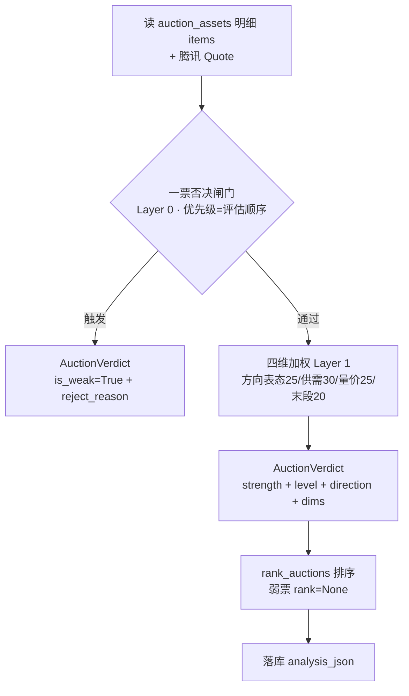

# 集合竞价强度分析 · 技术方案

> 依据已评审通过的《集合竞价强度判断方法论》（archived_md/auction/集合竞价强度判断方法论.md）编写。
> 本方案给出「竞价强度分析器」的落地设计，供 review 后实施。已按 solution-reviewer 复审意见修订（落库迁移 / 否决短路语义 / 闸门降级放行 / 符号约定收敛 / AuctionVerdict 字段补全 / direction 合成规则 / CLI 数据源职责分离）。
>
> **存储层变更（2026-10-20）**：原始竞价明细存 `assets.db/auction_assets`（`UNIQUE(trade_date, code)`，单列 `items_json`）；强度结果存独立表 `assets.db/auction_snapshots`（单列 `analysis_json`，`UNIQUE(trade_date, code, source)`）。下文「dragon.db/auction_snapshots 单表存明细并加 analysis_json 列」为历史设计，实施以新存储层为准。

---

## 一、概述

### 目标
新增一个**集合竞价强度分析器**：读入某只个股的 TDX 竞价盘口明细 `(time, price, matched, unmatched)` + 腾讯 `Quote` 辅助字段，产出 `AuctionVerdict`（否决闸门 + 四维加权 → 强度等级 / 方向 / 诊断明细），落库供盘后诊断与次日开盘决策消费。

### 范围（做什么）
- 否决闸门（Layer 0）：高位绿柱递增 / 强转弱 / 卡点撤单诱多 / 跌停价排队卖。
- 四维加权（Layer 1）：方向表态 25% / 供需结构 30% / 量价配合 25% / 末段抢筹 20%。
- 辅助字段（Layer 2，不进加权）：换手 / 流通市值 / 量比 / 封单 / 波动率 / 板块共振 / 竞价占比。
- CLI 接入 + 结果落库（含幂等补列迁移）。

### 非目标（不做什么）
- 不改造五维「识别真龙」评分器（scan 流程不动）。
- 不落地大盘情绪温度（Layer 2.9，Phase 3 独立模块）。
- 不接 Level-2 / 逐笔委托（一字控盘小白点等已裁决砍除）。
- 不做竞价量比滚动分位（2.8，需历史累积，Phase 2）。

### 关键时点约束（用户需知）
- TDX `get_auction` **仅当日 9:25 后可用、盘后仍可拉、无历史回看** → 竞价强度是**盘后产物**，用于「次日开盘决策」而非「当日盘中」。
- 与 scan 五维评分时点不同：五维是当日全市场扫描评分，竞价强度是盘后对「已采竞价明细」的个股分析。二者**并行、不可互替**。

---

## 二、候选设计（≥3，含反直觉路径）

### 方案 A（推荐）—— 独立「竞价强度分析器」模块，纯函数 `evaluate(items, quote)`
- 新建 `dragon_quant/auction/` 包：`types.py`（`AuctionVerdict`）、`registry.py`（常量 + `UNMATCHED_SIGN` 约定）、`strength.py`（`evaluate`/`rank_auctions`）。
- 输入直接传 `items + quote`，**不经 DataCache**；复用 `ScoreResult` 结构 + registry 集中常量的既有模式。
- **理由**：竞价数据是独立采集流（盘后落 `assets.db/auction_assets`），时点与 scan 数据不同，强行塞 DataCache 反而破坏 cache 键管理；纯函数式易测试、易回测。

### 方案 B —— 对齐「cache 消费者」约定：实现 `score(code, cache) -> ScoreResult`
- 把 `items`/`quote` 注入 DataCache（新 cache 键 `auction:items:{code}`），分析器从 cache 读。
- **优点**：完全遵守 AGENTS.md「评分器统一签名、cache 消费者」约定。
- **缺点**：auction 数据不在 scan 的拉数流程里，需额外把盘后采集结果反灌 cache；cache 生命周期与「盘后分析」场景错配，代码更绕，收益低。

### 方案 C（反直觉路径）—— 把竞价强度「并入」五维评分器（第六维或 liquidity 子因子）
- 理由：竞价封单/抢筹与「流动性-封板质量」语义重叠，合并能复用 scan 全流程。
- **致命缺陷**：① 时点冲突——五维是盘中/收盘扫描，竞价数据 9:25 后才完整；② 目标冲突——五维「识别真龙」vs 竞价「次日开盘决策」；③ 破坏五维纯净性，回测口径混入未来数据风险高。**否决**。

### 推荐与理由
**推荐方案 A**。以最小代价复用现有生态（`ScoreResult`/`DragonVerdict` 结构、registry 集中常量、门槛+加权聚合范式），同时保持与五维评分器的清晰边界（时点、目标、数据流均独立）。对「为何不遵守 cache 消费者约定」给出明确偏离理由（§八），并在 CLI/落库层与现有 `auction` 命令自然衔接。

---

## 三、架构设计

### 3.1 模块结构与数据源职责

```mermaid
flowchart LR
    subgraph 采集(现有)
        TDX[providers/tdx.py get_auction]
        TX[providers/tencent.py batch_get_quotes]
        AUCTION_CMD[auction 命令: 采集并落库]
    end
    subgraph 存储(现有+扩展)
        SNAP[storage/assets_db.py<br/>auction_assets 原始明细<br/>auction_snapshots 结果表]
        ENSURE[storage/assets_db.py _ensure_schema]
    end
    subgraph 新增 auction 包
        TYPES[auction/types.py AuctionVerdict]
        REG[auction/registry.py 常量+UNMATCHED_SIGN]
        STR[auction/strength.py evaluate/rank_auctions]
        CLI[auction-score 子命令]
    end
    TDX --> AUCTION_CMD --> SNAP
    TX --> CLI
    SNAP --> CLI
    CLI --> STR
    STR --> SNAP
    ENSURE -. 挂接 .-> SNAP
```

**职责分离（关键）**：`TDX` 只由 `auction` 采集命令使用；`auction-score` 分析子命令**只读 `auction_assets`（items）+ 腾讯 `Quote`（batch_get_quotes）**，不直接调 TDX。采集与分析彻底解耦。

### 3.2 数据流（两段式）



---

## 四、接口定义

```python
# dragon_quant/auction/types.py
from dataclasses import dataclass, field
from typing import Optional
from dragon_quant.models.types import ScoreResult, Quote

@dataclass
class AuctionVerdict:
    """竞价强度判定（门槛+加权聚合产物），镜像 scorers.base.DragonVerdict。"""
    code: str
    is_weak: bool                        # 是否触发一票否决（弱/回避）
    strength: float                      # 加权强度分 0-100（否决时=0）
    direction: str                       # "bull" / "bear" / "neutral"
    level: str                           # "强" / "中" / "弱"（registry STRENGTH_LEVELS 分桶）
    dims: dict[str, ScoreResult] = field(default_factory=dict)  # 四维独立分
    reject_reason: Optional[str] = None  # 若被否决，卡在哪个信号
    unverified: bool = False             # 关键数据/口径未实测或缺失，禁止回测结论与决策消费
```

```python
# dragon_quant/auction/strength.py
def evaluate(code: str, items: list[dict], quote: Optional[Quote]) -> AuctionVerdict:
    """对单只个股竞价盘口做否决闸门 + 四维加权。
    items: [{'time','price','matched','unmatched'}, ...]（TDX get_auction 原始）。
    quote: 腾讯行情，供 prev_close/limit_down/float_market_cap 等辅助；为 None 时经 0.4 保守否决（见 §七）。
    """

def rank_auctions(verdicts: list[AuctionVerdict]) -> list[AuctionVerdict]:
    """对通过否决且 unverified=False 的 verdicts 按 strength 降序赋 rank（弱票/未验证票 rank=None，同分按 code）。"""
```

### 与现有评分器的接口关系
- 复用 `models/types.py:ScoreResult`（单维 `dim/score/weight/details`）。
- 复用 registry 集中常量的**模式**，但新建独立 `auction/registry.py`（不污染五维 registry）。
- `AuctionVerdict` 镜像 `DragonVerdict` 的「门槛+加权 + rank + reject_reason」结构，下游消费心智一致；增量 `level` / `unverified` 字段补齐输出契约。

---

## 五、数据模型

| 项 | 方案 | 说明 |
|---|---|---|
| 单维结果 | 复用 `ScoreResult` | 不改 models/types.py |
| 聚合产物 | 新增 `AuctionVerdict` | 放 `auction/types.py`，不塞进 scorers/base.py（保持五维纯净） |
| 常量 | 新增 `auction/registry.py` | `AUCTION_DIM_WEIGHTS` / `STRENGTH_LEVELS` / 窗口秒数 / 分桶阈值 / **`UNMATCHED_SIGN`** |
| 落库 | 新建 `auction_snapshots` 结果表（`analysis_json TEXT`） | 幂等 UPSERT，见下 |

### 落库迁移（复用既有幂等补列模式）
- 在 `storage/assets_db.py` 的 `BASE_SCHEMA` 中直接建 `auction_snapshots` 结果表（含 `analysis_json`），不再走 `ALTER TABLE` 补列；`_ensure_schema` 的名称形状探针会拦截误放的旧库。
- 原始明细读写使用 `save_auction_asset` / `get_auction_asset` / `list_auction_assets`；结果表本期仅建表，后续算法写入 `analysis_json`。
- 表结构变更 + 新 CLI 须同 commit 同步 AGENTS.md / README.md（§九）。

---

## 六、核心算法要点

> 完整口径见方法论 §三；此处仅列实现要点与关键设计决策。

### 6.1 数据预处理（Phase 1 首项阻塞）
- `normalize(items)`：按 `time` 排序；把 `matched/unmatched` **统一差分出增量序列**（`Δmatched`/`Δunmatched`），并保留累计口径 `Σmatched`，使累计/逐笔两套语义下公式自洽（实测后固化）。
- **符号约定收敛（`UNMATCHED_SIGN`）**：所有「买单/卖单」判断**不直接写 `unmatched < 0`**，而经 `buy_side = unmatched × UNMATCHED_SIGN` 归一（`buy_side > 0` = 买单/红柱）。`UNMATCHED_SIGN ∈ {+1, −1}` 是 registry 单一约定常量，**实测后一次性翻转**；实测前 `unverified=True`。
- 末段窗口：默认 `09:24:30–09:25:00`；深交所根数 <4 时扩至 `09:24:00–09:25:00`（固定秒数，不用「末 N 根」）。

### 6.2 否决闸门（Layer 0，优先级 = 评估顺序，首个命中短路）
**评估顺序即优先级**（风险从高到低）：`0.4 跌停价排队卖 → 0.1 高位绿柱递增 → 0.2 强转弱 → 0.3 卡点撤单诱多`，**首个命中即短路返回 `is_weak=True`**，杜绝「先命中弱信号掩盖强信号」。

### 6.3 四维加权（Layer 1）
- 每维 `score(code, items, quote) -> ScoreResult`，独立 try/except，异常降级中性分（沿用 aggregator 的降级模式）。
- 方向表态 25%：1.1 高开表态单调分桶 + 1.2 末段斜率。
- 供需结构 30%：1.3 订单不平衡度 + 1.4 末段净挂单方向 + 1.5 弱转强。
- 量价配合 25%：1.6 量价匹配度 + 1.7 竞价量能。
- 末段抢筹 20%：1.8 抢筹 / 1.9 出货（同段同时触发时出货优先）。
- `strength = Σ(dims[d].score × weight)`。

**direction 合成规则（明确，进 registry）**：
1. **1.1 高开表态定基调**：`price[-1] > prev_close` → 偏多基调，否则偏空。
2. **1.4 末段净挂单方向同向确认 / 反向削弱**：与基调同向 → 确认；反向 → 翻转至 neutral 或反方。
3. **1.5 弱转强反向翻转**：触发则方向强制向 bull 翻转（空→多）。
4. 合成阈值（如「基调 + 1.4 同向 → 定方向；反向且 1.4 强度超阈值 → 翻转」）集中在 `registry.py`，避免实现各写各的。

**level 分桶**：`STRENGTH_LEVELS`（registry）将 `strength` 映射为「强 / 中 / 弱」。

### 6.4 设计模式（显式点明）
- **策略模式 + 注册表**：四维 → score 函数 dict（`_AUCTION_SCORERS`），与 `aggregator.py:_SCORERS` 同构；新增维度只加注册项，不改调度框架。
- **模板方法**：`evaluate` 固定「预处理 → 否决闸门 → 四维加权 → 聚合 → 判方向/level」骨架，各维度策略只实现自身打分，隔离变化。
- **两段式聚合（门槛+加权）**：与五维「识别真龙」同构，降低认知成本；否决维度不进加权，避免负向信号被正向分数稀释。

---

## 七、错误处理策略

| 场景 | 处理 |
|---|---|
| `items` 为空 / 非交易时段 | 返回 `AuctionVerdict(is_weak=True, reject_reason="竞价明细缺失")`，不 panic |
| `quote` 为 None | **经 0.4 保守否决**（`reject_reason="0.4 数据不足，无法清除否决"` + `unverified=True`），不产出可用 strength/level（dims 留空，闸门短路不评四维） |
| `quote` 非 None 但个别字段缺失（如 `float_market_cap`=0） | 对应维度降级中性分（1.7 竞价量能、2.2 流通市值等），其余维度不受影响 |
| **`limit_down` 不可得（0.4 专用）** | **不得静默跳过 0.4**：保留 TDX-only 子条件「`unmatched` 极负值（跌停价排队卖）」继续判定；若该子条件也不满足 → **保守否决** + `unverified=True`（宁可错杀，不静默放行） |
| 末段窗口根数不足（深交所 <4） | 扩窗 60s；仍不足则末段维度(1.8/1.9)降级中性 |
| `matched/unmatched` 语义 / 符号未实测 | `unverified=True`，评分照常但 details 注明「口径未固化」，**禁止回测结论与决策消费** |
| 单维评分异常 | 该维降级中性分 + `details={"degraded":True, "error":...}`（沿用 aggregator 模式） |
| 昨收为 0 / 涨停价缺失 | 1.1 判据降级；0.4 按上「0.4 专用」保守处理 |

---

## 八、测试策略

### 单元测试（`tests/test_auction_strength.py`）
- `normalize`：时间乱序、累计/逐笔两套语义、`UNMATCHED_SIGN` 翻转、末段窗口扩窗边界。
- 否决闸门：0.4/0.1/0.2/0.3 各自判定 + **短路优先级（0.4 命中时 0.1/0.2/0.3 不再评）** + 0.4 quote 缺失保守否决。
- 四维打分：每个因子的合成 items 边界（unmatched 全正/全负/零、价格平线、量价背离/齐升）。
- 聚合：`strength` 加权、`direction` 合成规则、`level` 分桶、`rank_auctions`（弱票/未验证票 rank=None、同分按 code）。

### 集成测试
- `evaluate` 全链路：否决短路 → 四维加权 → 落库 roundtrip（`analysis_json` UPSERT + 结果表 schema 幂等建表）。

### 回测验证（Phase 2）
- 攒 N 日 `auction_assets` 后，验证「strength/level/direction → 次日开盘表现」相关性；60/20/20 时间切分 + 双倍滑点；`unverified` 票不参与回测；未验证参数不固化为默认。

---

## 九、文档同步（强制）

按 AGENTS.md：表结构变更（`auction_assets` 原始明细 + `auction_snapshots` 结果表）+ 新 CLI 子命令，**须在同一 commit 内同步更新 `AGENTS.md` 与 `README.md`**。

---

## 十、已知风险与缓解

| 风险 | 影响 | 缓解 |
|---|---|---|
| `matched/unmatched` 语义未实测（累计/符号/量纲） | 评分口径可能全错 | Phase 1 首项阻塞：抽 1-2 票实测后固化（方法论 §7.1）；符号经 `UNMATCHED_SIGN` 单一常量路由 |
| 撮合频率差异（3s/9s） | 深市末段统计功效低 | 固定秒数窗口 + 根数下限扩窗（§6.1） |
| 卡点撤单是净量弱化近似 | 0.3 可能误判 | 仅作否决信号，不作精确强度分；details 标注近似 |
| 0.4 quote 缺失 | 静默放行跌停排队卖 | 保守否决 + unverified（§七） |
| 阈值过拟合 | 换市场/换阶段失效 | 滚动分位 + 样本外 60/20/20 + 双倍滑点 |
| 无历史回看 | Phase 1 无法立即回测 | 先上线诊断落库，攒数据后 Phase 2 回测，再决定是否接入决策流 |
| 偏离 cache 消费者约定 | 与五维评分器风格不一致 | 方案 A 已论证偏离合理性；复用 ScoreResult/registry/门槛加权范式保持生态一致 |

---

## 十一、落地 Phase 划分

- **Phase 1（最小可用）**：`auction/` 包 + `evaluate`/`rank_auctions` + CLI `auction-score` + `auction_snapshots` 结果表读写接线；**先实测 matched/unmatched 语义 + 符号**。
- **Phase 2（历史累积）**：竞价量比滚动分位（2.8）+ 回测验证 strength→次日表现。
- **Phase 3（可选）**：大盘情绪温度独立模块（2.9）。

---

## 十二、待用户确认的决策点

1. **集成边界**：竞价强度结果目前只「落库供诊断」，是否要接入 `review-account` / `buy` / `sell` 的决策流（如「竞价弱→当日不买/减仓」）？这决定 Phase 1 是否要额外改 strategy 层——**建议 Phase 1 先只落库，不接入决策流**，待回测验证后再接入。
2. **落库方案**：`analysis_json` 增列（推荐）vs 新建 `auction_analysis` 表，二者择一。
3. **CLI 形态**：扩展 `auction` 命令「采集后即时分析」vs 新增独立 `auction-score` 子命令（推荐独立子命令，职责单一、只读快照）。
