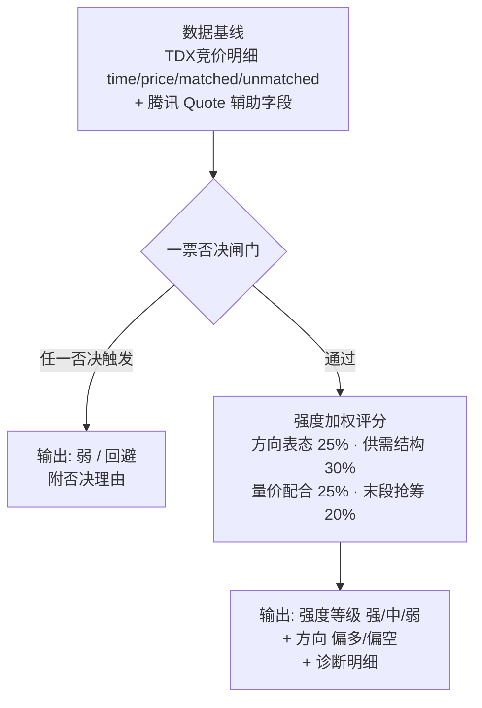

# 集合竞价强度判断方法论（自动化落地版）

> 从 6 份集合竞价材料（牛散赵哥、无名游资、云影月疏、正念财经、擒妖斩龙、耐心资本老肖_）中提炼，经 4 路因子辩论（游资实战 / 量化系统 / 风控防守 / 对抗审查）裁剪、research-reviewer 复审修订后的**可自动化落地的集合竞价强度判断方法论**。
> 目标：基于 TDX 竞价盘口明细 `(time, price, matched, unmatched)`，对单只个股的当日集合竞价给出「强度等级 + 方向 + 风险否决」的结构化判断，供盘后诊断 / 次日开盘决策消费。

---

## 一、设计原则（五条铁律）

1. **只信可算的供需与价格，砍归因叙事**：一切「主力自救 / 试盘 / 诱空 / 读心术 / 一字控盘小白点」都是不可证伪的事后归因，不落地。只保留从 `matched / unmatched / price` 三列能严格算出的供需关系与价格关系。
2. **9:20 分水岭 + 末段优先**：9:15–9:20 可撤单、假动作多，不作为决策输入；9:20:00–9:25:00 不可撤单、真实挂单。**末段以「固定秒数」界定（见 §7.2），不以「末 N 根」界定**，规避上交所 3 秒 / 深交所 9 秒撮合频率差异。
3. **防过拟合**：阈值用滚动分位（≥20 日），分桶 / 布尔优先于连续回归；样本外按 60/20/20 时间切分验证，双倍滑点复验后才可固化为默认参数。
4. **门槛 + 加权两段式**（与现有五维评分器同构）：先过一票否决闸门，再过加权强度分；否决票不参与加权排名。
5. **未来函数零容忍**：竞价强度**主评分（Layer 0/1）只用 9:25 前数据**；Layer 2 的盘中/盘后辅助字段（`volume_ratio` / `bid1_volume` 等）**仅限盘后诊断，不得回填 9:25 时点的强度分**。开盘后数据不得用于反推竞价结论。

---

## 二、总结构（两段式：否决闸门 → 加权强度分）

---

## 三、逐层落地规格

> 口径约定：`Δmatched = matched[i] − matched[i−1]`（单根增量）、`Σmatched`（累计成交）、`Δprice = price[i] − price[i−1]`。`matched / unmatched` 的「累计 vs 逐笔」语义**以实测为准**（§7.1 首项阻塞），此处统一按「差分后使用」表达，二者语义下公式均可自洽。

### Layer 0 — 一票否决闸门（负向信号）

> 任一触发即判「弱 / 回避」，不进入加权评分。这些是「宁可错杀不可放过」的防守信号。

| # | 信号 | 计算口径 | 数据源 | 裁决 |
|---|---|---|---|---|
| 0.1 | 高位绿柱递增（逃顶） | 竞价涨幅 > +3% 且末段窗口内 `unmatched < 0` 且 `\|unmatched\|` 单调递增 | TDX | **采纳·否决** |
| 0.2 | 强转弱 | 9:20–9:23 `median(unmatched) > 0`（买单）→ 末段转负且负值扩大 | TDX | **采纳·否决** |
| 0.3 | 卡点撤单·诱多 | 9:20:00 时刻 `unmatched(买)` 相对 9:19:5x 峰值骤降（<峰值 30%）且价格未同步回落；**9:19:5x 峰值仅作背景，9:20:00 骤降为核心判据** | TDX | **采纳·否决**（弱化：无逐笔撤单，仅以净量骤降近似） |
| 0.4 | 跌停价排队卖 | 9:24:50 后 `price ≈ limit_down` 或 `unmatched` 出现极负值（跌停价排队卖） | TDX + 腾讯 `limit_down` | **采纳·否决** |

### Layer 1 — 强度加权评分（四维，正向）

| 维度（权重） | # | 因子 | 计算口径 | 数据源 | 裁决 |
|---|---|---|---|---|---|
| **方向表态 25%** | 1.1 | 高开表态强度 | `(price[-1] / prev_close − 1) × 100`；单调口径：低开≤0 弱表态、0–3% 中、3–7% 强、>7% 最强（**不递减**，龙头战法偏好高开强票）；`>7%` 另出「高开兑现风险」提示 | 腾讯 `prev_close` | **采纳·核心** |
| | 1.2 | 末段价格斜率 | 末段窗口内 `price` 最小二乘斜率 `k`；`k>0` 且 `R²>0.3` 记上修 | TDX | **采纳** |
| **供需结构 30%** | 1.3 | 订单不平衡度 | `(Σ(unmatched>0) − Σ(\|unmatched<0\|)) / Σmatched`（净挂单 / 成交，经验因子） | TDX | **采纳·核心** |
| | 1.4 | 末段净挂单方向 | `sign(median(unmatched[末段窗口]))` | TDX | **采纳** |
| | 1.5 | 弱转强 | 9:20–9:23 卖单为主 → 末段转买单（0.2 强转弱的镜像正向信号） | TDX | **采纳** |
| **量价配合 25%** | 1.6 | 量价匹配度 | 分段 `Δmatched` 与 `Δprice` 同号占比；`>0.6` 量价齐升，价涨量缩→背离 | TDX | **采纳·核心** |
| | 1.7 | 竞价量能/换手 | `Σmatched / 流通股本`（参与度）；`Σmatched` 绝对量 | TDX + 腾讯 `float_market_cap` | **采纳** |
| **末段抢筹 20%** | 1.8 | 抢筹 | 末段 `Δmatched` 陡增（末段均值 > 前段均值 ×1.5）且 `unmatched(买)` 收敛 | TDX | **采纳·核心** |
| | 1.9 | 出货 | 末段 `Δmatched` 陡增但 `unmatched(卖)` 不减 / 价格下行 | TDX | **采纳**；**与 1.8 同段同时触发时，出货(1.9)优先判负** |

### Layer 2 — 辅助上下文（不进加权，用于过滤 / 加分）

> 标注 `【盘后】` 的因子仅用于盘后诊断，不回填 9:25 时点评分。

| # | 因子 | 计算口径 | 数据源 | 裁决 |
|---|---|---|---|---|
| 2.1 | 换手率 | `turnover_rate > 3%`（流动性门槛，候选池过滤） | 腾讯 | **采纳·过滤** |
| 2.2 | 流通市值 | `float_market_cap < 1e10 元`（= 100 亿元；代码 `float(f[44])*1e8` 已换算为元） | 腾讯 | **采纳·过滤** |
| 2.3 | 量比【盘后】 | 腾讯 `volume_ratio > 1.5`（当日量能活跃度，盘中口径） | 腾讯 | **采纳·盘后** |
| 2.4 | 封单强度【盘后】 | 盘后 `bid1_volume`；竞价内用 `unmatched(买)` 末值近似 | 腾讯盘后 / TDX | **采纳·盘后** |
| 2.5 | 波动率 | `(high−low) / prev_close`，只保留数值作风险度量（砍「即主力」因果） | 日K / 腾讯 | **采纳·降级** |
| 2.6 | 板块方向共振 | 所属板块当日/竞价涨跌幅，领涨板块加分 | 同花顺行业排行（盘后） | **采纳·加分** |
| 2.7 | 竞价占比 | `竞价总成交额 / 昨日全天成交额`（衡量竞价抢筹激烈度；竞价额≈`Σ(matched×price)`，昨额=昨日日K `amount`） | TDX + 日K | **采纳·盘后** |
| 2.8 | 竞价量比 | `Σmatched / mean(历史同窗口 Σmatched)`（**当前无历史，见缺口**） | auction_snapshots 累积 | **B 级·Phase 2** |
| 2.9 | 大盘情绪温度 | 隔夜跌停家数、跌幅>5% 家数（全市场，单票外） | 腾讯全市场扫描 | **C 级·独立模块** |

---

## 四、因子裁决总表（附理由）

> 完整辩论见 session 内 4 路因子研究员报告，此处保留最终结论。

| 因子 | 裁决 | 核心理由 |
|---|---|---|
| 强弱转换（unmatched 方向反转） | ✅ | 信息量最高、可严格判定，4 派共识 |
| 末段抢筹 / 出货（Δmatched 陡增 + unmatched 收敛） | ✅ | 纯供需失衡信号，剥离主力话术后仍成立 |
| 订单不平衡度（净挂单/成交） | ✅ | 经验因子，严格可算（**注：非「学术实证」，无文献出处**） |
| 竞价涨幅 / 高开表态 | ✅ | 对开盘方向解释力最强，单调口径 |
| 量价匹配度（齐升/背离） | ✅ | 可证伪，去掉主力话术仍可落地 |
| 高位绿柱递增 / 强转弱 / 跌停排队卖 | ✅ | 逃顶否决，防守价值高 |
| 竞价量能 / 换手 / 竞价占比 | ✅ | 参与度与抢筹激烈度度量 |
| 卡点撤单·诱多 | ✅(弱化) | 无逐笔撤单，仅以 9:20 净量骤降近似 |
| 波动率 | ✅(降级) | 保留数值作风险度量，砍因果 |
| 换手率 / 流通市值 / 量比 / 封单 | ✅ | 文档1筛选条件，辅助过滤（盘后） |
| 11 种竞价形态（一字/场字/U/Z/瀑布…） | ❌ | 看图说话，边界无严格判定，事后诸葛 |
| 一字控盘小白点集中=主力 | ❌ | Level-2 盘口队列，TDX 无此字段，不可证伪 |
| 主力撤单博弈 / 自救 / 试盘 / 诱空归因 | ❌ | 意图揣测，无证伪条件 |
| 波动率>8%=主力在场 | ❌ | 相关性冒充因果，阈值无出处 |
| 零和博弈→低位抄底必出货 | ❌ | 全局属性推不出单票方向 |
| 主力资金净流出 | ❌ | 黑箱估算值，噪音大 |
| 横盘位支撑/压力 | ❌ | 竞价是撮合定价无连续成交，概念错位 |

---

## 五、与现有系统的映射

| 方法论层 | 现有能力 | 需新增 |
|---|---|---|
| 数据基线 | `auction` 命令已采集 TDX 竞价明细；`auction_snapshots` 表存 `{time,price,matched,unmatched}` | 无（直接复用） |
| 辅助字段 | 腾讯 `batch_get_quotes` 已填 `prev_close/turnover_rate/float_market_cap/volume_ratio/limit_up/down/bid1_volume` | 无 |
| 强度评分 | 无 | **竞价强度分析器**：读 `auction_snapshots` + 腾讯 Quote → 否决闸门 + 四维加权 → 强度/方向/诊断 |
| 结果落库 | `auction_snapshots` 只存明细 | 新增「强度分析结果」落库（或复用单列 JSON，加字段=加 JSON key） |
| 大盘情绪 | 无全市场扫描能力 | Phase 3 独立模块（腾讯全市场批量） |

**关键数据源确认（已核代码）**：
- `providers/tdx.py:646 get_auction` 返回 `[{'time','price','matched','unmatched'}, ...]`；**`unmatched` 的符号方向、量纲、是否累计，代码 docstring 未声明，均待实测**（见 §7.1）。
- `providers/tencent.py:65 _parse_gtimg_quote` 已填充 `prev_close(f[4])/turnover_rate(f[38])/float_market_cap(f[44])/volume_ratio(f[49])/limit_up(f[47])/limit_down(f[48])/bid1_volume(f[10])`，其中 `float_market_cap = float(f[44])*1e8`（亿→元）。
- `models/types.py:37 Quote` 字段齐全。
- `storage/auction.py` 已有 `save/get/list_auction_snapshots`，UPSERT 幂等。

---

## 六、落地路线图

### Phase 1（最小可用 · 竞价强度分析器）
- **首项阻塞：实测 `matched / unmatched` 语义**（§7.1），固化符号方向、量纲、累计/增量口径后再写评分公式。
- 新增 `dragon_quant/auction/` 模块（或 `scorers/auction_strength.py`）：
  - `evaluate(code, items, quote) -> AuctionVerdict`（否决闸门 + 四维加权 + 强度等级/方向/诊断）。
  - 复用 `scorers/base.py` 的 `ScoreResult` 结构，新增 `AuctionVerdict` dataclass（`is_weak/strength/direction/dims/reject_reason`）。
- CLI：`auction` 命令扩展「采集后即时分析」，或新增 `auction-score` 子命令。
- 结果落库：`auction_snapshots` 增列 `analysis_json`，或新建 `auction_analysis` 表。

### Phase 2（历史累积 · 竞价量比滚动分位）
- 连续采集 N 日后，建 `mean(Σmatched, 同窗口)` 滚动基线，落地 2.8 竞价量比 + 滚动分位阈值。

### Phase 3（可选 · 大盘情绪温度）
- 腾讯全市场批量扫描，落地 2.9 跌停家数 / 跌幅>5% 家数，作择时闸门。

---

## 七、待验证 / 落地风险

1. **【首项阻塞】`matched / unmatched` 语义实测**：代码 docstring 未声明「累计 or 逐笔」「符号方向」「量纲（手/股）」。落地前需抽 1–2 只票实测：
   - 符号：取一只竞价明显涨停封单的票，看 `unmatched` 末值正负（正=买单/红柱，负=卖单/绿柱）；
   - 累计：看 `matched` 序列是否单调不减（单调不减=累计，否则=逐笔）；`unmatched` 同理；
   - 量纲：与腾讯 `bid1_volume`（手）/ 日K `volume`（手）对拍。
   - **公式变体**：若 `matched` 为累计，则 `Σmatched = matched[-1]`、`Δmatched` 需差分；若为逐笔，则 `Σmatched` 需累加、`matched[-1]` 无意义。§三 已统一用「差分后使用」表达，实测后固化。
2. **撮合频率差异（末段窗口界定）**：上交所 3 秒 / 深交所 9 秒。末段窗口默认 `9:24:30–9:25:00`（30 秒，上交所约 10 根、深交所约 3–4 根）；**深交所根数不足 4 时，末段窗口扩至 `9:24:00–9:25:00`（60 秒）**。所有「末段」因子用固定秒数窗口，不用「末 N 根」。
3. **卡点撤单 0.3 是弱化近似**：无逐笔撤单记录，「`unmatched` 骤降」可能被「新增反向委托」混淆，只能作否决而非精确判定。
4. **阈值全部滚动分位**：绝对阈值（+3%、量比 1.5、换手 3% 等）仅作当日诊断展示，不作固化决策常数。
