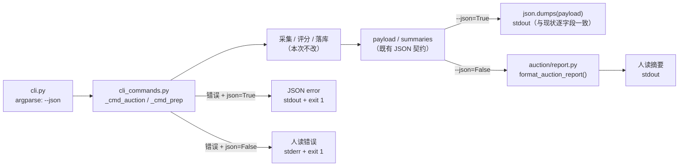
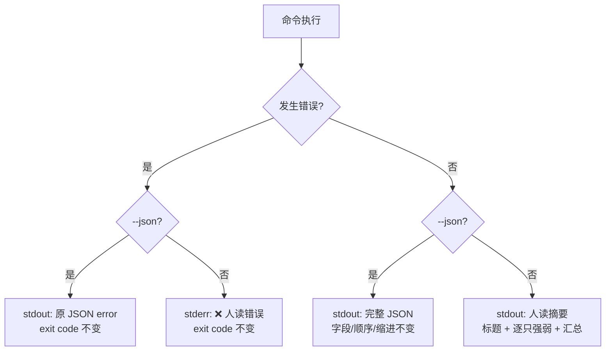
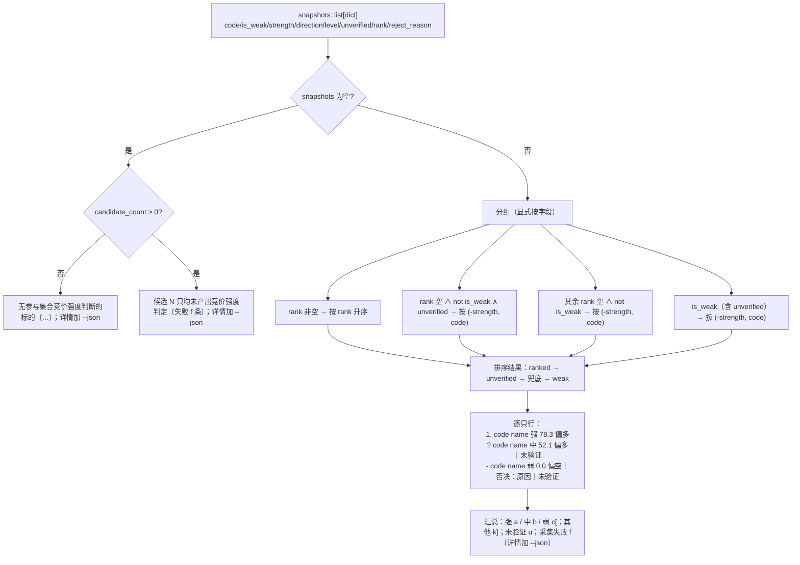

# auction / prep 输出开关统一（`--json`）— 技术方案

日期：2026-10-21 · 分支：feat/reviewa-account-op · 状态：v3（第 2 轮复审 1 MAJOR 已修，见 §13；方案审查已用满 2 轮，按门禁上报 main 决定是否放行实现）
范围：`auction` / `prep` 两个命令的**展示层**；不改评分、候选池、排名、落库与退出码语义。
阶段 0 已由 main 与用户确认；本轮不触发阶段 1（无新技术/新依赖）。

---

## 1. 背景与目标

现状两个命令的输出契约不对称：

| 命令 | 现状 | 问题 |
|------|------|------|
| `auction` / `auction --recompute` | **永远**输出完整 JSON（成功、空池、错误都是 JSON） | 人读时信息过载；每只标的的强弱结论淹没在 `dims`/`failed` 细节里 |
| `prep` | 默认人读（4 行摘要 + 标的清单），`--verbose` 输出完整 JSON | 开关名与 `auction` 不统一；`--verbose` 语义模糊（是日志更详细还是结构化输出？） |

目标：两个命令统一使用 `--json` 作为**唯一**结构化输出开关；默认输出人读摘要。JSON 契约（字段/顺序/缩进/`ensure_ascii`）保持逐字段一致，避免破坏 cron / 外部脚本。

### 1.1 验收标准（来自任务包）

| AC | 内容 |
|----|------|
| AC1 | `auction` 默认 stdout 只含人读摘要（标题/逐只强弱/汇总），无完整 JSON |
| AC2 | `auction --json` 输出与现状逐字段一致的完整 JSON（collect） |
| AC3 | `auction --recompute DATE` 默认人读；`--recompute DATE --json` 完整 JSON |
| AC4 | `prep --json` 完整 JSON；`prep` 默认 4 行摘要 + 标的清单不变；`--verbose` 已删除（argparse 拒绝） |
| AC5 | 所有退出码语义不变（空池 0、系统性失败 1、参数错误 2 等） |
| AC6 | 默认错误人读文本 + 非零退出；`--json` 错误 JSON + 非零退出 |
| AC7 | README.md / AGENTS.md / archived auction 方案文档同步更新 |

### 1.2 非目标

- 不改评分器、候选池、排名、`auction_assets` / `auction_snapshots` / `prep_snapshots` 落库契约；
- 不改 `buy` / `sell` / `review-account` / `scan` / `dragons` 的输出；
- 不新增第三方依赖；
- 不重构 `_cmd_auction` 的采集/落库主流程，只替换「输出」这一层。

---

## 2. 设计模式与动机

| 模式 | 落点 | 动机 |
|------|------|------|
| **策略（Strategy）** | 两种输出策略：人读摘要 / 完整 JSON，由 `--json` 在 CLI 层选择 | 隔离「展示方式」这一变化点；后续若加 `--format table` 只需新增一个纯函数分支，不动采集与落库 |
| **函数式核心 + 命令式外壳（Functional Core / Imperative Shell）** | `auction/report.py` 只做 `list[dict] → list[str]`；`cli_commands.py` 负责 print / exit | 人读格式可单测，无需 patch stdout；CLI 只做 I/O |
| **模板方法（Template Method，轻量）** | `format_auction_report()` 固定「标题 → 逐只 → 汇总」骨架，排序/行格式拆成小函数 | 两种模式（collect / recompute）共享同一骨架，仅标题信息不同 |

**刻意不做**：不为两种输出建类层次（`OutputStrategy` ABC + 两个子类）。当前只有两个纯函数、一个布尔分支，引入类层次属于「为假设的未来需求抽象」，违背 AGENTS.md「权衡优先简单」。若未来输出格式超过 3 种再升级为策略对象。

---

## 3. 候选设计

### 3.1 方案 A（推荐）：纯函数报告模块 + CLI 布尔分支

```
auction/report.py  (纯函数)
  ├─ sort_snapshots(snapshots) -> list[dict]
  ├─ format_verdict_line(snapshot, name) -> str
  ├─ format_summary(snapshots, failed_count) -> str
  └─ format_auction_report(snapshots, **meta) -> list[str]

cli_commands.py
  ├─ _cmd_auction: 采集/落库不变 → 构造 payload → if json: print(payload) else: print(report)
  └─ _cmd_auction_recompute(raw_date, as_json): 同上
```

优点：改动面小、无 I/O 依赖、人读格式可独立单测、JSON 构造完全不改。
缺点：`snapshots` 是 dict（来自 `_snapshot_summary`），纯函数只能靠字段约定，缺少类型约束（用 TypedDict 可缓解；当前项目风格以 dict 为主，保持一致）。

### 3.2 方案 B（反直觉）：命令函数返回 payload，由输出装饰器统一渲染

让 `_cmd_auction` / `_cmd_auction_recompute` **不再 print**，改为 `return payload`；在 `cli.main()` 的 dispatch 处用装饰器按 `args.json` 选择渲染器。

优点：输出职责彻底上移，所有命令未来可复用同一渲染层；commands 变成纯数据生产者。
缺点：现有命令函数大量中途 `sys.exit(1)`（错误路径），要改成异常模型才能让装饰器接管，改动外溢到错误处理与测试；`cli.main()` 对 `scan` / `buy` 等命令没有统一返回值约定。对本次「只改两个命令展示层」的需求，风险/收益不匹配。

### 3.3 方案 C（反直觉）：单一样本渲染 —— 只输出 JSON 的一个投影

不写独立格式化逻辑，而是把 JSON payload 交给一个通用「字段投影器」：`--json` 输出全字段，默认输出 `payload` 中预先声明的 `display` 子结构（由 payload 构造时一并写入）。

优点：人读与 JSON 同源，绝无字段漂移。
缺点：为了人读输出反向污染 JSON 契约（新增 `display` key），违反「JSON 逐字段一致」的硬约束；且排序/分组仍需专门逻辑，投影器并不省代码。**否决**。

### 3.4 推荐

采用 **方案 A**。理由：

1. JSON payload 构造保持原样，AC2/AC3 的「逐字段一致」风险最低；
2. 人读逻辑集中在 `auction/report.py`，可纯函数单测（排序、映射、空格、汇总）；
3. 改动只落在 `cli.py`（参数）、`cli_commands.py`（分支与错误输出）、新增 `report.py`（格式）、测试与文档；
4. 满足「策略模式」但不引入类层次，符合项目「优先简单」约定。

---

## 4. 架构与输出流

### 4.1 模块交互



### 4.2 输出决策流程



### 4.3 人读摘要生成流程



---

## 5. 接口定义

### 5.1 新增 `dragon_quant/auction/report.py`（纯函数，无 I/O）

```python
DIRECTION_LABELS = {"bull": "偏多", "bear": "偏空", "neutral": "中性"}

def sort_snapshots(snapshots: list[dict]) -> list[dict]:
    """rank 升序 → 未验证组(-strength, code) → 否决组(-strength, code)。"""

def format_verdict_line(snapshot: dict, name: str = "") -> str:
    """单只：`1. 600001 甲 强 78.3 偏多` / `? ...｜未验证` / `- ...｜否决：原因`。"""

def format_summary(snapshots: list[dict], failed_count: int = 0) -> str:
    """强/中/弱/其他计数 + 全量未验证计数；failed_count>0 时附「详情加 --json」。"""

def format_auction_report(
    snapshots: list[dict],
    *,
    trade_date: str,
    mode: str = "collect",                 # collect | recompute
    pool_source: str | None = None,
    candidate_count: int | None = None,
    fallback_reason: str | None = None,
    failed_count: int = 0,
    empty_count: int = 0,
    saved_count: int = 0,
    names: dict[str, str] | None = None,
) -> list[str]:
    """返回待 print 的整段行；空 snapshots 按「无候选 / 采集全失败 / 评分全失败 / 全空盘口」返回单行。"""
```

约定：

- `snapshot` 直接复用 `_snapshot_summary()` 的字典（无类型改造）；
- `names` 构造（两条路径都从**资产行**取，`by_code` 仅兜底，**首个非空名称优先**）：
  - collect：`persisted`（当日全部已存资产，含同日早前批次）→ `saved` → `by_code`，逐项仅在当前 code 尚无名称时写入；
  - recompute：`assets`（`list_auction_assets` 返回行）的 `name`；
  - 名称只用于展示，缺失（`""`/`None`）时**不插入空 token**，避免双空格；
- `strength` 非数值时显示 `—`（防御性，正常路径已被 `verdict_to_payload` 校验）；
- 所有函数不 print、不 exit、不读环境。

### 5.2 CLI 变更

`dragon_quant/cli.py`：

| 命令 | 变更 |
|------|------|
| `prep` | `--verbose` **删除**；新增 `--json`（`dest="json", action="store_true"`）；usage/description/epilog/示例同步 |
| `auction` | 新增 `--json`（同 dest）；usage 的两种模式都加 `[--json]`；示例补 `auction --json` |

`dragon_quant/cli_commands.py`：

```python
def _emit_prep_error(payload: dict, as_json: bool) -> NoReturn:
    """--json → 原 JSON 到 stdout；默认 → 人读一行到 stderr；均 exit 1。"""

def _emit_auction_error(payload: dict, as_json: bool) -> NoReturn:
    """同上，文案前缀「❌ 集合竞价失败：」。"""

def _cmd_prep(args):
    ...
    as_json = getattr(args, "json", False)
    ...
    if as_json:
        print(json.dumps(result, ensure_ascii=False, indent=2))
        return
    ...  # 既有 format_advice_lines / format_candidate_lines 不变

def _cmd_auction_recompute(raw_date: str, as_json: bool = False):
    ...

def _cmd_auction(args):
    ...
    as_json = getattr(args, "json", False)
    if recompute is not None:
        _cmd_auction_recompute(recompute, as_json)
        return
    ...
```

> `getattr(args, "json", False)` 兼容测试里手搓的 `SimpleNamespace`（未带 `json` 时按默认人读处理）。现有测试会显式传 `json=True`。

---

## 6. 输出契约

### 6.1 `auction` 默认人读（collect）

**示例 A（`SEMANTICS_VERIFIED=True` 且已验证时的形态，展示排序/否决/未验证三种前缀）**：

```text
📊 2026-10-21 集合竞价强度（参与 4 只｜池来源 prep）
1. 600001 甲 强 78.3 偏多
2. 600002 乙 中 55.0 中性
? 600004 丁 中 52.1 偏多｜未验证
- 600003 丙 弱 0.0 偏空｜否决：竞价明细缺失
汇总：强 1 / 中 2 / 弱 1；未验证 1；采集失败 1（详情加 --json）
```

**示例 B（当前现实：`SEMANTICS_VERIFIED=False`，所有未否决标的均 `unverified=True` 且 `rank=None`）**：

```text
📊 2026-10-21 集合竞价强度（参与 4 只｜池来源 prep｜回退：all_ignored）
? 600001 甲 中 78.3 偏多｜未验证
? 600002 乙 中 55.0 中性｜未验证
? 600004 丁 中 52.1 偏多｜未验证
- 600003 丙 弱 0.0 偏空｜否决：竞价明细缺失
汇总：强 0 / 中 3 / 弱 1；未验证 3
```

> ranked 行（`1.`）用纯函数 fixture 覆盖，**不得**在 CLI 集成测试里断言当前数据必然出现 rank。

规则：

- **标题**：`📊 {trade_date} 集合竞价强度（参与 {实际评分只数} 只｜池来源 {pool_source}）`；
  - 有 `fallback_reason` → 追加 `｜回退：{reason}`；
  - 候选数 > 评分只数 → 追加 `｜候选 {n} 只`（避免把采集失败静默掉；反向场景是同日早前批次资产参与评分，属正常，不追加）；
  - `empty_count > 0` → 追加 `｜空盘口 {n} 只`。
- **重算模式**：`📊 {trade_date} 集合竞价强度（重算｜参与 N 只[｜空盘口 K 只]）`。
- **逐只**：`{rank}.` / `?`（未验证组或未知 rank）/ `-`（`is_weak`）+ code + name（可缺）+ level + strength(1 位小数) + direction 中文映射。
  - **后缀可叠加**：`is_weak` → `｜否决：{reject_reason or "未说明原因"}`；`unverified` → 再追加 `｜未验证`（weak+unverified 显示为 `｜否决：…｜未验证`，不丢「禁止决策消费」语义）。
- **分组与排序**（显式按字段，不依赖 `rank_auctions` 的隐式不变量）：
  1. ranked 组：`rank is not None`，按 `rank` 升序；
  2. 未验证组：`rank is None ∧ not is_weak ∧ unverified`，按 `(-strength, code)`；
  3. 兜底组：`rank is None ∧ not is_weak ∧ not unverified`（理论上不存在），按 `(-strength, code)`；
  4. 否决组：`is_weak`（含 weak+unverified），按 `(-strength, code)`。
  最终顺序：ranked → unverified → 兜底 → 否决。
- **汇总**：`汇总：强 a / 中 b / 弱 c[；其他 k]`（level 未知单列「其他」，保证 a+b+c+k == 总只数）；`未验证 u` 仅在 u>0，且 **u 统计所有 `unverified=True`（含否决组）**；`采集失败 f（详情加 --json）` 仅在 f>0。
- **空 snapshots 分四种**（判定式按顺序短路）：
  1. 无候选（`candidate_count` 为空或 0）：`无参与集合竞价强度判断的标的（{date}，池来源 {pool_source}[，回退：…]）；详情加 --json`——**仅此形态**可以出现「无参与」。
  2. 采集层全失败（`saved_count == 0 ∧ failed_count > 0`）：`候选 {n} 只均未产出竞价强度判定（采集失败 {f} 条）；详情加 --json`；CLI 再向 stderr 打 `❌ 集合竞价失败：…` 并 exit 1（沿用现状退出条件）。
  3. 评分层全失败（`saved_count > 0`，原始资产已写入）：`候选 {n} 只均未产出评分结果（原始资产已写入，失败 {f} 条）；详情加 --json`；**不**打 ❌、**exit 0**（现有 `ok=false` 语义不变）。
  4. 全空盘口（`saved_count == 0 ∧ failed_count == 0`）：`候选 {n} 只均无竞价盘口（空盘口 {k} 只）；详情加 --json`；exit 0、无 ❌，**不得**出现「失败 0 条」。
  - recompute 空 snapshots 属错误路径（exit 1），不进入此分支。
- 所有默认模式输出**不含** `dims` / `failed` 明细 / JSON 花括号，`json.loads(stdout)` 必须失败。

### 6.2 `auction --json`

- collect 成功：沿用现有 **25** 个顶层字段及插入顺序、`ensure_ascii=False, indent=2`；
- 空池：沿用现有 16 个字段（含 `pool_empty` / `message`）；
- recompute 成功：沿用现有 15 个字段；错误变体沿用 `error` 键；
- **不得**为了人读输出新增/删除/重排任何 JSON key；
- 可验证落点：测试对 `list(payload.keys())` 做**黄金顺序断言**（collect 成功 / 空池 / recompute 成功 / 代表性错误各一组），而不是只抽查个别字段。

### 6.3 `prep`

- 默认：完全不变（4 行 + 空行 + 标的清单）；
- `--json`：`json.dumps(result, ensure_ascii=False, indent=2)`（与旧 `--verbose` 逐字节一致）；
- `--verbose`：argparse 未知参数 → stderr + exit 2（不带隐藏别名）。

---

## 7. 错误处理矩阵

| 场景 | 默认（无人读开关） | `--json` | exit |
|------|--------------------|----------|------|
| `prep` 无 v2 龙头、无法确定复盘日 | stderr `❌ 复盘失败：无 v2 龙头记录，无法确定复盘日` | stdout `{"error": ...}`（原样） | 1 |
| `prep` `PrepError` | stderr `❌ 复盘失败：{msg}` | stdout `{"error": "{msg}"}` | 1 |
| `prep` 未预期异常 | stderr `❌ 复盘失败：{Type}: {msg}` | stdout `{"error": "{Type}: {msg}"}` | 1 |
| `auction --recompute` 日期非法/未来日期/无资产/全空/全评分失败/写库失败 | stderr `❌ 集合竞价失败：{error}` | stdout 原 JSON error | 1 |
| `auction --recompute` 读取原始资产失败（`list_auction_assets` 抛异常） | stderr `❌ 集合竞价失败：读取竞价原始资产失败: {Type}: {msg}` | stdout 原 JSON error | 1 |
| `auction --pool legacy` 且最近 N 日无龙头 | stderr `❌ 集合竞价失败：最近 N 日无龙头，无需采集` | stdout `{"error": ...}`（原样） | 1 |
| `auction` collect 空池 | stdout 单行「无参与…」；`prep_degraded` 提示仍走 stderr | stdout 原 JSON（`pool_empty=true`） | 0 |
| `auction` 采集层全失败（`saved_count==0 and (failed or snapshot_error)`） | 先打印人读摘要（空快照分支 2）；再向 stderr 打 `❌ 集合竞价失败：候选 N 只，失败 f 条[，快照错误：…]（详情加 --json）`；exit 1 | 先打印 JSON，再 exit 1（JSON 已含 `failed`/`snapshot_error`，不额外打 stderr 错误行） | 1 |
| `auction` 评分层全失败（`saved_count>0 ∧ snapshots==[]`） | 人读单行「候选 N 只均未产出评分结果（原始资产已写入…）」；保留既有 stderr `⚠️ 快照未产出` 告警；**无 ❌** | JSON `ok=false` + `failed` | 0 |
| `auction` 候选全为空盘口（`saved_count==0 ∧ failed==[] ∧ empty_count>0`） | 人读单行「候选 N 只均无竞价盘口（空盘口 K 只）」；无 ❌ | JSON `snapshot_skipped="no_payloads"`、`ok=true` | 0 |
| 参数错误（如 `prep --verbose`） | argparse stderr | argparse stderr（argparse 不感知 `--json`） | 2 |
| 人读摘要格式化异常 | 回退到 stderr 一行提示 + 退出码不变（与 prep 展示层异常同策略） | 不涉及（JSON 不经过 report.py） | 原值 |

> 错误输出只改「呈现通道」，**不改任何退出码判断条件**。`_cmd_prep` 的展示层异常仍保持 exit 0（快照已落库，cron 不应误判）。

---

## 8. 测试策略

### 8.1 新增 `tests/test_auction_report.py`（纯函数）

1. 排序：ranked 升序、未验证组/否决组各自 `(-strength, code)`，整体顺序 ranked → unverified → 兜底 → weak；
2. 行格式：rank 前缀 `1.`、未验证 `?` + `｜未验证`、否决 `-` + `｜否决：原因`；`reject_reason=None` → 兜底文案；
3. **weak + unverified 叠加**：输出 `- code 弱 0.0 偏空｜否决：数据不足｜未验证`，两者都不丢；
4. 名称缺失不产生双空格（按 token 校验）；有名称正常渲染；
5. direction 映射 bull/bear/neutral；level 未知 → 汇总「其他 k」，且 `强+中+弱+其他 == len(snapshots)`；
6. 汇总：level 计数、未验证计数（含否决组）、`failed_count>0` 才出现「详情加 --json」；
7. 空 snapshots 四分支：无候选 → 「无参与…」；采集层全失败 → 「均未产出竞价强度判定」；评分层全失败（saved>0）→ 「均未产出评分结果（原始资产已写入）」；全空盘口 → 「均无竞价盘口」；后三者不得出现「无参与」，全空盘口不得出现「失败 0 条」；
8. collect header 含池来源/回退/候选/空盘口信息；recompute header 含「重算」。

### 8.2 更新既有测试（显式选择输出模式）

- `tests/test_cli.py::TestCmdAuctionStorage._run` / `TestCmdAuctionRecompute._run`：新增 `as_json=True` 参数并传入 `SimpleNamespace(json=...)`；默认保持 JSON 断言不变。
- `tests/test_auction_pool.py::_run`：同上。
- `tests/test_prep.py::TestCmdPrepOutput`：`_args(json=...)`；`test_verbose_prints_json` → `test_json_prints_json`；help 断言 `--json` 且不含 `--verbose`。

### 8.3 新增 CLI 行为测试

| 用例 | 断言 |
|------|------|
| `auction` 默认人读 | stdout 含标题/`600172`/名称/`汇总：`；`json.loads` 抛 `ValueError` |
| 有名称 / 无名称 | collect 从 `persisted`（含同日早前批次）取名称；缺失时不插空 token |
| `auction --json` | 既有字段契约测试全部保留（显式 `json=True`）+ **25 个顶层 key 的顺序黄金断言** |
| `auction --recompute` 默认人读 | 含「重算」、code、`汇总：`；不可 JSON 解析 |
| `auction --recompute --json` | 既有字段契约测试保留 + 15 个顶层 key 顺序黄金断言 |
| 空池默认 | 含「无参与集合竞价强度判断的标的」「回退：all_ignored」；exit 0 |
| 空池 `--json` | `pool_empty`/`candidate_codes`/`message` 保留（16 key 黄金断言） |
| **采集层全失败（默认）** | `get_auction`/`save_auction_asset` 全抛 → stdout 含「候选 N 只均未产出竞价强度判定」且不含「无参与」；stderr 含 `❌ 集合竞价失败`；exit 1 |
| **评分层全失败（默认）** | `evaluate` 全抛（saved>0）→ stdout 含「均未产出评分结果（原始资产已写入）」；stderr **不含** ❌；exit 0；JSON `ok=false` |
| **全空盘口（默认）** | `get_auction` 返回空 → stdout 含「均无竞价盘口」且不含「失败 0 条」；stderr 不含 ❌；exit 0；JSON `snapshot_skipped="no_payloads"`、`ok=true` |
| `prep --json` | 完整 JSON 可解析 |
| `prep --verbose` | exit 2，stderr 含 `unrecognized arguments` |
| 默认错误路径 | stdout 空、stderr 含 `❌ 复盘失败` / `❌ 集合竞价失败`、exit 1 |
| `--json` 错误路径 | stdout 为原 JSON error（key 顺序黄金断言）、exit 1 |
| recompute 读取资产失败（默认） | `list_auction_assets` 抛 `RuntimeError` → stdout 空、stderr 含 ❌、exit 1 |

### 8.4 自测命令

```bash
.venv/bin/python -m unittest tests.test_auction_report tests.test_cli \
    tests.test_auction_pool tests.test_prep -q
.venv/bin/python -m unittest discover -s tests -q   # 全量回归（基线 800 tests OK）
```

---

## 9. 风险与缓解

| 风险 | 影响 | 缓解 |
|------|------|------|
| 外部脚本依赖 `auction` 默认 JSON | 升级后解析失败 | 默认人读是用户明确要求；`--json` 保持逐字段一致；README/AGENTS 显式标注迁移方式 |
| 人读格式与 JSON 字段漂移 | 摘要显示错误强弱 | 摘要只读 `_snapshot_summary()` 的既有字段，不新增计算；纯函数单测覆盖字段映射 |
| `--verbose` 删除破坏旧脚本 | cron 报 exit 2 | 用户明确要求删除；release note/文档标注；不保留隐藏别名 |
| 人读输出污染 stdout 影响 cron | 解析失败 | 只影响未加 `--json` 的调用；错误提示走 stderr；退出码不变 |
| `snapshots` 为 dict，字段缺失 | 格式化抛 KeyError | 全部用 `.get()` + 兜底文案；格式化异常由 CLI 兜底为 stderr 提示、退出码不变 |
| 名称缺失/中文宽度 | 行列不齐 | 不依赖对齐，单空格 token；缺名不插入空 token |
| 错误路径漏改某个 `print(json.dumps(...))` | 默认模式输出 JSON | 错误矩阵逐条替换 + 测试覆盖代表性错误（prep / recompute / collect 旧口径） |

---

## 10. 文档同步清单（同一 commit）

1. `README.md`
   - `prep` 示例 `--verbose` → `--json`；正文「需要完整 JSON 时加 `--verbose`」→ `--json`；
   - `auction` 示例补 `auction --json`；「输出 JSON：…」改为「默认输出人读摘要（示例）+ `--json` 输出完整 JSON（字段列表）」；补默认错误走 stderr 的说明。
2. `AGENTS.md`
   - 快速使用块 `prep --verbose` → `prep --json`；
   - 「盘后复盘 `prep`」代码块与 CLI 输出段同步；
   - 「集合竞价采集 `auction`」段补 `--json` 与默认人读输出、错误通道。
3. `archived_md/auction/2026-10-20-auction-snapshot-wiring-design.md`（归档 ≠ 冻结）
   - 4.2 / 4.3 时序图末步「输出 JSON 报告」→「输出人读摘要（默认）/ 完整 JSON（`--json`）」；
   - §6.3 CLI 参数补 `[--json]` 与输出模式说明；
   - §7.3 错误表「JSON error」→「错误输出（默认 stderr 人读 / `--json` JSON）」；
   - §8 报告格式注明 `--json` 开关与默认摘要；§12 验收表补输出模式一行。
4. `dragon_quant/cli_commands.py` 内部引用 `--verbose` 的 docstring / 注释 / stderr 文案（约 342、372、380、386 行）全部改为 `--json`，避免用户照提示操作触发 exit 2。
5. `docs/solutions/` 下的历史方案文档（2026-10-20/21 prep 系列）是开发期产物，保留原样不追改；AC7 的 grep 范围不含它们。

---

## 11. 验收标准映射

| AC | 实现位置 | 验证 |
|----|----------|------|
| AC1 | `auction/report.py::format_auction_report` + `_cmd_auction` 分支 | `TestCmdAuctionStorage` 人读用例（不可 JSON 解析） |
| AC2 | `_cmd_auction` 既有 payload 原样 + `json.dumps` | 既有全字段契约测试 + 25 key 顺序黄金断言（`json=True`） |
| AC3 | `_cmd_auction_recompute(raw_date, as_json)` | 重算人读 + 重算 JSON 两组用例 |
| AC4 | `cli.py` prep 解析器 + `_cmd_prep` | `prep --json` JSON 用例、`prep --verbose` exit 2 用例、默认 4 行用例保留 |
| AC5 | 所有 `sys.exit` 条件未改 | 既有 exit code 断言全量保留 |
| AC6 | `_emit_prep_error` / `_emit_auction_error` | 默认错误 stderr + exit 1；`--json` 错误 JSON + exit 1 |
| AC7 | README / AGENTS / archived 文档 + `cli_commands.py` 内部 `--verbose` 文案 | `grep -rn -- '--verbose' dragon_quant/ README.md AGENTS.md archived_md/auction/` 仅允许「已删除」说明一处 |

---

## 12. 实施清单

1. 新增 `dragon_quant/auction/report.py`（纯函数）。
2. `dragon_quant/cli.py`：prep 删 `--verbose` 加 `--json`；auction 加 `--json`；usage/示例同步。
3. `dragon_quant/cli_commands.py`：`_cmd_prep` / `_cmd_auction` / `_cmd_auction_recompute` 接入 `--json` 分支；新增两个错误输出 helper；人读路径调用 report。
4. `tests/test_auction_report.py` 新增；`tests/test_cli.py` / `tests/test_auction_pool.py` / `tests/test_prep.py` 更新与补充。
5. 三份文档同步。
6. 自测：定向 + 全量 unittest。

---

## 13. 首轮 solution-reviewer findings 处理（v2）

| # | severity | finding 摘要 | 处理 |
|---|----------|--------------|------|
| 1 | MAJOR | collect「有候选但全部失败」被当成「无候选」，默认模式无失败文本 | §6.1 空快照拆分支；§7 在采集层全失败 exit 1 前向 stderr 打 `❌ 集合竞价失败：候选 N 只，失败 f 条（详情加 --json）`；§8.3 增加「采集层全失败」用例（stdout 不含「无参与」、stderr 含 ❌、exit 1） |
| 2 | MAJOR | weak+unverified 被互斥后缀吞掉；未验证计数口径未定义 | §6.1 后缀改为可叠加（`｜否决：…｜未验证`）；分组显式按 `is_weak`/`unverified` 字段；`未验证 u` 统计全部 `unverified=True`（含否决组）；§8.1 增加叠加用例 |
| 3 | MAJOR | 错误矩阵漏「读取竞价原始资产失败」分支 | §7 补该行；实现统一走 `_emit_auction_error` 机械替换所有错误 print；§8.3 增加 `list_auction_assets` 抛异常用例 |
| 4 | MINOR | 「逐字段一致」缺可验证落点；顶层 key 数量写错（27→25） | §6.2 改为 25/16/15 并新增 key 顺序黄金断言；§8.3 覆盖 collect 成功/空池/recompute 成功/错误四组 |
| 5 | MINOR | `cli_commands.py` 内仍有 3 处 `--verbose` 提示文案；grep 验收命令自相矛盾 | §10 增列代码字符串与历史 `docs/solutions` 豁免；AC7 grep 范围收窄为 `dragon_quant/ README.md AGENTS.md archived_md/auction/` |
| 6 | MINOR | `names` 来源未定义，早前批次标的会丢名 | §5.1 明确 collect 用 `persisted → saved → by_code`、recompute 用 `assets`；§8 增加有/无名称断言 |
| 7 | MINOR | 示例输出在当前 `SEMANTICS_VERIFIED=False` 下不可复现 | §6.1 拆示例 A（verified 形态）与示例 B（当前现实全 `?`）；ranked 行只用纯函数 fixture 覆盖 |
| 8 | MINOR | 未知 level 计数语义含糊，汇总无法对账 | §6.1 汇总增加「其他 k」，保证 `强+中+弱+其他 == 总只数`；§8.1 增加求和断言 |

无 rejected findings（8 条全部采纳）。

### 13.1 第 2 轮 solution-reviewer 新增 finding 处理（v3）

| # | severity | finding 摘要 | 处理 |
|---|----------|--------------|------|
| F1 | MAJOR | v2 把「有候选但全部未产出判定」统一写成 exit 1，但现有 exit 1 条件仅 `saved_count==0 and (failed or snapshot_error)`；`evaluate` 全抛时 saved>0 → 实际 exit 0。且漏了「候选全为空盘口」（saved==0、failed==[]、ok=true）形态，会误报「失败 0 条」。 | §6.1 空快照改四分支：无候选 / 采集层全失败（saved==0 ∧ failed>0 → ❌ + exit 1）/ 评分层全失败（saved>0 → 无 ❌ + exit 0）/ 全空盘口（saved==0 ∧ failed==0 → 无 ❌ + exit 0）；`format_auction_report` 增加 `saved_count` 参数用于区分。§7 拆三行退出语义。§8.3 拆三个用例（采集全失败 exit 1；evaluate 全抛 exit 0 且无 ❌；全空盘口 exit 0）。**退出码判断条件零改动**（AC5）。 |
| F2 | 非阻塞建议 | 分组编号与最终排序句不一致 | §6.1 改为 ranked(1) → unverified(2) → 兜底(3) → 否决(4)，最终顺序与编号一致。 |
| F3 | 非阻塞建议 | 示例标题「参与 12 只」与列出的 4 行不一致 | 示例 A/B 标题改为「参与 4 只」，汇总计数与列出条目对齐（采集失败 1 条不计入 snapshots）。 |

---

## 14. code-reviewer 首轮 findings 处理（实现阶段）

| # | severity | finding 摘要 | 处理 |
|---|----------|--------------|------|
| 1 | WARNING | `auction --recompute` 人读路径缺格式化异常兜底（collect/prep 已有） | `_cmd_auction_recompute` 的 report+print 包进 try/except，异常写 stderr `⚠️ 人读摘要生成失败…（可用 --json 查看完整结果）`，退出码保持 0；新增 `test_human_format_failure_keeps_exit_zero` |
| 2 | NIT | 标题在 `candidate_count < len(snapshots)`（同日早前批次参与评分）时也追加「候选 N 只」，误导 | `report.py` 改为 `candidate_count > len(snapshots)` 才追加；新增纯函数用例 |
| 3 | NIT | 名称合并空字符串会挡住后续兜底 | 改为 `persisted → saved → by_code` 首个非空优先 |
| 4 | 测试缺口 | `--json` 全失败不打 ❌ 无用例 | `test_all_failed_exits_nonzero_and_skips_replace` 增加 `assertNotIn("❌", err)` |
| 5 | 测试缺口 | `--json` 错误路径无 key 顺序断言 | recompute 错误补 `["ok","mode","trade_date","error"]`；prep 错误补 `["error"]` |

无 rejected findings（1 WARNING + 2 NIT + 2 测试缺口全部采纳）。
