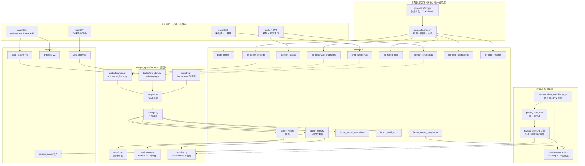
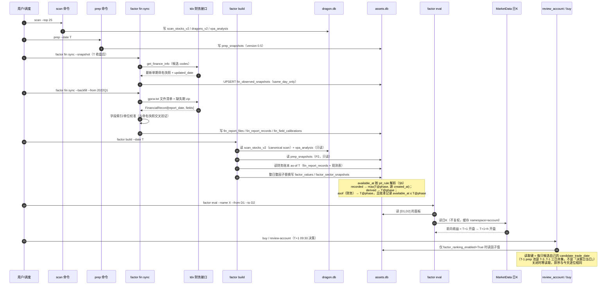
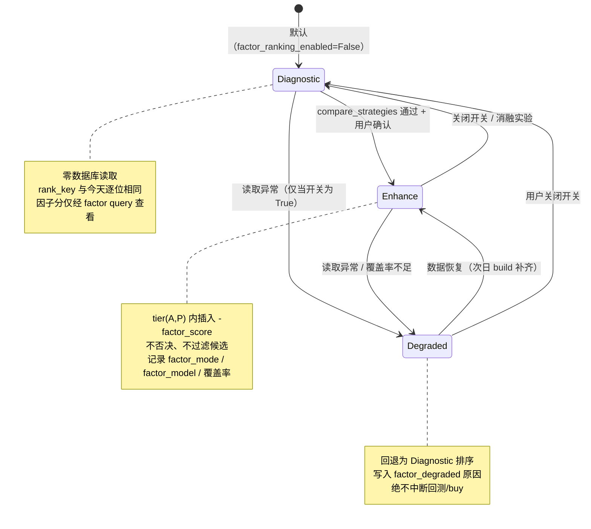
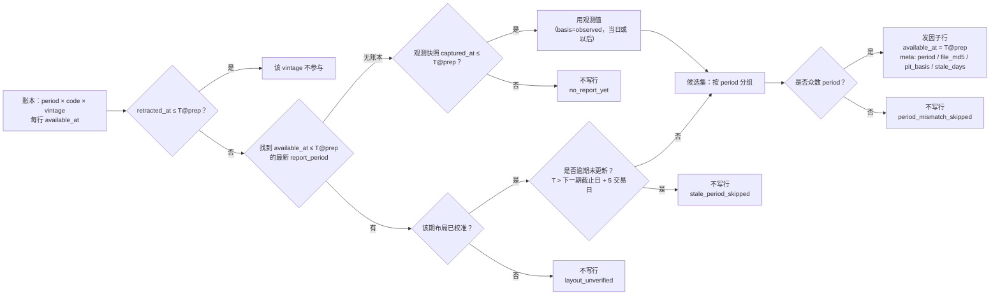

# 量化因子框架技术方案（issue #28）

- 日期：2026-10-22
- 分支：`feat/factor-framework`
- 上游调研：`archived_md/factor_framework/2026-10-22-factor-framework-survey.md`（research-reviewer APPROVE）
- 阶段：方案（阶段 2），**本文档只定义设计与实施边界，不含实现代码**（已随 feat 落地于 2026-10-23 归档）
- 结论摘要：采用「长表 + 并行诊断轨道」的轻量自研因子层。因子值落 `assets.db` 新表 `factor_values`（主键 `(trade_date, code, factor_name, factor_version)`，`source_scan_id` 作血缘字段）；五维评分保持唯一决策基线，因子层默认只诊断、不排序，决策接入只经 `review_account/priority.rank_key` 一个注入点、单开关控制、可零读取回退；评估口径自研（RankIC / ICIR / 2-3 分组 / HAC 修正），回测复用 `review_account`，不新建引擎。首期零新增运行时依赖。财务链路（P0.5，2026-10-22 delta 纳入）走 tmdx 财务接口：`get_finance_info` 日度观测（`same_day_only`）+ `gpcw*` 按报告期回填，PIT 以**法定披露截止日为下界、实测观测日优先**；原始财务数据落 `assets.db` 独立 `fin_*` 表，不进 `prep_assets`、不改变 `prep` 的采集/degraded 语义。

## Delta 修订记录（2026-10-22）

- **触发**：用户决策——**财务因子纳入本期**，数据源定为 **tmdx（`easy_tdx` 包）**，替换调研 §2.5 的 AKShare / Tushare / BaoStock 路线；同时解除「仅标准库」依赖约束（`AGENTS.md` 已由 main 更新，pandas 由 `tmdx` 传递安装）。
- **改动范围**：§1.1 新增里程碑 P0.5；§1.2 移除「财务因子」非目标并收窄为新的非目标；§1.3 新增强制决策点 **D4**；§2 新增财务链路候选对比（F1/F2/F3，推荐 F2）；§3 架构图/时序图/模块清单/复用约束；§4.1 枚举扩展、§4.3.1 财务因子清单、§4.4 读取日期无变化、§4.6 评估分层与财务口径、§4.9 财务接口；§5 五张 `fin_*` 表与读写语义；§6.1 新增 `pit_rule="asof"`、新增 §6.4 财务 PIT 口径；§7 财务错误分支；§8 财务测试；§9 补充模式；§10 新增 18-23；§11 新增 P0.5 验收；§12 新增 R16-R25；§13 文档同步；§14-3 标记已决策。
- **未改动**：D1（五维边界）、D2（`scan_id` 血缘与主键）、D3（存储位置与同步范围）、方案 A 的因子长表设计、`rank_key` 注入点、评估与决策的既有契约。财务链路是**新增的平行数据源**，不改变上述结论。
- **门禁记录（2 轮）**：原方案 APPROVE（0 CRITICAL，7 MAJOR / 9 MINOR 已修入）。delta 第 1 轮 REVISE（1 CRITICAL：回填期重述被标为截止日已知；8 MAJOR；7 MINOR）→ 已修入 `statutory_backfilled` 桶、观测时间门禁、截止日 23:59:59、追加式 vintage、数据版本留档、cohort 偏差量化、1q 伪独立修正、lookback 纠正、校准恒等式、`valid_from` 派生、raw blob、全部一致性问题。delta 第 2 轮 REVISE（1 CRITICAL：resolver 分支顺序让修订值借用观测时刻；2 MAJOR；1 MINOR）→ 已修入 **vintage 优先分支顺序**、观测值级哈希匹配与 `observed_unmatched`、`--pit-policy strict/research`、P0.5 评估验收、示例与范围行修正。**第 2 轮修复未再送审（门禁 2 轮上限），由 main 终审裁决（见交付报告）。**
- **事实边界（避免把假设当已验证）**：已验证——`easy_tdx` 公开方法名与返回形状、`FinanceInfo` 命名字段、`FinancialRecord.fields` 为**无名 float 数组**、`MacClient` **不含**财务方法（需另建 `TdxClient`）、`tmdx` 传递安装 pandas、`pyproject.toml` 仅声明 `playwright` + `tmdx`。**未验证（实现阶段实测）**——`gpcw` 的字段索引/单位/布局随报告期的差异、`gpcw.txt` 的历史期数、单期文件大小、计算服务器可用性。
- **P1 实现补充（2026-10-22，实现偏离登记）**：①每日收盘后的 `available_at` 在日频口径下**只能**用次一交易日开盘起算；同日开盘仅当 `available_at < 09:30`（竞价）才可成交，因此实际实现为「第一个开盘晚于 `available_at` 的交易日」，比 §4.6 文字更严格、无前视。②评估返回的分组数参数键为 `group_count`，`groups` 专指分组统计列表（避免 JSON 同名键冲突）。③`missing="drop"` 具体语义定为 **complete-case**（任一请求因子缺失即丢该 `(date, code)` 行）；`winsorize="mad"` 用 `median ± 3 × 1.4826 × MAD`。④`cohort_excluded_profile` 的规模代理取 `scan_stocks_v2.market_cap`；综合分分位按整个当日池计算（0-100，并列平均名次）。⑤`stale` 日历经 `factors/finance.load_trade_calendar` 取 TDX 指数日K；失败时 `stale_calendar_missing` 警告 + 工作日近似（不阻断 build）。⑥`factor_values.source_meta_json` 新增 `basis_by_code` / `period_by_code` / `finance_data_versions` / `retracted_count` / `layout_unverified`，评估按逐 code 口径统计 `pit_basis_mix`。⑦`retracted_count` 是当日因子级常量，评估按日期去重后求和（不被 code 数放大）；`fin` 因子跨报告期拼接时输出 `report_period_mixed` + warning；rank 归一在单只截面跳过（`insufficient_cross_section`）；`export_matrix(clean=None)` 默认原始值。

---

## 1. 目标、范围与硬性决策结论

### 1.1 本期范围

| 编号 | 能力 | 交付物 |
|---|---|---|
| P0 | 因子契约与注册表 | `FactorSpec`、内容哈希版本、`factor_registry` 快照、启用/关闭 |
| P0 | 因子长表存储与查询 | `factor_values` 长表 + 索引 + 点查/范围查 + 整日原子替换 |
| P0 | 首批因子迁移（**不重算**） | 五维系 7 个（6 个分数 + `is_true_dragon`）+ `vpa` 系 5 个 = 12 个 |
| P0 | 主板块归属快照 | `factor_sector_snapshots`（从既有扫描结果派生，不新增数据链路；`hy` 才是真实行业） |
| P0.5 | 财务原始数据链路 | `providers/tdx.py` 财务方法（`get_finance_info` / `get_financial_file_list` / `get_financial_records` / `get_xdxr_info`）+ `factor fin sync`（日度观测快照 / 按报告期回填 / 字段映射校准） |
| P0.5 | 首批财务因子 | 6 个因子（`fin_bps` / `fin_roe` / `fin_net_margin` / `fin_net_profit_yoy` / `fin_revenue_yoy` / `fin_net_assets`），按 `asof` 规则逐日展开落 `factor_values` |
| P1 | 矩阵导出 | 长表 → `date × code` 宽表，CSV/JSON + 清洗元数据 sidecar |
| P1 | 因子评估 | RankIC / ICIR / 2-3 分组收益 / 因子换手 / 覆盖率 / HAC 修正 |
| P2 | 决策接入 | `rank_key` 新增可选分量，单开关 + 可回退 + 降级 |
| P2 | 组合指标补全 | Sharpe（权益曲线）、行业暴露统计 |

### 1.2 明确非目标（本期不做）

- 估值类因子（PE / PB / PS）：需要「收盘价 × 财务」的统一口径（现价 vs 收盘、复权 vs 不复权、市值口径），且与现有 `Quote.pe` / 板块市值缓存口径未统一；本期不做。`fin_bps` 只提供每股净资产**原值**，不构造 PB（§14-9）。
- 财报文本 / 公告事件 / 业绩预告 / 股东与分红结构因子：`get_company_info_*` 文本接口不在本期；`get_xdxr_info` 仅落库备用，**不进任何因子**（§4.9、§14-10）。
- 财务因子的**因子值**不做全市场覆盖：`factor_values` 只对候选池代码产出行；`fin_report_*` 原始账本按**整期**保存（见 §5.1.1 存储边界），两者不矛盾。回填默认只处理最近 12 个报告期（策略参数，可 `--from-period` 扩大）。
- 行业中性化、风险平价、5 层分层（改 2-3 组）。
- ML 实现：只定义 `FactorModel` 协议与快照持久化，不引入 sklearn / numpy / pandas，不写 pickle。
- 新建回测引擎：一律复用 `review_account`（`simulator` / `strategy` / `execution` / `evaluation`）。
- 历史资金流 / 历史估值因子回填：数据源 `same_day_only`（`fund_flow` 等），不伪造历史，只标注 `valid_from`。
- 因子表达式引擎（qlib `Ref`/`Mean` 那类 DAG）：当前因子数十个、全部是代码函数，表达式引擎是纯负担。
- 因子值云端同步：见 §1.3-D3，本期明确排除。
- `scan --factor` 之类的扫描内联计算：因子层是**派生层**，只读既有产物，不进入扫描主链路。

### 1.3 四个强制决策点（结论先行）

#### D1 因子层与五维评分的边界

**结论：五维评分是唯一决策基线；因子层是并行诊断/增强层，默认零影响。**

隔离机制（四道）：

1. **代码隔离**：`dragon_quant/factors/` 不 import `dragon_quant/scorers/`；`scorers/` 永不 import `factors/`。五维 `aggregator.evaluate` / `rank_verdicts` / `DIM_FLOORS` 一行不改。
2. **数据隔离**：五维仍写 `scan_stocks_v2` / `dragons_v2`；因子值只写 `factor_values`。迁移是**只读复制**，不改写源表，不重算。
3. **候选池隔离**：候选池语义（`prep_snapshots` 优先 → `dragons_v2` 兜底、`verdict=ignore` 出池）完全不动。因子层不加过滤、不加否决。
4. **决策隔离**：因子分值只在 `rank_key` 的单一位置参与排序，且受 `factor_ranking_enabled`（默认 `False`）控制。关闭时 **零数据库读取、排序结果与今天逐位相同**（与 `auction_ranking_enabled=False` → A 恒 Unknown 的既有范式一致，AC8'）。

**唯一允许的写入方向**：`factor_ranking_enabled=True` 时，因子分量作为 tier 内的一个排序键插入：

```
现状： (auction_order, prep_order, -composite, -priority, code)
接入： (auction_order, prep_order, factor_rank, -factor_score, -composite, -priority, code)
```

- `factor_rank = 0`（有因子分）/ `1`（缺因子分）；**缺失者排在所有有分者之后**，不参与 `-factor_score` 比较。这是「缺失 ≠ 中性」在排序层的唯一表达（§4.5、§7）。
- 关闭开关时 `factor_rank ≡ 0`、`factor_score ≡ 0.0`，元组与现状**逐位等价**。
- 插在 `-composite` **之前**而不是之后：若放在 `priority` 之后，它退化成「几乎不生效的 tie-breaker」，A/B 实验永远测不出增量，等于假接入。

**将来切换（替换五维）的准入条件**（全部满足才允许讨论，缺一不可，且逐条对齐 `review_account/evaluation.py::compare_strategies` 的既有门禁）：

1. 样本外（60/20/20 的 test 段，且 test 只用一次）`total_return` **`> max(0, baseline)`**——与 `passes_holdout` 同口径，不只要求「高于 baseline」；
2. `max_drawdown >= -15`，且双倍滑点压力测试 `total_return > 0`；
3. 每个 split 的 `closed_count >= 10`；
4. `trial_count <= 20`；**`trial_count > 20` 视为不满足本准入点**（不是「降级后仍可通过」——现有代码只打 `overfitting_risk` 标签，本准入点比代码更严，因为「替换基线」的风险远高于「换一个卖出规则」）；
5. 用户显式确认。

在上述条件满足前，「替换五维」不进代码路径，连开关都不提供——避免出现「五维说买、因子说卖」的双结论（调研 §2.4-5）。

#### D2 `scan_id` 血缘与长表主键冲突

**结论：采用「同日唯一化 + 血缘字段」，主键为 `(trade_date, code, factor_name, factor_version)`，`source_scan_id` 只作血缘。**

同日唯一化规则（`canonical_scan`，唯一实现，确定性）：

```
canonical_scan(scan_date):
    rows = SELECT id, top_n, created_at FROM scans_v2
           WHERE scan_date = ?
           ORDER BY created_at DESC, top_n DESC, id DESC
    return rows[0] if rows else None
```

`ORDER BY` 的三个键都必要：`scan_id` 形如 `v2_YYYYMMDD_topN`（`top_n` **未补零**），纯字典序下 `v2_20260519_5 > v2_20260519_25`，同日同秒重扫时必须先比 `top_n` 再比 `id`。

理由：

1. **语义正确**：长表一行 = 一个交易日的观测值。同一天多次扫描是同一观测的重复采集（`scan_stocks` 内容随 `top_n` 不变化——`top_n` 只影响 `dragons` 物化与报告范围），不是多个独立观测。主键含 `source_scan_id` 会让同一因子一天多值，矩阵 pivot 需二次去重，IC 会重复计入同日样本，评估口径直接失真。
2. **与现有物化语义一致**：系统对同日多次扫描已有「同 `scan_id` 覆盖、不同 `top_n` 并存」的事实——`scans` 行以 `INSERT OR REPLACE` 覆盖（仅同一 `top_n`），不同 `top_n` 的 `scans` 行会并存，`get_scans_by_date` 返回多条。`dragons_v2` 则用 `UNIQUE(trade_date, code)` + UPSERT 收敛为一行。正因为「并存」是现状，才必须定义 canonical 规则；因子层沿用 `dragons_v2` 的收敛语义，不引入第二套时间规则。
3. **血缘不丢**：`factor_values.source_scan_id` + `factor_build_runs.report_json` 记录本次采纳的 `scan_id` / `top_n` / `scan_created_at`，可完整追溯。
4. **不会残留脏行**：写入按 `(trade_date, factor_name, factor_version)` 整因子整日替换（§5.4），同日重扫后旧候选的因子值被 prune，不会出现「旧扫描的 code 永远留在长表里」。

被否决的替代方案（主键加 `source_scan_id`）：只在一类需求下才正确——需要**同日多扫描横向对比**。该需求本期不存在，且可用 `factor_build_runs`（多次 build 各自留档）+ 显式 `--scan-id` 参数满足研究用途，无需污染主键。**重访条件**写入 §14。

补充约束：`scans.created_at` 在同日同 `top_n` 重扫时会被 `INSERT OR REPLACE` 重置，因此 `canonical_scan` 的解析结果随 DB 状态变化。这是**期望行为**（本地最新知识权威），但评估结果必须记录 build id / 解析出的 `source_scan_id`，否则跨时点不可复现（§11 风险 R5）。

#### D3 存储位置与云端同步范围

**结论：因子表落 `assets.db`；`factor_values` 本期【不纳入】云端同步。**

落 `assets.db` 的理由：

- 因子值是派生数据但**重算成本不低**（依赖 `scan` / `vpa` / `prep` 的历史产物），与 `prep_snapshots` / `auction_snapshots` 同属「结果层」，而 `assets.db` 的定位就是「原始资产 + 算法快照、与 `dragon.db` 物理隔离」。
- `storage clear --all` **不清理任何 `.db` 文件**（`storage/manager.py` 仅保护三个 DB 路径），落 `assets.db` 天然免于误清。
- 复用现有基础设施：`_connect(create=False)` 只读不建库、WAL + `busy_timeout`、`BEGIN IMMEDIATE` 单事务、逐行 JSON 损坏隔离、测试 patch `assets_db._connect` 即可完全隔离。新增一个 `factors.db` 会复制这一整套（约 100 行）而收益为零。

不纳入同步的理由：

1. `assets_sync` 的契约是「**不可再生**的原始资产」——manifest 身份是 `(trade_date, source, asset_type)`，`state.json` 水位与幂等判定都建立在这个粒度上。因子值不符合「不可再生」，也不符合这个粒度。
2. 因子值跨机器可比性依赖 `factor_version` + 模型权重 + 清洗配置；`pull` 的冲突判定是 **payload 哈希**而不是版本键，两台机器跑不同代码版本会产出语义不同但键相同的行，`--force` 覆盖会静默污染。
3. 本期因子表容量很小（§5.3 估算约 14 万行/年），重新计算成本低于维护一套派生数据的同步与冲突语义。

**必须诚实登记的缺口**：五维分与 `vpa` 分的**源数据在 `dragon.db`，而 `dragon.db` 目前完全不在备份范围内**。因此「因子值可本地重算」这个论断只在 DB 存活的机器上成立。缓解：

- P1 提供 `factor export`（CSV/JSONL + sidecar 元数据），可离线归档；
- 若将来需要跨机恢复，新增一个**显式版本门控**的同步源（`factor_values` 作为新 `source`，manifest 键含 `factor_version`），作为独立里程碑评估，**不在本期**（见 §14）。

#### D4 财务因子的数据源、存储与 PIT 口径（delta）

**结论：数据源 = tmdx（`easy_tdx`）；存储 = `assets.db` 独立 `fin_*` 五表；PIT = 「法定披露截止日下界 ∩ 实测观测日优先 ∩ 修订日修正」；依赖 = 项目代码零 `import pandas`。**

1. **两源分工，不是二选一**：
   - `get_finance_info(market, code)` = **最新单期命名快照**（`FinanceInfo`，约 30 个命名字段 + `updated_date`）。它是「TDX 当前认为的最新财务」，**没有历史**；任何按它回填历史都会前视。因此它只作**日度观测源**（`same_day_only`），按 `trade_date` 逐日积累，提供「我们确实在这一天看到了这期数据」的真实观测时刻。
   - `gpcw*` 专业财报 = **按报告期的多期历史**（`FinancialFileInfo` 含 md5/size，`FinancialRecord` 含 `report_date` + float 数组）。它可对历史期确定性重建，用于回填与同比（需要 P-4 个季度）。
   - 两者在 `(code, report_period)` 上合并为一张账本：**首版**的可用时刻取「实测观测日」与「法定截止日」的**更早者**（前提是观测值与首版值哈希相等；观测到即确知，比法定下界更早且不泄漏）；从未观测到的旧期只能用截止日下界（`statutory_backfilled`）；**修订版一律以首次下载时刻为下界**，`observed` 只能抬高、不能拉低（§6.4.2）。
2. **存储：独立 `fin_*` 表，不进 `prep_assets`、不进 `prep` 的 `ASSET_COLLECTORS`**。理由见 §2 财务候选对比：报告期主键与 `(trade_date, asset_type)` 语义不兼容；加入 `ASSET_COLLECTORS` 会让历史日永远缺席的财务快照出现在 `prep` 的 `degraded` 名单里，污染既有健康判定与 CLI 理由。代价是多一条调度契约（每个交易日收盘后跑一次 `factor fin sync --snapshot`；`factor build` 内置调用，当日已同步则零请求）。
3. **PIT：截止日只是「原始公告不晚于该日」，不是「回填值等于原始公告值」**。法定披露上限：一季报/年报 04-30、半年报 08-31、三季报 10-31（年报为次年 04-30），且按**当日 23:59:59** 计（A 股截止日盘后披露是常态）。据此分三桶：`observed`（日度观测确实看到过，可用时刻取 `min(截止日, 观测时刻)`）、`statutory_backfilled`（从未观测、只能回填，可用时刻取截止日，**无法证伪后来的重述**）、`revised`（追加式新 vintage，可用时刻以新文件首次下载时刻为下界）。账本**追加式 vintage**，修订绝不覆盖旧行。评估默认只把 `observed` / `revised` 当可证伪的 PIT 证据，`statutory_backfilled` 单列并标 `restatement_unverifiable`（§4.6、§6.4）。
4. **依赖：`gpcw` 的 `fields` 是无名 float 数组**，字段索引与单位必须用 `get_finance_info` 的命名值**交叉校准**；未校准 = 财务因子全部禁用（fail-closed），不存在「猜一个索引先跑起来」。项目代码不直接 `import pandas`，沿用 `providers/tdx.py` 既有的 `df.to_dict("records")` 适配；`pyproject.toml` 不新增 pandas 声明（由 `tmdx` 传递安装），并在 `factor fin status` 显式展示该传递依赖。

---

## 2. 候选设计对比

### 方案 A（推荐）：长表 + 并行诊断轨道

- 结构：`factor_values` 长表（一行一因子）+ 注册表快照 + 模型快照 + build 审计；因子层独立包；决策只经 `rank_key` 一个注入点。
- 优点：加因子零迁移；点查/范围查/矩阵导出都简单；天然带版本；与 `assets.db` 既有「结果表」模式一致；PR 面最小。
- 缺点：矩阵读取需要 pivot（Python 侧完成，规模小无感）；需要自己保证 PIT 与统计正确性。

### 方案 B（非常规 / 反直觉）：因子即资产，复用 `prep_assets` 的 JSON 面板

- 结构：不建任何新表。每次 build 把当日全部因子写成一个 JSON 面板，存进 `prep_assets`，`asset_type='factor_panel'`（同库、同两段式、同 `save_prep_assets` 事务）。
- 优点：实现量最小（约 200 行）；零 schema 变更；自动获得 `prep_assets` 的 UPSERT/报告/同步/`--recompute` 语义。
- 缺点（致命）：
  1. 无法按 `factor_name` 点查——只能整日整块读出再在 Python 里筛，失去 SQLite 索引的意义；
  2. 版本/血缘只能塞进 JSON，无法建唯一约束，重跑幂等要靠应用层保证；
  3. 会污染 `collection_report` 的语义（它是「原始资产健康状况」，混入派生数据后 `prep` 的健康判定与「零采集」短路会被误触发）；
  4. 一旦纳入 `assets_sync`，整个 JSON 面板会作为单个 blob 上传，任何因子改动都会让该日 blob 全量失效。
- **结论：否决，但保留其思想**——因子表的写入 API 采用「整日整因子替换」的原子语义，等价于 B 的幂等性，同时保住点查能力。

### 方案 C：独立 `factors.db` + 宽表（`date × code` 一行多列）

- 结构：第三个 DB 文件；宽表，加因子 = `ALTER TABLE ADD COLUMN`；矩阵读取零 pivot。
- 优点：矩阵读最快；与 `assets.db` 的同步/备份语义彻底解耦。
- 缺点：第三个连接/锁/schema 模块；每次加因子都要 DDL + 迁移；不同频率/版本因子难共存（版本一变就要加列或改列）；与项目「长表做权威源、宽表做派生视图」的判断相反（调研 §4.1）；`storage status/size` 还需新增一路统计。
- **结论：否决**。宽表作为**导出视图**存在（P1 `factor export`），不落盘为主存储。

### 财务链路候选设计（delta，三选一）

> 这里只比较**财务数据的取得与 PIT 口径**；因子值仍然落 `factor_values` 长表（方案 A），不受本小节影响。

#### F1）只做 `get_finance_info` 日度快照（最保守）

- 结构：每个交易日收盘后对候选池抓 `get_finance_info`，落 `fin_observed_snapshots`；因子只算「当期」指标（bps / roe / 净利率 / 净资产），**不做同比**。
- 优点：命名字段、零布局风险、零回填；PIT 是**真实观测**（观测日即可知日）；实现最小（约 200 行）。
- 缺点（决定性）：**没有历史**。`valid_from` = 上线日，评估至少等 20 个交易日，同比至少等 4 个季度（约一年）。P0.5 的价值要一年后才兑现，等于把「纳入本期」变成「一年后才有结论」。
- **结论：不单独采用**，但其观测表被 F2 完整保留。

#### F2（推荐）日度观测 + `gpcw` 按报告期回填

- 结构：F1 的 `fin_observed_snapshots` + `fin_report_files` / `fin_report_records`（按报告期的账本）；同一 `(code, report_period)` 的可用时刻 = `min(实测观测日, 法定截止日)`，无实测时取截止日；修订则 `max(上述, 修订观测日)`。
- 优点：历史**在布局可校准的前提下**「值可算、可入排序」；历史 IC 只能以 **research-grade** 口径输出（允许 `statutory_backfilled`，须标 `restatement_unverifiable` 并单独成节）；前向若观测**先于**该期首版落库，则可判为 `observed`（比截止日更早且确实知道）；历史深度由 `gpcw` 文件清单决定，不需要触网抓第三方网页。
- 缺点：`FinancialRecord.fields` 是**无名 float 数组**，索引/单位/布局必须校准；历史期布局可能与当前不同，早期同比可能缺失；回填期无法区分原始公告值与后来的重述（必须单列 `statutory_backfilled`）。
- 缓解（已设计，不是「实现时再说」）：字段映射未校准 → **fail-closed 不启用**；按 `num_fields` 隔离布局、未校准布局存 gzip blob；账本追加式 vintage（修订不覆盖、不回溯）；`valid_from` 运行期派生，build 报告 `fin_earliest_available`；评估默认只把 `observed` / `revised` 当可证伪 PIT 证据。

#### F3）只用 `gpcw`（连当期也用截止日）

- 优点：一条链路，少一张表。
- 缺点（否决）：放弃「我们真正观测到数据」的时刻，前向 PIT 更保守但**没有任何收益**；更关键的是**失去交叉校验能力**——`gpcw` 字段无名，没有 `get_finance_info` 的命名值做对照，索引/单位错误无法发现，等于在无校验的情况下产出财务因子。
- **结论：否决**。

| 维度 | F1 只快照 | **F2 混合（推荐）** | F3 只 gpcw |
|---|---|---|---|
| 历史可得 | 无（一年后才有） | 有（由文件清单决定） | 有 |
| 前向 PIT | 真实观测 | 真实观测（自动优于截止日） | 只有法定截止日 |
| 同比可行性 | 需等 4 个季度 | 可算（评估为 research 口径） | 可算（评估为 research 口径） |
| 字段错误可发现性 | 不涉及 | **有交叉校验** | 无（无法校验） |
| 新增存储 | 1 表 | 5 表（含本期仅落库的 xdxr） | 3 表 |
| 实现量 | ~200 行 | ~500-600 行 | ~400 行 |
| 结论 | 并入 F2 | **采用** | 否决 |

### 对比与推荐

| 维度 | A 长表 + 并行轨道 | B 因子即资产（JSON） | C 独立库 + 宽表 |
|---|---|---|---|
| 加因子成本 | 注册一行 + 一个函数 | 改 JSON 结构 | DDL 迁移 |
| 点查 `(date, code, factor)` | 索引直查 | 全量读出后筛 | 直查 |
| 版本并存 | 主键含 version，天然支持 | JSON 内弱约束 | 需加列/改名 |
| 幂等重跑 | 整日整因子替换 | 应用层保证 | 需自行处理 |
| 新增基础设施 | 0（复用 assets.db） | 0 | 1 个 DB 模块 |
| 对现有链路侵入 | 仅 `rank_key` + `collect_candidates_ex` | 污染 prep 两段式 | `storage` 三处统计 |
| 否决原因 | — | 无法点查、污染资产语义 | DDL 僵化、重复基建 |

**推荐 A**。B 的「原子替换」与 C 的「宽表只读视图」被吸收进 A 的写入 API 与导出层。

---

## 3. 架构设计

### 3.1 模块划分



读图要点：

- 因子层**只读**现有产物（实线箭头 `SS→BUI`、`VP→BUI`）。
- **虚线 = 惰性/可选依赖**：`PS`/`AS` 是 P2 才接入的潜在来源；`CC -.-> DEC` 表示 `market.collect_candidates_ex` 在**函数内惰性 import** `factors.decision.annotate_pool`，方向是 `review_account → factors`，与 §3.4 的依赖规则一致（`factors` 模块级不得 import `review_account`）。
- **财务链路（delta）**：`TDXF → SYNC` 是因子层唯一允许的取数方向；`builtin/financial.py` **只读**账本表（`FRR` 实线）与观测表（`FOB` 虚线：仅当账本无可用期时回退，且必须满足 `captured_at ≤ T@16:40`），**不发请求**。`factor build` 允许在开跑前触发 `finance.sync_snapshots`（采集与计算分离），但 `builtin/*` 内不得触网。这保证 compute 仍是纯函数（§4.3、§6.4.3）。
- 决策链路的唯一改动点是 `CC`（注解）与 `PK`（排序键）：因子分随候选池注解进入 `rank_key`，其余（撮合、T+1、涨跌停、停牌、费用）一行不改。
- 五维评分器（`scorers/`）不出现在图中——这是刻意的：因子层与五维无调用关系。
- `PREP` 与财务链路**没有边**：财务采集不进 `prep`（§2 F2 对比、§5.1）。

### 3.2 数据流与时点（PIT）对齐



**时点铁律**（写入 §6 详细规则）：

1. 因子值必须带 `available_at`；评估的前向收益**只能从 `available_at` 之后第一个可成交事件起算**。收盘因子用 `T+1 开盘 → T+1+h 开盘`，不能用 `T 收盘 → T+h 收盘` 的纸面收益（否则 IC 系统性偏乐观，调研 §4.4）。
2. 不需要「用未来数据算当日因子」的能力：`available_at` 是**保守下界**，宁可低估因子价值，绝不泄漏未来。

### 3.3 决策双轨与切换状态机



`replace`（因子替换五维）**不在状态机内**——它需要满足 §1.3-D1 的五条准入条件，属于独立里程碑。

### 3.4 分层依赖规则（防循环导入）

现有 `review_account/market.py` 需要调用因子注解，而 `factors/evaluation.py` 需要日K。规则：

| 方向 | 规则 |
|---|---|
| `factors/*` → `scorers/*` | **禁止**（模块级与函数级均禁止） |
| `factors/*` → `review_account/*` | **禁止模块级 import**；评估函数通过参数注入 `data` 对象（鸭子类型，不 import） |
| `review_account/*` → `factors/*` | 只允许**函数内惰性 import**（沿用 `market.py` 内 `from dragon_quant.storage import assets_db` 的既有写法） |
| `factors/*` → `storage/*` | 允许（`assets_db` / `db`） |
| `factors/*` → `providers/*` | **仅** `factors/finance.py`（财务数据同步适配层）允许；`engine.py` / `builtin/*` / `evaluation.py` **禁止**（compute 必须纯函数，§4.3） |
| `storage/*` → `factors/*` | **禁止**（存储层不知道因子语义） |

模块清单：

```
dragon_quant/factors/
├── __init__.py          # 门面：只导出 build / query / export_matrix / evaluate / annotate_pool
├── types.py             # FactorSpec / FactorValue / BuildResult / CleanConfig / FactorModel Protocol
├── registry.py          # FACTOR_SPECS 注册表 + 校验 + 内容哈希版本 + 启用集解析
├── storage.py           # factor_values / registry / model_snapshot / build_runs / industry 读写
├── engine.py            # build 模板方法（取数→校验→计算→时点→落库→报告）
├── finance.py           # 财务数据同步：观测快照 / gpcw 回填 / 字段校准（**唯一触网点**）
├── builtin/
│   ├── __init__.py
│   ├── five_dim.py      # 从 scan_stocks_v2 迁移五维分（只读复制）
│   ├── vpa.py           # 从 vpa_analysis 迁移 vpa 因子分（只读复制）
│   ├── financial.py     # 6 个财务因子（as-of 展开，纯函数）
│   └── financial_fields.py  # gpcw 字段索引/单位映射（校准产物；未校准即禁用）
├── matrix.py            # 长表 → 矩阵 + 清洗 + sidecar 元数据
├── evaluation.py        # RankIC / ICIR / 分组 / 换手 / 覆盖率 / HAC
├── decision.py          # FactorModel 协议 + EqualWeightRankModel + annotate_pool
└── service.py           # CLI 编排（build/query/export/eval/status）
```

`storage/factors.py`（新增，约 200 行）承载 SQL，经 `assets_db._connect` / `assets_db._ensure_schema` 的**模块属性访问**调用（保证测试 patch `assets_db._connect` 生效，等价于 `storage/_base.py` 的转发约定）。

### 3.5 复用约束（强制，不得另起实现）

| 能力 | 唯一实现（复用） | 禁止 |
|---|---|---|
| 候选排序 | `review_account/priority.rank_key`（`engine` / `signal_engine` / `strategy` 共用） | 因子层自写排序函数或第二套排序键 |
| 回测撮合 | `review_account` 的 `simulator` / `strategy` / `execution`（T+1、涨跌停、停牌、费用、滑点） | 新建回测引擎、用因子值直接算组合收益 |
| 交易日历 | `utils/trading.py`（`tdx_trade_dates` / `build_trade_calendar` / `trade_days_between`）+ `MarketData.calendar` | 自建日历、用自然日近似交易日、`dateutil`/`pandas` 日历 |
| 存储模式 | `assets_db` 的两段式约定：读路径 `create=False` 不建库、写路径 `_ensure_schema` + `BEGIN IMMEDIATE`、JSON `allow_nan=False` + 确定性键序、逐行 JSON 损坏隔离 | 新建 DB 门面复制这四件事；用 JSON 存整块因子面板 |
| 组合指标 | `evaluation.metrics` / `compare_strategies` / `metrics` 的键（只增不改） | 另起一套收益/回撤口径 |
| 历史行情 | `review_account/data.py::MarketData`（缓存命名空间 `account`、不复权口径） | 因子层直接调 provider 抓取 |
| 财务数据取数 | `providers/tdx.py` 新增财务方法（唯一触网点，沿用 `df.to_dict("records")` 适配） | `builtin/financial.py` 直接发请求；项目代码 `import pandas` |
| 财务原始数据落库 | `assets_db` 的事务/JSON/WAL 约定 + 新的 `storage/finance.py`（SQL 集中） | 复制第三方财务库、塞进 `prep_assets` 的 JSON blob |

因子层新增的只有三件事：**因子值的长表写入、矩阵 pivot、IC 与分组统计**。其余全部站在既有实现上。财务链路额外新增 **财务账本（观测/报告期/校准）的写入与 as-of 查询**，同样复用 `assets_db` 的四条约定。

---

## 4. 接口定义

### 4.1 `FactorSpec`（注册表元数据）

```python
@dataclass(frozen=True)
class FactorSpec:
    name: str                       # 唯一标识，蛇形：five_dim_drive / vpa_breakout
    label: str                      # 中文名，仅展示（不进版本哈希）
    frequency: str                  # "1d" | "5m" | "event" | "1q"（delta：季度事件源，见下）
    source: str                     # "scan" | "vpa" | "prep" | "auction" | "computed" | "fin"
    compute: Callable[[FactorContext], FactorFrame]   # 唯一计算入口
    impl_key: str                   # 实现指纹（源码哈希失败时的兜底）
    depends_on: tuple[str, ...] = ()      # 依赖的其他因子名（组合因子用）
    lookback: int = 0                     # 需要的交易日窗口（数据充分性检查）
    direction: str = "higher_better"      # higher_better | lower_better | neutral
    unit: str = "score"                   # score | pct | ratio | count | flag | cny | cny_per_share
    available_phase: str = "close"        # auction(09:25) | open(09:30) | close(15:05) | prep(16:40)
    pit_rule: str = "recorded"            # "recorded" | "derived" | "asof"（见 §6，决定 available_at 语义）
    scope: tuple[str, ...] = ("candidate",)   # candidate | dragon
    params: Mapping = field(default_factory=dict)
    default_enabled: bool = False          # 新增因子默认关（避免静默改变评估/决策）
    valid_from: str | None = None          # 数据可得起点（YYYY-MM-DD），防「上线前为空」当缺失
    deprecated_at: str | None = None
    owner: str = ""
    description: str = ""                  # 不进版本哈希
    version_override: str | None = None    # 手工版本（仅迁移用），None = 内容哈希
```

字段决策说明：

- **没有 `enabled` 列**：启用是运行时选择（`FactorSelection`），不是因子定义的一部分。写进因子定义会导致「同一版本在不同机器上语义不同」，破坏可复现性。`default_enabled` 只作为新因子的默认偏好被快照记录。
- **`pit_rule` 参与版本哈希**：`recorded`（记录型：源行是「某次运行算出来的」——`scan` / `vpa`）与 `derived`（派生型：源是日期键的纯函数——`prep` / `auction` / `computed`）决定 `available_at` 的三套语义（§6），选错会直接导致前视或历史评估假阴性。delta 新增 **`asof`**（as-of 展开型：源是「按报告期、自带可用时刻的账本」——`fin`），三套语义见 §6.1/§6.4。
- **`frequency="1q"` 的语义（delta）**：季度事件源。因子值本身只在报告期切换时变化，但存储仍是**日频行**：`engine` 负责 as-of 逐日展开（当日没有新报告期时复用最近一期，§6.4），`compute` 仍按单日调用。**`lookback` 不适用于 `1q`**：数据充分性唯一判据是「当期 + P-4Q 记录同时存在且均已校准」（§4.3.1），不设交易日窗口——否则每次披露后 1-2 周内同比因子会被错误判为「数据不充分」。
- **`unit` 新增 `cny` / `cny_per_share`（delta）**：财务金额（元）与每股金额（元/股）必须与 `score` / `ratio` 区分，否则导出层会把「金额」当「得分」做 rank 换算或 winsorize。`cny` 与 `cny_per_share` 不可混算。
- **`valid_from` 的运行期派生（delta，`fin` 专用例外）**：财务因子的 `valid_from` 在 spec 里为 `None`，由 `build` 在落 `factor_registry` 时写入运行期解析值 `fin_earliest_available`（首个「当期 + P-4Q 且布局已校准」的报告期对应的可用日）。这是全表**唯一**允许「`None` + 运行期解析」的因子族：写死一个日期会把未验证的历史深度当成承诺（§10-20、R19）。
- **`unit` 新增 `cny` / `cny_per_share`（delta）**：财务金额（元）与每股金额（元/股）必须与 `score` / `ratio` 区分，否则导出层会把「金额」当「得分」做 rank 换算或 winsorize。`cny` 与 `cny_per_share` 不可混算。
- **没有 `pool` / `industries` 过滤字段**：本期候选池只有一种语义（每日候选），按行业启用需要历史行业归属，属于 P3。用 `scope` 粗粒度声明即可。
- **`direction` 参与版本哈希**：它改变因子语义（评估时取反），必须进版本。
- **`label` / `description` / `owner` 不参与哈希**：改文案不该产生新版本。

### 4.2 版本生成（内容哈希）

```python
def compute_version(spec) -> str:
    payload = {
        "name": spec.name, "frequency": spec.frequency, "source": spec.source,
        "depends_on": sorted(spec.depends_on), "lookback": spec.lookback,
        "direction": spec.direction, "unit": spec.unit,
        "available_phase": spec.available_phase, "pit_rule": spec.pit_rule,
        "scope": sorted(spec.scope),
        "params": canonical_params(spec.params),
        "impl": source_fingerprint(spec.compute) or spec.impl_key,
    }
    return "v" + sha256(canonical_json(payload)).hexdigest()[:12]
```

- `source_fingerprint` = `inspect.getsource(compute)` 经**标准库 `tokenize`** 做 token 级规范化（丢弃 `COMMENT` / `NL` / 缩进与空白 token，再拼接），**不得用正则剥 `#`**——否则 `"a#b"` 这类字符串字面量会被破坏，导致语义未变却产生新版本。`getsource` 失败（冻结包、zip 导入、交互式定义）时回退 `impl_key`，并在 `factor build` 报告中记 `version_source="impl_key"` 警告。
- 版本一旦生成即不可变：同一 `(name, version)` 的语义永不变更。要改算法就产生新版本，旧版本行保留。
- 版本切换的语义是「为新模型**选择**一组确定的因子版本」，不是覆盖旧值。模型快照（§5.2 `factor_model_snapshots`）记录 `factor_versions` 映射。

### 4.3 因子计算契约与首批迁移清单

统一签名（**纯函数、无 I/O**，数据由 `FactorContext` 注入）：

```python
@dataclass(frozen=True)
class FactorContext:
    trade_date: str                      # YYYY-MM-DD
    codes: tuple[str, ...]               # 当日候选 codes（已排序）
    source_rows: Mapping[str, Any]       # 由 engine 按 spec.source 取好的源数据
    as_of: str                           # 源数据可知时点
    calendar: tuple[str, ...]            # 交易日历（升序）
    params: Mapping

def compute(ctx: FactorContext) -> FactorFrame
```

`FactorFrame`：

```python
@dataclass
class FactorFrame:
    values: dict[str, float]             # code -> value（缺失的 code 直接不出现，绝不填 0）
    available_at: str                    # 实际可知时点（≥ phase_timestamp）
    source: str
    source_scan_id: str | None = None
    meta: dict = field(default_factory=dict)   # 覆盖率/样本数等诊断，不入长表
```

首批因子（P0，全部**只读迁移、不重算**）：

| `factor_name` | `source` | 取值来源 | `available_phase` | `direction` |
|---|---|---|---|---|
| `five_dim_composite` | scan | `scan_stocks_v2.composite_score` | close | higher_better |
| `five_dim_drive` | scan | `dim_drive` | close | higher_better |
| `five_dim_leadership` | scan | `dim_leadership` | close | higher_better |
| `five_dim_anti_drop` | scan | `dim_anti_drop` | close | higher_better |
| `five_dim_liquidity` | scan | `dim_liquidity` | close | higher_better |
| `five_dim_absorption` | scan | `dim_absorption` | close | higher_better |
| `five_dim_is_true_dragon` | scan | `is_true_dragon`（1/0，**NULL 不写行**） | close | neutral |
| `vpa_health_score` | vpa | `vpa_analysis.health_score` | close | higher_better |
| `vpa_vol_amount` | vpa | `factors_json[].score` where `name=="vol_amount"` | close | higher_better |
| `vpa_trend_verify` | vpa | 同上 `trend_verify` | close | higher_better |
| `vpa_breakout` | vpa | 同上 `breakout` | close | higher_better |
| `vpa_divergence` | vpa | 同上 `divergence` | close | higher_better |

迁移注意事项：

- `scan_stocks_v2` **没有 `primary_sector` 列**（该字段只在 `scans.raw_output` 的 `ranking[]` 里）。因此「主板块快照」从 `raw_output` 解析；解析失败/字段缺失/`raw_output` 为 NULL → 该日该 code 不写行（不猜），覆盖率进报告。**本期不改 `scan_stocks` schema**，避免与扫描链路耦合；若 P1 实测解析开销不可接受，再评估加列（届时同步文档）。
- **`primary_sector` 是「行业+概念+地区融合总榜里排名最高的板块」，不保证是 `hy`（真实行业）**。因此该表命名为 `factor_sector_snapshots`（主板块快照），不是「行业归属」。`industry_exposure` 只统计 `category == "hy"` 的行，其余计入 `unattributed_ratio`——这是**结构性**缺失而非偶发缺失（§4.8、§10-10）。
- `vpa_analysis.factors_json` 的元素形状已核对：`{"name","title","signal","score","note","evidence","details"}`（写入点 `cli_commands.py::_cmd_vpa` 与 `review.py`）。`name` 缺失或重复时跳过并记 `skipped`，不静默取第一个。
- **`vpa_analysis` 存在跨日回填污染，必须过滤**：`review.py` 会用 `trade_date=<被回测日>` 写 vpa 行，但 `vpa.analyze(code)` 用的是**运行当天**的 60 日 K 线。这类行的 `created_at.date() > trade_date`，其值包含 `trade_date` 之后的信息，**不能当作该日因子值**。P0 迁移规则：`created_at.date() != trade_date` 的 vpa 行一律 `skip`，记 `skipped_backfilled`（附数量与样本 code），不写 `factor_values`。这是源数据的既有限制，不在本期修复 `review.py`。
- `is_true_dragon` 在 `scan_stocks_v2` 可以是 `NULL`（`save_scan` 的 `1 if ... else 0 if "is_true_dragon" in s else None`）。`NULL → 不写行`，绝不落成 0。
- 五维里 `composite_score` 与 `is_true_dragon` 是**诊断值**，不是决策来源；迁移它们是为了让因子评估能直接对照「现有基线」，不代表它们变成因子层决策输入。
- 任何因子在当日**无源数据**时不写行（不写 0 / 不写中性分）。这与五维 `aggregator` 在异常时写 `ABS_NEUTRAL=50` 的处理**刻意不同**：因子层的「缺失」必须可与「真实中性」区分，否则 IC 会被伪中性污染。

#### 4.3.1 财务因子清单（delta，P0.5）

`source_rows` 的财务形状（由 `engine` 按 `spec.source == "fin"` 组装，纯 dict）：

```python
{
  "current": {"period": "2026-06-30", "values": {...}, "available_at": "2026-08-31T23:59:59", "pit_basis": "statutory_backfilled", "layout_key": "gpcw_315"},
  "prior":   {"period": "2025-06-30", "values": {...}, "available_at": "2025-08-31T23:59:59", "pit_basis": "statutory_backfilled", "layout_key": "gpcw_315"},  # 同比用，缺失为 None
  "cohort":  {"modal_period": "2026-06-30", "n_total": 47, "n_cohort": 45, "n_mismatch": 2, "by_period": {"2026-06-30": 45, "2026-03-31": 2}},
  "observed": None | {"updated_date": "20260815", "values": {...}, "captured_at": "2026-08-15T17:02:11", "available_at": "2026-08-15T17:02:11"},  # 仅账本无可用期时回退；必须 captured_at ≤ T@16:40
}
```

首批 6 个因子（全部 `default_enabled=False`，启用由模型快照决定，§4.4）：

| `factor_name` | 计算 | `source` | `frequency` | `unit` | `direction` | `pit_rule` | `available_phase` | `lookback` | `valid_from` |
|---|---|---|---|---|---|---|---|---|---|
| `fin_bps` | 每股净资产（`meigujing_zichan`） | fin | 1q | cny_per_share | higher_better | asof | prep | 0 | 运行期派生 |
| `fin_roe` | `净利润(累计) × 4/季度序号 ÷ 净资产 × 100` | fin | 1q | pct | higher_better | asof | prep | 0 | 运行期派生 |
| `fin_net_margin` | `净利润(累计) ÷ 主营收入(累计) × 100` | fin | 1q | pct | higher_better | asof | prep | 0 | 运行期派生 |
| `fin_net_profit_yoy` | `净利润(P)/净利润(P-4Q) − 1) × 100` | fin | 1q | pct | higher_better | asof | prep | 0（P-4Q 存在性检查） | 运行期派生 |
| `fin_revenue_yoy` | `主营收入(P)/主营收入(P-4Q) − 1) × 100` | fin | 1q | pct | higher_better | asof | prep | 0（P-4Q 存在性检查） | 运行期派生 |
| `fin_net_assets` | 净资产（`jing_zichan`） | fin | 1q | cny | lower_better | asof | prep | 0 | 运行期派生 |

口径与取舍（每条都会被评审追问，写死）：

- **累计口径**：A 股财报是**年初至今累计**。`季度序号` 由报告期推导（`0331→1, 0630→2, 0930→3, 1231→4`）。ROE 的 `× 4/季度序号` 是**近似年化**，只用于同日截面排序，**不用于绝对收益口径或对外展示**；报告中标注 `annualization="approx_4_over_quarter"`。
- **同比用同季**：`P-4Q`（如 2026Q1 vs 2025Q1），不是「上一期」，以消季节性。缺 P-4Q 记录 → 该因子当日不写行（不写 0）。
- **严格同报告期队列（且必须量化其选择偏差）**：当日候选的最新报告期若不一致（典型：财报季切换日、个别公司延迟披露），只保留**众数报告期** cohort 的候选，其余不写行并计 `period_mismatch_skipped`。理由：Q1 累计值与年报累计值不可横向排名。**但这不是「纯覆盖率代价」**：A 股披露时点与业绩/质地相关（早披露者倾向更好），被剔除组集中在信息最有价值的切换窗口。因此评估必须额外输出 `cohort_excluded_profile`（被剔除数量 + 池内综合分分位/是否涨停/规模代理），并在 `warnings` 标 `cohort_selection_bias`。`params.cohort_policy` 提供两个取值：`"modal"`（默认）与 `"deadline_switch"`（以「法定截止日 + 1 交易日」为全池统一切换点，切换前全池统一用上一期、之后统一用新期，cohort 错配为 0，代价是切换日之前的信息滞后）。两者都不得把混合期拼成一条 IC 序列（§4.6、§10-21）。
- **`valid_from` 运行期派生**：不用写死的设计下限（写死会把未验证的历史深度当承诺）。实际起点 = gpcw 清单中同时具备「当期 + P-4Q」且**布局已校准**的最早报告期的可用日，落 `factor_registry.valid_from` 并在 build 报告写 `fin_earliest_available`；评估遇到早于它的日期直接不算样本。
- **分母保护**：净资产 ≤ 0 或主营收入（累计）= 0 → `fin_roe` / `fin_net_margin` 不写行（比率为负或无穷时排名无意义），计 `invalid_denominator`。
- **`fin_net_assets` 是规模代理**：与流通市值高度相关，`direction=lower_better` 表达小市值倾向；`EqualWeightRankModel` 默认权重为 0（只作为可评估的诊断因子），是否给权重由 `compare_strategies` 决定。
- **估值因子不做**：`fin_bps` 只输出原值；PB = 收盘价 / BPS 需要价格与财务的统一口径，列入 §14-9。
- **纯函数**：以上全部只读 `source_rows`；取数、账本解析、字段映射都在 `factors/finance.py` 与 `providers/tdx.py`，`builtin/financial.py` 内**没有任何 I/O 与 provider import**（§3.4 依赖表）。

### 4.4 `FactorModel` 协议

```python
@dataclass(frozen=True)
class PoolItem:
    code: str
    factor_date: str                 # 该候选自己的 trade_date（归一化分组键）
    values: Mapping[str, float]      # factor_name -> value（缺失因子直接不出现）

@dataclass(frozen=True)
class PoolInput:
    decision_date: str
    items: tuple[PoolItem, ...]

@runtime_checkable
class FactorModel(Protocol):
    name: str
    version: str
    def fit(self, panel: "FactorPanel") -> "FactorModel": ...   # 规则模型无状态，直接 return self
    def score(self, pool: PoolInput) -> dict[str, float]: ...   # code -> 0-100，可缺失
    def snapshot(self) -> dict: ...                             # 权重/参数/因子版本映射
```

模型接收的是**整池**（含每只候选的 `factor_date`），因为截面归一必须按组计算；单个 `trade_date` 的 `score(code, values)` 签名无法表达跨日并集池。

- 本期唯一实现：`EqualWeightRankModel`。**归一分组 = 同一 `candidate_trade_date` 的候选**（不是「决策日全部候选」）：候选池是 T-3..T-1 三日真龙并集，每只候选的因子值来自它自己的入选日；把三天的绝对因子值混在一起排名没有意义，而**组内 rank 归一后**各日得分同分布（`[0,1]`），跨日才可比。
  - 每个因子：`rank_pct = avg_rank(value) / (n_cohort - 1)`（并列取平均名次），`lower_better` 取 `1 - rank_pct`，`neutral` 权重为 0。
  - 候选得分 `score = 100 × Σ(w_i × rank_pct_i) / Σw_i`，落在 `[0,100]`；**要求该候选所有启用因子都有值**，任一缺失 → 该候选 `score = None`（进入缺失桶），不做「部分因子加权」——部分得分等于给缺失因子隐式赋中性值。
  - 组内样本 `n_cohort < 3` → 该组全部记缺失（1-2 个点的 rank 无意义），并在 `meta.small_cohorts` 记录日期与数量。
  - **P2 实现补充（2026-10-22）**：`n_cohort` 取「该组中所有必需因子都有值的候选数」（可评分 cohort），缺失候选不参与截面秩，否则会把有分候选的 `rank_pct` 压到 `<1`；可评分 cohort < 3 才整组缺失。该口径与「缺失者不得分」一致，不改变 `factor_rank=1` 桶语义。
- **模型成员与因子启用解耦**：`default_enabled` 只决定「不带 `--only` 时 `factor build` 是否计算该因子」；模型用哪些因子、权重多少，由 `factor_model_snapshots` 的 `factor_versions_json` + `params.weights` 唯一决定。`factor_model_version=""` → 解析为同名模型的最新快照；**没有快照就 `degraded`（`model_snapshot_missing`），不提供隐式默认模型**——否则「跑了哪个模型」无法复现。
- **不提供** `save/load` 方法：持久化统一走 `factor_model_snapshots` 存 JSON dict，**禁止 pickle**（安全 + 跨 Python 版本可读）。ML 模型将来接 `fit` 后同样只存 JSON 参数/权重，不存序列化对象。
- `fit` 对本模型是 no-op，保留在协议里是为了将来 sklearn 实现不需要改调用方。

### 4.5 决策接入接口

**读取日期（必须先定稿，否则 P2 交付物恒降级）**：候选池来自**严格 T-1** 的 `prep_snapshots`，而该快照是 T-3..T-1 三日真龙的并集，每只候选带自己的 `trade_date`（下游别名 `candidate_trade_date`）。因子值**按每只候选自己的 `trade_date` 读取**，不是决策日 T：

```python
def candidate_factor_date(candidate: dict, decision_date: str) -> str:
    return (candidate.get("trade_date") or candidate.get("candidate_trade_date")
            or decision_date)   # 兜底分支：两条现有池来源都带 trade_date，正常不会走到
```

已核对：`prep_snapshots.candidates[]` 保留每只的真实 `trade_date`，`dragons.get_dragons_by_date` 也返回 `trade_date`，所以正常路径永远按候选自身日期读取；`decision_date` 兜底只为防御未来新池来源漏字段，且触发时计入 `factor_degraded` 统计。

若按决策日 T 读，T 日因子值在 T 日 09:30 必然不存在（`factor build` 在收盘后跑），开关打开即恒 `degraded`——这是本设计最容易踩的坑。按候选日期读取后，截面是**跨日混合截面**：只保证「池内相对序」，不等价于同日截面 IC；该口径必须写进 `entry_priority.factor.cross_section` 供事后归因。

```python
# review_account/priority.py（扩展，向后兼容）
def key_components(signal: dict, candidate: dict,
                   auction_ranking_enabled: bool = False,
                   factor_ranking_enabled: bool = False) -> dict:
    # 现有 5 个键不变；新增：
    # "factor_rank": int    # 0=有分，1=缺失（缺失排在所有有分者之后）；关闭时恒 0
    # "factor_score": float # 0-100；关闭或缺失时 0.0
    # "factor_mode": str    # "off" | "on" | "degraded"

def rank_key(signal: dict, candidate: dict,
             auction_ranking_enabled: bool = False,
             factor_ranking_enabled: bool = False) -> tuple:
    parts = key_components(signal, candidate,
                           auction_ranking_enabled, factor_ranking_enabled)
    # 关闭：(auction_order, prep_order, 0, 0.0, -composite, -priority, code) ≡ 现状
    # 开启：(auction_order, prep_order, factor_rank, -factor_score,
    #        -composite, -priority, code)
```

**单一实现约束**：`key_components` 是唯一的归零/缺失判定处，`rank_key` 只消费 `parts`，不得另起分支（该模块 docstring 明文要求二者同源）。关闭开关时，无论候选注解里残留什么，`key_components` 都强制 `factor_rank=0 / factor_score=0.0 / factor_mode="off"`，保证落库的 `priority_key` 与实际排序一致。

`rank_key` 新增参数默认 `False`，**现有 6 个调用点无需改签名即可保持行为**：`review_account/engine.py:131`、`engine.py:200`、`review_account/strategy.py:196`、`strategy.py:644`、`live_trade/signal_engine.py:188`、`review_account/priority.py:114`（内部）。实现阶段这 6 处都显式传 `cfg.factor_ranking_enabled`。

候选注解（由 `factors/decision.py::annotate_pool` 产出，`market.collect_candidates_ex` 惰性调用）：

```python
candidate["entry_priority"]["factor"] = {
    "mode": "on" | "degraded",
    "score": 73.4,              # 0-100；degraded 或该候选缺因子值时 None
    "model": "equal_rank_v1",
    "model_version": "v1.0.0",
    "coverage": 0.86,           # 决策池中有因子分的候选比例
    "cross_section": "pool_mixed_vintage_by_candidate_date",
    "missing": False,           # 该候选自身是否缺因子分（True → factor_rank=1）
    "degraded_reason": None,
}
```

`StrategyConfig` 新增字段（默认关，向后兼容）：

| 字段 | 默认 | 语义 |
|---|---|---|
| `factor_ranking_enabled` | `False` | 开关；`False` 时零读取、零影响 |
| `factor_model_name` | `"equal_rank_v1"` | 模型名 |
| `factor_model_version` | `""` | 空 = 同名模型最新快照；无快照 → `degraded`，不隐式兜底 |
| `factor_min_coverage` | `0.6` | 决策池覆盖率低于此值 → 整日 `degraded`（排序完全回退），**不做部分排序** |

覆盖率与缺失的关系必须写死：**低于阈值 → 整日 `degraded`、排序不变**；**达到阈值 → 有分者按分排序，缺失者进入 `factor_rank=1` 桶排在最后**。这样既不会因一两只缺失而放弃整天，也不会让缺失值伪装成中性分（`factor_min_coverage` 只控制「整天用不用」，`factor_rank` 控制「单只排哪里」）。

`collect_candidates_ex` 新增 `factor_loader=None` 注入点（与 `auction_loader` 同构，便于单测），并在 `ctx` 中**只增不改**地加：`factor_mode`、`factor_model`、`factor_coverage`、`factor_degraded`。**不改 `ranking_mode` 枚举**（`auction`/`auction_unverified`/`prep_only`/`legacy` 是既有契约，Web UI 与测试依赖它）。

### 4.6 评估 API

```python
def evaluate_factor(name: str, date_from: str, date_to: str, *,
                    horizon: int = 1, groups: int = 2,
                    version: str | None = None,
                    data=None,                      # 注入 MarketData（鸭子类型）
                    min_days: int = 20, min_cross_section: int = 10) -> dict
```

返回结构（**永不返回裸数字**，始终带样本量与降级状态）：

```python
{
  "status": "evaluated" | "insufficient_data",
  "factor": name, "resolved_version": "v1a2b3c4d5e6f",
  "horizon": 1, "nw_lag": 0, "groups": 2,      # nw_lag = max(horizon - 1, 0)，由 horizon 派生
  "label_rule": "next_open_to_next_open",    # 可执行收益口径
  "days": 84, "observations": 3120,
  "effective_independent_days": 17,           # ≈ days / horizon（重叠标签修正）
  "coverage": {"mean": 0.83, "min": 0.41, "missing_rate": 0.17},
  "ic": {"mean": 0.041, "std": 0.16, "icir": 0.26,
         "t_stat": 1.98, "nw_t_stat": 1.42, "ci95": [-0.01, 0.09],
         "positive_ratio": 0.55, "n_days": 84},
  "groups": [{"group": 1, "n": 1560, "mean_return": 0.83, "hit_rate": 0.52}, ...],
  "long_short": {"mean": 0.42, "tradable": False},   # 涨停池不可做空，仅统计量
  "turnover": {"mean": 0.61, "definition": "group_membership_change"},
  "warnings": ["单日截面中位数 37 只，5% 双侧显著约需 |IC| 0.29"],
  "trial_count": 1,
  "build_ids": [101, 102, ...],
  "degraded": []
}
```

实现约束：

- **IC 主指标用 Spearman（RankIC）**；Pearson IC 只作附加输出。
- **ICIR = `mean(IC) / std(IC)`**，但必须同时给 Newey-West（`lag = max(horizon - 1, 0)`，由 `horizon` 派生，**不设独立的 `label_horizon` 参数**，避免两个参数各说一套）或按日期 block bootstrap 的修正 t 值。朴素 t 只作参考并标 `warnings`。
- **分组默认 2 组**（`groups ∈ {2,3}`，`5` 直接 `ValueError`），并输出「多头组 vs 池内均值」。**某日某组样本 < 3 只 → 该日不进分组统计**（2 组、N=5 时每组 2 只，结论是纯噪声）。
- **并列值处理**：涨停池中连板数/涨幅并列比例可能 >50%，Spearman 会被压缩。当某日并列率 >50% 时，该日 `warnings` 记 `high_tie_ratio`，并把 Kendall tau-b 一并输出。
- **最小样本**：天数 < `min_days` 或单日有效截面中位数 < `min_cross_section`（默认 10，N=5 时单日 RankIC 标准误约 0.6，见调研 §4.4 表）→ `status="insufficient_data"`，附原因（沿用 `evaluation.compare_strategies` 的先例，不返回空数字）。低于阈值的个别交易日**跳过并计数**，不参与 IC 序列。
- **重叠标签修正**：同时输出 `effective_independent_days ≈ days / horizon`，禁止用 `days` 冒充独立样本数（调研 §4.4 的 `t≈5.3 → 2.4` 教训）。
- **禁止全样本清洗**：任何 winsorize / 标准化只在**当日截面**内做，绝不使用全样本均值/标准差（Alphalens `filter_zscore` 的 lookahead 教训，调研 §4.3）。
- **财务因子额外输出（delta）**：`by_report_period`（按候选最新报告期分层的 IC/覆盖率）、`pit_basis_mix`（**三桶**：`{observed, statutory_backfilled, revised}`，三桶之和 = observations；`retracted` 另计 `retracted_count`，不进入样本）、`cohort_excluded_profile`（§4.3.1 的选择偏差量化）与 `finance_data_versions`（本次 as-of 实际读到的每期 `(period, file_md5, first_seen_at, available_at)`）。财报季切换日前后因子值代际变化，禁止把切换日两侧的 IC 直接拼成一条序列而不标注（§10-22）。
- **回填期不可证伪重述（delta，CRITICAL 修复）**：`statutory_backfilled` 桶的值来自「我们首次下载时服务器上的那一版」，**无法区分原始公告值与后来的会计差错更正/重述**。`factor eval` 必须：① 输出 `restatement_unverifiable: true` 与 `pit_basis_mix`；② 当 `statutory_backfilled` 占比 > 0 时在 `warnings` 写「回填期 IC 可能偏乐观」；③ 提供 `factor eval --pit-policy {strict,research}`：`strict`（默认）只统计 `observed`/`revised`，`research` 才纳入 `statutory_backfilled`；两者必须**同时给出各自样本量**，且 `research` 结论禁止直接写入 `factor_model_snapshots`。
- **`frequency="1q"` 的独立样本修正（delta）**：1q 因子日频展开后同一股票约 60 个交易日同值，IC 序列存在强因子自相关。`effective_independent_days ≈ days/horizon` **只修正标签重叠，不修正因子侧重叠**。因此 `fin_*` 必须额外输出：`effective_independent_observations`（因子值变化次数 / 报告期切换次数）、报告期 block bootstrap 的 t 值、IC 一阶自相关；**禁止对 `1q` 因子报告按日的 naive t**（允许输出但必须标 `pseudo_independent`）。
- **`annualization` 口径**：`fin_*` 的 ROE 使用近似年化，报告必须带 `annualization="approx_4_over_quarter"` 说明；该乘数在同一 cohort 内是常数，只影响展示、不影响同日截面秩。

前向收益：

```python
def forward_returns(code: str, start: str, horizon: int, data) -> float | None:
    """start = available_at 之后第一个可成交日；返回 (开盘_{start+h} / 开盘_start - 1) * 100。"""
```

- 起点：`available_at` 落在交易时段内（<15:00）→ 当日该时点之后第一个可成交事件；收盘/盘后 → 次一交易日开盘。
- 终点：起点 + `horizon` 个交易日开盘。停牌（日K缺行或量额双零）→ 该样本 `None`（不计入当日截面）。
- 不复权口径与 `review_account` 一致（`fq_type="normal"`）。

### 4.7 矩阵导出与清洗配置

```python
@dataclass(frozen=True)
class CleanConfig:
    missing: str = "nan"          # nan | drop（drop = 丢掉整行不足阈值的 code）
    winsorize: str = "mad"        # none | mad | quantile
    limits: tuple = (0.05, 0.95)  # 仅 quantile 生效
    normalize: str = "rank"       # none | rank | zscore
    max_stale: int = 0            # 仅 ffill 相关，本期未实现 ffill，保留字段

def export_matrix(date_from, date_to, *, names, version=None, codes=None,
                  clean=CleanConfig(), fmt="csv", out_path=None) -> dict
```

- **导出是派生视图，不落盘为主存储**；CSV 为 `rows = date × code`、列为因子值（默认原始值，`--clean` 时才按 `CleanConfig` 应用）。
- sidecar 元数据（`<out>.meta.json`）：`dates` / `codes` / `resolved_versions` / `clean` / `missing_rate_by_factor` / `coverage_by_date` / `build_ids` / `generated_at` / `pipeline_version`。
- `winsorize="mad"` 的退化分支：`MAD == 0`（一字板常见）→ 跳过缩尾并在 meta 记 `winsorize_skipped: "mad_zero"`，**绝不除零、绝不回退到全样本分位**。
- `normalize="rank"` 用 `(rank_pct - 0.5) * 3.46`；并列值取平均名次（`scipy` 不可用，自己实现，注意 O(n log n)）。

### 4.8 组合指标接口（P2，`review_account/evaluation.py` 扩展）

```python
def sharpe_ratio(equities: sequence[float], *,
                 periods_per_year: int = 252,
                 risk_free: float = 0.0) -> float | None:
    """日频权益曲线 → 年化 Sharpe。

    returns[t] = equities[t] / equities[t-1] - 1
    sharpe = (mean(returns) - risk_free / periods_per_year) / std(returns, ddof=1)
             * sqrt(periods_per_year)
    样本 < 2 或 std == 0 或存在非有限值时返回 None（不返回 0，不伪造）。
    """

def industry_exposure(positions: list[dict], sector_map: dict[str, dict], *,
                      weight: str = "market_value") -> dict:
    """已平仓/持仓记录的行业分布。

    只统计 category == "hy"（真实行业）；gn/dq（概念/地区）计入 unattributed。
    返回 {"by_industry": [{"name","weight","count"}], "unattributed_ratio",
          "coverage", "hhi", "basis": "entry_date_snapshot",
          "unattributed_reasons": {"non_hy_primary": n, "no_snapshot": n}}
    """
```

- `sharpe` **只增键**进 `evaluation.metrics(result)`，不改现有键；`compare_strategies` 的 `metrics()` 自动获得该指标。
- `industry_exposure` 的归属日**必须用 `entry_date` 的主板块快照**（`factor_sector_snapshots`），不得用最新板块回填历史（前视偏差，调研 §2.4-4）。缺快照 → 计入 `unattributed_ratio` 并在 CLI 打印覆盖率。
- **`unattributed_ratio` 是结构性指标，不是 bug 指标**：`primary_sector` 只保证是「融合总榜第一名」，大量候选的主板块是概念/地区（`gn`/`dq`），因此首期 `unattributed_ratio` 预计显著偏高。验收标准不是「低于某阈值」，而是：① 该值必须输出；② 必须与 `factor_sector_snapshots` 的实测分布一致；③ 首次全量 build 后把实测基线写回本文档。要降低它只能走 §14-4 的全市场行业采集，本期不做。
- 无风险利率默认 `0.0`（与项目现有回测口径一致），可通过 CLI `--risk-free` 覆盖。
- **P2 实现补充**：`industry_exposure` 增加可选 `sector_loader(entry_date)`（向后兼容）；未注入 `sector_map`/`sector_loader` 时按 `entry_date` 惰性读取 `factor_sector_snapshots`，保证多入场日组合也不会用最新板块回填历史。

### 4.9 财务数据接入接口（delta）

#### 4.9.1 Provider 层（`providers/tdx.py` 新增方法）

`MacClient` **不含**财务方法（已核实：财务命令在标准行情客户端 `TdxClient` 上），因此新增**第二个惰性共享连接**（独立 `threading.Lock`，不影响现有 MacClient 的串行化假设）：

```python
class TdxProvider:
    def _get_fin_client(self) -> object | None:
        """惰性创建 easy_tdx.TdxClient()（标准行情服务器，复用 config 的 best_host）。"""

    # transport 失败一律抛异常（沿用 prep 新增 provider 的错误契约），不返回空
    def get_finance_info(self, code: str) -> dict:
        """最新单期命名财务快照 → {字段名: 原生标量}，含 updated_date（int YYYYMMDD）。
        实现：df = client.get_finance_info(market, code); rows = df.to_dict("records")。
        """

    def get_financial_files(self) -> list[dict]:
        """gpcw.txt 清单 → [{"filename": ..., "md5": ..., "size": ...}]。
        实现：df = client.get_financial_file_list(); df.to_dict("records")
        **字段改名映射**：DataFrame 实际列名是 `hash` / `filesize`（`FinancialFileInfo`），
        适配层显式映射为 `md5` / `size`；不映射会让 `fin_report_files.md5` 写空。
        """

    def get_financial_records(self, filename: str) -> list[dict]:
        """单期财报 → [{"code", "market", "report_date", "fields": list[float]}]。
        实现：df = client.get_financial_records(filename); df.to_dict("records")。
        注意：该调用**内部会再下载一次 zip**，调用方不得先调 get_financial_file 再调它（避免双下载）。
        """

    def get_xdxr_info(self, code: str) -> list[dict]:
        """除权除息记录（本期仅落库备用，不参与因子）。"""
```

约束：

- **不 `import pandas`**：所有 DataFrame 只经 `df.to_dict("records")` 适配（与现有 `providers/tdx.py` 的既有用法一致）。pandas 由 `tmdx` 传递安装，`pyproject.toml` 不新增声明。
- `get_financial_file_list` / `get_financial_records` 走 `tdxfin/gpcw.txt` + 计算服务器（`get_calc_hosts()[0]`，**单主机、包内无自动 failover**）。因此 `factors/finance.py` 必须自带：单次重试 + 失败降级（不清空已有账本）+ `--host` 覆盖入口。
- `get_finance_info` 单票一次、候选池约 50 只 → 可接受；不做批量伪造，避免与行情链路的并发假设冲突。

#### 4.9.2 同步与校准（`factors/finance.py`，唯一触网点）

```python
def sync_snapshots(trade_date: str, codes: Sequence[str], *, tdx=None, db_path=None) -> dict:
    """日度观测：逐 code get_finance_info → UPSERT fin_observed_snapshots。
    返回 {"status": "ok"|"partial"|"error", "codes": n, "ok": n, "errors": [...],
          "updated_dates": {"20260630": n, ...}}"""

def sync_backfill(*, periods: Sequence[str] | None = None, from_period: str | None = None,
                  to_period: str | None = None, tdx=None, force: bool = False) -> dict:
    """按报告期回填：读 gpcw 清单 → 跳过 md5 未变的期 → 下载解析 → 校准布局 → 写账本。
    幂等：同 (period, md5) 零下载。**账本追加式**：md5 变化 = 新 vintage 行（不覆盖旧行），
    新 vintage 的 available_at 以「首次下载时刻」为下界，绝不回溯成截止日可用。
    返回 {"periods": [...], "downloaded": n, "skipped": n, "vintages": n, "removed": n}"""

def calibrate_field_map(*, sample: int = 20, tdx=None, db_path=None) -> dict:
    """用 get_finance_info 的命名值反推 gpcw 字段索引与单位。
    判据（**不再单靠数值相似度**）：
      ① 恒等式锚定：`meigujing_zichan × zong_guben(万股→股) ≈ jing_zichan`；
      ② 层级不等式：`jing_lirun ≤ yingye_lirun ≤ zhuying_lirun`；
      ③ 每个语义字段至少一条独立证据（数量级/唯一匹配/恒等式），**不要求**所有字段都满足
         `lens<0.2`（净利润与税后利润常几乎相等，单靠 lens 会误判不可区分）。
    语义相邻字段（`jing_lirun` / `shuihou_lirun`）允许按显式优先级择一并记录理由。
    仅当「bps / 净资产 / 主营收入 / 净利润」四者都拿到至少一条证据才 status="verified"。"""

def report_period_deadline(period: str) -> str:
    """报告期 → 法定披露截止日 **23:59:59**（含时分秒）：
    0331/1231(次年)→04-30，0630→08-31，0930→10-31。
    取当日 23:59:59 而非 00:00：A 股截止日盘后披露是常态，零点会把「当晚才披露」当成
    「当天开盘前已知」（前视）。返回值统一 `%Y-%m-%dT%H:%M:%S`。"""

def resolve_record_available_at(*, period: str, observed_first_at: str | None,
                                vintage_first_seen: str,
                                is_first_vintage: bool) -> tuple[str, str]:
    """→ (available_at, pit_basis)，全程 aware datetime 比较（禁止字符串比较）。
    分支顺序（**vintage 优先**）：
      非首版（md5 变）→ base = min(deadline, observed_first_at) if observed else deadline;
                        return max(base, vintage_first_seen), "revised"
      首版 + 观测到同一数值 → min(deadline, observed_first_at), "observed"
      首版 + 仅回填         → deadline, "statutory_backfilled"（§4.6 不可证伪重述）
    """
```

`factor fin` 子命令组（公开契约）：

| 命令 | 作用 | 关键参数 |
|---|---|---|
| `factor fin sync --snapshot [--date T]` | 当日观测（默认取 T 的候选 codes；`T != today` 直接拒绝，`same_day_only`） | `--json` |
| `factor fin sync --backfill` | 按报告期回填（可历史、可重复） | `--from-period` / `--to-period` / `--force` / `--host` |
| `factor fin calibrate` | 字段映射校准（写入 `fin_field_calibrations`） | `--sample` / `--json` |
| `factor fin status` | 账本期数/布局/校准状态/最近观测日/pandas 依赖来源 | `--json` |

`factor build` 的财务因子在开跑前检查：① 目标日的观测快照是否已同步（未同步则先调用 `sync_snapshots`，失败不阻断，因子降级）；② 账本布局是否有 `verified` 校准（否则该因子 `status="field_map_unverified"`，不出行）。**不隐式下载历史**：回填必须由 `--backfill` 显式触发（避免 build 时静默触网与长时间阻塞）。

---

## 5. 数据模型

### 5.1 表清单（全部落 `assets.db`）

| 表 | 作用 | 唯一性 | 写入方 |
|---|---|---|---|
| `factor_values` | 因子值长表（权威源） | `(trade_date, code, factor_name, factor_version)` | `factor build` |
| `factor_registry` | 因子元数据**历史快照**（同一 `(name, version)` 只写一次） | `(factor_name, factor_version)` | `factor build` |
| `factor_model_snapshots` | 决策模型参数 + 因子版本映射 | `(model_name, model_version)` | `factor model save`（P2） |
| `factor_build_runs` | 每次 build 的审计报告 | 自增 id | `factor build` |
| `factor_sector_snapshots` | 按交易日的主板块归属快照（单行/票，`category` 标明维度） | `(trade_date, code, category)` | `factor build` |

#### 5.1.1 财务原始数据表（delta，同样落 `assets.db`）

| 表 | 作用 | 唯一性 | 写入方 | 可再生性 |
|---|---|---|---|---|
| `fin_observed_snapshots` | `get_finance_info` 的**日度观测**（最新单期命名快照 + `updated_date`） | `(trade_date, code)` | `factor fin sync --snapshot` | **不可再生**（`same_day_only`：未观测到就永久缺失） |
| `fin_report_files` | 回填的期文件元数据（md5/size/条数/状态；`layout_unverified` 时额外存 `raw_blob`） | `(report_period, md5)` | `factor fin sync --backfill` | 可重下（gpcw 清单可得时） |
| `fin_report_records` | 按报告期的账本（映射后的语义字段 + 可用时刻 + 布局键；**追加式 vintage**，修订即新行） | `(period, code, file_md5)` | 同上 | 可重下重建（除非 gpcw 已下架该期） |
| `fin_field_calibrations` | gpcw 布局的字段索引/单位校准结果（按 `num_fields` 一布局一行） | `layout_key` | `factor fin calibrate` | 可重算（需最新期命名快照对照） |
| `fin_xdxr_records` | 除权除息记录（本期仅落库备用，**不参与因子**） | `(code, ex_date, category)` | `factor fin sync --xdxr`（可选） | 可重下 |

**存储边界（消除 §1.2 的歧义）**：`factor_values` 只对**候选池代码**产出行；`fin_report_*` 账本按**整期**保存（原始保真，便于将来扩展、校准与跨池复用）。§1.2「不做全 A 全量面板」指的是**因子值**，不是原始账本。

**为什么不进 `prep_assets`**（delta 的关键取舍）：

1. `prep_assets` 的主键是 `(trade_date, asset_type)`，语义是「某个交易日的原始资产快照」；财务账本的主键是**报告期**（一个报告期 × 数千 code），强行塞入会把「报告期」伪装成「交易日」，污染 `as_of`/`same_day_only`/`collection_report` 三套语义。
2. 回填是**整期**级别的大对象（单期数千 code），作为单个 JSON blob 写入会让「某一期重算」重写整日 blob，且失去按 `(code, report_period)` 点查与跨期 join 的索引能力。
3. 加入 `ASSET_COLLECTORS` 会让 `fin_*` 出现在 `prep` 的 `degraded` 名单与健康判定里（历史日永远缺席 → 每天降级），必须改 `_prepare_assets` 的过滤才能避免，属于**为了新资产修改既有语义**，风险大于收益。
4. 代价（诚实登记）：财务链路自带一套采集状态报告（`factor_build_runs.report_json` + `factor fin status`），不复用 `collection_report`；并且多一条调度契约（§13）。

`factor_registry` 只用于「历史值当时是怎么定义的」追溯；`factor list` 的当前元数据一律读**代码注册表**（代码是唯一真值），两者不冲突。

### 5.2 DDL 草案

```sql
-- 权威源：一个交易日的每只标的每个因子一行；缺失 = 无行（绝不写 0）
CREATE TABLE IF NOT EXISTS factor_values (
    id              INTEGER PRIMARY KEY AUTOINCREMENT,
    trade_date      TEXT NOT NULL,              -- YYYY-MM-DD
    code            TEXT NOT NULL,
    factor_name     TEXT NOT NULL,
    factor_version  TEXT NOT NULL,              -- v + 12 位内容哈希
    value           REAL NOT NULL,              -- NaN 会被 SQLite 转 NULL → NOT NULL 拒绝（快速失败）
    available_at    TEXT NOT NULL,              -- YYYY-MM-DDTHH:MM:SS（Asia/Shanghai）
    source          TEXT NOT NULL,              -- scan / vpa / prep / auction / computed / fin
    source_scan_id  TEXT,                       -- 血缘：仅 source=scan 时非空
    source_meta_json TEXT,                      -- 仅 source=fin 非空：{period, file_md5, pit_basis}（数据版本留档）
    computed_at     TEXT DEFAULT (datetime('now','localtime')),
    UNIQUE(trade_date, code, factor_name, factor_version)
);

CREATE INDEX IF NOT EXISTS idx_factor_values_date_name
    ON factor_values(trade_date, factor_name, factor_version);
CREATE INDEX IF NOT EXISTS idx_factor_values_code_date
    ON factor_values(code, trade_date);

-- 元数据快照：同一 (name, version) 语义不可变；版本升级 = 新行
CREATE TABLE IF NOT EXISTS factor_registry (
    factor_name     TEXT NOT NULL,
    factor_version  TEXT NOT NULL,
    label           TEXT,
    frequency       TEXT NOT NULL,
    source          TEXT NOT NULL,
    depends_on_json TEXT,
    lookback        INTEGER DEFAULT 0,
    direction       TEXT NOT NULL,
    unit            TEXT,
    available_phase TEXT NOT NULL,
    pit_rule        TEXT NOT NULL,              -- recorded / derived / asof（§6）
    scope_json      TEXT,
    params_json     TEXT,
    default_enabled INTEGER DEFAULT 0,
    valid_from      TEXT,
    deprecated_at   TEXT,
    owner           TEXT,
    description     TEXT,
    spec_hash       TEXT NOT NULL,
    created_at      TEXT DEFAULT (datetime('now','localtime')),
    PRIMARY KEY(factor_name, factor_version)
);

-- 模型快照：可复现一次决策所需的全部确定性输入
CREATE TABLE IF NOT EXISTS factor_model_snapshots (
    model_name            TEXT NOT NULL,
    model_version         TEXT NOT NULL,
    params_json           TEXT NOT NULL,        -- 权重/归一化/清洗/覆盖率门槛
    factor_versions_json  TEXT NOT NULL,        -- {"five_dim_drive": "v1a2b...", ...}
    created_at            TEXT DEFAULT (datetime('now','localtime')),
    PRIMARY KEY(model_name, model_version)
);

-- build 审计：单因子失败不中断，逐因子状态在此留档
CREATE TABLE IF NOT EXISTS factor_build_runs (
    id           INTEGER PRIMARY KEY AUTOINCREMENT,
    trade_date   TEXT NOT NULL,
    started_at   TEXT,
    finished_at  TEXT,
    report_json  TEXT NOT NULL,
    created_at   TEXT DEFAULT (datetime('now','localtime'))
);
CREATE INDEX IF NOT EXISTS idx_factor_build_runs_date ON factor_build_runs(trade_date);

-- 主板块快照：从 scans.raw_output 派生。
-- 语义：该 code 当日「主板块」= 行业+概念+地区融合总榜排名最高的板块，
-- 因此 category 可能是 gn/dq —— 只有 category='hy' 才算真实行业。
-- 唯一键含 category，为将来写入全量 hy 归属（§14-4）留出空间，不加迁移。
CREATE TABLE IF NOT EXISTS factor_sector_snapshots (
    trade_date    TEXT NOT NULL,
    code          TEXT NOT NULL,
    industry_code TEXT,
    industry_name TEXT,
    category      TEXT NOT NULL,               -- hy / gn / dq
    source        TEXT,                        -- tdx / ths
    scan_id       TEXT,
    created_at    TEXT DEFAULT (datetime('now','localtime')),
    UNIQUE(trade_date, code, category)
);
CREATE INDEX IF NOT EXISTS idx_factor_sector_date
    ON factor_sector_snapshots(trade_date, category);
```

财务原始数据 DDL（delta；同样落 `assets.db`）：

```sql
-- 日度观测：get_finance_info 的最新单期命名快照（不可再生，same_day_only）
CREATE TABLE IF NOT EXISTS fin_observed_snapshots (
    trade_date   TEXT NOT NULL,              -- 观测日 YYYY-MM-DD（= 采集当日）
    code         TEXT NOT NULL,
    updated_date INTEGER,                    -- TDX 财务更新日期 YYYYMMDD（可空：字段缺失时）
    period       TEXT,                       -- 可由 values_hash 与账本匹配得出；匹配不到为 NULL
    values_json  TEXT NOT NULL,              -- 命名语义字段（仅本方案需要的子集）
    values_hash  TEXT NOT NULL,              -- 语义字段规范化后的哈希（用于与 vintage 值级匹配）
    captured_at  TEXT DEFAULT (datetime('now','localtime')),
    UNIQUE(trade_date, code)
);

-- 回填期文件元数据：身份 = (报告期, md5)；md5 变即新行，旧行保留供审计
CREATE TABLE IF NOT EXISTS fin_report_files (
    report_period TEXT NOT NULL,             -- YYYY-MM-DD（报告期末）
    filename      TEXT NOT NULL,             -- tdxfin/gpcwYYYYMMDD.zip
    md5           TEXT NOT NULL,
    filesize      INTEGER,
    first_seen_at TEXT NOT NULL,
    status        TEXT NOT NULL,             -- ok / parse_error / layout_unverified
    records_count INTEGER DEFAULT 0,
    raw_blob      BLOB,                      -- 仅 layout_unverified 时保存原始 float 数组（gzip）
    error         TEXT,
    PRIMARY KEY(report_period, md5)
);

-- 报告期账本：追加式 vintage。一行 = (股票, 报告期, 文件版本)；
-- 修订 = 新 vintage 行，绝不覆盖旧行（否则历史值被销毁、重算会丢样本）。
CREATE TABLE IF NOT EXISTS fin_report_records (
    report_period TEXT NOT NULL,             -- YYYY-MM-DD（报告期末）
    code          TEXT NOT NULL,
    file_md5      TEXT NOT NULL,             -- vintage 身份
    layout_key    TEXT NOT NULL,             -- gpcw_<num_fields>，字段映射按布局隔离
    values_json   TEXT NOT NULL,             -- 映射后的语义字段（不含未映射的原始 float）
    available_at  TEXT NOT NULL,             -- YYYY-MM-DDTHH:MM:SS；§6.4 计算
    pit_basis     TEXT NOT NULL,             -- observed / statutory_backfilled / revised
    first_seen_at TEXT,                      -- 该 vintage 本地首次可见
    retracted_at  TEXT,                      -- 新版文件删除该 code 时的撤销时刻（as-of 排除）
    PRIMARY KEY(report_period, code, file_md5)
);
CREATE INDEX IF NOT EXISTS idx_fin_records_code_period
    ON fin_report_records(code, report_period, available_at);

-- 字段映射校准：按布局一行的最新结果（fail-closed 的唯一开关）
CREATE TABLE IF NOT EXISTS fin_field_calibrations (
    layout_key     TEXT PRIMARY KEY,         -- gpcw_<num_fields>
    num_fields     INTEGER NOT NULL,
    mapping_json   TEXT NOT NULL,            -- {"jing_zichan": {"index": N, "scale": 1.0}, ...}
    confidence_json TEXT NOT NULL,           -- 每字段 best_err / second_err / lens / sample_n
    status         TEXT NOT NULL,            -- verified / unverified
    sample_n       INTEGER NOT NULL,
    calibrated_at  TEXT DEFAULT (datetime('now','localtime'))
);

-- 除权除息（旁路资产，本期不进因子）
CREATE TABLE IF NOT EXISTS fin_xdxr_records (
    code         TEXT NOT NULL,
    ex_date      TEXT NOT NULL,              -- YYYY-MM-DD（由 year/month/day 组合）
    category     INTEGER NOT NULL,
    payload_json TEXT NOT NULL,
    created_at   TEXT DEFAULT (datetime('now','localtime')),
    UNIQUE(code, ex_date, category)
);
```

Schema 接入方式：上述**五张因子表 + 五张财务表**追加到 `storage/assets_db.py` 的 `BASE_SCHEMA`，并把核心列登记进 `_REQUIRED_COLUMNS` / `_WRITE_REQUIRED_COLUMNS`（wrong-DB 识别）。**无新增可空列**，因此 `_COLUMN_MIGRATIONS` 不动。表由既有 `_ensure_schema` 统一建。

财务表的 SQL 集中在新增的 `storage/finance.py`（约 150 行），经 `assets_db._connect` / `assets_db._ensure_schema` 的模块属性访问调用（保证测试 patch `assets_db._connect` 生效，同 `storage/_base.py` 的转发约定），**不新建 DB 门面**。

实现者须知（已核对 `assets_db._ensure_schema`）：`create=False` 只保证「DB 文件不存在时不建库」；文件已存在时读路径**仍会执行 `executescript(BASE_SCHEMA)`**（即新表会在只读打开时被创建），只是跳过 `ALTER TABLE`。这对本方案无害（新表本就该存在），但不要据此声称「读路径零 schema 写」。

`factor_registry` 的写入必须是 `INSERT ... ON CONFLICT(factor_name, factor_version) DO NOTHING`（**不可 UPSERT 刷新 `created_at`**）：`resolve_versions` 按「最新 `created_at`」解析默认版本，若重插旧版本会刷新其时间戳、劫持默认版本，造成默认版本漂移。§8.1 有对应单测。

### 5.3 容量与索引估算

| 量 | 估算 | 说明 |
|---|---|---|
| 每日行数 | 50 codes × 12 factors ≈ 600 | 候选池取涨停股，上限受涨停家数约束 |
| 每年行数 | 600 × 250 ≈ 15 万 | 单行 ~120 字节（含索引）→ 约 18 MB/年 |
| 5 年 | ~75 万行 / ~90 MB | SQLite 完全可承受（调研 §4.1 同一结论） |

财务表（delta）估算：

| 量 | 估算 | 说明 |
|---|---|---|
| `fin_report_records` | 12 期 × ~5,000 code ≈ 6 万行 / ~15 MB（修订 vintage 按需增加） | 每行只存映射后的 4-6 个语义字段；**未校准布局**的原始 float 以 gzip blob 存在 `fin_report_files.raw_blob`（约 6 MB/期，仅 unverified 时发生），保证将来可重映射 |
| `fin_observed_snapshots` | 50 code × 250 日 ≈ 1.25 万行/年 / ~3 MB/年 | 只存语义字段子集 |
| `fin_report_files` / `fin_field_calibrations` | 数十行 | 元数据 |
| 回填范围 | 默认最近 12 期（可 `--from-period` 扩大） | 期数为**策略参数**，不是代码常量；扩大只增磁盘 |

索引：`(code, report_period)` 支撑 as-of 查询主路径（单 code 取最近可用期）；评估按日截面查询时用 `report_period IN (...)` + `available_at <= T`，跨 code 扫描量在 6 万行级别，无需额外复合索引（实测 >2s 再议，同 R7）。

索引选择理由：`(trade_date, factor_name, factor_version)` 支撑「某日某因子的全截面」（评估与决策主路径）；`(code, trade_date)` 支撑「单票时序」（单因子时序图、龙回头类研究）。不建 `(factor_name, trade_date)` 重复索引——覆盖度已被第一个索引的前缀覆盖方向相反，实测再定（§12 风险 R7）。

### 5.4 写入语义（整日整因子原子替换）

```python
def replace_factor_day(trade_date: str, factor_name: str, factor_version: str,
                       rows: list[FactorValue], *, db_path=None) -> int:
    """单事务：DELETE (date, name, version) 旧行 → 批量 INSERT。空结果也执行 DELETE。

    与 replace_auction_snapshots 的差异：**空结果必须删除**（因子被显式声明为「当日无值」时，
    残留旧行会让评估把过期值当现值）。调用方若因「源数据整体不可用」而不想删，
    则不应调用本函数（由 engine 在取数失败时跳过该因子）。
    """
```

- `BEGIN IMMEDIATE` 单事务，失败整体回滚（不留「部分新部分旧」）。
- 单因子版本独立：重算 `vpa_breakout` 不会碰 `five_dim_*`。
- 幂等：同输入重复 build → 行数、值、`available_at` 完全一致（`computed_at` 除外）。
- **源整体不可用 ≠ 当日无值**：engine 区分两种状态——取数异常 → 跳过该因子（不删旧行，`report.status="error"`）；取数成功但结果为空 → 执行 DELETE（`report.status="empty"`）。

财务表写入语义（delta，`storage/finance.py`）：

```python
def upsert_observed_snapshots(trade_date: str, rows: list[dict], *, db_path=None) -> int:
    """按 (trade_date, code) UPSERT。updated_date 回退（< 已有值）时只更新 captured_at，
    不覆盖 period/values —— 防止期次倒退伪造新事实。"""

def insert_report_vintage(report_period: str, records: list[dict], *, file_md5: str,
                          layout_key: str, db_path=None) -> dict:
    """**追加式 vintage**（不覆盖旧行）：
       新 (period, code, md5) → INSERT，available_at 由 resolve_record_available_at 给出；
       同 (period, code) 的旧 vintage → 保留，供 as-of 与审计；
       新 vintage 不含某 code → 该 code 旧行 retracted_at = now（as-of 不再选中）。
    空 records 不删除任何行（文件解析失败 ≠ 该期无数据），由调用方传 status=parse_error。
    返回 {"inserted": n, "retracted": n, "vintages": n}
    """

def upsert_field_calibration(layout_key: str, payload: dict, *, db_path=None) -> None
def get_report_asof(codes, trade_date, *, phase="prep", db_path=None) -> dict
    # → {code: {"period","values","available_at","pit_basis","layout_key","file_md5","stale_days"}}
    # 选取规则：同 code 取「available_at ≤ T@phase 的最新 vintage」中 report_period 最大者；
    # retracted_at ≤ T@phase 的 vintage 不参与。
    # 观测→账本的 basis 升级**只做值级证明**：仅当首版 vintage 的 values_hash 与某条
    # captured_at ≤ 首版写入时刻的观测快照 values_hash 相等时，才把 basis 记为 observed
    # （观测只能抬高、不能拉低可用时刻）；匹配不到的观测计 observed_unmatched，不参与升级。
def get_report_periods(*, db_path=None) -> list[str]
```


### 5.5 读取语义与版本解析

```python
def resolve_versions(names, *, db_path=None) -> dict[str, str]
    # version=None 时：按 factor_registry 中该 name 的最新 created_at 解析
    # （tie → factor_version 字典序最大），并返回解析结果供调用方记录

def get_day_values(trade_date, *, codes=None, names=None, version=None) -> dict
def get_series(name, codes, date_from, date_to, version=None) -> list[dict]
def get_sector_map(trade_date) -> dict[str, dict]   # code -> {code,name,category,source}
```

- **`version=None` 绝不静默**：所有对外 API 的返回值都带 `resolved_versions`；`factor eval` / `factor export` 的 JSON 输出必须包含它，否则结论不可复现。
- 只读路径：DB 不存在 / 表不存在 → 返回空结构，不建库、不抛异常（沿用 `assets_db._connect(create=False)`）。
- 逐行容错：`factor_build_runs.report_json` 损坏 → 返回带 `report_error` 的行，不中断 `factor status` 列表。

---

## 6. `available_at` 与 PIT 对齐规则

### 6.1 三套语义：`pit_rule`

| `pit_rule` | 语义 | 适用 source | `available_at` |
|---|---|---|---|
| `recorded` | 源行是**某次运行算出来的记录**，运行时刻可能晚于观测日 | `scan` / `vpa` | 同日：`max(phase_ts, source_created_at)`；**跨日产生 → 拒绝写入** |
| `derived` | 源是**日期键输入的纯函数**，重算不改变「当时可知」的语义 | `prep` / `auction` / `computed` | `phase_ts(trade_date, phase)`，不看 `created_at` |
| `asof`（delta） | 源是**按报告期、自带可用时刻的账本**，因子按日 as-of 展开 | `fin` | 行值 `phase_ts(trade_date, phase)`；**硬门禁**：被选中的账本记录 `available_at ≤ phase_ts(trade_date, phase)`，否则该日不发此因子行 |

`recorded` 的跨日拒绝是硬规则：`vpa_analysis` 存在跨日回填污染（`review.py` 用运行当天 K 线写历史 `trade_date` 的行），若把这类行的 `available_at` 记成历史 phase，就是把未来信息当历史可用，属真实前视泄漏。`derived` 之所以可以忽略 `created_at`，是因为 `prep_snapshots` 是 `prep_assets`（按 `trade_date` 键）的纯函数、`auction_snapshots` 是 `auction_assets` 的纯函数，`--recompute` 只重放算法、不引入新信息。

### 6.2 基准时点

| `available_phase` | 基准时点（`trade_date` 当日） | 适用 |
|---|---|---|
| `auction` | 09:25 | 集合竞价快照 |
| `open` | 09:30 | 开盘可得的日K/前收类 |
| `close` | 15:05 | 收盘因子（五维、vpa、日K派生） |
| `prep` | 16:40 | 盘后复盘因子（`prep` 门禁是 16:40） |

### 6.3 实现规则（唯一实现，`factors/engine.py::resolve_available_at`）

```python
def parse_local(ts: str) -> datetime:
    # 兼容两种格式：SQLite datetime('now','localtime') 的 "YYYY-MM-DD HH:MM:SS"
    # 与 ISO 的 "YYYY-MM-DDTHH:MM:SS"。绝对不能按字符串比较：
    # 'T'(0x54) > ' '(0x20)，字符串比较会恒取 phase，静默吞掉「晚到源」。
    dt = datetime.fromisoformat(ts.strip().replace(" ", "T"))
    return dt if dt.tzinfo else dt.replace(tzinfo=ZoneInfo("Asia/Shanghai"))

def resolve_available_at(spec, trade_date, source_created_at):
    phase = phase_ts(trade_date, spec.available_phase)        # aware datetime
    if spec.pit_rule == "derived":
        return fmt(phase)                                     # %Y-%m-%dT%H:%M:%S
    created = parse_local(source_created_at)
    if created.date().isoformat() != trade_date:              # 跨日回填
        raise BackfilledSource(...)                           # 调用方 skip + 记 skipped_backfilled
    return fmt(max(phase, created))
```

- `resolve_available_at` 按 `pit_rule` 分派三套语义：`recorded`（`max(phase, created)` + 跨日拒绝）、`derived`（`phase`）、`asof`（`phase` + 账本记录可用性硬门禁）。三者的分支必须集中在**同一函数**里，禁止因子上自行拼时点（§9 策略模式）。
- 输出统一格式化为 `%Y-%m-%dT%H:%M:%S`（Asia/Shanghai），**比较全程用 aware `datetime`，不用字符串**。
- `recorded` 同日取 `max` 是**刻意保守**：`scan --force` 于 10:00 运行 → 仍按 `close` 记 15:05（低估但不泄漏）；`vpa` 于 16:10 运行 → 记 16:10（真实可知时刻）。两者都在 `factor_build_runs.report_json.availability_notes` 中提示。
- `source_created_at` 来自 `datetime('now','localtime')`，**依赖本机时区**。项目面向单机 A 股使用，时区应为 Asia/Shanghai；若 `time.localtime().tm_gmtoff` 与 +08:00 不等，`factor build` 写 `timezone_warning`（不阻断）。
- 评估与决策都**只使用 `available_at`，不看 `computed_at`**。`computed_at` 纯运维信息。
- 历史评估的可用性边界：`recorded` 源若从未在同日产生过，该日就没有因子行——这是**正确结果**（那时确实不知道），不是缺陷。`factor eval` 的 `coverage` 会如实反映。

### 6.4 财务源的 PIT 口径（delta）

#### 6.4.1 法定披露截止日（可确定性重建的下界）

| 报告期 | 期间结束 | 法定披露截止日 | 说明 |
|---|---|---|---|
| 一季报 | 03-31 | 同年 04-30 | 季度结束后 1 个月内 |
| 半年报 | 06-30 | 同年 08-31 | 半年度结束后 2 个月内 |
| 三季报 | 09-30 | 同年 10-31 | 季度结束后 1 个月内 |
| 年报 | 12-31 | **次年** 04-30 | 年度结束后 4 个月内 |

**为什么用截止日而不是「报告期 + 固定天数」**：截止日是**监管上限**，真实公告一定不晚于它，因此把它当作**原始公告**可用时刻的下界是安全的；固定天数（如 +45 天）在年报上会早于真实披露，属前视。但截止日**不能**证明「回填值等于原始公告值」（重述见 §6.4.2），所以回填期单列 `statutory_backfilled`。代价：年报信息最长滞后约 4 个月，这是**刻意保守**（§1.3-D4）。

#### 6.4.2 账本记录的可用时刻

```python
def resolve_record_available_at(period, observed_first_at, vintage_first_seen, is_first_vintage):
    deadline = report_period_deadline(period)        # 截止日 23:59:59（aware datetime）
    # **vintage 优先**：非首版一律按修订处理，observed 只能抬高下界、不能拉低
    if not is_first_vintage:
        base = min(deadline, observed_first_at) if observed_first_at else deadline
        return max(base, vintage_first_seen), "revised"
    if observed_first_at:                             # 首版 + 观测到同一数值
        return min(deadline, observed_first_at), "observed"
    return deadline, "statutory_backfilled"           # 首版只能回填 → 研究级近似
```

- **修订值不得借用观测时刻（CRITICAL 修复，第二轮）**：分支顺序必须是 `revised → observed → statutory_backfilled`。否则「曾观测过该期 + 后来修订」的期次会把重述后的数值记成首次观测日可用，重新打开前视路径。`observed` 分支只对**首版**生效，且（见 §5.4）要求观测值与首版值**哈希相等**，否则不升级。
- **`observed` 只能抬高、不能拉低可用时刻**：即使观测到得更早，修订版仍受 `vintage_first_seen` 下界约束。

- **口径变更（CRITICAL 修复）**：不再有裸 `statutory` 桶。**凡是从未观测到、仅靠回填得到的期次，一律记 `statutory_backfilled`**。理由：回填时我们拿到的是「今天服务器上的那一版」，它可能已包含会计差错更正/重述后的数字；此时把可用时刻记成截止日 = 声称「截止日就看到了这个值」，是**真实前视**。方案不再声称「用截止日作下界永不泄漏未来」——正确表述是：**截止日下界只保证「原始公告不晚于该日」，不保证「回填值等于原始公告值」**。
- **可证伪的边界**：`observed` 桶（日度观测确实看到过同一数值）与 `revised` 桶（我们亲眼看到值在某一时刻变了）是**可证伪的 PIT 证据**；`statutory_backfilled` 是**研究级近似**。`factor eval --pit-policy` 默认 `strict`（只用 `observed`/`revised`），`research` 才纳入回填桶并标 `restatement_unverifiable=true`；两种模式必须同时给出样本量（§4.6）。
- **`observed` 优先于截止日**：观测可能早于截止日（真实公告日），用更早的**真实观测**不是前视。观测是日频轮询，滞后最多 1 个交易日。
- **修订不回溯、不改写历史**：账本是**追加式 vintage**（§5.4）。同报告期文件 md5 变化 = 新 vintage 行，其 `available_at` 以**新 vintage 首次下载时刻**为下界（不会早于那一刻）；旧 vintage 行原样保留，as-of 查询按「`available_at ≤ T@phase` 的最新 vintage」取值。因此修订前看到的值仍然可复现，修订后的值不会回溯到修订前。值未变的 code 不产生新行（避免整期文件变化把全部历史推后）。
- **截止日为什么是 23:59:59 而不是 00:00**：A 股截止日盘后（18:00-24:00）披露是常态。取零点等于假设「截止日开盘前已知」，会让截止日当天 16:40 的 prep 因子行用到当晚才可能披露的期次。所有比较一律走 aware `datetime`，禁止字符串比较（同日字符串前缀会让 `min` 取到零点，正是 §6.3 立过的铁律）。

#### 6.4.3 日频展开（as-of join）与失效规则



- **观测快照的硬门禁（MAJOR 修复）**：观测值只在 `captured_at ≤ T@phase(16:40)` 时可用。由于快照在盘后采集（通常 17:00+），**当日观测默认不能进入当日因子行**，只能从下一交易日起参与 as-of；这消除了「17:02 采到的修订值回填到 16:40 的因子行」这条第二前视路径。`source_rows.observed` 必须带 `available_at` 字段（= `captured_at`），`compute` 不得自行放宽。

- 只有当 T ≥ `valid_from` 且存在「可用且已校准」的报告期时才发 `fin_*` 行；**发不出就留空，绝不写 0/中性分**。
- **逾期保护**：若 T 已超过下一期法定截止日 + 5 个交易日，而账本仍无下一期（数据源故障/文件缺期），则**不再用旧期冒充最新**，该日不发财务因子行并计 `stale_period_skipped`；`factor fin status` 同时显示逾期期数。
- **严格同报告期队列**：当日候选按最新可用报告期分组，只保留众数 cohort（§4.3.1）。这是截面可比性的硬要求，不是覆盖率优化。
- 财务因子的 `available_phase="prep"`（16:40）：观测快照在盘后采集，声明 `prep` 才不会把「16:40 才拿到的数据」说成 15:05 已知；评估标签因此从 T+1 开盘起算，与其它收盘因子同口径。

---

## 7. 错误处理策略

| 场景 | 处理 | 理由 |
|---|---|---|
| 单个因子计算抛异常 | 该因子不写行，`report[factor]={status:"error",reason}`，其余因子继续 | 逐因子隔离，沿用 `vpa/engine.py` 与 `prep` 采集段先例 |
| 源数据整体不可用（dragon.db 打不开 / 当日无扫描） | 该因子跳过、不删旧行，`status:"missing_source"` | 「不知道」不能变成「没有」，否则 prune 会销毁历史值 |
| 源数据可用但当日无候选 | 执行 DELETE（该因子当日无值），`status:"empty"` 并在 `warnings` 记 `empty_unexpected` | 空结果可能是真实（当日无涨停），也可能是上游故障；记警告供人工判断 |
| 值非有限（NaN/inf） | 该行跳过并记 `invalid_value`；**写入层 `value REAL NOT NULL` 兜底拒绝** | `assets_db._dumps` 的 `allow_nan=False` 同一哲学：尽早暴露 |
| `recorded` 源跨日回填（`created_at.date() != trade_date`） | 不写行，`status:"skipped_backfilled"` + 数量/样本 code | 回填值的计算输入可能晚于观测日，写入即前视泄漏（§6.1） |
| 版本哈希无法从源码计算 | 回退 `impl_key`，报告写 `version_source:"impl_key"` 警告 | 不阻断，但要可发现 |
| 读取时 DB/表不存在 | 返回空结构，不建库 | 查询命令不应在数据目录落空库 |
| `factor_build_runs.report_json` 损坏 | 逐行隔离返回 `report_error` | 沿用 `assets_db._load_json` 逐行容错 |
| 决策期因子读取失败 | `factor_mode="degraded"`，排序回退为关闭态，写 `factor_degraded` 原因 | 绝不因因子层故障中断 `buy` / `review-account` |
| 决策期覆盖率 < `factor_min_coverage` | 整日 `degraded`，排序完全回退 | 小样本截面 rank 极不稳定，宁可不用 |
| 决策期部分候选缺因子分（覆盖率仍达标） | 该候选进 `factor_rank=1` 桶，排在有分者之后；**不填 0/中性分** | 「缺失 ≠ 中性」在排序层的唯一表达 |
| `factor eval` 样本不足 | `status="insufficient_data"` + 原因，不返回数字 | 沿用 `compare_strategies` 先例 |
| `groups=5` 等非法参数 | `ValueError`，CLI exit 2 并打印合法值 | 显式拒绝，不静默改成 2 组 |
| 财务接口 transport 失败（`get_finance_info` / gpcw 下载） | `factor fin sync` 记 `status:error`，**不清空已有账本**；`factor build` 的财务因子 `status:"missing_source"` | 传输故障 ≠ 财务数据消失（沿用 prep 采集段契约） |
| 财务快照 `updated_date` 早于本地已有期 | 只更新 `captured_at`，不覆盖 `period/values` | 期次倒退不能伪造新事实 |
| gpcw 同报告期 md5 变化（修订） | **追加新 vintage 行**，旧行保留；新行 `available_at` 以首次下载时刻为下界；值未变的 code 不产新行 | 修订既不回溯成「早知道」，也不销毁历史值（否则重算会整段丢样本） |
| 新版期文件缺少某 code（撤销/退市） | 该 code 旧行记 `retracted_at=now`，as-of 查询此后不再选中，计 `retracted` | 已撤销的数据不得继续冒充有效 |
| 历史期仅回填、从未观测 | 记 `pit_basis="statutory_backfilled"`，可用时刻取截止日 23:59:59；评估标 `restatement_unverifiable` | 回填值可能含后来的重述，不能被声称为「截止日已知」 |
| 观测快照 `captured_at` 晚于 T@16:40 | 当日不使用该观测值（只作为后续日期的可用性证据），计 `observed_after_phase` | 盘后 17:02 采到的值不能回填到 16:40 的因子行 |
| 字段映射未校准 / 校准置信不足 | 该布局的全部财务因子禁用，`status:"field_map_unverified"`，不出任何行 | fail-closed：宁可没有，不可算错 |
| 报告期布局 `num_fields` 未在校准表 | 该期不参与计算，计 `layout_unverified` | 历史布局差异（R16） |
| 最新报告期逾期（超过下一期法定截止日 + 5 交易日仍无该期） | 不展开该日财务因子行，计 `stale_period_skipped` | 旧期数值不得在「应更新而未更新」时冒充最新 |
| 同日候选报告期不一致 | 只保留众数报告期 cohort，其余计 `period_mismatch_skipped` | 累计值跨报告期不可横向排名 |
| 净资产 ≤ 0 / 主营收入累计为 0 | 该 code 该比率因子不写行，计 `invalid_denominator` | 比率无经济含义，不写哨兵 |
| 并发 build（定时任务重叠） | `BEGIN IMMEDIATE` + `busy_timeout=5000`，冲突走 SQLite 等待；不新增进程锁 | 与 `assets_db` 现有并发策略一致；`assets_sync` 的进程锁只为跨进程长任务而设，build 是短事务 |
| `factor fin sync --backfill` 与 `factor build` 同时段运行 | 账本写入 `BEGIN IMMEDIATE`；build 读到的是「某期完整与否」的原子快照，不做跨期混读 | 回填是长任务，必须显式触发（§4.9.2），不与日常 build 混跑 |

**统一的「不写哨兵值」原则**：因子的缺失一律用「无行」表达。任何 0 / 50 / 中性分都必须是**真实计算出的值**。这是因子层与五维聚合器最关键的行为差异，必须在实现与评审中被反复校验。

排序层的配套规则（否则「不写哨兵」会在 `rank_key` 里被悄悄破坏）：`factor_rank` 桶（0=有分 / 1=缺失）先于 `-factor_score` 比较。若把缺失写成 `factor_score=0`，它会被静默钉在截面中位名次——正是「缺失伪装成中性」。整日 `degraded` 时所有候选的因子分量归零，排序退化为现状。

---

## 8. 测试策略

### 8.1 单元测试（无网络、无真实 DB）

| 目标 | 用例 |
|---|---|
| 版本哈希 | 同 spec 两次 → 同版本；改 `params`/`direction`/`pit_rule` → 新版本；改 `label`/`description` → 版本不变；**含 `#` 的字符串字面量不改变版本**（tokenize 规范化）；`getsource` 失败 → 回退 `impl_key` |
| 注册表校验 | 重名、非法 `frequency`/`direction`/`available_phase`/`pit_rule`、`depends_on` 指向不存在因子 → `ValueError` |
| `canonical_scan` | 同日多 `scan_id` → 取最新 `created_at`；同秒 tie → `top_n` 大者（如 `25 > 5`，覆盖未补零的字典序陷阱）；再无 tie → `id` 大者；无扫描 → `None` |
| 写入/替换 | 同日重 build 行数一致；新候选集合变小时旧 code 被 prune；空结果删除；异常回滚不留半态 |
| 读取 | DB 缺失返回空；版本解析 tie 规则；**重插旧版本（`DO NOTHING`）不改变默认版本**；逐行报告损坏隔离 |
| `available_at` | 四种 phase 基准；`recorded` 同日 `created_at` 晚于 phase → 取后者；`recorded` 跨日 → `skipped_backfilled`；`derived` 忽略 `created_at`；**SQLite 空格格式与 ISO 格式解析结果一致**；时区偏移告警 |
| 清洗 | `MAD=0` 退化跳过；并列值平均名次；`zscore` 单样本；`drop` 阈值 |
| 评估 | 完美因子 RankIC≈1、取反因子≈-1、随机因子≈0；ICIR 与 NW t 值在已知 AR(1) 序列上的数值断言（`nw_lag = horizon-1`）；并列率 >50% 触发 `high_tie_ratio`；样本不足返回 `insufficient_data`；每组 <3 只的交易日被跳过 |
| PIT | 构造 `available_at` 晚于标签起点的样本 → 必须被排除（no-lookahead 回归测试）；构造 `review.py` 式跨日 vpa 行 → 必须被 skip |
| 决策 | `factor_ranking_enabled=False` → `rank_key` 输出与旧实现**逐位相等**（黄金测试）；开启后 tier 内按因子分；**缺失候选排在所有有分者之后**（`factor_rank` 桶）；覆盖率不足 → 整日 `degraded` 且排序回退；`key_components` 的 `factor_score` 与 `rank_key` 第 4 分量恒同源 |
| 决策读取日期 | 三日并集候选（各自 `trade_date` 不同）→ 按**各自 `trade_date`** 读因子值，不是决策日；构造缺 `trade_date` 的候选 → 走决策日兜底并计入 `factor_degraded` |
| 财务字段校准（delta） | 恒等式锚定（`bps × 总股本 ≈ 净资产`）通过；净利润与税后利润数值相近时**仍能**按层级不等式择一并通过；任一语义字段无独立证据 → `unverified`；不同 `num_fields` 不复用映射 |
| 法定截止日（delta） | 四个报告期边界；`12-31 → 次年 04-30` 跨年；**截止日 23:59:59**：截止日当天 16:40 的因子行不得使用该期（`observed_after_phase` / 次日才可用） |
| as-of 展开（delta） | 截止日前一日无行；`observed` 观测时刻早于截止日 → 取观测时刻；回填期 `pit_basis="statutory_backfilled"`；新 vintage 只在首次下载后可用；**「D 日 observed + D+90 修订」→ 修订行 `available_at ≥ D+90` 且 `basis="revised"`（不得借用 D）**；观测与 vintage 哈希不等 → 不升级并计 `observed_unmatched`；`retracted_at` 后不再选中；`stale_period_skipped` 与 `no_report_yet` 互斥 |
| 观测硬门禁（delta） | `captured_at=17:02` 的观测不得进入同日 16:40 的因子行；次日 16:40 可用；`source_rows.observed` 带 `available_at` 且 compute 不放宽 |
| 1q 独立样本（delta） | 构造 60 日同值因子 → `effective_independent_observations` ≈ 报告期切换次数；naive 日频 t 被标 `pseudo_independent`；block bootstrap 按报告期分块 |
| 财务同比（delta） | 缺 P-4Q → 该因子无行；P 期布局未校准 → 无行；负基数（去年为负）→ 不写行而非算错 |
| 财务 cohort（delta） | 5 只 Q3 + 1 只 H1 → 只出 5 行，`period_mismatch_skipped=1`；全部不一致（各 1 只）→ 当日 0 行 |
| 依赖隔离（delta） | `builtin/financial.py` / `engine.py` 导入后 `sys.modules` 不含 pandas；二者不 import `providers`；`factors/finance.py` 是唯一 import provider 的模块 |

### 8.2 集成测试（临时 `assets.db` / `dragon.db`，`DQ_DATA_DIR` 指向 `tmpdir`）

1. **迁移闭环**：构造 `scan_stocks_v2` + `scans.raw_output` + `vpa_analysis` fixture → `factor build --date` → 断言 12 个因子的行数、`source_scan_id`、`available_at`、主板块快照（含 `category` 分布）。
2. **幂等**：连续两次 build，`SELECT trade_date,code,name,version,value,available_at` 排序后完全一致。
3. **区间 build**：`factor build --from --to` 只展开**区间内有扫描记录的交易日**（无扫描的日期无法产出因子，不伪造空跑记录），逐日独立事务，缺日/失败日逐日进 `factor_build_runs`，不全量回滚。
4. **评估闭环**：fixture 日K（含停牌日、一字板）→ `factor eval` → 断言标签口径（T+1 开盘起算）、停牌样本被剔除、`n_days`/`coverage` 与 fixture 一致。
5. **决策零影响**：同一 fixture 跑 `review-account`，`factor_ranking_enabled=False` 与「未实现因子层」的基线结果（trades / positions / total_return）**逐字段相同**。
6. **决策降级**：删除 `factor_values` 全部行但开关为 True → 不抛异常、`factor_mode="degraded"`、结果等于基线。
7. **决策读取日期**：T-3..T-1 三日并集候选 + 仅 T-1 有因子值的 fixture（覆盖率低于阈值）→ 整日降级；补齐后 → 断言读取的是各自 `trade_date` 的值。
8. **CLI 契约**：`factor build/query/export/eval/status` 的 `--json` 顶层键与退出码；默认模式错误写 stderr + 非零码。
9. **财务回填闭环（delta）**：构造 gpcw `.dat` 二进制 fixture（按 §4.9 记录的 header/index 格式）+ fake provider → `factor fin sync --backfill` → 断言 `fin_report_files`/`fin_report_records` 行数、`layout_key`、`available_at`（法定截止日）、`pit_basis`；同日重跑零新增；改一个 code 的值并改 md5 → 只有该 code 变 `revised`。
10. **财务 as-of 决策/评估隔离（delta）**：财务因子行存在但 `available_at` 晚于某日 `T@prep` → 该日评估样本必须被排除；`factor_ranking_enabled=False` 时 `review-account` 结果与「无财务链路」基线逐字段相同。
11. **prep 未被触碰（delta）**：`tests/test_prep.py` 全绿且 `ASSET_COLLECTORS` 键集合不含 `fin_*`；`prep --json` 的 `degraded` 列表与基线一致。
12. **观测快照时点（delta）**：`--date` 传历史日 → `factor fin sync --snapshot` 直接拒绝（`same_day_only`）；当日重复同步幂等；`updated_date` 回退不覆盖 values。

### 8.3 回归与守护

- 现有 `tests/test_priority.py` / `test_review_account.py` / `test_live_trade.py` 必须全绿（`rank_key` 默认参数不变是硬约束）。
- 新增 `tests/test_factors_registry.py`、`test_factors_storage.py`、`test_factors_evaluation.py`、`test_factors_decision.py`、`test_factors_cli.py`、`test_factors_integration.py`。
- 财务链路新增 `tests/test_finance_provider.py`（DataFrame → dict 适配、异常契约）、`test_finance_storage.py`（账本幂等/修订/可用时刻）、`test_factors_financial.py`（6 因子纯函数、cohort、同比）、`test_factors_pit.py`（三套 `pit_rule` + 财务截止日）。全部用 fixture 与 fake provider，**零触网**（`test_factors_integration.py` 的 gpcw fixture 为本地二进制）。
- 禁止测试触网：所有 provider 走注入替身，`MarketData(offline=True)` 或 fixture 缓存。

---

## 9. 设计模式与动机

| 模式 | 落点 | 动机 | 不用的边界 |
|---|---|---|---|
| **注册表模式**（Registry） | `factors/registry.py` 的 `FACTOR_SPECS` | 新增因子 = 声明一行 + 一个纯函数，engine/matrix/eval 零改动；与 `vpa/factors/__init__.py`、`prep` 的 `ASSET_COLLECTORS` 同一范式 | 不做动态插件加载（entry points / importlib 扫描）：几十个因子，import 即注册足够 |
| **策略模式**（Strategy） | `FactorModel` 协议 + `EqualWeightRankModel` | 决策算法可替换（未来 ML），调用方 `annotate_pool` 不变 | 不为「可能的 ML」预先造抽象层；协议只有 3 个方法 |
| **模板方法**（Template Method） | `engine.build_factor` | 固定骨架：解析 spec → 取数 → `lookback` 校验 → 计算 → 时点解析 → 原子写入 → 报告；把错误处理/血缘/PIT 收敛到一处，消灭每个因子的重复样板 | 不用继承实现（`FactorSpec` 组合 + 函数注入已足够，继承只为复用骨架是过度设计） |
| **适配器**（Adapter） | `builtin/five_dim.py`、`builtin/vpa.py` | 把 `scan_stocks_v2` / `vpa_analysis` 的行形状适配成 `FactorContext.source_rows`，让 compute 只见统一结构 | 不为每个源造 Adapter 类；两个 dict 构造函数即可 |
| **管道**（Pipeline） | `evaluation.py` | 前向收益 → 对齐 → 逐日 IC → 聚合 → 分组 → 报告，每步纯函数可单测 | 不建 Pipeline 框架/任务编排，就是顺序调用 |
| **外观**（Facade） | `factors/__init__.py` | 对外只暴露 5 个函数，CLI 与 `review_account` 不关心内部模块 | 不隐藏测试需要的纯函数（评估指标函数保持模块级可导入） |
| **策略模式**（Strategy，delta） | `engine.resolve_available_at` 按 `pit_rule` 分派 `recorded` / `derived` / `asof` | PIT 是本层最易出错、后果最严重的逻辑（前视泄漏），把三套语义收敛到一处、可单测、可按 source 扩展 | 不引入规则引擎/DSL；三个分支就是一个分派函数 |
| **适配器 + 表驱动**（Adapter，delta） | `builtin/financial_fields.py` + `fin_field_calibrations` | 第三方 gpcw 字段无名且布局随期变化；把不稳定性隔离成一张「布局键 → 索引/单位」的表，未校准即禁用 | 不为每种布局写一个解析类，也不猜索引 |

**明确不引入**：表达式 DAG 引擎、因子 DAG 依赖求解器、通用插件框架、抽象基类层级、单位/量纲系统。当前因子全部是「一次取数 + 一次计算」，任何求解器都是净负担。

---

## 10. 需求方未考虑但影响设计的点

前 7 条来自调研 §2.4（已复核），8-23 为本方案补充。

1. **样本选择偏差**：股票池本身是「当日已涨停」的股票，所有 IC 都是**条件 IC**。评估报告必须显式标注 `universe="limit_up_candidates"`，禁止与全市场 IC 横向比较。
2. **历史深度不足**：行情缓存按「扫描/复盘当天实际请求过的标的」持久化。因子回填不能假设历史齐全；P0 只迁既有产物，不触网回填。
3. **信息时点**：收盘因子不能用于当日盘中。`available_at` 是硬字段，评估标签从它之后起算（§6）。
4. **行业归属无历史快照，且「主板块」不等于「行业」**：板块成分来自实时接口，缓存 TTL 到当日 23:59。方案用「扫描结果派生 + 按日快照」缓解，但①只覆盖被扫描到的候选；②`primary_sector` 是融合总榜第一名，可能是概念/地区（`gn`/`dq`）。因此 `industry_exposure` 只统计 `hy`，其余计入 `unattributed_ratio`，且该比例是**结构性**的（§10-10 补充）。
5. **双轨评分风险**：五维与因子层可能给出相反结论。靠 D1 的四道隔离 + 默认关 + 单一 `rank_key` 注入点控制；`factor_mode` 必须落进信号 JSON，事后可判定当日排序是否受因子影响。
6. **小样本统计不可靠**：每日数十只、5 日持有。强制 2-3 组、强制报告样本天数、强制 HAC/block bootstrap，禁止只报一个 IC 数字。
7. **资金流/估值不可回填**：`fund_flow` / `market_breadth` / `fg_boards` 是 `same_day_only`。这类因子必须标 `valid_from` 且评估时按日期窗口排除，否则幸存样本会污染结论。
8. **同因子多版本并存使「默认取最新」成为隐性行为**：一次评估若不指定版本，代码升级后重跑会得到不同结果。本方案要求所有输出显式携带 `resolved_versions`，并把「未指定版本」写进报告（§5.5）。
9. **覆盖率本身是信号**：候选池规模随涨停家数剧烈波动，缺失并非随机（MCAR 不成立）。高覆盖率因子在池子变大时行为会变。评估必须同时给 `coverage.mean/min/missing_rate`，决策必须用 `factor_min_coverage` 兜底。
10. **`scan_stocks` 缺 `primary_sector` 列，且该字段不是「行业」**：主板块只能从 `scans.raw_output`（完整 JSON）解析，成本与 `raw_output` 体积挂钩；`raw_output` 为 NULL 的旧扫描无快照。更关键的是 `primary_sector_category` 可能是 `gn`/`dq`——行业暴露只能统计 `hy`，其余计入 `unattributed`，**不能在行业暴露里默认「未归属=其他」**。全量行业归属需要新采集链路（§14-4）。
11. **`scans.created_at` 会被同日重扫重置**：canonical scan 与 `available_at` 随之变化，历史评估不可逐字节复现。缓解：`build_ids` + `resolved_versions` 进所有报告（§5.2、§5.5）。
12. **排序改变会改变成交与费用，而不只是顺序**：`buy-all` 下排序决定 pending 顺序，`max_daily_buys=1` 时**排序直接决定当天买哪只**。因此因子接入的 A/B 必须比较收益/回撤/换手/成交笔数，不能只看 IC；且必须计入 `trial_count`。
13. **`vpa_analysis` 覆盖是非随机的**：只有当用户手动跑过 `vpa`（或 `review` 顺带跑过）的股票才有值。把「有没有 vpa 值」当成信号是典型的选择偏差；评估必须剔除或显式分层报告。
14. **`vpa_analysis` 存在跨日回填污染**：`review.py` 用**运行当天**的 K 线写历史 `trade_date` 的行，这类值包含未来信息。P0 以 `created_at.date() != trade_date` 识别并整行跳过（§4.3、§6.1）；不修 `review.py`（超出本期范围），但必须在 `factor status` 里可见 `skipped_backfilled` 计数。
15. **`top_n` 语义容易被误解**：`scan_stocks` 保存**全部候选**，`top_n` 只影响 `dragons` 物化与报告。因此「同日不同 top_n 的 scan_stocks 内容基本相同」，这正是 D2 选择「同日唯一化」而不是「多 run 并存」的事实基础。
16. **候选池是跨日并集，「截面」不是同日截面**：T-1 prep 快照的候选来自 T-3..T-1，因子值只能按各自的 `candidate_trade_date` 读取。跨日混合截面的 rank 排序只保证池内相对序，不能与同日截面 IC 互换口径（§4.5）。这一点必须在决策注解与评估报告里都写明。
17. **`storage clear --all` 不动 `.db`**：因子表落 `assets.db` 不会被误清，但也意味着**没有任何自动清理**。未来若空间成为问题，需要单独的 `factor prune --before DATE` 命令（本期不做，记入 §14）。
18. **`get_finance_info` 是「最新单期」，不是历史**（delta）：任何「用当前财务值回填历史」都是前视。观测表必须按 `trade_date` 逐日积累，性质与 `fund_flow` 的 `same_day_only` 同类；未观测到的日子永久缺失，这不是缺陷。
19. **报告期 ≠ 公告日，法定截止日只能约束「原始公告」**（delta）：Q1/年报 04-30、半年报 08-31、三季报 10-31，按当日 23:59:59 计。截止日下界**只保证原始公告不晚于该日**，不保证「我们今天回填的值等于原始公告值」——回填可能拿到重述后的数字。因此 `statutory_backfilled` 是研究级近似，评估必须单列并标 `restatement_unverifiable`；只有 `observed` / `revised` 是可证伪的 PIT 证据（§4.6、§6.4）。
20. **`gpcw` 字段是无名 float 数组**（delta）：包里没有字段名表，索引与单位只能靠 `get_finance_info` 命名值交叉校准；单靠数值相似度会把「净利润 vs 税后利润」误判为不可区分，因此校准必须用会计恒等式（`bps × 总股本 ≈ 净资产`）与层级不等式做锚定。未校准即 **fail-closed**；未校准布局的原始 float 以 gzip blob 落库，换取将来可重映射（R16）。
21. **累计口径、季节性与 cohort 选择偏差**（delta）：A 股财报为年初至今累计，同比必须同季（P-4Q）；ROE 年化是近似；跨报告期的绝对值不可横向排名 → 严格同报告期 cohort。**但 cohort 剔除不是纯覆盖率代价**：披露时点与质地相关，被剔除组集中在信息最有价值的切换窗口，构成与基本面相关的选择偏差，必须量化（`cohort_excluded_profile`）并提供 `cohort_policy="deadline_switch"` 作为替代口径。
22. **财务因子的样本被披露节奏切分，且日频展开会造成伪独立**（delta）：4/8/10 月底报告期集中切换，切换日前后因子值代际跳变，IC 序列会断裂；同时同一股票约 60 个交易日同值，逐日 IC 高度自相关。评估必须按 `report_period` 分层/分块，输出 `effective_independent_observations`，禁止对 1q 因子报告按日的 naive t（§4.6）。
23. **pandas 是传递依赖，不是显式依赖**（delta）：`easy_tdx` 硬依赖 pandas，项目虽不 `import pandas`，但 `df.to_dict("records")` 是 pandas API。`pyproject.toml` 不声明它会让「依赖清单」与实际不符；缓解是 `factor fin status` 显式展示 `pandas: transitive(tmdx)`，并在 tmdx 缺失/pandas 损坏时把财务因子整体降级、其余因子不受影响。

---

## 11. 里程碑与验收标准

### P0 契约 + 存储 + 迁移（约 700-900 行）

| 交付 | 验收标准 |
|---|---|
| `factors/types.py`、`registry.py` | 版本哈希稳定可复现；非法 spec 报错；新增因子只需注册一行 |
| `storage/factors.py` + 5 张表 | 幂等重 build；prune 正确；空结果删除、源故障不删；只读不建库；`factor_registry` 用 `DO NOTHING` 写入 |
| `builtin/five_dim.py`、`builtin/vpa.py` | 12 个因子按 DDL 落库；`source_scan_id`/`available_at` 可追溯；`is_true_dragon=NULL` 不写行；跨日 vpa 行被 skip 并计数 |
| `factor_sector_snapshots` | 从 `raw_output` 解析；`category` 如实记录（`hy`/`gn`/`dq`），不把概念当行业；缺失不猜 |
| CLI `factor build --date \| --from --to`、`list`、`query`、`status` | 单日与区间两种入口；区间只展开**区间内有扫描记录的交易日**，逐日独立事务、逐日报告；`--json` 契约稳定；默认错误 stderr + 非零退出 |
| 测试 | §8.1/§8.2 全绿；现有测试无回归 |

### P0.5 财务原始链路 + 首批财务因子（delta，约 500-700 行）

| 交付 | 验收标准 |
|---|---|
| `providers/tdx.py` 财务方法 | 4 个方法，transport 失败抛异常；`TdxClient` 惰性第二连接；只经 `df.to_dict("records")` 适配，**零 `import pandas`** |
| `factor fin sync`（snapshot / backfill） | 快照仅当日可采（历史日拒绝）、幂等；回填按 md5 幂等、md5 变化**追加 vintage**（不覆盖旧行）、新 vintage 可用时刻不早于首次下载；缺 code 记 `retracted`；`--json` 契约；默认错误 stderr + 非零退出 |
| `fin_*` 五表 | 观测与账本分离；同报告期同 md5 重跑零新增；修订保留旧 vintage 可审计；`retracted_at` 生效；布局键隔离 |
| `factor fin calibrate` | 用恒等式 + 层级不等式锚定；净利润与税后利润近等值时仍能择一并通过；任一语义字段无独立证据 → `unverified` 且财务因子禁用；未校准布局的原始 float 存 gzip blob |
| `builtin/financial.py` | 6 因子按 as-of 展开落 `factor_values`；`available_at` 不早于账本可用时刻；观测值受 `captured_at ≤ T@16:40` 门禁；严格 cohort + `cohort_excluded_profile`；逾期/未校准/无期均不写行；`valid_from` 运行期派生 |
| PIT 回归 | 「截止日当天 16:40 不得使用当晚披露期」「回填期标 `statutory_backfilled`」「修订 vintage 不回溯」「17:02 观测不进当日行」四类样本必须正确 |
| PIT 回归（第 2 轮补充） | 「D 日 observed、D+90 修订」→ `available_at ≥ D+90` 且 `basis="revised"`，绝不为 D；观测值与 vintage 哈希不等 → 不升级并计 `observed_unmatched` |
| 依赖与隔离 | 项目代码零 `import pandas`；`pyproject.toml` 不新增依赖；`prep` 的 `ASSET_COLLECTORS` 与 degraded 输出**不变**；`factor fin status` 展示 `pandas: transitive(tmdx)` |

### P1 矩阵导出 + 评估（约 500-700 行）

| 交付 | 验收标准 |
|---|---|
| `factor export` | CSV/JSON + sidecar；`resolved_versions`/coverage/missing 齐全；`MAD=0` 不除零 |
| `factor eval` | RankIC/ICIR/NW-t/2-3 分组/换手/覆盖率；样本不足返回 `insufficient_data`；标签从 `available_at` 之后起算 |
| 评估口径（由 P0.5 移入） | `--pit-policy strict` 下历史回填期样本为 0 时必须返回 `insufficient_data`（不是空表）；`research` 模式同时输出两种模式的样本量与 `restatement_unverifiable`；`pit_basis_mix` 的 `observed` 占比进 `factor fin status` |
| 1q 评估（由 P0.5 移入） | `effective_independent_observations`、报告期 block bootstrap、IC 一阶自相关三者必须输出；naive 日频 t 标 `pseudo_independent` |
| no-lookahead 回归测试 | 构造未来信息样本，必须被排除 |

### P2 决策接入 + 组合指标（约 300-500 行）

| 交付 | 验收标准 |
|---|---|
| `priority.rank_key` / `key_components` 扩展 | 关闭时与现状逐位相同；开启时 tier 内按因子分；缺失候选进 `factor_rank=1` 桶；两函数分量同源 |
| `market.collect_candidates_ex` 注解 | 关闭零读取；开启按**每只候选自己的 `trade_date`** 读因子值；写 `factor` 块；失败/覆盖率不足整日降级不中断 |
| `StrategyConfig` 四个字段 | `from_dict` 校验（已核对：白名单 + 类型校验，未知键报错）；非法值报错 |
| Sharpe + 行业暴露 | `evaluation.metrics` 新增 `sharpe`（只增键）；行业暴露含 `unattributed_ratio` 与 `unattributed_reasons` |
| A/B | `compare_strategies` variant 可跑 `factor_ranking_enabled=True/False`；**先满足「区间内 build 完成率 ≥ 95%」**，否则结论标 `insufficient_data`；`trial_count` 正确 |

### P3（不在本期，仅登记）

历史资金流 / 历史估值因子（PE/PB/PS，§14-9）；财报文本/公告事件因子（§14-10）；财务原始资产云端同步（§14-8）；行业中性化；风险平价；5 层分层；ML 实现。

---

## 12. 已知风险与缓解

| 编号 | 风险 | 影响 | 缓解 |
|---|---|---|---|
| R1 | 历史覆盖不足，因子值稀疏且非随机 | IC 与覆盖率都被扭曲 | P0 只迁既有产物；报告 `coverage`/`missing_rate`；不做触网回填 |
| R2 | 小样本 IC 噪声 | 把噪声当 alpha，改变实盘排序 | 2-3 组、HAC/block bootstrap、`trial_count`、样本外一次评估 |
| R3 | 清洗参数引入未来函数 | IC 虚高 | 清洗只在当日截面做；no-lookahead 回归测试 |
| R4 | 双轨结论冲突 | 用户困惑、决策不一致 | 默认关、单一注入点、`factor_mode` 落库、五条准入条件 |
| R5 | canonical scan 随重扫变化 | 历史评估不可逐字节复现 | `build_ids` + `resolved_versions` + `source_scan_id` 全链路留档 |
| R6 | 版本哈希不稳定（源码指纹漂移） | 产生伪新版本，旧值被「雪藏」 | 仅对语义字段哈希；`getsource` 失败回退 `impl_key`；新增哈希稳定性单测 |
| R7 | 长表查询在大日期区间变慢 | `factor eval` 慢 | 现有索引覆盖主路径；实测 >2s 再评估复合索引（不提前优化） |
| R8 | 行业快照只覆盖被扫描候选 | 行业暴露失真 | 报告 `unattributed_ratio`；只统计 `category="hy"` |
| R9 | 因子表无自动清理 | 磁盘缓慢增长 | 估算 18 MB/年，非问题；需要时加 `factor prune`（§14） |
| R10 | `dragon.db` 无备份，因子值不可跨机恢复 | 机器丢失后五维/vpa 因子永久消失 | P1 `factor export` 离线归档；跨机同步作为独立里程碑（§14） |
| R11 | 时区偏移导致 `available_at` 错位 | PIT 泄漏 | 构建时检测非 +08:00 写 `timezone_warning`；文档要求 Asia/Shanghai |
| R12 | 决策排序改变对 `buy` 的影响被低估 | 实盘买入标的改变 | 默认关；A/B 必看成交笔数与回撤；上线前先 shadow 对照（`factor_mode` 记录） |
| R13 | `vpa_analysis` 跨日回填污染（`review.py` 用当天 K 线写历史日期） | 迁移即引入前视泄漏 | `pit_rule="recorded"` + `created_at.date() != trade_date` 整行 skip；`factor status` 展示 `skipped_backfilled` |
| R14 | `primary_sector` 多为概念/地区而非行业 | 行业暴露大面积 `unattributed`，被误判为实现 bug | 表语义定为「主板块快照」；报告 `unattributed_reasons`；全量行业归属列为 §14-4 独立里程碑 |
| R15 | 决策读取日期错用决策日 | 开关打开即恒 `degraded`（P2 不可用） | §4.5 写死按 `candidate_trade_date` 读取；§8.2-7 集成测试守护 |
| R16 | `gpcw` 字段无名、布局随报告期变化（delta） | 财务因子算错（用错索引/单位）或早期期次缺失 | 恒等式（`bps × 总股本 ≈ 净资产`）+ 层级不等式锚定；按 `num_fields` 隔离布局；未校准布局的原始 float 存 gzip blob 以便将来重映射；**未校准即禁用**（fail-closed）；校准结果落表可审计 |
| R17 | 法定截止日口径让年报信息最长滞后约 4 个月（delta） | 1-4 月财务因子信息效率低，IC 被低估 | 观测**先于首版账本**时按 `observed` 记录（值级哈希匹配，不自动改写已落库 vintage）；评估输出 `pit_basis_mix`，不把滞后误判为因子失效 |
| R18 | 财报修订（同报告期 md5 变化）（delta） | 修订值若就地覆盖，历史值被销毁、重算整段丢样本；修订值若借用观测时刻则形成前视 | 追加式 vintage：新行可用时刻取 `max(原下界, 首次下载)`，旧行保留；as-of 取「`available_at ≤ T` 的最新 vintage」；缺 code 记 `retracted_at` |
| R19 | 财务历史只覆盖候选池所涉代码与已校准布局（delta） | 样本少、幸存偏差、早期期次可能永久 unverified | `valid_from` 运行期派生（不写死日期）；报告 `fin_earliest_available`、逐日覆盖率、`by_report_period`；未校准布局存 gzip blob 以便将来重映射；不做全市场承诺 |
| R20 | 财务接口单计算主机、无自动 failover；pandas 为传递依赖（delta） | 回填/观测失败或环境缺 pandas 时财务链路全挂 | 单次重试 + `--host` 覆盖 + 失败不清空账本；财务因子降级不影响其他因子；`factor fin status` 显式展示依赖来源 |
| R21 | 披露节奏造成因子代际跳变与日频伪独立（delta） | IC 序列在 4/8/10 月底断裂；1q 因子逐日同值使 ICIR/t 被高估 | 按 `report_period` 分层与 block bootstrap；输出 `effective_independent_observations`；禁止对 1q 报 naive t（标 `pseudo_independent`） |
| R22 | 财务因子与五维/现有池样本重叠小、单因子噪声大（delta） | 把噪声当 alpha 并接入排序 | 财务因子 `default_enabled=False`；只有通过 `compare_strategies`（含 `trial_count`）才进模型快照；沿用 §8 样本量门槛 |
| R23 | **历史期首次回填可能已含重述，却被当作截止日已知**（delta，CRITICAL） | 回填期 IC 系统性偏乐观，前向验证结论失真 | 单列 `statutory_backfilled` 桶；`--pit-policy` 默认 strict、research 模式标 `restatement_unverifiable` 且不得进模型快照；正文声明回填期不构成可证伪 PIT 证据 |
| R24 | 观测值无时间门禁会回填到同日 16:40 的因子行（delta） | 第二条前视路径 | `source_rows.observed` 带 `available_at=captured_at`，`captured_at ≤ T@16:40` 才可用；§8.1 与 §11 各有回归用例 |
| R25 | 严格 cohort 剔除与基本面相关的候选（delta） | 切换窗口 IC 系统性偏移，方向随披露分布变化 | 输出 `cohort_excluded_profile`；提供 `cohort_policy="deadline_switch"` 统一全池切换；`warnings` 标 `cohort_selection_bias` |

---

## 13. 文档同步清单（实现阶段强制，本期不动）

本期只落方案文档，**不修改 `AGENTS.md` / `README.md`、不 commit**。P0-P2 实现时必须**同一 commit** 内完成以下同步：

| 文档 | 必须新增/修改的段落 |
|---|---|
| `AGENTS.md` | ① 架构总览目录树加 `dragon_quant/factors/`；② 「快速使用」加 `factor` 命令组；③ 「SQLite 表结构」加 `assets.db` 五张新表与同步范围说明；④ 「开发注意事项」加「因子层与五维的边界 / 默认关 / 排序注入点」；⑤ 「必须遵守的约束」加「因子层禁止 import scorers」；⑥ 「当前状态」更新 |
| `README.md` | 命令示例、数据表说明、因子评估口径与样本量限制；**delta**：`factor fin` 命令组、字段校准含义、财务 PIT 口径（法定截止日 + 观测优先） |
| `AGENTS.md`（delta 追加） | ⑦ 数据源段落加「财务：tmdx `get_finance_info` / `gpcw*`，无需 Cookie」；⑧ SQLite 表结构加 `fin_*` 五表与「不纳入 assets_sync」；⑨ 约束段加「财务因子不直接 `import pandas`」「每个交易日收盘后至少跑一次 `factor fin sync --snapshot`」 |
| `providers/tdx.py` docstring（delta） | 财务方法 + 第二连接（`TdxClient`；MacClient 无财务方法）+ `to_dict("records")` 适配约定 |
| `storage/manager.py` | `storage status/size` 展示因子行数与财务表行数/期数（仅统计，不清理） |
| `review_account/STRATEGY.md` | `rank_key` 新增分量与 `factor_ranking_enabled` 语义（排序规则唯一来源变更） |
| `dragon_quant/assets_sync` + `assets status` 输出 | **代码改动（非文档）**：`assets status` 固定输出一行 `factor_*: not_synced` 与一行 `fin_*: not_synced`。因子表与 `fin_*` 和 `prep_assets`/`auction_assets` 同库但永不上传，运维必须能一眼看到，不能靠文档记忆 |
| `docs/solutions/` 本文件 | 实现偏离方案时，按项目 §6 在同一 commit 更新本文档（归档后同样适用） |

---

## 14. 未纳入本期与后续决策项（需用户决策）

1. **因子值云端同步**：若需跨机恢复，需新增 `factor_values` 同步源（manifest 键含 `factor_version`）并定义版本冲突语义。前置依赖：先解决 D3 记录的 `dragon.db` 无备份问题。
2. **同日多扫描横向对比**：若研究需要，为 `factor_values` 增加 `run_tag` 维度或提供 `--scan-id` 一次性构建（不污染主键）。
3. ~~**财务因子数据源**：AKShare / Tushare Pro / BaoStock 三选一（调研 §2.5），需接受 pandas 等新依赖。~~ **已决策（2026-10-22）：定为 tmdx（`easy_tdx`）财务接口**（`get_finance_info` + `gpcw*`）；AKShare/Tushare/BaoStock 路线作废（调研 §2.5 保留为历史记录）。决策细节见 §1.3-D4、§2 财务候选对比、§6.4。
4. **历史行业归属的完整采集**：当前只从扫描结果派生；若要做行业中性化，需要按交易日的全市场行业快照（新采集链路 + `same_day_only` 约束）。
5. **`factor prune`**：历史因子值清理命令（当前估算无需）。
6. **替换五维评分**：仅在 §1.3-D1 五条准入条件全部满足后讨论。
7. **`factor_registry` 与代码的漂移检测**：本期靠版本哈希天然一致；若将来允许库外注册，需要一致性校验工具。
8. **财务原始资产云端同步（delta）**：`fin_report_*` 在 gpcw 清单仍可得时可重下；但 `fin_observed_snapshots` **不可再生**（`same_day_only`）。是否把它并入 `assets_sync` 的独立 `source`（manifest 键含 `trade_date`）需单独评估；当前与 `factor_*` 一样标记 `not_synced`。
9. **估值类因子（PE / PB / PS）（delta）**：需要价格与财务的统一口径（收盘价 vs 实时价、复权口径、流通市值口径），且与 `Quote.pe` 缓存口径不一致，需单独决策后再做（`fin_bps` 已提供原值作为输入）。
10. **财报文本 / 公告事件因子（delta）**：业绩预告、股东变化、审计意见、分红方案等需要 `get_company_info_*` 文本接口与解析（可能再次引入新依赖），超出本期；`fin_xdxr_records` 已为将来的分红/除权因子预落库。
