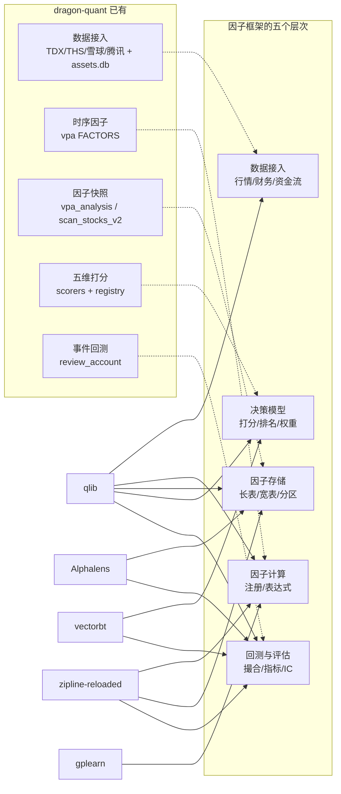
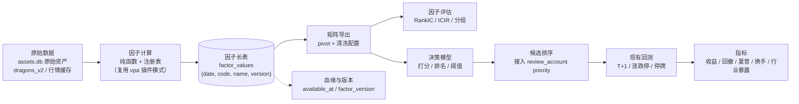

# 量化因子框架技术调研（issue #28）
> **当前状态（2026-10-25 整仓结构重构 M0–M12）**：本文中的 `dragon_quant/cli_commands.py` / `dragon_quant/review_account/prep.py` 等实现位置已迁移：命令入口在 `dragon_quant/commands/<command>.py`（经 `commands.dispatch`），prep 在 `dragon_quant/review_account/prep/` 包（service/collectors/compute/rebuild），auction 编排在 `dragon_quant/auction/service.py`，assets CLI 装配在 `dragon_quant/assets_sync/cli_service.py`。历史设计正文保留原样；当前结构与命令以 `AGENTS.md`「架构总览」为准。

- 日期：2026-10-22
- 分支：`feat/factor-framework`
- 范围：为 dragon-quant 评估「因子入库 / 启用关闭 / 存储查询 / 决策模型 / 回测评估」的落地路径，判断是否接入开源框架
- 结论摘要：**不建议接入任何候选框架作为运行时依赖**。推荐「混合路线」——借鉴 qlib 的因子注册与表达式思想、Alphalens 的评估口径，自研轻量因子层（纯 Python + SQLite），复用现有 `review_account` 撮合与评估链路。核心运行时零新增依赖；`polars` / `TA-Lib` 仅列为未来可选。issue #28 中的「财务因子」需新增数据链路（AKShare/Tushare/BaoStock，见 §2.5），首期不纳入，单独立项决策。

---

## 1. 调研方法与证据来源

| 证据类型 | 具体做法 | 可信度 |
|---|---|---|
| 仓库元数据 | GitHub API `repos/{owner}/{repo}` 读取 star、`pushed_at`、license、archived，抓取日 2026-10-22 | 高（官方 API） |
| 发行版元数据 | PyPI JSON API 读取 `version` / `requires_python` / `requires_dist`，抓取日 2026-10-22 | 高（官方 API） |
| 官方文档 | qlib Data 文档、Alphalens 文档、zipline-reloaded 入门文档 | 高（一手文档） |
| 本项目源码 | `vpa/`、`scorers/registry.py`、`storage/assets_db.py`、`storage/db.py`、`review_account/{market,evaluation,simulator}.py`、`cache/data_cache.py`、`models/types.py`、`pyproject.toml` | 高（直接读取） |
| 运行环境 | 本机 Python 3.14.8，项目 `requires-python >=3.10` | 高（实测） |

**边界声明**：本次**未安装、未实际运行**任何候选框架（含 qlib、vectorbt、zipline、alphalens、zer0factor）。原因是依赖体积大，且 qlib 的发行版不支持 Python 3.13/3.14，安装本身即会污染项目环境。因此候选库的「能力」判断来自官方文档、源码与依赖清单，「能否接入本项目」属于基于事实的工程推断，已在各节标注推断依据。

---

## 2. 项目现状与需求再定义

### 2.1 场景画像（与通用多因子平台的关键差异）

| 维度 | dragon-quant 现状 | 与通用多因子平台的差异 |
|---|---|---|
| 股票池 | 当日涨停股 + 板块/龙头/复盘候选，每日数十只（随涨停家数波动） | 不是全市场 4000+ 只横截面 |
| 持仓周期 | 约 5 个交易日，T+1 | 短周期、换手高；IC 的「下期收益」定义需明确为 1/3/5 日 |
| 撮合语义 | 5 分钟事件流、T+1 不可卖当日仓、封死涨跌停不假定成交、停牌冻结、日K兜底 | 通用框架默认美股连续竞价，需大量定制 |
| 数据源 | 通达信 / 同花顺 / 雪球 / 腾讯，免费；**无财务报表** | 无财务、无历史估值、无历史资金流 |
| 运行时约束 | 仅标准库 + `playwright` + `tmdx`（本任务已授权放宽，但放宽本身是决策项） | 框架通常要求 numpy/pandas 全栈 |
| 已有存储 | `dragons_v2` / `scan_stocks_v2` / `assets.db` 两段式（原始资产 + 快照） | 已有「按 (date, key) UPSERT + version」模式 |

### 2.2 已有能力盘点（避免重复建设）

| 已有能力 | 位置 | 与因子框架的关系 |
|---|---|---|
| 时序因子注册表 | `vpa/factors/__init__.py` 的 `FACTORS` 列表；签名 `factor(klines, ctx) -> FactorResult`；引擎逐因子异常隔离 | 已是「插件式因子」雏形，但只做**单票时序**，不做截面、不产因子矩阵 |
| 因子结果持久化 | `vpa_analysis(trade_date, code, factors_json, version)`，`UNIQUE(trade_date, code)` | 已是长表 + JSON 明细 + 版本字段 |
| 权重/门槛集中调参 | `scorers/registry.py`（五维权重、`DIM_FLOORS`、各子因子阈值） | 已是「配置与算法分离」的样板 |
| 五维评分物化 | `scan_stocks_v2`（`dim_drive`/`dim_leadership`/`dim_anti_drop`/`dim_liquidity`/`dim_absorption`/`composite_score`/`reject_reason`） | 事实上已是「按 (scan_id, code) 的宽表因子快照」，只是没有统一注册 |
| 原始资产两段式 | `assets.db`：`prep_assets` / `auction_assets` 原始，`prep_snapshots` / `auction_snapshots` 结果；`UNIQUE(trade_date, asset_type)` | 可直接作为因子计算输入；快照 = 资产纯函数的模式可复用 |
| 回测撮合 | `review_account/simulator.py` + `strategy.py` + `execution.py`，复用同一套买卖/成交/费用函数 | **不应再引入第二套回测引擎** |
| 评估指标 | `review_account/evaluation.py`：`total_return` / `max_drawdown` / `win_rate` / `turnover` / `profit_factor` / `walk_forward` / `plateau_scan` / `ablation` / `compare_strategies` | 已有收益、回撤、换手、稳健性框架；**缺 Sharpe、IC/RankIC、行业暴露** |
| 历史行情缓存 | `cache/data_cache.py` 按交易日目录持久化 provider 响应；`kline:day:` 等键 | 历史深度取决于「扫描/复盘当天是否请求过」，不是完整历史库 |

**关键结论**：项目已经具备因子框架所需的大部分基础设施（注册表、JSON 因子明细、版本字段、两段式资产、回测引擎），缺的是**统一因子契约、截面因子存储与评估**，不是缺一个平台。

### 2.3 issue #28 五项需求在本项目中的真实含义

| issue 需求 | 现实可行性 | 说明 |
|---|---|---|
| 1. 因子入库：行情 / 财务 / 资金流 / 估值 / 动量 / 波动率 | **部分可行** | 行情/动量/波动率/流动性：可从 K 线计算；资金流：TDX `Quote.main_net_amount` 仅由 tdx 链路当日赋值（`providers/tdx.py`），`prep` 的 `fund_flow` 在 `review_account/prep.py` 中标记为 `same_day_only=True`，**历史不可回溯**；估值：`Quote`（`models/types.py`）只有当日 `pe` / `market_cap` / `float_market_cap` 快照，无历史序列；财务：**项目当前未接入任何财务数据源**（可选方案评估见 §2.5），首期建议不纳入 |
| 2. 因子启用/关闭、按股票池/行业/时间区间、版本切换 | **可行** | 注册表 + `enabled` + `scope` 过滤 + `factor_version` 即可；「按行业启用」需要历史行业归属，见 §2.4 |
| 3. 按 ticker+date+factor_name 查询、矩阵导出、缺失/极端/对齐配置 | **可行** | SQLite 长表 + 索引；矩阵导出为派生视图；清洗策略必须显式记录在矩阵元数据中 |
| 4. 多因子打分/排名/阈值、权重配置、预留 ML 接口 | **可行但有边界** | 与现有五维评分**功能重叠**；必须先明确「因子层是研究/增强层，还是替换五维」，否则双轨评分会互相污染 |
| 5. 基于因子信号持仓、收益/回撤/夏普/换手/行业暴露 | **大部分已具备** | 收益/回撤/换手已有；夏普需新增（约 10 行）；行业暴露需要历史行业归属快照；持仓生成应复用 `review_account`，不应新建引擎 |

### 2.4 需求方未明确、但直接影响设计的点

1. **样本选择偏差**：股票池本身就是「当日已涨停」的股票，任何因子的 IC 都是**条件 IC**（在涨停股内部），不能与全市场 IC 直接比较，也不能据此推断「因子能选出涨停股」。
2. **历史深度不足**：行情缓存按交易日、按实际请求的标的持久化（`cache/data_cache.py::set_for_trade_date` / `load_for_trade_date`）。若某日未扫描某只股票，该股当日 K 线不存在本地。「因子回填」需要重新触网，受同花顺 403 频控与雪球 Cookie 限制。
3. **同一交易日的信息时点**：收盘后计算的因子（如当日封板质量、当日资金流）不能用于当日盘中决策。因子值必须带 `as_of` / `available_at`，否则回测会把未来信息泄漏进 T 日。
4. **行业归属没有历史快照**：板块成分股来自 TDX/THS 实时接口，`sector:components:*` 缓存 TTL 到当日 23:59:59（`cache/data_cache.py::_today_end`）。要做「行业中性化 / 行业暴露」，必须开始按交易日快照行业归属；否则只能用当前行业回填历史，存在前视偏差。
5. **双轨评分风险**：`scorers/aggregator` 已有门槛+加权与一票否决，若新因子模型另起一套排名，会出现「五维说买、因子说卖」的两套结论。必须先定单一决策源。
6. **小样本统计不可靠**：每日数十只、约 250 个交易日，单日 RankIC 的标准误很大；分层回测若分 5 层，每组仅数只，分层收益几乎是噪声。需要池化面板与更粗的分组。
7. **资金流/估值因子不可回填**：如果一开始就建「历史因子库」，这两类因子会出现大量「上线日之前为空」，必须在元数据里标注 `valid_from`，否则评估结果会被幸存样本污染。

### 2.5 财务数据源补充评估（回应 issue #28 第一项）

结论先行：财务因子并非「无源」，而是「需要新增一条数据链路与依赖」；三个候选都不是零成本，首期建议不纳入，待用户决策。

| 数据源 | 版本 / 许可 | Python / 依赖 | 财务覆盖 | 成本与限制 | 建议 |
|---|---|---|---|---|---|
| **AKShare** | 1.19.1 / MIT | `>=3.11`；pandas、requests、lxml、beautifulsoup4、curl_cffi、openpyxl 等 | `stock_financial_abstract`（关键指标）、`stock_financial_report_sina`（三大报表）等，抓新浪/同花顺公开页（来源：<https://github.com/akfamily/akshare>、<https://pypi.org/pypi/akshare/json>） | 免费、无 token；依赖网页结构，接口随上游变动、无 SLA；仓库 23,037 stars | 若要做财务因子，**优先评估**（MIT、生态活跃） |
| **Tushare Pro** | SDK 1.4.29 / BSD | 未声明 `requires_python`；pandas、requests、lxml、simplejson、bs4、websocket-client | 提供财务接口，但需 token 与积分权限 | 注册 100 分，接口按 120/320/520/620 分级，积分一年有效（来源：<https://tushare.pro/document/1?doc_id=13>）；token 是唯一凭证（来源：<https://tushare.pro/document/1?doc_id=39>）；数据权限非开源 | 次选（token/积分与数据授权约束） |
| **BaoStock** | 0.9.4 / BSD | 未声明 `requires_python`；仅 pandas | 提供部分财务与行情数据，需登录 | 免费、字段有限、更新频率低（来源：<https://pypi.org/pypi/baostock/json>） | 备选，优先级最低 |

三者都会引入 pandas（AKShare 还引入 lxml/curl_cffi），与本项目「零 pandas」现状冲突；财务因子的 PIT 对齐（按公告日）也比价格因子复杂。**建议**：把财务因子拆为独立里程碑，先由用户决策数据源与是否接受新增依赖；本期因子框架只预留 `source`/`available_at` 字段。

---

## 3. 开源候选对比

### 3.1 总表（元数据抓取日 2026-10-22）

| 候选 | Stars | 最近提交 | 许可证 | Python / 关键依赖 | 因子模型 | 回测能力 | 接入判断 |
|---|---:|---|---|---|---|---|---|
| **microsoft/qlib** | 49,589 | 2026-10-08（默认分支；`pushed_at` 10-22） | MIT | GitHub Release v0.9.8（2026-10-08），PyPI `0.9.7`（2025-08-15）：`>=3.8`，wheel 仅 cp38–cp312；依赖 mlflow/redis/pymongo/lightgbm/gym/cvxpy/jupyter/pyarrow 等 20+ 包 | 自建数据湖（`features/<instrument>/<field>.day.bin` + `calendars/` + `instruments/`）+ 表达式引擎 | 完整组合回测；原生支持 A 股涨跌停阈值与停牌，**无 T+1** | **不可接入**：数据模型与依赖体量不匹配，且无 Python 3.13/3.14 wheel |
| **stefan-jansen/alphalens-reloaded** | 673 | 2026-10-17 | Apache-2.0 | `0.5.0`：`>=3.11,<3.16`；numpy/pandas/scipy/matplotlib/seaborn/statsmodels/IPython/empyrical-reloaded | 输入 `MultiIndex(date, asset)` 的因子 Series + 宽价格表，输出 `factor_data`（因子值 + 前向收益 + 分层 + 行业分组） | **无独立回测引擎**；仅有实验性的 `create_pyfolio_input` 组合模拟 | **不接入运行时**；可作为一次性离线评估工具（dev extra），口径值得借鉴 |
| **polakowo/vectorbt** | 9,488 | 2026-10-19 | **Apache-2.0 + Commons Clause**（不得售卖） | `1.2.0`：`>=3.11,<3.15`；numpy>=2.4.6、pandas>=3.0.3、numba>=0.66、scipy、plotly 等 | 无因子注册概念；以数组/矩阵为中心做批量参数扫描 | 向量化回测强，但无 T+1 / 涨跌停语义 | **不接入**：依赖栈过新过重，撮合语义需自行编码；许可限制商业化 |
| **stefan-jansen/zipline-reloaded** | 1,968 | 2026-10-17（`pushed_at` 10-19） | Apache-2.0 | `3.2.0`：`>=3.11,<3.15`；pandas<3、SQLAlchemy>2、exchange_calendars>=4.2、bcolz-zipline/h5py/tables 等 | Pipeline（列式因子计算）+ `ingest` 数据 bundle | 事件驱动回测，含滑点/佣金/可自定义零成交；**无内建 T+1/涨跌停**；官方声明进入维护模式 | **不接入**：需要重建数据 bundle，撮合语义与现有引擎重复且保真度更低 |
| **trevorstephens/gplearn** | 1,893 | 2026-08-14 | BSD-3-Clause | `0.4.3`：`>=3.11`；scikit-learn>=1.8、joblib | 遗传编程符号回归（生成因子表达式），无存储/注册 | 无 | **不接入**：小样本下过拟合风险极高，且引入 sklearn 全栈 |
| **zer0quant/zer0factor** | 90 | 2026-07-08 | MIT（README 声明；无 release、未上 PyPI） | `>=3.11`；duckdb、pyarrow、pandas、numpy、alphalens-reloaded、pyfolio-reloaded、plotly、jupyter、alphapurify；另需同作者 `zer0share` 提供本地数据 | `FactorSpec + FactorFrame + compute()`，输出 `trade_date, ts_code, value`；Parquet 分区 + DuckDB 注册表；`config/factors.toml` 管理因子 | 依赖 Alphalens/Pyfolio 做 IC/分组/换手/组合指标；**无 T+1/涨跌停撮合** | **可借鉴，不直接接入**：接口契约与存储思路高度契合，但强绑定 `zer0share` 数据层、早期阶段、缺 ST/停牌/精确涨停字段 |
| 参考：qusong0627/QuantMind | 1,774 | 2026-10-22 | 未核实 | 基于 qlib + RD-Agent 的 Docker 平台 | 沿用 qlib | 沿用 qlib | 不接入：继承 qlib 的数据湖与 Python 版本约束，且为重型平台 |
| 参考：quantopian/alphalens（原版） | 4,476 | 2020-04-27（默认分支；`pushed_at` 2024-02-12 仅分支推送） | Apache-2.0 | 未归档但实际停更 | 同上 | 无 | 已被 alphalens-reloaded 取代，不再考虑 |
| 参考：quantstats | — | PyPI 0.0.86 | Apache-2.0 | `>=3.10`；pandas>=2、numpy、scipy、matplotlib、seaborn、yfinance | 无（纯指标/报告） | 无 | 仅指标可借鉴；为 ~10 个指标引入 pandas 栈不划算 |
| 参考：bt | — | PyPI 1.4.1 | MIT | `>=3.9`；ffn/pyprind/tqdm | 按权重再平衡组合 | 组合级回测，无事件撮合 | 不适用（本项目需要 5 分钟事件与涨跌停） |
| 参考：pandas-ta | — | PyPI 0.4.71b0 | 未声明（PyPI 无 license 字段/classifier） | `>=3.12`；numba==0.61.2、numpy>=2.2.6、pandas>=2.3.2 | 技术指标库（时序） | 无 | 不接入；指标需求可由自研因子覆盖 |
| 参考：backtrader | — | PyPI 1.9.78.123（2023-04-19 上传） | GPL-3.0 | 未声明 `requires_python` | 无因子层 | 事件驱动 | 不接入（GPL 传染 + 无 A 股语义 + 长期停更） |
| 参考：polars | — | PyPI 2.0.0 | MIT | `>=3.10`；唯一运行时依赖 `polars-runtime-32` | 无（数据框） | 无 | **唯一值得保留的可选项**：若未来做矩阵运算/导出加速 |

> star 与 `pushed_at` 来自 GitHub API；版本/依赖来自 PyPI JSON。A 股专用项目的补充对比见 §3.3，未验证项见 §6。
>
> **运行环境说明**：本机 Python 3.14.8。qlib 的 wheel 只到 cp312，是硬阻断；vectorbt（`>=3.11,<3.15`）与 zipline-reloaded（`>=3.11,<3.15`）的版本范围**覆盖 3.14**，环境不是二者的阻断点，它们被否决的原因是数据模型/撮合语义/依赖体量。

### 3.2 逐候选判断

#### 3.2.1 qlib：能力最强，场景最不匹配

- **数据模型**：qlib 要求把行情重建为 `calendars/day.txt` + `instruments/*.txt` + 每标的每个字段一个 `.bin` 文件，派生字段由表达式引擎计算并缓存（来源：<https://qlib.readthedocs.io/en/latest/component/data.html>）。这与本项目「候选池 + 按日 JSON 缓存 + SQLite」的存储模型是两套体系，接入等于重建数据层。
- **依赖体量**：`pyqlib 0.9.7` 的 `requires_dist` 包含 mlflow、redis、pymongo、lightgbm、gym、cvxpy、jupyter、nbconvert、pyarrow 等（来源：<https://pypi.org/pypi/pyqlib/json>）。对一个 CLI 工具而言不可接受。
- **环境阻断**：README 写明支持 Python 3.8–3.12；PyPI 只发布 wheel（cp38–cp312，无 sdist），在 Python 3.13/3.14 上 `pip install pyqlib` 会直接报 no matching distribution；唯一路径是从 git 源码编译 Cython 扩展，风险高（来源：<https://pypi.org/pypi/pyqlib/json>、<https://github.com/microsoft/qlib>）。
- **对 A 股的支持要分开看（避免误判）**：qlib 的 `Exchange` 原生支持 `limit_threshold=0.095`（涨停不可买、跌停不可卖）、`$close` 为 NaN 视为停牌、`trade_unit=100`、买卖费用等（来源：<https://raw.githubusercontent.com/microsoft/qlib/main/qlib/backtest/exchange.py>）；但 `Position` 不记录买入日，**没有内建 T+1**（来源：<https://raw.githubusercontent.com/microsoft/qlib/main/qlib/backtest/position.py>），且涨停判定是日频收盘口径，无法表达本项目已有的「盘中开板、封单强度、一字板买不进」分钟级语义。因此「qlib 支持 A 股」只在日频组合层面成立，不能替代现有事件引擎。
- **数据可得性**：qlib README 明确官方数据集因数据安全政策暂时停用，建议改用社区数据源；接入方需自行准备全市场数据并 `dump_bin`。
- **可借鉴**：表达式/字段依赖声明（`Ref`、`Mean`、`Rank` 等算子 + 缓存）与 Alpha158 的因子清单组织方式，可用于自研注册表的 `depends_on` 字段；但不需要引入代码。

#### 3.2.2 Alphalens-reloaded：评估口径的事实标准，但不是框架

- **输入模型**：因子是 `MultiIndex(date, asset)` 的 Series，价格是 `date × asset` 的宽表；`get_clean_factor_and_forward_returns` 输出 `factor_data`（因子值、各周期前向收益、分位、可选行业分组），默认 `periods=(1,5,10)`、`quantiles=5`、`max_loss=0.35`（来源：<https://github.com/stefan-jansen/alphalens-reloaded>、<https://raw.githubusercontent.com/stefan-jansen/alphalens-reloaded/main/src/alphalens/utils.py>）。
- **输出**：IC 明确为「因子与前向收益的 Spearman 秩相关」；提供分位收益、换手、因子收益、alpha/beta、tear sheet；**没有独立回测引擎**，组合模拟 API 仍标 experimental。
- **维护状态**：alphalens-reloaded README 声明仅做 bug/安全/兼容性维护，新开发转向 `ml4t/diagnostic`；原版 alphalens 默认分支自 2020-04-27 起无提交。作为长期依赖不合适。
- **必须警惕**：`filter_zscore`（默认 20）按**全样本**前向收益的均值/标准差过滤异常值，官方 docstring 明确警告会引入 lookahead bias（来源：<https://raw.githubusercontent.com/stefan-jansen/alphalens-reloaded/main/src/alphalens/utils.py>）。若借鉴其流程，这一参数必须关闭或改为滚动窗口。
- **契合点**：它的评估口径（RankIC、分位收益、换手）正是 issue #28 第 5 项缺的部分，可以「照口径自研」，不必引入 pandas 栈。
- **不契合点**：它假设全市场宽面板；本项目的候选池是稀疏的（某只股票只在成为候选的日期出现），直接喂给它会产生大量缺失行；而且每日 20–60 只的横截面，IC 噪声极大；它不建模涨停/停牌/T+1，前向收益会偏乐观。

#### 3.2.3 vectorbt：适合参数扫描，不适合本项目撮合

- 向量化、numba 加速、批量参数网格是它的强项；但 A 股 T+1、封板不成交、5 分钟事件序列都需要自行编码为掩码，表达能力不如现有 `review_account` 事件引擎。
- 依赖要求 `numpy>=2.4.6`、`pandas>=3.0.3`（来源：<https://pypi.org/pypi/vectorbt/json>），属于非常新的栈；项目当前完全不依赖 pandas，引入即背上整套科学计算栈。
- 许可证为 **Apache-2.0 with Commons Clause**，明确「不得售卖本软件」；内部研究可用，但会限制未来商业化分发（来源：<https://github.com/polakowo/vectorbt/blob/master/LICENSE.md>）。

#### 3.2.4 zipline-reloaded：另一套回测引擎，收益为负

- 必须先 `zipline ingest -b <bundle>` 建数据包（来源：<https://zipline.ml4trading.io/>），再以 Pipeline 计算因子、事件驱动回测。
- 撮合可扩展：自定义 `SlippageModel` 可以返回 0 成交量或抛出 `LiquidityExceeded`，**理论上可用来模拟涨停买不进/跌停卖不出**；但 T+1 仍需策略层自行拦截，`Position` 不记买入日（来源：<https://raw.githubusercontent.com/stefan-jansen/zipline-reloaded/main/src/zipline/finance/slippage.py>、<https://raw.githubusercontent.com/stefan-jansen/zipline-reloaded/main/src/zipline/finance/position.py>）。
- 数据与依赖成本：bcolz/h5py/tables/sqlalchemy 等编译型依赖；`bcolz-zipline` 最新版只有 cp39–cp312 wheel，Python 3.13/3.14 上可能回退源码编译（来源：<https://pypi.org/pypi/bcolz-zipline/json>）。
- 维护状态：README 明确「仅做 bug、安全与兼容性修复」，新功能转向 ML4T Backtest（来源：<https://github.com/stefan-jansen/zipline-reloaded>）。
- 结论：接入等于「用一套不熟悉 A 股规则、且已进入维护模式的引擎，替换一套已经验证过的事件引擎」，负收益。

#### 3.2.5 gplearn：因子挖掘工具，不是因子框架

- 遗传编程符号回归，sklearn 风格 API，依赖 `scikit-learn>=1.8`（来源：<https://pypi.org/pypi/gplearn/json>）。
- 在本项目样本量（每日几十只 × 数百日）下，符号回归极易拟合噪声；若要使用，必须配合严格的 walk-forward 与试验次数惩罚（项目已有 `trial_count` 思路）。子代理建议：把 `fitness` 换成 RankIC / Top-decile spread，`function_set` 限制在少量算子，`parsimony_coefficient` 加大，并在**独立 venv** 中离线运行，产出表达式后再用纯 Python 实现进主流程。
- 结论：不纳入运行时框架；可作为离线研究工具试用，但预期收益有限，且必须与生产链路隔离。

#### 3.2.6 zer0factor：最接近本项目需求的 A 股同类项目，但仍不宜直接接入

- **定位**：面向 A 股的本地因子研究工作台，流程是「研报/想法 → `FactorSpec` → Python `compute()` → Parquet 因子值」，用 DuckDB 做元数据注册，`config/factors.toml` 管理待评估因子，评估复用 Alphalens/Pyfolio（来源：<https://github.com/zer0quant/zer0factor>）。默认分支最后提交为 2026-07-08，无 release、未上 PyPI。
- **与本项目契合点**：`FactorSpec + FactorFrame + compute()` 的契约、`trade_date, ts_code, value` 的长表输出、注册表与评估分离，正是本项目需要的最小骨架；其「早期项目、研究用途」的自我定位也说明它没有生产级承诺。
- **不契合点**：强绑定同作者的 `zer0share` 本地数据层（`pyproject.toml` 直接依赖 `zer0share`），而本项目的数据来自 TDX/THS/雪球/腾讯与 `assets.db`；依赖 pandas/duckdb/pyarrow/alphalens/pyfolio/jupyter；README 明确 `FactorFrame` 尚未暴露 ST、停牌、上市天数、精确涨停等字段，因此**无法表达本项目的核心撮合约束**；Python>=3.11。
- **结论**：作为「设计参照物」价值很高（尤其是 FactorSpec 契约与注册表形态），但直接接入会把数据层与依赖栈一起搬进来，不如按其契约自研。

#### 3.2.7 A 股平台类项目

- **QuantMind**（1,774 stars，2026-10-22 更新，<https://github.com/qusong0627/QuantMind>）：基于微软 qlib + RD-Agent 的 Docker 化多市场平台，功能范围远超本项目，且继承 qlib 的数据湖与 Python 版本约束。不适用。
- **BitSoulStockSkill**（578 stars，2026-10-15 更新，<https://github.com/BitSoulTech/BitSoulStockSkill>）：以 Agent Skill 形式提供 A 股数据、因子与回测，属于「工具调用封装」而非可嵌入的库；未核对其因子存储与撮合语义，不纳入候选。
- 其余个人研究型项目规模小、定位为研究工作流，未发现可复用的因子注册 + 存储 + 评估抽象，不逐一展开。

#### 3.2.8 其他候选的取舍

- **quantstats**（7,734 stars，0.0.86 / 2026-09-27，Apache-2.0）：指标与 tear sheet 全面，但硬依赖 pandas + yfinance；本项目只需要 Sharpe/回撤/换手等少量指标，自研成本更低。
- **bt**（3,000 stars，1.4.1 / 2026-10-10，MIT）：组合权重再平衡回测，有 cp314 wheel；无法表达「信号 → 下一可执行 5 分钟 K 成交 / 涨停买不进」，不适用。
- **backtrader**（23,542 stars，PyPI 1.9.78.123 / 2023-04-19，GPL-3.0）：事件驱动，但停更近两年，GPL 与 MIT 项目冲突，不接入。
- **pandas-ta**：原 `twopirllc/pandas-ta` 仓库已删除（GitHub 404），PyPI 仅剩 `0.4.71b0` 且要求 Python>=3.12；活跃继任者为 `xgboosted/pandas-ta-classic`（458 stars，MIT，0.8.32 / 2026-09-14，Python 3.10–3.14）。技术指标并非本项目瓶颈（`vpa` 已自研 4 个），不接入。
- **TA-Lib**（12,326 stars，0.8.2 / 2026-10-12，BSD-2-Clause）：0.8.2 已提供含 cp314/macOS arm64 的 wheel，不再需要本地编译 C 库，是本清单中接入摩擦最小的指标库；但仍只解决指标计算，不解决因子存储/评估/撮合。列为「未来可选」。
- **polars**：不是因子框架，但作为**可选**矩阵运算/导出依赖最轻（单一 runtime 依赖，支持 Python>=3.10）。用 `pl.col` 表达式定义因子、`pivot` 出矩阵是一条可行的自建路径，性能好、API 现代；但当前数据规模（数百日 × 数十标的 × 数十因子，百万级 cell）纯 Python 足够，故列为「未来可选」，不作为首期依赖；若未来扩到全市场，polars 表达式自建应优先于 qlib。
- **factorflow / finances 类**：PyPI 上不存在 `factorflow` 与 `finances` 包（均返回 404，抓取日 2026-10-22）。GitHub 上可查到的 `JupiterFund/factorflow` 是 Java 实现的因子分析平台（1 star，最近更新 2019-11 或 2020-10，不同抓取口径有差异），不是可接入的 Python 框架；其余同名仓库为因子图/硬件分析等无关项目。**检索口径**：PyPI 精确包名查询 + GitHub `factorflow/finances in:name` + `A股 因子 in:description language:python stars:>50`（抓取日 2026-10-22）；在该口径下未发现被遗漏的活跃 Python 因子框架。RQFactor 作为闭源平台组件单列于 §3.3。

### 3.3 A 股专用框架补充对比

| 项目 | Stars | 最近提交 | 许可证 | 性质 | 接入判断 |
|---|---:|---|---|---|---|
| ricequant/rqalpha | 6,835 | 2026-10-22 | 自定义许可（非商业按 Apache-2.0；**法人/组织任何用途及个人商用均需米筐授权**） | A 股事件驱动回测/交易框架；源码含 `price_limits.py`、持仓 `t_plus` 可卖量 | **不接入**；但其 A 股约束建模是**最好的对照实现**，可用于检查本项目撮合漏项 |
| cn-vhql/FactorHub | 430 | 2026-07-12 | AGPL-3.0（双许可） | A 股因子全生命周期平台：FastAPI + SQLite + TA-Lib + vectorbt 0.25+ + DEAP + akshare | **不接入**（AGPL 传染 + 依赖栈过重）；可借鉴其「因子全生命周期」的模块划分 |
| RiceQuant RQFactor（`rqfactor`） | —（闭源平台组件） | PyPI 1.5.0 | 未声明（依赖 `rqdatac` 商业数据终端） | 因子表达式 DAG（`.expr` / `.dependencies`），`execute_factor()` 输出 `date × code` 宽表 | **不接入**：无 `rqdatac` 授权即不可用；但表达式/依赖组织方式可借鉴 |
| PandaAI-Tech/panda_factor | 2,822 | 2026-06-18 | AGPL-3.0 | 因子库，`Factor.calculate()` 返回 `Series`，索引 `['symbol','date']`，依赖 Tushare | 不接入（AGPL + 数据源不匹配） |
| FinHackCN/finhack | 1,248 | 2026-10-22 | GPL-3.0（商业双许可） | 全流程框架，README 声明支持 A 股涨跌停 + T+1；当前处于重构期 | 不接入（GPL + 可运行性未验证） |
| zvtvz/zvt | 4,315 | 2026-07-01 | MIT | 模块化选股/数据框架 | 不接入（偏数据/选股，不含本项目所需的事件撮合） |
| tkfy920/qstock | 1,949 | 2025-03-16 | MIT | 数据获取 + 选股 + 简单回测 | 不活跃，不接入 |
| mpquant/Ashare | 3,912 | 2025-12-24 | **无许可证** | 行情接口封装 | 不是因子框架；无许可证不可复用 |
| bbfamily/abu | 18,991 | 2026-10-16 | GPL-3.0 | 策略/机器学习框架 | 非本次目标，GPL 阻碍 |
| QUANTAXIS/QUANTAXIS | 11,301 | 2026-09-18 | MIT | 数据/回测/交易一体化 | 过重，不接入 |

**结论**：A 股专用项目里，`rqalpha` 的 T+1/涨跌停建模最有参考价值，`FactorHub` 的因子全生命周期分层最接近 issue #28 的完整诉求；但前者是非商业许可的完整运行时，后者是 AGPL + FastAPI/vectorbt/akshare 的重型平台，均不适合嵌入一个 MIT 的 CLI 工具。其余项目要么许可证不兼容，要么只是数据/选股封装。

### 3.4 能力覆盖对比（与本项目已有能力的重叠）

**读图结论**：没有任何一个候选只补「缺口」而不重复已有能力。qlib 覆盖最全，但要求替换数据层与决策层；Alphalens 只补评估口径；vectorbt/zipline 重复回测；gplearn 只补因子挖掘。项目真正缺的是「统一因子契约 + 截面存储 + IC 评估」，这三块的代码量远小于接入成本。

---

## 4. 业界规范设计要点（自研时的参考坐标）

### 4.1 因子存储 schema：长表、宽表与分区

| 方案 | 结构 | 优点 | 缺点 | 适用 |
|---|---|---|---|---|
| **长表（tidy）** | `(trade_date, code, factor_name, factor_version, value)` | 稀疏友好、加因子零迁移、点查/范围查都简单、天然带版本 | 矩阵导出需 pivot；行数 = 日期 × 标的 × 因子 | **本项目首选**：候选池稀疏、因子数百、数据量小 |
| 宽表 | `(trade_date, code, f1, f2, ...)` | 矩阵读取快、截面运算直观 | 加/删因子要 DDL；不同频率因子难共存；版本管理弱 | 固定因子集、全市场面板 |
| 分区二进制 | 每标的每字段一个 `.bin`（qlib） | 全市场读取极快、表达式缓存 | 需要专用数据湖与工具链；增量更新复杂 | 全市场、ML 大规模训练 |

**事实标准参考**：qlib 采用「日历 + 标的列表 + 每标的每字段二进制 + 表达式缓存」的分区模型（来源：qlib Data 文档）；Alphalens 采用「长因子（`MultiIndex(date, asset)`）+ 宽价格表」作为分析输入（来源：Alphalens 文档）。DolphinDB 的公开 benchmark（5000 标的 × 10000 因子 × 21 天，HDD）显示：长表落盘 185 GB（压缩 2.6×），宽表 166 GB（压缩 1.1×）；长表冷查询 80 s、宽表 425 s；长表新增/更新/删除单因子约 1 s，宽表改一列约 534 s（来源：<http://docs.dolphindb.cn/zh/3.00.3/tutorials/best_practices_for_multi_factor.html>）。该结论在「>1000 因子」规模下才显著，本项目规模远低于此，但方向一致：**长表做权威源，宽表做派生视图**。

**推荐**：长表落 `assets.db`（与原始资产同库、物理隔离于 `dragon.db`），索引 `(trade_date, factor_name)` 与 `(code, trade_date)`；矩阵作为**派生视图**，不持久化，导出时写 CSV 并附清洗策略元数据。以每日 50 只、250 日、100 因子估算，约 125 万行/年，SQLite 完全可承受。

**必须先在阶段 2 定稿的数据模型缺口（迁移现有五维分时会遇到）**：五维分来自 `scan_stocks_v2`，按 `scan_id` 组织；同一交易日用不同 `--top` 重扫会产生多个 `scan_id`（`v2_YYYYMMDD_topN`）。若直接迁入主键为 `(trade_date, code, factor_name, version)` 的长表，会丢失 scan 血缘，甚至同日主键冲突。两种可选方案：(a) 主键加入 `source_scan_id`，保留多次扫描；(b) 定义同日唯一化规则（取最新一次或最大 topN），并把 `source_scan_id` 写入血缘字段。二者必须在阶段 2 明确，不能留到实现时临时决定。

### 4.2 因子注册、版本与开关

注册表至少应包含：

| 字段 | 作用 |
|---|---|
| `name` / `label` | 唯一标识与中文名 |
| `version` | 因子实现版本；算法变更必须递增，旧值保留 |
| `frequency` | `1d` / `5m` / `1m` / `event` |
| `source` | 依赖的资产类型（如 `dragons` / `fund_flow` / `kline:day`） |
| `depends_on` | 依赖的其他因子（表达式/组合因子） |
| `lookback` | 计算所需最小窗口，用于数据充分性检查 |
| `direction` | `higher_better` / `lower_better` / `neutral` |
| `params` | 参数默认值与可调范围 |
| `scope` | 适用股票池（候选池 / 真龙 / 全市场）与行业过滤 |
| `enabled` | 开关（默认关闭新增因子，避免静默改变结果） |
| `valid_from` / `deprecated_at` | 数据可得区间，防止把「上线前为空」当成真实缺失 |
| `owner` / `description` | 可维护性 |

**版本切换的正确语义**：切换 `factor_version` 是「为新模型选择一组确定的因子版本」，不是覆盖旧值；同一 `(trade_date, code, factor_name, version)` 唯一，重算写新版本或同版本覆盖。模型快照应记录 `factor_versions` 映射，保证可复现。

**版本号的生成方式**：业界没有「因子级版本管理」的统一规范（qlib/Alphalens/RQFactor 都只有表达式 + 缓存，没有显式因子版本）。可借鉴特征仓库的工程实践：因子定义不可变，修改即新版本；版本可用**内容哈希**生成 —— `sha256(compute_fn 源码 + params + 依赖字段 + 复权口径 + 股票池口径)[:12]`。这样能避免「改了实现但忘了改版本号」，也天然支持血缘追溯。

**开关的正确语义**：`enabled=false` 只影响**新计算与决策输入**，不删除历史值；评估时应能按 `version` + `enabled` 组合重放。

### 4.3 对齐、缺失值与极端值

| 问题 | 业界常见做法 | 本项目注意点 |
|---|---|---|
| 交易日历对齐 | 以交易所日历为基准，缺失日记为缺失而非 0 | 项目已有 `utils/trading.py` 与 `review_account/market.calendar`，应复用同一日历 |
| 股票池对齐 | 使用「当日可知」的成分/候选，不用今天的池子回填历史 | 候选池来自 `prep_snapshots` / `dragons_v2`，必须按 `candidate_trade_date` 对齐 |
| 停牌 | 价格/收益因子记缺失；状态因子可前值填充但标注 `stale_days` | 项目已有停牌判定（日K缺行或量额双零），因子层应复用 |
| 涨跌停 | 收益因子需区分「可成交收益」与「收盘价收益」；封板日收益不可交易 | 现有回测已区分，因子评估也要区分，否则 IC 被高估 |
| 缺失值 | 截面中位数填充、剔除、或时间序列前值填充（限 `max_stale`） | 小样本下中位数填充会压缩截面方差；建议默认「剔除 + 记录缺失率」，不默认填充 |
| 极端值 | MAD（`1.4826 × median(\|x-median\|)`）或分位 winsorize（1%/99%、5%/95%） | 每日 20–60 只时 1%/99% 等于只截 1 个点；建议 MAD 或 5%/95%，并记录截断比例 |
| 标准化 | 截面 zscore 或 rank 归一 | 小样本 zscore 受极端值影响大；**rank 更稳健**，且与现有「分位打分」一致 |
| 行业中性化 | 行业内去均值/回归残差 | 需要历史行业归属；每日每行业可能只有 1–3 只，中性化后几乎是噪声。**首期不建议做**，只做行业暴露统计 |

**三个易踩的坑（有据可查）**：

1. **清洗参数本身造成未来函数**：Alphalens 的 `filter_zscore`（默认 20）按全样本前向收益过滤异常值，官方 docstring 明确标为 lookahead bias；`max_loss=0.35` 则限制「最多丢弃 35% 的输入行」。自研时应把清洗策略限定在「当日及以前」的数据窗口。
2. **极端值方法在小样本上失效**：N=50 时 1%/99% 分位只截 1 个点；涨停池中大量一字板会使 MAD=0，`1.4826 × MAD = 0` 导致除零。应加退化分支（MAD=0 时跳过缩尾或改用分位）。
3. **标准化公式与并列值**：qlib 的 `CSRankNorm` 用 `(rank_pct − 0.5) × 3.46` 把均匀分布拉到近似单位方差（来源：<https://github.com/microsoft/qlib/blob/main/qlib/data/dataset/processor.py>），可直接借鉴；但当涨停池的收益/连板数并列比例 >50% 时，Spearman 会被压缩，应改用 Kendall tau-b 或直接比较分组。

### 4.4 评估指标的事实标准与小样本修正

| 指标 | 定义 | 本项目适用性 |
|---|---|---|
| IC | 因子值与下期收益的 Pearson 相关 | 对极端值敏感，不推荐作为主指标 |
| RankIC | 因子秩与下期收益秩的 Spearman 相关（Alphalens 的 IC 即此口径） | **主指标**；但单日 N=20–60，需报告置信区间 |
| ICIR | `mean(IC) / std(IC)` | 可用，但需至少 20–30 个交易日；应做 Newey-West 或分块 bootstrap |
| 分层收益 | 按因子分位分组，比较各组前向收益 | 5 层在 N=30 时每组 6 只，噪声极大；**建议 2–3 组**，或做「多头组 vs 池内均值」 |
| 多空收益 | Top 组减 Bottom 组 | 涨停池内做空不可实现；只能作为统计量，不是可交易收益 |
| 换手 | 相邻期分层成员变化比例 | 已有 `evaluation.metrics` 的 `turnover`（按成交额/初始资金），口径不同，需区分「组合换手」与「因子换手」 |
| 夏普 | 日/周收益均值 / 标准差（年化） | 需新增；短线策略建议用日频权益曲线，无风险利率可配置（默认 0 或 1.5%） |
| 最大回撤 | 权益曲线峰谷 | 已有 |
| 行业暴露 | 组合行业权重 vs 基准 | 需历史行业归属；首期只能出「当前行业分布」，不能做时序归因 |

**单日 IC 的统计功效**（Pearson 近似：检验统计量 `t = r·sqrt(n−2)/sqrt(1−r²)`，零假设下 `SE ≈ 1/sqrt(n−3)`；Spearman 应取 `t(n−2)` 临界值，阈值略高）：

| 当日候选数 N | 单日 IC 标准误 | 5% 双侧显著所需 \|IC\|（约） |
|---:|---:|---:|
| 30 | ≈0.19 | ≈0.36 |
| 50 | ≈0.15 | ≈0.28 |
| 100 | ≈0.10 | ≈0.20 |

也就是说：**在 50 只候选上，单日 RankIC=0.15 与噪声不可区分**。必须跨日聚合；若 250 个交易日的均值 IC=0.05、IC 标准差=0.15，iid 口径下 `t ≈ 5.3`，但 5 日重叠标签使有效独立样本接近 50，修正后约 `t ≈ 2.4`——因此必须以 HAC/block bootstrap 的结果为准，不能直接引用 5.3。

**重叠样本修正**：5 日持有期的标签在相邻日高度重叠，IC 序列自相关，朴素 t 检验会低估不确定性。应使用 Newey-West/HAC 标准误（`label_horizon=5`），或用按日期分块的 block bootstrap；同时报告「样本天数」而非只报 IC。

**标签时点必须与撮合一致**：本项目「T 日收盘决策 → T+1 开盘成交」的时点链，意味着因子评估应使用 **T+1 开盘 → T+6 开盘** 的可执行收益，而不是 T 日收盘 → T+5 收盘的纸面收益。否则 IC 会系统性偏乐观。

**Breadth 视角**：Grinold 的主动管理基本定律 `IR ≈ IC × sqrt(Breadth)` 中，Breadth 是独立下注次数（来源：Grinold & Kahn, *Active Portfolio Management*, 2nd ed., 2000, Ch. 6）；几十只高度相关的涨停股、5 日持有，有效 breadth 远小于「股票数 × 天数」。这解释了为什么小池子很难靠单因子获得高 IR，也说明 IC 高不代表策略收益高。

**小样本的四条硬规则**（建议写入后续方案）：

1. **池化评估**：不要只看「每日 IC 的均值」，要把 `(date, code)` 面板池化后计算，或对每日 RankIC 做 block bootstrap，报告 95% 区间与样本天数。
2. **限制试验次数**：项目已有 `trial_count` 与「试验次数 >20 结论降级」的先例，因子筛选必须沿用；否则 50 个因子中总有几个「显著」。
3. **必须样本外**：因子选择、方向、阈值都只能在训练/验证段确定；测试段只评估一次。现有 `compare_strategies` 的 60/20/20 划分可复用。
4. **重叠标签必须修正推断**：5 日标签在相邻日重叠，统计显著性用 HAC（`label_horizon=5`）或 block bootstrap；同时报告可执行收益口径与样本天数，禁止只报一个 IC 数字。

### 4.5 参考流水线（与本项目组件的映射）

图中实线是建议路径；虚线强调「血缘」必须随因子值一起存储，否则无法做点时（PIT）回测。

### 4.6 因子配置项清单（供方案阶段直接引用）

| 配置域 | 键 | 取值示例 | 语义 |
|---|---|---|---|
| 对齐 | `calendar` | `trade` / `union` | 以交易日历为基准，或取并集 |
| 对齐 | `universe` | `candidate` / `dragon` / `seen` | 当日可知的股票池；`seen` 表示历史上出现过的标的 |
| 对齐 | `as_of` | `close` / `next_open` / 指定时点 | 因子值可用于决策的时点 |
| 缺失 | `missing` | `drop` / `nan` / `median` / `ffill` | 默认 `nan` + 缺失率报告，不静默填充 |
| 缺失 | `max_stale` | `0` / `5`（交易日） | 仅 `ffill` 时生效，防止跨越停牌长期填充 |
| 极端值 | `winsorize` | `none` / `mad` / `quantile` | 默认 `mad`（`1.4826 × MAD`），分位法需显式给上下限 |
| 极端值 | `limits` | `[0.05, 0.95]` | 分位截断边界 |
| 标准化 | `normalize` | `none` / `rank` / `zscore` | 默认 `rank`（小样本更稳健） |
| 启用范围 | `pools` | `["candidate"]` | 按股票池启用 |
| 启用范围 | `industries` | `["半导体"]` | 按行业启用；需要历史行业归属 |
| 启用范围 | `date_range` | `["20260101", "20261231"]` | 只影响计算与评估窗口，不改变因子定义 |
| 版本 | `factor_version` | `"1.0.0"` | 写入每条因子值；模型快照记录映射 |
| 开关 | `enabled` | `true` / `false` | 只影响新计算与决策输入，不删历史 |

> 「按时间区间选择性启用」应实现为**计算/评估窗口过滤**，而不是修改因子定义；否则同一因子在不同区间含义不同，无法比较。

---

## 5. 结论与建议

### 5.1 三条路线对比

| 路线 | 做法 | 成本 | 风险 | 结论 |
|---|---|---|---|---|
| A. 接入 qlib | 重建 qlib 数据目录，因子/模型/回测全部迁移 | 高（数周–数月）+ 20+ 依赖 + Python 版本受限 | 数据层重写、撮合语义丢失、运行环境不兼容 | **否决** |
| B. Alphalens + vectorbt 组合 | Alphalens 做因子评估，vectorbt 做参数扫描，回测仍用现有引擎 | 中（引入 pandas 全栈 + 两套 API） | 稀疏候选池与宽面板不匹配；依赖栈新；许可限制 | **否决**（可作为离线研究工具，不进仓库依赖） |
| C. 混合自研 | 借鉴 qlib 注册表/表达式思想 + Alphalens 评估口径，自研轻量因子层，复用现有回测 | 低–中（纯 Python + SQLite，估算约 1–2k 行） | 需要自己保证统计正确性；因子层与五维的边界要设计好 | **推荐** |

### 5.2 推荐方案：轻量自研 + 设计借鉴

**核心判断**：本项目的因子规模与数据规模都很小（每日几十只、因子数十个、历史数百日），通用框架的性能优势用不上，而它们在数据模型、撮合语义、依赖栈上的假设全部与项目冲突。自研的成本远低于适配成本。可直接借鉴的四份设计：qlib 的表达式/依赖字段与 Alpha158 因子清单、alphalens-reloaded 的评估口径、zer0factor 的 `FactorSpec + FactorFrame + compute()` 契约、rqalpha 的 T+1/涨跌停约束建模（用于对照检查现有引擎）。

建议的模块边界（**仅为调研结论，不是实现方案**）：

- `dragon_quant/factors/`：注册表（元数据 + 版本 + 开关）、因子纯函数、存储读写、矩阵导出、评估。
- 存储落在 `assets.db`：`factor_values`（长表）+ `factor_meta`（注册表快照）+ 可选的 `factor_model_snapshots`（模型权重与因子版本映射）；不写 `dragon.db`，避免与扫描/龙头表耦合。
- 输入只读：`prep_assets` / `auction_assets` / `dragons_v2` / `scan_stocks_v2` / 行情缓存；不新增数据抓取链路。
- 决策接入点：因子模型的输出应进入 `review_account/priority.rank_key` 的排序链路或候选过滤，**不新建回测引擎**；五维评分保持唯一基线，因子层先以「诊断/增强」方式并行，待回测证明增量后再讨论替换。
- ML 接口：只定义 `FactorModel` 协议（`fit` / `predict` / `save` / `load`），首期不实现、不引入 sklearn；矩阵导出为 CSV/JSON，外部 Notebook 可消费。

### 5.3 依赖建议

- **首期新增运行时依赖：0**。纯标准库 + SQLite 足以支撑当前数据量。
- **不建议引入**：qlib、vectorbt、zipline-reloaded、gplearn、pandas-ta、backtrader、quantstats。
- **可选（延后决策）**：`polars`（Python>=3.10，单一 runtime 依赖）用于矩阵运算/导出加速；`TA-Lib 0.8.2`（BSD-2，含 cp314/macOS arm64 wheel）用于补齐 ATR/ADX 等标准指标。两者都只在出现明确需求时引入，不作为首期依赖。
- **若未来做全市场多因子**：再评估 polars + 自研向量化算子；qlib 仍不推荐（数据层与运行环境不匹配），除非接受独立 Python 3.12 环境与独立数据湖。

### 5.4 对 issue #28 的需求裁剪建议

| 需求 | 建议 |
|---|---|
| 财务因子 | **拆出本期范围**：项目当前未接入财务数据源；候选 AKShare（MIT、免费）/ Tushare Pro（token+积分）/ BaoStock（BSD），依赖与授权代价见 §2.5；需用户先决策 |
| 历史资金流/估值因子 | 只能从「上线日开始积累」，标注 `valid_from`；不要伪造历史 |
| 行业中性化 | 首期不做；先积累按交易日的行业归属快照，再评估 |
| 5 层分层回测 | 改为 2–3 组或「多头组 vs 池内均值」，并强制报告样本数 |
| 权重配置（等权/行业中性/风险平价） | 首期只做等权与 rank 合成；风险平价需要协方差估计，在 30 只、5 日持仓下不稳定 |
| ML 接口 | 只留协议与矩阵导出，不引入 ML 依赖 |
| 回测 | 复用 `review_account`；新增 Sharpe 与行业暴露统计，不新建引擎 |

### 5.5 建议的实施顺序（供阶段 2 方案参考）

1. **P0 因子契约与存储**：注册表元数据、`factor_values` 长表、`available_at`/`factor_version`、缺失/极端值策略配置；先迁入已存在的五维分与 `vpa` 因子作为首批因子（不重算），但**必须先解决 `scan_id` 唯一化/血缘字段**（见 §4.1）。
2. **P1 因子评估**：RankIC/ICIR/分组收益/换手，池化面板 + block bootstrap；矩阵导出。
3. **P2 决策接入**：因子模型输出接入候选排序（可开关、可回退），复用现有回测做 A/B；新增 Sharpe 与行业暴露。
4. **P3 数据扩展**：财务/历史资金流/历史估值，等数据源决策后再做；行业归属快照从 P0 起就可以顺手落库。

---

## 6. 未验证项与风险

| 项 | 说明 |
|---|---|
| 候选库未实测 | 未安装运行 qlib / vectorbt / zipline / alphalens / zer0factor；能力判断基于官方文档、源码、依赖清单与许可证，非运行验证 |
| qlib 版本差异 | GitHub Release 已到 v0.9.8（2026-10-08），PyPI 仍为 0.9.7（2025-08-15）；两者对 Python 3.13/3.14 的支持均未验证，按「不支持」处理 |
| qlib 在 Python 3.14 的可用性 | PyPI wheel 仅 cp38–cp312；未验证源码编译能否成功 |
| zipline 的 A 股定制可行性 | 已确认自定义 `SlippageModel` 可返回 0 成交量，但未验证能否完整覆盖一字板、盘中开板、停牌与 T+1 的组合边界 |
| 其他 A 股开源因子平台 | `zer0factor` 已读 README/pyproject，但未安装运行；`QuantMind`/`BitSoulStockSkill` 仅依据仓库描述判断，未审计源码；`FactorHub`/`finhack` 的 A 股能力来自 README，未实测 |
| 历史行情覆盖度 | 未统计本地缓存实际覆盖多少交易日/标的；这决定因子回填的可行范围 |
| 行业归属历史 | 当前只有实时板块成分；未验证 TDX/THS 是否提供历史成分接口 |
| 因子与五维的增量价值 | 未做实证；需在 P2 用样本外回测验证，不能仅凭 IC 判断 |

---

## 7. 参考资料

1. qlib 仓库与数据文档：<https://github.com/microsoft/qlib>、<https://qlib.readthedocs.io/en/latest/component/data.html>
2. qlib PyPI 元数据：<https://pypi.org/pypi/pyqlib/json>
3. Alphalens 文档（factor_data / IC / 分层 / 换手）：<https://quantopian.github.io/alphalens/alphalens.html>
4. alphalens-reloaded 仓库：<https://github.com/stefan-jansen/alphalens-reloaded>；PyPI：<https://pypi.org/pypi/alphalens-reloaded/json>
5. zipline-reloaded 仓库与文档：<https://github.com/stefan-jansen/zipline-reloaded>、<https://zipline.ml4trading.io/>、<https://zipline.ml4trading.io/beginner-tutorial.html>；PyPI：<https://pypi.org/pypi/zipline-reloaded/json>
6. vectorbt 仓库、许可证与 PyPI：<https://github.com/polakowo/vectorbt>、<https://github.com/polakowo/vectorbt/blob/master/LICENSE.md>、<https://pypi.org/pypi/vectorbt/json>
7. gplearn 仓库与 PyPI：<https://github.com/trevorstephens/gplearn>、<https://pypi.org/pypi/gplearn/json>
8. quantstats：<https://pypi.org/pypi/quantstats/json>；bt：<https://pypi.org/pypi/bt/json>；pandas-ta：<https://pypi.org/pypi/pandas-ta/json>；backtrader：<https://pypi.org/pypi/backtrader/json>；polars：<https://pypi.org/pypi/polars/json>
9. 本项目源码：`dragon_quant/vpa/`、`dragon_quant/scorers/registry.py`、`dragon_quant/storage/assets_db.py`、`dragon_quant/storage/db.py`、`dragon_quant/review_account/{market,evaluation,simulator}.py`、`dragon_quant/cache/data_cache.py`、`dragon_quant/models/types.py`
10. 项目约束：`pyproject.toml`（`requires-python >=3.10`，依赖 `playwright>=1.30`、`tmdx>=3.0`）、`AGENTS.md`
11. zer0factor：<https://github.com/zer0quant/zer0factor>（README 与 `pyproject.toml`，抓取日 2026-10-22）
12. 存储方案 benchmark：DolphinDB《中高频多因子库存储最佳实践》<http://docs.dolphindb.cn/zh/3.00.3/tutorials/best_practices_for_multi_factor.html>
13. qlib PIT 与处理器：<https://qlib.readthedocs.io/en/latest/_sources/advanced/PIT.rst.txt>、<https://github.com/microsoft/qlib/blob/main/qlib/data/dataset/processor.py>、Alpha158：<https://github.com/microsoft/qlib/blob/main/qlib/contrib/data/loader.py>
14. Alphalens 源码（`get_clean_factor_and_forward_returns` / `filter_zscore` / Spearman IC / turnover）：<https://github.com/stefan-jansen/alphalens-reloaded/blob/main/src/alphalens/utils.py>、<https://github.com/stefan-jansen/alphalens-reloaded/blob/main/src/alphalens/performance.py>
15. 因子表达式与依赖的另一种实现（RQFactor）：<https://www.ricequant.com/doc/rqfactor/manual/quick-start>
16. HAC 修正 IC：<https://github.com/ml4t/diagnostic/blob/main/docs/methods/hac-ic.md>；相关系数显著性检验：<https://en.wikipedia.org/wiki/Pearson_correlation_coefficient>
17. 风险模型参考：MSCI Barra China Equity Model (CNE5) <https://www.msci.com/documents/10199/242721/Barra_China_Equity_Model_CNE5.pdf>
18. A 股因子处理实践（券商研报，属「某家做法」）：国信金工《动量类因子全解析》（剔除涨停日样本）<https://bigquant.com/wiki/doc/QCazSo8N8z>；华泰《单因子测试》<https://crm.htsc.com.cn/doc/2018/10750101/71376742-b7ed-4bb0-a7af-8dcaeaa6d310.pdf>；光大《高质量股票池构造体系》<https://bigdata-s3.wmcloud.com/researchreport/2022-06/0b21bf4a4eb4d768f34012b0c33d7494.pdf>（该 PDF 抓取日返回 403，可能需机构权限；其结论仅用于说明「各家剔除阈值不同」，未作为事实标准）
19. A 股专用框架：rqalpha <https://github.com/ricequant/rqalpha>；FactorHub <https://github.com/cn-vhql/FactorHub>；panda_factor <https://github.com/PandaAI-Tech/panda_factor>；finhack <https://github.com/FinHackCN/finhack>；zvt <https://github.com/zvtvz/zvt>；qstock <https://github.com/tkfy920/qstock>；Ashare <https://github.com/mpquant/Ashare>
20. 指标库：TA-Lib <https://github.com/ta-lib/ta-lib-python>；pandas-ta-classic <https://github.com/xgboosted/pandas-ta-classic>；quantstats <https://github.com/ranaroussi/quantstats>；bt <https://github.com/pmorissette/bt>；backtrader <https://github.com/mementum/backtrader>
21. 主动管理基本定律：Grinold, R. C. & Kahn, R. N., *Active Portfolio Management*, 2nd ed., McGraw-Hill, 2000（第 6 章）
22. 财务数据源：AKShare <https://github.com/akfamily/akshare>、<https://pypi.org/pypi/akshare/json>；Tushare <https://pypi.org/pypi/tushare/json>、积分说明 <https://tushare.pro/document/1?doc_id=13>、token 说明 <https://tushare.pro/document/1?doc_id=39>；BaoStock <https://pypi.org/pypi/baostock/json>
