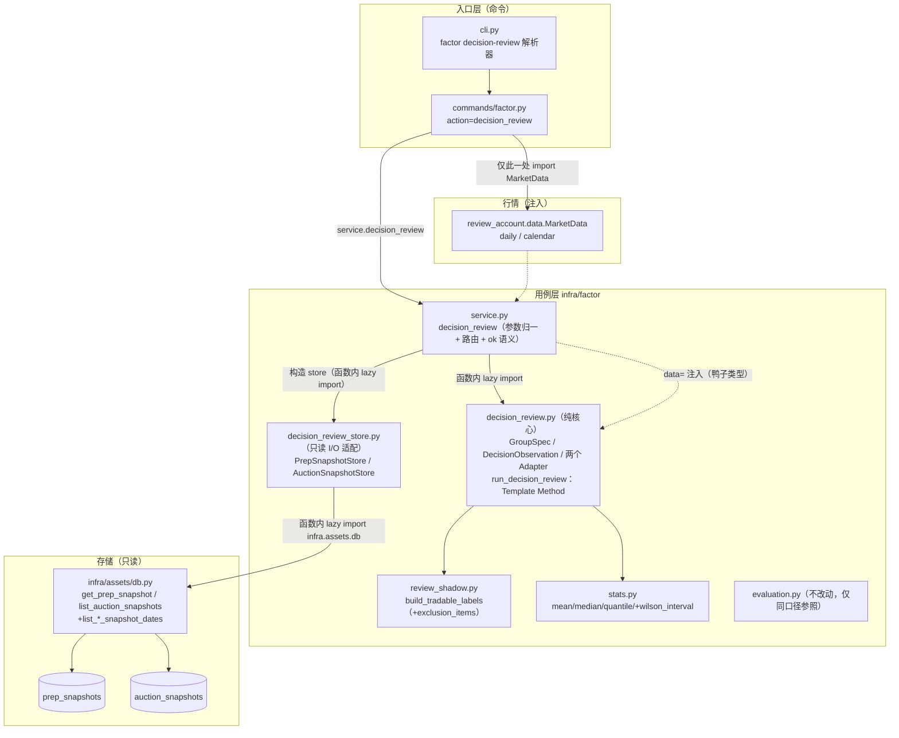
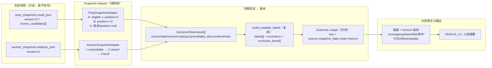
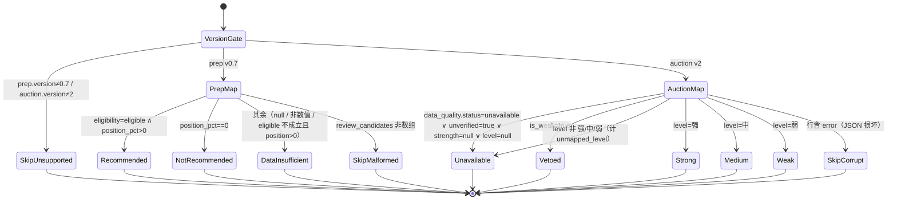

# prep / auction 决策结果回测 · 技术方案

> 日期：2026-10-29｜阶段：2（技术方案）｜上游：`archived_md/factor_framework/2026-10-29-decision-outcome-review-research.md`（阶段 1，research-self-review APPROVE）
>
> 范围：只把既有 prep / auction 决策**回测化**（分组 × 1/3/5 日结果），不改评分、阈值、候选池、`buy`/`sell`、排序注入与任何生产消费方。
>
> 本方案遵循 main 已定的框架 A–H（入口、适配器/模板方法、标签复用、版本白名单、指标、CLI、输出、文档），不改变核心方向；本文只在其内补齐接口、数据模型、错误处理、测试与风险。
>
> **本轮只交付方案，不写产品代码、不改真实 DB、不提交。**

---

## 0. 阅读指引与事实来源

| 结论 | 事实来源（已读） |
|---|---|
| prep 快照 `version=0.7`、`review_candidates[].{eligibility,position_pct,review_score,review_grade,...}` | `dragon_quant/review_account/prep/service.py:229`、`review/orchestrator.py`、`review/gates.py`、`tests/e2e/golden/prep/snapshot.json` |
| auction `analysis_json` v2 契约（`data_quality.status` / `is_weak` / `level` / `strength` / `unverified`） | `archived_md/auction/2026-10-29-auction-strength-technical-design.md` §9.3/§11/§11.3、`tests/e2e/golden/auction/snapshots.json` |
| 快照只读读接口 | `infra/assets/db.py::get_prep_snapshot(with_meta)` / `list_auction_snapshots(with_meta)` / `_list_dates` |
| 可成交标签现状 | `infra/factor/review_shadow.py::build_tradable_labels`（默认 1/3/5、13bp、剔除语义） |
| 单因子评估口径（对照，不复用） | `infra/factor/evaluation.py::evaluate_factor` |
| 命令层进入因子层的唯一通道 | `commands/factor.py`、`infra/factor/main.py`（13 个出口）、`infra/factor/service.py` |
| 架构硬约束（AST 门禁） | `tests/test_architecture_rules.py`、`tests/e2e/test_architecture_rules.py`（M7） |
| E2E 门禁与覆盖映射 | `tests/e2e/coverage-map.json`（51 节点/15 顶层）、`tests/e2e/test_coverage_map.py`、`tests/test_docs_consistency.py` |

**本次未改动**：真实 `dragon.db` / `assets.db`、任何快照、`factor_values`、`review_account/*`、`scan/*`、`vpa/*`、Web UI、Skill 行为。

---

## 1. 目标、边界与非目标

### 1.1 目标（可测试）

1. 新增**只读**子命令 `factor decision-review`，把库内既有 prep / auction 冻结快照转成统一「决策观测」，算出分组 × 1/3/5 日的可成交结果与方向命中描述。
2. 每个样本（`source+snapshot_date+code+horizon`）可追溯：快照版本、进出场日期/价格、成本、毛收益、净收益、outcome 或剔除原因。
3. 覆盖与缺失显式：不可成交、版本不支持、快照缺失、空决策、损坏行**分别计数**，绝不静默丢样本或伪造分母。
4. 分组样本量按组独立判定；小样本只标 `low_confidence`，不输出「策略有效/无效」。
5. 输出确定性：同一 DB + 同一行情 → 逐字节相同的 JSON（不写 `generated_at`，不读 wall clock）。

### 1.2 边界（阶段 0 已确认）

- 只回测**既有结论**；不调分、不调参、不做阈值搜索、不做自动优化、不触达 `buy`。
- `reference_line=0.65` 仅作展示参考线，不触发任何判定、不写任何模型或信号。
- prep：推荐组上涨命中率、不推荐组下跌命中率**分别**计算；数据不足永不并入不推荐。
- auction：`unavailable` 优先，再 `vetoed`，最后按 `level` 强/中/弱。
- 1/3/5 交易日、往返 13bp、可成交开盘 → 第 N 日开盘；**按扣除 13bp 后的净收益**判定上涨/下跌，净收益恰为 0（保本）独立成 `flat`。
- 现有 prep/auction 评分、快照、候选池、`buy`、默认输出**零变化**。
- 本轮不实现产品代码。

### 1.3 非目标（显式不做）

| 不做 | 理由 |
|---|---|
| 新增顶层命令 / 扩展 `factor eval` 语义 | 调研 §4 已否决 A/C；main 框架 A 固定为子命令 |
| 新表、run manifest、历史空盘口补采 | 本期写路径为零；`auction` 覆盖边界只声明不修复 |
| 要求先 `factor build` | 直接读冻结快照，避免把决策结论耦合到因子构建完成度 |
| `RankIC` / ICIR / 换手 / 分组单调性替代方向命中 | 两者问题不同；`factor eval` 已提供 IC |
| 65% 门槛判定、胜率承诺、策略有效结论 | 样本与相关性都不支持；只描述 |
| 调分/调参/自动优化/`buy`/仓位 | 阶段 0 明确排除 |
| 真实账户成交、滑点模型、竞价成交假设 | 沿用日 K 正式开盘价，与 `factor eval` 同口径 |

---

## 2. 关键设计取舍（候选方案对比）

### 2.1 入口承载：`factor` 子命令内新增（沿用调研结论，不重开）

| 方向 | 评价 |
|---|---|
| 扩展 `factor eval --decision-groups` | 两套分母/指标/参数耦合；prep `position_pct=0` 与 auction veto 不是单因子值 → 拒绝 |
| **`factor decision-review` 子命令（采纳）** | 评估域内、无新顶层命令、不要求 build、可复用 service 错误码与行情注入 |
| 新顶层 `review-decisions` | 增加第 16 个顶层命令 + coverage-map/路由/文档成本，收益不足 |
| 一次性脚本（非常规） | 验证快，但要重造行情加载、错误码、E2E；长期不可维护 |

### 2.2 标签复用方式（本方案的主候选对比）

| 方案 | 做法 | 评价 |
|---|---|---|
| **C1（推荐）单次调用 + 只增 `exclusion_items`** | 一次 `build_tradable_labels(observations, ..., horizons=(1,3,5))`；函数内把「进入 horizon 循环前的剔除」按每个请求 horizon 展开进新键 `exclusion_items`；`labels` 与 `exclusions` 语义**一字不改** | 行情只按 code 取一次；分母按 horizon 对齐；旧测试零改动；唯一代价是 review_shadow 新增 ~15 行 |
| C2 每个 horizon 各调一次 | 天然 per-horizon 剔除 | 行情访问放大 3 倍；`exclusions` 语义从「每次观测一次」变为「每 horizon 一次」，**旧计数漂移**；需要调用方再求和还原，易错 → 拒绝 |
| C3（非常规）不调用，自建轻量 labeler | 复制 entry/exit/剔除逻辑，只保留需要的字段 | 立即产生第二份「可成交口径」真源，日后必与 `factor eval`/影子分叉 → 拒绝 |

**采纳 C1。** 取整策略：`exclusion_items` 是**新增**的、逐样本逐 horizon 的事实；`exclusions` 保持现状（早期剔除一次计数），并在文档中标注 `exclusions` 为 legacy 聚合计数、**不得**用作 per-horizon 分母。

### 2.3 快照日期枚举

| 方案 | 做法 | 评价 |
|---|---|---|
| **D1（推荐）区间直查** | `infra/assets/db.py` 新增两个只读函数 `list_prep_snapshot_dates(from,to,source="v2")` / `list_auction_snapshot_dates(...)`，`SELECT DISTINCT trade_date ... BETWEEN` | 一次连接拿到全部有快照的日期；与 `_list_dates` 同风格；无 DDL、无写 |
| D2 逐交易日探针 | 对交易日历逐日 `get_prep_snapshot` / `list_auction_snapshots` | O(交易日) 次连接；`missing` 仍要靠日历才能算，且无日历时空转 → 拒绝 |
| D3（非常规）从 `factor_values` 反推日期 | 读 `auction_*`/`prep_*` 因子行日期 | 要求先 build；版本过滤二次污染；与「不要求 build」冲突 → 拒绝 |

### 2.4 方向判定基准（main 阶段 2 验收裁决：采纳 G2）

| 方案 | 后果 | 评价 |
|---|---|---|
| G1 毛收益定方向、净收益定幅度 | `outcome = sign(exit_open/entry_open − 1)`；`net_return_pct` 另含 13bp | 需求方要评估的是**可成交净结果**，不是毛价格方向；毛收益定方向会让 13bp 成本只影响收益均值、不影响命中率，与「默认扣除 13bp 往返成本」的验收语义脱节 → 拒绝 |
| **G2（采纳，main 裁决）净收益定方向** | `outcome = sign(net_return_pct)`，`net = gross − cost_bps/100` | 命中率直接回答「扣完成本后是否赚钱」；`flat` = 净收益恰为 `0`（毛收益恰好覆盖成本，**经济含义是保本**），阶段 0 的「零收益独立」由此获得可解释定义；`gross_return_pct` 保留在账本内供审计 |
| G3 双口径都出 | 两套 up/down/flat + 两个命中率 | 输出歧义（用户不知道看哪个）、65% 参考线比较二义 → 明确拒绝，**本期不做双口径** |

**采纳 G2**（main 阶段 2 单次验收裁决，2026-10-29）。JSON 固定输出 `config.outcome_basis="net_open_to_open_after_cost"`、`config.net_return_basis="gross_minus_cost"`，任何人可据此复核；`gross_return_pct` 只进逐样本账本，不参与分组统计与方向判定。

> 实现上这是 `_classify(net_return_pct)` 一处判定；`gross_return_pct` 仍由同一对进出场价派生（审计用途），因此两口径共享价格事实、不会分叉。

### 2.5 模块切分

| 方案 | 做法 | 评价 |
|---|---|---|
| **M1（推荐）纯核心 + 独立 store + service 包装** | `decision_review.py`（零 I/O：适配器映射、账本、指标、装配）+ `decision_review_store.py`（唯一碰 `assets.db` 的只读适配）+ `service.decision_review()`（参数校验/路由） | 核心可被单测直接覆盖；可对 `decision_review.py` 加与 `review_shadow.py` 同级的「数据注入」AST 门禁；命令层仍只经 `service` 进入 |
| M2 单模块内含 DB 读取 | 少一个文件 | 纯函数与 I/O 混在一起，单测要么连库要么 mock 到内部；无法复用现有「数据注入」门禁 |
| M3（非常规）放进 `review_shadow.py` | 表面复用 | `review_shadow.py` 被 AST 门禁钉死为**零 I/O、禁 `infra.assets`**；塞入 DB 读取直接破坏 M6 契约 → 拒绝 |

---

## 3. 架构

### 3.1 分层与依赖方向



**可测试的依赖规则**

| 规则 | 强制方式 |
|---|---|
| `decision_review.py` 零 I/O：不得 import `dragon_quant.infra.assets`、`dragon_quant.infra.provider`、`dragon_quant.review_account*`、`sqlite3`、`requests`、`urllib`、`pandas` | 新增 AST 门禁（与 `test_review_shadow_is_data_injected` 同款） |
| 行情只经注入：`daily(code,start)`（必需）、`calendar(start,end)`（可选） | 单测传假 market；模块内不读 wall clock |
| `decision_review_store.py` 只允许 `infra.assets.db`，且必须**函数内** lazy import；读快照显式传 `source="v2"`（与 `engine._load_prep_source`/`_load_auction_source` 一致） | 单测 monkeypatch `get_prep_snapshot` / `list_auction_snapshots` |
| `commands/factor.py` 只经门面 `CleanConfig` + `service.*` 进入因子层 | 既有 `test_m7_command_uses_only_the_factor_facade`（本方案不改门面出口） |
| 包根 `main.py` 的 `__all__` 保持 13 个名字 | 既有 `test_m7_factors_facade_exports_exactly_thirteen_names` |
| 不新增顶层命令、不新表 | 本方案零 DDL；coverage-map 只加 `factor decision-review` 节点 |

### 3.2 设计模式与动机

| 模式 | 落点 | 动机 |
|---|---|---|
| **Adapter** | `PrepSnapshotAdapter` / `AuctionSnapshotAdapter`：把两份异构快照映射为同构 `DecisionObservation` | 隔离「prep 用 `eligibility`+`position_pct`」「auction 用 `data_quality`+`is_weak`+`level`」的字段差异；未来新增第三源只加一个适配器 |
| **Strategy** | `service.decision_review` 按 `--source` 选择适配器；适配器携带各自的 `accepted_versions` 与 `group_specs` | 版本白名单、分组语义、输出组序全部随策略走，核心骨架零 `if source == …` |
| **Template Method** | `run_decision_review`：校验 → 枚举快照日 → 装载 → 观测 → 可成交标签 → 账本 → 分组指标 → 装配输出 | 骨架固定，变的是适配器；避免为两类来源复制七步流水线 |
| **Strategy（口径参数化）** | `GroupSpec.expected_direction`（`up`/`down`/`None`） | 「中」「数据不足」不计算方向命中是数据驱动，不是分支堆叠 |
| 不采用 | Observer / DI 容器 / 插件注册表 | 只有两个稳定来源，注册表是过度抽象（AGENTS.md 全局约定 §3：优先简单） |

### 3.3 接口契约（实现前即固定）

```python
# decision_review.py（纯核心，零 I/O）
SOURCE_GROUP_SPECS: dict[str, tuple[GroupSpec, ...]]   # 组序即输出序
ACCEPTED_VERSIONS: dict[str, tuple[str, ...]]          # {"prep": ("0.7",), "auction": ("2",)}

@dataclass(frozen=True)
class GroupSpec:
    key: str
    label: str
    expected_direction: str | None      # "up" | "down" | None

@dataclass(frozen=True)
class DecisionObservation: ...          # 字段见 §6.1

@dataclass(frozen=True)
class SnapshotDay:
    snapshot_date: str
    version: str | None
    created_at: str | None
    observations: tuple[DecisionObservation, ...]
    counters: Mapping[str, int]         # 快照级计数（§10.2 / §10.1 的 unmapped_*）

class SnapshotStore(Protocol):          # decision_review_store.py 实现
    def snapshot_dates(self, date_from: str, date_to: str) -> list[str]: ...
    def load(self, snapshot_date: str) -> SnapshotDay: ...

class SnapshotAdapter(Protocol):
    source: str
    accepted_versions: tuple[str, ...]
    group_specs: tuple[GroupSpec, ...]
    def load_day(self, snapshot_date: str) -> SnapshotDay: ...   # 委托 store

def run_decision_review(
    adapter: SnapshotAdapter,
    *,
    market,                             # daily(code,start) 必需；calendar(start,end) 可选
    date_from: str, date_to: str,
    horizons: Sequence[int] = (1, 3, 5),
    cost_bps: float = DEFAULT_COST_BPS,
    min_days: int = 20,
    min_group_samples: int = 30,
    include_samples: bool = False,
) -> dict: ...
```

**注入顺序（实现契约，顺序错会导致覆盖率与剔除偏差）**

1. `store.snapshot_dates` + 逐日 `adapter.load_day` → 全部观测；
2. `_BarView.warm(codes, date_from)` 预热全部码的日 K（含用于日历并集回退）；
3. 取日历：先试 `market.calendar(window_start, window_end)`；抛错或空 → 用已预热 bars 的日期并集（`calendar_basis` 如实记录）；
4. 调 `build_tradable_labels`（一次）；
5. 账本 → 指标 → 装配。

---

## 4. 数据流



**流水线规则（顺序即契约）**

1. **枚举**：`store.snapshot_dates(from,to)` 给出区间内有快照的日期（升序去重）。同时用注入行情取交易日历，算出 `requested_days`。
2. **装载 + 映射**：逐日 `store.load(date)` → `SnapshotDay(version, created_at, observations, counters)`。版本不在白名单的日/行**不产生 observation**，只进 `counters`。
3. **标签**：全部 observation 一次送进 `build_tradable_labels`（`horizons` 为用户请求集合，默认 `(1,3,5)`；`cost_bps` 默认 13）。
4. **账本**：对每个 `observation × horizon` 用 `(observation.snapshot_date == label.trade_date, code, horizon)` 回接 label，命中则填价格/收益，未命中则从 `exclusion_items` 取 reason；**两种情况都留行**。
5. **聚合**：按固定组序 × 请求 horizon 生成指标；空组只影响自己。
6. **装配**：`schema_version="dr_v1"` 的稳定键序；`--include-samples` 才附 `samples`。

**不变量**

- 账本行数 `== Σ_groups(observations) × len(horizons)`；不等则输出 `warning: ledger_mismatch`（防御性，正常永不发生）。
- 任一观测的 `available_at` 日期 **必须等于** `snapshot_date`；不等只可能是实现缺陷，测试断言。
- 决策观测的 `group` 只由快照字段决定，**绝不**由收益方向回填（禁止前视）。
- `build_tradable_labels` 返回 `status="insufficient_data"`（零可成交样本）时**不得短路**：账本仍按观测 × horizon 全量产出（全部带剔除原因），否则分母与覆盖率会消失。

---

## 5. 分组判定

### 5.1 状态机（分类优先序）



### 5.2 组定义表

| source | group key | 人读标签 | 判定 | expected_direction |
|---|---|---|---|---|
| prep | `recommended` | 推荐 | `eligibility=="eligible"` 且 `position_pct` 为 >0 数值 | `up` |
| prep | `not_recommended` | 明确不推荐 | `position_pct` 数值 `== 0` | `down` |
| prep | `data_insufficient` | 数据不足 | 其余（`position_pct` 为 `null`/非数值，或 `position_pct>0` 但 `eligibility!="eligible"`） | `null` |
| auction | `strong` | 强 | 通过 `unavailable` / `vetoed` 后被排除，`level=="强"` | `up` |
| auction | `medium` | 中 | 同上，`level=="中"` | `null`（只展示分布） |
| auction | `weak` | 弱 | 同上，`level=="弱"` | `down` |
| auction | `vetoed` | 否决 | `is_weak is True`（真实风险否决） | `down` |
| auction | `unavailable` | 数据不足 | `data_quality.status=="unavailable"` ∨ `unverified is True` ∨ `strength is null` ∨ `level is null` ∨ `level` 非法 | `null` |

> `expected_direction` 是**决策语义**（「推荐/否决 = 预期不涨（或涨）的那一侧」），不是对个股方向的预测；报告必须与该措辞同时出现。`unavailable` / `data_insufficient` 的 `expected_direction` 永远为 `null`——数据不足不是看空。

### 5.3 分组边界（必须测试）

| 场景 | 期望 |
|---|---|
| prep `position_pct=0` 且 `eligibility=not_qualified` | `not_recommended`（`position_pct` 优先于 eligibility） |
| prep `position_pct=0.0`（float 零） | `not_recommended` |
| prep `position_pct=True`（bool 陷阱） | `data_insufficient` + `unparsed_position_pct` 计数（bool 不是仓位） |
| prep `position_pct="4"`（字符串） | `data_insufficient` + `unparsed_position_pct`（不猜数值） |
| prep `position_pct>0` 但 `eligibility="unknown"` | `data_insufficient`（A 组要求 eligible） |
| prep `review_candidates` 重复 code | 保留首次出现，计 `duplicate_code`（确定性：按快照内顺序） |
| prep `review_candidates=[]`（`review.enabled=false` 或真空） | 该日 `empty_decision`，**不**产生观测，**不**算作缺失版本 |
| prep `version="0.6"` | 该日 `unsupported_snapshot_version`，不产生观测 |
| prep `version=null` 或缺失 | 同上（unsupported） |
| auction 行 `version="1"` | 该行 `unsupported_snapshot_version`（行级计数） |
| auction 行含 `error` | 该行 `corrupt_row` |
| auction `data_quality.status="unavailable"` 且 `is_weak=True` | `unavailable`（unavailable 优先于 vetoed） |
| auction `is_weak=True` 且 `level="弱"` | `vetoed`（vetoed 优先于 level） |
| auction `level=null`、`is_weak=False` | `unavailable` |
| auction `level="强"`、`data_quality.status="degraded"` | `strong`（degraded 不是不可用；`rank` 缺失不影响） |
| auction `data_quality` 键缺失（旧 v2 变体） | 不据此判 unavailable，继续走 `unverified`/`strength`/`level` 判定 |
| auction `unverified` **键缺失** | 视为不可用（`unavailable`）——缺键 fail-closed，与因子层 `_usable_row` 同策略 |
| auction `is_weak` 键缺失 | 不构成否决；但若 `strength`/`level` 也缺 → `unavailable`（不会误落 strong/weak） |
| auction `strength=null` 但 `level="中"`（契约外组合） | `unavailable`（strength 缺失即不可评价） |
| auction 同日重复 code | 保留首次，计 `duplicate_code` |

---

## 6. 数据模型

### 6.1 统一决策观测（`DecisionObservation`，frozen dataclass）

| 字段 | 类型 | 来源（prep / auction） |
|---|---|---|
| `source` | `"prep" \| "auction"` | 常量 |
| `snapshot_version` | `str` | `result_json.version` / 行 `version` |
| `snapshot_date` | `YYYY-MM-DD` | DB 行 `trade_date`（**不是** payload 里的 `trade_date`；不一致只告警） |
| `snapshot_created_at` | `str \| null` | `with_meta=True` 的 `created_at` |
| `code` | `str` | `review_candidates[].code` / 行 `code` |
| `name` | `str \| null` | `review_candidates[].name` / auction 行无 `name`（`null`） |
| `group` | 组 key | §5.2 |
| `available_at` | `YYYY-MM-DDT16:40:00+08:00` / `...T09:25:00+08:00` | **按源契约常量生成**，见 §6.4 |
| `score` | `float \| null` | `review_score` / `strength` |
| `level` | `str \| null` | `review_grade` / `level` |
| `veto` | `bool` | `False` / `is_weak is True` |
| `data_quality_status` | `str \| null` | `null` / `data_quality.status` |

### 6.2 样本账本（内存聚合，不落库）

主键：`source + snapshot_date + code + horizon`。

| 字段 | 说明 |
|---|---|
| `sample_id` | `f"{source}:{snapshot_date}:{code}:{horizon}"` |
| `group` / `expected_direction` | 回填自组定义（便于单样本自查） |
| `snapshot_version` / `snapshot_created_at` | 血缘 |
| `available_at` | 时点 |
| `horizon` | 1/3/5 |
| `entry_date` / `exit_date` | 由标签给出；剔除时为 `null` |
| `entry_price` / `exit_price` | 日 K 正式开盘价；剔除时为 `null` |
| `cost_bps` | 本次运行成本 |
| `gross_return_pct` | `(exit/entry−1)×100`；**仅审计**，不参与方向判定与分组统计；剔除时 `null` |
| `net_return_pct` | `gross − cost_bps/100`；**方向判定与收益统计的唯一口径**；剔除时 `null` |
| `outcome` | `"up" \| "down" \| "flat" \| null`，由 `sign(net_return_pct)` 判定（`flat` = 净收益恰为 `0`，即保本） |
| `exclusion_reason` | §10.1 枚举；正常样本为 `null` |

**排序**：`(snapshot_date, code, horizon)` 升序 —— 与主键一致且与快照内顺序解耦，保证确定性。

### 6.3 可成交口径（复用，不改）

- 入口：`available_at` 之后第一个**可成交**交易日开盘；`available_at` 时刻 `< 09:30` 时允许当日开盘（`review_shadow._available_parts`）。
- 出口：入口日之后的第 `horizon` 个交易日开盘。
- 成本：`net = gross − cost_bps/100`（13bp → 0.13 个百分点），**方向判定与 up/down/flat 计数一律用 net**；`gross` 只留在账本供审计。
- 剔除：一字涨停（无成交且开盘≥涨停价或 `limit_up`）、停牌（量额双零）、`amount < 2 亿`、缺行情、区间不足。
- **显式不传 `auction_price` / `auction_fillable`**：两个来源都走日 K 正式开盘价，不假设竞价一定成交（调研 §1.3）。这也是 prep 与 auction 可比的前提。

### 6.4 时点常量而非 payload 时间戳

| source | `available_at` | 理由 |
|---|---|---|
| prep | `f"{snapshot_date}T16:40:00+08:00"` | prep 冻结时点契约（`prep_frozen_at`）；若改读 payload `strategy_context.frozen_at`，一旦快照内时点漂移到开盘前就会产生**前视** |
| auction | `f"{snapshot_date}T09:25:00+08:00"` | 竞价终态时点契约（`strategy_context.as_of` 同源） |

`strategy_context.frozen_at` 仅作诊断：其日期与 `snapshot_date` 不一致时输出 `warning: prep_frozen_at_mismatch`（不参与入场计算）。

---

## 7. CLI 契约

```
python -m dragon_quant factor decision-review --source prep --from 20260501 --to 20260630
python -m dragon_quant factor decision-review --source auction --from 20260601 --to 20260630 --horizon 1
python -m dragon_quant factor decision-review --source prep --from 20260501 --to 20260630 \
    --horizon 1 --horizon 3 --json --include-samples
```

| 参数 | 类型/默认 | 说明 |
|---|---|---|
| `--source` | `prep\|auction`，**必填** | 一次只回测一个来源；不提供「混合」以免分母语义混淆 |
| `--from` / `--to` | 必填，`YYYYMMDD/YYYY-MM-DD/YYYY/MM/DD` | 快照日期区间（含端点）；**无默认**，保证无 wall clock |
| `--horizon` | 可重复 `int`，默认 `[1,3,5]` | 去重升序；`<1` → exit 2 |
| `--cost-bps` | `float`，默认 `13` | 往返成本（bp）；`<0`/非有限 → exit 2 |
| `--min-days` | `int`，默认 `20` | 组内有效决策日下限（质量判定） |
| `--min-group-samples` | `int`，默认 `30` | 组内有效样本下限（质量判定） |
| `--include-samples` | flag | **仅影响 `--json`**：附完整账本 `samples[]`；人读模式忽略并提示 |
| `--json` | flag | 完整 JSON（稳定键序） |

**退出码**：`ok`（含 `insufficient_data`）→ `0`；参数错误（`ValueError`/argparse）→ `2`；运行时失败（库读异常、注入行情异常等）→ `1`。走既有 `_emit_factor_error`，与 `factor eval` 一致。

**未给子动作**：`factor` 无 action 保持既有退出码行为（既有 E2E 已钉）。

---

## 8. JSON 契约 `dr_v1`

### 8.1 顶层键序（稳定）

```json
{
  "schema_version": "dr_v1",
  "ok": true,
  "status": "ok",
  "source": "prep",
  "date_from": "2026-05-01",
  "date_to": "2026-06-30",
  "universe": "persisted_decision_snapshots",
  "coverage_basis": "persisted_snapshots",
  "config": {
    "horizons": [1, 3, 5],
    "cost_bps": 13.0,
    "min_days": 20,
    "min_group_samples": 30,
    "include_samples": false,
    "outcome_basis": "net_open_to_open_after_cost",
    "net_return_basis": "gross_minus_cost",
    "entry_rule": "available_at_first_tradable_open",
    "exit_rule": "nth_trading_day_open",
    "calendar_basis": "index_calendar"
  },
  "snapshots": {
    "requested_days": 42,
    "with_snapshot": 12,
    "missing": 30,
    "usable": 11,
    "unsupported_version": 1,
    "malformed": 0,
    "empty_decision": 0,
    "corrupt_rows": 0,
    "non_trading_snapshot_dates": 0
  },
  "versions": {
    "accepted": ["0.7"],
    "seen": {"0.6": 1, "0.7": 11},
    "unsupported_units": 1
  },
  "groups": [ { "…": "见 8.2" } ],
  "spreads": {
    "1": {"pair": ["recommended", "not_recommended"], "basis": "mean_net_return_pct", "value": 1.84},
    "3": {"pair": ["recommended", "not_recommended"], "basis": "mean_net_return_pct", "value": -0.12},
    "5": {"pair": ["recommended", "not_recommended"], "basis": "mean_net_return_pct", "value": null}
  },
  "exclusions": {
    "sample": {"illiquid": 3, "insufficient_horizon": 8, "missing_bar": 2},
    "snapshot": {"unsupported_snapshot_version": 1, "missing_snapshot": 30}
  },
  "caveats": [
    "方向命中率仅描述历史样本，不构成策略有效性结论",
    "Wilson 95% 区间假设样本近似独立；同日多只与相邻 horizon 存在相关性，区间偏窄",
    "prep 分组为决策语义：position_pct=0 表示不建议新建仓，不等于看空"
  ],
  "warnings": []
}
```

- `config.outcome_basis`：方向判定基准，固定 `"net_open_to_open_after_cost"`（净收益 = 开盘→开盘毛收益 − `cost_bps/100`）；`gross_return_pct` 只在 `samples[]` 内供审计，不参与统计。
- `config.calendar_basis`：实际使用的日历来源，`"index_calendar"`（注入方 `calendar`）或 `"bars_union"`（回退并集）；不得写成常量。
- `status`：任一 `group × horizon` 的 `quality=="ok"` → `"ok"`，否则 `"insufficient_data"`（`ok` 仍为 `true`，退出码 0）。
- `samples`：仅 `--include-samples` 时**出现该键**；未请求时键整体省略（不做空数组占位，避免误读「账本为空」）。`exclusions.sample` 恒有。
- `caveats`：与数据无关但**随来源**不同的固定提示（prep 用「position_pct=0 ≠ 看空」，auction 用「分母仅为已持久化快照，不含未持久化的空盘口/失败候选」）；逐字稳定（golden 可 pin）。
- **不含** `generated_at` / 耗时 / 绝对路径，保证确定性；同一 DB + 同一行情必得同字节 JSON。

### 8.2 分组条目（8.1 中 `groups[]`）

```json
{
  "group": "recommended",
  "label": "推荐",
  "expected_direction": "up",
  "horizons": {
    "1": {
      "observations": 30, "valid": 27, "excluded": 3, "coverage": 0.9,
      "up": 16, "down": 10, "flat": 1,
      "direction_evaluable": true,
      "direction_hit_rate": 0.5926,
      "direction_hit_denominator": "valid_including_flat",
      "daily_hit_rate_mean": 0.6,
      "days": 9, "days_with_observations": 10,
      "effective_independent_days": 9,
      "wilson95": [0.4073, 0.7548], "wilson_n": 27,
      "wilson_caveat": "date_correlated_descriptive_only",
      "mean_net_return_pct": 1.42,
      "median_net_return_pct": 0.88,
      "p25_net_return_pct": -1.9,
      "p75_net_return_pct": 3.4,
      "reference_line": 0.65,
      "above_reference": false,
      "quality": "low_confidence"
    }
  }
}
```

- `up/down/flat` 全部由 `net_return_pct` 的符号判定（`flat` = 净收益恰为 `0`，保本）；`direction_hit_rate` 分母为 `valid`（含 `flat`，`flat` 永不算命中）。
- `groups[]` 的**顺序固定**：prep `recommended / not_recommended / data_insufficient`；auction `strong / medium / weak / vetoed / unavailable`。空组也在列表内（`observations=0`，全 `null`），便于诊断。
- `horizons` 是对象（键为字符串化整数），键序 = `config.horizons` 顺序。
- `expected_direction` 同时出现在组级与 horizon 级（组级为权威，horizon 级便于单行消费）。
- `above_reference`：`quality=="ok"` 且 `direction_evaluable` 且命中率非空时才有布尔值，否则 `null`。

### 8.3 样本条目（`--include-samples`）

```json
{
  "sample_id": "prep:2026-05-19:600001:1",
  "source": "prep", "snapshot_date": "2026-05-19",
  "snapshot_version": "0.7", "snapshot_created_at": "2026-05-19 17:02:11",
  "code": "600001", "name": "示例甲", "group": "recommended",
  "expected_direction": "up",
  "available_at": "2026-05-19T16:40:00+08:00",
  "horizon": 1,
  "entry_date": "2026-05-20", "exit_date": "2026-05-21",
  "entry_price": 10.0, "exit_price": 10.5,
  "cost_bps": 13.0,
  "gross_return_pct": 5.0, "net_return_pct": 4.87,
  "outcome": "up", "exclusion_reason": null
}
```

剔除样本同构：`entry_date/exit_date/entry_price/exit_price/gross_return_pct/net_return_pct/outcome` 均为 `null`，`exclusion_reason` 为 §10.1 的枚举值。

保本样本（`flat`）示例：`entry_price=10.0`、`exit_price=10.013`、`gross_return_pct≈0.13`、`net_return_pct≈0.0`、`outcome="flat"`——毛收益恰好覆盖 13bp 往返成本。判定按 §9 的 `1e-6` 个百分点归零精度（价格比值必然带浮点尾差，归零精度远小于任何可交易价差）。`gross_return_pct` 仅用于审计核对，不参与分组统计。

---

## 9. 指标公式与质量口径

记某组 `g`、某 horizon `h` 的账本子集为 `R`，`V = {r ∈ R | outcome ≠ null}`（有效样本）；`net = gross − cost_bps/100`。

| 指标 | 公式 / 定义 |
|---|---|
| `observations` | `len(R)`（每组每 horizon 相同，因为每个观测按 horizon 展开） |
| `valid` | `len(V)` |
| `excluded` | `observations − valid` |
| `coverage` | `valid / observations`，`observations==0` → `null` |
| `up/down/flat` | **由 `net_return_pct` 判定**：`up` = `net > 0`；`down` = `net < 0`；`flat` = `net == 0`（保本）。浮点实现：先对 `net` 按 `1e-6` 个百分点归零（`round(net, 6)`），再取符号——价格比值必然带浮点尾差，归零精度比任何可交易价差小 4 个数量级以上，不会把微利/微亏误判为保本 |
| `direction_evaluable` | `expected_direction ∈ {up,down}` 且 `valid>0` |
| `direction_hit_rate`（pooled） | `hits / valid`，`hits = #{outcome == expected_direction}`；**flat 计入分母、永不算命中**；不可评目标 → `null` |
| `daily_hit_rate_mean` | 逐 `snapshot_date` 计算 `hits_d / valid_d`，对 `valid_d>0` 的日子取算术均值；无则 `null` |
| `days` | `V` 中出现的不同 `snapshot_date` 数 |
| `days_with_observations` | `R` 中出现的不同 `snapshot_date` 数 |
| `effective_independent_days` | `days==0 → 0`；否则 `max(1, round(days / h))`（与 `factor eval` 同口径，近似抵消 h 日重叠） |
| `wilson95` | 见下；`direction_evaluable` 为假 → `null`（如 n=27、hits=16 → `[0.4073, 0.7548]`） |
| `mean/median/p25/p75_net_return_pct` | 对 `V` 的 `net_return_pct`（与方向判定同一口径）；`p25/p75` 用 `stats.quantile`（线性插值，输入升序） |
| `reference_line` | 恒 `0.65` |
| `above_reference` | `quality=="ok" && direction_evaluable && direction_hit_rate≠null` 时 `direction_hit_rate >= 0.65`，否则 `null` |
| `quality` | `observations==0 → "not_evaluable"`；`days < min_days 或 valid < min_group_samples → "low_confidence"`；否则 `"ok"`。**语义 = 样本充足度，不是统计独立性**；独立性由 `effective_independent_days` 单独展示，不得用 `quality=ok` 推断「结论稳健」 |

**为何不把 `gross` 用于方向**：阶段 0 的验收对象是「按 13bp 往返成本可成交后的结果」，毛价格方向无法回答「这笔决策扣完成本是否赚钱」；`gross_return_pct` 仅保留在逐样本账本用于审计与复核成本口径，绝不出现在组级统计与命中率中（不做双口径）。

**Wilson 95%（描述性）**：`z=1.96`，`p̂=hits/valid`，`n=valid`

```
center = (p̂ + z²/(2n)) / (1 + z²/n)
half   = z·sqrt(p̂(1−p̂)/n + z²/(4n²)) / (1 + z²/n)
wilson95 = [center − half, center + half]
```

`n==0` → `null`。固定标记 `wilson_caveat="date_correlated_descriptive_only"`：同日多只、相邻 horizon 重叠都会让区间**偏窄**，因此只用于描述，不用于「是否达标」的决策。

**差值（`spreads`）**：prep = `mean(recommended) − mean(not_recommended)`；auction = `mean(strong) − mean(weak)`，均按 horizon 独立计算；任一侧 `mean` 为 `null` → `value=null`。不改用合成多空收益，不引入权重。

**小样本与相关性处理**：`min_days=20`、`min_group_samples=30` 默认**逐组独立**；单组为空/不足只把该组标 `low_confidence`/`not_evaluable`，不把其它组拖成 `insufficient_data`（阶段 1 硬输入 12）。

---

## 10. 版本、覆盖与缺失语义

### 10.1 剔除原因枚举（账本级，逐 horizon）

| reason | 含义 | 来源 |
|---|---|---|
| `insufficient_horizon` | 区间末端不足 h 个交易日 | `build_tradable_labels` |
| `missing_bar` | 入口/出口日无日 K 或开盘价非法 | 同上 |
| `suspended` | 量额双零 | 同上 |
| `illiquid` | 入口日成交额 < 2 亿 | 同上 |
| `unfillable_one_word` | 一字涨停无法成交 | 同上 |
| `no_entry_day` | `available_at` 之后无交易日 | 同上 |
| `missing_observation` | 观测缺 code/available_at（适配器正常不产生） | 同上 |
| `unmapped_label` | 账本回接标签失败（防御性，正常为 0） | decision_review |

### 10.2 快照级计数（非样本）

| 键 | 口径 |
|---|---|
| `requested_days` | `[from,to]` 内交易日数（注入日历）；日历不可用 → `null` + 告警 |
| `with_snapshot` | 区间内有快照行的日期数（`list_*_snapshot_dates`，含非交易日异常行） |
| `missing` | `requested_days − |snapshot_dates ∩ 交易日历|`；`requested_days==null` → `null`（非交易日快照不抵扣缺失，另计 `non_trading_snapshot_dates`） |
| `usable` | `with_snapshot − unsupported_version − malformed`（prep 按日；auction 以「当日存在 ≥1 条通过版本门槛的行」计） |
| `unsupported_version` | prep：版本≠`0.7` 的**日**数；auction：版本≠`2` 的**行**数 |
| `malformed` | prep：`v0.7` 但 `review_candidates` 非数组的日数 |
| `empty_decision` | 可用版本但零决策观测的日数（prep 空池 / `review.enabled=false`） |
| `corrupt_rows` | auction 行含 `error`（JSON 损坏）的行数 |
| `non_trading_snapshot_dates` | 有快照但不在注入日历内的日期数（数据异常提示） |

`versions.seen` = 版本 → 计数（prep 按日、auction 按行，报告里以 `unsupported_units` 注明单位），`accepted` = 白名单。

**映射诊断计数（与观测并存，不剔除样本）**：输出在 `exclusions.snapshot` 同名键下——`duplicate_code`（同快照重复 code，保留首次）、`unparsed_position_pct`（prep 仓位不是可用数值，落 `data_insufficient`）、`unmapped_level`（auction 非 强/中/弱，落 `unavailable`）、`unmapped_label`（账本回接失败，属 `exclusions.sample`）。它们解释「为什么这只会落在这个组/为什么这行没有标签」，与 `corrupt_row` / `unsupported_snapshot_version`（真剔除）区分开。

### 10.3 版本与覆盖警告（人读 + `warnings[]`）

| 触发 | 文案（确定性模板） |
|---|---|
| 有 unsupported | `unsupported_snapshot_version: prep 1 日（seen {'0.6': 1}）；请先按当前实现重算（prep --recompute / auction --recompute DATE）` |
| 有 missing | `snapshot_missing: 30/42 交易日无快照（仅统计库内持久化快照）` |
| 有 empty_decision | `empty_decision: N 日快照可解析但无决策观测` |
| 有 corrupt_rows | `corrupt_snapshot_rows: N 行 JSON 损坏已跳过` |
| auction | `coverage_basis=persisted_snapshots: 未持久化的空盘口/失败候选不在分母内（无 run manifest）` |
| 日历回退 | `calendar_fallback: 用个股日 K 并集代替指数交易日历，requested_days 可能缺失` |
| prep 冻结时点不一致 | `prep_frozen_at_mismatch: N 日 frozen_at 日期与 trade_date 不一致（入场仍按 16:40 契约）` |
| 金额/行情缺失 | `market_data_missing: N/M 只无日 K` |

---

## 11. 人读输出契约（默认模式）

```
决策回测 prep 2026-05-01~2026-06-30｜快照 11/42 日（unsupported 1）｜样本 180｜成本 13bp
horizon=1
  组            方向  命中      有效/观测   覆盖     mean净收益  quality
  推荐          ↑     59.3%     27/30       90.0%    +1.42%      low_confidence
  明确不推荐    ↓     47.8%     23/25       92.0%    -0.42%      low_confidence
  数据不足      -     -         5/5         100.0%   -1.10%      not_evaluable
  差值 A−B: +1.84pp
horizon=3
  组            方向  命中      有效/观测   覆盖     mean净收益  quality
  推荐          ↑     55.6%     27/30       90.0%    +0.88%      low_confidence
  明确不推荐    ↓     52.2%     23/25       92.0%    +1.00%      low_confidence
  数据不足      -     -         5/5         100.0%   +0.20%      not_evaluable
  差值 A−B: -0.12pp
horizon=5  （同构，省略）
参考线 65%（只描述，不做策略判定）；quality 只标非 ok 组（low_confidence: days=9<20 / valid=27<30）
⚠️ unsupported_snapshot_version: prep 1 日（seen {'0.6': 1}）；请先重算
⚠️ snapshot_missing: 31/42 交易日无快照（仅统计库内持久化快照）
说明：命中/涨跌按扣除 13bp 后的净收益判定；flat=净收益恰为 0（保本）；Wilson 区间受同日/相邻 horizon 相关性影响，偏窄。
```

规则：固定「来源 + 区间 + 快照计数 + 样本数 + 成本」首行；每个 horizon 一个小表，组序与 JSON 一致；命中 `null` 显示 `-`；`有效/观测` 给 `valid/observations`；「差值」行只在来源有对应两条腿时出现；`quality` 只对非 `ok` 组加标注；`warnings` 逐条 `⚠️`；末行 `caveats` 固定措辞。人读**不**打印逐样本账本。列宽按内容自适应，不截断数字精度（比率 1 位小数、收益 2 位小数、pp 差值 2 位小数）。

---

## 12. 边界与错误处理

| 场景 | 行为 |
|---|---|
| 区间内没有任何快照 | `status=insufficient_data`，reason `no_snapshot_in_range`，exit 0 |
| 日历不可用（`data.calendar` 抛错且个股并集为空） | `status=insufficient_data`，reason `calendar_unavailable`，`requested_days=null`，exit 0（与 `factor eval` 同策略） |
| 全部快照版本不支持 | `status=insufficient_data`，`warnings` 提示重算，exit 0 |
| 某组零观测 | 该组 `quality=not_evaluable`，其余组照常；整体 `status` 由其它组决定 |
| 某 horizon 的 `valid=0` | 该 horizon 指标全 `null`（含 `coverage` 若 `observations=0`），不报错 |
| `from > to` | `ValueError` → exit 2 |
| `horizon` 含 0/负数/非整数 | `ValueError` → exit 2 |
| `cost_bps` 负数/NaN/Inf | `ValueError` → exit 2 |
| `min_days < 1` / `min_group_samples < 1` | `ValueError` → exit 2 |
| `--source` 非法 | argparse `choices` → exit 2 |
| 库文件不存在 | 只读连接 `create=False` 返回 `None` → 视为「零快照」→ `insufficient_data` exit 0（不建库） |
| 表结构缺列 / 表损坏 | 底层异常上抛 → exit 1（不吞，不伪造 0） |
| `data` 注入为 `None` | `ValueError`（与 `evaluate_factor` 一致）→ exit 2 |
| 行情窗口不足（很早的 `--from`） | 逐样本 `missing_bar` 剔除并计数；文档限定期望窗口（行情注入方约 260 个交易日） |
| 账本行数不等于 `observations×horizons` | `warning: ledger_mismatch`（防御性） |

---

## 13. 性能与确定性

- 日历窗口：`window_start = date_from`；`window_end = date_to + max(30, max_horizon*5 + 10) 天`（与 `factor eval` 同口径），保证第 N 日开盘可取；超出已发布行情的日子只会落成 `missing_bar`/`insufficient_horizon` 剔除，不静默缩短 horizon。
- 行情按 code **只取一次**：`_BarView` 首次以 `date_from` 为起点缓存整段日 K，后续 `daily(code, later_start)` 命中缓存（`build_tradable_labels` 每次观测都调用 `daily(code, day)`，缓存是必需的）；预热必须先于日历回退（§3.3 注入顺序）。
- 账本一次 `build_tradable_labels` 调用完成（C1），不做 per-horizon 重复取数。
- 单日快照读取：prep 每日 1 次 `get_prep_snapshot`；auction 每日 1 次 `list_auction_snapshots`（行级 JSON 损坏已隔离）。
- 复杂度：`O(码数 × 观测数 + 样本数)`；样本数 = 观测数 × horizon 数。
- **确定性**：模块内零 `datetime.now` / `time.time`；不输出 `generated_at`；`warnings` 按固定顺序（版本 → 缺失 → 空 → 损坏 → 覆盖 → 日历 → 冻结时点 → 行情）；`samples` 固定排序；`exclusions` 键排序输出。同一 DB + 同一行情必得同字节 JSON。

---

## 14. 测试策略

### 14.1 单元测试（纯函数，零 I/O）— 新文件 `dragon_quant/tests/test_factors_decision_review.py`

| 组 | 用例 |
|---|---|
| 分组映射 | §5.3 全表逐条（含 bool/字符串 `position_pct`、`position==0` 优先于 eligibility、auction 三级优先序、`version=1`、`error` 行） |
| 观测构造 | `available_at` 常量正确（prep 16:40→次日/auction 09:25→当日）；`snapshot_date` 取 DB 键；`frozen_at` 不一致只告警 |
| 账本 | 每个观测 × horizon 都留行；早期剔除按 horizon 展开（1 个 `no_entry_day` → 3 行）；`unmapped_label` 防御分支 |
| 指标 | pooled 命中（净收益口径；flat 计入分母不算命中）；`daily_hit_rate_mean`；`effective_independent_days`；Wilson 已知值（n=27,hits=16 → `[0.4073, 0.7548]`）；p25/p75；`above_reference` 三态；`quality` 三态；空组隔离 |
| 方向口径 | `gross=0.13`（`net≈0`）→ `flat`；`gross=0.10`（`net<0`）→ `down`；`gross=0.20`（`net>0`）→ `up`；`gross_return_pct` 不进入任何组级统计 |
| 差值 | prep A−B、auction strong−weak；一侧为空 → `null` |
| 确定性 | 同输入两次调用 `==`；无 `generated_at`；`samples` 排序稳定 |
| 参数校验 | `from>to`、bad horizon、bad cost、bad min_*、`data=None` → `ValueError` |

### 14.2 标签兼容回归（既有文件扩展）

- `tests/test_factors_prep_review.py::TestTradableLabels`：
  - 既有 3 个用例**不改**（`labels` 数值、`exclusions` 计数、竞价价路径）；
  - 新增：同一输入在 `horizons=(1,3,5)` 下 `exclusions["illiquid"]==1`（legacy 计数不放大），而 `exclusion_items` 有 3 条、horizon 分别为 1/3/5；
  - 新增：`exclusion_items` 字段集合 `{code, trade_date, horizon, reason}` 且顺序确定。
- `tests/test_factors_decision_review.py`：`build_tradable_labels` 返回键集合 = 旧 5 键 + `exclusion_items`（`status/labels/exclusions/cost_bps/reason` 不变）。

### 14.3 架构门禁

- `tests/test_architecture_rules.py` 新增 `test_decision_review_core_is_data_injected`：`decision_review.py` 不得 import `dragon_quant.review_account*`、`dragon_quant.review*`、`dragon_quant.infra.provider*`、`dragon_quant.infra.assets*`、`sqlite3`、`socket`、`requests`、`urllib`、`pandas`；同文件既有 `test_factor_never_imports_review_account` 继续通过。
- `tests/e2e/test_architecture_rules.py` 既有 `test_m7_factors_facade_exports_exactly_thirteen_names` / `test_m7_command_uses_only_the_factor_facade` 必须继续通过（本方案不改门面出口；`service.decision_review` 追加进 `_M7_COMMAND_SERVICE_CALLS` 使门禁覆盖新用例包装）。

### 14.4 E2E（`tests/e2e/test_factor.py` 追加，真实子进程 + 临时根）

| 用例 | 断言要点 |
|---|---|
| F17 prep 决策回测 | 种子 `assets.db` 写 1 日 v0.7（A/B/U 三组）+ 1 日 v0.6；假行情覆盖码与指数；`--json` 校验键序、`status`、组序、`unsupported_version=1`、`missing`、命中率、`spreads`、`samples` 排序；golden 比对 |
| F18 auction 决策回测 | 种子 v2 行覆盖 strong/medium/weak/vetoed/unavailable + 1 行 v1 + 1 行损坏；断言分组优先序、`corrupt_rows=1`、`unsupported_units=1`、`coverage_basis`、`caveats` |
| F19 参数与空库 | `--source` 缺失、`horizon 0`、`cost-bps -1` → exit 2 + JSON error；空库 → exit 0 `insufficient_data`、`no_snapshot_in_range` |
| F20 只读性与行为不变 | 运行前后 `prep_snapshots` / `auction_snapshots` / `factor_values` 行数与内容不变；无新增表；真实数据目录哨兵通过 |

`coverage-map.json` 同步：`node_count 51 → 52`，新增节点 `factor decision-review` 的 flags 列表（`-h, --help, --source, --from, --to, --horizon, --json, --include-samples, --min-days, --min-group-samples, --cost-bps`）与 `coverage.nodes` 条目（指向 F17/F18/F19 真实函数）；`test_coverage_map.py` 与 `test_docs_consistency.py` 的 `_parser_nodes()`（断言 `node_count==51`）/`test_every_parser_node_has_a_readme_command` 一并更新并变绿。

### 14.5 回归门禁命令（阶段 3 必跑）

```bash
.venv/bin/python -m pytest dragon_quant/tests/test_factors_decision_review.py \
    dragon_quant/tests/test_factors_prep_review.py \
    dragon_quant/tests/test_architecture_rules.py -q
.venv/bin/python -m pytest dragon_quant/tests -q --ignore=dragon_quant/tests/e2e --ignore=dragon_quant/tests/smoke
.venv/bin/python -m pytest dragon_quant/tests/e2e -q
.venv/bin/python -m pytest dragon_quant/tests/test_docs_consistency.py \
    dragon_quant/tests/e2e/test_coverage_map.py -q
```

---

## 15. 实施切片（每片可独立验收/回滚）

| 片 | 内容 | 验收 |
|---|---|---|
| S1 | `review_shadow.py` 增 `exclusion_items`；`stats.wilson_interval` | 旧用例全绿 + 新增兼容/统计用例 |
| S2 | `decision_review.py` 纯核心（组表、观测、账本、指标、装配） | 单元测试全绿；AST 门禁通过 |
| S3 | `decision_review_store.py` + `assets/db.py` 两个只读函数 + `service.decision_review` | 单测 monkeypatch store；`factor` 其它子命令零漂移 |
| S4 | `cli.py` + `commands/factor.py` 解析与人读 | E2E F17–F20 + golden + coverage-map |
| S5 | 文档同步（README / factor.md / prep-auction.md / architecture.md / skills） | docs consistency + 本地链接门禁 |

回滚：删 S3–S5 即回到「无命令」状态；S1 只增键，回滚删除 `exclusion_items` 与 Wilson 函数不影响任何既有调用方（无调用方）。

---

## 16. 文档同步（同一 commit 强制）

| 文件 | 改动 |
|---|---|
| `README.md` | 命令块加 `factor decision-review` 示例 + 一条语义说明（只读、不要求 build、`insufficient_data` exit 0） |
| `docs/agent/factor.md` | 新增一条「决策回测（decision-review）」：入口/边界/版本白名单/分组/指标/退出码/无新表/不 import review_account |
| `docs/agent/prep-auction.md` | 一行交叉引用：决策回测只读 `prep_snapshots`/`auction_snapshots`，口径 owner 仍在 factor.md（不复制正文） |
| `docs/agent/architecture.md` | `infra/factor` 目录树行追加 `decision_review.py / decision_review_store.py` |
| `skills/dragon-quant/references/commands.md` | 新增只读行（`factor decision-review`，T0，human/json，`insufficient_data` exit 0） |
| `skills/dragon-quant/references/safety.md` | 把 `factor decision-review` 列入只读清单 |
| `skills/dragon-quant/references/outputs.md` | 一节说明 `dr_v1`：只要看组级命中/覆盖/quality，不要把 Wilson 当显著性 |
| `tests/e2e/coverage-map.json` | 52 节点 + 覆盖条目 |
| `tests/test_architecture_rules.py` | 新纯核心数据注入门禁 |
| `tests/e2e/test_architecture_rules.py` | `_M7_COMMAND_SERVICE_CALLS` 追加 `decision_review` |
| `AGENTS.md` | 覆盖映射硬约束 `51 → 52 个 parser 节点 / 15 个顶层命令`（跨模块 E2E 覆盖硬约束；阶段 3 main 单次验收要求，避免根与 README / development / coverage-map 两种说法并存） |
| `docs/agent/development.md`、`README.md`、`tests/test_docs_consistency.py`、`tests/e2e/test_coverage_map.py` | 一并同步 `51 → 52` |

根 `AGENTS.md` 仅改覆盖映射这一处常量（跨模块 E2E 硬约束，仍在 20 KB / 240 行门禁内）；其余章节不改。

---

## 17. 风险与缓解

| # | 风险 | 缓解 |
|---|---|---|
| R1 | 剔除偏差：难成交样本集中在某组，剩余命中率虚高 | 每组保留 `observations` 全分母 + `coverage` + 逐组 `exclusions`；账本保留被剔除样本（不删行） |
| R2 | 同日多只、相邻 horizon 重叠 → 有效样本量被放大、Wilson 偏窄 | `days` / `effective_independent_days` 并列；`wilson_caveat` 固定标注；`quality` 用交易日与样本双门槛；不输出显著性结论 |
| R3 | auction 宇宙不完整（只有持久化快照） | `coverage_basis="persisted_snapshots"` + 固定 caveat；不伪造 `unavailable` 之外的空盘口/失败候选 |
| R4 | 本地新快照极少（调研：prep v0.7 仅 1 日、auction v2 仅 7 行） | 首期只验证口径；`insufficient_data` 是合法结论；文档明确「不得据此宣称策略有效」 |
| R5 | 方向基准（毛/净）理解分歧 | main 阶段 2 已裁决 G2（净收益）；`config.outcome_basis="net_open_to_open_after_cost"` / `net_return_basis="gross_minus_cost"` 显式；`direction_hit_denominator` 显式；不做双口径 |
| R6 | 行情窗口上限（注入方约 260 日）使早期区间退化为 `missing_bar` | 逐样本计数 + 文档限定期望区间；不静默截短 horizon |
| R7 | 与 `evaluation._Market` 的日 K 缓存实现重复（约 20 行） | 本方案在 `decision_review.py` 内自带 `_BarView`，**不动** `evaluation.py`（其语义被 AST 门禁钉死）；后续如需统一另开小重构，登记为 known issue |
| R8 | 输出膨胀（`--include-samples` 大区间） | 默认不输出；建议 ≤ 半年区间；账本是内存结构、不落库 |
| R9 | 版本白名单过严导致「看起来没数据」 | `unsupported_snapshot_version` 明确计数 + 重算命令提示；不静默混入旧版本 |
| R10 | 未来 prep 版本升级（0.8）被静默拒绝 | `accepted` 白名单是常量且有测试；升级版本时同一 commit 更新白名单与文档（登记为兼容点） |

---

## 18. 验收映射

### 18.1 阶段 0 验收标准 → 实现位置 → 验证方式

| 验收标准（原文） | 实现位置 | 验证 |
|---|---|---|
| 只回测既有 prep/auction 结论，不调分调参/自动优化/buy | 全链路只读；`decision_review.py` 无写路径 | E2E F20 行数/内容不变；代码评审无写调用 |
| 1/3/5 日、13bp、可成交开盘→第 N 日开盘 | `run_decision_review`（默认 horizons/cost）+ `build_tradable_labels` | 单测标签数值；E2E golden |
| prep 推荐（eligible ∧ position>0）/明确不推荐（position=0）/数据不足（null） | `PrepSnapshotAdapter.map_group` | 单测 §5.3 全表 |
| auction unavailable 优先 → vetoed → level 强/中/弱 | `AuctionSnapshotAdapter.map_group` | 单测优先序 + E2E F18 |
| 推荐组上涨命中、不推荐组下跌命中分别计算（**扣除 13bp 后的净收益**口径） | `expected_direction` + `direction_hit_rate`（`sign(net_return_pct)`） | 单测 A/B 各自命中率；E2E 断言 |
| flat 单独（净收益恰为 0 = 保本） | `outcome` 三态 + `up/down/flat` 计数（净收益按 `1e-6` 个百分点归零后取符号） | 单测：`gross=0.13`→flat、`gross=0.10`→down、`gross=0.20`→up |
| 不可成交/版本/缺快照分别计数 | `exclusions.sample` / `snapshots.unsupported_version` / `snapshots.missing` | 单测 + E2E F17/F18 |
| 每样本可追溯（快照、进出场日期价格、成本、净收益、outcome/剔除原因） | 账本字段 + `--include-samples` | E2E samples golden |
| 现有行为不变 | 不改 `review_account/*`、`factor_values`、命令默认输出；`build_tradable_labels` 只增键 | 全量回归 + 兼容单测 |
| 本轮不实现 | 本文档即交付 | 无代码改动 |

### 18.2 main 框架 A–H → 落点

| 框架 | 落点 |
|---|---|
| A 子命令、不扩展 eval、不新增顶层、不要求 build、不新表、不 import review_account | §2.1/§3.1/§7；`decision_review.py` AST 门禁 |
| B Strategy+Adapter + Template Method | §3.2/§4 |
| C 复用标签、只增 `exclusion_items`、早期剔除按 horizon 展开、排除样本不删 | §2.2/§6.2/§10.1 |
| D prep 仅 0.7 / auction 仅 v2、`unsupported_snapshot_version`、`coverage_basis=persisted_snapshots` | §10.2/§10.3 |
| E 指标全量（observations…quality）、中/数据不足不算命中、min_days/min_group_samples 逐组独立 | §9 |
| F 默认 1/3/5、可重复 `--horizon`、参数集、exit 0/2/1 | §7 |
| G 配置/汇总/剔除/版本覆盖警告、无 wall clock、样本含进出场与 outcome | §8/§9/§13 |
| H Mermaid、CLI/JSON schema、公式、边界、测试、验收映射、文档同步 | §3–§5、§7–§9、§12、§14、§16、§18 |

---

## 19. 回滚与兼容

- **无 DDL、无迁移、无写路径**：回滚 = 删除新文件与命令节点；既有表与快照不受影响。
- `review_shadow.build_tradable_labels` 只增 `exclusion_items`；`exclusions`/`labels` 逐字段不变（兼容测试钉住）。
- 包根门面出口保持 13 个；`factor` 其它子命令语义不变。
- 若后续引入 prep 0.8 / auction v3，只改适配器白名单与组表，核心骨架不动。

---

## 20. solution-self-review 留痕

```yaml
review_type: solution
round: 1
verdict: APPROVE
summary: "框架内可落地，无 CRITICAL；3 条 MAJOR（接口签名缺失、calendar_basis 自相矛盾、JSON 示例矛盾）已在同轮修正。"
findings:
  - severity: MAJOR
    dimension: "架构"
    location: "§3.1 / §4"
    finding: "只给了分层图，没有 adapter/store/run_decision_review 的签名，也没写「预热行情 → 取日历 → 打标签」的注入顺序；实现者可能先取日历再预热，导致 bars_union 回退永远为空。"
    evidence: "§3.1 图中 CORE 含 Adapter、STORE 独立，但未说明 Adapter 如何拿到 store；§4 步骤 1 把日历与装载并列。"
    recommendation: "新增 §3.3 接口契约（GroupSpec/DecisionObservation/SnapshotDay/SnapshotStore/SnapshotAdapter/run_decision_review）并固定注入顺序。"
    change_my_mind: "若项目既有同类模块已有等价契约可直接引用，则不必在本文重复。"
    resolution: "已加 §3.3，并把顺序写成实现契约。"
  - severity: MAJOR
    dimension: "一致性"
    location: "§8.1 config"
    finding: "config.calendar_basis 写成常量 'injected_market_calendar'，但 §12 允许 calendars 回退到个股并集；输出会撒谎。"
    evidence: "§12 边界表与 §3.3 注入顺序都允许 bars_union 回退。"
    recommendation: "改为动态值 'index_calendar' | 'bars_union'，并在 §13 写明窗口公式。"
    change_my_mind: "若决定不允许回退（日历不可用即 insufficient_data），常量才成立——但那会让有快照的区间白跑。"
    resolution: "已改为动态字段并在 §8.1 说明「不得写成常量」。"
  - severity: MAJOR
    dimension: "可维护性"
    location: "§8.1 示例"
    finding: "示例 JSON 同时出现 'samples': [] 与正文「未请求时省略该键」；且 prep 示例含 auction 专属 caveat，golden 会自相矛盾。"
    evidence: "§8.1 顶层示例与紧邻的 3 条 bullets。"
    recommendation: "示例删除 samples 键；caveats 改为随来源不同的固定三条并写明。"
    change_my_mind: "若约定 samples 恒存在（空数组=未请求），则需删掉「省略」措辞；两者选一即可。"
    resolution: "已删空数组并明确「仅 --include-samples 时出现该键」；caveats 随来源。"
  - severity: MINOR
    dimension: "可维护性"
    location: "§4 不变量"
    finding: "build_tradable_labels 返回 insufficient_data 时若提前返回，账本/分母会消失，直接违背「排除样本不删」。"
    recommendation: "写成显式不变量：标签状态不短路账本。"
    change_my_mind: "若实现改为逐日调用标签函数（C2），该风险仍在，仍需此不变量。"
    resolution: "已加入 §4 不变量。"
  - severity: MINOR
    dimension: "一致性"
    location: "§5.3"
    finding: "auction 缺 data_quality / unverified / is_weak / strength 键时的 fail-closed 行为未定义，容易把缺键当可用。"
    recommendation: "补齐 4 行边界表，unverified 缺键 fail-closed 为 unavailable。"
    change_my_mind: "若 v2 契约保证这些键恒在，可只保留一行声明；但历史快照可能不保证。"
    resolution: "已补 §5.3 四行。"
  - severity: MINOR
    dimension: "一致性"
    location: "§5.2 / §9"
    finding: "flat 判定是否用 epsilon、expected_direction 的「决策语义」适用范围（prep B 同样成立）未写清。"
    recommendation: "明确严格 gross==0，并把决策语义说明扩展到全部来源。"
    change_my_mind: "若改用净收益判定方向，则 flat 语义需整体重定义（G2）。"
    resolution: "已补 §5.2 说明与 §9 flat 行。"
  - severity: MINOR
    dimension: "可扩展性"
    location: "§9 quality"
    finding: "quality 同时暗示「样本够」与「结论稳」；horizon 重叠会让 days 够但独立信息少。"
    recommendation: "声明 quality = 样本充足度，独立性由 effective_independent_days 单独展示。"
    change_my_mind: "若把 effective_independent_days 也纳入 quality 门槛，需重新定义阈值来源（当前无实证依据）。"
    resolution: "已在 §9 写明语义边界。"
  - severity: MINOR
    dimension: "可维护性"
    location: "§14.4"
    finding: "coverage-map 新增节点需要精确 flags 列表，未列出会让 S4 返工。"
    recommendation: "在方案中直接给出 11 个 flag 名。"
    change_my_mind: "无。"
    resolution: "已补 flags 列表。"
scorecard:
  critical: 0
  major: 3
  minor: 6
  dimensions_passed: "7/7"
```

**说明**：round 1 已就地修正 3 条 MAJOR 与 6 条 MINOR，无 CRITICAL，按工作流直接通过（不触发第 2 轮）。

> **后续变更留痕**：main 阶段 2 单次验收（2026-10-29）作出 1 项「必须修改」——方向判定由 G1（毛收益）改判 G2（净收益），并要求 `flat` = 净收益恰为 0（保本），禁止双口径。该裁决直接推翻了 round 1 中 MINOR #6 的 `change_my_mind` 前提，本文已按裁决修订 §1.2 / §2.4 / §6.2 / §6.3 / §8.1–§8.3 / §9 / §11 / §14.1 / §17(R5) / §18.1，并在 §22 记录处置。round 1 的原始 finding 文本保留不改，以维持审计链。

---

## 21. 待办

- main 阶段 2 单次验收的「必须修改」已落实（见 §22），无待决项、不再复审。
- 阶段 3 才动代码；本文件与调研文件在合入前按全局约定 §6 询问是否归档。

---

## 22. main_acceptance（阶段 2 单次验收记录）

```yaml
review_stage: 2
reviewer: main
date: 2026-10-29
must_fix:
  - item: "方向判定从 G1 改为 G2：用扣除 13bp 后的 net_return_pct 判定 up/down/flat；flat 定义为净收益 == 0（保本）；保留 gross_return_pct 供审计，net_return_pct 同时用于方向命中与收益统计；禁止双口径。"
    status: DONE
    changes:
      - "§1.2：边界改述为「按净收益判定上涨/下跌，保本独立成 flat」"
      - "§2.4：G2 采纳、G1 拒绝（附理由），删除 G1 推荐与 G3 双口径选项"
      - "§6.2/§6.3：账本字段与成本口径明确 net 为判定与统计唯一口径，gross 仅审计"
      - "§8.1：config.outcome_basis = net_open_to_open_after_cost；保留 net_return_basis"
      - "§8.2/§8.3：组级统计与样本示例改为净收益口径，新增保本样本示例"
      - "§9：up/down/flat 公式改为 sign(net)，flat = net == 0（1e-6 个百分点归零避免浮点尾差）；补「为何不用 gross 定方向」"
      - "§11：人读说明改为「命中/涨跌按扣除 13bp 后的净收益判定；flat=保本」"
      - "§14.1：新增方向口径用例（gross=0.13→flat / 0.10→down / 0.20→up）"
      - "§17(R5)/§18.1：风险与验收映射同步为净收益口径"
suggestions_accepted: []
suggestions_rejected: []
other_verdict: "质量 / 版本 / 覆盖设计保持不变，无其他方向性问题。"
post_fix_review: "按 main 指示不再复审；阶段 2 方案定稿。"
```


---

## 23. main_acceptance（阶段 3 单次验收记录）

```yaml
review_stage: 3
reviewer: main
date: 2026-10-29
must_fix:
  - item: "根 AGENTS.md 覆盖映射说明由「51 个 parser 节点 / 15 个顶层命令」更新为「52 个 parser 节点 / 15 个顶层命令」，避免根与 README / development / coverage-map 两种说法并存；并在方案文档同步清单 / deviations 登记。"
    status: DONE
    changes:
      - "AGENTS.md：覆盖映射常量 51 → 52（仅此一处，跨模块 E2E 覆盖硬约束）"
      - "本文 §16 文档同步表新增 AGENTS.md 行并撤销「根不改」措辞"
      - "交付报告 deviations 登记：根文档仅改该常量"
verification:
  - "pytest dragon_quant/tests/test_docs_consistency.py -q"
  - "pytest dragon_quant/tests/e2e/test_coverage_map.py -q"
accepted_deviations:
  - "退化 payload 顶层 reason（no_snapshot_in_range / calendar_unavailable）"
  - "exclusions.snapshot 增加 §10.2 映射诊断键（排序输出）"
  - "_normalize_bar 在注入边界解析 epoch-ms timestamp（不改可成交口径）"
  - "人读输出为 §11 忠实渲染、非逐字节一致"
  - "wilson_n 在 direction_evaluable=false 时为 null"
accepted_known_issues:
  - "_ensure_schema(migrate=False) 在部分 assets.db 上惰性补标准 schema（项目 B1 允许；F20 已证明业务数据不变）；不得描述为严格零 DDL。"
  - "其余 NIT / known_issues 本期不打磨。"
verdict: "阶段 3 单次验收通过，进入终审。"
```
