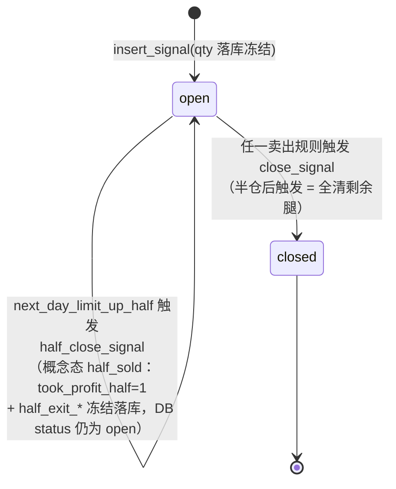
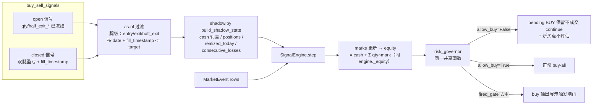

# live_trade ↔ review_account 操盘策略执行层对齐 — 技术方案（v3）

日期：2026-10-20 · 分支：feat/reviewa-account-op
v2 修订：吸收 solution-reviewer 首轮 findings（1 CRITICAL / 5 MAJOR / 7 MINOR），逐条处理见 §11。
v3 修订：main 终审放行选项 A，吸收复审第 2 轮残留 findings（3 MAJOR / 3 MINOR），逐条处理见 §12。

## 1. 背景与目标

`live_trade`（`buy`/`sell` 命令）与 `review_account`（`review-account` 回测）共享同一套策略与成交函数
（`evaluate_buy`/`evaluate_sell`/`fill_price`/`fee`），但执行层（`SignalEngine` vs `TradingEngine`）
存在已审计分歧，导致 live 信号与回测结果可观测地偏离（如保本线提前 0.9pct 触发）。
本方案以 review-account 为准绳逐项对齐，**不复制任何规则代码**：规则本体复用共享函数，
本次还在 `execution.py` 新提取两个共享原语（`apply_sell_fill` / `track_peak`），供两个引擎共同调用。

### 阶段 0 已确认决策（不得偏离）

1. 保本线：notional Position `qty=100` 改为与回测同口径推算的 qty
   （`initial_cash × max_position_pct / entry_price` 取整到 `lot_size`）。
2. 减半仓：`buy_sell_signals` 支持半仓记账（触发 `next_day_limit_up_half` 不整体 closed，
   剩余半仓继续跟踪；需 DB 迁移加列）。
3. 账户闸门：保持 buy-all，补齐 ①当日已卖出禁买 ②`risk_governor` 熔断的 live 等价实现（允许说明理由后降级）。
4. 数据分级：`sell` 回放纳入当日候选池代码做完整性判定（对齐回测 `codes = candidates ∪ positions`）。

## 2. 分歧清单与对齐动作

| # | 位置 | 问题 | 对齐动作 |
|---|------|------|---------|
| 1 | `trader.py:107-114` | `qty=100` 使 `break_even_price` 摊销畸高（+1.253% vs 回测 +0.311%） | 新增共享 `notional_quantity()`，qty 落库冻结 |
| 2 | `signal_engine.py:148-156` | `_fill_sell` 无条件 `positions.remove(p)`，半仓信号变全清；`took_profit_half` 从不落 DB | `execution.py` 提取共享 `apply_sell_fill()`；新增 `half_close_signal`，半仓腿 qty/原因全部落库冻结 |
| 3 | `trader.py:88` | sell 的 `codes` 只有持仓，回测是 `candidates ∪ positions` | sell 回放加载候选池；buy 对称纳入持仓 code |
| 4 | `signal_engine.py:37-128` | 缺 `sold_today` 禁买与 `risk_governor` 熔断 | 影子状态重建（修正版 equity 口径）+ 直接调用同一 `risk_governor` |
| 5 | `signal_engine.py` | pending BUY 无 300s 过期丢弃（`engine.py:43` 有） | 同款过期条件（与 sold_today 分支分离，对齐 engine 的 remove/continue 语义） |
| 6 | `trader.py:79-80` | buy 运行不回写既有持仓峰值；当天只跑 buy 不跑 sell 时，盘中峰值丢失，次日移动止盈/保本与回测分叉 | buy 运行对影子持仓按共享 `track_peak()` 跟踪并写回 |

## 3. 架构设计

### 3.1 信号生命周期状态机（半仓记账）



要点：`idx_buy_sell_open` 部分唯一索引（`WHERE status='open'`）不受影响——半仓后仍 `open`，
同一 code 幂等禁买语义不变；`evaluate_sell` 的 `_rule_half` 已检查 `not pos.took_profit_half`，
半仓不会重复触发。图中「half_sold」是概念态，DB 层只有 `status='open' + took_profit_half=1`。

### 3.2 影子状态（Shadow State）风控等价实现 — v2 修正版

live 无账户/资金，但 `risk_governor(cfg, state, equity)` 只读 `state.realized_today` /
`state.consecutive_losses` / `state.peak_equity` 三个字段外加 `equity` 入参。
方案：从 `buy_sell_signals` 全量记录 **as-of 重建**一个 `AccountState` 影子对象，
**逐事件调用同一个 `risk_governor`**（零规则复制）。

**v2 关键修正（CRITICAL #1）**：buy-all 下 notional 敞口可超 100%，若按
「现金 = initial_cash − Σ买入 + Σ卖出」重建，N 个同时持仓使现金为负、equity 失真，
`risk_governor` 的 `equity > 0` 守卫会让日级熔断静默失效。改为**显式净值口径**：

```
equity = initial_cash + Σ已实现盈亏(as-of) + Σ(mark × 剩余qty − 剩余成本)
```

实现上不用新公式硬编码进引擎：构造影子 `AccountState` 时令
`cash = initial_cash + Σ已实现盈亏(as-of) − Σ剩余成本`（**轧差塞项，不是现金主张**），
则引擎沿用与 `engine._equity` 完全相同的 `cash + Σ qty×mark` 恒等式即得上述 equity。
日级熔断百分比分母即此净值；buy-all 多仓会放大单日亏损占比的敏感度，属预期语义，写入 STRATEGY.md。



重建算法（新模块 `live_trade/shadow.py`，纯函数）：

```python
def build_shadow_state(signals: list[dict], cfg: StrategyConfig,
                       day: str, as_of: int | None = None) -> AccountState
```

- **as-of 用回放时点 `target`（v3 修正，R2-MAJOR #1）**：`_run` 里 `target = at(day, clock)`
  是回放时点，`until` 只是行情加载截止（历史日恒为 None）。as-of 过滤、持仓构造、
  sold_today 一律用 `as_of=target`；`as_of=None` 仅表示「整日」语义，不来自 `until`。
- **as-of 腿级过滤**（修复历史回放前视）：买入腿生效 ⇔ `entry_date < day` 或
  （`entry_date == day` 且 `entry_signal.fill_timestamp <= as_of`）；卖出腿/半仓腿同理按
  `exit_date` / `half_exit_date` + 各自 signal_json 的 `fill_timestamp`。
  缺 fill_timestamp 的当日腿保守视为已生效。
- **qty**：优先读 DB 冻结值；legacy 行（qty IS NULL）按 `notional_quantity(cfg, entry_price)` 兜底。
- **腿拆分**：`half_qty = half_exit_qty`（DB 冻结值，**不用当前 cfg 的 sell_quantity 反推**）；
  剩余 qty = qty − half_qty；成本按 **原始成本 × 腿qty/总qty 比例摊**（含最低佣金整体按比例，
  对齐 `engine.py:171,178`，不按剩余 qty 重新 `fee()`——小资金下两者不等价）。
- **realized_today**：卖出腿按腿的日期归属（half 腿归 `half_exit_date`，平仓腿归 `exit_date`），
  对齐 `engine._fill` 逐笔 `realized_today += pnl`。
- **consecutive_losses**：完全平仓信号按 `(exit_date, exit_signal.fill_timestamp, id)` 降序
  （同日多笔按成交先后，对齐 engine 逐笔更新语义），累计总实现盈亏 < 0 的领头段长度；
  半仓腿计入该信号总盈亏（对齐 `ClosedPosition.realized_return = realized_pnl / initial_cost`）。
- **sold_today**：任一卖出腿 as-of 当日已生效（含 half 腿，对齐 `engine._fill` 对任意 SELL 置 True）。
  单一事实源：`SignalEngine` 只从影子 `AccountState.sold_today` 读，不再有独立构造参数。
- **positions**：as-of 未平仓信号的剩余 qty / 剩余成本构造 notional Position（供 marks 与峰值跟踪），
  由公开 helper `position_as_of(signal, cfg, day, as_of) -> Position | None` 产出
  （v3：buy 影子持仓与 sell 持仓共用同一投影函数，`_notional_position` 删除；
  回放到半仓腿时点之前保持全仓且 `took_profit_half=False`，R2-MINOR #4）。
- **run 内买入记账（v3 新增，R2-MAJOR #2）**：`_fill_buy` 成交时
  `account.cash -= amount + fee`，且 `account.positions` 与 `SignalEngine.positions` 是
  **同一 list 对象**——净值恒等式 `cash + Σ qty×mark` 在 run 内持续成立，
  buy-all N 票不再稀释日级熔断分母。
- **peak_equity = 0 且 run 内不更新**：`risk_governor` 回撤分支要求 `peak_equity > 0`，
  永不触发——见 3.5 降级声明（drawdown_delevel 不可见且 no-op，不透传展示）。

### 3.3 notional qty 口径

`execution.py` 新增（放在 `buy_quantity` 旁，关系显式）：

```python
def notional_quantity(cfg: StrategyConfig, price: float) -> int:
    """实盘辅助的虚拟数量口径：满仓单票（initial_cash × max_position_pct），与回测首仓同口径。"""
    return buy_quantity(cfg.initial_cash, cfg.initial_cash, price, cfg)
```

- 等价性：回测首仓 `buy_quantity(cash=equity=initial_cash)` 的 `min(cash, equity×pct)` =
  `initial_cash×pct`；`risk_per_trade_pct > 0` 时风险上限同样以 initial_cash 结算，两端仍等价
  （仅多仓 buy-all 场景超出首仓语义，此时 notional 口径仍逐票独立成立）。
- **qty=0 不再保底一手**（v2 修正）：回测 `_fill` 对 `buy_quantity==0` 直接不建仓
  （`engine.py:156-157`），live 对齐——`_fill_buy` 检测到 0 时**跳过该信号**并记 detail
  `budget_insufficient`（预算不足，回测同样不建仓），不强制记录买入。
- 买入时计算并**落库** `qty` 列：冻结买入日口径，跨日 cfg 变更不回溯改写既有信号的保本线。
- 卖出回放（`_notional_position`）读 DB `qty`；legacy 行按同一函数兜底（确定性纯函数，结果一致）。

### 3.4 共享成交原语提取（消除「镜像=复制」）

`execution.py` 新增两个纯函数，**两个引擎共同调用**（响应 MAJOR #2）：

```python
def apply_sell_fill(position: Position, price: float, reason_code: str, cfg: StrategyConfig) -> dict:
    """卖出成交的仓位记账原语：返回 {qty, amount, fee, cost, pnl, partial}。
    副作用：扣减 position.qty/cost、累加 realized_pnl、半仓时置 took_profit_half。
    TradingEngine._fill 与 SignalEngine._fill_sell 共用，账户/信号簿记由各自调用方负责。"""

def track_peak(position: Position, row: dict, entry_ts: int) -> None:
    """峰值跟踪原语：同一根 K 的高点不反向激活该根 K 内的保护（两引擎现有逻辑逐字相同）。"""
```

`engine.py:169-190` 的数量/成本/盈亏/`took_profit_half` 段与 `engine.py:83-87` /
`signal_engine.py:93-97` 的峰值段分别替换为对这两函数的调用；`SignalEngine._fill_sell`
剩余部分只剩信号字典装配与「partial 时不 remove position」，不含任何数量/成本/盈亏计算。

### 3.5 risk_governor 降级声明（v2 修正）

| 闸门 | 类型 | live 等价性 |
|------|------|------------|
| `daily_loss_circuit_breaker` | allow_buy | ✅ 跟随（修正版净值口径 + 腿归属 realized_today + run 内买入记账） |
| `streak_circuit_breaker`（≥6 连亏） | allow_buy | ✅ 跟随（closed 信号盈亏符号、毫秒级排序重建） |
| `streak_delevel`（4-5 连亏） | delevel | ⚪ buy-all 无 sizing，行为 no-op；fired_gate 透传展示 |
| `drawdown_delevel` | delevel | ⚪ 永不触发（peak_equity=0）且行为 no-op；不透传 |
| `shadow_equity_floor`（v3 新增，R2-MAJOR #3） | allow_buy | ✅ live 侧显式破产闸：`equity <= 0` → 禁买。修补 `risk.py:22` 的 `equity > 0` 守卫在 buy-all 杠杆下（累计/浮动亏损超 initial_cash 时净值合法为负）静默跳过日级熔断的缺口 |

降级理由：delevel 只乘以 `buy_quantity` 的 `budget_scale`，live 无账户、不 sizing，
因此无需 equity 曲线峰值——这是无行为差异的精确降级，不是近似。
buy-all 敞口可超 100%、日级熔断分母为影子净值（run 内随成交持续更新）——语义写入 STRATEGY.md §5。

## 4. 候选设计（难点专项）

### 4.1 半仓记账的 DB 迁移方案

**候选 A（推荐）：`buy_sell_signals` 加列（v2 补齐冻结列）**

新增 7 列，全部追加在既有列之后（新库 CREATE 内联、旧库幂等 ALTER）：
`qty INTEGER`、`half_exit_date TEXT`、`half_exit_price REAL`、`half_exit_qty INTEGER`、
`half_exit_reason_code TEXT`、`half_exit_reason_text TEXT`、`half_exit_signal_json TEXT`
（`took_profit_half` 列已存在，此前从未被写入）。

- v2 修正（MAJOR #3）：**half 腿 qty 与原因码/文本一并冻结落库**，剩余腿一律由 DB 值推导
  （剩余 qty = qty − half_exit_qty；剩余成本按比例摊），不再调用当前 cfg 的 `sell_quantity` 反推——
  避免 `lot_size`/公式调整让历史信号口径漂移。
- 优点：单行单信号不变式不破；部分唯一索引不动；旧数据 NULL 可读（兜底分支）；查询无 join。
- 缺点：只支持一次半仓（当前规则链确实只有 `next_day_limit_up_half` 一条部分卖出）。

**候选 B（非常规）：事件溯源子表 `buy_sell_signal_exits`**

每条卖出腿一行（signal_id, leg_date, leg_price, leg_qty, reason_code, signal_json），
父表只剩 open/closed 状态。支持任意 N 次部分卖出，审计最完整。

- 否决理由：规则链只有一个部分卖出点，N=1 是稳定业务事实；join 读取、迁移既有行、
  平仓判定都要重写，为假设的未来需求引入抽象，违反「优先简单」约定。

**决策**：候选 A。若未来出现第二种部分卖出规则，再评估升被子表。

### 4.2 risk_governor 在无账户状态下的等价实现

**候选 A（推荐）：影子状态 as-of 重建 + 调用同一 `risk_governor`**

如 3.2。重建是纯函数（同一输入同一输出），无新增可变状态；`risk_governor` 零修改零复制。

**候选 B（非常规）：持久化虚拟账户台账（`live_account_state` 单行表）**

每次 buy/sell 运行后把影子净值/连亏计数写回一行持久状态，下次直接读。

- 否决理由：引入「信号表之外的第二事实源」，两者可能脱节（手工改库、写中断）；
  台账本质是信号表的物化视图，而信号表本身足以确定性重建——缓存一个可重建的视图是负资产。

**决策**：候选 A。

### 4.3 执行层收敛路径

**候选 A（推荐）：双引擎 + 共享原语**（本方案）

`TradingEngine` 与 `SignalEngine` 保留各自 `step()`（账户语义 vs buy-all 信号语义），
数量/成本/盈亏/峰值/风控全部经共享函数收敛。

**候选 B（非常规）：单引擎适配——`SignalEngine` 包装 `TradingEngine` + notional 账户**

- 否决理由：`TradingEngine` 买入路径内嵌预算/仓位上限/择优只取第一只
  （`engine.py:88-117`），与 buy-all 直接冲突；关掉它们需要配置手术（`max_daily_buys=∞` 等）
  且 `_fill` 仍返回带现金语义的 `Trade`。适配层要伪造的恰好是 live 明确不维护的账户不变式，
  比双引擎 + 共享原语更脆弱。

**决策**：候选 A。

## 5. 接口定义与数据模型

### 5.1 DB 迁移（`storage/db.py`）

- `BASE_SCHEMA` 的 `CREATE TABLE buy_sell_signals` 内联新列（新库）。
- 新增 `_ensure_signal_columns(conn)` 并入 `_ensure_schema`：对旧库按既有
  `PRAGMA table_info` + `ALTER TABLE ADD COLUMN` 幂等补列；并发首启撞
  `duplicate column` 时复查后视为成功（沿用 `assets_db.py:23` 先例），不再「异常即失败」。

### 5.2 `storage/signals.py`

- `_SIGNAL_COLS` / `_signal_row_to_dict`：新列**追加在末尾**（防位置映射错乱），dict 键同名。
- `insert_signal(..., entry_signal=None, source="v2", *, qty=None) -> tuple[int, bool]`：
  qty 为 **keyword-only 且位于 source 之后**（v2 修正 MAJOR #4：现有调用位置传 source，
  插到 source 前会让 'v2' 落入 INTEGER 列）；trader 调用点同步改关键字。
  返回值改为 `(id, created)`（v3 新增，R2-MINOR #5：dedup 命中时 `created=False`，
  调用方据此标注「未落库」，避免回放时输出与库不一致）。
- `half_close_signal(code, exit_date, exit_price, exit_qty, reason_code, reason_text, exit_signal) -> bool`：
  `WHERE code=? AND status='open' AND took_profit_half=0`（幂等守卫），
  置 `took_profit_half=1` + `half_exit_*`（含冻结 qty/原因），**保持 `status='open'`**。
- `list_all_signals(source="v2") -> list[dict]`：全量（open+closed）按 id 升序，供影子重建。
- 不设独立 `has_sell_on`（v3 修正）：`sold_today` 由 `build_shadow_state` 单一产出，
  避免双事实源。

### 5.3 `live_trade/shadow.py`（新模块）

- `build_shadow_state(signals, cfg, day, as_of=None) -> AccountState`：见 3.2，单一事实源。
- `position_as_of(signal, cfg, day, as_of=None) -> Position | None`（v3 新增）：
  单信号 as-of 投影——买入腿未生效或未平仓不成立返回 None；半仓腿未生效时保持全仓
  且 `took_profit_half=False`。buy 影子持仓与 sell 持仓共用，`trader._notional_position` 删除。
- 腿级 helper（`entry_active` / `half_active` / `close_active`）：`_run_buy`/`_run_sell` 共用，
  持仓/held_codes 也经同一 as-of 口径构造，修复历史回放前视。

### 5.4 `live_trade/signal_engine.py`

- `SignalEngine(cfg, positions=None, held_codes=None, sentiment_pct=None, account=None,
  evaluate_sells=True)`：
  - `account`：影子 `AccountState`（buy 命令注入；sell 命令 `allow_buy=False`，不注入，
    风控门默认放行）。
  - 每事件（有 account 时）：更新 `account.marks` → `equity = cash + Σ qty×mark`
    （与 `engine._equity` 同式）→ `risk_governor` → `risk_allow_buy`；`fired_gate`
    按 run 去重后透出（`dict.fromkeys`，对齐 `simulator.py:51`）。
  - pending BUY 成交条件补 `risk_allow_buy`：**不通过是 `continue`（保留 pending），
    与 sold_today/300s 过期的 `remove` 分支保持分离**（对齐 `engine.py:41-46` 同位插入）。
  - pending BUY 丢弃条件补 `sold_today or age > 300_000`；`max_daily_buys`/`max_positions`
    属 buy-all 设计保留，不引入。
  - 买点评估门补 `risk_allow_buy and not sold_today`（对齐 `engine.py:88-89`）；
    `sold_today` 只读 `account.sold_today`（无 account 时 False）。
  - 本 run 内发生卖出成交时置 `account.sold_today = True`（防御性，buy run 实际不评估卖出）。
  - 持仓循环内：`evaluate_sells=False`（buy run）时跳过 `evaluate_sell` 但**仍执行
    共享 `track_peak()`**——buy run 也能为既有持仓写回峰值（v2 新增，MAJOR #6）。
- `_fill_buy`：`qty = notional_quantity(cfg, price)`；**qty==0 时跳过并记
  `budget_insufficient` detail**（v2 修正，对齐回测不建仓）；成本按 qty 计；返回字典带 `qty`；
  **有 account 时 `account.cash -= amount + fee`**（v3 新增 run 内买入记账，
  `account.positions` 与 `self.positions` 为同一 list，净值恒等式 run 内持续成立）。
- `_fill_sell`：调用共享 `apply_sell_fill()`；有 account 时
  `account.cash += amount - fee`、`account.realized_today += pnl`、`account.sold_today = True`；
  partial 时不 remove position；返回字典带 `partial: bool`、`qty`。
  补 `p.entry_date >= day` 守卫（对齐 `engine.py:167`）。
- **破产闸（v3 新增）**：每事件影子 equity 计算后 `equity <= 0 → risk_allow_buy = False`
  并记 `fired_gate += ["shadow_equity_floor"]`（修补 `risk.py:22` 守卫在杠杆下的静默跳过）。

### 5.5 `live_trade/trader.py`

- **as-of 接线（v3 修正，R2-MAJOR #1）**：`build_shadow_state` / `position_as_of` /
  持仓与 held_codes 构造一律传 `as_of=target`（回放时点），与行情加载截止 `until` 无关。
- `_run_buy`：
  - `signals = db.list_all_signals(...)` → `build_shadow_state(signals, cfg, day, as_of=target)`；
    `held_codes` 与持仓由同一 as-of 口径得出（不再用无日期过滤的 `list_open_signals()`）。
  - `codes = 候选 ∪ as-of 持仓 code`（对齐 `simulator.py:32`，同时让影子持仓有当日 marks）；
    **持仓 code 逐只预检 `data.daily(code, day)`，缺日K剔除并注记降级**（v3 新增，R2-MINOR #6：
    买入路径不因历史持仓停牌/缺数据整体失败；候选缺日K仍抛错——买入前提数据必须完整）。
  - 注入 `account=shadow`、`positions=shadow.positions`（同一 list）、`evaluate_sells=False`；
    结束对全部 positions（含影子持仓）`update_signal_peaks` 写回。
  - `insert_signal(..., qty=b["qty"])`（关键字）；消费 `(id, created)`，`created=False` 时
    该买入记 `persisted=False`（回放撞既有 open 行，输出标注「未落库」）。
- `_run_sell`：
  - 接 `calendar`；`collect_candidates` 包 try/except，失败降级为「持仓-only + 输出降级提示」；
    候选 code 逐只预检 `data.daily(code, day)`，缺日K剔除并注记（卖出是风控路径，
    不因候选池数据问题整体失败；持仓缺日K仍抛错——无法估值）。
  - as-of 持仓口径：`entry_date < day` 且 as-of 未平仓（T+1 + 时点过滤），
    由 `position_as_of(s, cfg, day, as_of=target)` 构造（替代 `_notional_position`）。
  - `codes = 持仓 ∪ 候选 code`（决策 4）；卖出路由：`partial` → `half_close_signal`
    （传冻结 qty），否则 `close_signal`；两者返回值消费，`False` 时记 `persisted=False`。
- buy/sell 结果新增 `data_quality`（从当日第一个 event row 读取，对齐 `simulator.py:37-38`）。

### 5.6 `live_trade/service.py`

- `_print_sell`：`partial` 记录显示「减半仓（剩余继续跟踪）」。
- `_print_buy`：尾部打印去重后的 `fired_gate`（如有）。
- 两者打印 `data_quality == daily_fallback/mixed` 的兜底提示（v2 新增）；
  `persisted=False` 的买/卖记录标注「未落库」（v3 新增）。

## 6. 错误处理策略

- 影子重建遇 legacy 脏数据（closed 但缺 exit_price / 缺 fill_timestamp）：缺价腿按 0 盈亏跳过；
  缺 fill_timestamp 的腿 as-of 判定退化为日期粒度（当日腿视为已生效，保守方向），均不中断命令。
- `notional_quantity` 返回 0 → 不建仓并记 detail（不保底、不除零）。
- DB 迁移幂等且向后兼容：旧库 ALTER 加列、旧行 NULL 走兜底、新库 CREATE 内联；
  并发 duplicate column 复查后视为成功。
- 候选池读取/候选日K缺失：sell 路径降级不中断（§5.5）；buy 路径保持现状（候选是买入前提，失败即报错）。

## 7. 测试策略（`tests/test_live_trade.py` + `tests/test_storage.py`）

| 用例 | 验证点 |
|------|--------|
| notional qty 保本对齐 | 同价买入后 live notional Position 与 TradingEngine 首仓的 `break_even_price` 逐分相等；**含 `risk_per_trade_pct > 0` 场景**（v2 补） |
| qty=0 不建仓 | 超高股价/小 `initial_cash` → 无买入记录 + `budget_insufficient` detail（v2 补） |
| qty 落库与 legacy 兜底 | insert 带 qty → 读回一致；qty=NULL 且 half_exit_* 全 NULL 行 `_notional_position` 兜底不崩且口径一致 |
| 位置参数兼容 | `insert_signal` 旧式位置传 source 仍正确（v2 补，MAJOR #4 回归） |
| 半仓触发不清仓 | `_fill_sell` 半仓后 position 保留、qty/cost/took_profit_half 与 `TradingEngine._fill` 同值（共享 `apply_sell_fill` 的 parity 断言） |
| 半仓落库续跟踪 | `half_close_signal` 后 `list_open_signals` 仍含该 code、7 个半仓字段齐全；随后 `close_signal` 正常闭环；重复 `half_close_signal` 幂等 False |
| 小资金成本比例摊 | 小 `initial_cash`（最低佣金生效）下半仓后剩余成本 = 原成本按比例，`break_even_price` 与回测一致（v2 补，MINOR #7） |
| sell 候选池数据分级 | 候选 code 分时缺失 → 整日 `daily_fallback`；候选池读取异常 → 降级持仓-only + 提示 |
| buy 持仓纳入 codes | as-of 持仓 code 分时缺失 → buy 同样整日兜底 |
| buy 峰值写回 | buy run 后既有持仓 `highest_price` 更新到当日已见高点（v2 补，MAJOR #6） |
| 卖出后禁买 | 影子 `sold_today=True` → 无新 pending BUY 且存量 pending BUY 被 remove |
| 300s 过期 | pending BUY 超 300s remove；`risk_allow_buy=False` 时 pending 保留不成交（两分支语义分离） |
| 连亏熔断 | 构造 6 连亏 closed 信号（同日多笔带 fill_timestamp 乱序）→ `consecutive_losses=6` → buy 被 `streak_circuit_breaker` 否决且 fired_gate 透出 |
| 日级熔断端到端 | 当日卖出腿亏损超阈值 → **断言 buy 真的被拦**（v2 补，CRITICAL #1 回归） |
| 破产闸端到端 | 影子 equity ≤ 0（杠杆亏损超 initial_cash）→ buy 被拦且 `shadow_equity_floor` 透出（v3 补） |
| run 内买入记账 | buy-all 多票成交后影子 `cash + Σqty×mark` 与净值公式逐分一致（v3 补，R2-MAJOR #2） |
| 腿归属 | half 腿与平仓腿按各自日期计入 `realized_today` |
| as-of 过滤 | 回放日 D：entry_date > D 的信号不进持仓/影子；D 之后平仓的信号在 D 回放中仍是持仓；**同日时点：D 日 14:00 回放不受 D 日 14:55 未来卖出影响（sold_today/持仓/半仓投影）**（v3 补同日粒度，R2-MAJOR #1 / R2-MINOR #4） |
| 持久化标注 | 回放撞上既有 open 行 → `created=False` → 输出 `persisted=False`（v3 补，R2-MINOR #5） |
| buy 持仓缺日K降级 | 持仓 code 缺日K → 剔除并注记，buy 不整体失败（v3 补，R2-MINOR #6） |
| 迁移兼容 | 手工建旧 schema 表 → `_ensure_schema` → 新列存在、旧行可读 |
| 回归 | `tests/` 全绿（含 test_review_account / test_live_trade 既有 parity 用例） |

## 8. 文档同步（同一 commit，逐句点名）

- `AGENTS.md`：
  - 实盘辅助段落「不维护模拟账户/资金/数量/仓位」改为「不维护真实账户；qty 按回测同口径落库冻结，
    风控经信号表重建的影子状态对齐」；
  - 「卖出用 notional Position（qty=100）」改为 notional_quantity 口径 + 半仓记账说明；
  - `buy_sell_signals` 表结构行补 7 个新列与 `live_trade/shadow.py` 模块条目。
- `README.md`：§实盘辅助交易（半仓记账行为、风控闸门跟随范围、data_quality 提示、
  「每交易日跑 sell 维持峰值新鲜度」运维契约——buy 写回为增量改进，漏跑 sell 仍可能丢当日尾盘峰值）；
  `buy_sell_signals` 字段清单补 qty/half_exit_*。
- `review_account/STRATEGY.md` §5 分叉声明表：
  - 「组合熔断/降仓」行改为「allow_buy 闸门经影子状态跟随（日级熔断分母为影子净值，buy-all 敞口可超 100%）；
    delevel 降仓不适用（无 sizing，drawdown_delevel 不触发不透传）」；
  - 新增保本线 qty 口径行与半仓记账行。

## 9. 风险与缓解

| 风险 | 缓解 |
|------|------|
| buy/sell 纳入对方代码集后，分时缺失票会拉高日K兜底频率 | 与回测一致的**预期行为**；输出新增 `data_quality` 兜底提示 |
| 影子重建用**当前** cfg 费率重算历史腿盈亏 | 费率变更极罕见且影响仅在熔断阈值边界；STRATEGY.md 声明 |
| buy-all 多仓使日级熔断分母敏感度放大 | 预期语义，STRATEGY.md 声明；阈值调参以前向验证为准 |
| legacy 信号无 qty，保本线口径新旧混排 | 兜底函数与落库公式同源；新买入全部落库，随时间自然收敛 |
| 峰值新鲜度依赖当日至少跑一次 buy 或 sell | README 运维契约；buy 侧写回为增量改进 |
| `--date` 历史回放会写库（既有行为） | as-of 过滤消除前视；写库副作用在 README 声明（signals 幂等 + close 幂等，重放安全） |
| `sold_today` 仅覆盖经本系统卖出的场景（人工场外卖出不可见） | 文档声明：闸门只对系统内信号负责 |

## 10. 非目标

- 不引入 `max_daily_buys`/`max_positions`/择优（buy-all 为保留设计）。
- 不改 `evaluate_buy`/`evaluate_sell`/`fill_price`/`fee`/`risk_governor` 任何规则本体。
- 不接券商、不做真实下单。
- 不为半仓引入子表/事件溯源（4.1 候选 B，已否决）。
- 不合并两个引擎为单一 step()（4.3 候选 B，已否决）。

## 11. v2 修订记录（solution-reviewer 首轮 findings 处置）

| finding | 处置 | 位置 |
|---------|------|------|
| CRITICAL #1 影子 equity 负值/熔断失效 | 采纳：改为显式净值口径（cash 轧差塞项），引擎沿用 `cash + Σqty×mark` 恒等式；补端到端拦截测试 | §3.2 / §7 |
| MAJOR #2 半仓记账镜像=复制 | 采纳：`execution.py` 提取 `apply_sell_fill`/`track_peak` 共享原语，双引擎共调 | §3.4 |
| MAJOR #3 half 腿 qty/原因未冻结 | 采纳：迁移列补齐 `half_exit_qty/reason_code/reason_text`，剩余腿全由 DB 冻结值推导 | §4.1 / §5.2 |
| MAJOR #4 insert_signal 位置兼容 | 采纳：qty 改 keyword-only 且位于 source 后；新列追加末尾；补回归测试 | §5.2 / §7 |
| MAJOR #5 as-of 时点过滤缺失 | 采纳：腿级 as-of 过滤（date + fill_timestamp），持仓/held_codes/影子同一口径 | §3.2 / §5.3 / §5.5 |
| MAJOR #6 buy 不写回持仓峰值 | 采纳：`evaluate_sells` 开关 + buy run 对影子持仓 `track_peak` 并写回；README 运维契约 | §2 #6 / §5.4 / §8 |
| MINOR #7 成本重新 fee 不等价 | 采纳：比例摊成本 | §3.2 / §5.5 |
| MINOR #8 连亏同日排序 | 采纳：`(exit_date, fill_timestamp, id)` 降序 | §3.2 |
| MINOR #9 drawdown 行自相矛盾 | 采纳：改为「不触发不透传」 | §3.5 |
| MINOR #10 输出无 data_quality | 采纳：buy/sell 结果与打印补兜底提示 | §5.5 / §5.6 |
| MINOR #11 qty=0 保底一手 | 采纳：改为跳过 + `budget_insufficient`，对齐回测不建仓 | §3.3 / §5.4 |
| MINOR #12 实现细节空洞 | 采纳：shadow.py 模块/签名明确；sold_today 单一事实源；fired_gate 去重；迁移并发复查；half_close WHERE 守卫 | §5.1-5.4 |
| MINOR #13 文档同步未点名 | 采纳：§8 逐句点名 | §8 |
| MINOR #14 测试缺口 | 采纳：补 risk_per_trade / 日级熔断端到端 / as-of 回放 / legacy NULL 用例 | §7 |
| MINOR #15 sell 候选失败面 | 采纳：collect_candidates try/except 降级 + 候选逐只日K预检 | §5.5 / §6 |

## 12. v3 修订记录（复审第 2 轮残留 findings 处置；main 终审放行选项 A，免第 3 轮方案复审）

放行理由（main 终审）：残留 6 条全部是实现级接线修正，修复路径明确，不涉及方案方向/范围/阶段 0 决策变更。

| finding | 处置 | 位置 |
|---------|------|------|
| R2-MAJOR #1 as-of 截止接错（用了 until 而非 target） | 采纳：`as_of=target` 贯穿 build_shadow_state/position_as_of/持仓构造；补同日时点测试 | §3.2 / §5.5 / §7 |
| R2-MAJOR #2 run 内买入未记账稀释熔断分母 | 采纳：`_fill_buy` 扣影子现金，account.positions 与 engine.positions 同一 list；补净值恒等断言 | §3.2 / §5.4 / §7 |
| R2-MAJOR #3 杠杆下净值转负使 `equity>0` 守卫静默跳过熔断 | 采纳：live 侧显式破产闸 `shadow_equity_floor`（equity<=0 → 禁买），同步 STRATEGY.md | §3.5 / §5.4 / §7 |
| R2-MINOR #4 `_notional_position` 无条件应用半仓 | 采纳：删除该方法，buy/sell 共用 `position_as_of` 投影（半仓腿未生效时全仓） | §3.2 / §5.3 / §5.5 |
| R2-MINOR #5 写库幂等返回值未消费 | 采纳：`insert_signal` 返回 `(id, created)`；买/卖记录带 `persisted`，未落库标注 | §5.2 / §5.5 / §5.6 |
| R2-MINOR #6 buy 持仓缺日K新增失败面 | 采纳：持仓 code 逐只日K预检剔除 + 降级注记；候选缺日K仍抛错（买入前提） | §5.5 / §7 |
| 附带 API 调整 | `has_sell_on` 不落地（sold_today 由影子状态单一产出）；`insert_signal` 返回类型变更为 `(int, bool)` | §5.2 |
