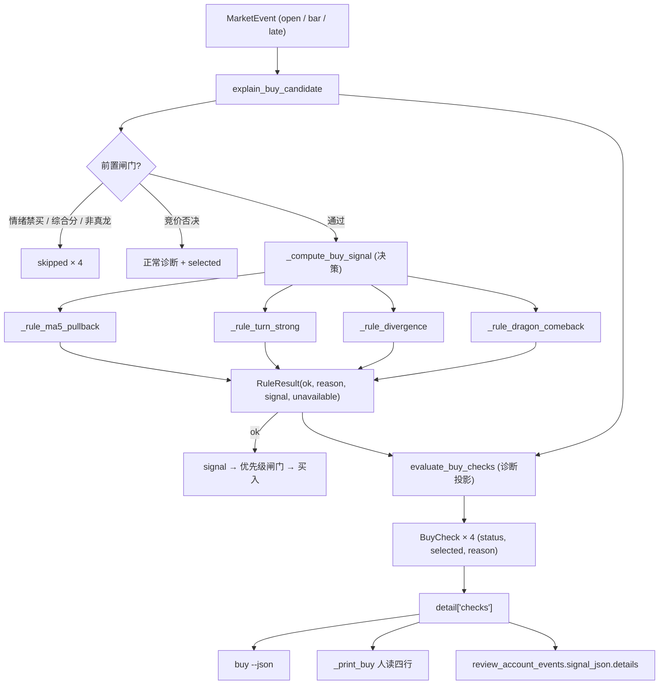
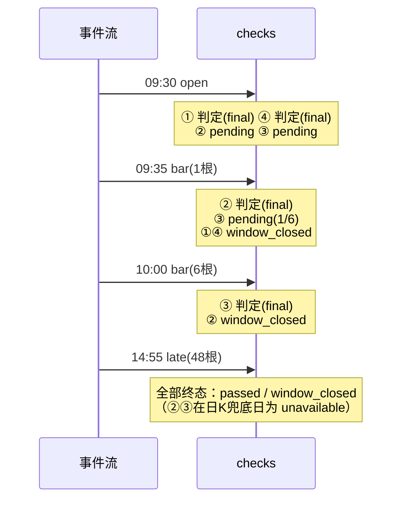

# buy 四类买点诊断全量输出 + 龙回头默认开启 — 技术方案

日期：2026-10-21 · 分支：feat/reviewa-account-op · 状态：v3（第 2 轮复审后修订；2 轮上限已到，main 已预授权按推荐方案进入阶段 3）
范围：阶段 2（技术方案）。阶段 0 需求已由 main 与用户确认；本文不重开需求讨论，只解决「怎么落」。
v2 修订：吸收第 1 轮 findings（0 CRITICAL / 3 MAJOR / 10 MINOR），逐条处理见 §17.1。
v3 修订：吸收第 2 轮 findings（0 CRITICAL / 1 MAJOR / 6 MINOR），逐条处理见 §17.2。方案审查已用满 2 轮，按 main 预授权直接进入阶段 3，不再发起第 3 轮。

---

## 1. 背景与问题定性

### 1.1 现象（2026-10-21 实测）

`python3 -m dragon_quant buy --force` 对 3 只候选只输出一条原因：

> 开盘距MA5 +5.4% > 3%（未贴近，不满足回踩承接）

但逐事件回放显示当天四类买点都评估过：

| 买点 | 时点 | 实际判定 |
|------|------|----------|
| ① 开盘回踩 MA5 | 09:30 open | 距 MA5 +5.4% > 3%，未通过 |
| ② 弱转强 | 09:35 首根 5 分钟 K | 开盘 38.12 < 上日高点 38.51，未通过 |
| ③ 分歧买龙 | 10:00 前 6 根 5 分钟 K | 连续一字板 0 < 2，未通过 |
| ④ 龙回头 | 09:30 open（日 K） | 默认关闭，未评估 |

### 1.2 根因（函数级定位）

| 位置 | 现状 |
|------|------|
| `review_account/strategy.py::_compute_buy_signal` | 按 `row["phase"]` 路由：open 只判 ①④，bar 只判 ②③；判定结果只有一个 `signal or None`，失败原因不落库 |
| `review_account/strategy.py::explain_buy_candidate` | 未命中时调用 `_no_pattern_reason`，只按**当前事件**拼一条摘要 |
| `review_account/strategy.py::_no_pattern_reason` | 与决策函数各写一套阈值/条件（第三份拷贝），且 open 事件只讲 ① |
| `live_trade/service.py::_print_buy` | `seen` 去重保留**第一条** detail（09:30），后续 09:35/10:00/14:55 的判定全部丢弃；已买入标的只打印一行 `reason_text` |
| `live_trade/trader.py::_run_buy` | 逐事件 `details.extend`，JSON 里其实有全天 detail，但人读输出只取首条 |
| `review_account/models.py::StrategyConfig.dragon_comeback_enabled` | 默认 `False`，④ 从未参与实盘判断 |

结论：**决策层有全天信息，展示层只取了第一帧**；同时失败原因没有结构化产物，导致「诊断」与「决策」是两套代码。

### 1.3 目标

1. `dragon_comeback_enabled` 默认开启（`buy` / `review-account` 共享策略同时生效），阈值与形态逻辑零改动。
2. `buy` 对**每个候选**（买入与未买入）逐条展示四类买点的状态与带数值的原因。
3. 同一 code 只展示一次，取**最后一个可评估事件**的判定。
4. `buy --json` 的 `details[].checks` 提供同源结构化诊断。
5. 诊断与决策共用同一套逐规则判定函数，阈值/条件只有一份。

---

## 2. 本文补充决策（需求未明确处的落地口径）

| # | 决策 | 理由 |
|---|------|------|
| C1 | 状态枚举在用户要求的 4 态之外增加 `unavailable`（不可判定）与 `skipped`（未评估） | 日K兜底日 ②③ 不可判定；情绪禁买/综合分不足/非真龙时四类形态**根本没进入判断**，标「未通过」会误导 |
| C2 | `buy --json` 目前**不存在**（`cli.py` 的 buy parser 没有 `--json`）。AC5 要求 `details[].checks`，因此本方案新增 `buy --json` | 否则 AC5 无落点；新增而非改变既有契约。成功 payload 补 `ok: true` / `mode: "buy"`，与 auction/prep 的 JSON 约定对齐。**这是本次唯一的 CLI 表面扩展，列为待确认点（§16）** |
| C3 | `checks[].selected` 表示「该规则产生了本次决策信号（可能随后被竞价否决 / 排序淘汰 / 未成交）」，不是「已成交」 | 让 AC6「checks 通过 ⇔ 实际触发该买点」可精确测试；成交与否由 `passed`/`buys` 表达 |
| C4 | 人读 last-wins 的口径是「同一 code 最后一条**带非空 checks** 的 detail」；若无则退回最后一条 detail。买入标的的 `selected` 在渲染层用 `buys[].reason_code` 回填，不依赖 `already_holding` 帧 | 成交失败（`budget_insufficient`）等 detail 不能覆盖形态判定；`already_holding` 的 selected 恒 false，不能表达「今天的命中买点」 |
| C5 | `checks` 只进 detail JSON：`buy --json` 的 `details`、`review_account_events.signal_json` 的 `details`；**不写入** `buy_sell_signals.signal_json`，不新增表/列，不写 `prep_snapshots` | 「只增字段」最小面；信号表保持既有结构 |
| C6 | `reason_text` 维持既有单行摘要语义；`checks` 才是四类明细。Web UI 继续展示 `reason_text`，不需要改前端 | AC7；前端 `AccountApp.tsx` 直接渲染 `reason_text` |
| C7 | `_no_pattern_reason` 改为「共享规则函数的原因 + 旧格式拼接」，保留旧关键词（距MA5/振幅/涨幅/回撤/换手） | 消除第三份阈值拷贝，同时不破坏既有 `assertIn` 断言 |
| C8 | 历史回测/历史快照不做迁移、不重算；龙回头默认值只影响**新运行** | 用户已确认默认开启；历史 `review_account_runs` 的 `strategy_params` 里显式 `false` 仍按 false 重放 |

---

## 3. 架构设计

### 3.1 核心思路：规则函数 + 诊断投影

把四类买点的**条件判定**抽成四个纯函数，统一返回 `RuleResult`：

- **决策层** `_compute_buy_signal`：按原有 phase 路由调用规则函数，`ok` 即返回 signal —— 行为与现在完全一致（AC10）。
- **诊断层** `evaluate_buy_checks`：调用同一批规则函数，再叠加「窗口/数据可用性」投影成 `BuyCheck` 展示状态（待确认/窗口已过/不可判定/未评估）。

关键性质：**四类判定的输入都是当日确定量**（`row["open"]`、`prev_row`、`hist_rows`、当日已完成的 `intraday_bars`），因此在 14:55 的最后一帧重算 09:30/09:35/10:00 的规则，结果与当时一致——**不需要录制决策轨迹**（这是方案 B 被否的前提，见 §9）。



图 1：决策与诊断共用 `_rule_*`，`evaluate_buy_checks` 只做状态投影，不复制阈值。

### 3.2 一天的窗口时序（严格 5 分钟 K）



图 2：09:30 的 ②③ 必须是「待确认」，不是「未通过」；窗口过去后保留最终判定与原因。

### 3.3 设计模式说明

- **表驱动 + 纯函数（Registry-lite）**：四类规则由命名常量 + 有序元组组织，不引入 `BuyRule` 抽象基类/策略类。四条规则、四个纯函数，符合「不为假设的未来需求引入抽象」。
- **投影/适配器**：`RuleResult`（决策语义）→ `BuyCheck`（展示语义）的转换集中在 `evaluate_buy_checks` 一处；新增展示状态只改投影层，不改规则。
- **模板方法思想（非继承实现）**：决策与诊断共享同一批「条件步骤」，差异仅在窗口选择与状态映射；用函数组合而非类继承表达。

---

## 4. 接口定义

### 4.1 新增类型与常量（`review_account/strategy.py`）

```python
# 状态枚举（JSON 原生字符串；顺序即文档顺序）
BUY_CHECK_PASSED = "passed"                    # 通过
BUY_CHECK_FAILED = "failed"                    # 未通过（该规则的判定时点就在当前事件）
BUY_CHECK_PENDING = "pending"                  # 待确认（确认时点未到）
BUY_CHECK_WINDOW_CLOSED = "window_closed"      # 窗口已过（最终判定未通过）
BUY_CHECK_UNAVAILABLE = "unavailable"          # 不可判定（日K兜底/数据缺失）
BUY_CHECK_SKIPPED = "skipped"                  # 未评估（前置闸门早退/规则配置关闭）
BUY_CHECK_STATUSES = (...)

BUY_CHECK_LABELS = {
    "buy_open_ma5_pullback": "开盘回踩MA5",
    "buy_open_turn_strong": "弱转强",
    "buy_divergence_first_break": "分歧买龙",
    "buy_dragon_comeback": "龙回头",
}

BUY_CHECK_DISPLAY_ORDER = (
    "buy_open_ma5_pullback", "buy_open_turn_strong",
    "buy_divergence_first_break", "buy_dragon_comeback",
)  # ① ② ③ ④（用户展示顺序）
BUY_CHECK_SELECTION_ORDER = (
    "buy_open_ma5_pullback", "buy_dragon_comeback",
    "buy_open_turn_strong", "buy_divergence_first_break",
)  # 实际跨事件决策优先级：open ①→④，bar ②→③

@dataclass(frozen=True)
class RuleResult:
    ok: bool
    reason: str
    signal: Optional[dict] = None
    unavailable: bool = False   # 数据缺失/历史不足，而非条件不满足

@dataclass(frozen=True)
class BuyCheckContext:
    candidate: dict
    row: dict
    cfg: StrategyConfig
    prev_row: Optional[dict] = None
    hist_rows: Optional[list] = None
    intraday_bars: Optional[list] = None

@dataclass(frozen=True)
class BuyCheck:
    rule: str
    label: str
    window: str
    status: str
    reason: str
    selected: bool = False

    def to_dict(self) -> dict:
        return {"rule": self.rule, "label": self.label, "window": self.window,
                "status": self.status, "selected": self.selected, "reason": self.reason}
```

### 4.2 函数签名

```python
def _ctx(candidate, row, cfg, prev_row=None, hist_rows=None,
         intraday_bars=None) -> BuyCheckContext

def _open_common_gate(ctx) -> tuple[Optional[str], bool]
    """① ② 共享的开盘前置门槛；返回 (reason, unavailable)。"""

def _turn_strong_preconditions(ctx) -> tuple[Optional[str], bool]
    """② 除首根K换手外的全部条件（前高/缺口/换手区间/成交额/距MA5）。"""

def _divergence_preconditions(ctx) -> tuple[Optional[str], bool]
    """③ 除窗口外的全部条件（开关/真龙/综合分/连续一字板/缩量）。"""

def _rule_ma5_pullback(ctx) -> RuleResult
def _rule_turn_strong(ctx, first_bar) -> RuleResult
    """first_bar 必须恰好是当日首根 5 分钟 K（intraday_bars[0]）。"""
def _rule_divergence(ctx, bars) -> RuleResult
    """bars 必须恰好是确认窗口的 N 根（N=cfg.divergence_confirm_bars）。

    调用契约（消除「重算窗口不等价」）：
    - 决策层：仅当 len(intraday_bars) == N 时调用，并传入完整 intraday_bars；
      其他长度直接返回 None，不进入规则。
    - 诊断层：len(intraday_bars) >= N 时传入 intraday_bars[:N]；
      因此 14:55 帧重算出的 reason 与 10:00 帧完全一致。
    - 规则内部的 len(bars) != N 保留为防御性断言（正常调用不会命中）。
    """
def _rule_dragon_comeback(ctx) -> RuleResult

def _safe_rule(fn, *args) -> RuleResult
    """逐规则兜底：规则函数抛异常时返回 unavailable，保证四条 checks 不整体丢失。"""

def evaluate_buy_checks(ctx: BuyCheckContext,
                        selected_rule: Optional[str] = None) -> list[BuyCheck]
    """四条诊断，按 BUY_CHECK_DISPLAY_ORDER 返回；纯函数、无 I/O。"""

def explain_buy_checks(candidate, row, cfg, prev_row=None, hist_rows=None,
                       intraday_bars=None, selected_rule=None) -> list[dict]
    """detail 用的 JSON 版；四条规则各自经 _safe_rule，异常只影响单条。"""
```

兼容包装（保留既有名字，内部转调共享规则，**行为不变**）：

```python
def evaluate_divergence_buy(candidate, row, cfg, hist_rows=None,
                            intraday_bars=None, prev_row=None) -> Optional[dict]:
    bars = intraday_bars or []
    if len(bars) != cfg.divergence_confirm_bars:
        return None
    return _rule_divergence(_ctx(...), bars).signal
```

`_turn_strong_signal` / `_dragon_comeback_signal` 由规则函数取代；仓库内无外部引用（已 grep），删除并在提交信息说明。

**决策路径必须逐字保留的原有结构**（AC10）：

- `phase == "bar"`：`len(intraday_bars) == 1` 时先判 ②，未命中再判 ③；其他长度只判 ③（且 `len != N` 直接 None）。
- `phase == "open"` 且 `prev_row` 存在：先判 ①，未命中且 `dragon_comeback_enabled` 时判 ④。
- 其他 phase（`fill` / `late` / `close`）或 `prev_row is None`：返回 None，不评估任何规则。
- 规则 payload 必须保留原有键：② 的 `first_bar_turnover`；③ 的 `divergence_window_bars` / `board_count`（这些键会原样落 `buy_sell_signals.signal_json`）。

### 4.3 `checks` JSON schema（`details[].checks[]`）

```json
{
  "rule": "buy_open_turn_strong",
  "label": "弱转强",
  "window": "09:35 首根5分钟K",
  "status": "window_closed",
  "selected": false,
  "reason": "开盘38.12 未突破上日高点38.51"
}
```

- 六个字段全部 JSON 原生（str/bool），`ensure_ascii=False` 可直接落库/输出。
- 列表顺序固定为 ①②③④；**正常路径下恒为 4 条**（逐规则 `_safe_rule` 兜底，异常只把该条降级为 `unavailable`）。
- `window`：①「09:30 开盘」；②「09:35 首根5分钟K」；③「{确认时点} 前 N 根5分钟K」（N=`cfg.divergence_confirm_bars`，默认 6 → 10:00）；④「09:30 开盘（日K形态）」。
- `selected`：不变量 `selected == (rule == selected_rule and status == "passed")`；每条 detail 至多一个 true。
- **detail 级别新增 `observed_at`（epoch ms）与 `phase`**（只增字段）：`buy --json` 的 details 是按事件堆积的，消费者需要据此判断某条 checks 是 09:30 的 pending 帧还是 14:55 的终态帧。`checks` 本身不重复时间戳。
- `checks` 正常路径恒为 4 条；只有未来新增「完全拿不到候选上下文」的 detail 才允许为 `[]`（当前已通过 pending order 挂载 checks 消除该场景，见 §6）。

### 4.4 `buy --json`

`cli.py` 给 `buy` 增加 `--json`；`cli_commands._cmd_buy` 在 JSON 模式下 `verbose=False`，随后 `json.dumps(result, ensure_ascii=False, indent=2)`。成功输出即 `run_buy` 的完整 result，并补 `ok: true`、`mode: "buy"`（与 auction/prep 的 JSON 约定对齐；`run_buy` 返回值本身也可直接加这两个键，避免 CLI 二次包装）。失败沿用既有非零退出，但 JSON 模式输出 `{"ok": false, "mode": "buy", "trade_date": <原始输入或解析失败前的字符串>, "error": "..."}` 到 stdout（与 auction/prep 一致），人读模式仍写 stderr。

`details` 不做去重，保留逐事件记录；每条 detail 带 `observed_at` / `phase`，供消费者定位帧；人读去重只在 `_print_buy`。

---

## 5. 逐规则判定与窗口语义

| # | rule | 判定输入 | 判定时点 | 通过条件（现逻辑不变） |
|---|------|----------|----------|------------------------|
| ① | `buy_open_ma5_pullback` | `row.open`、`prev_row`（ma5/amount/turnover/quality） | 09:30 open | 量能门槛 + 质量门槛 + 非涨跌停 + MA5 上行（可选）+ `ma5_min_distance_pct ≤ distance ≤ 3` + `-3 < gap ≤ max_open_gap` |
| ② | `buy_open_turn_strong` | ①的输入 + `prev_row.high` + 首根 K 换手 | 09:35 bar（1 根） | 量能/质量/涨跌停 + `open > prev_high` + `0 ≤ gap ≤ min(5.5, max_open_gap)` + `distance ≤ max_close_to_ma5` + 上日换手区间 + 成交额≥5亿 + 首根K换手≥`turn_strong_bar_turnover_min` |
| ③ | `buy_divergence_first_break` | `hist_rows` + 当日前 N 根 5 分钟 K | 10:00 bar（N=6） | 开关 + 真龙 + 综合分 + 连续缩量一字板≥`min_boards` + 恰好 N 根且时点连续 + 开盘断板 + 未破昨收 + 末根收盘≥首根开盘 |
| ④ | `buy_dragon_comeback` | `hist_rows` + `row.open` | 09:30 open | 第一波（≥2 涨停且涨幅≥30%）→ 回调 3–10 日、深度 30%–50%、不破 MA20、缩量、无大阳反抽 → T-1 涨停或阳线吞没 |

### 5.1 状态映射（诊断投影）

| 场景 | ① | ② | ③ | ④ |
|------|----|----|----|----|
| 09:30 open，确认时点未到 | 判定（通过/未通过） | **pending** | **pending** | 判定（通过/未通过） |
| 09:35 bar（1 根） | 未通过→window_closed | 判定：通过/未通过 | pending（1/N） | 未通过→window_closed |
| 10:00 bar（N 根） | window_closed | 未通过→window_closed | 判定：通过/未通过 | window_closed |
| 盘中/盘后（>N 根） | window_closed | window_closed | window_closed | window_closed |
| 规则已通过 | passed（后续帧保持 passed） | passed | passed | passed |
| 日K兜底（`data_quality=="daily_fallback"`） | 正常判定（日K可得） | **unavailable** | **unavailable** | 正常判定（日K可得） |
| 缺 `prev_row` / `ma5` | unavailable | unavailable | — | unavailable（历史不足） |
| 规则配置关闭 | — | — | skipped | skipped |
| 前置闸门早退 | skipped ×4 | skipped ×4 | skipped ×4 | skipped ×4 |

补充口径：

- **pending 不是「未通过」**：09:30 的 ②③ 即使 `open ≤ prev_high`、`连续一字板 0 < 2` 这类已知条件已经不可能通过，也标 pending，`reason` 里以「待…；已知：…」给出证据（满足用户「不能标未通过」的明确要求）。
- **window_closed 携带最终未通过原因**；通过则直接 `passed`（原因即命中买点的 `reason_text`）。
- **① 在日K兜底日仍可判定**：只用 open/prev_row，不依赖分时。④ 同理（全日K）。
- **③ 的窗口长度取配置**：`cfg.divergence_confirm_bars`（默认 6）；窗口文案与 pending 原因都用配置值，不硬编码 10:00。

### 5.2 selected 计算

1. **不变量**：`selected = (rule == selected_rule and status == "passed")`。`selected_rule` 指向一条 failed/pending 规则时，该条不得 selected=true（负向用例覆盖）。
2. `selected_rule` 由调用方显式传入：命中信号 `signal["code"]`、竞价否决 `vetoed_signal["code"]`、`ranked_out` 的 `signal["code"]`；`no_buy_pattern` / `already_holding` / `daily_buy_limit` / 早退场景不传，全部 false。
3. 渲染层对**买入标的**用 `buys[].reason_code` 回填 selected（见 §7），因为成交后的 `already_holding` 帧不携带「今天的命中买点」。

**关于跨窗口优先级**：`BUY_CHECK_SELECTION_ORDER = (①, ④, ②, ③)` 描述的是**跨事件**的决策顺序（open 帧 ①→④，bar 帧 ②→③），不是单帧内四条规则的短路顺序。实际可同时满足的只有：

- open 帧 ① 与 ④（真实短路：① 命中则 ④ 不再评估）；
- ② 与 ③ **不可能同帧同时满足**（② 只在 `len(bars)==1` 评估，③ 只在 `len(bars)==N` 评估）。

因此 `selected` 由调用方传入的 `selected_rule` 决定，不做「自动取第一个 passed」的推断；`test_checks_selected_only_for_signal` 只在 open 帧构造 ①/④ 同时满足的场景。

**AC6 的精确表述**：在**规则自身窗口事件**上，`evaluate_buy` 返回 `signal["code"]==R` ⇔ `evaluate_buy_checks(..., selected_rule=R)` 中 R 的 `status=="passed"` 且 `selected==true`，其余三条 `selected==false`。人读的 last-wins 是跨帧合成，不是「14:55 重新执行了一次决策」；14:55 的 `window_closed` reason 必须等于窗口帧的 reason（由 §4.2 的切片契约保证）。

---

## 6. 早退/非形态 detail 的 checks 行为矩阵

| reason_code | 来源 | checks 行为 | 人读输出 |
|-------------|------|-------------|----------|
| `no_buy_pattern` | `explain_buy_candidate` | 四条完整诊断，`selected` 全 false | 无摘要行 + 四行（四行已覆盖原因） |
| 买点命中（`passed=true`） | 同上 | 四条诊断，命中条 `selected=true` | 买入行 + 四行 |
| `auction_veto` | `BuyRejected`（带 signal） | 四条完整诊断，被否决买点 `selected=true` | 否决摘要 + 四行 |
| `sentiment_ban` / 通用 `vetoed` | `BuyRejected`（无 signal） | 四条 `skipped`：前置闸门未进入形态判断 | 摘要行 + 四行「未评估」 |
| `score_too_low` | 分支 | 四条 `skipped`，原因含分数与门槛 | 摘要行 + 四行「未评估」 |
| `not_true_dragon` | 分支 | 四条 `skipped` | 摘要行 + 四行「未评估」 |
| `missing_kline` | `row is None` | 四条 `unavailable`：「缺少决策时点行情」 | 摘要行 + 四行「不可判定」 |
| `already_holding` | 两个 engine | 四条完整诊断（`row` 可得），`selected` 全 false | **仅未买入的持仓代码**进「其他候选」；买入代码不重复出现（§7） |
| `ranked_out` | `TradingEngine` | 四条完整诊断，`selected_rule=该 signal code`（信号曾产生但排序淘汰） | 摘要行 + 四行 |
| `daily_buy_limit` | `TradingEngine` | 四条完整诊断，`selected` 全 false | 摘要行 + 四行 |
| `untradable_price` | `SignalEngine` pending 成交失败 | 从 pending order 携带的 checks 原样输出，`selected=true` | 「买点命中但未成交（不可成交价）」+ 四行 |
| `buy_pending_expired` | `SignalEngine` pending 超 300s | 从 pending order 携带的 checks 原样输出，`selected=true` | 「买点命中但未成交（超过300秒未成交）」+ 四行 |
| `budget_insufficient` | `SignalEngine._fill_buy` | 从 pending order 携带的 checks 原样输出，`selected=true` | 「买点命中但未成交（预算不足一手）」+ 四行 |
| `buy_pending_unfilled` | `trader._run_buy` 收尾仍有 pending BUY（`--force` 截断/盘中回放结束） | 从 pending order 携带的 checks 原样输出，`selected=true`；trader 在 `details` 末尾补 detail | 「买点命中但回放结束时仍未成交」+ 四行 |
| **事件级闸门**：`risk_allow_buy=False` / `_sold_today()` | `SignalEngine.step` 买入评估整段跳过 | **先判 held**：已持仓发 `already_holding`（checks）；其余每只候选每个 bar 发一次 `skipped×4`（`buy_eval_skipped`，原因写闸门）；result 增 `buy_eval_skipped`，trader 显式透传 | 顶部「本轮买点未评估：<闸门>」+ 四行 |
| **pending BUY 存在** | 同上 | 不追加 detail（该 code 已有决策帧，追加会覆盖 last-wins）；其他候选本轮也不评估，下一事件恢复 | 无额外输出 |
| `event.allow_buy=False` | `sell` 命令 | 不产生 buy checks（sell 输出不看买点） | 不适用 |

这一矩阵直接回答需求方关心的「综合分不足不应显示四类形态全失败」：前置闸门统一用 `skipped`，不伪造失败。

**实现要点（避免 detail 被覆盖或丢失）**：

- 在 `SignalEngine` 创建 pending BUY 时，把 `detail["checks"]` 与 `sig["code"]` 挂到 order 上（`order["checks"]` / `order["selected_rule"]`，仅内存，不落库）。成交失败（`untradable_price` / TTL / `budget_insufficient`）时用它们构造 detail，保证「命中但未成交」仍能展示四类。
- `trader._run_buy` 收尾检查 `engine.pending` 中残留的 BUY order，追加 `buy_pending_unfilled` detail（携带 order 的 checks/selected_rule）；再把 `engine.buy_eval_skipped` 显式写入返回 dict（`trader.py` 的返回 dict 是显式构造，不会自动透传 engine 新键）。
- 事件级闸门只对 `command == "buy"` 生效；每个 `bar_timestamp` 用 `evaluated` 键去重，避免逐事件重复。`pending BUY` 不产生 skipped detail。**先判 held 再判闸门**：已持仓代码仍出 `already_holding`，不因闸门变成「未评估」。
- **held / ranked_out / daily_buy_limit 只调用 `explain_buy_checks(ctx, selected_rule)`**，不得调用 `explain_buy_candidate`（后者会重跑决策，可能抛 `BuyRejected` 或判 passed，与「selected 全 false」冲突）。
- `TradingEngine` 的 `untradable_price` 维持现状（review-account 没有 AC3 的人读要求）；矩阵中标注为「既有行为」。若实现成本低，可复用同一 order-checks 机制补齐。

---

## 7. 人读输出设计（`live_trade/service.py::_print_buy`）

### 7.1 渲染契约（last-wins + 不重复）

```python
latest = {}
for d in result["details"]:
    code = d.get("code")
    if not code:
        continue
    if d.get("checks") or code not in latest:
        latest[code] = d          # 最后一条带 checks 的 detail

bought = {b["code"]: b for b in result["buys"]}
others = [d for code, d in latest.items() if code not in bought]
```

- 同一 code 只出现一次（AC4）：买入代码只在 `🟢 买入` 段出现，**不再进入「其他候选」列表**（修复现状 `_print_buy` 把买入代码重复列入 rejected 的问题）。
- 买入代码的四行取 `latest[code]`（最后一条带 checks 的 detail，通常是 14:55 的 `already_holding`），随后在渲染层用 `bought[code]["reason_code"]` 回填 selected：把该 rule 的 `selected` 置 true、其余置 false。**不依赖 `already_holding` 帧表达命中买点。**
- `already_holding` 的未买入持仓代码进入「其他候选」，摘要行标注「已持仓」。
- 「买点命中但未成交」（`untradable_price` / `buy_pending_expired` / `budget_insufficient` / `buy_pending_unfilled`）的 detail 已从 order 携带 checks，排在「其他候选」中，摘要行明确「未成交」。
- **摘要行口径**：`reason_code == "no_buy_pattern"` 时不打印摘要行（四行 checks 已覆盖），只打印代码/名称；其他 reason_code 打印 `reason_text`（闸门/已持仓/排序淘汰/未成交/未评估）。这样避免「`late` 帧摘要退化」与四行重复。
- 若最后一条 detail 无 checks（理论上已由 order 机制消除），保留上一帧有 checks 的判定。

### 7.2 输出格式示例

未买入：

```text
  其他候选（3 只）：
     - 某某股份（600001）
       ① 开盘回踩MA5｜窗口已过（未通过）｜开盘距MA5 +5.4% > 3%（未贴近，不满足回踩承接）
       ② 弱转强｜窗口已过（未通过）｜开盘38.12 未突破上日高点38.51
       ③ 分歧买龙｜窗口已过（未通过）｜连续一字板0 < 2板（非分歧形态）
       ④ 龙回头｜窗口已过（未通过）｜回调天数0 < 3
```

买入：

```text
  🟢 买入 某某股份（600001）@10.20
     开盘贴近上日MA5，回踩承接
       ① 开盘回踩MA5｜通过，命中买点｜开盘贴近上日MA5，回踩承接
       ② 弱转强｜窗口已过（未通过）｜开盘10.10 未突破上日高点10.30
       ③ 分歧买龙｜窗口已过（未通过）｜连续一字板0 < 2板（非分歧形态）
       ④ 龙回头｜窗口已过（未通过）｜回调天数0 < 3
```

事件级闸门：

```text
  ⚠️ 本轮买点未评估：组合风控闸门 shadow_equity_floor
  其他候选（2 只）：
     - 某某股份（600001）：本轮买点未评估（组合风控闸门）
       ① 开盘回踩MA5｜未评估｜前置闸门：组合风控闸门
       ...（②③④ 同）
```

已持仓（未买入）：

```text
     - 某某股份（600001）：已持仓（今日不再买入）
       ① 开盘回踩MA5｜通过｜开盘贴近上日MA5，回踩承接
       ...
```

状态文案映射：

| status | 人读文案 |
|--------|----------|
| `passed` | 通过（`selected` 时追加「，命中买点」） |
| `failed` | 未通过 |
| `pending` | 待确认 |
| `window_closed` | 窗口已过（未通过） |
| `unavailable` | 不可判定 |
| `skipped` | 未评估 |

摘要行（`reason_text`）保留，四行在其下缩进。`checks` 缺失/为空时退回只打印摘要行。

---

## 8. 需求 1：龙回头默认开启的影响面

- `StrategyConfig.dragon_comeback_enabled: bool = True`。
- 阈值与形态逻辑零改动（`min_rise_pct=30` / `min_boards=2` / `pullback_days 3–10` / `volume_ratio=0.333` / `confirm_pct=3`）。
- `StrategyConfig.from_dict` 不做迁移：历史 `review_account_runs.strategy_params` 里显式 `false` 仍为 false，重放结果不变；新运行才使用 true。
- **历史回测结果会变**（多一类买点信号），历史快照不重算；在 `STRATEGY.md` 与 `AGENTS.md` 明确标注「默认开启后与旧基线不可直接比较」。
- 显式关闭路径必须保留：`--config '{"dragon_comeback_enabled": false}'` 可复现旧行为（AC2）。

---

## 9. 候选设计对比

### 方案 A（推荐）：共享规则函数 + 诊断投影

如 §3。决策与诊断调用同一批 `_rule_*`，诊断层只做状态投影。

- 优点：单一阈值来源；AC6 可测；无新状态、无轨迹存储；纯函数易测。
- 缺点：需要重构 `strategy.py` 的四个内部函数（但可用现有测试兜底）；`explain_buy_candidate` 会多算一遍纯函数（可忽略）。

### 方案 B（非常规/反直觉）：录制决策轨迹，不做重算

让 `_compute_buy_signal` 把「本轮评估了哪些规则、各自为何失败」写入 signal/detail，展示层直接回放轨迹。

- 表面优点：绝对零漂移，展示的就是当时决策。
- 否决理由：
  1. `_compute_buy_signal` 按 phase 路由，09:30 根本不评估 ②③，轨迹里没有「待确认」信息；要补全仍得在后续帧重算。
  2. 全天最终判断需要跨事件累积轨迹 → 必须把状态塞进 engine/信号表，破坏纯函数与无状态回放，`buy` 的历史重放也会依赖运行历史。
  3. `review-account` 快照 JSON 体积随事件数线性膨胀，且轨迹格式与决策内部结构强耦合，后续改规则会读旧轨迹。
  4. 与用户「at 14:55 展示全天最终判断」的需求天然冲突：轨迹只记录「当时评估过的」。

### 方案 C：规则注册表 + 策略对象（`BuyRule(code, label, window, decide, project)`）

- 优点：新增买点只加一行；窗口描述集中。
- 否决理由：只有 4 条规则，且决策顺序（①④②③）与展示顺序（①②③④）不同，注册表反而要求两套排序键；引入类/协议后，phase 路由与短路语义会藏进框架，可读性下降。违反「优先简单」。

### 方案 D：只在 `_print_buy` 里重算（不入 JSON）

- 优点：零 JSON/快照影响。
- 否决理由：渲染层拿不到 `prev_row/hist_rows/intraday_bars`，必须把整份行情塞进 result；且 AC5 明确要求 `details[].checks`。直接排除。

**结论：采用方案 A。** 方案 B 的「轨迹」只适合未来需要审计「当时到底评估了什么」的场景；当前需求的本质是「同一批条件、不同窗口的投影」，重算是幂等的，不需要轨迹。

---

## 10. 需求方未考虑但影响设计的点

1. **龙回头默认开启改变历史回测与快照可解释性**
   - 影响：同一日期区间重跑 `review-account` 会多出 `buy_dragon_comeback` 交易；旧报告不可直接对比。
   - 处理：文档显式标注；不迁移历史；提供显式关闭复现旧基线；阶段 3 自测中跑一次启用/关闭的对照，确认差异只来自 ④ 信号。

2. **`checks` 进入 review-account 快照 JSON 的体量与兼容性**
   - **review-account 面**：`simulator` 按 `(code, reason_code)` 去重，一天 5 只候选 × 约 4 种 reason_code ≈ 12 条 detail；每条 check ≈ 120–160 B，4 条约 0.5–0.6 KB → 6–7 KB/日；60 交易日约 0.4 MB。可接受。
   - **`buy --json` 面**：details **不去重**，严格 5 分钟日每个候选约 49 帧（open + 48 bar + late；fill 被 `bar_timestamp` 去重挡掉），5 只候选约 245 条 detail；按 0.5–0.6 KB/条估算约 **120–150 KB/日**（与 review-account 面不同量级）。
   - 只增字段；旧读取方忽略未知字段。不升 `version`（review-account 事件 JSON 本身无版本号）；`prep_snapshots` 不受影响。每条 detail 新增 `observed_at`/`phase` 便于消费者定位帧。
   - 缓解：`to_dict()` 不携带 `signal`/内部字段；`reason` 控制在单行；阶段 3 实测 `buy --json` 单日体积并记录；若超过 200 KB，优先在 `buy` JSON 出口做「每 code 最后一条带 checks」的压缩视图（新增 `diagnostics` 字段），**不改变 AC5 的 `details[].checks` 契约**。

3. **日K兜底日（无分时）如何展示 ②③**
   - `build_daily_row` 的 `intraday_bars=[]`、`data_quality="daily_fallback"`。②③ 必须 `unavailable`（「日K兜底，无分时数据，不可判定」），不能 `failed`。
   - ①④ 是日K可判定的，照常显示；人读输出已有的「数据分级：日K兜底」提示继续打印。

4. **非形态原因的 detail 是否带 checks**
   - `already_holding` / `ranked_out` / `daily_buy_limit`：带（row 可得），保持四行一致。
   - `untradable_price` / TTL 过期 / `budget_insufficient`：从 pending order 携带的 checks 输出（见 §6），仍为四行。
   - 早退闸门：四条 `skipped`，避免「综合分不足 → 四类全失败」的误导。

5. **买入成功时也要展示四类**
   - 买入行 + `reason_text` + 四行；命中条 `selected=true` 并标「命中买点」，其余三条照常显示最终状态。
   - 若买入后后续事件产生 `already_holding`，last-wins 取最后一帧，因此展示的是**全天最终判断**，不是买入瞬间的 pending 帧。

6. **`buy --json` 当前不存在（AC5 的前置缺口）**
   - 本方案新增；属于 CLI 表面扩展，需在方案确认点向用户说明。

7. **pending 与「已知不可能」的张力**
   - 09:30 的 ②③ 即使开盘已低于上日高点、连板为 0，也按要求标 pending；`reason` 用「待…；已知：…」同时给出证据，避免用户误以为还有机会。

8. **`divergence_confirm_bars` 可配置**
   - 窗口文案/pending 进度/原因必须用配置值；测试需覆盖非默认 N（如 N=4 → 09:50），防止硬编码 10:00/6。

9. **部分回放（`--force` 午休/盘中）**
   - 事件流截断到最后一个已完成 K；窗口未到的仍 `pending`，已到的按「是否恰好在该事件判定」区分 `failed`/`window_closed`。不会因为截断把未到窗口标成失败。

10. **`already_holding` 逐事件重复 detail**
    - 现状每个事件都会追加一条；加 checks 后 JSON 变大。人读 last-wins 只取最后一条；JSON 保留原逐事件语义（不改消费者），体积风险见第 2 点。

11. **信号表不落 checks**
    - `buy_sell_signals.signal_json` 只存成交信号；`checks` 是诊断产物，不进入信号表，避免 schema/JSON 语义膨胀。需要事后审计时看 `buy --json` 或 `review_account_events`。

12. **Web UI 兼容**
    - 前端只读 `reason_text`/`reason_code`，`checks` 是新增字段，不需要构建前端；`web_ui/dist` 不变。

13. **`_no_pattern_reason` 的第三份逻辑 / `late` 帧摘要退化**
    - 改为 **phase 无关的四规则原因合成**：① 永远参与（时间不变量）；② 用 `bars[0]`（len≥1）；③ 用 `bars[:N]`（len≥N），不足 N 时写「承接窗口需N根，当前M根」；④ 按开关与历史长度参与。这样 09:30/09:35/10:00/14:55（`late`）都有具体摘要，不会退化为「当前已知数据未触发买点」。
    - 人读输出对 `no_buy_pattern` 不打印摘要行（四行 checks 已覆盖）；Web UI 的 `reason_text` 因此保持可读。
    - 旧关键词（距MA5/振幅/涨幅/回撤/换手）由规则原因保留；AC7 口径为「关键词与语义不变，逐字可变」。

14. **并行/线程安全**
    - `checks` 全为局部纯计算，无缓存/全局状态，不影响 DataCache/DB。

---

## 11. 错误处理策略

1. **数据缺失不抛错**：`prev_row/ma5/gap/hist_rows/intraday_bars/first_bar` 缺失时，规则返回 `RuleResult(unavailable=True)`，诊断投影为 `unavailable`/`pending`，不访问不存在字段。
2. **诊断失败不影响决策**：`explain_buy_checks` 对四条规则分别调用 `_safe_rule`，单条规则异常时该条降级为 `unavailable`（reason=`诊断异常：<异常类型>`），其余三条照常；不会整段丢失 checks。`explain_buy_checks` 外层仍保留一次兜底 `try/except`（防御 ctx 构造失败），异常时返回 4 条 `unavailable`，绝不抛出。因为 engine 依赖 `detail["full_signal"]` 下单，诊断绝不能让买入路径失败。
3. **JSON 可序列化**：`BuyCheck.to_dict()` 只输出 str/bool；detail 的 `observed_at` 为 int、`phase` 为 str；测试用 `json.dumps(detail, ensure_ascii=False, allow_nan=False)` 断言。
4. **CLI 错误**：`buy --json` 的 `ValueError` 输出 `{"ok": false, ...}` 到 stdout + exit 1；人读模式保持 stderr + exit 1。
5. **配置错误**：沿用 `StrategyConfig.from_dict` 校验；`dragon_comeback_enabled` 必须是布尔值（现有 `from_dict` 已覆盖）。

---

## 12. 测试策略

测试命令：`.venv/bin/python -m unittest discover -s tests -q`（项目现有虚拟环境；不使用系统 Python 装包）。

### 12.1 新增/更新用例

| 文件 | 用例 | 覆盖 |
|------|------|------|
| `tests/test_review_account_timing.py` | `test_dragon_comeback_enabled_by_default` | AC1：默认 true，且 `_buy(default)` 触发 `buy_dragon_comeback` |
| 同上 | `test_dragon_comeback_can_be_disabled`（替换 `test_dragon_comeback_disabled_by_default`） | AC2：显式 false 时返回 None |
| `tests/test_review_account.py`（新 `TestBuyChecks`） | `test_ma5_check_failed_at_open_then_window_closed` | ① 的状态迁移与原因含「距MA5」 |
| 同上 | `test_turn_strong_pending_at_open_then_failed_at_first_bar` | ② pending → failed，原因含「未突破上日高点」 |
| 同上 | `test_divergence_pending_until_confirm_bars_then_failed` | ③ pending → failed，原因含「连续一字板」 |
| 同上 | `test_divergence_window_uses_configured_bars` | 非默认 N 的窗口文案/进度 |
| 同上 | `test_dragon_comeback_reason_reports_pullback_days` | ④ 原因含「回调天数」 |
| 同上 | `test_checks_pass_iff_actual_signal` | AC6：四类各自通过时，`evaluate_buy` 对应事件的 code 与 selected 一致 |
| 同上 | `test_checks_selected_only_for_signal` | 多规则同时满足时只有决策顺序第一条 selected |
| 同上 | `test_early_exit_checks_are_skipped` | sentiment_ban / score_too_low / not_true_dragon → skipped |
| 同上 | `test_auction_veto_checks_keep_shape_and_selected` | auction_veto → 完整诊断 + selected |
| 同上 | `test_missing_kline_checks_are_unavailable` | missing_kline → unavailable ×4 |
| 同上 | `test_daily_fallback_turn_strong_and_divergence_unavailable` | 日K兜底：②③ unavailable，①④ 正常 |
| 同上 | `test_checks_json_serializable` | `json.dumps(..., allow_nan=False)` |
| 同上 | `test_reason_text_substrings_preserved` | 「距MA5」「振幅」「涨幅」「回撤」「换手」仍出现 |
| 同上 | `test_divergence_reason_identical_at_later_frames` | **MAJOR 3**：14:55 帧的 ③ reason/status 必须与 10:00 帧一致（切片契约） |
| 同上 | `test_selected_requires_passed_status` | **MINOR 1**：`selected_rule` 指向 failed 规则时不得 selected=true |
| 同上 | `test_turn_strong_and_divergence_guard_reasons` | **MINOR 10**：表驱动覆盖 ②③ 的每个 early-return（reason 前缀 + 决策结果不变） |
| 同上 | `test_rule_exception_degrades_single_check` | **MINOR 4**：单规则抛异常只降级该条，其余三条正常，决策不受影响 |
| 同上 | `test_event_gate_emits_skipped_checks` | **MAJOR 2**：risk/sold 闸门日每只候选有 skipped×4 + `buy_eval_skipped` |
| 同上 | `test_passed_but_unfilled_keeps_checks` | **MAJOR 2**：untradable / TTL 过期 / budget_insufficient 仍展示四类且 selected=true |
| 同上 | `test_signal_payload_keys_preserved` | **MINOR 9**：`first_bar_turnover` / `divergence_window_bars` / `board_count` 不丢 |
| 同上 | `test_detail_has_observed_at_and_phase` | **MINOR 8**：detail 帧定位字段存在 |
| `tests/test_review_account.py`（pre-refactor） | `test_buy_signal_golden_matrix`（重构前先写、以当前实现跑绿） | **MINOR 10 / R2**：四类规则 × 通过/各 guard 失败的信号序列 golden 基线；重构后同用例必须仍绿 |
| 同上 | `test_print_buy_summary_suppressed_for_no_pattern` | **N1/N4**：`no_buy_pattern` 不打摘要行；表头改为「其他候选」 |
| 同上 | `test_print_buy_pending_unfilled` | **N2**：回放结束残留 pending BUY 显示「命中但未成交」+ 四行 |
| `tests/test_review_account.py`（`TestBuyChecks`） | `test_no_pattern_reason_at_late_is_specific` | **N1**：14:55（`late`）的 `reason_text` 不再退化为「当前已知数据未触发买点」 |
| 同上 | `test_event_gate_keeps_held_as_already_holding` | **N6**：闸门日已持仓代码仍标「已持仓」，不变成 skipped×4 |
| `tests/test_live_trade.py` | `test_print_buy_bought_code_not_in_other_list` | **M1**：买入代码只出现一次，selected 由 buys.reason_code 回填 |
| 同上 | `test_print_buy_event_gate_note` | **MAJOR 2**：闸门日顶部提示 + 四行未评估 |
| `tests/test_cli.py` | `test_buy_json_ok_mode` | **MINOR 8**：成功 payload 含 `ok: true` / `mode: "buy"` |
| `tests/test_live_trade.py` | `test_print_buy_last_wins_per_code` | AC4：同 code 一次，最后一条带 checks 的 detail 生效 |
| 同上 | `test_print_buy_shows_four_checks_for_rejected` | AC3：四行、含状态与原因 |
| 同上 | `test_print_buy_shows_four_checks_for_bought` | AC4：买入也四行，命中标 selected |
| 同上 | `test_print_buy_falls_back_to_reason_text_without_checks` | 旧数据/无 checks detail 兼容 |
| `tests/test_review_account.py`（engine） | `test_engine_details_include_checks` | already_holding / ranked_out / daily_buy_limit 带 checks |
| `tests/test_cli.py` | `test_buy_json_flag_prints_result` | AC5：`--json` 输出可解析，`details[].checks` 字段齐全 |
| 同上 | `test_buy_json_error_envelope` | JSON 错误契约（含 trade_date 原始输入） |
| 全量回归 | 现有 `test_review_account*` / `test_live_trade` / `test_cli` | AC7/AC10：决策与 reason_text 无回归 |

### 12.2 AC 映射（阶段 3 逐条核对）

| AC | 实现位置 | 验证方式 |
|----|----------|----------|
| AC1 | `models.py::StrategyConfig.dragon_comeback_enabled=True` | `test_dragon_comeback_enabled_by_default`；`buy`/`review-account` 同一 config |
| AC2 | `models.py` 默认值 + `from_dict` 显式覆盖 | `test_dragon_comeback_can_be_disabled`；对照回放 |
| AC3 | `service.py::_print_buy` + `strategy.py::explain_buy_checks` | `test_print_buy_shows_four_checks_for_rejected` |
| AC4 | `_print_buy` last-wins + selected | `test_print_buy_last_wins_per_code` / `..._for_bought` |
| AC5 | `strategy.BuyCheck.to_dict` + `cli.py`/`cli_commands.py` `--json` | `test_buy_json_flag_prints_result` / `test_checks_json_serializable` |
| AC6 | `_rule_*` 同时被 `_compute_buy_signal` 与 `evaluate_buy_checks` 调用 | `test_checks_pass_iff_actual_signal` |
| AC7 | `reason_text` 不改语义；`_no_pattern_reason` 组合共享原因 | 现有 `assertIn` 用例 + `test_reason_text_substrings_preserved`；前端不改 |
| AC8 | 见 12.1 矩阵 | 上述用例 |
| AC9 | `AGENTS.md` / `README.md` / `STRATEGY.md` | 同 commit diff + 人工核对 |
| AC10 | 决策函数只重构不改条件；默认值单独一行改动 | 全量回归 + 关闭龙回头的对照测试 + 代码 diff 审查 |

---

## 13. 重点改动文件清单

| 文件 | 改动 | 风险 |
|------|------|------|
| `dragon_quant/review_account/models.py` | `dragon_comeback_enabled` 默认 `True` | 改变回测结果；已用显式 false 兜底 |
| `dragon_quant/review_account/strategy.py` | 新增 `RuleResult/BuyCheckContext/BuyCheck` 与状态常量；抽出 `_open_common_gate`/`_turn_strong_preconditions`/`_divergence_preconditions`/`_rule_*`；`_compute_buy_signal` 改为调用规则函数；`evaluate_buy_checks`/`explain_buy_checks`；`explain_buy_candidate` 附 `checks`+`observed_at`+`phase`；`_no_pattern_reason` 改为组合规则原因。**必须保留 signal payload 的 `first_bar_turnover` / `divergence_window_bars` / `board_count`** | **核心文件**；重构必须保持决策逐字节一致（golden 基线 + 现有测试） |
| `dragon_quant/live_trade/signal_engine.py` | `already_holding`：**先取 `row` 再判 held**，detail 附 checks + observed_at/phase；pending BUY order 挂 `checks`/`selected_rule`；`untradable_price`/TTL 过期/`budget_insufficient` 输出带 checks 的 detail；risk/sold 闸门发 `buy_eval_skipped` + skipped×4；result 增 `buy_eval_skipped` | 中：新增 detail 路径，不动决策 |
| `dragon_quant/review_account/engine.py` | `already_holding`（**内联 dict，不经 `_detail_base`，且先取 row**）附 checks；`_detail_base` 增 `checks` 参数；`_ranked_out_detail` 增 `row` 参数并传 `selected_rule=signal["code"]`；`daily_buy_limit` 分支补取 row 并传 checks | 中：改 detail 构造，不动决策 |
| `dragon_quant/live_trade/service.py` | `_print_buy`：per-code last-wins（带 checks）、买入代码从「其他候选」排除、selected 用 `buys.reason_code` 回填、四行渲染、闸门顶部提示；表头由「候选未触发买点」改为「其他候选」（同步更新 `test_dedupes_rejected_candidates_by_code` 断言） | 中：输出格式变化；需更新表头断言 |
| `dragon_quant/live_trade/trader.py` | `_run_buy` 收尾把残留 pending BUY 转 `buy_pending_unfilled` detail；返回 dict 增 `buy_eval_skipped` | 低 |
| `dragon_quant/cli.py` | `buy` 增加 `--json`、usage/epilog | 低 |
| `dragon_quant/cli_commands.py` | `_cmd_buy` JSON 输出与错误契约 | 低 |
| `tests/test_review_account.py` | 新增 `TestBuyChecks`；engine checks 用例 | — |
| `tests/test_review_account_timing.py` | 默认值用例改名/新增 | — |
| `tests/test_live_trade.py` | `_print_buy` 用例 | — |
| `tests/test_cli.py` | `buy --json` 用例 | — |
| `AGENTS.md` | buy 四类诊断、`--json`、龙回头默认开启 | 强制文档同步 |
| `README.md` | 同上 + 命令示例 | 强制文档同步 |
| `dragon_quant/review_account/STRATEGY.md` | §3 默认值 + 新增「买点诊断」章节 | 策略规则文档 |

不改：数据库表结构、`buy_sell_signals` 写入、`prep_snapshots`、Web UI 源码与 `dist`、运行时依赖。

---

## 14. 已知风险与缓解

| # | 风险 | 等级 | 缓解 |
|---|------|------|------|
| R1 | 龙回头默认开启导致历史回测/对照结果偏移 | 高（业务预期内） | 文档显式标注；不迁移历史；显式 false 复现旧基线；阶段 3 做启用/关闭对照 |
| R2 | 重构 `_compute_buy_signal` 引入决策漂移 | 高 | 先重构（默认仍 false）跑全量测试，再翻默认值；新增「四类规则输出矩阵」对照测试；逐条件 review |
| R3 | `_no_pattern_reason` 改写导致 `reason_text` 断言/前端展示变化 | 中 | 保留旧关键词；`test_reason_text_substrings_preserved`；仅做组合不改阈值 |
| R4 | `checks` 体积膨胀（回测事件 JSON） | 中 | 紧凑 schema、不嵌 signal、单行 reason；阶段 3 实测单日体积 |
| R5 | 诊断异常拖垮买入 | 中 | 逐规则 `_safe_rule`：单规则异常只降级该条为 `unavailable`，其余三条正常；外层再兜底为 4 条 `unavailable`；决策路径不依赖 checks |
| R6 | 窗口状态在部分回放/日K兜底下误判 | 中 | 用 `data_quality` 与已完成 bar 数判定；覆盖 09:30/09:35/10:00/14:55/日K兜底用例 |
| R7 | `buy --json` 新增表面被误解为已有契约 | 低 | 方案确认点说明；README/AGENTS 标注新增命令 |
| R8 | 已持仓/排序淘汰 detail 的 selected 语义混淆 | 低 | 文档定义 selected=「产生信号」，成交与否看 buys/passed；already_holding 恒 false |
| R9 | 旧测试夹具在默认开启后意外触发 ④ | 中 | 全量跑测；若失败，显式在夹具 `StrategyConfig(dragon_comeback_enabled=False)` 保持原测试意图，并单独加 ④ 用例 |
| R10 | `divergence_confirm_bars` 非默认值窗口文案硬编码 | 低 | 用配置值生成文案；加非默认 N 用例 |
| R11 | 事件级闸门（风控/已卖出）整段跳过买入评估，导致当天无 checks | 中 | `SignalEngine` 发 `buy_eval_skipped` + skipped×4（每 bar 去重）；人读顶部提示；`pending BUY` 不追加，避免覆盖命中帧 |
| R12 | `buy --json` 逐事件 details 体积（约 120–150 KB/日） | 中 | 阶段 3 实测；超 200 KB 时在 JSON 出口增加每 code 压缩视图 `diagnostics`，保留 `details[].checks` 契约不变 |
| R13 | ③/④ 的多个 early-return 改写引入决策漂移 | 高 | 先写 golden 矩阵（以当前实现跑绿）→ 重构 → 同用例复跑；每个 guard 一个表驱动用例；`first_bar_turnover`/`divergence_window_bars`/`board_count` 键断言 |
| R14 | `already_holding` 在买入代码上覆盖 selected | 中 | 渲染层用 `buys.reason_code` 回填；买入代码不进「其他候选」；加 `test_print_buy_bought_code_not_in_other_list` |

---

## 15. 阶段 3 实施顺序（建议）

1. **Golden 基线（默认值不动）**：先写 `test_buy_signal_golden_matrix`，以当前实现跑绿，覆盖四类规则的通过/各 guard 失败信号序列 + payload 键。
2. **纯重构**：抽 `RuleResult`/规则函数，`_compute_buy_signal`/`evaluate_divergence_buy` 转调（③ 严格切片契约）；golden 矩阵 + 全量测试必须零回归。
3. **诊断投影**：`BuyCheck`/状态常量/`evaluate_buy_checks`/`explain_buy_checks`（逐规则 `_safe_rule`）；`explain_buy_candidate` 附 `checks`+`observed_at`+`phase`；新增 `TestBuyChecks`。
4. **引擎 detail**：`already_holding`（先取 row）、`ranked_out`（row 参数）、`daily_buy_limit`（row）、pending order 挂 checks、成交失败 detail、事件级闸门 `buy_eval_skipped`。
5. **人读输出**：`_print_buy` per-code last-wins + 买入代码排除 + selected 回填 + 四行；更新/新增 `TestPrintBuy`。
6. **`buy --json`**：CLI + `_cmd_buy`（`ok/mode` + 错误 envelope）+ 测试。
7. **翻默认值**：`dragon_comeback_enabled=True` + 默认值测试改名/新增；跑全量；做启用/关闭对照。
8. **文档同步**：`AGENTS.md` / `README.md` / `STRATEGY.md` 同一 commit。
9. **自测证据**：全量单测输出摘要 + `buy --force` 人读输出 + `buy --json` 体积与 `details[].checks` 摘要 + 启用/关闭龙回头对照。

---

## 16. 待用户确认的关键决策点

1. **`buy --json` 是新增命令表面**（当前不存在）。AC5 依赖它；是否同意新增（仅 buy，sell 不动）？
2. **状态枚举扩展**：除「通过/未通过/待确认/窗口已过」外，增加 `unavailable`（日K兜底不可判定）与 `skipped`（前置闸门未评估）。是否接受？
3. **龙回头默认开启后历史回测不可直接对比**：确认只影响新运行、不重算历史？（用户已确认需求，此处仅为风险提示，不需要额外动作）

**裁决状态**：main 已预授权跳过方案确认点，并指示「若仍 NEED_DECISION 或方案取舍，按推荐方案执行并记录 deviations」。因此本方案按以下推荐执行：新增 `buy --json`（仅 buy）、接受 `unavailable`/`skipped` 状态扩展；龙回头默认开启的风险仅在文档提示、不迁移历史。阶段 3 按 §15 执行。

---

## 17. 第 1 轮 solution-reviewer findings 处理（v1 → v2）

| # | severity | finding | 处理 |
|---|:---:|---------|------|
| M1 | MAJOR | 买入代码的 selected 与 `already_holding` 帧冲突；买入代码还会重复进入 rejected | §7 渲染契约改为：买入代码只在买入段出现、从「其他候选」排除；selected 用 `buys[].reason_code` 回填；`already_holding` 不承载命中语义。新增 `test_print_buy_bought_code_not_in_other_list` |
| M2 | MAJOR | §6 矩阵漏事件级闸门与 passed-but-unfilled | §6 增 `buy_eval_skipped`（risk/sold，每 bar 去重）与 untradable/TTL/budget 行；pending BUY 明确不追加 detail；pending order 挂 checks 供成交失败输出 |
| M3 | MAJOR | ③ 窗口切片未定义，14:55 重算不等价 | §4.2 写死调用契约：决策只在 len==N 时传完整列表；诊断传 `intraday_bars[:N]`；规则内 len 检查降为防御；§12 增 14:55 与 10:00 reason 一致性用例 |
| m1 | MINOR | selected 与 status 耦合未定义 | §5.2 写成不变量 `selected == (rule==selected_rule and status=="passed")`；增负向用例 |
| m2 | MINOR | `BUY_CHECK_SELECTION_ORDER` 被误述为单帧短路 | §5.2 明确是跨事件顺序；只有 ①/④ 同帧可同时满足；②③ 因 bar 数互斥；测试限定 open 帧 |
| m3 | MINOR | engine 改动点不完整 | §13 逐点列出 already_holding 内联/先取 row、ranked_out row 参数、daily_buy_limit 取 row |
| m4 | MINOR | 「checks 为空唯一场景」不成立（try/except 整段降级） | §11 改为逐规则 `_safe_rule`，异常只降级单条；§4.3 明确正常路径恒 4 条 |
| m5 | MINOR | detail/checks 缺事件时间戳 | §4.3/§4.4 给 detail 增 `observed_at`/`phase`（只增字段）；§12 加用例 |
| m6 | MINOR | 体积估算漏了 `buy --json` 未去重面 | §10.2 分开估算：review-account ≈0.4 MB/60日；buy ≈120–150 KB/日；超 200 KB 时加压缩视图 |
| m7 | MINOR | ③/④ 多 early-return 改写有漂移风险、测试不足 | §15 增「先写 golden 矩阵再重构」；§12 增表驱动 guard 用例与 payload 键断言 |
| m8 | MINOR | buy JSON 成功缺 ok/mode，错误 trade_date 形态未定义 | §4.4 补 `ok/mode`；错误 envelope 的 trade_date 用原始输入 |
| m9 | MINOR | 重构会丢 signal payload 三个键 | §4.2/§13 明确保留 `first_bar_turnover`/`divergence_window_bars`/`board_count`；加用例 |
| m10 | MINOR | `_no_pattern_reason` 在非窗口帧文案可能变化 | v2 先保留旧文案；v3 进一步改为 phase 无关四规则合成（见 §17.2 N1），AC7 口径为「关键词与语义不变、逐字可变」 |

**门禁状态**：第 1 轮 0 CRITICAL / 3 MAJOR / 10 MINOR → v2。三条 MAJOR 均为口径缺失，不推翻架构；修订后送第 2 轮审查。

### 17.2 第 2 轮 solution-reviewer findings 处理（v2 → v3）

| # | severity | finding | 处理 |
|---|:---:|---------|------|
| N1 | MAJOR | last-wins 取 14:55（`late`）帧时 `_no_pattern_reason` 退化为「当前已知数据未触发买点」，与 §7.2 矛盾 | 采用 reviewer 的选项 2：`_no_pattern_reason` 改为 **phase 无关四规则原因合成**（① 恒定；② 用 `bars[0]`；③ 用 `bars[:N]`；④ 按开关/历史）；09:30–14:55 都有具体摘要。人读对 `no_buy_pattern` 不打印摘要行（四行覆盖）。新增 `test_no_pattern_reason_at_late_is_specific` |
| N2 | MINOR | 回放结束仍有 pending BUY（14:56/`--force` 午休截断）时无「未成交」标记 | §6 增 `buy_pending_unfilled` 行；`trader._run_buy` 收尾把残留 pending BUY 转 detail（携带 order checks） |
| N3 | MINOR | R5 仍写「降级 `[]`」，与恒 4 条矛盾 | R5 改为「单条降级 unavailable + 外层 4 条 unavailable」 |
| N4 | MINOR | 表头改名与现有测试断言不一致 | §13/§12 明确表头改为「其他候选」，同步更新 `test_dedupes_rejected_candidates_by_code` 断言；新增 `test_print_buy_summary_suppressed_for_no_pattern` |
| N5 | MINOR | `trader._run_buy` 显式返回 dict 不透传 engine 新键 | §13 增 `trader.py` 行：返回 dict 增 `buy_eval_skipped`；残留 pending 转 detail |
| N6 | MINOR | 闸门日 held 代码会被标成 skipped×4 | §6 明确**先判 held 再判闸门**；新增 `test_event_gate_keeps_held_as_already_holding` |
| N7 | MINOR | held/ranked_out/daily_buy_limit 用哪个函数产 checks 未点名 | §6 实现要点明确只调 `explain_buy_checks(ctx, selected_rule)`，禁止调 `explain_buy_candidate` |

**门禁状态**：第 2 轮 0 CRITICAL / 1 MAJOR / 6 MINOR → v3。方案审查已用满 2 轮；main 已预授权「若仍 NEED_DECISION 或方案取舍，按推荐方案执行并记录 deviations」。v3 按 N1–N7 完成最小修订，直接进入阶段 3，交付报告登记「方案审查 2 轮用满、v3 未经第 3 轮复审」。
