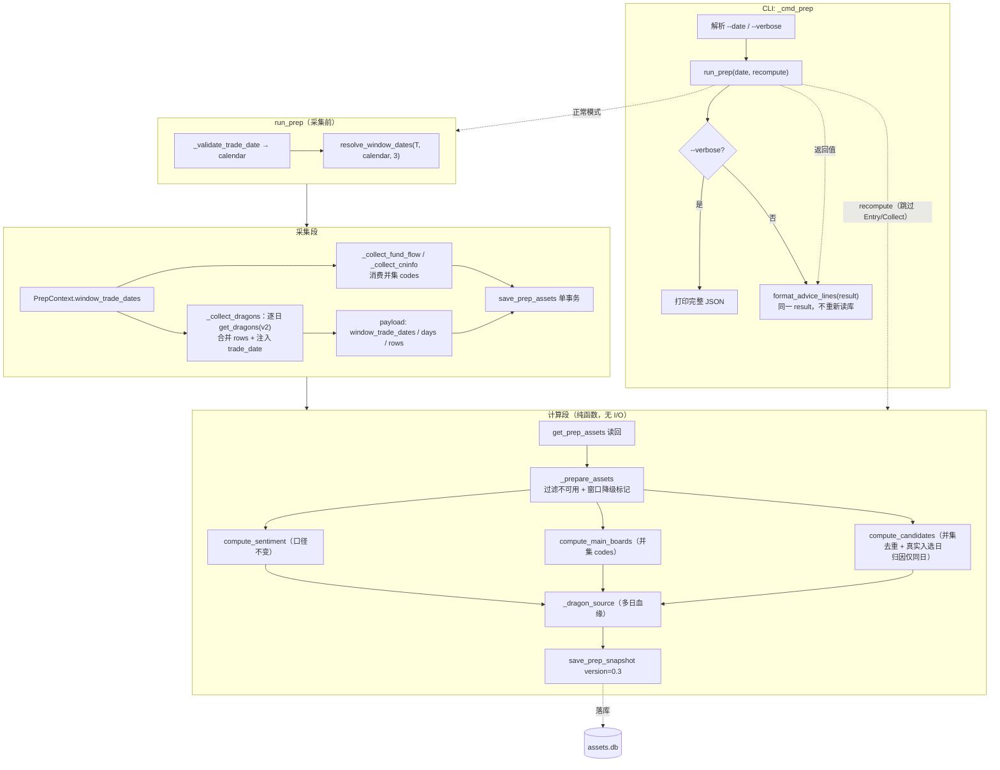
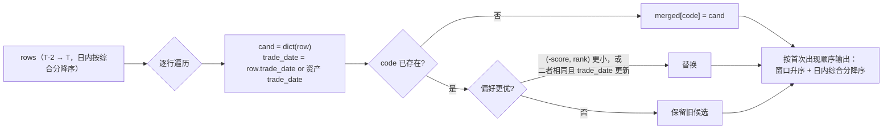

# prep 复盘近三日龙头窗口 + CLI 输出精简 — 技术方案（v2）

日期：2026-10-20 · 分支：feat/reviewa-account-op · 状态：待复审
v2 修订：吸收 solution-reviewer 首轮 findings（6 MAJOR / 9 MINOR），逐条处理见 §13。

## 1. 背景与目标

`prep`（盘后复盘）当前只复盘**当日（T）**龙头，候选池因此只覆盖 T 日 scan 物化的真龙；同时 CLI 直接
`json.dumps` 整个复盘结果，信息过载，用户无法一眼看到「买不买、买多少」。

本方案做两件事：

1. **复盘范围扩展为含 T 的近三个交易日**：`[T-2, T-1, T]`（按交易日历）。候选池取三日真龙并集，
   同 code 去重保留综合分更优者，并保留各自**真实入选日**（下游 `candidate_trade_date` 血缘）。
2. **CLI 默认输出精简为 4 项**：是否建议买入 / 建议仓位 / 建议等级 / 买入理由；`--verbose` 保留完整 JSON。

### 1.1 阶段 0 已确认决策（不得偏离）

| # | 决策 |
|---|------|
| D1 | 窗口 = `[T-2, T-1, T]` 三个**交易日**，含 T；按交易日历取 |
| D2 | 窗口日期在**采集段**解析并写入 dragons 资产 payload，保证 compute 段是资产纯函数、`--recompute` 可重放 |
| D3 | 候选池同 code 去重保留综合分更优者，每只保留**行内真实入选日**（不再覆写为 T） |
| D4 | `fund_flow` / `cninfo_announcements` 的 codes 扩到并集；`compute_main_boards` 命中数基于并集；`dragon_source` 改多日血缘 |
| D5 | 窗口内缺日 → 跳过并标 degraded，不中断；**三日并集为空**时维持既有 `empty` 语义（v2 修订：原措辞「T 完全无记录」有歧义，按复审建议改为并集口径，**需 main/用户确认**，交付报告登记为 decision_clarification） |
| D6 | 快照只增 key、`version` 0.2 → 0.3；`--recompute` 用旧资产（单日口径）不得报错 |
| D7 | **不改** `position_advice` 阈值公式（80/5/30/10）；buy/sell/review-account 行为不变 |
| D8 | CLI 等级映射：0.8→强烈买入、0.5→一般、0.3→轻仓博弈、0.0/None→不建议买入；降级信息并入理由，取消独立 stderr 警告 |
| D9 | 理由生成必须是纯函数 |

## 2. 候选设计

### 候选 A（推荐）：窗口前置解析 + 单 dragons 资产内嵌多日

采集段用 TDX 指数日K解析窗口 → `_collect_dragons` 逐日读 `dragons_v2` → 合并 rows（每行注入
`trade_date`）→ 单个 `dragons` payload 内嵌 `window_trade_dates` / `days`（每日 scan_id/version/count/status）。
compute 段只消费 payload；CLI 用独立纯函数模块组装展示文本。

- 优点：资产仍按 `(trade_date, asset_type)` 单行原子落库，无 schema/注册表改动；compute 保持纯函数；
  旧资产兼容点**集中为 4 处**（§5.1 末尾清单）；每日血缘在 payload 内完整可审计。
- 缺点：单 payload 体积变大（三日 rows，量级几十行）；某日采集失败时只能整日资产重采。

### 候选 B（非常规）：按日拆资产键 `dragons@YYYY-MM-DD`

复用 `UNIQUE(trade_date, asset_type)`，把窗口每日真龙拆成 `dragons@2026-10-16` 等独立资产行，compute 扫描前缀聚合。

- 优点：每日独立可重采/可审计；单日失败隔离粒度更细。
- 缺点：`ASSET_COLLECTORS` 是静态注册表，动态键需在流水线里特判；`_EMPTY_KEYS`、`collection_report`
  状态、旧 `dragons` 键都要双写兼容；compute 从「单资产纯函数」退化为「多资产聚合」；`--recompute`
  需扫描前缀。为 3 天窗口引入这套机制属于过度设计。
- 结论：**不采用**。

### 候选 C（反直觉）：窗口解析下沉到 compute 段

采集段只存 T 日 dragons，compute 段再用交易日历/DB 查询补 T-1、T-2。

- 缺点：compute 段产生 I/O 与网络依赖，破坏「快照 = 资产纯函数」，`--recompute` 无法重放历史口径，
  且历史补跑会把「今天才知道的 T-1/T-2」混入。直接违背 D2。
- 结论：**不采用**。

### 候选 D：窗口内逐日采集 THS 涨停池/题材榜（用于按日归因）

`ths_limit_up_pool` / `ths_block_top` 的 provider 方法接受任意日期，README 也声明 THS 支持 ≥4.5 个月历史补采，
因此**技术上可行**：payload 改为按日分组，compute 按候选自己的 `trade_date` 取归因，T-1/T-2 候选也能获得
`reason_type`/`limit_up_type`/`open_num` 等字段。

- 优点：三日候选的归因信息完整，语义与入选日严格同源。
- 代价（这是拒绝理由，而非「天然不支持」）：
  1. 涨停池是分页 dataapi，3 天≈3 倍请求，叠加 THS 网关 403 频控（AGENTS.md 已记录），盘后稳定性下降；
  2. `ths_block_top` 也需按日分组，`compute_main_boards` 的「当日主线」语义会变成「三日主线」，与 D4
     的「命中数基于并集」纠缠，需额外定义主线时点；
  3. 本任务范围锁定为「候选**选择**窗口」，归因是附加信息；按 CLAUDE.md §3「不为假设的未来需求引入抽象」，
     先保证选择正确与口径诚实（跨日候选归因为 null），后续确有分析需求再扩展。
- 结论：**本期不采用**；改为「归因只对与 T 日池同日（`trade_date == T`）的候选生效，其余为 null」，
  并列入 §11 后续增强。此决策同时修复 MAJOR-5 的字段/日期不同源问题。

### 推荐

采用**候选 A**：最小改动面、保持两段式契约、旧资产兼容点集中、测试可完全用假 provider 覆盖。

## 3. 架构与数据流

### 3.1 两段式数据流（改动后）



### 3.2 候选池去重流程



> 偏好键与 `market.candidate_key`（`-score, rank, code`）保持一致，仅追加「同分同日取较新入选日」；
> 消费方 `collect_candidates` 会按自身 `candidate_key` 重新排序，快照内顺序只影响可读性。

## 4. 数据契约

### 4.1 `dragons` 资产 payload（v0.3 新增字段）

```jsonc
{
  "trade_date": "2026-10-20",          // T，保留
  "scan_id": null,                     // 保留键：仅单日窗口取该日唯一值；多日窗口恒为 null（血缘看 days[]）
  "version": null,                     // 保留键：同上
  "count": 42,                         // 三日并集行数（含跨日重复 code）
  "rows": [                            // 每日 rows 合并；每行注入真实 trade_date
    {"code": "600001", "trade_date": "2026-10-16", "composite_score": 88, "...": "..."}
  ],
  "window_days": 3,                    // 新增：请求的窗口长度（常量 WINDOW_TRADING_DAYS）
  "window_trade_dates": ["2026-10-16", "2026-10-17", "2026-10-20"],  // 新增：按日历解析的窗口（不保证每日有数据）
  "days": [                            // 新增：逐日血缘，唯一真相
    {"trade_date": "2026-10-16", "scan_id": "v2_20261016_top25",
     "version": "0.6.2", "count": 20, "status": "ok"},
    {"trade_date": "2026-10-17", "count": 0, "status": "empty"},
    {"trade_date": "2026-10-20", "scan_id": "v2_20261020_top25",
     "version": "0.6.2", "count": 22, "status": "ok"}
  ]
}
```

- `days[].status` ∈ `ok` / `empty` / `error`；`error` 额外带 `error` 文本。
- `days[].scan_id` / `days[].version` 为「字符串或 null」；同一交易日跑了多次 scan（不同 topN）时置 null，
  不输出列表（与顶层类型稳定目标一致）。
- 顶层 `scan_id`/`version` 仅对单日窗口有值；三日窗口内每日 scan_id 必然不同，故恒为 null。
  血缘一律读 `days[]`（资产）/ `dates[]`（快照），不要从顶层字段推断。
- **不单独存 `missing_dates`**：compute 端从 `days[]` 派生（`status in {empty,error}`），避免双份真相。
- **旧资产**（无 `window_days`/`days`）保持原样可读：rows 无 `trade_date` 时回退到 payload 顶层 `trade_date`。

### 4.2 快照 `dragon_source`（多日血缘）

```jsonc
{
  "trade_date": "2026-10-20",
  "scan_id": "...",           // 兼容键：仅单日窗口有值，多日窗口为 null
  "version": "...",           // 兼容键，同上
  "count": 42,
  "window_days": 3,           // 新增；旧资产补 1（仅增 key，口径永远可判定）
  "dates": [                  // 新增：逐日血缘（旧资产合成单条）
    {"trade_date": "...", "scan_id": "...", "version": "...", "count": 20, "status": "ok"}
  ],
  "version_mixed": false      // 新增：窗口内出现 >1 个非空 scorer version 时为 true
}
```

旧资产（无 `days`）输出 `window_days: 1` + 由顶层字段合成的单条 `dates`，不报错。

### 4.3 快照 `candidates[]`

结构与现有完全一致，仅语义修正：

- `trade_date`：**该候选真实入选日**（不再覆写为 T）。旧资产无行内日期时回退 T。
- **归因字段只与同日池匹配**：仅当 `candidate.trade_date == ths_limit_up_pool.trade_date`（即候选来自 T 日）
  时填充 `reason_type` / `limit_up_type` / `open_num` / `is_again_limit` / `first_limit_up_time`；
  跨日候选全部为 `null`（未知，不伪造）。旧资产（无行内日期）回退 T 后仍可命中，行为不变。
- `main_net_amount`（fund_flow，`as_of=T`）与 `announcements`（窗口 `[T-7,T]`）是 **T 日时点信息**，
  对所有候选都附加，语义上不代表入选日当天数据——文档显式标注，避免与 `trade_date` 混读。
- 其余 key 不变。

### 4.4 CLI 契约

默认输出（4 行，中文）：

```
是否建议买入：是
建议仓位：50%
建议等级：一般
买入理由：复盘日 2026-10-20；涨停 59 家；跌停 1 家；炸板率 12.3%；昨日涨停溢价 +2.10%；晋级率 25.0%；最高 4 板；主线：低空经济、机器人。涨跌停家数处中性区间，建议仓位 50%。数据降级：市场宽度缺失，结论可信度下降。
```

- 是否建议买入（三态）：`pct > 0` → 是；`pct == 0` → 否；`pct is None` → 无法判断（数据不足）。
- 仓位：数值 `{round(pct*100)}%`，`None` → `—`。
- 等级（D8 锁定）：`>=0.8 强烈买入` / `>=0.5 一般` / `>0 轻仓博弈` / `0.0 → 不建议买入` /
  `None → 不建议买入（数据不足）`。区间写法是防御式实现，公式实际只产 0.8/0.5/0.3/0.0；
  后两档加限定语，避免同屏出现「无法判断」与「不建议买入」的矛盾观感。
- 复盘日放在「买入理由」行首，不增加行数。
- `--verbose`：打印完整 JSON（现状行为）。错误路径（`PrepError` / 意外异常）不变。
- 展示层异常兜底：`format_advice_lines` 抛异常时向 stderr 打印一行错误并**以 0 退出**（快照已落库），
  避免 cron 把成功当失败。

## 5. 实现要点

### 5.1 `review_account/prep.py`

| 位置 | 改动 |
|------|------|
| `WINDOW_TRADING_DAYS` | 新增常量 = 3 |
| `_trading_dates(tdx)` | 提取交易日历（`get_kline("SH000001", days=120)` → 排序去重日期）；空则 `PrepError` |
| `_validate_trade_date` | 改为**返回** calendar 列表；判断逻辑与文案不变 |
| `resolve_window_dates(trade_date, calendar, size=3)` | 新增纯函数：取 `<= T` 的最后 `size` 个交易日，升序返回；不足 `size` 返回可用日期 |
| `PrepContext` | 新增 `window_trade_dates: list = field(default_factory=list)` |
| `_collect_all` | 签名改为 `_collect_all(trade_date, *, window_trade_dates, tdx=None)`（必填关键字，避免隐式单日/隐式联网） |
| `_collect_dragons` | 逐日 `db.get_dragons(day, source="v2")`；行注入 `trade_date`；构造 `days`/`window_trade_dates`；逐日异常隔离；**并集无行且存在 error 日 → raise**（异常消息拼接各日错误） |
| `_collect_fund_flow` | codes = 并集（按首次出现去重） |
| `_collect_cninfo` | 遍历并集 codes（去重后逐个采集） |
| `_EMPTY_KEYS["dragons"]` | `count == 0`（三日并集为空才 empty） |
| `_prepare_assets` | 防御式判定：`isinstance(payload, dict) and isinstance(payload.get("window_days"), int) and payload["window_days"] > 1`；`len(payload.get("window_trade_dates") or []) < window_days` → `dragons_window_short`；`_list_of_dicts(payload.get("days"))` 中任一 `empty/error` → `dragons_partial`（畸形 payload 不崩溃） |
| `compute_candidates` | 去重 + 真实入选日 + **归因仅同日**（§4.3） |
| `_dragon_source` | 多日血缘 + `window_days`/`dates`/`version_mixed`；旧资产补 `window_days: 1` |
| `_compute_all` | `version` → `"0.3"` |

`compute_candidates` 去重偏好键（与 `market.candidate_key` 对齐）：

```python
def _preference(c: dict) -> tuple:
    return (-(c.get("composite_score") or 0),
            c.get("rank") if c.get("rank") is not None else 999999)

# 更优 = preference 更小；完全相同则 trade_date 更新者胜
```

**旧资产兼容点清单（共 4 处，逐个测试）**：

1. `_prepare_assets`：无 `window_days` → 不做窗口降级判定；
2. `compute_candidates`：行内无 `trade_date` → 回退 payload `trade_date`；池匹配按回退后的日期；
3. `_dragon_source`：无 `days` → 兼容键 + 合成单条 `dates` + `window_days: 1`；
4. `advice` 降级标签：未知 code 原样展示，不抛异常。

### 5.2 新增 `review_account/advice.py`（纯展示层）

```python
def advice_level(pct: Optional[float]) -> str
def should_buy(pct: Optional[float]) -> Optional[bool]   # None=数据不足
def format_buy_flag(pct: Optional[float]) -> str         # 是/否/无法判断（数据不足）
def format_position(pct: Optional[float]) -> str
def build_advice_reason(sentiment: dict, main_boards: list,
                        trade_date: Optional[str] = None) -> str
def format_advice_lines(result: dict) -> list[str]
```

- 无 I/O、无网络、无 DB；输入是快照 dict。
- 理由 = 日期片段 + 因子片段（`；` 连接）+ 结论句 + 降级提示句；因子为 `None` 时跳过该片段。
- 所有外部文本片段经 `_clean_text` 去除 C0/C1 控制字符（`\x00-\x1f`、`\x7f-\x9f`）后再拼接。
- 降级 code → 中文标签映射（未知 code 原样）：`ths_limit_up_pool`→「THS 涨停数据缺失」、
  `position_input_fg_t1`→「涨停/跌停采用 FG T-1 口径」、`market_breadth`→「市场宽度缺失」、
  `dragons_partial`→「近三日龙头窗口缺日」、`dragons_window_short`→「交易日历不足三日」等。

### 5.3 `cli_commands.py` / `cli.py`

- `cli.py`：`prep` 增加 `--verbose`（`action="store_true"`），usage/epilog/示例同步。
- `_cmd_prep`：`run_prep` 成功后按 `args.verbose` 二选一输出；删除独立 stderr 降级警告。
  非 verbose 分支用 try/except 包住展示层（§4.4）。

## 6. 错误处理与降级（可判定规则）

| # | 场景 | `dragons` 资产状态 / 行为 |
|---|------|--------------------------|
| R1 | 三日并集 rows 为空且 **days 无 error** | `count=0` → `empty`（唯一 empty 条件）；candidates `[]` |
| R2 | T 日单日为空、其它日有数据 | 资产 `ok`；`days[T].status="empty"`；compute 标 `dragons_partial` |
| R3 | 部分日读取异常、其它日有数据 | 资产 `ok`；`days[].status="error"` + 错误文本；compute 标 `dragons_partial` |
| R4 | 并集无任何行且**存在 error 日**（任意一日，含全 error） | collector **raise**（消息拼接各日错误）→ `collection_report.dragons.status="error"`，不伪装成「无龙头」 |
| R5 | 日历不足 3 日 | 用可用日期；`dragons_window_short` 降级（仅窗口资产） |
| R6 | 旧资产 `--recompute`（无 `window_days`） | 单日口径重算；**不产生任何 `dragons_*` 降级**；`version` 写 0.3 |
| R7 | 情绪因子缺失 | 理由跳过对应片段；`position_pct=None` 时首行「无法判断（数据不足）」 |

其它既有门禁（未来日/盘中/非交易日/日历数据源失败）文案不变。

## 7. 兼容性

- **表结构**：不改。`prep_assets` payload 是 JSON；`prep_snapshots.result_json` 只增 key。
- **已有 key 类型稳定**：`scan_id`/`version` 保持「字符串或 null」，多日信息只进 `dates[]`（修复 MAJOR-4）。
- **下游消费者**：`collect_candidates` 只读 `candidates` 的 `code`/`composite_score`/`is_true_dragon`/
  `rank`；`strategy.py` 仅把 `trade_date` 写入 `candidate_trade_date` 血缘。
- **`load_market_sentiment`**：只读 `sentiment.position_pct`，口径未变。
- **旧快照**：继续可读（缺新 key 时下游 `.get()` 容错）。
- **窗口口径与其它配置的关系**（显式声明）：
  - 快照优先路径的候选范围由 prep 的 `WINDOW_TRADING_DAYS` 决定，与
    `StrategyConfig.candidate_lookback_days` 无关；后者只作用于快照缺失时的旧回退路径。
  - `auction --days N` 的口径是「最近 N 个**有龙头数据的**交易日」，prep 是「最近 N 个**日历交易日** +
    缺日降级」，两者不同，不要互相推断。

## 8. 测试策略

全部用 `unittest` + 假 provider/DB（项目惯例，无 pytest 依赖）。自测命令：
`.venv/bin/python -m unittest discover -s tests -q`（基线 601 项通过）。

1. `resolve_window_dates`：正常三日、跨周末、日历不足、排除 T 之后日期。
2. `_validate_trade_date` 返回值：返回完整 calendar；现有门禁断言不破坏。
3. `_collect_dragons`：三日合并 + 行内 `trade_date` 注入；缺日 → `days.status=empty`；某日异常 →
   `days.status=error` 且其它日保留；**三日全异常 → raise**。
4. 旧资产兼容：`_assets()`（无 `window_days`/`days`）`_compute_all` 正常；candidates 回退顶层日期；
   `dragon_source.window_days == 1` 且 `dates` 单条；**`sentiment.degraded` 不含任何 `dragons_*`**。
5. 多日候选去重：同 code 高分保留且保留其入选日；同分取 `rank` 更优者；rank 也相同取较新日；
   独有 code 保留；跨日候选归因为 `None`；同日候选归因正常。
6. `fund_flow` / `cninfo` codes 并集去重（重复 code 只请求一次）。
7. `main_boards` 命中数：跨日同 code 只计一次；仅 T-2 出现的 code 也计入。
8. `advice_level` 四档 + None；`should_buy` 三态；`format_position`；None → 「不建议买入（数据不足）」、
   0.0 → 「不建议买入」的区分。
9. `build_advice_reason`：全因子、因子缺失跳过、`position_pct=None`、degraded 并入、控制字符清洗。
10. `format_advice_lines`：恰好 4 行、中文标签、三态买卖/仓位/等级正确、复盘日出现。
10.1 畸形 `dragons` payload（`str` / 缺 `window_days` / `window_trade_dates=None`）不击穿 `_compute_all`。
11. CLI：默认 4 行、`--verbose` 输出 JSON（patch `run_prep`）；展示层异常仍退出 0。
12. **契约迁移与兼容回归**：
    - `tests/test_prep.py:403` 的 `patch("..._validate_trade_date")` 必须改为 `return_value=[...]`
      （旧 MagicMock 不可迭代，`resolve_window_dates` 会 TypeError）；
    - `tests/test_prep.py:459/478` 的 `_collect_all(date)` 改为 `_collect_all(date, window_trade_dates=[date])`；
    - `TestComputeCandidates`（:129-149）保留「行内无 `trade_date` → 回退 T」并加显式断言；
    - `run_prep` 集成测试断言资产 key 集合与快照 version=0.3；
    - `TestRunPrepRecompute` 增加「旧资产 recompute 的 degraded 不含 `dragons_*`」断言。
13. 既有输出契约测试：`version` 0.2→0.3（`test_output_contract_keys`、集成测试）。

## 9. 设计模式

- **模板方法 + 注册表**（既有，不改）：`ASSET_COLLECTORS` 定义采集骨架，`dragons` 作为首个 collector
  为后续 collector 提供并集 codes；窗口解析是采集段的前置步骤，不引入新流水线。
- **建造者（轻量）**：`build_advice_reason` 用有序片段列表组装文本（片段 → 过滤 None → join），
  等价于简化 Builder；新增因子只需加一个片段函数，不改拼接主流程。**不引入** `AdviceBuilder` 类——
  当前 7 个片段用列表推导更易读，符合「优先简单」。
- **策略（隐含）**：窗口日期解析与采集解耦（`resolve_window_dates` 纯函数）；未来若改窗口长度，
  只改常量/入参。
- **不做**：不为「任意窗口长度」「按日分资产」「窗口内逐日归因」等假设需求引入抽象（候选 B/D 均拒绝）。

## 10. 用户未考虑但影响设计的点

1. **THS 涨停池可历史补采（README 已声明），但本期不采集多日池**：跨日候选的归因字段为 `null`；这是
   「未知」而非「无」，理由是 3 倍分页请求 + 403 频控 + 主线时点语义复杂（§2 候选 D），不是技术不可行。
2. **跨日重复 code 的入选日语义**：保留高分者可能来自 T-2，`candidate_trade_date` 会是 T-2。预期行为，
   但需在文档写明，避免回测分析误读。
3. **两种时点信息并存**：`trade_date` 是入选日；`main_net_amount`/`announcements` 是 T 日时点信息。
   归因字段只在同日填充；其余字段不参与归因（§4.3 已显式标注）。
4. **cninfo 请求量放大**：codes 从「当日真龙」变为「三日并集」，最坏约 3 倍请求；已按 code 去重，
   窗口仍 `[T-7, T]`，不改变 look-ahead 防护。本次不加并发。
5. **T 日尚未 scan 时的语义**：盘后先跑 prep、后跑 scan 时，T 日 `dragons_v2` 为空。窗口方案下 T-1/T-2
   仍能产出候选（标 `dragons_partial`），而不是得到空候选。这是行为增强，需在 AGENTS/README 写明。
6. **默认复盘日的选择**：无 `--date` 时取「最新有龙头数据的交易日」作为 T；窗口向前取两个**日历交易日**，
   而不是「最近三天有数据的日期」。
7. **跨 scorer version 混比**：窗口内可能由不同版本扫描器产出，`composite_score` 跨版本不一定可比；
   快照用 `dragon_source.version_mixed` 显式标注（§4.2），去重仍按分数执行。
8. **快照体积**：candidates 最多约 3 倍；`assets.db` 单列 JSON，量级可接受，不裁剪。

## 11. 风险与缓解

| 风险 | 影响 | 缓解 |
|------|------|------|
| 窗口多日让候选池包含已走弱的老龙头 | 策略选中率下降 | 产品决策（D1/D3）；`collect_candidates` 仍按综合分/最低分过滤；可回测验证后再调窗口 |
| 旧资产 recompute 路径遗漏 | 历史重放报错/误降级 | `window_days is not None` 守卫 + 兼容点清单 + 专门单测（§8.4/§8.12） |
| 多日 rows 让 `main_boards` 计数口径变化 | 主线命中数变大 | set 去重；明确「跨日真龙集合」语义并在测试固定 |
| CLI 默认输出破坏脚本消费 | 外部脚本仍期望 JSON | 需要 JSON 的用户显式加 `--verbose`；README/AGENTS 同步说明 |
| 日历不足三日 | 窗口变短 | `dragons_window_short` 降级可见，不静默 |
| 跨 scorer version 混比 | 去重偏袒某版本 | `version_mixed` 标注；后续可加「同版本优先」策略（本期不做） |
| 外部文本含控制字符进入终端 | 人读输出被操控 | advice 层清洗 C0/C1（一行） |
| 展示层异常导致 cron 误判失败 | 运维噪音 | 展示层 try/except，快照已落库时仍退出 0 |
| 后续需要按日归因 | 跨日候选信息不足 | 明确列入后续增强（候选 D），不阻塞本期 |

## 12. 文档同步清单（实现阶段同一 commit）

1. **README.md `prep` 段**：
   - 窗口语义：`[T-2, T-1, T]` 三个交易日、缺日跳过并降级；T 日未 scan 时仍可用前两日；
   - 默认 4 行输出示例 + `--verbose` 说明；
   - `dragon_source` 新 key（`window_days`/`dates`/`version_mixed`）；
   - 跨日候选归因为 null 的口径说明；cninfo 请求量约 3 倍；
   - 快速使用块补 `prep --verbose`。
2. **AGENTS.md `prep` 段**：
   - `dragons` 采集改为三日窗口（`dragons_v2` 逐日读取），payload 新增 `window_days`/`window_trade_dates`/`days`；
   - 候选池真实入选日、归因仅同日；`version` 0.3；
   - 快速使用块补 `prep --verbose`。
3. **cli.py**：usage/epilog/示例加 `[--verbose]`。

## 13. 首轮 findings 处理对照

| Finding | 级别 | 处理 |
|---------|------|------|
| MAJOR-1 THS 历史补采前提错误 | MAJOR | 新增候选 D，承认技术可行，按「3 倍分页 + 403 频控 + 主线时点复杂」拒绝；§10.1 改写 |
| MAJOR-2 旧资产凭空产生窗口降级 | MAJOR | `window_days` 守卫 + 从 payload 读取；§8.4/§8.12 加断言 |
| MAJOR-3 empty/error 语义矛盾 | MAJOR | §6 写成 R1-R7 可判定规则；全 error → raise |
| MAJOR-4 scan_id/version 类型多态 | MAJOR | 保持字符串或 null；legacy 输出 `window_days: 1`；新增 `version_mixed` |
| MAJOR-5 归因字段与入选日不同源 | MAJOR | 归因仅当候选日 == 池日；§4.3 显式区分两种时点信息 |
| MAJOR-6 测试迁移清单不完整 | MAJOR | §8.12 逐条列出 4 个调用点 + legacy degraded 断言 |
| MINOR-1 tie-break 不一致 | MINOR | 统一 `(-score, rank)` + 同日取新；§3.2/§5.1 |
| MINOR-2 窗口与 candidate_lookback_days / auction | MINOR | §7 显式声明三者口径差异 |
| MINOR-3 双份真相/命名/兼容点 | MINOR | 删 `missing_dates`；改名 `window_trade_dates`；§5.1 列 4 个兼容点 |
| MINOR-4 None 与 0 合并 | MINOR | 首行三态「无法判断（数据不足）」；等级仍按 D8 |
| MINOR-5 输出缺日期/展示异常 | MINOR | 理由行首加复盘日；展示层 try/except 退出 0 |
| MINOR-6 文档同步不具体 | MINOR | §12 展开为逐项清单 |
| MINOR-7 控制字符 | MINOR | advice 层清洗 C0/C1 |
| MINOR-8 跨版本混比风险 | MINOR | `version_mixed` + §11 风险行 |
| MINOR-9 Mermaid 位置偏差 | MINOR | §3.1 把门禁移出入口子图；A5 输入改为 A2 返回值 |

## 14. 第 2 轮 findings 处理对照（v2.1）

| Finding | 处理 |
|---------|------|
| 第 2 轮 MINOR-1 raise 条件不一致 | §5.1 与 §6 R1/R4 统一为「并集无行且存在 error 日 → raise」，异常消息拼接各日错误 |
| 第 2 轮 MINOR-2 scan_id 恒 null / 同日多 scan | §4.1 明确多日窗口顶层恒 null、血缘看 days[]；days[].scan_id/version 同日多 scan 置 null |
| 第 2 轮 MINOR-3 `_prepare_assets` 裸调用 | §5.1 改为 isinstance/`or []`/`_list_of_dicts` 防御式；§8.10.1 加畸形 payload 测试 |
| 第 2 轮 MINOR-4 首行与等级矛盾 | §4.4 等级区分「不建议买入（数据不足）」与「不建议买入」；§8.8 断言 |
| 第 2 轮 MINOR-5 §12 笔误 | 改为 `[T-2, T-1, T]` |
| 第 2 轮 MINOR-6 D5 改写未标注 | D5 已加 v2 修订标注；交付报告登记 decision_clarification |
