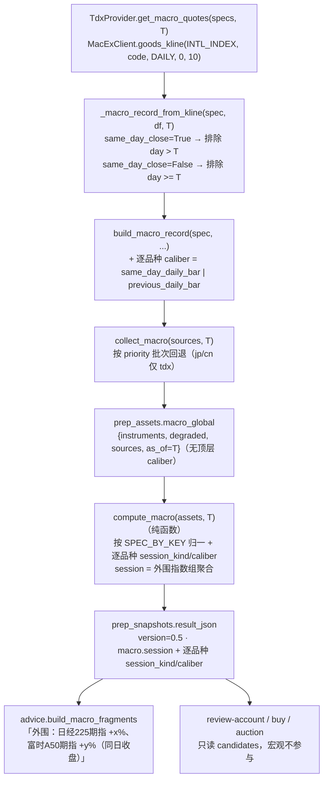

# prep 宏观资产改为日经225期指 + 富时A50期指 — 技术方案

日期：2026-10-21 · 分支：feat/reviewa-account-op · 状态：solution-reviewer 2 轮，按第 2 轮关闭条件落实（方案门禁通过）
上游实盘取证（本机 2026-10-21 实测，见任务包 §2）：
TDX `ExMarket.INTL_INDEX` 全量 66 品种中含 `NK0Y`（日经225期指连续）与 `CNY0`（富时A50期指连续），
无 KOSPI、无日经现货；两个品种 `goods_kline` 返回标准日 K 列。
前置方案：[docs/solutions/2026-10-20-prep-macro-candidate-verdict-design.md](2026-10-20-prep-macro-candidate-verdict-design.md)

## 1. 背景与目标

上一版 `prep` 的 `macro_global` 采集「道指/纳指/标普 + 美债10Y + 黄金」，canonical 为
**日期 `< trade_date` 的最后一根日 K**（T-1 口径）。用户确认新需求：

> 外围观察对象从「美股三大指数」改为「**日经225期指 + 富时A50期指**」，两者取**同日**（T 日）
> 已完成日 K；美债 10Y 与黄金保留不变；数据源只走 TDX 扩展行情，不做回退。

### 1.1 阶段 0 已确认决策（不得偏离）

| # | 决策 |
|---|------|
| D1 | 删除 `us_dji` / `us_ixic` / `us_spx` 三个 MacroSpec |
| D2 | 新增 `jp_nikkei`（标签「日经225期指」，`INTL_INDEX/NK0Y`）与 `cn_a50`（标签「富时A50期指」，`INTL_INDEX/CNY0`），`priority=("tdx",)` |
| D3 | 两品种取 `<= trade_date` 的最后一根日 K（同日）；`ust10y`/`gold` 保持 `< trade_date` |
| D4 | `MacroSpec` 增加逐品种口径字段（`same_day_close: bool = False`），由 `_macro_record_from_kline` 按字段选过滤条件 |
| D5 | prep 当日门禁 15:30 → **16:40**（A50 期指日盘 16:30 收盘 + 缓冲），错误文案同步（措辞改为「盘后数据尚未就绪，请 16:40 后运行 prep」：15:30–16:40 已收盘，不再称「盘中」） |
| D6 | 快照 `version` 0.4 → **0.5** |
| D7 | 不做量能因子、不做韩国/KOSPI、不做 Yahoo/腾讯/新浪回退、不做 T+1 盘前快照、不做解禁 |

非目标（明确不做）：不改 `position_advice` 阈值公式；宏观仍**只展示**不进仓位计算；
不迁移/不 DROP `prep_assets`；不重构无关模块；不删除腾讯/雪球 macro provider 方法。

## 2. 候选设计

### 2.1 口径表达：三个候选

#### 候选 A（推荐）：`MacroSpec.same_day_close` 声明式字段

每个品种用布尔字段声明「是否同日收盘」；转换函数 `_macro_record_from_kline` 一处读字段决定
过滤条件（`day > trade_date` vs `day >= trade_date`）。记录层同时落 `caliber`（口径血缘），
快照层落 `session_kind`（逐品种）与 `session`（外围指数组聚合）。

- 模式：**Strategy（策略）语义的 Policy Field** —— 把「取哪根 bar」这个可变量下沉到规格声明，
  转换函数保持单一实现、无分支复制；新增品种只改一行规格。
- 模式：**Template Method** 的轻量形态 —— `collect_macro` 固定「按源顺序批次拉取 → 归一 → 聚合」
  骨架，每个源实现 `get_macro_quotes(specs, trade_date)` 钩子。
- 优点：口径与品种强绑定，不可能出现「日经用 T-1 而 A50 用 T」的错配；口径随记录进入 JSON，
  `--recompute` 与人工排障可直接读到血缘；测试可对单个 spec 断言。
- 缺点：规格字段从 8 个增到 9 个，需更新构造处（仅 `macro.py` 内部，且改用关键字构造）。
- **扩展性约束**：品种分组（哪些 key 属于「外围指数组」）不重复写字面量。`macro.py` 导出
  `MACRO_INDEX_KEYS = tuple(s.key for s in MACRO_SPECS if s.kind == "index")`（派生，不平行维护），
  `prep._macro_session`、`prep._compute_all`（同日缺失标记）与 `advice.build_macro_fragments`
  一律 import；测试断言它等于 `("jp_nikkei","cn_a50")` 且为 `MACRO_KEYS` 子集。
  新增/替换指数品种只改 `MACRO_SPECS` 一行。

#### 候选 B（反直觉）：全局统一 `<= trade_date`，不加字段

「既然 `<= trade_date` 对美债/黄金也不会取到盘中值，为何不全局放宽？」——直觉上可行，
因为 A 股 16:40 运行时纽约时间约 04:40（夏令时）/03:40（冬令时），美股尚未开盘。

**实测/推演结论：不可行。** 黄金（COMEX `GC00W`）近乎 24 小时交易，北京 20:00 之后 T 日 bar
已存在且仍在变动；若全局放宽为 `<=`，同一 `trade_date` 在 16:41 与 23:00 会取到不同的黄金值，
直接违反「快照 = 资产纯函数、可重放」的既有契约（也是 0.4 方案选择 `<` 的原因）。
另：`ust10y` 的 TDX 日频快照在晚间也可能出现 T 日占位行。故 **拒绝**。

#### 候选 C（反直觉）：资产里同时存 T 与 T-1，compute 段按时点选择

采集时把 `<= T` 与 `< T` 两条都落库，compute 段根据 `now` 决定用哪条。
**拒绝**：引入运行时刻依赖，`--recompute` 不再确定；且增大资产体积，收益为零。

### 2.2 推荐方案的数据流



关键时点（北京）：日经期指日盘约 07:45–14:15、夜盘 15:30 起；A50 期指日盘 09:00–16:30、
夜盘 17:00 起。夜盘归属**下一交易日 bar**。（交易所时段仅用于说明门禁取 16:40 的依据；
下方分钟 K 的时间戳口径未校准，不据此推断精确时段。）

**2026-10-21 21:09 CST 实盘补证（第 2 轮审查后补充）**：

| 证据 | 观测 |
|------|------|
| `NK0Y` 日 K | 2026-10-19/20/21/22 四根；10-21 close 64750 |
| `NK0Y` 分钟 K | 10-21 标注段最后一分钟 close 64750（与日 K close 完全一致）；10-22 标注段从 14:56 起（段起点受 700 根抓取窗口限制，非真实时段边界） |
| `CNY0` 日 K | 10-21 close 13164；10-22 open 13164 |
| `CNY0` 分钟 K | 10-21 标注段最后一分钟 close 13164；10-22 标注段从 17:01 起（夜盘首分钟） |

结论：**T 日 daily bar 的 close 等于 T 日标注段最后一分钟，且 T+1 段首分钟 = 夜盘起点、
open = T close**，说明日 K 归属边界在夜盘开盘处，T 日 bar 在日盘结束后不再收到数据；
因此 16:40（A50 日盘 16:30 收盘后 10 分钟）取 `<= T` 拿到的是已定型 bar，T+1 bar 被
`day > T` 排除。**仍未直接量测的是 TDX 服务端在 16:30–16:40 之间的日 K 发布延迟**
（本次只能观测到 21:09 时 T bar 已存在）。该残余风险不静默：`_compute_all` 在任一外围指数
`session_kind != "same_day"` 时写入 `macro_same_day_missing` 降级标记（见 §3.3），
CLI 理由行与 `sentiment.degraded` 均可见。

因此「16:41 与 20:00 取值一致」的准确表述是：**T 日 bar 在 TDX 发布后确定，且发布延迟导致
退化时必有显式降级标记**；不把「16:40 一定已发布」当作未经证实的公理。

## 3. 接口与字段变更

### 3.1 `dragon_quant/providers/macro.py`

```python
CALIBER_SAME_DAY = "same_day_daily_bar"
CALIBER_PREVIOUS = "previous_daily_bar"

# 外围指数组：由规格派生，避免与 MACRO_SPECS 平行维护第二份真值
MACRO_INDEX_KEYS = tuple(s.key for s in MACRO_SPECS if s.kind == "index")

@dataclass(frozen=True)
class MacroSpec:
    key: str
    label: str
    kind: str
    price_unit: str
    chg_unit: str
    tdx: tuple[tuple[str, str], ...]
    priority: tuple[str, ...]
    tencent: Optional[str] = None
    xueqiu: Optional[str] = None
    yahoo: Optional[str] = None
    same_day_close: bool = False
```

`MACRO_SPECS`（顺序即展示顺序）：

| key | label | kind | tdx | priority | same_day_close |
|-----|-------|------|-----|----------|----------------|
| `jp_nikkei` | 日经225期指 | index | `INTL_INDEX/NK0Y` | `("tdx",)` | **True** |
| `cn_a50` | 富时A50期指 | index | `INTL_INDEX/CNY0` | `("tdx",)` | **True** |
| `ust10y` | 美债10Y | yield | `MACRO_INDICATOR/8_ATY` | `("tdx","yahoo")` | False |
| `gold` | COMEX金 | commodity | `COMEX_FUTURES/GC00W` → `SH_GOLD/Au99.99` | `("tdx","yahoo")` | False |

- `build_macro_record` 新增输出键 `caliber`（由 `spec.same_day_close` 派生）——这是**唯一**的
  口径血缘，逐品种、随资产落库。
- **不新增顶层聚合 `caliber`**：健康采集下它恒为 `"mixed"`（指数同日 + 美债/黄金 T-1），
  一个正常值长得像降级信号，且没有任何消费方（advice 只用 `session` 与逐条 `session_kind`，
  web_ui 不渲染 macro，review-account/buy/auction 不读宏观）。`collect_macro` payload 与快照
  都不写顶层 `caliber`；旧 payload 的 `caliber` 字段保留可读、不被消费。
- `_record_from_yahoo`：对 `same_day_close=True` 的 spec **直接返回 None**（该源的日期换算固定
  按 `NEW_YORK`，不支持同日品种），不做「假装支持」的过滤；实际新指数也不路由到 yahoo。
- `tencent` / `xueqiu` 字段与对应 provider 方法保留（无 spec 路由），测试改用合成 spec 维持契约覆盖。

### 3.2 `dragon_quant/providers/tdx.py`

```python
def _macro_record_from_kline(spec, df, trade_date, market_name, code):
    same_day = spec.same_day_close      # 直接属性访问：合成 spec 漏字段时立即报错
    ...
    if (day > trade_date) if same_day else (day >= trade_date):
        continue
```

`get_macro_quotes` 无需改签名（已透传 spec）；docstring 更新为「日经/A50 期指同日 + 美债/黄金 T-1」。

### 3.3 `dragon_quant/review_account/prep.py`

| 项 | 变更 |
|----|------|
| `_AFTER_CLOSE` | `(15, 30)` → `(16, 40)`；错误文案「盘后数据尚未就绪，请 16:40 后运行 prep」（15:30–16:40 已收盘，不再称「盘中」） |
| `_collect_macro` | sources 只保留 `tdx` + `yahoo`（yahoo 仅服务 `ust10y`/`gold`），删除腾讯/雪球注入 |
| `_macro_session` | 只看 `MACRO_INDEX_KEYS`；`session_kind` 全 same_day → `"same_day"`，全 previous → `"previous_session"`，混合 → `"mixed"`，无记录 → `None` |
| `_normalize_macro_record` | 新增逐品种 `caliber`（按 spec 派生）与 `session_kind`；`session_date` 缺失或 `> trade_date` → 记录判不可用（返回 None，该 key 进 degraded），不伪装成 previous_session |
| `compute_macro` | 旧 payload `degraded` 与 `sources` 均按当前 `MACRO_KEYS` 过滤（`us_*` 等旧键不外泄），再并上缺失的新 key；不写顶层 `caliber`；`_empty_macro()` 同步删除 `"caliber": None` |
| `_compute_all` | `version` `"0.4"` → `"0.5"`；新增 `macro_same_day_missing` 标记：`macro.available` 且任一 `MACRO_INDEX_KEYS` 的 `session_kind != "same_day"` 或缺失 → 并入 `sentiment.degraded`（仅用于复盘展示，见下） |
| `market.py` | `prep_degraded` 判定排除 `macro_same_day_missing`：外围指数非同日靠重跑 prep 无法修复，不应触发 buy/auction 的「请先补跑 prep」提示 |
| `advice.py` | `DEGRADED_LABELS` 增加 `macro_same_day_missing: "外围期指同日数据缺失"` |

快照 `macro` 结构（只增/改语义，不改表）：

```json
{
  "available": true,
  "as_of": "2026-10-21",
  "session": "same_day",
  "instruments": {
    "jp_nikkei": {"key": "jp_nikkei", "label": "日经225期指", "pct": 1.23,
                  "session_date": "2026-10-21", "session_kind": "same_day",
                  "caliber": "same_day_daily_bar", "stale": false, "...": "..."},
    "ust10y": {"...": "...", "session_date": "2026-10-20",
               "session_kind": "previous_session", "caliber": "previous_daily_bar"}
  },
  "degraded": [],
  "sources": {"jp_nikkei": "tdx", "cn_a50": "tdx", "...": "..."}
}
```

注：顶层只有 `session`（描述外围指数组），口径血缘在**逐品种** `caliber`；不再有顶层
`caliber`，避免「健康采集恒为 mixed」的伪降级信号。若任一外围指数不是同日，顶层
`sentiment.degraded` 会出现 `macro_same_day_missing`（CLI 显示「外围期指同日数据缺失」）。

### 3.4 `dragon_quant/review_account/advice.py`

`build_macro_fragments` 外围片段：

- 遍历 `MACRO_INDEX_KEYS`（从 `providers.macro` import，不写字面量），使用记录自带 `label`
  （`期指` 字样来自规格，避免误写「指数」）。
- session 后缀：`same_day` →「（同日收盘）」；`previous_session` →「（前一交易日收盘）」；
  `mixed` → 每个品种单独标 `（YYYY-MM-DD 收盘）`。
- **不做 0.4 的 `intraday`/`overnight` 显式映射**：0.4 快照只有 `us_*`，新代码只遍历
  `jp_nikkei/cn_a50`，`indices` 恒空，该分支不可达；未知/缺失 session 一律不加后缀。
- `stale` 检测沿用（>4 天），只统计 `MACRO_INDEX_KEYS`（同一常量，不重复元组）。
- 旧快照只含 `us_*` → 无外围片段（不崩、不误报），美债/黄金片段照常，满足兼容要求。

## 4. 错误处理与降级

| 场景 | 行为 |
|------|------|
| `MacExClient` 不可用 / K 线传输失败 | `get_macro_quotes` 抛 `RuntimeError`（provider 契约不变）→ `collect_macro` 记 `source_errors.tdx`；`jp/cn` 无回退 → 进入 `degraded` |
| 单品种失败但另一品种成功 | `get_macro_quotes` 只在**全部** code 失败时抛错，部分 code 的异常目前只进 provider 日志；方案要求 `note` 增加 `errs={len(errors)}`，并在 §6 明确「部分失败根因只在日志，不在 source_errors」 |
| `jp/cn` 缺失但 `ust/gold` 成功 | `macro.available=true`，`macro_partial` 标记；任一外围指数不同日/缺失 → 追加 `macro_same_day_missing`；买入理由只展示可用品种 |
| 全部品种失败 | collector 抛错 → `collection_report.macro_global=error`，不写 payload；若存量健康则保留状态并写 `last_attempt`；compute 按缺失降级 `macro_global` |
| T 日 bar 尚未生成（品种休市/源发布延迟） | 自动退到 `<= T` 的上一根 → `session_kind=previous_session`，展示「前一交易日收盘」，不伪造同日；`sentiment.degraded` 必有 `macro_same_day_missing` |
| 旧资产含 `us_*` 做 `--recompute` | 忽略未知键；新 key 进入 `degraded`；`degraded` 与 `sources` 均过滤为当前 `MACRO_KEYS`，不污染展示 |
| 旧快照（0.4）读取 | JSON 只增 key，旧字段可读；`version` 不参与反序列化；无外围片段但美债/黄金照常 |

## 5. 测试策略

测试文件与用例（新增 ≥4 个口径用例，替换全部 US fixture）：

| 文件 | 用例 |
|------|------|
| `tests/test_macro.py` | `MACRO_KEYS == ("jp_nikkei","cn_a50","ust10y","gold")` 且无 `us_*`；`MACRO_INDEX_KEYS == ("jp_nikkei","cn_a50")` 且为 `MACRO_KEYS` 子集；两新 spec 的 label/tdx/priority/same_day_close；TDX 同日纳入（`session_date == T`）；T+1 bar 被排除；**确定性**（一个有 T+1 bar、一个没有的假 client，同一 T 输出相等）；**T 日 bar 缺失**（两品种只有 T-1 bar）→ `session_date == T-1`、不误判同日；**两者皆 T-1 → `session == "previous_session"` + `macro_same_day_missing`**；**COMEX 正常路径**（GC00W 有正值时不回退沪金）；`ust10y`/`gold` 仍取 T-1 且 bp 近似；Yahoo 对 `same_day_close=True` 的合成 spec 返回空；门面回退/降级/全失败/JSON NaN 契约；腾讯/雪球 provider 用合成 spec 维持契约覆盖 |
| `tests/test_prep.py` | fixture 换成 `jp_nikkei`/`cn_a50`（`session_date == T`）+ `ust10y`/`gold`（T-1）；`session == "same_day"`；混合 session；**T 日缺失 → previous_session + `macro_same_day_missing`**；`_collect_macro` sources 恰为 `{tdx, yahoo}`；旧 `us_*` 资产 recompute 不崩、新 key 进 degraded、`sources` 无 `us_*`、payload/snapshot 均无顶层 `caliber`（含 `available=false` 分支）；门禁 15:31 拒绝 / 16:39 拒绝 / 16:40 放行；所有 `version` 断言 0.5 |
| `tests/test_auction_pool.py` | `sentiment.degraded` 含 `macro_same_day_missing` 时 `collect_candidates_ex` 的 `prep_degraded` 仍为 False；混入其它降级后为 True |
| `tests/test_verdicts.py` | 买入理由含「日经225期指」「富时A50期指」「（同日收盘）」/「（前一交易日收盘）」，不含「道指/纳指/标普」；mixed session 逐品种日期；旧 0.4 快照（仅 `us_*` + `overnight`）无外围片段、美债/黄金照常、不崩 |
| 全量 | `.venv/bin/python -m unittest discover -s tests -q` |
| 文档自检 | `grep -rn "道指\|纳指\|标普\|美股" dragon_quant README.md AGENTS.md` **零命中**；`grep -rn "version=0\.4\|version=\"0\.4\"" dragon_quant README.md AGENTS.md` 零命中；`grep -rn "15:30" dragon_quant README.md AGENTS.md` 仅允许 AGENTS 的「15:30–16:40 时段硬拒绝」迁移说明 1 处；tests 中的 `us_dji/道指` 仅允许作为「旧资产被过滤」兼容 fixture；`prep -h` 输出含 `16:40` |

## 6. 风险与缓解

| 风险 | 等级 | 缓解 |
|------|------|------|
| 指数从多源降为 TDX 单源 | MAJOR | 明确接受（用户决策）；失败只降级 `macro_global`/`macro_partial`，不中断 prep；**全失败**才有 `source_errors`，单品种失败记 provider 日志 `errs=N`；文档写明无回退 |
| T 日 bar 在 16:40 尚未发布（源端延迟） | MAJOR | 结构上 T 日 bar 在日盘收盘后定型（§2.2 实盘补证），但发布延迟未量测；退化时 `session_kind=previous_session` 且 `macro_same_day_missing` 显式标记，不静默 |
| 期指连续换月 roll 跳变污染 `pct` | MAJOR | label 固定「期指」；README/AGENTS 标注换月日涨跌幅可能失真；不进仓位公式，仅展示 |
| 门禁 15:30→16:40 影响所有当日 prep 调用 | MAJOR | 帮助文本（`cli.py`）、错误文案、README/AGENTS、测试断言同步；历史日校验不受影响；16:40 是 A50 日盘收盘后 10 分钟 |
| 15:30–16:40 期间当日 prep 不可用（可用性回退） | MINOR | 明确接受：不做 per-asset 门禁，保持统一门禁语义（避免「情绪 15:30、宏观 16:40」分裂）；错误文案改为「盘后数据尚未就绪」 |
| 旧数据兼容 | MINOR | 不 DROP/迁移；`compute_macro` 过滤未知 key（degraded 与 sources）；旧快照 0.4 可读 |
| 日经夜盘在 16:40 已生成 T+1 bar | MINOR | `day > T` 排除；确定性单测覆盖 |
| JP/CN 节假日导致 T 日无 bar | MINOR | 退到 `previous_session` 并明确展示 + 降级标记，不冒充同日 |

## 7. 需求方未考虑但影响设计的点

1. **门禁变更的连带影响**：15:30 原本兼顾 TDX 盘后刷新；改 16:40 会推迟所有当日资产（含情绪/资金）
   的可用时间。方案不改 `same_day_only` 集合，只改统一门禁，避免出现「部分资产 16:40、部分 15:30」的分裂语义。
2. **夜盘归属下一交易日**：若不显式排除 `day > T`，日经夜盘会在 16:40 后污染结果；已纳入确定性测试。
3. **「同日」失败的可见性**：源端延迟/休市会让 T 日 bar 缺失，若不额外标记，用户只能从后缀
   察觉。方案用 `macro_same_day_missing` 把「预期同日但未拿到」提升为显式降级，避免 AC2/AC3 静默失败。
4. **旧键泄漏面不止 degraded**：旧资产 `sources` 同样含 `us_*`；方案对 `degraded` 与 `sources`
   一并按当前 `MACRO_KEYS` 收口。
5. **远期合约无可用量能**：两品种 `amount=0`、`vol` 单位未校准，明确不做量能因子。
6. **美股/日经节假日错位**：A 股交易日可能对应 JP 休市，`session_kind` 允许逐品种回退，避免整组降级。
7. **门禁可用性回退**：15:30–16:40 之间原可跑出情绪/候选池，现被硬拒绝；不做 per-asset 门禁
   （用户决策），文案改为「盘后数据尚未就绪」。

## 8. 改动文件清单

- `dragon_quant/providers/macro.py`（specs + `same_day_close` + `MACRO_INDEX_KEYS` + 逐条 caliber + 文档）
- `dragon_quant/providers/tdx.py`（日 K 过滤 + docstring）
- `dragon_quant/review_account/prep.py`（门禁 16:40 / sources / session / session_kind / `macro_same_day_missing` / version 0.5）
- `dragon_quant/review_account/advice.py`（外围片段 `MACRO_INDEX_KEYS` + session 文案 + `macro_same_day_missing` 标签）
- `dragon_quant/review_account/market.py`（`prep_degraded` 排除 `macro_same_day_missing`）
- `dragon_quant/providers/tencent.py` / `xueqiu.py`（**仅 docstring/注释**：说明当前 `MACRO_SPECS` 无该源路由，方法保留历史契约）
- `dragon_quant/cli.py`（第 354、365 行帮助文本 15:30 → 16:40）
- `tests/test_macro.py` / `tests/test_prep.py` / `tests/test_verdicts.py` / `tests/test_market.py`
- `AGENTS.md`（63 / **116-117** / 254-255 / 330-331 / 334-335 / 337 / 339 / 408：门禁、version 0.5、宏观数据源与口径；116 腾讯去掉「宏观美股 quote」或标注未路由，117 改为 TDX 主链路 + Yahoo 仅美债/黄金）
- `README.md`（131 / 140 / 146 / 154 / 166 / 170 / 172 / 357-358 / 423：帮助示例、数据源表、示例输出、时点语义、version）
- `docs/solutions/2026-10-20-prep-macro-candidate-verdict-design.md`（顶部口径变更指针，不改历史正文）
- `docs/solutions/2026-10-21-prep-incremental-rerun-design.md`（顶部门禁/version 变更指针，不改历史正文）
- 本方案

## 9. 验收标准映射（实现后回填）

| # | 验收标准（任务包） | 方案落点 |
|---|-------------------|----------|
| 1 | instruments 含 jp_nikkei/cn_a50，无 us_* | `MACRO_SPECS` + `compute_macro` 只遍历 `MACRO_KEYS` |
| 2 | 两品种 session_date == trade_date | `same_day_close=True` + `_macro_record_from_kline` `day > T` 过滤；不同日时 `macro_same_day_missing` 可见 |
| 3 | 16:41 与 20:00 取值一致 | 同上；确定性单测（有/无 T+1 bar）；T 日 bar 发布延迟属残余风险（§2.2） |
| 4 | ust10y/gold 行为不变 | `same_day_close=False` 保持 `>= T` 排除；`TestTdxMacroDailyK` 回归 |
| 5 | CLI 出现两期指与正确 session，不出现美股 | `advice.build_macro_fragments` + `tests/test_verdicts.py` |
| 6 | 旧资产 recompute 不崩，新 key 进 degraded | `compute_macro` 未知键过滤（degraded + sources）+ 缺失补齐；新测例 |
| 7 | 全量单测通过 | 第 5 节 + 交付报告自测证据 |
| 8 | AGENTS/README 同步 | §8 逐文件清单 + 第 5 节「文档自检」grep 判据 |

## 10. 审查修订记录（第 1 轮 REVISE）

| finding | 级别 | 处理 |
|---------|------|------|
| 确定性前提未实证且退化静默 | MAJOR | §2.2 补 21:09 实盘证据（daily close == 日盘最后分钟、T+1 从夜盘起算）；收窄确定性表述；新增 `macro_same_day_missing` |
| 指数 key 三处硬编码 | MAJOR | 新增 `MACRO_INDEX_KEYS` 单一来源，prep/advice import，测试断言 |
| 改动清单漏 `cli.py` / README/AGENTS 具体行 | MAJOR | §8 逐文件逐行补全；§5 增加 grep + `prep -h` 自检 |
| 顶层 `caliber` 冗余且常态 mixed | MAJOR | 删除顶层聚合，只保留逐品种 `caliber`；同步删风险/说明条目 |
| 部分失败根因丢失 | MINOR | provider log `errs=N`；§4/§6 措辞更正 |
| `sources` 旧键泄漏 | MINOR | `compute_macro` 同时过滤 `sources`，补断言 |
| advice 兼容分支不可达 | MINOR | 删除 `intraday`/`overnight` 映射，未知不加后缀 |
| Yahoo 假支持同日 + getattr | MINOR | Yahoo 对同日 spec 返回 None；tdx 直接属性访问 |
| `session_kind` 未定义分支 | MINOR | 缺失/未来日期 → 记录不可用并进 degraded |
| tencent/xueqiu 注释误导 | MINOR | §8 列入仅注释改动 |
| 测试矩阵缺 4 类回归 | MINOR | §5 补齐 T 日缺失、sources 构成、sources 泄漏、15:31 边界；§9 文档判据可执行 |
| 门禁可用性回退未记录 | MINOR | §6 新增风险行；错误文案改「盘后数据尚未就绪」 |

### 第 2 轮复审（REVISE，1 MAJOR / 5 MINOR）及处理

| finding | 级别 | 处理 |
|---------|------|------|
| Mermaid 仍写顶层 caliber，与 §3.1/§3.3 冲突；`_empty_macro` 仍带 caliber | MAJOR | §2.2 三个节点改为逐品种 caliber / 无顶层 caliber / `version=0.5 · session`；§3.3 明确 `_empty_macro()` 删除 `caliber`；§5 断言含 `available=false` 分支 |
| grep 判据会把 archived_md 误判为失败 | MINOR | §5 改为白名单式 `grep dragon_quant tests README.md AGENTS.md` 零命中 |
| `MACRO_INDEX_KEYS` 平行真值仍可能漂移 | MINOR | 改为从 `MACRO_SPECS` 派生（`kind == "index"`），不再手工同步 |
| AGENTS 116-117 描述失真未列入 | MINOR | §8 补 116-117 并写明改法 |
| `macro_same_day_missing` 会污染 buy/auction 的 `prep_degraded` 提示 | MINOR | §3.3 增加 `market.py` 排除项 + `advice` 中文标签；§5 补测试 |
| 分钟 K 时间戳口径与正文时段对不上 | MINOR | §2.2 明确「时间戳口径未校准、段起点受 700 根抓取窗口限制」，只保留归属边界结论 |

> 第 2 轮复审对 MAJOR 给出的关闭条件是「§2.2 与 `_empty_macro` 全部去掉顶层 caliber」；
> 本文件已按该条件逐项落实，未再新增设计分歧，按提前收敛视为方案门禁通过。
> 本文件内 `caliber` **仅逐品种存在**，不再有顶层聚合。

### 代码审查（第 1 轮 NEEDS_CHANGES，1 BLOCKER / 1 WARNING / 4 NIT）及处理

| finding | 级别 | 处理 |
|---------|------|------|
| AGENTS「已完成」条目仍写美股/多源/version=0.4 | BLOCKER | 已改为日经/A50 同日 + 美债/黄金 T-1 + Yahoo 仅美债/黄金 + version=0.5；文档自检词表补 `美股` 与 `version=0.4` |
| previous_session 聚合与文案无测试 | WARNING | 新增「两者皆 T-1 → session=previous_session + macro_same_day_missing」与 advice 后缀用例 |
| GC00W 正常路径无测试 | WARNING（test_gap） | 新增 COMEX 正值路径用例（market/label/price_unit/session_date） |
| AGENTS「16:40 采集时 T bar 已定型」表述过硬 | NIT | 改为「T 日 bar 一旦发布即定型；发布延迟由 macro_same_day_missing 标记」 |
| 腾讯/雪球 quote 源未防御同日 spec | NIT | 两处 `wanted` 过滤条件补 `not same_day_close`，与 Yahoo 对称 |
| `_macro_session` 的 `trade_date` 参数未使用 | NIT | 删除参数并同步调用点 |
| incremental-rerun 设计文档 15:30/0.4 脱节 | NIT | 顶部加口径变更指针（不改历史正文） |
