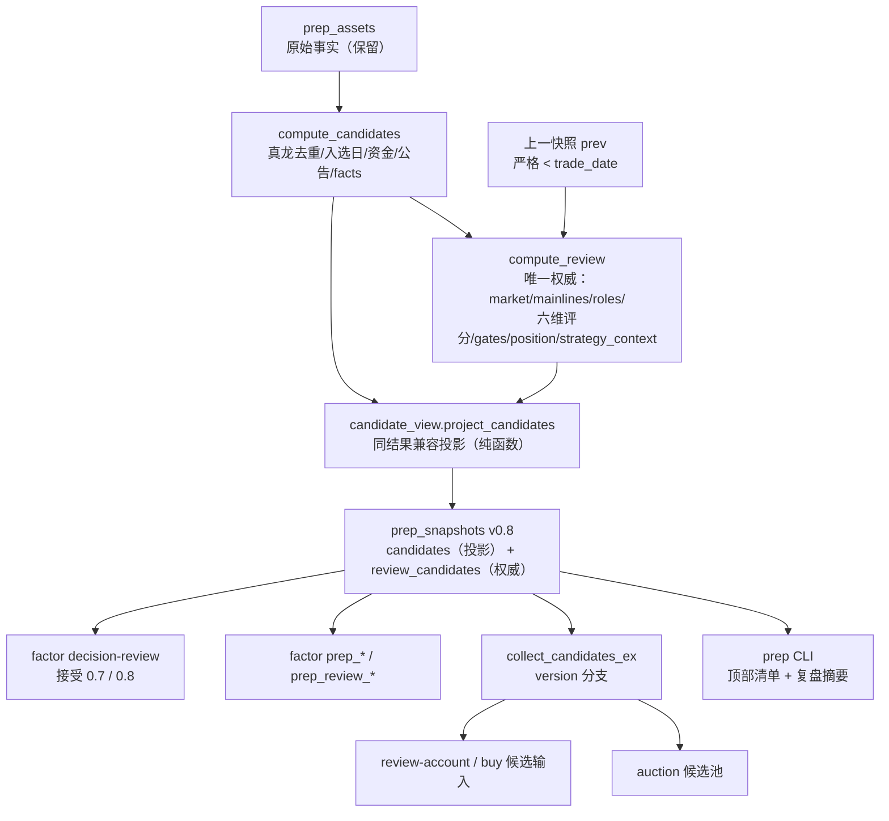
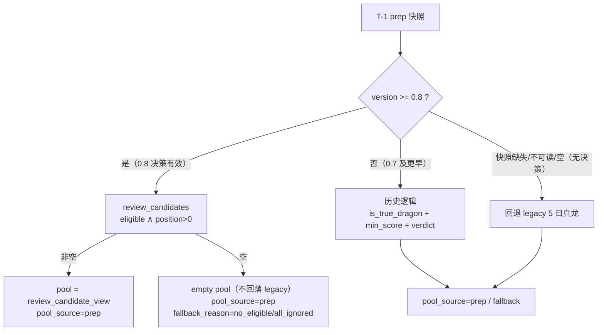
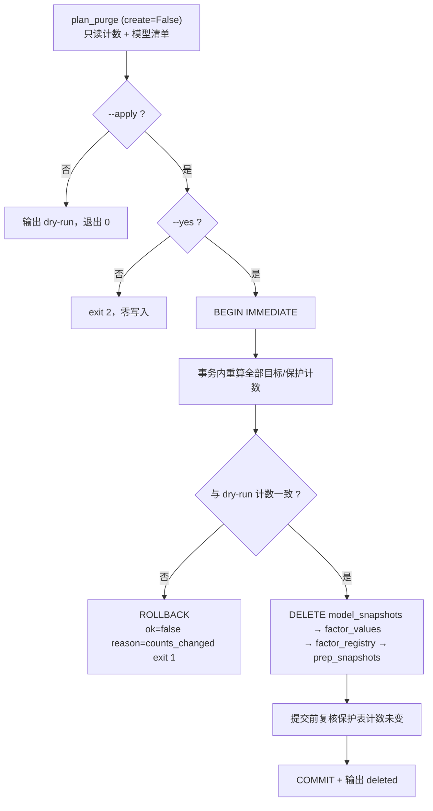
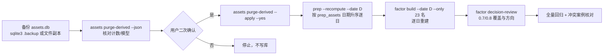

# prep 新旧算法统一 + prev 修复 + 派生清理 · 技术方案

> 日期：2026-10-30｜阶段：2（技术方案）｜状态：solution-self-review **APPROVE** + main 单次验收**通过**（见 §15、§16）
>
> 上游：`archived_md/prep/2026-10-30-prep-unified-review-research.md`（阶段 1，research-self-review APPROVE）。
> 范围：新六维 `review` 成为 `prep` / `auction` / `buy` 的唯一决策来源；修复主线 `prev` 未接线；保留原始资产，只清理可重建派生数据。
> 非目标：不改六维权重/评分公式/闸门阈值；不改 `buy` 买卖规则本体；不处理「最高板 262148」异常；不清理云端旧派生数据；不删除 `prep_assets` / `auction_*` / scan 因子。

---

## 1. 用户已确认决策与不可变式

| # | 决策 | 本方案落点 |
|---|------|-----------|
| 1 | 不允许旧五维候选评级与新六维复盘同时给出推荐 | 旧 `evaluate_candidates` 推荐链退出生产；`review_candidates` 唯一权威 |
| 2 | 新六维应用到 prep 展示、auction 候选池、buy 候选输入 | 快照升 `0.8`；`collect_candidates_ex` 版本分支；`candidates[]` 同结果投影 |
| 3 | 旧算法直接退役，不再作为第二套生产规则 | 删除旧规则链与 `prep_verdict` / `prep_composite` 因子 |
| 4 | 仅清派生数据 | 新增 `assets purge-derived`；保护 `prep_assets` / auction 资产 / 其他因子 / 云端 |
| 5 | 真删先 dry-run，再二次确认 | 默认 dry-run；`--apply` 必须叠加 `--yes`；单事务 + 写前复核 |

**方案级不可变式（实现必须逐条满足）**

1. `prep` 计算顺序固定为「原始事实装配 → 六维 review → candidates 兼容投影」，禁止任何反向依赖。
2. `review_candidates[]` 结构与字段不变；只允许 `review` 顶层只增键（`prev` 审计块）。
3. **`candidates[]` 主集合 = `review_candidates[]`**（同一新详细池、同一新决策）；原始 `raw_candidates` 只用于补齐 name/facts/concepts/资金公告，不得限制候选范围。raw 中因 `review_max_codes` 未进入详细池的代码才作为 `unrated/review_pool_truncated` 追加。
4. `0.8` 下游候选集合恒等于 `review_candidates` 中 `eligibility=="eligible" ∧ position_pct>0`，不得再叠加旧 `min_score` / 旧 `is_true_dragon` / 旧 `verdict` 过滤。
5. `0.7` 及更早快照按原路径只读，历史回测可复现。
6. `candidates[]` 中任何字段都不得来自旧规则链；旧五维分/旧 verdict 只允许出现在 `review_candidates[].legacy`（历史快照冻结值）里。
7. 清理只删「可重建派生」；删除与重建分两步，删除命令本身永不重建、永不触云端。

---

## 2. 候选设计（≥2，含非常规路径）

### 方案 A（推荐）：版本化快照适配器 + 同结果投影

- 写入侧：`compute_candidates` 保留全部原始事实与共享工具；`compute_review` 产出唯一权威；新增纯函数 `project_candidates()` 把同一份 review 结果映射成旧字段。
- 读取侧：`collect_candidates_ex` 按 `snapshot.version` 分派 Strategy：`>=0.8` 直接读 `review_candidates` 的 eligibility/position；`<=0.7` 保留历史逻辑。
- 传播面：`candidates[]` 是同一结果的兼容视图，不是第二套算法；旧消费方（CLI 清单、buy 前置闸门、因子 `prep_*`）无需立刻改结构。

**优点**：改动集中、旧 JSON 可读、旧快照可回放、回滚容易；与阶段 1 推荐一致。
**代价**：`candidates[]` 与 `review_candidates[]` 作用域不同，需要在文档和测试里固定「同 code 同结论」不变量。

### 方案 B：写时归一（快照只存 review，`candidates` 由读取方即时合成）

- 快照不再写 `candidates[]`，所有消费者在读取时调用同一投影函数。

**优点**：schema 最干净，彻底消除双份 JSON。
**拒绝理由**：破坏 0.7/0.8 混合期的读取契约；外部脚本、Agent Skill、Web UI 与旧测试都直接读 `candidates[]`；金标准与回滚面过大，不符合「优先简单」。

### 方案 C（非常规）：反向投影（保留旧 `candidates` 为权威，review 做覆盖层）

- 继续以旧候选池为骨架，用 review 覆盖排序与推荐标签，但 codes 仍由旧过滤决定。

**拒绝理由**：方向反了。旧身份（`is_true_dragon` / 旧 min_score / 旧 verdict）会再次决定谁进入候选，光洋/中国卫星类冲突无法根除；这等于把新算法降级成排序插件，违反用户决策 1/3。

### 推荐

**A**。它满足「唯一权威 + 单点映射 + 历史可读 + 最小回滚面」，且把风险集中在两个纯函数与一个版本分支上，便于测试收敛。

---

## 3. 架构总览



**依赖方向**：`service → compute → review`；兼容映射放在 **`dragon_quant/review_account/candidate_view.py`**（`review_account` 顶层，不放在 `prep/` 子包下）。原因：`prep` 包 `__init__` 是兼容代理，会 eager 加载 `prep.main`（provider/采集/编排）；若 `review_account.market` 直接 import `prep.compat`，会让 buy/auction 的导入链被动加载整套 prep/provider 依赖，形成隐藏耦合与潜在循环。`candidate_view` 只依赖 `review_account.verdicts` 常量；`REASON_LABELS` 在函数内 lazy import `prep.review.gates`，模块导入期保持轻量。`market.collect_candidates_ex` 只依赖 `candidate_view` 的只读视图，不 import `prep.review`。

### 设计模式与动机

| 模式 | 落点 | 动机 |
|------|------|------|
| **Adapter（适配器）** | `review_account/candidate_view.py::project_candidates/review_candidate_view` | 把一个权威结果适配成旧字段契约，隔离「新算法」与「旧消费方」的变化；放在 `prep` 包外避免代理导入耦合 |
| **Strategy（策略）** | `collect_candidates_ex` 的版本分支 | `0.8` 与 `<=0.7` 的候选集合规则可替换，调用方不变 |
| **Template Method（模板方法）** | `_compute_all` 固定「事实 → review → 投影 → 反馈」骨架 | 单点失败隔离与步骤顺序只实现一次 |
| **Registry（注册表）** | `factor/maintenance.py` 的 `TARGET_FACTOR_NAMES` / `REBUILD_FACTOR_NAMES` | 清理目标与重建名单是显式数据，不用 glob 猜名字 |
| **Chain of Responsibility（责任链）** | 既有 `gates.py` G0→G7 | 本次不改闸门语义，只在投影层消费 `reason_code` / `gate_trace` |

---

## 4. 统一流水线设计

### 4.1 计算编排（`service._compute_all`）

```text
_prepare_assets(assets, trade_date)                     # 既有：按 collection_report/as_of 过滤
sentiment / main_boards / macro                          # 既有，不动
raw_candidates = compute_candidates(usable, trade_date)  # 原始事实 + facts，不跑旧评级
review = compute_review({**usable, "candidates": raw_candidates},
                        trade_date, prev=prev, prev_meta=prev_meta)
review_candidates = review["review_candidates"]
candidates = project_candidates(review_candidates, raw_candidates, trade_date)
有效 prev_plan = prev.strategy_context（优先）→ 保留的 prev_plan 资产（回退）
feedback / plan_review                                   # 用有效 prev_plan
result.version = "0.8"
```

- `compute_candidates` 保留：窗口真龙去重、真实入选日、THS 归因、资金/公告、`facts`、`risk_announcement`、`legacy.composite_score/in_candidates` 证据；但它不再决定 `candidates[]` 的范围。
- `project_candidates` 以 `review_candidates` 为主集合逐只投影；`raw_candidates` 只按 code 提供 name/facts/concepts/资金公告补齐。review-only 代码使用 review 的 name 与既有补齐逻辑，缺失保持 null；只有 raw 中因 `review_max_codes` 未进入详细池的代码才追加为 `unrated/review_pool_truncated`。
- `evaluate_candidates` 及其规则链（`evaluate_one` / `_ignore_reason` / `_is_strong` / `_is_light` / `build_facts` / `build_dimensions`）删除；`find_risk_announcement` 与文本清洗工具保留。
- 旧 `legacy.verdict`：新快照为 `null`（旧规则不再运行）；历史 0.7 快照里的冻结值仍可读。
- `review` 计算失败或 `DQ_REVIEW_V2_ENABLED=0/false`：不回落旧算法；`candidates[]` 全部投影为 `unrated` / `composite_score=null` / `ignore_reason="review_unavailable"`，`review_candidates=[]`。

### 4.2 prev 注入（修复「主线永远 unknown」）

`run_prep` 在正常与 `--recompute` 两种模式都执行：

```python
prev, prev_meta = assets_db.get_previous_prep_snapshot(trade_date, source="v2")
result = _compute_all(trade_date, assets, prev=prev, prev_meta=prev_meta)
```

- 新只读接口：`get_previous_prep_snapshot(before_date)` → `SELECT ... WHERE trade_date < ? ORDER BY trade_date DESC LIMIT 1`，`create=False`，严格小于，绝不返回当日快照。
- 读取/JSON 损坏：返回 `(None, {"error": ...})`；主线 `unknown_reason="prev_snapshot_corrupt"`。
- 无快照：`(None, {})`；`unknown_reason="prev_snapshot_missing"`。
- `review` 顶层新增只增审计块：

```json
"prev": {
  "snapshot_date": "2026-10-29",
  "snapshot_version": "0.8",
  "mainlines": "ok",
  "degraded": []
}
```

`mainlines` ∈ `ok` / `missing` / `snapshot_missing` / `corrupt`。

### 4.3 主线 unknown_reason（稳定原因，禁止空说明）

`compute_mainlines` 每个板块行输出 `unknown_reason`（与 `board_rank` 既有原因用 `;` 合并去重）：

| reason_code | 触发条件 |
|---|---|
| `prev_snapshot_missing` | 无严格 `<T` 的 prep 快照 |
| `prev_snapshot_corrupt` | 上一快照读取/JSON 损坏 |
| `prev_mainlines_missing` | 上一快照存在但无 `review.mainlines`（旧快照/disabled/异常） |
| `prev_mainline_score_missing` | 上一快照该板块存在但 `mainline_score` 缺失 |
| `mainline_score_missing` | 当前板块主线分不可用（替换旧 `mainline_score_unavailable`） |
| `mainline_prev_rank_missing` | 当前板块不在上一快照前 5，且排名 > top_n（无法判定 new） |
| `mainline_change_below_threshold` | 防御性兜底：有 prev 但变化不足以归入五态 |
| `board_members_missing` | 既有：板块成员名单缺失 |

`state` 五态与阈值**完全不变**；只补原因。市场状态复用同一 `prev`，`prev_score/prev_state/score_change` 自然恢复，仍禁止当日自比。

### 4.4 有效 T-1 计划（保证升序重建一致）

优先级：

1. 上一快照的 `strategy_context`（由 `positions` / `feedback_plans` 重建计划 dict）；
2. 已保留的 `prev_plan` 资产（正常运行时两者应等价）；
3. 空计划（`degraded=["no_prev_plan"]` 或 `no_previous_trade_date`）。

- 升序重建时，第 2 天起上一快照就是新算出的快照，因此反馈评估的是新计划；首个重建日无上一日快照、保留资产本身也为空，故 `feedback` 合法缺席（不写键、不报错）。
- 非升序重建时，后段可能回退到保留的原计划资产；文档必须明确「必须升序」，并在 `review.prev.degraded` 记 `prev_snapshot_missing` 供审计。
- 不伪造成交价/仓位：`actual_*` 缺失仍为 `null` + `execution_known=false`。

### 4.5 快照 `0.8` 兼容映射

`project_candidates(review_candidates, raw_candidates, trade_date)`：

1. 以 `review_candidates`（新详细池）为主集合逐只生成兼容视图；
2. 按 `code` 从 `raw_candidates` 取 name/facts/concepts/资金公告补齐；review-only 代码用 review 的 name，缺失保持 `null`；
3. 把 raw 中**因 `review_max_codes` 未进入详细池**的代码追加为 `unrated/review_pool_truncated`（保证不静默丢窗口真龙）；
4. 其余 raw 代码（已入池）不重复追加。

| 兼容字段 | 0.8 取值 | 说明 |
|---|---|---|
| `code` / `name` / `trade_date` / `facts` / `concepts` / `main_net_amount` / `announcements` | 原样保留 | 原始事实装配，不让位 |
| `composite_score` | `review_score` | 旧五维分不得进入生产排序 |
| `rank` | `review_candidates` 排序的 1-based 名次 | 全局 review 排名，允许在子集里有空档 |
| `verdict` | `S/A ∧ position>0` → `strong`；其他 `position>0` → `light`；`position==0` → `ignore`；`position==null` → `unrated` | 确定性映射，无第二套规则 |
| `verdict_label` | `VERDICT_LABELS[verdict]` | 展示 |
| `ignore_reason` | `reason_code` 的中文标签 + 首个失败闸门 detail；硬风险优先拼接公告标题 | 来自 `reason_code` / `gate_trace` |
| `dimensions` | 2-3 行：复盘分/档位、角色/仓位、主线名次 | 仅展示，不参与计算 |
| `is_true_dragon` | `null`（未知），绝不写 `true/false` | 防止旧身份二次否决新主线 |
| `review_pool` | `true`（仅表示该行是 0.8 review 兼容视图） | 供 buy 前置闸门识别来源，不代表可买 |
| `review_eligible` | `eligibility=="eligible" ∧ position_pct>0` | 唯一可买标记；buy 前置闸门只认这个 |
| `legacy` | 不投影到 `candidates` | 只在 `review_candidates[].legacy` |

**缺失/截断语义**

- review 池按 `review_max_codes` 截断导致某龙不在 `review_candidates`：该 raw 候选追加为 `composite_score=null`、`rank=null`、`verdict="unrated"`、`position_pct=null`、`ignore_reason="review_pool_truncated"`。
- review 不可用：`review_pool` 主集合为空，所有 raw 候选投影为 `review_unavailable`。
- 投影绝不抛异常；单只畸形只让该只降级为 `unrated`。

**视图补齐**：`review_candidate_view(review_candidate, raw=None, rank=None)` 在 0.8 池构造时接受 `snapshot.candidates` 的 raw 行，补齐 `name` / `facts` / `concepts` / 资金与公告字段；review-only 代码没有 raw 时使用 review 的 `name`，缺失保持 `null`，绝不伪造。`candidates[]` 与 `review_candidates[]` 是同一主集合，raw 只做增强。

**一致性不变量**：`candidates[]` 的 code 集合 = `review_candidates[].code` ∪ `{raw 中因截断未入池的 code}`；对任意 review 代码，`review_score`、`composite_score`、`verdict`、`position_pct`、`reason_code/ignore_reason` 必须逐字段一致。prep 顶部清单、复盘摘要、auction/buy 使用同一详细池与同一新决策，不再存在「窗口真龙 vs 详细池」两套范围。

### 4.6 下游读路径

`review_account/market.py::collect_candidates_ex`：



- 新增分支以 `review_candidates` 为权威（`candidates[]` 已是同一主集合的兼容视图）；`ignore_reasons` 取 `position<=0` 的投影原因；`recommended_count` = 达标数；`filtered_ignore` = 明确 0 仓数。
- **0.8 有效决策的空池不回落 legacy**：`eligible ∧ position>0` 为空即当日无候选（auction 正常空池退出，buy 无候选）。回落 legacy 会用旧 `min_score` / 旧身份重新给出一份推荐，等于第二套算法，违反唯一权威。`fallback_reason` 仅作诊断。
- **只有「没有 0.8 决策」才回落**：快照缺失、读取异常、`candidates` 为空、`version` 缺失（历史快照）→ 走原回退路径。
- `version` 缺失或非数值一律按 `<=0.7` 历史分支处理（兼容既有测试与旧快照）。
- 0.8 快照缺 `review_candidates`（损坏/disabled）→ 空池 + `review_missing`，**不**回落 legacy。
- `auction` 复用同一函数，因此池集合与 `buy` / `review-account` 天然一致；旧 auction 快照不自动刷新，文档提示 `auction --force`。历史 `auction_snapshots` 是旧 prep 决策的冻结产物，重建 prep 不会改写它们，不可横向对比新旧池。

**buy 前置闸门**：`evaluate_buy` / `_divergence_preconditions` / `explain_buy_checks` 三处改为：

1. `review_pool is True` 且 `review_eligible is not True` → 直接拒绝（`review_not_eligible`），防止任何未来路径把 0 仓候选送进买点；
2. `review_eligible is True` → 跳过旧 `is_true_dragon` / `min_score` 判断；
3. 其余候选（0.7/legacy）保持原逻辑。

买点形态、卖出规则、费用、优先级排序**本体不改**。这是「候选输入按新算法」的必要适配，不改变任何买卖形态判定。

**展示层**：`format_candidate_lines` 读 `candidates[]`（已是全详细池投影），`format_review_lines` 读 `review_candidates`；两者集合与结论一致，同一 code 的 score/verdict/position/reason 逐字段相同。复盘摘要主线行在 `state=="unknown"` 时追加 `（未知：<unknown_reason>）`，不再出现无说明的「未知」。

**decision-review**：`ACCEPTED_VERSIONS["prep"] = ("0.7", "0.8")`；0.7 历史快照继续可回测，0.8 用同一 `eligible ∧ position>0` 分组，`review_candidates` 结构未变，指标口径零改动。

### 4.7 接口契约（实现按此签名）

```python
# dragon_quant/review_account/candidate_view.py（纯函数，无 I/O）
def review_candidate_view(rc: dict, *, raw: dict | None = None,
                          rank: int | None = None) -> dict: ...
def project_candidates(review_candidates: list[dict],
                        raw_candidates: list[dict],
                        trade_date: str) -> list[dict]: ...
def is_review_pool(candidate: dict) -> bool: ...
def is_review_eligible(candidate: dict) -> bool: ...

# dragon_quant/infra/assets/db.py（只读，create=False）
def get_previous_prep_snapshot(before_date: str, source: str = "v2"
                               ) -> tuple[dict | None, dict]: ...
# 返回 (payload, {"trade_date": ..., "created_at": ..., "error": ...|None})

# dragon_quant/review_account/prep/service.py
def _compute_all(trade_date: str, assets: dict, *,
                 prev: dict | None = None,
                 prev_meta: dict | None = None) -> dict: ...

# dragon_quant/review_account/prep/compute.py（纯函数）
def effective_prev_plan(prev: dict | None,
                        stored_prev_plan: dict | None) -> dict | None: ...

# dragon_quant/infra/factor/maintenance.py
@dataclass(frozen=True)
class PurgePlan:
    db_path: str | None
    counts: dict          # 目标计数
    protected: dict       # 保护表计数
    models: list[dict]    # {model_name, model_version, matched_factors, mixed}
    rebuild_steps: list[str]
    warnings: list[dict]

def plan_purge(db_path: str | None = None) -> PurgePlan: ...
def apply_purge(plan: PurgePlan) -> dict: ...   # 事务内复核 + 删除 + 结果
```

`compute_review(..., prev=None, prev_meta=None)` 只增可选关键字参数；`review_candidates` 结构不变。

---

## 5. 派生数据清理与重建（`assets purge-derived`）

### 5.1 目标清单（精确名，禁止 glob）

**退役不重建（2）**：`prep_composite`、`prep_verdict`。

**保留并重建（23）**：

- prep 事实 5：`prep_high_days`、`prep_t_pct`、`prep_t_turnover`、`prep_limit_up_suc_rate`、`prep_in_pool_today`
- prep review 18：`prep_review_score`、`prep_review_grade`、`prep_position_pct`、`prep_market_state`、`prep_mainline_rank`、`prep_role`、`prep_dim_d1..d6`、`prep_seal_ratio`、`prep_main_net_ratio`、`prep_turnover_health`、`prep_distance_high60`、`prep_chip_concentration`、`prep_feedback_state`

`TARGET_FACTOR_NAMES = RETIRED ∪ {spec.source=="prep" 的当前注册因子}`；测试强制二者相等，新增 prep 因子必须同步清理清单。

### 5.2 删除范围与保护边界

| 对象 | 动作 | 理由 |
|---|---|---|
| `prep_snapshots` 全部行 | 删除 | 可重算；唯一约束 `(trade_date, source)` |
| `factor_values` 目标 25 名的全部行 | 删除 | 派生值，随快照重建 |
| `factor_registry` 目标 25 名的全部版本行 | 删除 | 历史元数据，代码重跑会重注册 |
| `factor_model_snapshots` 引用任一目标名的行 | 删除；dry-run 完整列出 model_name/version/命中因子/是否混合 | 快照已不可复现，保留会误导决策 |
| `prep_assets`（含 collection_report/prev_plan/auction_feedback/t1_intraday） | 保留 | 原始证据，含 same_day_only 不可再生数据 |
| `auction_assets` / `auction_snapshots` / `auction_*` 因子 | 保留 | 另一数据源，不因名字相似连带清理 |
| `five_dim_composite` / 其他非目标因子 | 保留 | scan 产物，与 prep 无关 |
| `factor_build_runs` | 保留 | 历史构建审计，不是因子值或生产输入 |
| 云端对象 / manifest / state | 零操作 | 用户已接受本期不处理；恢复边界见 §5.6 |

**模型快照解析**：`factor_versions_json` 是 `{factor_name: version}`；命中任一目标名即整行删除。JSON 损坏行不删，记 `warnings=[{model_name, reason:"malformed_json"}]`。混合模型在 dry-run 与 apply 报告中逐行展示，不静默。删除后在报告写 `model_rebuild_required=true`，并列出受影响的 `model_name/version`；生产模型必须用重建后的因子版本重新生成快照，否则决策会降级 `model_snapshot_missing`。

### 5.3 CLI 契约

```bash
dragon-quant assets purge-derived                 # dry-run（默认），只读
dragon-quant assets purge-derived --json          # 稳定 JSON
dragon-quant assets purge-derived --apply --yes   # 单事务删除
```

- `--apply` 未带 `--yes`：参数错误，exit 2，零写入。
- **进程锁**：`purge-derived` 与 `assets push/pull` 共用 `<DQ_DATA_DIR>/assets_sync.lock`（`ProcessLock`）；锁被占用 exit 1，不并发写。命令层获取锁，`infra/factor/maintenance.py` 只做 DB，不 import sync。
- **不与 prep / factor build 并发**：`BEGIN IMMEDIATE` 只防跨进程写，不防语义竞争；运维文档要求先停定时 prep/factor build。
- 默认 dry-run：`create=False` 只读；库不存在时计数为 0、`db_exists=false`，exit 0。
- 退出码：0 成功/无可删；1 计数变化、事务失败；2 参数/库不可读。
- 人读摘要走 stderr，JSON 走 stdout（沿用 `assets backfill-dragons` 约定）。

**JSON 稳定键**

```json
{
  "ok": true,
  "command": "assets purge-derived",
  "dry_run": true,
  "applied": false,
  "db_exists": true,
  "counts": {
    "prep_snapshots": {"rows": 7},
    "factor_values": {"rows": 0, "by_factor": {}},
    "factor_registry": {"rows": 7, "by_factor": {}},
    "factor_model_snapshots": {"rows": 0, "models": []}
  },
  "protected": {
    "prep_assets": 73, "auction_assets": 0, "auction_snapshots": 0,
    "factor_values_other": 0, "factor_registry_other": 0,
    "factor_build_runs": 0, "factor_model_snapshots_other": 0
  },
  "recheck": null,
  "deleted": null,
  "rebuild_steps": [
    "python -m dragon_quant prep --recompute --date <D>  # 升序逐日",
    "python -m dragon_quant factor build --date <D> --only prep_high_days,...,prep_feedback_state",
    "python -m dragon_quant factor decision-review --source prep --from <D0> --to <Dn>"
  ],
  "warnings": [],
  "failed": []
}
```

`--apply` 时 `recheck` 记录事务内重算计数，`deleted` 记录实际删除行数；`rebuild_steps` 由 `prep_assets` 日期升序与 `REBUILD_FACTOR_NAMES` 生成，只作提示，purge 自身**不执行**重建。

### 5.4 单事务与写前复核



- 复核摘要包含 `prep_assets` / auction 表 / 非目标因子 / `factor_build_runs` 行数；任一变化即回滚。
- 不依赖 SQLite 级联（本库无 `FOREIGN KEY`）；顺序固定，单事务保证「要么全删、要么不动」。
- 禁止在普通功能测试、E2E 默认流程、import 时或任何自动化路径调用 `--apply`；只允许独立临时库测试。

### 5.5 迁移与重建流程



- 升序是硬要求：第 2 天起 `prev` 才指向新算出的前一快照；首日 `prev_plan` / `feedback` 合法为空。
- `prep --recompute` 零网络、零采集；历史 `same_day_only` 资产缺失仍是合法降级，不伪造。`--recompute` 按既有契约只回写 `dragons` 资产行（审计键），不新增/删除其他 `prep_assets`。
- `factor build` 使用显式 23 名，禁止 `--all`（会连带构建 auction/fin）。
- 重建完成后 `factor query` 的 `resolved_versions` 自动指向新版本；旧版本行已被清理。
- 重建后可显式 `assets push` 覆盖云端新派生；不执行也不影响本地正确性。完成后 `assets status` 会因远端仍是旧派生而报 `mismatched`，这是预期，不得据此回滚。

### 5.6 云端与回滚

- **云端零操作**：purge 不 import `infra.assets.sync`、不调用 provider、不读写 `state.json`；测试用 import/调用断言锁定。
- **恢复禁令**：迁移完成前禁止把云端旧 `prep_snapshots` / 旧 prep 因子恢复到主库（会重新引入旧派生）；隔离恢复 `assets pull --target-dir` 用于审计不受此限。
- **回滚**：apply 前做文件级备份（WAL checkpoint 后复制 `assets.db`）是唯一推荐回滚物；主库禁止 `pull --force`。回滚后按同一方案重跑 dry-run 校验。

---

## 6. 因子层变更

| 项 | 变更 |
|---|---|
| `builtin/prep.py` | 删除 `compute_verdict` / `compute_composite` 与两条 `FactorSpec`；保留 5 个事实因子及共享 helper |
| `builtin/prep_review.py` | 不变（18 个；`config_hash` 仍与 `review/config.py` 单一真源一致） |
| 注册表 | `FACTOR_SPECS` 自动少 2 项；`factor list` / `--all` / 默认启用集同步变化 |
| 基线 | `architecture_baseline.json.factor_versions` 与 `golden_sha256` 属**批准行为变更**，用 `DQ_BASELINE_WRITE=1` 重生成并人工核对 |
| E2E fixture | `EXPECTED_FACTOR_NAMES` 移除 2 名；显式 `--only prep_verdict` 改为「未知因子 exit 2」用例 |
| decision-review | prep 接受 `0.7` / `0.8`；其他版本仍计 `unsupported_snapshot_version` |

`prep_*` 因子读的 `candidates[]` 变为投影值：`prep_composite` 已退役，其余 5 个事实因子字段不变；`prep_review_*` 读 `review_candidates`，结构不变。

---

## 7. 错误处理与降级矩阵

| 场景 | 行为 | 留痕 |
|---|---|---|
| 单只 review 评分异常 | 该只 `review_score=null` / `position=null`，其余继续 | `warnings` / `reason_code=compute_error` |
| review 整体失败 / disabled | 不回落旧算法；candidates 全 `unrated` | `review.compute_error` / `enabled=false` |
| 上一快照缺失 | 主线全 `unknown`，市场不环比 | `prev_snapshot_missing` + `review.prev` |
| 上一快照损坏 | 同上 | `prev_snapshot_corrupt` |
| 上一快照无 mainlines | 主线全 `unknown` | `prev_mainlines_missing` |
| review 池截断 | 未入池候选 `unrated` | `review_pool_truncated` |
| 候选未进入 review 池（其他） | `unrated` | `review_unavailable` |
| 0.8 快照无 `review_candidates` | 空池，不回落 legacy，`fallback_reason=review_missing` | `ctx.degraded` |
| 0.8 有效决策无 eligible | 空池，不回落 legacy | `fallback_reason=no_eligible/all_ignored` |
| `review_pool` 但 `review_eligible!=True` 误入 buy | 直接拒绝 `review_not_eligible` | 诊断 checks |
| purge 进程锁被占用 | exit 1，零写入 | `lock` |
| purge 计数变化 | 回滚、exit 1 | `counts_changed` + before/after |
| purge 模型 JSON 损坏 | 不删该行 | `warnings[].malformed_json` |
| purge 库不存在 | dry-run 计数 0；apply 拒绝 | `db_exists=false` |

---

## 8. 测试策略与矩阵

> 原则：单元/集成用临时 `db_path` 或 monkeypatch `assets_db._connect`；E2E 只在临时 `DQ_DATA_DIR`，永不打开真实 `dragon.db` / `assets.db`；`--apply` 只在隔离临时库。

| # | 验收点 | 测试（建议文件::用例） |
|---|---|---|
| T1 | 光洋/中国卫星/上海沪工冲突消除 | `test_prep_review_integration.py::test_projection_conflict_cases_consistent`；断言 candidates 与 review_candidates 的 verdict/score/position/reason 一致；上海沪工 `hard_risk` → `ignore` + position 0 |
| T2 | 顶部清单与复盘摘要一致（同一详细池） | `test_verdicts.py::test_candidate_lines_match_projection`；同一 code 的标签/分数/仓位文案一致，且 candidates 集合 = review 集合 |
| T3 | 机器人 prev 恢复五态 | `test_review_mainline.py` 新增：有 prev → `strengthening/stable`；无 prev → `unknown + prev_snapshot_missing`；prev 无 mainlines → `prev_mainlines_missing`；prev 板块缺分 → `prev_mainline_score_missing` |
| T4 | 严格前一快照、无当日自比 | `test_prep.py::test_previous_snapshot_is_strictly_before`；同日快照被排除；重算两次 prev 仍为 T-1 |
| T5 | 升序重建首日反馈为空 | `test_prep.py`：purge 后首个日期 `--recompute` 无 `feedback` 键、无异常；第二日 prev 指向新快照 |
| T6 | 0.8 候选集合 = eligible ∧ position>0；空池不回退 | `test_auction_pool.py::test_review_pool_uses_eligibility_and_position`；`test_review_pool_empty_does_not_fallback`；与 `buy`/`review-account` 共用同一函数 |
| T7 | 0.7 历史分支不变 | `test_auction_pool.py`：0.7 快照仍按旧 verdict/min_score 过滤；version 缺失走历史分支；输出与改动前一致 |
| T8 | 不叠加旧 min_score / 身份 | `test_buy_checks.py`：`review_eligible=True` 且 `min_score=90` 时仍通过；`review_pool=True` 但 `review_eligible=False` 被拒绝；形态判定不变 |
| T9 | 快照 0.8 / decision-review 0.7+0.8 | `test_prep.py` 版本断言；`test_factors_decision_review.py` 新增 0.8 观测与 0.6 不支持 |
| T10 | 因子退役 | `test_factors_prep_auction.py`：注册表少 2 项；显式 `--only prep_verdict` → 未知因子；`test_factors_build_all.py` 全量名单同步 |
| T11 | purge dry-run 计数/保护项 | `test_assets_purge_derived.py`：种子库精确计数；保护表零变化；混合模型展示 |
| T12 | purge apply 单事务/复核 | 同上：计数变化回滚；`--apply` 无 `--yes` exit 2；事务失败零残留 |
| T13 | purge 云端零操作 | 同上：断言未调用 sync/provider；源码/导入级检查 |
| T14 | E2E 临时库 + 新命令覆盖 | `tests/e2e/test_assets.py::test_as19_purge_derived_dry_run_and_apply_temp_db`；`coverage-map.json` 53 节点 |
| T15 | 文档/Skill/README 同步 | `test_docs_consistency.py`（0.8、`assets purge-derived`、52→53）；`test_skill_content.py` / `test_skill_routes.py`（T2 路由） |
| T16 | golden / 基线 | `golden/prep/snapshot.json`、`golden/prep/stdout.txt`、`architecture_baseline.json` 按批准行为变更更新 |
| T17 | 兼容视图补齐与 name 不丢失 | `test_prep_review_integration.py`：review-only code 的 name 来自 review，重叠 code 的 facts/name 来自 raw；不伪造缺失 |
| T18 | purge 进程锁/并发 | `test_assets_purge_derived.py`：持锁时 apply exit 1 零写入；锁释放后可执行 |
| T19 | candidates 主集合 = 详细池 | `test_prep_review_integration.py::test_candidates_scope_is_review_pool`：review-only 代码进入 candidates；raw 截断代码追加 `review_pool_truncated`；无重复 code |

**E2E golden 变更说明**：`prep` 顶部清单文案（`LEGACY_STDOUT_PREFIX` 常量）、快照 `version`、`review_candidates[].legacy.verdict`（新快照为 null）、`mainlines[].unknown_reason` 属批准行为变更；`test_prep.py` 中所有 `version == "0.7"` 单元断言同步改 0.8。`prep/assets.json` 与 `calls.json` 预期不变（资产与采集路径未改）。golden 只允许在人工核对后更新，结构重构不得顺手改。

---

## 9. 验收标准映射（任务包 A-F）

| 任务包要求 | 方案落点 | 验证 |
|---|---|---|
| A. 原始事实装配 → 六维 review → candidates 投影；旧推荐规则退出 | §4.1、§4.5；`service._compute_all`、`candidate_view.py`；删除 `evaluate_candidates` | T1/T2/T10 |
| B. candidates 主集合=review 详细池；仅同结果映射；0.8 下游 eligible∧position>0；不叠加旧过滤；0.7 历史分支 | §4.5、§4.6；`candidate_view.project_candidates`、`collect_candidates_ex`、buy 前置短路 | T1/T2/T6/T7/T8/T19 |
| C. 快照 0.8；review_candidates 不变；decision-review 0.7/0.8；清单/摘要一致；buy 规则本体不改；auction 提示 --force | §4.5、§4.6、§6；§10 文档 | T2/T8/T9/T15 |
| D. prev 严格前一快照注入；稳定 unknown_reason；不自比；升序首日反馈允许空 | §4.2–§4.4 | T3/T4/T5 |
| E. `assets purge-derived` dry-run/apply；只删指定派生；保护项；单事务；二次确认；不自行清真实库 | §5 | T11/T12/T13/T14 |
| F. Mermaid/schema 兼容表/prev 状态/purge 契约/回滚/测试矩阵/验收映射/冲突案例/旧版本/云端/E2E/README/owner/Skill/coverage-map/golden/AGENTS 53 节点 | 本文 + §10；T1–T19 | T15/T16/T19 |

---

## 10. 文档、Skill 与发布物同步

| 文件 | 必改内容 |
|---|---|
| `README.md` | `version=0.8`；candidates 投影与一致性；prev 原因；`assets purge-derived` 命令/边界/迁移步骤；factor 7→5；decision-review 0.7/0.8；auction `--force` 提示 |
| `docs/agent/prep-auction.md` | 快照 0.8、投影契约、prev 注入与 unknown_reason、有效 prev_plan、清理/重建提示、auction 缓存 |
| `docs/agent/factor.md` | prep 因子 7→5、两因子退役、decision-review 0.7/0.8、重复计数警告更新、purge 重建名单 |
| `docs/agent/assets.md` | `purge-derived` 契约/保护边界/单事务/二次确认/云端零操作/回滚 |
| `docs/agent/trading.md` | 0.8 候选分支、buy 前置闸门标记、0.7 历史分支 |
| `docs/agent/architecture.md` | 目录树新增 `review_account/candidate_view.py`、`infra/factor/maintenance.py`；命令导航补 purge 动作（无新顶层命令） |
| `review_account/strategy/STRATEGY.md` | 候选池 0.8 规则与新旧分支说明；旧 `prep_verdict_filter_enabled` 仅 0.7 历史路径生效 |
| `skills/dragon-quant/references/{commands,safety,operations}.md` | `assets purge-derived`：dry-run T0、`--apply --yes` T2；迁移/回滚操作提示 |
| `AGENTS.md` | **仅改一处常量**：覆盖映射 parser 节点数 `52` → `53`（新增 `assets purge-derived` 属跨模块 E2E 覆盖硬约束）；其余不动 |
| `dragon_quant/tests/e2e/coverage-map.json` + `test_coverage_map.py` | 新增 `assets purge-derived` 节点（52→53）与用例映射；同步测试名/断言的 52→53 |
| `dragon_quant/tests/test_docs_consistency.py` | 版本 token 0.7→0.8；52→53 注释/断言；新增命令可达性 |
| `dragon_quant/tests/fixtures/architecture_baseline.json` | 因子版本与 golden 哈希重生成 |

根 `AGENTS.md` 除上述 parser 节点数外不改：命令手册归 README，模块契约归 owner 文档。

---

## 11. 风险与缓解

| 风险 | 影响 | 缓解 |
|---|---|---|
| 兼容字段再次形成旧过滤 | 新主线标的被旧身份/分数否决 | 0.8 分支直接读 eligibility/position；`is_true_dragon=null`；buy 前置闸门用 `review_eligible` 短路 |
| 旧因子双份语义 | `prep_composite` 与 `prep_review_score` 并存 | 退役两因子；注册表/文档/基线/Golden 同步 |
| 先删后建顺序错误 | prev 无法建立、反馈错配 | 强制升序；首日空计划合法；文档与测试锁定 |
| 保留的 `prev_plan` 资产与重建计划语义分裂 | 反馈可能评估旧计划 | 优先用上一快照 `strategy_context` 重建有效计划；资产仅回退；非升序显式记录 |
| review 池截断 | 部分龙不在详细池 | 投影 `unrated + review_pool_truncated`；0.8 池不含截断标的，不伪造推荐 |
| 云端旧派生恢复 | 旧数据重新污染主库 | 文档禁令；隔离恢复仅审计；purge 零云端操作 |
| 混合模型快照误删 | 丢失非目标因子配置 | dry-run 逐行展示；只删引用目标名的行；JSON 损坏不删 |
| auction 旧快照未刷新 | 池仍按旧 prep 结果 | 文档提示 `auction --force`；不自动清理 |
| 兼容视图被误当作可买标记 | 0 仓候选进入买点 | `review_pool` 与 `review_eligible` 分离；buy 三处短路；未来调用路径也安全 |
| 兼容模块放错层 | buy/auction 导入链加载 prep 代理/provider，隐藏循环 | `candidate_view` 放 `review_account` 顶层，`REASON_LABELS` 函数内 lazy |
| 0.8 空池回落 legacy | 旧算法再次给出推荐，唯一权威被破坏 | 0.8 有效决策空池直接空；只有「无 0.8 决策」才回退 |
| 模型快照被删后未重建 | 决策降级 `model_snapshot_missing` | 报告 `model_rebuild_required` + 影响清单；文档要求重建 |
| purge 与 push/pull 并发 | 删除与备份/恢复交叉 | 复用 `assets_sync.lock`；要求停 prep/factor build |
| 历史 auction 快照与新 prep 池不一致 | 横向对比误读 | 明确冻结产物不可重建；需要时 `auction --force` 只影响新日 |
| 0.7 历史回归 | 回测不可复现 | 版本分支保持旧逻辑；T7 测试锁定 |

---

## 12. 实施顺序（供阶段 3 拆分提交）

1. **统一流水线**：`candidate_view.py` + `_compute_all` 改序 + 删除旧规则链 + 0.8 版本 + 投影测试。
2. **prev 修复**：`get_previous_prep_snapshot` + `_compute_all(prev)` + mainline reasons + 有效 prev_plan + 测试。
3. **下游适配**：`collect_candidates_ex` 版本分支 + buy 前置闸门标记 + advice 未知原因展示 + decision-review 版本 + 测试。
4. **因子退役**：`builtin/prep.py` 删 2 + fixture/基线/文档。
5. **派生清理**：`factor/maintenance.py` + CLI/parser + 单测 + E2E temp DB + coverage-map。
6. **文档/Golden**：README/owner/Skill/STRATEGY/golden/architecture baseline；全量回归。

> 提交按用户指令执行；本会话不写产品代码、不跑 `--apply`。各提交信息需说明偏离与验收证据。

---

## 13. 明确不做 / 留给后续

- 不改六维权重、闸门、仓位公式、市场/主线阈值。
- 不改 `buy` / `sell` 的形态与成交规则；仅候选前置闸门适配。
- 不清理云端；不做 launchd / 定时迁移。
- 不处理「最高板 262148」异常。
- 不新增 `factor build` 按 prep 日期的区间参数；重建用逐日命令。
- ~~不把 `candidates[]` 改成详细池全量~~（main 单次验收已推翻）：0.8 起 `candidates[]` 主集合就是 review 详细池，raw 仅补齐/截断兜底。

---

## 14. self-review 留痕

```yaml
review_type: solution
round: 1
verdict: REVISE
summary: "唯一权威与清理边界基本成立，但 0.8 空池回退 legacy 会重新引入第二套推荐（CRITICAL）；模块分层与标记语义需收紧。"
findings:
  - severity: CRITICAL
    dimension: 一致性
    location: "§4.6 下游读路径"
    finding: "0.8 有效决策但 eligible∧position>0 为空时回退 legacy，会用旧 min_score/身份再次给出推荐，违反唯一权威。"
    recommendation: "0.8 有效快照空池保持空；只有快照缺失/不可读/无 candidates（无决策）才回退。"
    change_my_mind: "若产品明确要求‘无新推荐时允许旧池兜底交易’，且接受与新算法矛盾，可保留回退。"
  - severity: MAJOR
    dimension: 架构
    location: "§3 依赖方向"
    finding: "兼容映射若放 prep/ 子包，market 导入会触发 prep 包代理 eager 加载 prep.main/provider，形成隐藏耦合。"
    recommendation: "移到 review_account/candidate_view.py，原因标签函数内 lazy import。"
    change_my_mind: "若 prep 包改为非 eager 代理且 market 不因导入加载 provider，可放回。"
  - severity: MAJOR
    dimension: 安全性/一致性
    location: "§4.5 兼容映射、§4.6 buy 前置闸门"
    finding: "review_pool 单标记覆盖所有 0.8 候选，零仓候选若被未来路径送入 buy 会绕过旧闸门。"
    recommendation: "拆分 review_pool（来源）与 review_eligible（eligible∧position>0）；buy 对 pool 但非 eligible 直接拒绝。"
    change_my_mind: "若能证明 buy 只可能收到 pool 过滤后的候选且永不复用快照 candidates，可单标记。"
  - severity: MAJOR
    dimension: 一致性/运维
    location: "§5.3 CLI 契约"
    finding: "purge 未复用 assets_sync.lock，可能与 push/pull 并发；BEGIN IMMEDIATE 只防写不防语义竞争。"
    recommendation: "命令层复用 ProcessLock，锁占用 exit 1；文档要求停 prep/factor build。"
    change_my_mind: "若 purge 被设计为纯只读或云端同步已彻底停用，可不加锁。"
  - severity: MAJOR
    dimension: 可维护性
    location: "§4.5 视图补齐"
    finding: "仅从 review_candidates 构造池会丢失 name/facts，review-only 代码展示与诊断退化。"
    recommendation: "view 接受 raw 候选补齐；缺失保持 null，不伪造。"
    change_my_mind: "若下游完全不读 name/facts，可只保留 review 字段。"
  - severity: MINOR
    dimension: 可维护性
    location: "§4.7"
    finding: "缺少可执行接口签名，阶段 3 易各自命名。"
    recommendation: "补齐 candidate_view / prev / purge 的签名与返回契约。"
  - severity: MINOR
    dimension: 一致性
    location: "§5.2"
    finding: "删除模型快照未说明生产模型需重建，可能静默降级。"
    recommendation: "报告 model_rebuild_required 与影响清单。"
  - severity: MINOR
    dimension: 可维护性
    location: "§8"
    finding: "测试矩阵未覆盖版本断言、LEGACY 输出常量、purge 锁与视图补齐。"
    recommendation: "新增 T17/T18，补充 test_prep.py 版本断言说明。"
  - severity: MINOR
    dimension: 一致性
    location: "§4.6/§11"
    finding: "历史 auction_snapshots 与新 prep 池不可对齐，未显式说明。"
    recommendation: "标注冻结产物不可重建，--force 只影响新日。"

review_type: solution
round: 2
verdict: APPROVE
summary: "上轮 CRITICAL/MAJOR 全部落实：0.8 空池不再回退、兼容模块移出 prep 包、标记拆分、purge 加锁、视图补齐；无新增高级别问题。"
findings: []
scorecard:
  critical: 0
  major: 0
  minor: 0
  dimensions_passed: "7/7"
```

---

## 15. main 阶段 2 单次验收留痕

> 验收时间：2026-10-30｜结论：2 项必须修改 + 其余裁决接受；按规则「必须修改不可拒绝」，直接修订并自动进入阶段 3，不复审、不编码、不清理真实库。

### 必须修改 1：`candidates[]` 以 `review_candidates` 为主集合（已落实）

- §1 不可变式新增：`candidates[]` 主集合 = `review_candidates[]`；raw 只补齐 name/facts/concepts/资金公告，不限制范围；仅 raw 中因 `review_max_codes` 截断的代码追加 `unrated/review_pool_truncated`。
- §4.1 流水线与 `project_candidates` 入参改为 `(review_candidates, raw_candidates, trade_date)`；`compute_candidates` 不再决定 candidates 范围。
- §4.5 重写投影步骤、缺失/截断语义、视图补齐与一致性不变量：`candidates` 集合 = review 集合 ∪ raw 截断代码；prep 顶部清单、复盘摘要、auction/buy 共用同一详细池。
- §4.6 展示层改为「`candidates[]` 已是全详细池投影」，删除「窗口真龙 vs 详细池」两套范围表述。
- §4.7 接口签名同步；§8 新增 T19 并更新 T2/T17；§9 验收 B/F 同步；§13 旧「不改详细池全量」结论标记为被 main 推翻。
- 已知影响：`candidates[]` 规模从窗口真龙扩大到详细池（≤ `review_max_codes`）；`prep_*` 事实因子与 CLI 顶部清单随之覆盖更全，属批准行为变更，golden 需人工核对。

### 必须修改 2：根 `AGENTS.md` parser 节点数 52→53（已落实）

- §10 撤销「根 AGENTS.md 不改」，改为仅更新 `coverage-map` parser 节点数 `52 → 53` 这一处常量，并同步 `test_coverage_map.py` / `test_docs_consistency.py` 的 52→53 断言与注释。

### main 接受的其他裁决（记录，不再改动）

- `candidate_view` 放 `review_account` 顶层；buy 前置 `review_eligible` 短路；有效 `prev_plan` 优先上一快照；`infra/factor/maintenance.py` 位置；`--apply --yes` 双参数；0.8 空池不回落 legacy；保留 `factor_build_runs` 审计与云端边界。

### 状态

- 两项必须修改已全部写入本方案；无阻塞、无 `NEED_DECISION`。
- 按 main 指示：**不复审**，直接进入阶段 3 编码；本会话不写产品代码、不删除数据、不提交。

---

## 16. main 阶段 3 单次验收留痕

> 验收时间：2026-10-30｜结论：**通过**，无「必须修改」项；进入阶段 3.5 产品与方案符合性终审。

### main_acceptance

| # | 验收项 | 结论 |
|---|--------|------|
| 1 | `candidates[]` 以 `review_candidates` 详细池为主集合，raw 仅补齐事实/截断兜底 | 已核对，通过 |
| 2 | 0.8 下游 = `eligible ∧ position_pct>0`；有效决策空池不回落 legacy | 已核对，通过 |
| 3 | `buy` 仅必要前置适配，形态/卖出/费用/优先级本体未改 | 已核对，通过 |
| 4 | `prev` 严格前一快照注入；有效 `prev_plan` 优先上一快照 `strategy_context` | 已核对，通过 |
| 5 | 25 个 prep 精确清理目标 + `prep_assets`/auction/非目标因子/`factor_build_runs`/云端保护 | 已核对，通过 |
| 6 | purge 默认 dry-run、`--apply --yes`、单事务写前复核、云端零操作 | 已核对，通过 |
| 7 | 根 `AGENTS.md` 与 `coverage-map.json` parser 节点 53 | 已核对，通过 |

### 接受的 deviations（全部接受，不再改动）

- dry-run 只读连接改用 `assets_db._connect_readonly`（`mode=ro`，不触发 WAL sidecar）；
- `project_candidates(..., review_available=)` 可选关键字用于区分 disabled/失败与真实空池；
- 0.8 下游 `recommended_count` = `eligible ∧ position>0` 达标数；
- prep golden、`decision_review_prep` golden、`architecture_baseline`、`strategy_functions_baseline` 按批准行为变更重生成；
- `purge-derived` 的锁与装配放在 `infra/assets/sync/cli_service.py`，`commands/assets.py` 保持 thin adapter。

### 接受的 known_issues / NIT（不阻塞）

- `test_coverage_map.py` 函数名仍含 52（断言已 53）；
- `_review_decision_branch` 未使用 `snapshot_date` 参数；
- 0.8 `candidates[]` 扩大至详细池（≤ `review_max_codes`，批准行为变更）；
- `test_lazy_storage` 并发用例偶发（复跑通过，与本次无关）；
- 自审列为 test_gap 的「0.8 单只畸形投影」「purge 事务中途异常」留待后续补充，不阻塞。

### 验收证据（main 已核对）

- 单元/集成：`2406 passed, 2 skipped, 1489 subtests passed`；
- E2E：`319 passed`；
- 定向：`242 passed, 23 subtests passed`；
- harness self-check：`SELF-CHECK OK`；
- 真实数据库未执行 `purge --apply`，未触云端；未 git 提交。
