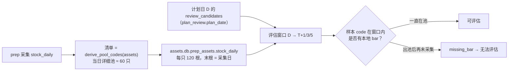
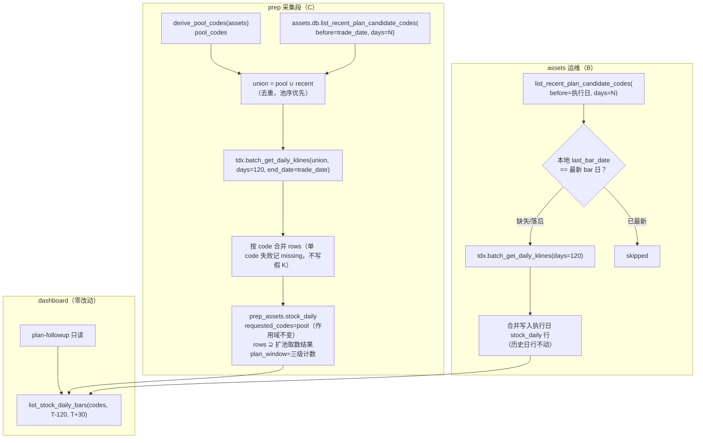
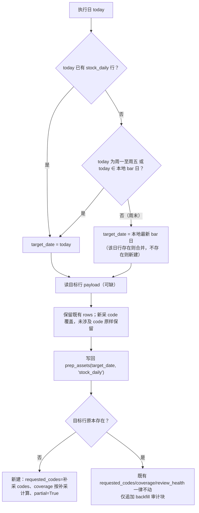

# stock_daily 扩池 + 历史回填 — 技术方案（阶段 2）

> 状态：待 main 单次验收
> 范围：只改 `prep` 采集段、`infra/assets` 仓储/运维命令、CLI 装配与文档；**不改** `web_ui/**`、评估 presenter 口径、历史资产行、`infra/factor/**`。
> 需求来源：阶段 0 用户确认「C 治本 + B 补救」。main 已定框架见任务包，本文在框架内补全接口/数据/错误/成本/测试，未改变核心方向。

---

## 1. 需求与根因

### 1.1 现象

dashboard 复盘页「当前 T 日效果」（`GET /api/prep/{date}/plan-followup`）对大量股票显示
「无法评估 · 缺本地日 K」，原因是样本股在评估窗口内没有本地 bar。

### 1.2 根因链（已在真实数据上验证）



- 评估 presenter 刻意只读本地 `stock_daily`，不触网（`web_ui/backend/presenters/prep_effect.py`）。
- `_collect_stock_daily`（`review_account/prep/collectors.py:564`）的 `to_fetch` 只来自当日详细池。
- 股票离开后续日期的详细池后，本地日 K 停在离池那天；评估窗口天然跨出池 → 缺 bar。

### 1.3 实测（2026-11-03，本机真实 `assets.db`，只读查询）

| 指标 | 值 |
|------|----|
| `prep_snapshots` 快照日 | 9 天（2026-10-20 … 2026-11-02） |
| 单日 `review_candidates` | 48–60 只 |
| 近 10 个快照日候选并集 | **319 只** |
| 本地 `stock_daily` 覆盖 code | 168 只 |
| 本地最新 bar 日 | 2026-11-02 |
| 并集中「完全缺失」 | **151 只** |
| 并集中「末根落后于最新 bar 日」 | **108 只** |
| 并集中「已最新」 | 60 只（= 当日池） |
| 单日 stock_daily payload | 1.48 MB / 60 code / 7200 bar |

结论：只修当日池永远追不上评估窗口；10 日候选并集显著大于池（319 vs 60），是本方案成本评估的关键输入。

---

## 2. 现状代码事实（方案落点依据）

| 事实 | 位置 | 对方案的影响 |
|------|------|--------------|
| `_collect_stock_daily` 组装 `to_fetch`、`review_only` 合并、`missing`、`coverage`、`review_codes`、cap 裁剪 | `prep/collectors.py:564-628` | C 的唯一改造点 |
| `derive_pool_codes` 纯函数，返回 `{"codes", "sources", "truncated", "excluded"}` | `prep/review/pool.py:239` | C 的池输入不变 |
| `STOCK_DAILY_DAYS = 120` | `prep/collectors.py:52` | C/B 共用取数根数 |
| `_stock_daily_suspicious` 以 `coverage.ratio < 0.8` 判 `empty_suspicious` | `prep/collectors.py:631` | **扩池绝不能改 coverage 分母**（见 §5.3） |
| `_EMPTY_KEYS["stock_daily"] = not rows` | `prep/collectors.py:980` | rows 非空即不 empty；扩池不触发 |
| `asset_health` / `collection_health` / `is_collectable` | `prep/collectors.py:1012-1057` | 守卫语义保持 |
| `get_prep_asset` / `get_prep_snapshot` / `list_stock_daily_bar_dates` / `list_stock_daily_bars` 均 `_connect(create=False)` | `infra/assets/db.py:281/337/1041/1096` | 新增只读函数沿用同一范式（B1 惰性） |
| `prep_snapshots(result_json)`，`review_candidates[].code` 含全部候选（含 `position_pct=0/null`、`eligibility != eligible`） | `infra/factor/decision_review.py:232-285`；presenter 分组 `recommended/not_recommended/data_insufficient` | 清单取**全部**带 code 的候选，不按 eligibility 过滤 |
| `view` 分组依据 `position_pct` 三段，而非 eligibility 单字段 | `prep_effect.py:33`、`decision_review.py:256-268` | 同上 |
| `get_previous_prep_snapshot` 用 `trade_date < ? ORDER BY trade_date DESC` | `infra/assets/db.py:379` | 新读取函数沿用「严格早于」与 DESC 口径 |
| `assets` 命令为 `_never_providers` | `commands/__init__.py` | B 需新增按 action 的 provider 策略 |
| `backfill-dragons` 的 `AssetsOutcome(command, payload, exit_code)`、JSON→stdout / 人读→stderr、0/1/2 | `sync/cli_service.py:207-227`、`commands/assets.py:103-122` | B 沿用同一输出/退出码惯例 |
| 命令数 18 / coverage-map 节点 56 | `architecture.md:113`、`coverage-map.json`、`test_coverage_map.py:75` | 新增 1 个 parser 节点 → 56→57，需同步 map 与断言 |
| E2E fake provider 经 `sitecustomize` + `DQ_E2E_SCENARIO` 注入；`batch_get_daily_klines` 已有 fake | `tests/e2e/injection/`、`fixtures/scenario_*.json` | C/B 的 E2E 注入点现成 |
| `/api/prep/{date}/plan-followup` 读 `[T-120, T+30]`；`/api/prep/calendar` 默认 `days=365`，两者都调用 `list_stock_daily_bars` / `list_stock_daily_bar_dates`，实现会 `json.loads` **窗口内全部 payload** | `prep_effect.py:34`、`deps.py:107-118`、`routers/assets.py:530-543` | 扩池带来 payload 增长，必须控制单日体积（§5.2 存储上限） |

**已核实但任务包未覆盖的关键交互**：`_stock_daily_suspicious` 用 `coverage.ratio` 判
`empty_suspicious`，而 `empty_suspicious` 属 `_BAD_STATUS`，会让 compute 把整个
`stock_daily` 判为不可用（D5/D6 全池降级）。若把 `requested_codes`/`coverage` 直接扩到
319，只要有 20% 代码取不到（退市/停牌/改名），整池日 K 会被误判为数据源故障。
→ **C 必须把「review 作用域」与「扩池取数」分离**（见 §5.2）。

---

## 3. 方案总览



职责分层：`prep` = 每日复盘采集（C）；`assets` = 数据资产运维/回填（B）；两者共享
「近 N 日计划候选」清单函数与「bar → 行」转换/合并函数，不复制规则。

---

## 4. 候选设计与取舍

### 4.1 清单读取落点

| 候选 | 做法 | 评价 |
|------|------|------|
| **A（推荐）** | `infra/assets/db.py` 新增只读函数 `list_recent_plan_candidate_codes(before_date, days)`，prep 与 assets 共同调用 | 读逻辑单点、`create=False` 天然满足 B1、依赖方向 `prep → infra` 合法 |
| B | prep 里直接写 SQL；assets 再写一份 | 规则两处漂移，违反 DRY，且 assets 命令层不应持有 SQL |
| C（非常规） | 把「近 N 日候选」固化成新的 asset_type（如 `plan_candidate_window`），由 prep 每日落库，B 直接读 | 多一份派生存量、需同步/清理与历史补算；收益仅是省一次 JSON 解析，不值得 |

**采用 A**：清单是「读取现有快照的投影」，不应再造派生资产。

### 4.2 B 的写入目标

| 候选 | 做法 | 评价 |
|------|------|------|
| **A（推荐）** | 写入「执行日」的 `stock_daily` 行；当日无行则新建并标 `partial`；不碰更早日期 | 与任务包一致；不篡改历史行；dashboard 只按 bar 日期读，行键自由 |
| B | 回填到「缺口所属历史日」（如 10-30 行） | 直接篡改历史资产行，违反红线 |
| C（非常规） | 不写 `stock_daily`，在评估 presenter 读不到时临时触网补采 | 破坏 dashboard「只读、不触网」设计，且每次请求都联网；否决 |

### 4.3 B 的触发方式

| 候选 | 做法 | 评价 |
|------|------|------|
| **A（推荐）** | 显式命令 `assets backfill-stock-daily`（默认自动检测，`--dry-run`） | 运维可控、可审计、成本可见 |
| B | prep 末尾自动回填 | 拉长每日 prep、放大故障面；且 C 上线后每日已在扩池，无需再补 |
| C（非常规） | `dashboard` 启动时后台补采 | dashboard 只读红线；失败不可观测 |

### 4.4 设计模式点明

- **策略 + 并集组合（C）**：`derive_pool_codes`（池策略）与
  `list_recent_plan_candidate_codes`（计划窗口策略）各自独立，采集函数只做 `∪` 与去重；
  新增来源不需要改 `_collect_stock_daily` 主体。
- **模板方法（B 的检测/补采/合并）**：`detect → fetch → merge → write` 四段固定，
  单 code 失败隔离在 fetch 段；dry-run 复用 detect 段、跳过 write。
- **单一实现/DRY**：清单函数、bar 行转换、合并规则各只有一份，C/B 共享。
- **不做多余抽象**：不引入「Collector 插件」「回填任务队列」等未来假设结构。

---

## 5. C：`_collect_stock_daily` 清单扩池

### 5.1 清单函数契约（新增，`infra/assets/db.py`）

```python
PLAN_CANDIDATE_LOOKBACK_DAYS = 10   # 近 N 个「有快照的交易日」（= 任务包的
                                    # STOCK_DAILY_PLAN_LOOKBACK_DAYS，命名更贴近清单语义）

def list_recent_plan_candidate_codes(
    before_date: str,
    days: int = PLAN_CANDIDATE_LOOKBACK_DAYS,
    *, source: str = "v2", db_path=None,
) -> dict:
    """严格早于 before_date 的最近 days 个快照日的 review_candidates[].code 并集。

    返回:
      {
        "codes": [...],          # 去重；日序由新到旧，日内按 review_candidates 顺序
        "trade_dates": [...],    # 实际读取的快照日（升序）
        "corrupt_dates": [...],  # result_json 损坏/缺 review_candidates 的日期
        "lookback_days": days,
      }
    库不存在 → 全空结构（不建库、不报错）。
    """
```

- **读取口径**：`SELECT trade_date, result_json FROM prep_snapshots
  WHERE trade_date < ? AND source = ? ORDER BY trade_date DESC LIMIT ?`。
- **取全部候选**：只过滤 `isinstance(item, dict) and item.get("code")`；**不按
  `eligibility` / `position_pct` 过滤**——dashboard 评估样本正是全量候选（分
  `recommended/not_recommended/data_insufficient` 三组），过滤会造成新的「样本缺失」。
- 「近 N 个交易日」以**有快照的交易日**计数（无快照日不占位）；文档写明该口径，
  避免与交易所日历混淆。
- 严格 `< before_date`：正常 prep 用 `ctx.trade_date`，排除当日（当日快照尚未计算/重算）；
  B 用执行日，当日候选已由当日池覆盖。
- 单日 JSON 损坏 → 记 `corrupt_dates` 并跳过，不中断（防御式，与现有读函数一致）。

### 5.2 `_collect_stock_daily` 改造（保持 review 作用域）

```python
POOL_MAX_BARS = STOCK_DAILY_DAYS          # 120：D5/D6 需要完整回看
PLAN_CANDIDATE_MAX_BARS = 20              # 扩池 code 仅服务前向评估，存 20 根足够

pool = derive_pool_codes(assets)
pool_codes = list(pool["codes"])
recent = assets_db.list_recent_plan_candidate_codes(ctx.trade_date)   # 失败/空 → 空结构
fetch_codes = _dedupe_codes(pool_codes + recent["codes"])             # 池序优先

if ctx.review_only:
    requested_codes = _dedupe_codes(pool_codes + list(existing.get("requested_codes") or []))
    to_fetch = _dedupe_codes(ctx.review_codes)
else:
    requested_codes = pool_codes          # ★ review 作用域，绝不扩
    to_fetch = fetch_codes

fetched = tdx.batch_get_daily_klines(to_fetch, days=STOCK_DAILY_DAYS,
                                     end_date=ctx.trade_date)
# 合并逻辑不变；单 code 失败不写假 K；每 code 保留根数：
#   pool_codes 内 → 最近 120 根；扩池独有 code → 最近 20 根（见下「存储上限」）

cap = max(len(fetch_codes) * 2, len(rows), 1)   # 保留扩池行，不因 review 修复被裁掉
missing = [code for code in requested_codes if code not in rows]   # 只报池缺失
if recent["codes"]:                    # 无近 N 日快照时不写该键（旧 payload 形状不变）
    payload["plan_window"] = {
        "lookback_days": recent["lookback_days"],
        "trade_dates": recent["trade_dates"],
        "pool": len(pool_codes),
        "recent": len(recent["codes"]),
        "union": len(fetch_codes),
        "fetched": sum(1 for code in fetch_codes if code in rows),
        "missing": [code for code in fetch_codes if code not in rows],
    }
```

**存储上限（扩池引入的必要约束）**：D5/D6 只消费 `pool_codes`，需要 120 根；
扩池独有 code 只服务 dashboard 的**前向**收益评估（计划日 → T+5），单日 payload 存
最近 `PLAN_CANDIDATE_MAX_BARS = 20` 根即可。`list_stock_daily_bars` 会跨日按
`(code, date)` 合并，历史根数由更早的 payload 提供，**不会损失评估所需 bar**；
且 20 > N/2 + T+5，即使评估视野调大也留有余量。若某扩池 code 之后进入详细池，
当日采集会按池口径重新取 120 根并覆盖该 code 行。

不设该上限时，实测并集 319 只会让单日 payload 从 1.48 MB 涨到 **7.9 MB**；
plan-followup 每次请求解析 `[T-120, T+30]` 约 150 份 payload（≈1.2 GB JSON），
calendar 默认 365 天（≈2.9 GB），dashboard 会明显卡顿——这是扩池必须同时处理的
副作用，不能只改 `to_fetch`。

要点：

1. **`requested_codes` / `coverage` / `missing_codes` / `review_health` 仍只描述详细池**，
   守卫语义逐字段不变；扩池结果只体现在 `rows`（超集）与新增 `plan_window`。
2. `review_codes`（详细池非龙头）不变；扩池代码不进 review 作用域。
3. `truncated` 仍取 `pool["truncated"]`。
4. `cap` 改为 `max(len(fetch_codes)*2, len(rows), 1)`：正常模式保留扩池行；
   review 修复模式（`rows` 从存量开始）不会把扩池行裁掉。
5. `review_only` **不扩池取数**：review 修复只服务当日复盘评分（只需池代码），
   且其 `to_fetch` 语义是「缺失代码修复」，不应顺手拉 319 只。
   但 `requested_codes` 需要并入存量 `requested_codes`，否则 cap 缩小会裁掉扩池行。
6. 清单读取异常（库损坏/权限）catch 后按空 recent 处理并写
   `plan_window={"error": ...}`（此时仍输出该键以便观测），**不得中断 prep**；
   此时行为等价现状（只采池）。
7. 日志：`logging.getLogger("dragon_quant.prep.stock_daily").info(
   "stock_daily pool=%d recent=%d union=%d", ...)`（真实日志，不改 CLI 输出），
   三级计数同时落 `plan_window` 供 `--json` 与测试断言。

### 5.3 守卫不变性（逐条）

| 守卫 | 现状 | C 之后 |
|------|------|--------|
| 空池不覆盖健康存量（`_MUST_NONEMPTY` / `_DRAGON_DEPENDENTS`） | stock_daily 需 dragons 就绪 | 不变 |
| 单 code 失败记 missing、不写假 K | 只写 `fetched` 返回的 code | 不变 |
| `empty` 判据 | `rows` 为空 | 扩池只会让 rows 更多，不会改变「空」判定 |
| `empty_suspicious` 覆盖率 | `coverage.ratio`（分母 = `requested_codes`） | **分母仍是池**；扩池失败不影响判定 |
| `review_health` | 只看 `review_codes` | 不变 |
| review 修复模式 | 只补 `review_codes`、按键合并、不写 report | 取数范围不变；仅 cap 下限改为保留存量行 |
| `--recompute` 零采集 | 不经过 collector | 不变 |

### 5.4 触发链事实

`prep` 正常运行时 `plan_prep` 依据 `collection_health` 决定是否采集 stock_daily；
新的一天存量缺失 → 必采。同一日重跑且资产健康 → 零采集（扩池不会强制刷新）；
需要强制扩池时用 `prep --force`。此行为与现状一致，文档写明。

---

## 6. B：`assets backfill-stock-daily`

### 6.1 命令契约

```bash
dragon-quant assets backfill-stock-daily [--dry-run] [--days N]
                                         [--codes 301132,000995] [--json]
```

| 参数 | 默认 | 语义 |
|------|------|------|
| `--days N` | `PLAN_CANDIDATE_LOOKBACK_DAYS`（10） | 近 N 个有快照交易日作为检测窗口 |
| `--codes A,B,...` | 无 | 显式指定 code；给定时跳过自动检测（仍做本地状态体检用于报告） |
| `--dry-run` | 否 | 只检测与报告，不触网、不写库、不构造 provider |
| `--json` | 否 | JSON 到 stdout；默认人读摘要到 stderr |

目标集合：

- 默认：`list_recent_plan_candidate_codes(before=执行日)` 的 codes 中，本地
  `last_bar_date` 缺失或 `< 本地最新 bar 日`（`list_stock_daily_bar_dates` 并集口径）的 code。
- `--codes`：以给定 codes 为准，仍计算并报告 missing/stale，但全部补采。
- code 规范化：去空白、去 `SH/SZ/BJ` 前缀、6 位数字校验；非法项 → exit 2。

### 6.2 检测口径（新增只读函数）

```python
def latest_stock_daily_asset_date(*, db_path=None) -> str | None:
    """MAX(prep_assets.trade_date) WHERE asset_type='stock_daily'（单行 SQL，不解析 payload）。"""

def stock_daily_last_bar_dates(codes=None, *, max_asset_days=60,
                               db_path=None) -> dict[str, str]:
    """{code: 本地最大 bar 日期}；只读、不建库；损坏 payload 跳过。

    从最新 trade_date 向旧扫描，命中即记（每 code 只取最大日期）；
    codes 给定时收齐后提前结束；最多扫 max_asset_days 个资产日（防全历史解析）。
    """
```

- **检测用最新 bar 日**取 `latest_stock_daily_asset_date()` 对应行的 `rows` 最大
  `date`（单份 payload，O(1)），**不扫全历史**：`list_stock_daily_bar_dates()` 无
  日期上界时会 `json.loads` 全部 payload（扩池后每年约 900 MB），不适合作为命令入口。
- 每 code 的 last_bar_date 用 `stock_daily_last_bar_dates(codes, max_asset_days=60)`
  有界扫描；扫满仍无记录的 code 按「缺失」处理（映射为 `missing`）。
- 与 `list_stock_daily_bar_dates` 同源口径（bar 日并集，不是交易所日历）。
- 停牌/退市 code 的 last_bar_date 会一直落后；补采无新 bar 时记
  `skipped_no_new_bars`，不写假 K，下次运行仍会重试（成本可忽略，文档写明）。

### 6.3 写入与合并语义



- **不篡改更早日期资产行**：`target_date` 只可能是执行日或本地最新 bar 日，绝不回写
  更早的资产键。周末运行合并到「最新已确认交易日」行（main 口径的「最近交易日」）。
- **合并**：`rows = dict(existing.rows)`；对每个 fetched code，用共享转换函数
  `bars → 行`（过滤 `date <= target_date`、升序）后覆盖该 code；根数上限与 C 一致：
  **code ∈ 目标行 `requested_codes`（池作用域）→ 120 根；否则 → 20 根**
  （新建的 partial 行没有池清单 → 全部 20 根）。空结果**不覆盖**、不写空行。
- **新建行的守卫**：payload 标 `partial=True` + `backfill={...}`；
  `asset_health` 新增一处识别：`payload.get("partial") is True → "partial_payload"`。
  这样：下一次正常 prep 会重新采集（`collection_health` 非 None）；`prep --recompute`
  不会把部分行当成完整池数据消费。**这是对现有守卫的「加严」而非放宽**，非 `partial`
  payload 行为逐字段不变。
- **既有行**：不改 `requested_codes`/`returned_codes`/`missing_codes`/`coverage`/
  `review_health`/`as_of`，只扩 `rows` 并写 `backfill` 审计块（时间、请求数、成功数、
  失败清单）。理由：这些字段是 review 作用域的健康口径，B 不应改写。
- 若既有 payload 损坏（非 dict）：按不存在处理，新建并记
  `warnings=["existing_payload_corrupt"]`；不静默丢数据（旧 payload 原样留在
  `backfill.previous_corrupt` 摘要中，不落盘原文）。

### 6.4 输出与退出码

JSON（键序固定）：

```text
ok, command, dry_run, target_date, latest_bar_date, lookback_days,
detected, missing, stale, fetched, updated, skipped, failed, warnings, window
```

- `window = {"trade_dates": [...], "codes": [...]}`（便于审计「为什么选这些 code」）。
- 人读摘要（stderr）：`体检（dry-run）| 回填：detected=… missing=… stale=… fetched=… updated=… skipped=… failed=…`，
  末行提示「dashboard 刷新即可见」。逐条失败行另起一行。
- 退出码：`0` 成功（含 detected=0）/ `1` 部分失败或写库失败 / `2` 参数、环境
  （assets.db 不存在、无 provider、`--days < 1`、非法 code）。与 `backfill-dragons` 一致。

### 6.5 装配（CLI）

- `commands/__init__.py`：新增 `_assets_providers(args)` =
  `args.assets_action == "backfill-stock-daily" and not args.dry_run`；`assets`
  命令改用该策略（其余 action 仍零 provider）。
- `commands/assets.py`：新增分支 `action == "backfill-stock-daily"` → 调用
  `infra.assets.main.backfill_stock_daily(args, services)`，按 §6.4 输出。
- 业务实现放 `dragon_quant/infra/assets/stock_daily_backfill.py`，由
  `infra/assets/main.py` 导出；`cli_service.run` 增加一个本地动作分支（与
  `backfill-dragons` 同类），不复制同步层逻辑。
- provider 取 `services.providers.tdx`；`--dry-run` 不构造、不调用。

---

## 7. 共享模块与依赖方向

新增 `dragon_quant/infra/assets/stock_daily.py`（叶子，仅依赖 `infra.clock` / `infra.models`）：

```python
STOCK_DAILY_DAYS = 120
def daily_row(bar) -> dict | None                 # KBar → 行（时间戳→Asia/Shanghai 日期）
def merge_daily_rows(rows, fetched, trade_date, days=STOCK_DAILY_DAYS) -> dict
```

- `collectors` 改为从该模块取 `daily_row` / `STOCK_DAILY_DAYS`（保留同名模块属性，
  现有 patch 目标不失效）；删除重复实现。
- 依赖方向：`review_account/prep → infra/assets/stock_daily`（合法）；
  `infra/assets/stock_daily_backfill → infra/assets/db + infra/assets/stock_daily`
  （合法，infra 内部叶子）；**infra 不 import review_account**。
- 零 `pandas`；`infra/factor/**` 不涉及。

---

## 8. 成本评估（按真实 319 只并集）

| 项 | 估算 | 依据 |
|----|------|------|
| C 每日额外取数 | 319 只；`batch_get_daily_klines` 逐 code 串行 + 固定 `sleep(0.05)` | `infra/provider/tdx.py:1024-1064`（`_lock` 内单路调用） |
| C 每日耗时增量 | 约 0.05 s×319 = 16 s 固定，加单 code 往返 0.03–0.3 s → **约 25–110 s** | 实现后需 smoke 记录真实值；prep 原有 60 只约 5–20 s |
| stock_daily payload | 池 60×120 + 扩池 259×20 = 12,380 bar ≈ **2.55 MB/日**（当前 1.48 MB/日） | 实测 206 B/bar；扩池独有 code 只存 20 根 |
| assets.db 年增量 | ≈ 250 日×2.55 MB ≈ **0.64 GB/年**（未压缩） | 同上 |
| 云端 push | 单分区 2.55 MB，远低于 16 MiB `shard_large` 阈值 | `assets.md` 分片阈值 |
| B 一次性 | 151 缺失 + 108 落后 = 259 只 → **20–90 s**；新增行约 +1.1 MB | 同上一行 |
| plan-followup 读取 | 150 天 × 2.55 MB ≈ **382 MB JSON**/请求（当前 ≈222 MB，约 1.7×） | `list_stock_daily_bars` 解析窗口内全部 payload |
| prep calendar 读取 | 365 天 × 2.55 MB ≈ **931 MB JSON**/请求（当前 ≈540 MB，约 1.7×） | `list_stock_daily_bar_dates`；默认 `days=365` |

**风险（已知，登记后续优化）**：即使有 20 根上限，calendar / plan-followup 的整窗
`json.loads` 仍随资产天数线性增长（约 1.7× 现状）。后续可选：
① 在 `stock_daily` payload 外维护轻量「每日 bar 日期摘要」供 calendar 使用；
② 由 main 审批后收窄 presenter 的 `BAR_LOOKBACK_DAYS`（当前 120 天，评估实际只需
计划日之后）。本方案不改 `web_ui`，只把上限控制在 1.7×。

---

## 9. 错误处理

| 场景 | 行为 |
|------|------|
| 快照库缺失/损坏 | C：按空 recent 处理，`plan_window.error` 记录，prep 继续；B：exit 2（无 assets.db）或按 `--codes` 继续 |
| 单 code 取数失败 | 记 missing/skipped，不写假 K；不中断 |
| tdx transport 失败（整体抛异常） | C：collector 失败 → 不写 payload（现有隔离）；B：`failed` 记录，`ok=false`，exit 1 |
| 取回空 bars | 不覆盖该 code 的行；B 记 `skipped_no_new_bars` |
| 写库失败 | B 单事务失败 → 回滚，exit 1；C 沿用 `save_prep_assets` 事务 |
| 无计划候选且未给 `--codes` | B `ok=true, detected=0`，人读提示 `--codes`，exit 0 |
| 当日/最新日无 bar（盘中运行） | 允许写行；p=partial 保护；文档提示盘后运行 |
| 重复运行 | B 幂等：补齐后 detected=0；C 同日健康资产零采集（`--force` 可强制） |

---

## 10. 测试策略

### 10.1 单元（`dragon_quant/tests/`，临时库 + fake tdx，零网络）

| 用例 | 断言 |
|------|------|
| `test_assets_db_calendar.py` 扩展：`list_recent_plan_candidate_codes` | 严格 `< before_date`；按日 DESC 取 N 日；取**全部**候选（含 `position_pct=0`、`eligibility=not_qualified`）；去重顺序；损坏 JSON 进 `corrupt_dates`；库不存在返回空且不建库 |
| 同上：`stock_daily_last_bar_dates` | 跨多日取每 code 最大日期；codes 过滤；损坏 payload 跳过 |
| 新增 `test_prep_stock_daily_plan_window.py` | ① `requested_codes` 仍=池、`coverage.ratio` 不被扩池稀释；② `rows` 含池外候选；③ 扩池 code 取数失败 → 只进 `plan_window.missing`，`missing_codes`/`review_health` 不变；④ 空池仍抛错；⑤ `review_only` 不拉扩池、不裁掉存量行（构造 >2×pool 的 rows）；⑥ **池 code 存 120 根、扩池独有 code 存 20 根**；无近 N 日快照时无 `plan_window` 键 |
| 新增 `test_stock_daily_backfill.py` | ① dry-run 零写、零 provider 调用；② 检测 missing/stale；③ 合并保留未涉及 code；④ 新建行 `partial=True`；⑤ 既有行不改 `requested_codes/coverage`；⑥ tdx 整体失败不写库、exit 1；⑦ `--codes` 跳过检测；⑧ 幂等二次运行 detected=0 |
| `test_prep_review_integration.py` 扩展（如已有 fake 结构） | 两日场景：day2 池不含 code X，但 `stock_daily.rows[X]` 末根=day2（钉住 C2） |
| `test_commands.py` / `test_app.py` | `assets` provider 策略：仅 `backfill-stock-daily` 且非 dry-run 需要 provider |

### 10.2 E2E（真实 CLI 子进程 + fake provider）

| 用例 | 文件 | 要点 |
|------|------|------|
| `test_as20_backfill_stock_daily_dry_run_reports_gap_without_write` | `test_assets.py` | 种子 `prep_snapshots`(0.8, `review_candidates`) + `prep_assets.stock_daily` 缺口；`--dry-run --json` 输出 missing/stale；DB 行数不变；`call_log` 无 tdx 调用 |
| `test_as21_backfill_stock_daily_merges_into_execution_day_and_is_idempotent` | `test_assets.py` | 注入 `batch_get_daily_klines`；运行后 `prep_assets` 目标日 payload 含补齐 code 且未涉及 code 原样；二次运行 detected=0 |
| `test_p20_prep_stock_daily_includes_recent_plan_candidates` | `test_prep.py` | 场景含 `review_candidates` 与池外 code 的日 K；断言 `assets.db.prep_assets` 当日 `rows` 含该 code 的 T 日 bar，`requested_codes` 仍=池 |
| coverage | `test_coverage_map.py` | 节点 56→57；`assets backfill-stock-daily` 映射到上述用例；顶层命令仍 18 |

**fake 注入点**：E2E sandbox `PYTHONPATH` 注入目录 + `DQ_E2E_SCENARIO`（`sitecustomize.py`）；
`fake_providers.TdxProvider.batch_get_daily_klines` 已按 scenario 键返回；
单测直接用 `FakeTdx`（`test_prep_review_integration.py:81` 模式）或 `unittest.mock` 注入
`backfill_stock_daily(tdx=...)`。

**golden 纪律**：E2E prep 场景若没有更早的 `prep_snapshots`，`recent` 为空 →
不写 `plan_window`，且池 code 仍存 120 根 → `golden/prep/assets.json` 的
`stock_daily` payload **逐字节不变**；扩池只在有多日快照的真实/新增场景生效。
若某 E2E 场景确有池外候选，则属于批准的行为变更，需在提交信息说明后更新该 golden。

---

## 11. 文档同步清单（同一 commit）

| 文件 | 改动 |
|------|------|
| `docs/agent/prep-auction.md` | §详细池 / stock_daily 条目：清单 = 池 ∪ 近 N 日计划候选；`requested_codes` 作用域不变；`plan_window`；cap 规则；池 120 根 / 扩池 20 根；review_only 不扩池 |
| `docs/agent/assets.md` | 新增 `assets backfill-stock-daily` 小节：参数、检测口径、目标日、合并/partial、输出、退出码 |
| `docs/agent/architecture.md` | 命令导航/资产运维入口提及新动作；若表/模块目录树新增 `infra/assets/stock_daily*.py` 需更新目录树 |
| `AGENTS.md` | 测试门禁段的 coverage-map 计数 **55/17 → 57/18**（现状文档已落后于实际 56/18，顺带修正） |
| `README.md` | `assets` 快速使用补一条回填命令（人读手册） |
| `docs/solutions/` | 本文件（开发期产物，合入前再议归档） |

---

## 12. 验收标准映射

| 验收 | 实现 | 验证 |
|------|------|------|
| C1 清单=池∪近10日候选且守卫不变 | `collectors._collect_stock_daily` + `db.list_recent_plan_candidate_codes` | `test_prep_stock_daily_plan_window.py` ①③④；`test_assets_db_calendar.py` 清单用例 |
| C2 出池候选 bars 随 prep 续更 | 同上（`rows` 合并） | `test_prep_review_integration` 两日场景；E2E `test_p20` |
| B1 子命令 dry-run/回填/合并语义正确 | `infra/assets/stock_daily_backfill.py` + CLI | `test_stock_daily_backfill.py`；E2E `test_as20/as21` |
| B2 回填后缺 bars 候选在窗口内可读 | 写入目标日行 → `list_stock_daily_bars` | 单测：回填后调用 `list_stock_daily_bars(codes, D-120, T+30)` 命中 |
| B3 web_ui 零改动 | 不触碰 `web_ui/**` | `git diff --stat` 无 web_ui；既有 web 测试全绿 |
| B4 文档与 coverage-map 同步 | §11 清单 | `test_coverage_map.py` 通过；文档 diff |

---

## 13. 风险与开放点（交 main 终审裁决）

1. **读取窗口成本**（§8）：扩池后 calendar / plan-followup 的整窗 JSON 解析约为现状
   1.7×（已用「扩池 code 只存 20 根」把单日 payload 从预测 7.9 MB 压到 2.55 MB）。
   后续可选：每日 bar 日期摘要、或经 main 审批收窄 presenter 的 120 天回看窗口。
2. **`partial` 守卫扩展**：B 新建行必须标 partial 并由 `asset_health` 识别，否则
   下一次 prep 会把部分行当健康资产而跳过采集。这是新增的加严语义，非既有行为改变。
3. **周末/节假日运行 B**：按「执行日 → 最新 bar 日」规则可能合并到最新交易日行；
   若 main 要求严格只写执行日，可改为始终 `target_date=today`（会产生非交易日资产行）。
   本文按 main 的「trade_date=最近交易日」口径实现。
4. **停牌 code 重复补采**：检测口径无法区分「停牌」与「断更」；补采无新 bar 记
   `skipped_no_new_bars`，每次运行仍会重试（数量小，成本可忽略）。
5. **同日重跑 prep 不扩池刷新**：增量健康判定跳过 stock_daily；需 `prep --force`。
   保持现状语义，文档写明。
6. **N=10 的覆盖边界**：计划日 D 的 T+5 在 D+5 个交易日内完成，而 D 在 10 个快照日
   窗口内仍被请求；N=10 足够。若有超长评估视野需求，调 `--days` / 常量即可。
7. **20 根存储上限的假设**：若未来评估视野扩展到 T+20 以上，需同步调大
   `PLAN_CANDIDATE_MAX_BARS`；常量集中定义、单测钉住当前值。
