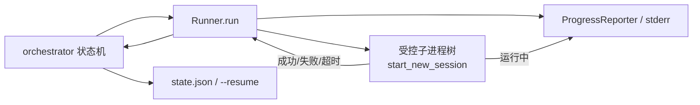
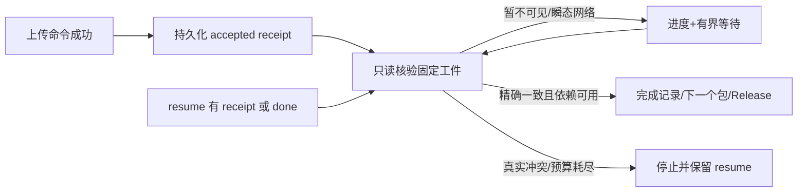
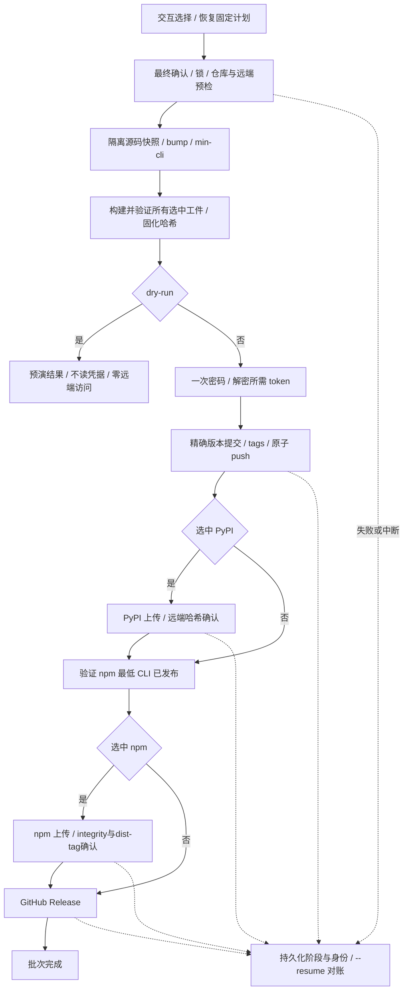

# 统一交互发布与断点恢复（已定稿并实施）

> 状态：阶段 3 已由 Bridge execute-agent 实施并通过隔离验收；本方案随实现提交并归档，未执行真实发包。实现入口与验收映射见文末「实施状态」。

## 实施状态（2026-11-14）

- 入口：`scripts/publish.sh`（薄壳）→ `scripts/release/main.py`（参数/交互）→ `orchestrator.py`（唯一用例与状态机）。
- 叶子能力：`common.py`（错误/版本/哈希/原子写/Runner/秘密剥离）、`state.py`（schema=2 批次状态、intent/result）、`lock.py`（git dir 内 `flock` 仓库锁）、`git_ops.py`（身份、精确提交、tag、原子 push、Release、远端对账）、`credentials.py`（一次密码解密两份密文）。
- 适配器：`publish_pypi.py` / `publish_npm.py` 只做各自测试、构建、包边界、远端对账与上传；不导入 orchestrator，不写 Git、不 bump、不问密码、不创建 Release。
- 入口迁移：`scripts/publish-skill.sh` 退化为 npm 单包薄入口（参数白名单 + 转发 `--packages npm`）；`scripts/encrypt_token.sh` 改为交互选择 PyPI/npm/两者、隐藏输入、同一密码、0600 临时文件全部成功后原子替换。
- 测试：`dragon_quant/tests/test_release_publish.py`（PyPI 流程安全与恢复）、`test_unified_release.py`（双包顺序、min-cli、dist-tag、交互取消、真实 OpenSSL 凭据、锁、信号清理）、`test/publish-skill.test.mjs`（薄入口校验与转发）。
- 文档：`README.md`、`docs/agent/development.md` 已同步；本文件不再标记“待确认”。
- **验收返工（M1–M10 / S1–S2）**：npm 按真实 `npm pack --json` 单包 `files[]` 结构解析并用真实本地 pack 验证；`ReleaseState.begin` 不再清零已记录成功，commit/tag/push/upload/Release 恢复一律 fail-closed 且只在操作前记录的 tree/intent 上采纳；prepare 冻结 `staging_identity`（发布文件 + `web_ui/dist` 哈希），resume 先校验内容才允许提交；交互 EOF/Ctrl-C 全程取消（恢复确认默认否），加密脚本信号恢复回显、双密文替换失败回滚；Release notes 在任何外部写入前生成并冻结（CHANGELOG 缺段走 git 变更 fallback），恢复校验哈希、远端正文冲突不覆盖；已完成批次 `--resume` 只报告结果，失败预演可 `--dry-run --resume` 或重开；min-cli 检查排除全部 yanked 工件并前置到外部写入前，dist-tag 上传前拒绝降级并支持 `NPM_OTP`；staging 迁入批次目录，git common-dir 活动指针统一发现未完成批次并覆盖 linked worktree；发布提交主题为中文 emoji。

## 进度可观测性与超时（2026-11-15 增量）

**根因**：`Runner.run` 用 `subprocess.run(capture_output=True)` 且无 timeout。真实发布时两个顺序 `git ls-remote` 各约 10 秒、PyPI 查询约 2.8 秒，随后构建/测试可静默数分钟，用户无法区分"正在工作"与"卡死"，实测 `preflight` 被 Ctrl-C 中断。

**设计**：在 `common.py` 增加可注入的 `ProgressReporter`（Observer 式文本报告器）与 `Runner` 的 `progress_label` / `timeout` 参数；orchestrator 只把 `runner.progress` 透传给叶子调用，不新增状态字段或 schema。CLI 装配 stderr 报告器，测试注入内存流与短心跳。

**行为**：

- KR1 进度：每个可能超过 1 秒的步骤开始前立即输出 `▶ [stage] label 开始`；覆盖远端 tag 检查、`ls-remote` 对账、PyPI/npm 版本查询、离线测试、前端构建、wheel/sdist 构建与 `twine check`、npm pack/白名单/安装冒烟、上传、原子 push、GitHub Release 查询/创建、源码快照复制与暂存哈希。阶段前缀沿用状态机名，不新增持久字段。
- KR2 心跳：长任务运行期间每 10 秒输出 `… label 仍在运行（已耗时 Xs）`，结束输出 `✅/❌ label（耗时）`；`DQ_RELEASE_HEARTBEAT_SECONDS` 可调间隔（默认 10）。
- KR3 分级超时：只读/本地 git 探针 60s（也是兜底默认）、远端 registry/Release 读 60s、离线测试/构建/pack/安装冒烟 20 分钟、registry 上传/push/Release 创建 15 分钟；PyPI urllib 查询保留既有 10s 并包裹进度。超时击杀整个子进程树并以当前 stage 的 `ReleaseError` 失败，`state.json` 记录失败步骤，`--resume` 语义不变。
- KR4 输出通道：进度与心跳只写 stderr；stdout 的 JSON、dry-run 结果与摘要契约不变，无 spinner/ANSI。
- KR5 脱敏：label 只含版本/tag 等静态文本，不打印完整命令、secret env 或子进程原始 stdout/stderr；既有 token/密码/OTP scrub 与错误 redact 不变。
- KR6 清理：心跳 daemon 线程在任务结束（含成功、失败、超时、Ctrl-C）前 stop/join；子进程在独立 session 中，超时与中断都会回收，不留孤儿进程；状态机仍准确记录失败步骤。
- KR7 文档：`docs/agent/development.md` 与本文同 commit 同步。

**测试**：`test_unified_release.py` 新增内存流进度/心跳/耗时断言、0.5s 超时杀进程且心跳停止/无 secret/无存活线程、无 reporter 兼容、CLI stderr-only + 心跳可见、in-process CLI 超时记录 `prepare` 失败并保留 resume 状态、已完成批次 resume 不重放执行日志。

## Registry 传播等待（2026-11-15 增量）

**根因**：真实发布三次报错都源于「上传成功 ≠ 立刻可见」。PyPI 上传 15:22:34 完成，9 秒后 `min_cli` 查询报版本不存在，4 分钟后 `resume` 报工件缺失；随后实时 API 的 SHA256 与状态完全一致。项目级 JSON 响应带 `Cache-Control: max-age=900`。npm 15:39:05 上传后立即核验报 integrity 缺失/不一致，稍后 registry 返回的 integrity 与本地完全一致。主流程只在远端立即查询一次，把传播延迟误判为「没有」；还存在「上传已成功但确认未完成」的中断窗口，`resume` 可能再次上传。

**设计**：新增叶子 `scripts/release/consistency.py`，用 **Strategy（策略）** 隔离「等多久/怎么等」，两个适配器只提供 registry 细节的 **Predicate**（判定暂不可见 vs 终态）：

- KR1 端点：PyPI 查版本级 `/pypi/dragon-quant/<version>/json` 的 `urls`，带 `Accept`、`User-Agent`、`Cache-Control: no-cache`；**不声称** no-cache 绕过 CDN。`DQ_RELEASE_PYPI_URL` 覆盖继续可用（支持 `{version}` 占位，项目级 `releases` 形状兼容）；缺失字段/格式错硬失败，绝不当「不存在」。
- KR2 等待：新鲜上传或 receipt/done 的 resume 遇到版本/工件暂不可见，按 15 秒间隔有界等待，默认总预算 960 秒（覆盖 900 秒缓存窗口）；`monotonic` deadline 先判后探测（预算耗尽不再发查询，`sleep` 不超过剩余预算），单次探测的 socket/子进程超时按剩余预算收紧（urllib 超时是逐 socket 操作级上限，不构成慢速分段响应的整请求硬截止）；`clock`/`sleep` 可注入，测试不真实等待；预算/间隔必须是有限正数——env 非法值（`inf`/`nan`/0/负数/非数字）回退默认，显式 `WaitPolicy` 直接拒绝；整个等待上下文（含首次查询）复用同一条 `ProgressReporter` 任务，立即输出开始行、等待与查询期间都有默认 10 秒心跳，成功/失败/中断都 stop/join，stderr 明确「等待PyPI/npm传播」、尝试次数、已耗时与剩余预算，stdout 仍只有最终 JSON；Ctrl-C 可中断。
- KR3 分类：只重试暂不可见、integrity 暂缺、有限传输超时/连接错误/429/5xx；401/403、结构损坏、未知错误立即失败；网络失败绝不转为 404/可重新上传。已返回不同 hash/integrity 或额外不明工件立即失败，不用等待掩盖冲突。npm E404 与「已有版本但 integrity 暂缺」都是 pending；`remote_facts` 等既有读取接口语义不变。
- KR4 receipt：上传命令成功返回后、任何远端核验前，把固定 version+工件身份写入该步骤 `result` 的 `accepted` receipt（不置 done，schema=2 历史状态无需迁移）。resume 见 receipt 或 done 只核验等待，绝不再调 `twine`/`npm publish`。命令成功到 receipt 落盘之间仍有不可避免的中断窗口（持续时间未经测量）：进程若在此崩溃，resume 回退到一次性对账，最坏是向 registry 再发一次上传并被拒绝（fail-closed），不保证 exactly-once。
- KR5 全路径：`_upload_need`、`_reconcile_git_before_credentials`、上传步骤与完成批次路径都走同一等待/核验；done 语义保留，预算耗尽后失败可 `--resume`；既有 hash/staging/HEAD/remote/tag 身份校验不变。
- KR6 min-cli：fresh 分支复用本轮已核验的 PyPI 版本工件证据（至少一个未 yanked 文件），避免刚确认 hash 后又命中旧项目缓存；已发布的不同最低 CLI 仍做真实可用性检查。
- KR7 顺序与隔离：npm dist-tag 与 GitHub Release 只在工件核验通过后继续；dry-run 仍零 registry/零凭据、stdout JSON 纯净；token/密码/OTP 不进状态或日志。
- KR8 文档：`README.md`、`docs/agent/development.md` 与本文同步；旧的「远端暂不可见立即退出、不重试」描述已按本文修正。

**风险与验证**：预算耗尽只是可恢复失败（receipt 保留、不重复上传）；等待期间出现真实哈希冲突立即失败，不会被 960 秒等待掩盖。已知残余风险：urllib/子进程的 timeout 是单次 socket 操作与进程级上限，慢速分段响应或子进程内部长阻塞可能略超剩余预算，因此不宣称严格端到端硬截止（预算耗尽后仍不会额外发起查询）。验证：`test_release_propagation.py` 用本地 HTTP 服务器做真实只读传播模拟（404 → 部分 → 完整、503 重试、401/坏 JSON 终止、预算耗尽、Ctrl-C、npm E404/缺 integrity → 正确 integrity、hash/integrity 冲突立即失败、lag + receipt 的 resume 不再上传、dry-run 零请求），并覆盖等待进度任务的开始/心跳先于慢查询返回、失败/中断无残留线程、假 clock 的 deadline 精确边界、env 非法值与显式策略非有限/非正值拒绝；`test_unified_release.py` 断言 fresh min_cli 不再二次查询；既有 `test_release_publish.py` / `test_unified_release.py` 全绿。

## 需求、证据与取舍

用户提出六项目标：主流程统一分支/Git/tag/GitHub Release；PyPI/npm 子流程仅构建上传；任意失败可 resume；交互选择包与版本并确认；双包先 PyPI 后 npm 并处理 min-cli；一次密码解密两个独立 token。

现状证据：`scripts/release/publish_pypi.py` 已有隔离 staging、原子状态写入、工件哈希、精确发布提交/原子 push、恢复身份校验；`scripts/publish-skill.sh` 有离线门禁/打包/安装冒烟/临时 npmrc，但无 bump/resume。`test_release_publish.py::test_distribution_versions_are_consistent` 强制 min-cli == Python 当前版本，与 development.md 最低兼容版本语义冲突，需同步修正 owner 文档及断言。

推荐迁移现有安全能力到唯一主流程，而非主脚本依次执行两个旧的完整发布器。后者会造成 Git/tag/凭据/恢复状态多头管理，无法满足统一批次身份。

本方案替代此前 Skill 单独扩展方案。保留用户已有 CHANGELOG.md 修改。实施授权不等于实际发包授权；本任务只实现并用隔离环境验证，不运行真实发布。

## 交互与入口

唯一日常入口 `scripts/publish.sh`，无参数进入交互；`--resume` 恢复已有批次，`--dry-run` 走隔离预演。保留 `--status-dir` 选择状态位置。可提供明确 `--pypi-version` / `--npm-version` / `--min-cli-version` 预填值，TTY 仍显示计划并确认；非 TTY 真发布必须显式 `--yes` 和完整选择，不能默认批准。旧 `--v`/`--version` 可作为 PyPI 单包版本别名，说明弃用但不静默改变含义。拒绝密码 argv。

交互顺序：是否开始本次发布（默认否）→ PyPI / npm / 两者 → 所选包目标版本（显示当前值与建议 patch）→ npm 的最低 CLI 版本 → 展示版本/依赖/分支/tag/推送与 Release 动作并最终确认（默认否）→ 预检/构建 → 如需要，隐藏读取一次密码并解密全部待上传凭据 → 外部写入。

版本输入为明确 x.y.z，不隐式重算；默认建议 patch 供确认。拒绝倒退；已手动准备为相同目标版本可沿用，但远端目标必须不存在或属于当前恢复批次。取消/Ctrl-C 在确认前无 Git、发布或版本变更。

`--resume` 从状态读取固定的包集合、版本、min-cli、tag 和选项，显示已完成/待执行步骤，确认继续；不重新询问或计算版本，不允许改变发布计划。全完成批次只报告结果。已有未完成批次阻止新发布；完成批次保留历史后允许启动新批次。旧 PyPI 状态不冒充新 schema：明确指引保留旧流程完成或人工核对，不自动覆盖/猜测迁移。

## 主流程与子流程职责

导航：`scripts/publish.sh` 薄壳 → `scripts/release/main.py` 参数/装配 → `orchestrator.py` 发布用例 → `state.py` / `git_ops.py` / `credentials.py` / `publish_pypi.py` / `publish_npm.py`。

采用 Facade 收口主入口、显式状态机管理持久化阶段、两个发布 Adapter 隔离 PyPI/npm 差异；无需通用插件注册、抽象基类或工作流引擎。两个 adapter 暴露 prepare/verify/upload/reconcile；不导入 orchestrator，不写 Git、不 bump、不问密码、不创建 GitHub Release。底层 common/state 不反向依赖入口。

主流程唯一负责：计划、交互、锁、仓库身份/分支门禁、版本及 min-cli 写入临时源码、选择门禁、工件记录、一次密码、精确发布提交、tag、原子 push、顺序上传、Release 与摘要。子流程构建范围包括原有对应测试、打包边界、安装冒烟、工件检查。

旧 `scripts/publish-skill.sh` 作为迁移提示/主流程 npm 模式薄入口，不保留第二套 Git 或状态编排；如保留 `scripts/publish-pypi.sh` 子入口，只构建/上传明确工件，不独立完成一次 release。不得用调用旧全流程的方式伪装职责拆分。

所有选中包先准备成功，再做 Git 或 registry 写入，避免 PyPI 发布完才发现 npm 无法构建。PyPI 上传/验证失败立即停止，npm 不执行。发布不可跨平台原子回滚：已上传的 PyPI 保留，恢复只补 npm 或 Release，不自动撤包/删 tag/reset。

## 版本依赖与 GitHub Release

| 选择 | Python 版本 | npm / skill-version | min-cli-version |
|---|---|---|---|
| PyPI | 目标 PyPI 版本 | 保留 | 保留，不能因 Python bump 强迫同步 |
| npm | 保留 | 目标 npm 版本 | 默认当前最低版本，可确认调整；要求对应 PyPI 版本已存在且未撤回 |
| 两者 | 目标 PyPI 版本 | 目标 npm 版本 | 默认本次 PyPI 目标，可明确选择已发布的更低兼容版本；不得高于此次 CLI |

npm 与 Skill 版本必须相等；Python 的 pyproject 与 _version 必须相等；最低 CLI 不再要求等于仓库当前 CLI，但不能高于用于构建验证的 CLI。双包默认按新 CLI 保守声明依赖；npm 上传前核验最低 CLI 确实已在 PyPI 可用（双包时本批次上传结果优先）。min-cli 变更只随选中 npm 写入，不能意外污染 PyPI 单包提交。

主流程一次精确提交选中版本文件、必要的 min-cli、Python 选中时的 frontend dist；不顺带提交其他文件。发布提交使用中文 emoji 主题与 `Co-Authored-By: Codex <codex@openai.com>` trailer（如由本自动化生成）。已准备版本且内容无变化时复用基准 HEAD，不创建空 bump 提交。

建议 tag：PyPI 保留 `vX.Y.Z`；npm 用 `skills-vA.B.C` 防止两套独立版本碰撞。双包两个 tag 指向同一个发布提交并与分支一起原子 push。主流程按批次创建一份 GitHub Release：含 PyPI 时挂 `vX.Y.Z`，npm 单包挂 `skills-vA.B.C`；标题和正文明确全部包版本、最低 CLI、安装命令和关联 tag。

Release notes 由主流程固化：保留现有 PyPI CHANGELOG 对应段作为内容来源，补充 npm 版本与依赖信息；无对应内容时可从所选包前一个 tag 到冻结基准提交生成 git 变更列表，不自动改写 CHANGELOG。正文写入状态目录，恢复沿用同一内容。所有选中上传成功后再创建 Release；gh 缺失/失败保持 Release pending、整体非完成，resume 只补此步，不能假报成功。创建时验证远端 tag，不让 gh 自动创建意外 tag。

## 状态、恢复与中断窗口

状态 schema 带版本，保存在 `.release/` 独立批次目录，原子替换；敏感值不入状态。staging 与已构建工件持久化在该批次目录内，完成前不自动清理（scratch/index/npmrc 仍用可清理临时目录）。仓库级互斥锁与活动批次指针都基于 git common-dir：覆盖多个 `--status-dir` 与同仓库 linked worktree，避免两进程同时 bump/publish；活动指针在批次完成时释放、历史保留。锁由内核在进程结束时释放，无陈旧锁猜测。

记录固定计划、repo realpath、base/release commit、branch/upstream、origin push URL 指纹、release_id、目标文件旧/新哈希、stage snapshot、工件文件名+SHA256（npm另有SHA512 integrity）、每个 tag、每个包上传阶段、npm dist-tag、Release 身份/正文哈希。工件和冻结输入在完成前不得自动删除。

| 步骤 | 成功标记前中断的恢复判定 |
|---|---|
| staging bump/build | 与基准身份和固定计划核对；未完成构建可重新准备，已验证工件必须哈希一致，不重算版本 |
| 本地文件回写 | 先记录目标内容与旧/新哈希；仅允许文件为旧值或预期新值，部分回写可补齐；第三种内容停止 |
| git commit | 记录预期 tree/parent/发布身份；识别 HEAD 已是准确发布提交则补记，不重复 commit；其他 HEAD 拒绝 |
| tag | 已存在且指向准确发布提交则补记；不同指向拒绝，不删改 |
| atomic push | 对账远端 branch 和所有 tags；全匹配则补记，远端冲突拒绝，不降级为非原子 push |
| PyPI upload | 按 filename+sha256 对账，只补缺失文件；同名不同 hash/额外不明工件停止 |
| npm upload | 按精确 package/version 的 dist.integrity 或下载工件哈希对账；匹配即补记，不重复 publish；dist-tag 单独对账，只补本批次缺失设置、不覆盖外部新版本 |
| GitHub Release | 查固定 repo/tag 已有 Release 与提交、正文身份；准确匹配补记，冲突拒绝，不重复创建 |

不能仅靠 done 布尔实现跳过。每个有副作用步骤先落 intent/预期身份再执行，之后记结果；恢复先核实真实状态。网络错误不是不存在，明确 404 才可判断缺失；真实上传或已接受上传的版本/工件暂不可见时按**有界传播等待**（见「Registry 传播等待」增量），既不盲目上传，也不把暂不可见当作缺失；预算耗尽后退出待恢复。已完成上传在恢复时只读核对，不能再次调用上传。

## 一次密码与密文准备

沿用现有 PyPI `scripts/publish_token.enc`，npm 独立 `scripts/npm_token.enc`，两者须用同一密码加密，主流程不尝试猜测/修改已有密码。只有选中且尚需上传的包才需要凭据。优先使用已提供 TWINE_PASSWORD/NPM_TOKEN，否则缓存一次 `getpass` 或 DQ_PUBLISH_PASSWORD 供缺少的所选 token 解密；恢复只有 Release 时不问密码。

扩展 `scripts/encrypt_token.sh` 为交互选择 PyPI/npm/两者，隐藏输入凭据与两次确认密码，保留旧 PyPI 密文的解密兼容性；明确提供 npm 单独初始化方式，让用户用现有密码加密 npm token。token/password 不进入 argv，不打印解密垃圾，不写明文长期文件；OpenSSL 从受控 stdin/fd 或环境读取密码，子上传只得到自身 token。构建/测试子进程不得继承这两个 token 和发布密码。

加密输出先写0600临时文件，成功再原子替换；选择双密文时全部准备成功才开始替换，保留失败处理；不自动覆盖非选中密文。没有 npm 密文时给初始化指令，不误用 PyPI 密文；解密失败在 Git 写入前停止。只有必要0600临时 npmrc允许短期落明文，退出/信号清理；npm日志与错误输出需脱敏。保持旧 OTP 环境变量入口，密码不能替代 registry 要求的额外OTP。

## 实施切片与范围

1. 迁移叶子能力与状态单元，先保住现有 PyPI 门禁；2. 新主流程与交互/Git；3. npm adapter、双包/min-cli和共同凭据；4. 恢复故障矩阵、文档与独立只读审查。每片不真实发布，不同时保留两套可变发布编排。

范围：scripts/publish.sh、publish-skill.sh、encrypt_token.sh、scripts/release/，对应 Python/Node 发布与版本测试、README、docs/agent/development.md、当前方案。新增统一主流程测试；必要时只更新已有归档发布方案的受影响契约。不得修改真实 token 密文、根 AGENTS.md、业务逻辑、当前发行版本、用户 CHANGELOG 内容；不提交/推送/发包。

## KR 与验证

- KR1：交互选择 PyPI/npm/两者、版本/min-cli、最终确认；拒绝/中断零副作用，非TTY不隐式确认。
- KR2：主流程唯一拥有 bump/Git/tag/Release；两个 adapter 单独验证无这些副作用。
- KR3：三种选择产物元数据正确；双包顺序 PyPI→npm，依赖不可用时npm不上传；PyPI单包不动Skill。
- KR4：每个阶段注入失败及「远端成功、本地未记」故障后 resume，不重复 bump/commit/tag/push/upload/Release；部分 wheel/sdist只补缺失；npm dist-tag独立恢复。
- KR5：篡改输入/工件/HEAD/remote/tag、变更计划、并发运行均明确拒绝；网络失败fail-closed。
- KR6：同密码虚构双token真实OpenSSL往返，一次提示解密两者；错误密码、空token、非法控制字符、损坏密文均无泄露；未选中及已完成包不读凭据。
- KR7：dry-run凭据零读取、零注册表访问、零Git/源码修改；保留隔离测试、包白名单、同工件、0600/信号清理；owner文档和README同步。

隔离 HOME/TMPDIR/npm cache 的 `npm test`；`.venv/bin/python -m pytest dragon_quant/tests/test_release_publish.py dragon_quant/tests/test_skill_package.py dragon_quant/tests/test_skill_content.py dragon_quant/tests/test_skill_routes.py -q` 及新增统一主流程测试；shell语法检查；`git diff --check`。使用本地临时 bare git、fake registry/gh/上传、真实OpenSSL与真实本地tarball元数据检查。实际远端发布不属于验证范围。

本变更涉及凭据与不可逆发布，按复杂任务处理：确认方案后 Bridge execute-agent 实现/自测/自审，main独立只读审查与验收；不能把fake命令通过说成真实registry端到端发布成功。

## 一手来源（2026-11-14核查）

- npm publish提交tarball sha1/integrity(SHA512)，相同name/version不可重复使用：https://docs.npmjs.com/cli/v11/commands/npm-publish/
- PyPI JSON API公开工件filename与digests.sha256：https://docs.pypi.org/api/json/
- gh release create支持notes-file/verify-tag：https://cli.github.com/manual/gh_release_create
- OpenSSL密码来源支持stdin/fd/env，不能把密码写pass:argv：https://docs.openssl.org/3.0/man1/openssl-passphrase-options/
