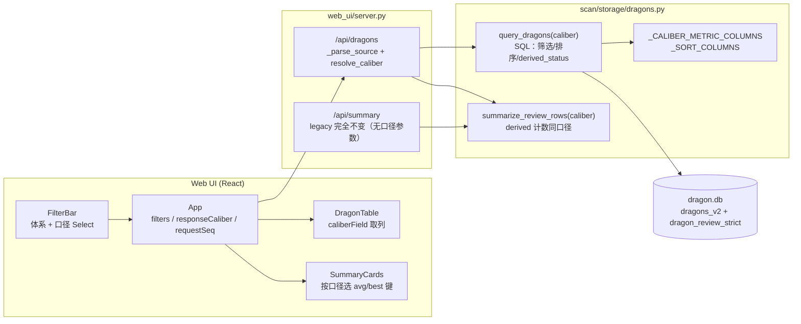

# Review 双口径筛选与展示技术方案（阶段 2）

- 日期：2026-10-30
- 范围：`review` Web UI 的回测面板（`/api/dragons` 查询参数、前端筛选/表格/卡片；legacy `/api/summary` 完全不动）
- 目标：一次 `review` 已同时算出宽松 + 严格两套结果，UI 增加「口径」筛选，用户切换即可看到所选口径的收益/回撤/状态/排序/卡片；两套原始字段仍随行返回。
- 非目标：不改 review 计算公式、不改数据库表结构、不改 CLI、不新增依赖、不改 v1 历史口径与语义。

---

## 1. 现状核对（代码事实）

| 层 | 位置 | 现状 |
|----|------|------|
| 计算 | `dragon_quant/review/main.py` `review_dragon` | 一次返回顶层宽松字段 + `strict` 子字典 |
| 存储 | `dragon_quant/scan/storage/dragons.py` `save_dual_review` | 同一 `dragon.db` 事务写宽松（`dragons_v2`）+ 严格（`dragon_review_strict`），`strict=None` 不覆盖已有严格行 |
| 查询 | 同文件 `query_dragons` | v2 LEFT JOIN 严格侧表；收益/回撤筛选、状态筛选、排序**固定严格口径**；行内同时返回宽松字段与 `strict_*` |
| API | `web_ui/server.py` `_serve_api_dragons` | 无口径参数；`summary` 由筛选后完整 rows 经 `summarize_review_rows(include_derived_counts=True)` 计算 |
| 汇总 | `dragons.summarize_review_rows` | 旧键（`avg_return`/`win_rate`/`best_*`）恒为宽松；`*_strict` 恒为严格；`derived_*` 用严格派生状态 |
| 前端 | `web_ui/frontend/src/` | `DragonTable` 固定读 `strict_*`；`FilterBar` 无口径选择；`App` 客户端排序；`SummaryCards` 平均收益/最佳固定严格，两胜率同时展示 |

结论：双口径的**计算与存储已完成**，缺的是「查询上下文的选择权」与前端字段选择。本方案只做查询/API/UI。

---

## 2. 候选方案与取舍

### A. 服务端 `review_caliber` + 统一字段映射（推荐，main 已定）

`/api/dragons?review_caliber=strict|loose` 作为**统一查询上下文**：一个口径决定范围筛选、状态筛选、排序、`derived_status`、表格列、卡片指标。行内仍返回两套原始字段。

- 优点：筛选、汇总、列表天然同源；前端只做字段选择，不做二次过滤；默认 strict 与现行为逐值一致；无迁移、无新表、无新依赖。
- 代价：`query_dragons`/`summarize_review_rows` 需要携带口径参数；前端需要一张逻辑字段映射表。

### B. 纯前端切换（不推荐）

API 仍返回严格筛选后的行，前端只在渲染时把列切到宽松字段。

- 否决理由：收益/回撤范围与状态筛选发生在 SQL，纯前端无法让「筛选条件」随口径变化；`summary` 也已按严格口径筛选，卡片会与表格口径不一致；列表条目不完整（例如宽松 completed 但严格 `pending_recompute` 的行会被筛掉）。违反「筛选/汇总/列表同源」。

### C. 两组独立数据或物化视图（非常规路径，不推荐）

`/api/dragons` 返回 `strict_rows` 与 `loose_rows` 两套完整行；或新增 `dragon_review_dual` 物化视图预拼两套口径。

- 否决理由：
  - 两套行会把响应体、`count`、分页、排序、前端状态全部翻倍，且「口径筛选」变成「选哪个数组」，与现有统一 rows 契约冲突；
  - 物化视图需要新增表、同步写入/回填/清理、镜像与 `assets` 同步边界，收益仅为省去 JOIN，成本远大于收益；
  - 未来加第三口径需要再改表与写入链路，方向与「口径是查询维度」相悖。
- 保留价值：该路径证明了「行内双字段 + 查询时选择」才是最小改动面。

**采用 A。**

---

## 3. 设计模式：策略式口径字段映射

**模式**：策略（Strategy）的轻量变体——「口径」是策略键，每个策略给出一组**列名映射**；调用方（筛选、排序、状态、表格、卡片）只面向逻辑字段，不写 `if strict else loose`。

**动机**：
- 消除 SQL 筛选、排序、`derived_status`、前端表格、卡片五处平行分支；
- 口径新增（若未来有第三口径）只扩一张映射表；
- 不引入类层级：本改动是一个 dict + 一个解析函数，符合「优先简单」。

落地为两张表 + 一个解析函数：

```python
# 唯一口径解析入口（服务端权威）
def resolve_caliber(value: Optional[str], source: str = "v2") -> str: ...

# 逻辑指标 → 物理列
_CALIBER_METRIC_COLUMNS = {
    "strict": {"return": "strict_max_return_5d", "drawdown": "strict_max_drawdown_5d"},
    "loose":  {"return": "max_return_5d",        "drawdown": "max_drawdown_5d"},
}

# 逻辑排序键 → 物理列（strict / loose 各一份）
_SORT_COLUMNS = {"strict": {...}, "loose": {...}}
```

前端对应一张 `CALIBER_FIELD`（`strict` / `loose` → `Dragon` 字段名）+ `caliberField(caliber, logicalKey)`。

---

## 4. 总体架构



要点：
- 口径只在**请求入口**解析一次；`query_dragons` 与 `summarize_review_rows` 收到的是已规范化的 `"strict"|"loose"`。
- `summary` 与 `data` 来自同一次查询的同一批 rows（既有契约不变）。
- `/api/summary` 与 `get_review_summary` 完全不变：不接收口径参数，响应形状与数值均保持现状。

---

## 5. 数据流（一次请求）

```mermaid
sequenceDiagram
    participant U as 用户
    participant FB as FilterBar
    participant App as App
    participant S as /api/dragons
    participant Q as query_dragons
    participant M as summarize_review_rows
    participant DB as dragon.db

    U->>FB: 选择口径（严格/宽松）
    FB->>App: onChange({review_caliber})
    Note over App: 仅更新表单，不请求
    U->>FB: 点击「查询」
    FB->>App: onSearch()
    App->>App: seq = ++requestSeq
    App->>S: GET /api/dragons?source=v2&review_caliber=loose&...
    S->>S: source = _parse_source(...); caliber = resolve_caliber(...)
    S->>Q: query_dragons(filters, sort_by, sort_dir, source, caliber)
    Q->>DB: SELECT ... 按口径列筛选 / 排序 / derived_status
    DB-->>Q: rows（宽松 + strict_* 全套）
    Q-->>S: rows
    S->>M: summarize_review_rows(rows, source, caliber)
    M-->>S: summary（两套指标 + 所选口径 derived 计数）
    S-->>App: {data, count, summary}
    App->>App: seq 校验；setRawData + setSummary + setResponseCaliber
    App-->>FB: 渲染表格（所选口径列）与卡片（所选口径 avg/best）
```

慢旧响应：`App` 已有 `requestSeq`，只有最后一次请求的响应能同时写入 `data` / `summary` / `responseCaliber`，不会出现「旧口径数据 + 新口径标签」的混合状态。

---

## 6. 接口与函数签名

### 6.1 `dragon_quant/scan/storage/dragons.py`

```python
def resolve_caliber(value: Optional[str], source: str = "v2") -> str:
    """口径解析唯一入口。

    - source == "v1"      → "loose"（v1 无严格侧表，强制旧口径）
    - v2 + "loose"        → "loose"
    - v2 + 其它/缺省/非法 → "strict"（保持既有默认）
    """

def query_dragons(filters: Optional[dict] = None,
                  sort_by: str = "composite_score",
                  sort_dir: str = "desc",
                  source: str = "v2",
                  *,
                  caliber: Optional[str] = None) -> list[dict]:
    """caliber 决定：return_*/drawdown_* 范围列、status 过滤的 derived_status、
    sort_by 的物理列。行内始终返回宽松字段与 strict_* 全套。"""

def summarize_review_rows(rows: list[dict],
                          source: str = "v2",
                          *,
                          include_derived_counts: bool = False,
                          caliber: Optional[str] = None) -> dict:
    """caliber 只影响 derived_completed/derived_pending 的状态来源；
    旧键（宽松）与 *_strict 键均保持不变，供前端按口径选键。"""

def get_review_summary(source: str = "v2") -> dict:
    """legacy wrapper，**完全不改**：签名、实现与响应均保持现状。

    legacy 端点不接收口径参数——口径对 legacy 无任何可观察影响（它不含
    derived_* 计数），新增 no-op 参数只扩接口、无收益（main 阶段 2 验收）。
    口径切换只由 /api/dragons 承载。
    """
```

`query_dragons` 内部替换：

- `_query_base_sql(table, source, caliber)`：
  - v2 恒投影 7 个 `strict_*` 列；
  - `derived_status` 表达式按口径：
    - strict → 现有 `CASE WHEN s.review_status IS NOT NULL ... ELSE 'pending_recompute' END`
    - loose → `d.review_status`
  - v1 → 恒 `d.review_status`（沿用现状）。
- 范围列：`_CALIBER_METRIC_COLUMNS[caliber]`（v1 恒 loose）。
- 排序列：`_resolve_sort_column(source, caliber, sort_by)`，见 §8。

### 6.2 `web_ui/server.py`

```python
def _parse_filters(params: dict) -> dict          # 不变
def _parse_source(params: dict, default="v2")     # 不变

def _serve_api_dragons(self, params: dict):
    source = _parse_source(params, self.server.default_source)
    caliber = db.resolve_caliber(_first(params, "review_caliber"), source)
    rows = db.query_dragons(filters, sort_by, sort_dir, source=source, caliber=caliber)
    summary = db.summarize_review_rows(rows, source=source,
                                       include_derived_counts=True,
                                       caliber=caliber)
    self._send_json({"data": rows, "count": len(rows), "summary": summary})

def _serve_api_summary(self, params: dict):
    # legacy 端点完全不变：不读取 review_caliber（传入也会被忽略，不新增错误协议）
    source = _parse_source(params, self.server.default_source)
    self._send_json(db.get_review_summary(source=source))
```

**响应契约不变**：不新增任何响应键（含不回显 `review_caliber`）。原因：`默认 strict 下现有 API 响应不变` 是硬约束；前端本就掌握请求参数。默认 strict 的 `data` / `count` / `summary` 与改造前**逐值等价**。

`/api/summary` 与 `get_review_summary` **完全不改**：不接收、不透传口径参数。口径只属于 `/api/dragons` 的查询上下文；给 legacy 加 no-op 参数属于为假设需求扩接口，main 验收已明确删除。

### 6.3 前端类型

```ts
// api.ts
export type ReviewCaliber = "strict" | "loose";

export interface DragonFilters {
  // ...既有字段
  review_caliber?: ReviewCaliber;
}
// fetchDragons 的 keys 数组加入 "review_caliber"
```

```ts
// caliber.ts（新增，小文件，无依赖）
export type CaliberField =
  | "buy_date" | "buy_price" | "max_return_5d"
  | "max_drawdown_5d" | "max_return_hold_days" | "status";

export const CALIBER_FIELD: Record<ReviewCaliber, Record<CaliberField, keyof Dragon>> = {
  strict: {
    buy_date: "strict_buy_date",
    buy_price: "strict_buy_price",
    max_return_5d: "strict_max_return_5d",
    max_drawdown_5d: "strict_max_drawdown_5d",
    max_return_hold_days: "strict_max_return_hold_days",
    status: "derived_status",
  },
  loose: {
    buy_date: "buy_date",
    buy_price: "buy_price",
    max_return_5d: "max_return_5d",
    max_drawdown_5d: "max_drawdown_5d",
    max_return_hold_days: "max_return_hold_days",
    status: "derived_status",
  },
};

/** 与后端 resolve_caliber 同规则：v1 恒 loose，v2 仅显式 loose 才宽松。 */
export function effectiveCaliber(source: "v1" | "v2", caliber?: ReviewCaliber): ReviewCaliber;

export function caliberField(caliber: ReviewCaliber, field: CaliberField): keyof Dragon;
```

---

## 7. `derived_status` 规则

| 数据源 | 口径 | `derived_status` | 说明 |
|--------|------|------------------|------|
| v1 | 任意（强制 loose） | `d.review_status` | 与现状完全一致 |
| v2 | strict | `s.review_status` 优先；否则 `review_status='pending'`→`pending`、`'error'`→`error`、其余→`pending_recompute` | 与现状 CASE 逐值一致 |
| v2 | loose | `d.review_status` | 直接取宽松状态：`completed` / `pending` / `no_entry` / `error` |

推论（必须写进测试）：

- **pending_recompute 不污染宽松状态**：宽松模式下不存在 `pending_recompute`；「宽松 completed、严格缺行」的行显示为 `completed`。
- **cannot_evaluate 只在严格模式出现**：宽松模式下该行按其 `review_status`（通常 `completed`）展示，宽松收益字段与严格 `cannot_evaluate` 并列保留。
- `no_entry` 在 v2 宽松模式可达（`_loose_review` 写 `no_entry`）；严格模式仍按现有 CASE 落入 `pending_recompute`。
- 严格缺行（`strict_reviewed=false`）不影响宽松模式的状态与范围筛选；`strict_*` 列仍为 `null`。

`summarize_review_rows` 的 `_row_derived_status(row, source, caliber)` 必须遵守同一张表，且**优先按显式 caliber 计算**，不能无条件读行内 `derived_status`（否则 strict 行喂给 loose 汇总时会误用严格状态）。调用方保证 `query_dragons` 与 `summarize_review_rows` 传同一 caliber。

---

## 8. 排序 key 兼容策略

统一规则：先把排序键归一到**逻辑键**，再查所选口径的物理列；未知键回退 `composite_score`（现状）。

| 输入 `sort_by` | 逻辑键 | strict 物理列 | loose 物理列 |
|----------------|--------|---------------|--------------|
| `trade_date`/`code`/`name`/`rank`/`composite_score`/`board_count`/`pct` | 同名 | 同名 | 同名 |
| `buy_date` / `strict_buy_date` | `buy_date` | `strict_buy_date` | `buy_date` |
| `buy_price` / `strict_buy_price` | `buy_price` | `strict_buy_price` | `buy_price` |
| `max_return_5d` / `strict_max_return_5d` | `max_return_5d` | `strict_max_return_5d` | `max_return_5d` |
| `max_drawdown_5d` / `strict_max_drawdown_5d` | `max_drawdown_5d` | `strict_max_drawdown_5d` | `max_drawdown_5d` |
| `max_return_hold_days` / `strict_max_return_hold_days` | `max_return_hold_days` | `strict_max_return_hold_days` | `max_return_hold_days` |
| `review_status` / `strict_review_status` | `review_status` | `derived_status` | `derived_status` |
| 其它 | 未知 | `composite_score` | `composite_score` |

- 兼容目标：旧客户端继续传 `strict_*` 键时，strict 模式行为不变；loose 模式下这些键**语义降级**为宽松列（与 v1 现有「strict_* 键映射回旧字段」的做法一致），不会报错、不会 500。
- `NULLS LAST` 保持现状，两种口径一致。
- 前端表头排序仍是**客户端排序**（现状），但 `App` 用 `caliberField(responseCaliber, sort.by)` 取物理字段，避免「显示宽松值、按严格值排序」。

---

## 9. 前端设计

### 9.1 FilterBar

可见区在「体系」后新增「口径」`Select`：

- 选项：`严格`（`strict`）/`宽松`（`loose`），默认 `strict`。
- `source === "v1"` 时：`value="loose"` 且 `disabled`，旁注文案改为「v1 历史数据固定旧口径」。
- 切换体系：
  - → `v1`：同时写入 `review_caliber: "loose"`；
  - → `v2`：同时写入 `review_caliber: "strict"`（v2 默认严格，行为确定、无隐藏状态）。
- 「重置」：保留 `source`，其余清空；`review_caliber = source === "v1" ? "loose" : "strict"`。
- 状态选项按**生效口径**动态给出（shared `effectiveCaliber(source, review_caliber)`）：
  - strict：`completed / 全部 / pending / pending_recompute / cannot_evaluate / no_entry / error`（现状全集）；
  - loose：`completed / 全部 / pending / no_entry / error`（隐藏仅严格可达的 `pending_recompute` / `cannot_evaluate`）。
- 切换口径或体系导致生效口径变为 loose 时，若当前 `status` 属于严格专有值，**同一 patch 内清空为 `""`（全部）**，避免表单出现必然 0 条的死选项，也保证 Select 的 `value` 始终存在于 `data` 中。清空只改表单，不自动请求（与现有「筛选不自动请求」一致）。
- `no_entry` 标签由「无介入（v1）」改为「无介入」（v2 宽松也可达）。

### 9.2 App

- `DragonFilters` 增加 `review_caliber`；初始值：`source==="v1" ? "loose" : "strict"`（含 URL `?source=v1` 场景）。
- 新增 `responseCaliber` state：请求成功后在 `seq` 守卫内与 `rawData`、`summary` 一起设置，值为 `effectiveCaliber(f.source, f.review_caliber)`。
- `onSearch` / `onReset` 行为不变（仍是显式请求）。
- 客户端排序：`sort.by` 改为逻辑列键，`field = caliberField(responseCaliber, sort.by)` 后再比较；`null` 仍视为最小值（现状）。
- 排序状态在响应到达时重置为请求的 `sort_by`（现状）；`composite_score` 在两种口径下同列，默认行为不变。

### 9.3 DragonTable

- 新增 `caliber: ReviewCaliber` prop（来自 `responseCaliber`，**不是**表单里的待提交值），保证表格与已加载数据同口径。
- 列定义改用逻辑键（`buy_date`/`buy_price`/`max_return_5d`/`max_drawdown_5d`/`max_return_hold_days`/`status`），渲染时统一走 `caliberField`。
- 删除 `strictValue` 与 `displayStatus` 中的口径分支：状态列直接展示 `derived_status`（服务端已按口径给出）；保留对旧响应缺失 `derived_status` 的兜底（现状代码可保留为单点兜底，不参与口径选择）。
- 默认 strict 下渲染与现状逐格一致（strict 映射等价于原 `strictValue`）。
- **有意的排序修正**：状态列排序键由 `strict_review_status`（可能为 `null`，`null` 被当最小值）改为 `derived_status`（与展示值一致；strict 模式必非空，loose 模式通常非空，异常 `NULL` 仍按最小值处理）。这只影响用户点击「状态」表头时的排序顺序，不影响默认排序与筛选结果；在 `docs/agent/review.md` 记录该变化。

### 9.4 SummaryCards

- 新增 `caliber: ReviewCaliber` prop。
- 平均收益/最佳：
  - strict → `avg_return_strict` / `best_stock_*_strict` / `best_return_strict`；
  - loose → `avg_return` / `best_stock_code` / `best_stock_name` / `best_return`；
  - v1 → 同 loose，副标题「旧口径」。
- 宽松胜率、严格胜率两张卡始终同时展示（对比用），逻辑不变。
- 「已完成 / 待回测」使用服务端按所选口径计算的 `derived_completed` / `derived_pending`。
- 副标题随口径显示「严格口径」/「宽松口径」/「旧口径」。
- 「待回测」卡的副文案「待重算 X · 失败 Y」来自严格侧统计（`pending_recompute` / `failed_recompute`），**仅在 v2 + strict 时展示**；loose 模式不展示，避免把严格侧重算进度误当成宽松状态。
- 「严格胜率」卡的 `cannot_evaluate` 副文案始终展示（它描述严格侧样本），与当前口径无关。

---

## 10. 边界与异常

| 场景 | 行为 |
|------|------|
| `review_caliber` 缺省 / 空 | v2 → `strict`；v1 → `loose` |
| 非法值（`foo`、大小写、重复参数） | 取第一个值，`.strip().lower()` 后不在白名单 → 默认（v2 strict / v1 loose）；**不返回 4xx**，沿用 `_parse_source` 风格 |
| `source=v1&review_caliber=strict` | 强制 `loose`，响应不报错；前端 v1 下 Select 已禁用并显示宽松 |
| v1 数据 | 与现状完全一致：范围筛选用旧字段，`derived_status = review_status`，`strict_*` 为 `null`，严格键汇总为 `None/0` |
| 严格缺行 | strict：`pending_recompute`；loose：`review_status`（通常 `completed`）；`strict_reviewed=false` 保留 |
| `cannot_evaluate` | strict：状态为 `cannot_evaluate`；loose：按宽松状态展示，严格列保留 `cannot_evaluate` 与分析原因 |
| 宽松 `no_entry` | loose：状态 `no_entry`，收益/回撤列为 `NULL`；设置范围筛选时被 `COALESCE(..., ±9999)` 排除（现状语义） |
| `NULL` 指标 | 均值只取非 `NULL`；胜率分母保留 completed（现状）；范围筛选仍用 `COALESCE` |
| 空集 | `total=0`，均值/胜率/最佳全 `None`（`—`）；真实无赢家仍为 `0.0` |
| 孤儿严格行 | 不进入权威集合（严格侧只统计能 JOIN 到 dragon 行的记录，现状） |
| 排序未知键 | 回退 `composite_score`（现状） |
| 慢旧请求 | `requestSeq` 丢弃；`data`/`summary`/`responseCaliber` 同一次写入，不混合 |
| 表单改了口径但未点查询 | 表格/卡片保持上次响应口径（与现有「筛选不自动请求」一致），不会出现标签/数据错配 |
| 切口径后 status 成为死选项 | FilterBar 在同一 patch 内清空严格专有 status（`pending_recompute`/`cannot_evaluate`）为「全部」；宽松选项列表不包含它们 |

---

## 11. 测试策略

### 11.1 现有证据（不改动，作为双写不被回归的基线）

- `dragon_quant/tests/test_review.py::TestRunReview::test_run_review_single_dragon`：确认 `save_dual_review` 被调用一次（一次 review 双写路径）。
- `test_review_strict.py::test_save_dual_review_rolls_back_when_strict_write_fails`：同事务失败整体回滚。
- `test_review_strict.py::test_save_dual_review_without_strict_keeps_existing_strict_row`：传输失败不覆盖已有严格行。
- `test_review_summary_rows.py` 全部用例：默认汇总与 legacy `/api/summary` 等价。
- `test_review_strict.py::test_query_dragons_uses_strict_filters_and_derived_status`：默认 strict 行为锁定。

阶段 3 必须原样重跑并通过，不允许为了新功能改这些断言。

### 11.2 新增单元测试 `dragon_quant/tests/test_review_caliber.py`

复用现有 `_init / _insert_loose / _insert_strict` 模式，种子覆盖：

| 行 | 宽松 | 严格 | 用途 |
|----|------|------|------|
| A `600001` | 100 / -100 completed | 9 / -4 completed | 区分两套范围筛选 |
| B `600002` | 8 / -3 completed | 无行 | strict 缺行 → `pending_recompute` |
| C `600003` | pending | 无行 | pending |
| D `600004` | error | 无行 | error |
| E `600005` | 7 / -2 completed | cannot_evaluate | 宽松状态不被严格状态污染 |
| F `600006` | no_entry | 无行 | 宽松 `no_entry` 可达、严格落 `pending_recompute` |

用例：
1. `test_default_equals_explicit_strict`：`query_dragons({})` 与 `query_dragons({}, caliber="strict")` 返回完全相等（含顺序与所有键）。
2. `test_loose_range_filters_use_loose_columns`：`return_min=8.5` strict 命中 A（严格 9.0）；loose 命中 A（宽松 100）而 B（8.0）不命中。`drawdown_min=-50` strict 命中 A（-4；B 无严格行被 `COALESCE` 排除）；loose 命中 B（-3）、E（-2），A（-100）被排除——同一条件在两种口径下命中不同行。
3. `test_loose_status_uses_dragons_review_status`：`status=[completed]` → A/B/E；`status=[pending_recompute]` → 空；`status=[cannot_evaluate]` → 空；`status=[no_entry]` → F；`status=[error]` → D。
4. `test_loose_rows_keep_strict_fields`：loose 行仍含 7 个 `strict_*` 键、`strict_reviewed` 正确；A 的严格值与宽松值不同且同时存在。
5. `test_loose_sort_aliases_and_columns`：`sort_by="max_return_5d"` 按宽松值排；`sort_by="strict_max_return_5d"` 在 loose 下同样按宽松值排（别名降级）；strict 下按严格值排。
6. `test_invalid_caliber_falls_back_to_strict`：`caliber="foo"` 与默认结果相等。
7. `test_v1_ignores_caliber_and_stays_loose`：v1 下 `caliber="strict"` 与 `caliber=None` 结果相同，范围筛选仍用旧字段，严格键汇总仍为 `None`。
8. `test_summary_derived_counts_follow_caliber`：同一批 rows，`caliber="strict"` → `derived_completed=1`（A），`derived_pending=3`（B/C/F；D error、E cannot 不计）；`caliber="loose"` → `derived_completed=3`（A/B/E），`derived_pending=1`（C；F `no_entry`、D `error` 不计）。
9. `test_summary_legacy_and_strict_keys_unchanged_by_caliber`：两种口径下 `avg_return` / `avg_return_strict` / 两胜率 / `best_*` 逐键相等（口径只影响 derived 计数）。
10. `test_resolve_caliber_rule_table`：`(None,v2)=strict`、`("loose",v2)=loose`、`("strict",v1)=loose`、`("LOOSE ",v2)=loose`、`("foo",v2)=strict`。

### 11.3 E2E（`dragon_quant/tests/e2e/test_web_api.py`，真实子进程）

在现有 `test_w1_w3_w4_w7_review_ui_routes_and_404` 上追加（或在同文件新增 `test_w9_review_caliber_switch`，复用 `seed_dragons`）：

- 默认 `/api/dragons` 与 `/api/dragons?review_caliber=strict` 的 `data`/`count`/`summary` 完全相等。
- `review_caliber=loose`：
  - `derived_status` 序列等于 `review_status` 序列（`completed,pending,pending`）；
  - `return_min=8.5` → 0 条（宽松 8.0 不命中），`return_min=7.5` → 1 条（600001）；
  - 行内 `strict_max_return_5d=9.0`、`strict_buy_date` 仍在。
- 新增 v1 种子（`seed_db` 增加 `dragons_v1` 表 spec，列与 `DRAGON_COLUMNS` 对齐，单行 `completed`），请求 `source=v1&review_caliber=strict`：
  - 行为等同 `source=v1`（强制宽松），`return_min` 用旧字段命中。
- `/api/summary` 默认响应与现状逐键相等（现有断言不动）；**不新增**任何 legacy 口径参数用例——legacy 端点不接收该参数。
- 覆盖映射：未新增 CLI 命令/parser 节点，`coverage-map.json` 的 53 节点 / 15 顶层命令不变；但 `test_every_e2e_test_function_is_mapped` 要求**每个** e2e 测试函数都有归属，故新增的 `test_w9_review_caliber_switch` 登记到 `independent_entries.web.tests`（不改节点数量）。

### 11.4 前端验证

- `cd web_ui/frontend && npm run build`（`tsc --noEmit` + vite）必须通过；提交重建后的 `web_ui/dist/`（该目录已入库并随包分发）。
- 人工/Playwright 冒烟（可选，不作为门禁）：
  1. 默认打开 → 口径显示「严格」，表格为严格值；
  2. 切「宽松」→ 查询 → 买入日/买入价/收益/回撤/持有天/状态均变化，卡片平均收益/最佳变化；
  3. 两胜率卡不变；
  4. 切体系 v1 → 口径 Select 显示宽松且禁用，查询结果与改造前 v1 一致；
  5. 重置 → 保留体系，v2 回到严格，v1 保持宽松；
  6. 快速连续切换口径并查询 → 最终只显示最后一次结果（序号守卫）；
  7. 在严格模式选「待重算」后切到宽松 → 状态选项不再含「待重算/无法评估」，状态自动变为「全部」，不会提交必然 0 条的条件。

### 11.5 阶段 3 自测命令

```bash
.venv/bin/python -m pytest \
  dragon_quant/tests/test_review_caliber.py \
  dragon_quant/tests/test_review_strict.py \
  dragon_quant/tests/test_review_summary_rows.py \
  dragon_quant/tests/test_review.py -q
.venv/bin/python -m pytest dragon_quant/tests/e2e/test_web_api.py -q
.venv/bin/python -m pytest dragon_quant/tests -q \
  --ignore=dragon_quant/tests/e2e --ignore=dragon_quant/tests/smoke
cd web_ui/frontend && npm run build
```

---

## 12. 文档同步（同一 commit）

| 文件 | 修改点 |
|------|--------|
| `docs/agent/review.md` | 「Web UI 表格 / 收益 / 回撤 / 状态筛选固定严格口径」改为可选口径；补充 `review_caliber` 语义、`derived_status` 三态规则、v1 强制宽松、卡片键选择、排序键兼容、状态列排序改为 `derived_status`、宽松模式动态状态选项、默认响应不变；明确 legacy `/api/summary` 不变 |
| `README.md` | `review` 段的「Web UI …固定使用严格口径」改为「默认严格，可切宽松」；指标联动段补充口径 Select、重置与 v1 固定宽松 |
| `docs/solutions/2026-10-30-review-dual-caliber-filter-design.md` | 本方案（新增） |
| `AGENTS.md` | **不改**（无新增跨模块硬约束；根体量受门禁约束） |
| `web_ui/dist/` | 前端重建产物（入库） |

`test_docs_consistency.py` 关注的 `summarize_review_rows` / `dragon_review_strict` 归属仍保留在 `docs/agent/review.md`。

---

## 13. 风险与缓解

| 风险 | 缓解 |
|------|------|
| SQL 拼接引入注入 | 口径来自白名单映射，列名非用户输入；`filters` 仍参数化 |
| 默认 strict 行为漂移 | `test_default_equals_explicit_strict` + 现有 strict 测试原样保留；e2e `/api/summary` 逐键断言不动 |
| 汇总与列表口径不一致 | 服务端同一请求内用同一 `caliber` 调 `query_dragons` 与 `summarize_review_rows`；`include_derived_counts` 与 rows 同源 |
| 前端「表单口径」与「已加载数据口径」错配 | 表格/卡片用 `responseCaliber`（响应态），不用表单态；`requestSeq` 原子写入 |
| 前后端口径规则漂移 | 服务端 `resolve_caliber` 为权威；前端 `effectiveCaliber` 同规则并有单测表；v1 在 UI 层已强制 loose |
| 宽松模式出现死状态选项 | 动态选项（loose 隐藏 `pending_recompute`/`cannot_evaluate`）+ 切口径时清理失效 status；Select `value` 始终在 `data` 内 |
| `web_ui/dist` 忘记重建 | 阶段 3 门禁命令包含 `npm run build`，交付报告附构建输出 |
| 状态筛选在宽松下语义变化被误用 | `derived_status` 规则表 + 单测覆盖 pending_recompute 不出现、cannot/no_entry 行为 |
| v1 回归 | 现有 v1 单测 + 新增强制宽松测试 + e2e v1 种子 |

**残余风险**：
- 前端无组件单测框架，UI 行为主要靠 `tsc` + 构建 + 人工冒烟；若后续引入 Vitest 可补 `caliberField` / `effectiveCaliber` 单测。
- 宽松模式的状态语义（`no_entry`/`error`）与严格派生状态并非一一对应，导出/外部消费者需阅读 `docs/agent/review.md`。

---

## 14. 验收标准映射

| 验收标准 | 实现 | 验证 |
|----------|------|------|
| v2 一次 review 双写有现有测试证据且不被回归 | 不改 `review/main.py` / `save_dual_review` | 重跑 `test_review.py`、`test_review_strict.py` 双写用例 |
| 默认请求与 `review_caliber=strict` 等价 | `resolve_caliber` 缺省 strict；`_query_base_sql` strict 分支保持原 CASE | 单测 1 + e2e 默认/strict 对比 |
| loose 下范围/状态/排序/表格/卡片均用宽松值，严格值保留在 row | `_CALIBER_METRIC_COLUMNS` + `_SORT_COLUMNS` + `CALIBER_FIELD` + `SummaryCards` 键选择 | 单测 2/3/4/5/8 + e2e loose 断言 + 构建 |
| 严格缺行与宽松状态差异正确，pending_recompute 不污染宽松 | `derived_status` loose = `d.review_status` | 单测 3/8（B 行） |
| v1 行为不变 | `resolve_caliber` 强制 loose；v1 SQL/排序映射保持 | 现有 v1 单测 + 单测 6/7 + e2e v1 |
| 旧慢响应不覆盖新口径；重置/来源切换一致 | `requestSeq` + `responseCaliber`；FilterBar 同步规则 | 代码审查 + 人工冒烟 6 |
| 默认行为不变，测试与前端构建可验证 | 响应无新增键；strict SQL 等价 | 全量 pytest + `npm run build` |

---

## 15. 不做什么

- 不新增数据库表、索引或物化视图。
- 不修改 `review` 的双口径公式、成熟度、写回与 `--recompute-all` 行为。
- 不新增 CLI 参数；`review --ui` 行为不变。
- 不改 `assets.db` 镜像与同步语义。
- 不为未来第三口径引入类层级/插件机制；映射表可扩展即可。

---

## 16. main 阶段 2 单次验收处置

| 级别 | 意见 | 处置 |
|------|------|------|
| 必须修改 | 删除 legacy `/api/summary` 与 `get_review_summary` 新增的 `review_caliber` / `caliber` no-op 参数及 E2E no-op 用例；legacy 端点与 wrapper 完全不变；`summarize_review_rows(caliber=...)` 保留，仅供 `/api/dragons` 派生计数 | **已落实**：`get_review_summary` 签名恢复为 `(source="v2")`；`_serve_api_summary` 不读取口径；§4 架构图/要点、§6.1/§6.2、§11.3、§12 全部同步删除相关表述与用例 |
| 建议 | 宽松模式动态隐藏仅严格可达的 `pending_recompute` / `cannot_evaluate` 状态选项，并在切口径时清理已失效的 status | **已采纳**：§9.1 动态状态选项 + 同 patch 清空失效 status；§10、§13、§11.4 同步 |
| 建议 | 不回显 `review_caliber` 可接受；前端无组件测试的残余风险保留，不引入 Vitest | **接受**：§6.2 保持无回显；§13 残余风险保留；不引入前端测试框架 |
