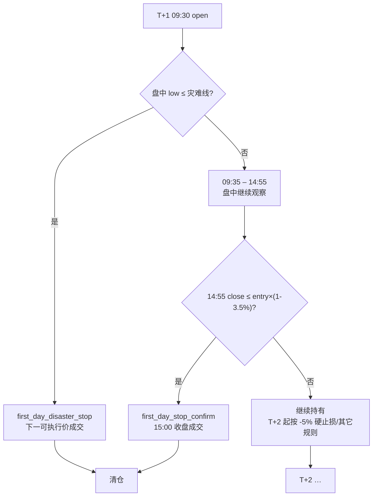
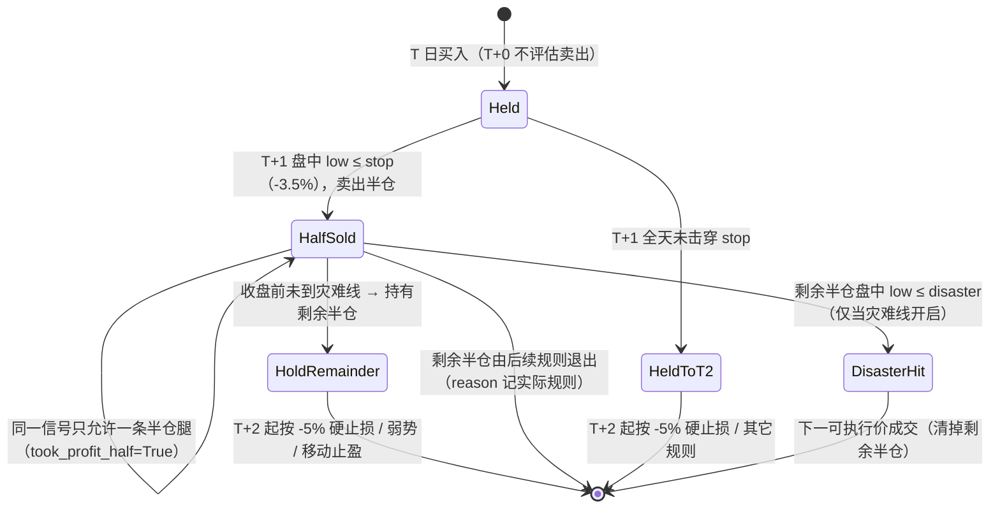

# 首日止损改造（first-day stop redesign）— 技术方案

- 日期：2026-10-22 · 分支：`feat/reviewa-account-op` · 状态：v3（第 2 轮 solution-reviewer 复审 APPROVE，可进入方案确认点）
v2 修订摘要：灾难段改为「灾难优先、不带半仓守卫」；`first_day_disaster_stop_pct` 默认改为 0；开关收敛到 `StrategyConfig`（消除跨规则读 toggle 与循环依赖）；兜底日两腿同日/跨日语义显式化并给实测证据；风险口径改为上界；验证门槛分两级；测试补 12–16 与引擎级兜底日用例。
- 范围：`review_account/strategy.py` 卖出责任链中的首日止损（`hard_stop` 的 `hold_days==1` 分支）及其成交价口径、配置开关、回测/实盘一致性
- 输入：run #6（2026-06-26 → 2026-10-22，10 万本金）回测分析；`archived_md/review_account/2026-10-22-position-sizing-backtest.md`（仓位分散无效的结论）
- 非目标：不改仓位/风控参数、不改止盈类规则（trailing / breakeven / volume_spike）、不改买点、不引入新数据源

---

## 1. 问题定性（数据驱动）

### 1.1 现象（run #6）

| 指标 | 数值 |
|---|---|
| 已平仓 | 27 笔 |
| 首日止损 `first_day_stop_loss` | **10 笔（37%）**，平均 **-5.91%**，合计 **-43,607 元** |
| 全部平仓净利 | +23,527 元 |
| 首日止损清仓后 5 日内最高涨幅（均值） | **+9.07%** |
| 其中卖出后 5 日内反弹 >5% | 4 笔（敦煌种业 +39.2%、特一药业 +25.9%、凯莱英 +17.8%、丽人丽妆 +7.0%） |
| 止盈类卖点（trailing/volume_spike） | 8 笔，平均 +4.4% ~ +11.0%，卖出后标的多继续下跌 |

**首日止损一项就吃掉了全部净利（-43,607 vs +23,527）**，是策略最大的单点出血。

### 1.2 根因拆解

**根因 A：-3.5% 的阈值落在日常噪声内。** 10 笔首日止损标的在买入日的 14 日 ATR 中位数 **6.26%**、5 日平均振幅中位数 **7.84%**；-3.5% ≈ **0.56 × ATR**。也就是说，止损线在一根普通日 K 的波动区间之内，盘中任何一次正常回踩都可能打掉仓位（`bar_low` 触及即触发）。

**根因 B：成交模型把「止损」变成了「市价单」。** 规则在 `bar_low <= stop` 时产出信号，成交发生在**下一个可执行事件**（`fill_price(row, ...)`）。10 笔首日止损的成交分布：

| 卖出时点 | 笔数 | 成交价口径 |
|---|---:|---|
| T+1 开盘（跳空低开，直接低于止损线） | 6 | 开盘价（滑点后） |
| T+1 14:55 → 15:00 收盘 | 3 | 止损线或收盘价（日K兜底近似） |
| T+1 盘中（唯一有完整 5 分钟 K 的样本） | 1 | 下一根 K 开盘 |

结果是**阈值 -3.5%，实际平均亏损 -5.91%**：跳空造成的缺口完全无法被固定百分比止损覆盖。

**根因 C：10 笔里 9 笔发生在「日K兜底日」。** 样本中只有 605136（丽人丽妆）当天有完整 5 分钟 K；其余 9 笔当天整日降级为日K兜底。兜底日的 `open` 事件只暴露开盘价，`bar_low = open`，因此只要**开盘价低于止损线就立刻触发**，连「盘中是否只是短暂插针」都无从判断。这是「错杀」在数据层的放大器。

**根因 D（结构发现）：把首日止损推迟到收盘，`weak_close` 会在同一天接管。** 原型实验显示：「收盘确认」「跌破买入日最低价」「首日完全不止损」三种设计在本区间的**交易结果完全相同**（+26.87% / -15.09% / 25 笔），只是原因码不同。原因：只要 T+1 收盘是弱势的（收<开且跌>1%、破 MA5、破昨收），既有 `weak_close` 规则已经在 14:55 以收盘价清仓。**首日止损真正独有的作用，只是「比 weak_close 更早卖」**——而早卖的成交价往往更差（wick 或跳空开盘）。

这条发现决定了方案的重心：改造首日止损 = 决定「要不要在 14:55 之前卖」，而不是发明一个更聪明的止损公式。

### 1.3 目标（可验证）

1. 首日错杀**只造成一半损失**：盘中触及止损线时先减半，剩余半仓不被同一根 K 洗出（若采用确认式，则盘中不卖、14:55 再判）。
2. 单笔尾部可控：剩余半仓在 T+2 起受既有 -5% 硬止损约束；可选灾难线（**默认 0 = 关闭**）为剩余半仓再加一道盘中底线。
3. 默认行为与现状**逐笔一致**（新规则默认关，`sell_rule_toggles` 可开），旧基线可复现。
4. 回测与实盘 `buy/sell` 共用同一规则实现（`evaluate_sell`），无分叉。

---

## 2. 候选设计

> 所有候选都遵守既有契约：T+1 不卖当日仓；决策 → 下一可执行事件成交；封死涨跌停不假定成交；跳空不补填不存在的价；同一根 K 的高点不反向激活该根 K 内保护。

### D0 现状：固定 -3.5% 盘中击穿即卖

- 触发：`(bar_low/entry-1)*100 <= -3.5`，任意 phase。
- 成交：下一事件价（跳空时=开盘价）。
- 优点：尾部最紧（阈值最低）。
- 缺点：1.2 节全部根因；实测吃掉了全部净利。

### D1 收盘确认（close-confirm）

- 触发：仅 `phase == late`（14:55）且 `bar_close <= entry*(1-3.5%)`。
- 成交：15:00 收盘价（日K兜底日按当日收盘价）。
- 优点：一个条件即可消除插针错杀；与 `weak_close` 同帧同价，回测/实盘口径天然一致。
- 缺点：跳空日会更差（等收盘）；对「收盘刚好在线上」的边界敏感。

### D2 结构联动（structural）

- 触发：仅 `phase == late`，且「收盘 < 买入日最低价」或「收盘 < MA5」。
- 成交：收盘价。
- 优点：阈值随个股结构自适应（不依赖固定 %）；直接对齐「结构破坏」的交易语义。
- 缺点：①买入日最低价可能是 -8%，等于放弃首日风控；②`close < MA5` 与 `weak_close` 的「破 MA5」重复；③需要新增 `entry_day_low` 数据链路（目前 `Position.entry_day_low` 字段存在但从未赋值）。
- 实测：与 D1/D4 完全相同（+26.87%），因为两条件几乎总与 `weak_close` 同时满足 → 复杂度没有换来收益。

### D3 首日浮亏减半（half-stop）

- 触发：盘中 `bar_low` 触及 -3.5% → 卖出**一半**（新原因码 `first_day_stop_half`），剩余半仓继续由既有规则管理。
- 成交：同现状（下一可执行价），但数量减半。
- 优点：错杀时只损失一半；跳空放大也只放大一半；不需要等待收盘，尾控仍在。
- 缺点：①需要部分成交记账（回测 `sell_quantity`、实盘 `half_close_signal`）；②**与 `next_day_limit_up_half` 争用同一条半仓腿**：live 的 `half_exit_*` 只有一组字段、`took_profit_half` 是唯一性守卫，首日减半后再遇次日封板将无法再记半仓；③真跌的票仍留一半敞口到 -5% 乃至更深。

### D4（非常规）首日不止损 + 次日开盘判新低（defer）

- 触发：T+1 完全不评估首日止损；T+2 开盘若低于 T+1 最低价（创新低）则在开盘退出，否则继续。
- 优点：彻底消除「一日游错杀」（本样本 4 笔反弹全部保留）。
- 缺点：①单笔风险显著放大——T+1 跌停也不卖，T+2 还要低开才卖，最坏情形可能 -15% 以上；②需要新增 `Position` 状态（T+1 最低价、是否已延迟）与 T+2 决策分支；③在日K兜底日「T+1 最低价」只有日 K low，粒度粗；④与目标 2（尾部可控）直接冲突。
- 评价：**作为消融/研究项保留，不作为默认**。它用「更大的单笔风险」换「错杀消除」，与本任务「同时控制跳空放大」的要求相反。

### D5 两段式：收盘确认 + 灾难线（保守备选）

- **第一段（软止损 / 确认）**：T+1 仅在 14:55 确认 `bar_close <= entry*(1+first_day_stop_loss_pct/100)` 才清仓，原因码 `first_day_stop_confirm`。
- **第二段（硬止损 / 灾难）**：T+1 任意时点 `(bar_low/entry-1)*100 <= first_day_disaster_stop_pct`（本样本 -7% 的风险指标最好，见 §4）仍立即清仓，原因码 `first_day_disaster_stop`。
- T+2 及以后：沿用现状 `hard_stop_loss`（-5%）。
- 成交价：确认段 → 15:00 收盘价；灾难段 → 下一可执行价（跳空则开盘价，日K兜底日按 `daily_fallback_sell_price` 的「开盘价或止损线」近似）。



---

## 3. 推荐与理由

**推荐 D3（首日浮亏减半，灾难线默认关闭），作为新规则 `first_day_stop`（默认关）。**

理由：

1. **同时命中两个目标**：错杀时只卖一半（损失减半）、跳空放大也只放大一半；而且仍在 -3.5% 就先动作（比 D5 的 -7% 灾难线更早降暴露），跳空日不会像纯确认式那样「等收盘」把缺口全部吃下。这与既有方法论的判断一致——T+1 隔夜跳空不可对冲，是首日更紧止损的必要性来源（`archived_md/review_account/择时与仓位调研.md` §5、§3.1），因此不应把首日止损整体推迟到收盘。
2. **实测（修正兜底成交价口径后，D3 为 `disaster=0` 纯减半口径）**：D3 = **+39.37% / -13.61% / 25 笔 / 胜率 52.0% / 盈亏比 1.69 / 最差 -10.42%**；baseline = +23.53% / -14.22% / 27 笔 / 44.4% / 1.54 / -8.43%；D5（灾难 -7，实际等价于把首日线挪到 -7%）= +33.13% / -11.81% / 25 笔 / 52.0% / 1.43 / -8.44%。**D3 在收益、最大回撤、胜率、盈亏比四项上优于基线，唯最差单笔更差（-10.42% vs -8.43%）**；D5-7 的风险指标最好（回撤 -11.81%、最差 -8.44%），但收益比 D3 低 6.2 个百分点。
3. **保留硬止损语义**：盘中触发、下一可执行价成交，与既有 `first_day_stop_loss_pct` 参数和 `daily_fallback_sell_price` 口径完全兼容；剩余半仓在 T+2 起自动受 -5% 硬止损约束，尾部不会无界。
4. **实现成本可控**：复用既有半仓原语（`sell_quantity` 的减半分支、`apply_sell_fill` 的 `took_profit_half` 置位、live `half_close_signal`），不新增 `Position` 状态、不改任何表结构（§5.5）。
5. **可复现**：新规则默认关（`_DEFAULT_OFF_RULES`），`sell_rule_toggles` 显式开启；关闭时 `_rule_hard_stop` 逐行不变，旧基线逐笔可复现。
6. **设计模式**：沿用既有 **责任链（Chain of Responsibility）**——新规则是链首节点，调用方不动；半仓记账复用既有原语（等价**模板方法**：`apply_sell_fill` 定义记账骨架，规则只决定数量与原因码）；「软/硬」差异用**策略参数化**（`first_day_disaster_stop_pct`）而非再拆规则；开关用**配置驱动**，符合项目「新增规则默认关 + 消融实验」惯例。

**必须同时写明的两点保留意见**：

- **改善集中**：D3 相对基线的收益改善主要来自 2 只标的（002728 从 -6.59% 变 -0.76%、002821 从 -3.80% 变 -1.47%）；其余 5 只减半标的更差（如 002470 -8.43% → -10.42%、603989 -7.49% → -9.06%）。样本仅 25 笔、单区间，**不能据此推广参数**；阶段 3 必须用 `compare_strategies`（60/20/20 + 双倍滑点）与多区间验证后才允许启用。
- **兜底日限制**：10 笔首日止损中 9 笔发生在日K兜底日；兜底日只有 `open` 与 `late` 两帧，任何「盘中」规则（灾难线、减半触发）只能在 `late` 帧用当日 low 事后判定，成交按保守近似（开盘价或止损线）——**无法像真盘中那样在击穿瞬间退出**。这是数据分级带来的固有限制，不是实现缺陷（§4.2）。

> **D5 作为风险优先备选**：如果用户更看重回撤与最差单笔、或不希望引入部分成交（live 首日占用半仓腿），可选 D5——+33.13% / -11.81% / 最差 -8.44%。代价是它本质上是把首日止损线从 -3.5% 挪到 -7%（确认段从未触发，数值与 -7% 阈值逐笔一致），阈值扫描非单调 → 过拟合风险最高，必须更严格地做样本外验证。
>
> **D4（首日不止损）明确不采用**：它在本样本与 D1 等价，却把最坏单笔放大到 -12.40%，与「控制跳空放大」的目标相反。

---

## 4. 实验证据（sandbox 原型，非交付代码）

> 原型通过进程内 monkeypatch 替换 `_SELL_RULES` 中的 `hard_stop.evaluate` 实现，不修改仓库文件，仅用于方案阶段估算；最终验收必须以阶段 3 的实现 + `compare_strategies` 为准。
> 统一配置 = run #6 参数；区间 2026-06-26 → 2026-10-22；`mixed` 数据质量。
> 方法：`AccountSimulator(cfg).run(...)`（与 `review-account` 同一内核），D3 额外 patch `execution.sell_quantity`（半仓数量）与 `engine.apply_sell_fill`（半仓标记），D5 只 patch 规则本身。脚本为 sandbox 临时文件，不入库。

| 设计 | total_return | max_drawdown | closed | win_rate | payoff | 首日类退出笔数 | 最差单笔 |
|---|---:|---:|---:|---:|---:|---:|---:|
| D0 基线（-3.5% 盘中） | +23.53% | -14.22% | 27 | 44.4% | 1.54 | 10 | -8.43% |
| D1 收盘确认 | +26.87% | -15.09% | 25 | 56.0% | 1.12 | 6 | -12.40% |
| D2 结构联动 | +26.87% | -15.09% | 25 | 56.0% | 1.12 | 9 | -12.40% |
| D4 首日不止损 | +26.87% | -15.09% | 25 | 56.0% | 1.12 | 0 | -12.40% |
| **D3 首日减半** | **+39.37%** | -13.61% | 25 | 52.0% | **1.69** | 8（半仓腿） | -10.42% |
| D5 确认 + 灾难线 -7% | +33.13% | **-11.81%** | 25 | 52.0% | 1.43 | 6（灾难段） | **-8.44%** |
| D0' 仅加宽阈值到 -5.5% | +13.44% | -15.99% | 25 | 44.0% | 1.50 | 9 | — |
| D0' 仅加宽阈值到 -6.5% | +19.80% | -15.85% | 24 | 45.8% | 1.45 | 8 | — |
| D0' 仅加宽阈值到 -7.0% | +33.13% | -11.81% | 25 | 52.0% | 1.43 | 6 | -8.44% |
| D0' 仅加宽阈值到 -8.0% | +30.25% | -12.61% | 26 | 50.0% | 1.41 | 5 | — |

> **口径修正（重要）**：D1/D2/D4、基线与阈值扫描用的都是**既有原因码**，成交价由现成规则决定，数值可直接采用。D3/D5 的新原因码在第一版原型里没有登记 `daily_fallback_sell_price`，兜底日退化为「收盘价成交」，给出了偏高的 +41.85% / +35.46%；按 §5.2 的正确口径（「开盘价（跳空）或止损线」）重跑后为 **+39.37% / +33.13%**，上表只采用修正值。D5 的灾难 -8% 同理应与 `-8.0%` 阈值一致（未单独重跑，按同一推理给出参考值 +30.25% / -12.61%），不再单列。

> **参数不单调（重要）**：-3.5% → +23.53%，-5.5% → +13.44%，-6.5% → +19.80%，-7.0% → +33.13%，-8.0% → +30.25%，关闭盘中止损 → +26.87%。同一条规则只改阈值，收益在 13%–33% 之间非单调跳动，说明**这段样本对「止损点在哪个价位触发」高度路径敏感**。因此：①不推荐把「调阈值」当作方案（无法证明哪个点更优，且极易过拟合）；②任何新规则都必须默认关，并接受阶段 3 的样本外检验。

### 4.2 关键观察

1. **D5 的「确认段」实际从未触发**（`confirm_triggers=0`）：只要 T+1 收盘跌破 -3.5%，既有 `weak_close` 必然同时满足（收盘破 MA5、破昨收或跌幅>1%），它在同一个 14:55 帧就会退出；确认段只在「收盘 -3.5% 但仍高于 MA5/昨收且跌幅<1%」这种罕见组合才有增量。**因此 D5-7 与「把首日止损线直接改成 -7%」逐笔一致**：修正后 D5-7 = `+33.1267% / -11.8084% / 25 笔 / 52.0% / 1.4308 / 最差 -8.4348%`，与 `first_day_stop_loss_pct=-7.0` 的基线族结果**到小数位完全相同**——这是本方案最重要的反证：确认式没有创造新信息，只是换了阈值。
2. **D5-7 的风险指标最好**：最大回撤 -11.81%（优于基线 2.41pp）、最差单笔 -8.44%（与基线 -8.43% 基本一致），代价是收益比 D3 低 6.2 个百分点。它的收益来自「不再在 -3.5% 被洗出」+「-7% 才兜底」，属于阈值调整。
3. **D3 的半仓腿共 8 次**，修正后逐笔效果：
   - 002728 特一药业：半仓 6/29 卖出后，剩余半仓 6/30 由 `volume_spike_take_profit` 退出，整笔 **-6.59% → -0.76%**（+5.83pp）；
   - 002821 凯莱英：半仓腿按止损线成交，整笔 **-3.80% → -1.47%**（+2.33pp）；
   - 600354 敦煌种业：**-5.00% → -3.37%**（+1.63pp）；
   - 其余 5 只更差：002638 -4.33%→-6.28%、000504 -4.54%→-5.01%、603989 -7.49%→-9.06%、002141 -4.45%→-5.65%、002470 -8.43%→-10.42%。
   - **收益改善集中在 2 只**（恰好是反弹最猛的两只）；其余 5 只因「剩余半仓多扛了一天」而变差。若这两只没反弹，D3 会跑输基线——这是本方案最大的过拟合风险（R2/R8）。
4. **灾难线对 D3 没有增量（且原型实现有缺陷）**：修正前口径下灾难 -6% / -7% / -8% 三档与纯 D3 的差异 <0.3pp（触发 3–4 次）。但第一版原型的灾难分支带 `took_profit_half` 守卫，意味着**首次击穿灾难线的那根 K 不会触发灾难段**（只卖一半），这本身就是缺陷；§5.1 已改为「灾难优先、不带半仓守卫」。因此这组数字**不能**作为「灾难线无效」的证据——阶段 3 必须按修正实现重测后才有结论。默认 `0`（关闭），避免把一个未验证参数带进默认路径。
5. **日K兜底日的固有限制**：10 笔首日止损中 9 笔发生在兜底日；兜底日只有 `open` / `late` 两帧，任何「盘中」规则只能在 `late` 帧用当日 low 判定、按止损线成交。**灾难线在兜底日无法提前退出**，必须在 STRATEGY.md 写明，避免误解为「盘中止损」。
6. **D1/D2/D4 三者逐笔等价**（+26.87% / -15.09%）：这证明「结构位」「延迟到 T+2」在本样本没有增量，首日止损的全部差异只来自「盘中卖 / 收盘卖 / 卖多少」三件事。

结论：D1/D2/D4 在本样本中**完全等价**（+26.87% / -15.09%），且最差单笔恶化到 -12.40%；D5-7 的风险指标最好但本质是阈值调整（-3.5% → -7%），而阈值扫描非单调、过拟合风险最高；**D3「减半」不改任何阈值，在收益（+39.37%）、回撤（-13.61%）、胜率、盈亏比（1.69）上均优于基线，唯最差单笔更差（-10.42% vs -8.43%）**。推荐 D3，D5-7 作为「风险优先」备选；两者都必须默认关、经阶段 3 样本外验证后才可启用。

---

## 5. 详细设计

### 5.1 规则链与开关

现状（`strategy._SELL_RULES`，顺序即优先级）：

```
hard_stop → trailing → breakeven → high_open_clear → soft_time_stop
          → weak_close → hard_time_stop → half → volume_spike
```

改造后：

```
first_day_stop → hard_stop → trailing → ...（其余不变）
```

- 新增 `SellRule("first_day_stop", late_only=False, _rule_first_day_stop)`，放在链首。
- `_rule_first_day_stop(ctx)`：仅 `hold_days == 1` 时生效；否则返回 `None`（交给后续）。
- `_rule_hard_stop`：`hold_days == 1` 分支前加一行「让位」判断——当 `first_day_stop` 开关开启时，`hard_stop` 只处理 `hold_days >= 2`。

```python
# models.StrategyConfig：单一真值来源（strategy 与 execution 都读它，避免跨模块循环依赖）
def first_day_stop_enabled(self) -> bool:
    return bool(self.sell_rule_toggles.get("first_day_stop", False))

def first_day_risk_distance_pct(self) -> float:
    """首日最大单股风险距离（仅用于 risk_per_trade_pct 的下单量，是上界不是精确口径）。"""
    half = self.first_day_stop_loss_pct
    tail = self.first_day_disaster_stop_pct or self.stop_loss_pct
    return (half + tail) / 2 if self.first_day_stop_enabled() else self.first_day_stop_loss_pct

# strategy：推荐实现（D3 减半式）
def _rule_first_day_stop(ctx):
    if ctx.hold_days != 1:
        return None
    row, pos, cfg = ctx.row, ctx.position, ctx.cfg
    low_ret = (row["bar_low"] / pos.entry_price - 1) * 100
    # 灾难段优先：首次击穿即整仓退出；已减半后再次击穿则卖剩余全部
    if cfg.first_day_disaster_stop_pct and low_ret <= cfg.first_day_disaster_stop_pct:
        return _sell("first_day_disaster_stop", "首日盘中触及灾难止损线，清仓", row)
    if pos.took_profit_half:             # 同一信号只允许一条半仓腿
        return None
    if low_ret <= cfg.first_day_stop_loss_pct:
        return _sell("first_day_stop_half", "首日浮亏达止损线，先减半仓", row)
    return None

# strategy：备选实现（D5 确认式，与上者二选一）
def _first_day_confirm(ctx):
    if ctx.hold_days != 1:
        return None
    row, pos, cfg = ctx.row, ctx.position, ctx.cfg
    low_ret = (row["bar_low"] / pos.entry_price - 1) * 100
    if cfg.first_day_disaster_stop_pct and low_ret <= cfg.first_day_disaster_stop_pct:
        return _sell("first_day_disaster_stop", "首日盘中触及灾难止损线，清仓", row)
    if row["phase"] != "late":
        return None                      # 盘中击穿软止损线不卖
    stop = pos.entry_price * (1 + cfg.first_day_stop_loss_pct / 100)
    if row["bar_close"] <= stop:
        return _sell("first_day_stop_confirm", "首日收盘确认跌破止损线，清仓", row)
    return None

def _rule_hard_stop(ctx):
    row, pos, hold_days, cfg = ...
    if hold_days == 1 and cfg.first_day_stop_enabled():
        return None                      # 首日由新规则接管；判定收在 StrategyConfig，规则间不互相读 toggle
    ...
```

> 两个实现共用同一个规则名 `first_day_stop`、同一个 `first_day_disaster_stop_pct` 字段与同一条「让位」逻辑；阶段 3 只落地其中一个（按方案确认点的选择），另一个作为消融项记录在文档中，避免两套逻辑同时存在。

- `models.SELL_RULE_NAMES` 增加 `"first_day_stop"`；`strategy._DEFAULT_OFF_RULES` 增加 `"first_day_stop"`（新增默认关）。
- 新增配置（`StrategyConfig`）：

| 字段 | 默认 | 校验 | 语义 |
|---|---|---|---|
| `first_day_disaster_stop_pct` | `0.0`（关闭） | `-100 < x < 0` 或 `0`；`x != 0` 时必须 `x <= first_day_stop_loss_pct`（灾难线必须比减半线更宽，参照 `trailing_activate_pct < breakeven_activate_pct` 的既有跨字段校验写法） | 首日灾难线；`0` = 只做减半，不设灾难段 |

> 注意：`first_day_stop_loss_pct`（-3.5%）在 D3 下仍是「盘中触发减半的线」，在 D5 下才是「收盘确认线」；**默认值不变**，只有开启新规则时才生效。默认 `first_day_disaster_stop_pct=0`（关闭），与「新增默认关 + 推荐起点 = 纯减半」一致；证据表里 D3 的 +39.37% 就是 `disaster=0` 的口径。

### 5.2 成交价口径（不补填不存在的价）

| 原因码 | 盘中（有 5 分钟 K） | 日K兜底日 |
|---|---|---|
| `first_day_stop_half`（D3） | 触发 K → 下一事件价（跳空则开盘价），数量减半 | `open` 帧若开盘已低于线 → 开盘价；`late` 帧 → 按止损线（与 `hard_stop_loss` 同一近似） |
| `first_day_disaster_stop` | 触发 K → 下一事件价（跳空则开盘价），整仓/剩余全部 | `open` 帧若开盘已低于线 → 开盘价；`late` 帧 → 按灾难线（与 `hard_stop_loss` 完全一致） |
| `first_day_stop_confirm`（D5） | 14:55 决策 → **下一事件**成交（15:00 bar 的开盘价，约等于 14:55 收盘；既有两段式） | `late` 决策 → `daily_fallback_sell_price` 的**默认分支**返回当日收盘价，无需显式分支 |

- 只有 `first_day_stop_half` / `first_day_disaster_stop` 需要在 `execution.daily_fallback_sell_price` 显式分支（它们按「开盘价或止损线」近似）；`first_day_stop_confirm` 用默认分支（`return row["bar_close"]`）即可。
- `execution.sell_quantity`：抽一个 `_half_qty(qty, lot) -> int`（`(qty//2//lot)*lot or qty`），`first_day_stop_half` 与 `next_day_limit_up_half` 共用，避免两处重复；不足一手时退化为全卖（不产生 0 股成交）。
- `evaluation.drawdown_decomposition` 的 `stop` 集合加入三个新原因码，保证止损归因不丢。

**同一天出现两条腿的口径（兜底日关键路径）**

兜底日的事件序列是 `open → fill(开盘价) → late → fill(收盘价)`（`data._daily_events`），而引擎**只在 `phase ∈ {open, bar, late, close}` 评估卖出**，`fill` 帧不评估。因此：

1. **每个评估帧最多产出一条腿**；`fill` 帧只负责成交，不会在同一帧再生成新信号。
2. 兜底日若在 `open` 帧减半（开盘已破线），成交在 `fill(开盘价)`；随后 `late` 帧会再次评估，若当日最低已破灾难线，则产出 `first_day_disaster_stop` 并在**当日** `fill(收盘/止损线)` 成交剩余半仓——同日两条腿，但都在当日成交。
3. 兜底日若在 `late` 帧才减半（开盘未破线、日低破线），成交在当日收盘；**当日之后不再有评估帧**，剩余半仓留到 T+2，由 `hold_days=2` 的 `hard_stop_loss`（-5%）在 T+2 的可执行价退出。此时不存在「跨日 pending SELL」，也不会用 T+1 的止损线去补 T+2 的价格。
4. 由此产生一个必须写明的副作用：`late` 帧的减半信号会短路同帧的 `weak_close`，剩余半仓当天不再被弱势规则清掉，只能等 T+2。这是 D3 单笔尾部（本样本最差 -10.42%）的来源之一；如果用户不能接受，应选 D5（确认式在 `late` 帧直接整仓退出，不会留下隔夜半仓）。

> 上述 1–3 条必须由一条**引擎级集成测试**守护（用 `historical_events` 驱动兜底日，断言 T+1 的成交笔数、原因码与 `state.pending` 无跨日残留），而不是只测 `evaluate_sell` 单函数。
>
> 实测佐证（本次方案阶段已用 `historical_events` + 假数据跑通）：兜底日事件序列为 `open(09:30) → fill(09:30.001) → late(15:00) → fill(15:00.001)`，四个事件的 `phase` 分别是 `open/fill/late/fill`；`TradingEngine.step` 外层门是 `phase ∈ {open, bar, late, close}`，但内层还有 `event.phase != "close"`（engine.py 卖出评估段），因此**实际评估相是 open/bar/late，`fill` 与 `close` 帧都不评估**。在兜底日：`open` 帧产生的腿在 `fill(开盘价)` 成交，`late` 帧产生的腿在 `fill(收盘/止损线)` 成交，**每帧最多一条腿，且不会在成交帧再生成新腿**；`late` 帧之后没有评估帧，剩余半仓只能等 T+2 的 `hard_stop_loss`（按 T+2 自身价格成交）。**在可成交前提下，不存在「T+1 生成、T+2 成交、却按 T+1 止损线定价」的路径**；若 T+1 跌停封死导致 SELL 无法成交，pending 会跨日保留，但 T+2 的 `daily_fallback_sell_price` 仍按 **T+2 自己的行** 重算成交价（开盘价或基于 entry 的止损线），不是 T+1 的价格。

### 5.3 数据模型影响

- 无表结构变更：新原因码只是 `reason_code` 字符串，`review_account_positions` / `review_account_trades` / `buy_sell_signals` 均已是 TEXT。
- `StrategyConfig` 新增 1 个字段（`to_json_dict` 自动带出，旧 run 的 `strategy_params_json` 缺该键时由 dataclass 默认值补齐）。
- `Position` **不加字段**：D3 复用已有的 `took_profit_half` 作为半仓腿唯一性守卫（live 从 `buy_sell_signals.took_profit_half` 重建，天然一致）；D5 不需要跨日状态。若将来采用 D2，需要给现有的 `entry_day_low` 赋值（字段已存在但从未使用，加赋值即可，不需要迁移）。

### 5.4 状态机（T+1 首日，推荐 D3）



> D5（确认式）的状态机只有 `Held → Confirmed / RolledOver / DisasterHit` 三个分支，没有 `HalfSold`；若最终选择 D5，本节图随之替换。

### 5.5 与 `next_day_limit_up_half` 的交互

- **D5（确认式）不产生部分成交，零冲突**：若 T+1 收盘仍封板（close ≥ limit_up*0.999），`first_day_stop_confirm` 不会触发（封板时收盘必然高于止损线），半仓规则照常执行。
- **D3（减半式）复用既有「半仓腿」语义，一个信号只允许一条半仓腿**：
  - 回测：`apply_sell_fill` 在 `reason_code ∈ {next_day_limit_up_half, first_day_stop_half}` 时统一置 `position.took_profit_half = True`；`_rule_first_day_stop`（D3 分支）仅在 `not pos.took_profit_half` 时触发，`_rule_half` 也已有同样的守卫 → 两条规则天然互斥。
  - 实盘：`trader.py` 对 `partial=True` 的卖出走 `db.half_close_signal`，冻结 `half_exit_*` 并置 `took_profit_half=1`；`shadow.position_as_of` 从 DB 重建时同样置位 → 下一轮 `sell` 不会重复减半。
  - 结论：首日已减半的标的，次日即使封板也不再执行「次日涨停减半」（同一信号仅一条半仓腿，与现状一致）；需在 STRATEGY.md 写明。
  - **不要**新增 `Position.first_day_half_done` 字段：它会与 `took_profit_half` 形成两套并存状态，且 live 重建时无法从 `buy_sell_signals` 恢复（该表只有 `half_exit_*` 一组列）。
  - 语义澄清：`took_profit_half` 应理解为「该信号已完成一条半仓腿（**不分盈亏**）」，字段名沿用不改 schema；`half_exit_reason_code` 已能区分止盈减半与止损减半。live 人读输出的「（已减半仓）」保持不变。

### 5.6 回测 / 实盘一致性

- 决策：`evaluate_sell` 唯一实现，`TradingEngine` 与 `SignalEngine` 均调用 → 新规则自动跟随。
- 成交：`fill_price` / `daily_fallback_sell_price` / `apply_sell_fill` 共用；D5 不改变成交原语，D3 仅扩展 `sell_quantity` 的半仓分支（与 `next_day_limit_up_half` 同一表达式）。
- 开关注入：`--config`（回测）与 `review_account/STRATEGY.md` 声明一致；live 的 `StrategyConfig` 来自同一 `strategy_params` 通道 → 无分叉。
- **运维契约**：`buy` 命令 `evaluate_sells=False`，只有 `sell` 评估卖出。启用 `first_day_stop` 后，**T+1 必须至少运行一次 `sell`**，否则首日止损窗口被静默错过（T+2 起只剩 -5% 硬止损）。需写入 STRATEGY.md / AGENTS.md；可选在 `sell` 输出对「昨日买入且尚未卖出」的持仓给一行提示。

### 5.7 与 `risk_per_trade_pct` 的口径修正（登记为非目标的必要扩展）

`execution.buy_quantity` 在 `risk_per_trade_pct > 0` 时，用 `first_day_stop_loss_pct` 作为每股风险距离：

```python
per_share = price * (-cfg.first_day_stop_loss_pct / 100 + cfg.sell_slippage + ...)
```

开启 `first_day_stop` 后，首日的最大单股损失不再是 -3.5%：一半仓位在 -3.5%（或跳空缺口）退出，剩余一半最多到 T+2 的 -5%（灾难线开启时更早）。继续用 -3.5% 会把风险预算低估。**实现要求**：

1. 风险距离统一从 `StrategyConfig` 读（放在 `models.py`，`strategy` 与 `execution` 都依赖它，**不得反向 import strategy**，否则与 `strategy.py` 顶部 `from ...execution import break_even_price` 形成循环）：

```python
# models.StrategyConfig
def first_day_risk_distance_pct(self) -> float:
    half = self.first_day_stop_loss_pct                      # -3.5
    tail = self.first_day_disaster_stop_pct or self.stop_loss_pct  # 灾难线或 T+2 的 -5
    return (half + tail) / 2 if self.first_day_stop_enabled() else self.first_day_stop_loss_pct
```

2. 该值是**保守上界**（假设半仓分别在两条线上成交），不包含跳空与滑点之外的费用细节；文档必须写明「近似口径」。
3. 这是对原「非目标：不改仓位/风控参数」的一处**有意扩展**：默认配置（新规则关、`risk_per_trade_pct=0`）行为完全不变，只有同时开启两者时才切换口径。
4. 单测：默认关时 `buy_quantity` 逐分不变；开启后风险距离等于 `(half+tail)/2`。

---

## 6. 错误处理

| 场景 | 行为 |
|---|---|
| `hold_days` 计算异常 / 历史行缺失 | 现有 `evaluate_sell` 已在 `hold_days <= 0` 或 `entry_date >= date` 时返回 `[]`；新规则同样只在 `hold_days == 1` 生效，不额外抛错 |
| `entry_price <= 0` | 不可能（买入价经 `fill_price` 校验）；若出现，止损线计算为负，规则自然不触发，不抛异常 |
| `bar_close` 缺失（日K兜底行异常） | `build_daily_row` 已校验 OHLC，缺行会提前 `DataCoverageError`；规则不吞错 |
| 停牌日 | 停牌 code 不进 `rows`，不评估卖出（现状），新规则不改变 |
| 封死跌停 | `fill_price` 返回 `None` → 不成交，pending 保留到下一事件；不假定成交 |
| 半仓数量不足一手（`qty//2//lot == 0`） | `sell_quantity` 的 `or position.qty` 退化为全卖，不会产生 0 股卖出 |
| 半仓后又触发灾难线 | 灾难段优先判定，卖出剩余全部；`took_profit_half` 只挡「再次减半」，不挡灾难整清 |
| live 已有半仓腿（`half_exit_*` 已写） | `took_profit_half=1` 从 DB 重建 → 首日规则不再触发半仓，避免双写 |
| 新原因码遗漏映射 | 单测覆盖 `daily_fallback_sell_price`、`sell_quantity` 与 `drawdown_decomposition` 的映射表；`SELL_RULE_NAMES` 校验未知 toggle 键（现有） |

---

## 7. 测试策略

单元测试（`tests/test_review_account_timing.py` 新类 `TestFirstDayStopRedesign`）：

1. **默认关**：`sell_rule_toggles` 为空时，`bar_low` 破 -3.5% 仍产出 `first_day_stop_loss`（旧基线逐笔一致）。
2. **D3 半仓触发**：开启后，`phase="bar"`/`"open"` 且 `bar_low` 破 -3.5% → `first_day_stop_half`；`sell_quantity` 返回半仓数量。
3. **半仓记账**：`apply_sell_fill` 后 `position.qty` 减半、`cost` 同比减半、`took_profit_half=True`、position 仍在 `state.positions` 中；`ClosedPosition` 不产生。
4. **不重复减半**：同一 position 再次评估 → `[]`（`took_profit_half` 守卫），且 `_rule_half` 不再触发。
5. **灾难线**：剩余半仓 `bar_low ≤ -8%` → `first_day_disaster_stop`，卖出剩余全部；`first_day_disaster_stop_pct=0` 时同场景不触发。
6. **T+2 回归**：`hold_days=2` + 成本 -6% → `hard_stop_loss`（不是新原因码）。
7. **成交价**：`daily_fallback_sell_price` 对 `first_day_stop_half` / `first_day_disaster_stop` 返回「开盘价（若开盘已破线）或止损线」；对 D5 的 `first_day_stop_confirm` 返回收盘价。
8. **奇数手**：`qty=100`（半仓计算为 0）→ 退化为全卖，不产生 0 股成交。
9. **归因**：`drawdown_decomposition` 把三个新原因码计入 `stop_loss` 桶。
10. **开关互斥**：`first_day_stop=False` + `hard_stop=False` → 首日无任何止损信号（消融可用）。
11. **D5 分支专用**（若最终选 D5）：`phase="bar"` 破线 → `[]`；`phase="late"` 且 `bar_close` 破线 → `first_day_stop_confirm`；`bar_low` 破线但 `bar_close` 未破 → `[]`。
12. **灾难段优先于减半**（关键回归）：单根 K `low=-9%`、`took_profit_half=False` → 只产出 `first_day_disaster_stop` 且 `sell_quantity == position.qty`（不得先卖一半）。
13. **同帧短路**：`first_day_stop` 在 `late` 帧触发后，`weak_close` 不再产出第二条信号（责任链短路），剩余半仓按 §5.2 的兜底日语义留到 T+2。
14. **`_half_qty` 回归**：`next_day_limit_up_half` 的返回值与改动前逐分一致；`qty=100` 时返回 100（不死循环、不 0 股）。
15. **消融语义**：`first_day_stop=True` + `hard_stop=False` 时，`hold_days=2` 且成本 -6% → 无止损信号（首日规则不接管后续交易日）。
16. **风险口径**：默认关时 `buy_quantity` 与改动前逐分一致；开启后风险距离 = `(first_day_stop_loss_pct + (disaster or stop_loss_pct))/2`。

集成/回归：

- **引擎级兜底日测试（必须）**：用 `historical_events` 在日K兜底日驱动 `TradingEngine`，断言：①T+1 最多两条腿且都在当日成交；②`state.pending` 在日终无 SELL 残留；③`late` 帧减半后剩余半仓不留跨日止损线成交（T+2 由 -5% 处理）。
- `tests/test_review_account.py` 既有 `test_first_and_regular_stop` 必须继续通过（默认关）。
- 跑一次全区间 harness（baseline 配置）确认 `+23.5267% / -14.2180% / 27 笔` 逐项复现。
- 跑开启配置的全区间，记录到 `STRATEGY.md` 与实验文档（仅记录，不改默认）。
- **验证门槛必须写清可达路径**：本区间（78 个交易日）无法满足 `compare_strategies` 的「每段 ≥10 笔已平仓」，会返回 `insufficient_evidence`（见实验报告 §3）。因此验收分两级：①**门槛内**：全区间逐笔复现 baseline + 消融 A/B/C/D + 至少再加一个 ≥6 个月的区间做 `compare_strategies`；②门槛前：只记录、不阻塞（不宣称参数已验证）。在 ① 完成前，默认保持关。
- live 侧：`tests/test_live_trade.py` 补一条 partial 卖出用例，断言 `partial=True` 时 `trader` 走 `db.half_close_signal`、`shadow.position_as_of` 重建后 `took_profit_half=True` 且剩余 qty 正确。

---

## 8. 风险与缓解

| # | 风险 | 影响 | 缓解 |
|---|---|---|---|
| R1 | D3 剩余半仓的尾部：本样本最差单笔 -10.42%（基线 -8.43%） | 单笔回撤可能超预期 | 剩余半仓在 T+2 起受 -5% 硬止损约束；默认关；文档明示「减半不是减风险，只是把单次错杀成本减半」；阶段 3 用双倍滑点 + 多区间验证 |
| R2 | 收益改善来自本区间少数赢家（600272 单笔贡献全部净利） | 过拟合 | 参数默认关；只在用户确认后开启；`compare_strategies` + `plateau_scan` 证据 |
| R3 | 日K兜底日（本样本 9/10）行为与盘中路径不一致 | 兜底日仍可能出现「收盘才卖」的滑价 | 成交价口径显式写死（§5.2），兜底日灾难线仍按开盘/止损线近似；测试覆盖 |
| R4 | 归因变化：首日半仓腿记 `first_day_stop_half`，剩余半仓的最终退出记 `weak_close`/`hard_stop_loss`；`ClosedPosition` 只有一条（整笔 realized_return） | 按 reason 的统计口径变化 | 文档说明；三个新码都进止损桶；首日半仓腿只在 `review_account_trades` 出现，不出现在已平仓表 |
| R5 | 用户误以为「减半 = 更安全」 | 剩余半仓仍暴露在 -5%~-10% 区间 | STRATEGY.md 明确写「减半只降低单次错杀成本，不改变剩余半仓的下跌风险；D5 才是风险优先选项」 |
| R6 | live 半仓腿唯一性：首日减半占用 `half_exit_*` 唯一一条腿 | 次日封板不再减半 | 与现状「一个信号一条半仓腿」一致；STRATEGY.md 写明；`took_profit_half` 由 DB 重建，不会双写 |
| R7 | `risk_per_trade_pct>0` 时风险预算仍按 -3.5% 计算 | 单笔风险被低估（灾难关时约 1.2×，灾难 -8 时约 1.6×） | §5.7 显式切换风险距离为 `(half+tail)/2`；单测覆盖「默认关时不改变口径」 |
| R8 | 参数扫描在样本内非单调（-3.5: +23.53，-5.5: +13.44，-6.5: +19.80，-7: +33.13，-8: +30.25，关闭盘中: +26.87） | 说明路径敏感、易过拟合 | 不推广任何新参数默认值；D3 只沿用既有 -3.5% 阈值（不调参）；`first_day_disaster_stop_pct` 默认 **0（关闭）**，只有用户显式开启才生效；`compare_strategies` 通过前不启用 |
| R9 | 启用后 T+1 未运行 `sell` | 首日窗口被静默错过，只剩 T+2 -5% | 写入 STRATEGY.md / AGENTS.md 运维契约；`sell` 输出对「昨日买入未卖」提示 |
| R10 | `compare_strategies` 门槛在本区间不可达（每段 <10 笔） | 「验证后启用」变成「永远不启用」 | §7 明确两级验收：门槛前只记录不阻塞；门槛要求多区间，不能只靠 run #6 区间 |

---

## 9. 参数与消融

- 新增：`first_day_disaster_stop_pct`（默认 **0.0 = 关闭**，与「新增默认关 + 推荐起点 = 纯减半」一致）。若用户显式开启，建议扫描 `{-6, -7, -8}`，以最差单笔、最大回撤与多区间 `compare_strategies` 为准；注意第一版原型的灾难分支有「同根 K 被半仓守卫挡住」的缺陷（§4.2 已注明），开启前必须按 §5.1 的「灾难优先」实现重测。
- `first_day_stop_loss_pct`（-3.5%）保持默认值不变；在 D3 下语义仍是「盘中触发减半的线」。
- 消融矩阵：
  - A：`first_day_stop=off`（基线，逐笔 = 现状）
  - B：`first_day_stop=on` + disaster=0（纯减半，**推荐起点 = 默认值**）
  - C：`first_day_stop=on` + disaster=-8（加保险）
  - D：`first_day_stop=on` + disaster=-6（更紧的剩余半仓底线）
  - E（若选 D5）：确认模式 + disaster=-7
- 全部通过 `sell_rule_toggles` 与 `--config` 表达，不改默认。

---

## 10. 文档同步（阶段 3 必做）

- `dragon_quant/review_account/STRATEGY.md`（逐节）：§1 规则表新增 `first_day_stop` 行并注明「首日止损由它负责」这一不变量；§2 默认关清单加入 `first_day_stop`；§3 新字段 `first_day_disaster_stop_pct` 语义（默认 0 = 关闭）；§5 分叉声明表补一行（T+1 必须跑 `sell`）；§5 半仓规则行注明「同一信号仅一条半仓腿」。
- `AGENTS.md`：行为契约变化处（「9 条 SellRule」→「10 条」、默认关清单、T+1 运维契约）更新。
- `README.md`：CLI 无变化则不改。
- `archived_md/review_account/择时与仓位技术方案.md`、`archived_md/review_account/现状策略基线.md` 中也有「9 条规则 / 首日 -3.5%」的旧表：按项目归档约定二选一——同步更新，或在归档目录 README 标注「历史快照，以 STRATEGY.md 为准」。本方案建议后者（归档 ≠ 冻结，但这两份是历史调研快照）。

---

## 11. 方案确认点（需要用户拍板的三件事）

1. **规则形态**：
   - A（推荐）：D3 首日浮亏减半（不改阈值，收益/回撤/胜率/盈亏比均优于基线，唯最差单笔 -10.42% 劣于基线 -8.43%）；
   - B（风险优先）：D5 确认 + 灾难 -7%（回撤 -11.81%、最差 -8.44% 最好，但本质是阈值调整，过拟合风险最高）。
2. **灾难线是否启用**：方案默认 `first_day_disaster_stop_pct = 0`（关闭，纯减半，与证据口径一致）。若用户希望多一道极端情形保险，可显式设为 -8，但必须先在阶段 3 用修正实现（灾难优先）重测——第一版原型的灾难档数字因守卫缺陷不可用。
3. **落地方式**：新规则默认关（`sell_rule_toggles={"first_day_stop": true}` 才启用），默认回测结果与 run #6 逐笔一致；阶段 3 只实现被选中的那一个分支（D3 或 D5），另一个保留在文档中作为消融项。

确认后进入阶段 3：按方案实现 + 单测 + 全区间基线复现 + `compare_strategies` 样本外验证，再送 code-reviewer。

---

## 12. 阶段 3 实现验证（2026-10-22，D3 落地）

> 实现范围：新增 `SellRule("first_day_stop")`（链首、默认关）、`StrategyConfig.first_day_disaster_stop_pct`（默认 0）、`first_day_stop_enabled()` / `first_day_risk_distance_pct()`、`sell_quantity`/`apply_sell_fill` 半仓腿复用、`daily_fallback_sell_price` 两个新原因码、`drawdown_decomposition` 止损桶。
> Harness：`StrategyConfig.from_dict(run #6 strategy_params + override)` + `AccountSimulator(cfg).run(...)` + `evaluation.metrics`，不落库（临时脚本，未入库）。

### 12.1 全区间（2026-06-26 → 2026-10-22，基线逐笔复现）

| 变体 | total_return | max_drawdown | 成交笔数 | 已平仓 | 胜率 | 盈亏比 | 最差单笔 |
|---|---:|---:|---:|---:|---:|---:|---:|
| baseline（默认配置） | **+23.5267%** | **-14.2180%** | 56 | 27 | 44.44% | 1.536 | -8.43% |
| D3（`first_day_stop=true`, disaster=0） | **+33.8136%** | **-13.6571%** | 57 | 24 | 54.17% | 1.381 | -10.42% |

- 基线到小数点后 6 位与 run #6 一致（`+23.526668… / -14.218030… / 56 / 27 / 44.44%`）→ AC1 通过：默认关不扰动基线。
- D3 半仓腿 8 次（与 §4.2 一致）。逐笔改善仍集中在 2 只：002728 -6.59%→+0.25%、002821 -3.80%→-1.47%；600354 -5.00%→-3.37%；其余 5 只更差（002638 -6.28%、000504 -5.01%、603989 -9.06%、002470 -10.42%，605136 为奇数手退化为全卖）。

### 12.2 与方案原型 +39.37% 的差异（实现按 §5.5 收敛为「一条半仓腿」）

原型（`/tmp/dq-exp/proto_combo_fixed.py`，未入库）用临时属性 `fd_half_done` 而不是 `took_profit_half` 做守卫，导致 **`_rule_half` 没有被挡住**：002728 在 T+1（06-29）盘中减半后当日收盘封涨停，又触发了一次 `next_day_limit_up_half`（2900 股 @8.7824），等于同一信号产生两条半仓腿，并把多出的现金投入后续标的（600237 从 3500 股变 5500 股等），复利放大到 +39.37%。

本实现按 §5.5 的硬性设计：`apply_sell_fill` 对 `{next_day_limit_up_half, first_day_stop_half}` 统一置 `took_profit_half`，两条规则天然互斥。因此 **+33.81% 才是方案自洽的 D3 口径**，§4 表中 +39.37% 应视为原型守卫缺陷下的上界（首日已减半则次日/同日封板不再减半）。差异 -5.56pp，方向为「更少减仓」，不改变 D3 优劣排序（收益/回撤/胜率仍优于基线，胜率 54.17% 高于原型 52.0%）。

### 12.3 多区间对照（AC3，基线 vs D3）

| 区间 | 变体 | total_return | max_drawdown | 成交 | 已平仓 | 胜率 | 盈亏比 | 最差单笔 | 数据质量 |
|---|---|---:|---:|---:|---:|---:|---:|---:|---|
| 2026-06-26 → 2026-10-22（全区间，79 交易日） | baseline | +23.53% | -14.22% | 56 | 27 | 44.44% | 1.536 | -8.43% | mixed（兜底 59 日） |
| 同上 | D3 | **+33.81%** | **-13.66%** | 57 | 24 | 54.17% | 1.381 | -10.42% | mixed（61 日） |
| 2026-06-20 → 2026-08-14（W2，前期，40 交易日） | baseline | +21.72% | -17.68% | 30 | 14 | 42.86% | 1.903 | -8.37% | daily_fallback |
| 同上 | D3 | **+25.70%** | **-13.97%** | 33 | 13 | 46.15% | 1.686 | -9.50% | daily_fallback |
| 2026-08-17 → 2026-10-22（W3，后期，43 交易日） | baseline | -3.92% | -10.13% | 25 | 12 | 41.67% | 0.825 | -8.43% | mixed |
| 同上 | D3 | **-8.97%** | **-13.59%** | 24 | 10 | 50.00% | 0.694 | -10.42% | mixed |

**逐区间结论（只陈述是否支持在该区间启用，不改默认值）：**

- W2（06-20→08-14，14/13 笔已平仓）：**支持**——收益 +3.98pp、回撤改善 3.71pp、胜率 +3.29pp；代价是最差单笔 -9.50% vs -8.37%。
- W3（08-17→10-22，12/10 笔已平仓）：**不支持**——收益 -5.05pp、回撤恶化 3.46pp、盈亏比 0.694 vs 0.825；胜率虽 +8.3pp，但被个别大亏（最差 -10.42%）抵消。该区间已平仓恰好 10 笔，处于「样本不足」边界（<10 笔即判不足），结论置信度低。
- 全区间：支持（四项指标中收益/回撤/胜率改善，最差单笔恶化 1.99pp）。

**总论**：证据**不一致**——D3 的收益改善依赖少数错杀后反弹的样本，在后期窗口反而跑输。**不据此修改默认值**（`first_day_stop` 保持默认关）；建议只作 opt-in，并在更长样本（≥6 个月、每段 ≥10 笔已平仓）与 `compare_strategies` 门槛通过前不推广。当前 dragons_v2 仅有 62 个交易日、且 2026-09-15～10-06 存在断档，`compare_strategies` 的 60/20/20 划分仍不可达（各段 <10 笔），本次不做参数晋升结论。

### 12.4 执行口径确认

- 日K兜底日（全部 3 个区间都是 mixed/daily_fallback）：兜底日只有 `open`/`late` 两帧，减半信号在 `late` 帧用当日 low 判定、按止损线（或开盘价）成交；灾难线（默认关）在兜底日无法提前退出。
- 跨日 pending（T+1 跌停封死）：引擎级用例确认仓位不动、pending SELL 保留，T+2 按 **T+2 自己的行** 重算成交价（用例 `test_engine_limit_down_lock_keeps_pending_and_reprices_on_fill_day`）。
