# 清仓后窗口指标 + 买点类型统计（/account）

> 状态：待审查 · 日期：2026-10-22 · 分支：feat/reviewa-account-op

## 1. 背景与目标

`/account`（`review-account` 回测 Web UI）用于迭代复盘系统，本 feat 增加两个只读分析能力：

1. **买点统计**：四类买点（开盘回踩MA5 / 弱转强 / 分歧买龙 / 龙回头）各自的笔数、盈利笔数、胜率、
   平均每笔收益、累计贡献收益，外加合计行。基于已有字段实时聚合，旧 run 也能用。
2. **单票收益汇总新增两列**：清仓后 5 个交易日内最高盈利 / 最大回撤。新字段持久化，旧 run 为 `null`（UI 显示 `—`）。

不改变任何买卖决策、排序、风控、成交规则；不回溯重算历史 run。

## 2. 口径（已由用户确认，不得更改）

| 指标 | 公式 |
|------|------|
| 清仓后最高盈利 | `(窗口内最高价 − 卖出价) / 卖出价 × 100` |
| 清仓后最大回撤 | `(窗口内最低价 − 卖出价) / 卖出价 × 100`，按单边跌幅语义取 `min(0, …)` |
| 平均每笔收益 | `mean(realized_return)` |
| 累计贡献收益 | `Σ(realized_return/100 × entry_price × qty) / initial_cash × 100` |
| 窗口 | 清仓日**之后**的 5 个**有日K的交易日**；停牌无 bar 不计入，继续向后数满 5 根；不足按实际根数并标记；无 bar → 两列 `null`、窗口 0 天 |
| 区间越界 | 窗口允许越出回测 `date_to`（事后评估，不影响交易决策）；UI 提示「含回测区间外数据」 |
| 旧 run | 不回溯重算；新列为 NULL → UI `—`；买点统计基于已有字段实时聚合，旧 run 可用 |

> **口径补充决策（实现明确化）**：公式 `(最低价 − 卖出价)/卖出价` 在清仓后价格始终高于卖出价时为正数，
> 与「最大回撤 ≤ 0」的定义冲突。本方案取 `min(0.0, 公式值)`，语义为「以卖出价为起点的单边跌幅」：
> 从未跌破卖出价 → `0.0`，而非正收益。该决策在实现与文档中显式标注。

> **修订 v2（2026-10-22，回应 solution-reviewer 首轮）**：见 §15 修订记录。3 条 MAJOR 全部采纳：
> 停牌占位 bar 判定、注解移出 `run()`、`window_days` 不用 `DEFAULT 0`。

## 3. 现状与约束（已核实）

| 事项 | 位置 |
|------|------|
| `ClosedPosition` | `dragon_quant/review_account/models.py:270-285` |
| 平仓记录生成 | `review_account/engine.py:240-281` `_fill()` 卖出分支，仅 `not fill["partial"]` 时生成 |
| 结果组装 | `review_account/simulator.py:142-175` `_result()`；`win_rate` 来自 `closed_positions` 中 `realized_return > 0` 占比 |
| 持久化 | `storage/db.py`（建表 + `_ensure_review_account_columns`）、`storage/review_account.py`（INSERT / SELECT） |
| 服务层 | `review_account/service.py:29-65` 用 `p.__dict__` 组装 positions |
| API | `web_ui/server.py:334-338` `_serve_api_account_positions` |
| 前端 | `web_ui/frontend/src/AccountApp.tsx` / `api.ts`；产物 `web_ui/dist/` 入库 |
| 日K | `MarketData.daily(code, start)` 返回按 timestamp 升序的 `list[KBar]`，内存 + 磁盘缓存；失败抛 `DataCoverageError` |
| 日期 | `review_account/market.py:25` `event_date(ts)`；`indicators.py` 内已有等价 `kbar_date`（避免反向 import market 造成循环） |
| 标签单一来源 | `BUY_SIGNAL_CODES` 在 `models.py`；`BUY_CHECK_LABELS` 在 `strategy.py` |

## 4. 候选设计

### 方案 A（推荐）：**回测结束时一次性注解 + 落库 + 读时聚合**

- 回测 `run()` 末尾、`_result()` 之前，对每条 `ClosedPosition` 用日K + 纯函数补算三个新字段；
- 三列随 positions 一起落库；
- 买点统计在 API 读时用纯函数对已落库 positions 聚合（不需要新表/新列）。

**优点**：结果可复现（与 run 的行情快照同批生成）、API 零外部依赖且快，旧 run 天然不回溯；
失败可按条降级；与现有 `review_account_*` 持久化模式一致。
**缺点**：需要在回测末尾多做最多「每 code 一次」的日K查询（多数命中内存/磁盘缓存）；旧 run 永远无新列（符合用户要求）。

### 方案 B（反直觉）：**不落库，API 读时按需补算**

`/api/account/positions` 收到请求后再用 provider 拉日K计算，返回时附带指标。

**优点**：零 schema 迁移；旧 run 也能立即看到窗口指标。
**缺点（否决理由）**：
1. 直接违背「旧 run 不回溯重算」——旧 run 每次打开页面都会被静默重算；
2. 把网络 I/O 放进 HTTP 请求路径，页面加载被行情源延迟/限频阻塞，离线或 Cookie 失效时接口退化；
3. 同一 run 的结果随时间漂移（今天看到 5 根、明天看到 6 根的数据窗口若重复计算口径易错）；
4. 无法解释「该 run 产出时点」的数据血缘。

> 反直觉点在于「不落库看似更省迁移」，但对回测产物而言**可复现性优先于实时性**，故否决。

### 方案 C（反直觉）：**引擎在卖出瞬间向前看 5 根日K**

在 `TradingEngine._fill()` 生成 `ClosedPosition` 时就查未来日K填充字段。

**优点**：字段与记录同生，无需末尾遍历。
**缺点（否决理由）**：引擎是 as-of 事件流的决策核心，引入「未来数据」访问会打破「不允许用未来信号」的架构契约；
回测终点附近的窗口不完整且无法在后续补齐；把 I/O 与网络失败风险引入成交路径。**坚决否决。**

### 推荐

**方案 A**。理由：与现有「回测 → 落库 → API → UI」血缘一致；纯函数可离线单测；失败隔离在回测末尾的
注解步骤，不影响任何决策数值；满足「旧 run 不回溯」。

## 5. 设计模式与动机

| 模式 | 落点 | 动机 |
|------|------|------|
| **纯函数 / 函数式核心** | `indicators.post_exit_stats`、`evaluation.entry_reason_stats` | 计算与 I/O 隔离，边界可穷举单测；同一口径被回测与 API 复用 |
| **适配器（Adapter）** | `AccountSimulator._annotate_post_exit` | 把 `MarketData.daily` 的 I/O 结果适配成纯函数输入；I/O 失败只影响注解，不影响回测主体 |
| **表驱动（数据驱动）** | `entry_reason_stats` 按 `BUY_SIGNAL_CODES` 固定顺序产出行；标签复用 `BUY_CHECK_LABELS` | 新增买点只改一处常量，统计行自动跟随；避免四段复制粘贴 |
| **单一只源（Single Source of Truth）** | `BUY_SIGNAL_CODES` / `BUY_CHECK_LABELS` | 统计标签与 `buy` 命令诊断标签完全一致，防止两处文案漂移 |

不为假设需求引入抽象：只有两个纯函数 + 一次遍历，不建新类层次。

## 6. 架构与数据流

```mermaid
flowchart LR
    subgraph Backtest["回测（review-account / API 创建）"]
        E["TradingEngine._fill<br/>生成 ClosedPosition"] --> R["AccountSimulator.run() 结束"]
        R --> A["_annotate_post_exit()<br/>按 code 分组取日K"]
        A --> P1["indicators.post_exit_stats()<br/>纯函数"]
        P1 --> R2["_result() → positions"]
    end
    R2 --> S["service.run_review_account<br/>p.__dict__"]
    S --> D[("SQLite<br/>review_account_positions<br/>+3 列")]
    D --> Q["storage.query_review_account_positions"]
    Q --> API["GET /api/account/positions<br/>data + stats"]
    Q --> F1["evaluation.entry_reason_stats()<br/>纯函数聚合"]
    F1 --> API
    API --> UI["AccountApp.tsx<br/>买点统计卡片 + 两列"]
```



## 7. 接口定义

### 7.1 `post_exit_stats`（`review_account/indicators.py`）

```python
def post_exit_stats(history: list[KBar], exit_date: str, exit_price: float,
                    window: int = 5) -> dict:
    """清仓后窗口指标（纯函数，无 I/O）。

    返回 {"post_exit_max_return": float|None,
          "post_exit_max_drawdown": float|None,
          "post_exit_window_days": int}
    """
```

规则：
1. 仅保留 `kbar_date(b) > exit_date` 的 bar，按 `timestamp` 升序；
2. 丢弃**停牌占位 bar 与异常 bar**，不占用窗口名额，取前 `window` 根有效 bar：
   - 停牌判定复用既有单一实现 `is_tradable_daily_bar`（`volume<=0 且 amount<=0` 的占位行视为无 bar）；
   - 该谓词从 `market.py` **原样下移**到 `indicators.py`（`market.py` 反向 import 并 re-export，
     不改变任何既有调用语义），避免 `market → indicators → market` 循环；
   - 叠加 `math.isfinite(high/low)` 且 `high > 0 and low > 0`，过滤 NaN/inf 与非法 OHLC；
3. 窗口为空或无有效 bar → `(None, None, 0)`；`exit_price <= 0` → 同上；
4. `max_return = (max(high) - exit_price) / exit_price * 100`；
5. `max_drawdown = min(0.0, (min(low) - exit_price) / exit_price * 100)`；
6. `window_days = 有效 bar 数`（`1..window`）。

> 使用 `indicators.kbar_date`（与 `market.event_date` 同实现）而非 import `market`，避免
> `market → indicators → market` 循环导入。

### 7.2 `entry_reason_stats`（`review_account/evaluation.py`）

```python
def entry_reason_stats(positions: list[dict], initial_cash: float) -> dict:
    """按买点类型聚合已平仓记录（纯函数）。

    返回 {"initial_cash": float, "total_trades": int, "rows": [
        {"reason_code", "label", "trades", "wins",
         "win_rate": float|None, "avg_return": float|None,
         "contribution": float|None}, ...
    ]}
    """
```

规则：
- 行顺序：`BUY_SIGNAL_CODES` 四类（0 笔也输出）→ 未知 `entry_reason_code`（按首次出现顺序，仅非空时）→ 合计行；
- `label`：四类取 `strategy.BUY_CHECK_LABELS`；未知取 code；空字符串 label 用「未知」；
- `trades` / `wins`（`realized_return > 0`）/ `win_rate = wins/trades*100` / `avg_return = mean(realized_return)`，
  0 笔时后两者为 `None`；
- `contribution = Σ(realized_return/100 × entry_price × qty) / initial_cash × 100`，`initial_cash <= 0` 时为 `None`；
  0 笔且 `initial_cash > 0` 时求和为空集 → `0.0`（语义为「无贡献」，与 `win_rate`/`avg_return` 的
  `None` 区分：后两者是无样本、不可计算，贡献是可计算的 0）；
- 合计行 `reason_code="__total__"`、`label="合计"`，口径与 `_result()["win_rate"]` 完全一致
  （同一批记录、`realized_return > 0`）；
- 近似说明（函数 docstring 注明）：用 `entry_price × qty` 近似初始成本，忽略买入佣金，
  `realized_return` 已含半仓盈利与买卖费用，误差为买入佣金量级；四类之和 ≈ 组合已实现收益。

> 导入方向：`evaluation → simulator → engine → strategy`，因此 `evaluation` 再 import `strategy`
> **不构成循环**；标签保持单一来源，不搬迁常量。

### 7.3 数据模型（`ClosedPosition` 末尾追加默认值字段）

```python
post_exit_max_return: Optional[float] = None
post_exit_max_drawdown: Optional[float] = None
post_exit_window_days: int = 0
```

### 7.4 SQLite（`review_account_positions`）

```sql
post_exit_max_return    REAL,
post_exit_max_drawdown  REAL,
post_exit_window_days   INTEGER      -- 不设 DEFAULT
```

- 建表 schema 同步加列；`post_exit_window_days` **不带 DEFAULT**，新行由 INSERT 显式写 `0..5`；
- `_ensure_review_account_columns` 对旧库 `PRAGMA table_info` + 幂等 `ALTER TABLE ... ADD COLUMN`；
  补列逻辑对齐 `_ensure_signal_columns` 的并发安全先例（捕获 `OperationalError` 后复查列是否已存在）；
- **旧行三列均为 NULL**（SQLite `ADD COLUMN` 带常量 DEFAULT 会把既有行读成默认值，故必须省略 DEFAULT），
  SELECT 如实返回 `None`，与「旧 run 不回溯」语义一致。

### 7.5 API `GET /api/account/positions?run_id=N`

```json
{
  "data": [ { "...": "原字段", "post_exit_max_return": 3.2, "post_exit_max_drawdown": -1.4, "post_exit_window_days": 5 } ],
  "stats": {
    "initial_cash": 100000.0,
    "total_trades": 12,
    "rows": [
      {"reason_code": "buy_open_ma5_pullback", "label": "开盘回踩MA5", "trades": 5, "wins": 3,
       "win_rate": 60.0, "avg_return": 1.23, "contribution": 0.45},
      {"reason_code": "__total__", "label": "合计", "trades": 12, "wins": 7,
       "win_rate": 58.33, "avg_return": 0.9, "contribution": 1.1}
    ]
  }
}
```

只增键不改 `data` 结构。`initial_cash` 取 `get_review_account_run(run_id)`；run 不存在时 `initial_cash=0.0`，
`stats.rows` 仍输出「四类买点 0 笔 + 合计 0 笔」（`contribution=None`），不把原本可用的空列表请求变成 404，
保持向后兼容；与 UI 无持仓时的渲染结构一致。

>`entry_reason_stats` 由 handler **局部 import**（与 `run_review_account` 的延迟导入先例一致），
> 避免 Web 服务器启动时经 `evaluation → simulator → data → providers` 链条拉入行情栈。

### 7.6 前端类型（`api.ts`）

```ts
export interface AccountPosition { ...; post_exit_max_return: number | null;
  post_exit_max_drawdown: number | null; post_exit_window_days: number | null; }
export interface EntryReasonStatRow { reason_code: string; label: string; trades: number;
  wins: number; win_rate: number | null; avg_return: number | null; contribution: number | null; }
export interface AccountPositionStats { initial_cash: number; total_trades: number; rows: EntryReasonStatRow[]; }
export async function fetchAccountPositions(runId: number):
  Promise<{ data: AccountPosition[]; stats: AccountPositionStats }>
```

## 8. 回测后注解流程（service 层，不进入 `run()`）

**修订 v2**：注解从 `AccountSimulator.run()` 内部移到 **`service.run_review_account`** 的
`sim.run()` 之后、`save_review_account_results` 之前。理由：

- `run()` 是纯 as-of 决策门面，读取「清仓日之后」的行情属于事后评估，不应出现在决策核心内部；
- `compare_strategies` / `plateau_scan` / `ablation` / `walk_forward` 等研究工具直接调用
  `AccountSimulator.run()`，移出后它们零影响、零额外开销，也不会让 `_result()["positions"]`
  带着未来派生值流入研究链路；
- 持久化入口只有 service，Web UI 创建与 CLI `review-account` 都经过它，功能覆盖不变。

```python
# simulator.py 模块级函数（不属于 run 流程）
def annotate_post_exit(positions, data) -> None:
    by_code = {}
    for p in positions:
        by_code.setdefault(p.code, []).append(p)
    for code, items in by_code.items():
        start = min(p.exit_date for p in items)
        try:
            history = data.daily(code, start)
            for p in items:
                stats = post_exit_stats(history, p.exit_date, p.exit_price)
                p.post_exit_max_return = stats["post_exit_max_return"]
                p.post_exit_max_drawdown = stats["post_exit_max_drawdown"]
                p.post_exit_window_days = stats["post_exit_window_days"]
        except Exception:      # 含 DataCoverageError / provider 异常
            for p in items:    # 保持默认 None / None / 0
                p.post_exit_max_return = None
                p.post_exit_max_drawdown = None
                p.post_exit_window_days = 0
```

```python
# service.run_review_account
result = sim.run(date_from, date_to)
annotate_post_exit(result["positions"], sim.data)   # 只读行情、只写新字段
...
db.save_review_account_results(...)
```

- 按 code 分组，每个 code 最多一次 `daily()`，多数命中 `MarketData._daily` 内存缓存；
- 逐条 try/except（含 `DataCoverageError`），任何失败只使该 code 的三字段降级；
- 注解**不读写任何交易状态**，`run()` 的返回值（trades / snapshots / final_equity / win_rate）在注解前后
  完全一致（回归测试断言）。
- 偏离任务包「在 `AccountSimulator.run()` 结束、`_result()` 之前」的建议：偏离原因见上，登记于交付报告
  `deviations`。

## 9. 前端交互

### 9.1 买点统计卡片（`AccountApp.tsx`，`AccountStats` 之后）

- 标题「买点统计」，副标题：
  「累计贡献按 Σ已实现盈亏/初始资金估算，四类之和≈组合已实现收益」
- 列：买点 / 笔数 / 盈利笔数 / 胜率（`Progress` 细条 + 文本，Mantine 内置，不引入图表库）/
  平均每笔收益 / 累计贡献收益；
- 收益列用 `fmtPct` + `pnlColor`；`None` → `—`；0 笔行贡献显示 `0.00%`；
- 合计行 `fw={700}`；
- `trades < 5` 时对胜率单元格加 `Tooltip label="样本不足（<5 笔）"` + `Badge` 角标；
- 无持仓时仍渲染四行 0 笔，比值列 `—`（贡献 `0.00%`）。

### 9.2 单票收益汇总

- 新增「清仓5日内最高盈利」「清仓5日内最大回撤」两列：`fmtPct` + `pnlColor`，`null → —`；
- `post_exit_window_days != null && < 5` → 单元格加 `Tooltip` 标注「实际窗口 N/5 天（后续日K不足或停牌）」；
  旧 run 的 `window_days` 为 `null`，不触发该提示；
- **表头副标题承载区间提示**：「清仓后窗口为卖出日之后的 5 个交易日，可能含回测区间外数据（事后评估，不参与交易决策）」；
- 空态 `colSpan` 8 → 10；`Table.ScrollContainer minWidth` 900 → 1100。

## 10. 错误处理策略

| 场景 | 行为 |
|------|------|
| 日K缺失 / `DataCoverageError` / provider 异常 | 该 code 三字段降级 `None/None/0`，回测继续 |
| 清仓日 = 区间末端 / 无后续 bar | 两列 `null`、`window_days=0` |
| 后续 bar 不足 5 根 | 按实际根数计算并展示，UI 标注 |
| 停牌占位 bar（`volume<=0 且 amount<=0`） | 视为无 bar，不占窗口名额、不参与极值 |
| 异常 OHLC（`high/low <= 0` 或 NaN/inf） | 跳过该 bar，不占名额 |
| `exit_price <= 0` | `None/None/0` |
| 旧 run 无新列 | SELECT 返回 `None`（三列均为 NULL），UI `—`；`window_days=null` 不显示窗口提示 |
| `initial_cash <= 0` | `contribution=None`，UI `—` |
| run 不存在 | positions 空列表 + stats「四类 0 笔 + 合计」，`initial_cash=0.0`，不 404（兼容原行为） |

## 11. 测试策略

沿用 `unittest`（仓库无 pytest）与 `tests/test_review_account.py` 的 `FakeData` 风格。

1. `tests/test_review_account.py`（或新 `tests/test_post_exit_stats.py`）：
   - `post_exit_stats`：恰好 5 根 / 多于 5 根取前 5 / 停牌缺日跨过 / **零成交量占位 bar 不占名额不参与极值** /
     1 根 / 3 根（window_days 与 null 语义）/ 空列表 / 异常 OHLC / **NaN、inf** / 正负号 /
     `exit_price<=0` / 仅含清仓日 bar 不计入；
   - `entry_reason_stats`：四类 + 未知 + 合计、0 笔（win_rate/avg 为 None、contribution 为 0.0）、
     `contribution` 数值、`initial_cash=0`（contribution None）、未知 code 标签、空 code；
   - 一致性：同一批 positions 的合计 `win_rate` 与 `AccountSimulator._result()["win_rate"]` 相等。
2. 存储 roundtrip（`tests/test_storage.py`）：新列写入/读取；**旧 schema 自动 ALTER 后旧行三列为 NULL**
   （尤其 `window_days` 不得读成 0）；新列并发补列不抛错。
3. API（`tests/test_integration.py` 或新用例）：positions 响应含 `stats`（四类 + 合计、字段完整）；
   旧 run 新字段 `None`；run 不存在时 stats 为四类 0 笔 + 合计；handler 顶层不新增行情栈 import。
4. 回测端到端：构造含平仓的区间，断言新字段被填充且 `trades/final_equity/win_rate` 与 golden 值一致；
   并断言 `sim.run()` 本身不触发未来日K读取（注解只在 service 调用）。
5. 前端：`npm run build`（`tsc --noEmit` + vite build）作为类型与构建门禁。

## 12. 风险与缓解

| 风险 | 等级 | 缓解 |
|------|------|------|
| 事后读取未来行情被误认为决策依据 | 中 | 注解在 service 层、`run()` 之外执行；只写展示字段，不被任何买卖规则读取；AGENTS.md 标明「仅事后评估」 |
| 回测末尾追加日K请求导致耗时增加 | 中 | 按 code 分组、复用 `MarketData` 内存/磁盘缓存；多数场景零网络请求 |
| 窗口可越出 `date_to`，用户误读为「回测内表现」 | 中 | `PositionsTable` 表头副标题明确「可能含回测区间外数据（事后评估）」；文档同步 |
| 贡献率为近似值（忽略买入佣金） | 低 | docstring + 文档 + UI 副标题三处注明；合计行为同一近似口径 |
| 旧 run 与新 run 列语义差异（`null` vs 0） | 低 | 三列均不带 DEFAULT，旧行 NULL；UI 统一 `—`；文档说明不回溯 |
| `daily()` 按 start 计算请求天数导致缓存键不一致 | 低 | 按 code 取最早 exit_date 一次拉取；内存缓存命中为主 |
| 停牌占位 bar 污染窗口 | 中 | 复用 `is_tradable_daily_bar` 单一判据 + 有效窗口计数 |
| 前端构建依赖网络 | 低 | 使用仓库已有 `package-lock.json`；本机可 `npm ci`/`npm install` 后构建，产物入库 |

## 13. 文件级实施清单

**后端**
- `dragon_quant/review_account/indicators.py`：`is_tradable_daily_bar` 下移 + `post_exit_stats`
- `dragon_quant/review_account/market.py`：改为从 indicators 导入并 re-export `is_tradable_daily_bar`（行为不变）
- `dragon_quant/review_account/evaluation.py`：`entry_reason_stats`
- `dragon_quant/review_account/models.py`：`ClosedPosition` +3 字段
- `dragon_quant/review_account/simulator.py`：模块级 `annotate_post_exit`（**不**由 `run()` 调用）
- `dragon_quant/review_account/service.py`：`run()` 之后调用 `annotate_post_exit(result["positions"], sim.data)`
- `dragon_quant/storage/db.py`：建表 + 幂等补列（无 DEFAULT；对齐 `_ensure_signal_columns` 并发写法）
- `dragon_quant/storage/review_account.py`：INSERT + SELECT 三列
- `web_ui/server.py`：positions handler 局部 import `entry_reason_stats`，返回 `stats`

**前端**
- `web_ui/frontend/src/api.ts`：`AccountPosition` +3 字段、`AccountPositionStats`/`EntryReasonStatRow`、返回类型
- `web_ui/frontend/src/AccountApp.tsx`：买点统计卡片（`AccountStats` 之后）、`PositionsTable` 两列 + 表头提示 + 空态
- `web_ui/dist/`：重新构建并入库

**测试 / 文档**
- `tests/test_review_account.py`（纯函数 + 注解 + end-to-end）、`tests/test_storage.py`（roundtrip/旧 schema）、
  `tests/test_integration.py`（service 注解 + API stats）
- `AGENTS.md`：`review_account_positions` 表说明补三列与窗口口径；「账户级模拟交易」段补买点统计/两列；
  「Web UI 前端构建」段补统计卡片说明
- `README.md`：账户级模拟交易与 Web UI 对应段落同步

## 14. 非目标

- 不修改买卖决策、排序、风控、成交规则；不改 `live_trade/*`、CLI 输出；
- 不回溯重算历史 run；不引入前端图表库；不新增数据表或迁移脚本；
- 不把窗口指标用于任何交易决策（纯事后评估）。

## 15. 修订记录（v2，回应首轮 solution-review）

| # | 首轮 finding | 级别 | 处理 |
|---|--------------|------|------|
| 1 | 停牌占位 bar（零量、OHLC=前收）会占窗口名额并污染极值 | MAJOR | 采纳。`is_tradable_daily_bar` 原样下移 `indicators.py`，`market.py` re-export；`post_exit_stats` 复用它并叠加 `isfinite`/正值校验；补零量占位 bar 用例（§7.1/§11） |
| 2 | 未来数据读取放进 `AccountSimulator.run()`，拖入研究工具链、弱化 as-of 边界 | MAJOR | 采纳。改为 service 层 `annotate_post_exit(positions, data)`，`run()` 保持纯 as-of；研究工具零影响；登记为任务包偏离（§8/§13） |
| 3 | `post_exit_window_days INTEGER DEFAULT 0` 会让旧行读成 0，与「旧 run NULL」冲突 | MAJOR | 采纳。三列均不带 DEFAULT，旧行 NULL；补列对齐并发安全写法；测试断言旧行 `window_days is None`（§7.4/§11） |
| 4 | run 不存在时 stats 形状自相矛盾 | MINOR | 采纳。统一为「四类 0 笔 + 合计」，`initial_cash=0.0`（§7.5/§10） |
| 5 | 0 笔行的 contribution 未定义 | MINOR | 采纳。0 笔且 `initial_cash>0` → `0.0`；`initial_cash<=0` → `None`（§7.2） |
| 6 | server 顶层 import `evaluation` 会拉入 provider/DB 栈 | MINOR | 采纳。handler 局部 import，沿用 `run_review_account` 延迟导入先例（§7.5/§13） |
| 7 | NaN/inf 未纳入异常 bar 判定 | MINOR | 采纳。`math.isfinite` + 正值校验（§7.1） |
| 8 | 文档同步颗粒度不足；越界提示应放在 PositionsTable | MINOR | 采纳。§9.2 表头副标题承载提示；§13 明确 AGENTS.md/README.md 的具体段落 |

首轮审查者明确判定 `evaluation → strategy.BUY_CHECK_LABELS` 不构成循环依赖，标签保持单一来源；
`min(0, …)` 口径可接受；窗口越出 `date_to` 合规。上述判定在 v2 中保留。
