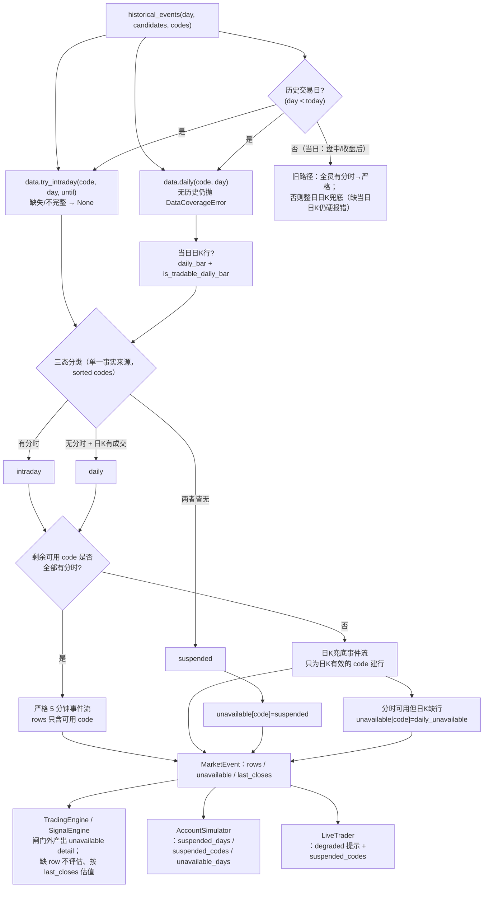
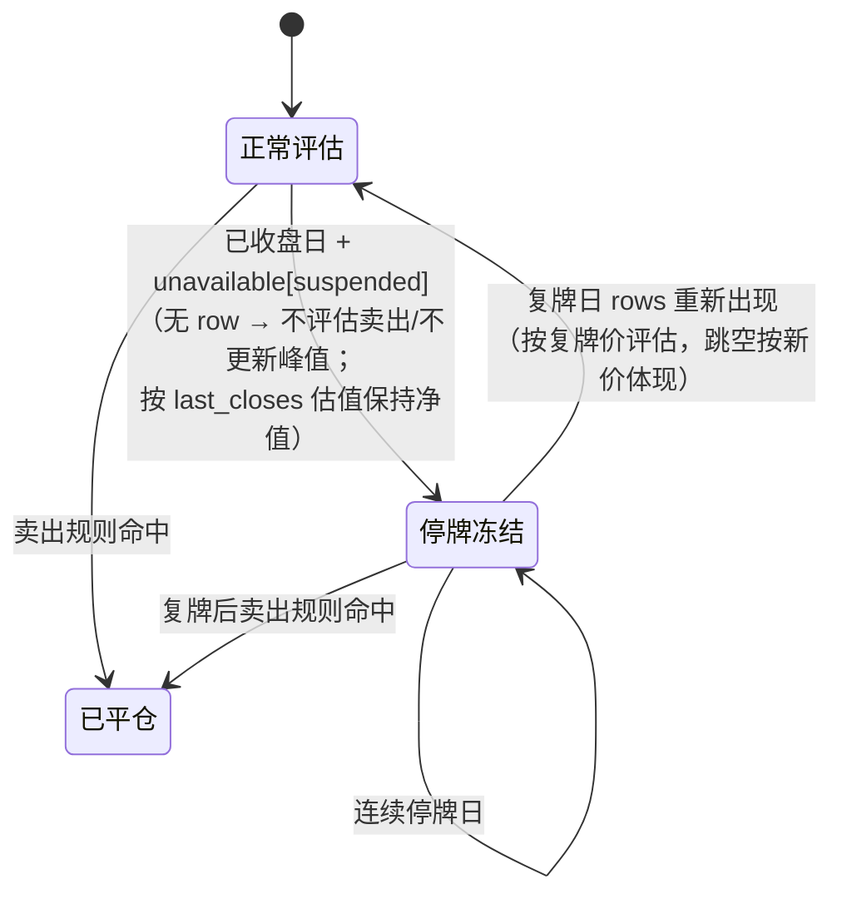
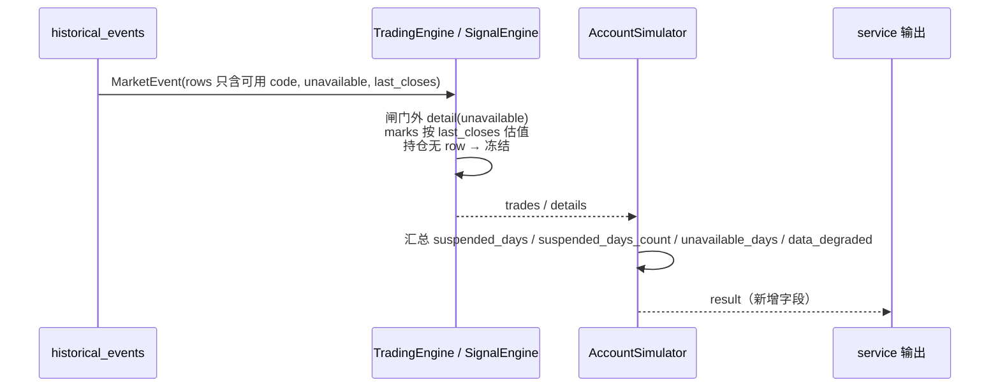

# 停牌标的按 code 跳过与标记 — 技术方案

日期：2026-10-22 · 分支：feat/reviewa-account-op · 状态：v3（第 2 轮 delta 复审：上轮全部 solved、无新增 CRITICAL/BLOCKER，按收敛规则落地 F1-F3 后进入阶段 3）
范围：阶段 2（技术方案）。阶段 0 需求已由 main 与用户确认（采用「按 code 判断当日可用性，停牌跳过并标记」，禁止合成平价K线），本文只解决「怎么落」。
触发：Web UI 回测 2026-06-26 ~ 2026-10-22 报错「2026-10-13 缺少当日日K，无法兜底回测」。
v2 修订：吸收第 1 轮 findings（1 CRITICAL / 4 MAJOR / 5 MINOR），逐条处理见 §11。
v3 修订：吸收第 2 轮新增 findings（0 CRITICAL / 1 MAJOR / 2 MINOR：日K缓存新鲜度、`buy_eval_skipped` 分支去重、`daily_unavailable` 估值口径），见 §11.1。

---

## 1. 背景与根因

### 1.1 复现证据（缓存离线，2026-10-13）

候选池走 legacy 3 日真龙并集（`fallback_reason=no_snapshot`），共 13 只。逐只检查当日数据：

| code | 当日日K | 当日5分钟K |
|------|---------|-----------|
| 其余 12 只 | 有行且有成交 | 48 根 |
| 600825 新华传媒 | **缺行**（10-12 直接跳到 10-16） | **无** |

`historical_events` 因此让整日走日K兜底，`build_daily_row` 对 600825 抛
`DataCoverageError("2026-10-13 缺少当日日K，无法兜底回测")`，整个回测中断。
基线确认：`.venv/bin/python -m unittest discover -s tests -q` → 894 tests OK；离线脚本同样复现 `AccountSimulator.run("2026-10-09","2026-10-19")` 抛同一异常。

### 1.2 根因定位

| 位置 | 现状 |
|------|------|
| `review_account/data.py::historical_events` | 只按「是否全员有 5 分钟K」二选一：全有 → 严格分时；否则整日降级日K兜底。**没有按 code 判断当日是否可交易** |
| `review_account/data.py::_daily_events` | 对 `codes` 中每一只无条件调用 `build_daily_row` |
| `review_account/market.py::build_daily_row` | 当日日K缺行即抛 `DataCoverageError`，无「停牌」概念 |
| `review_account/models.py::MarketEvent` | 只有 `rows`，没有「本事件哪些 code 不可用及原因」的载体 |

结论：**数据不可用（停牌）与数据口径故障（预热不足/无效 OHLC）被同一条异常路径处理**。停牌是可预期的正常市场状态，应当跳过并标记；口径故障必须继续硬报错。

---

## 2. 本文补充决策（需求未明确处的落地口径）

| # | 决策 | 理由 |
|---|------|------|
| D1 | 停牌判定 = 「当日日K缺行」**或**「当日日K `volume<=0 且 amount<=0`」**且**「当日无可用 5 分钟K」，**且仅对已收盘交易日生效**（D13） | 用户确认口径；三分支对称（分时可用即视为可交易） |
| D2 | 三态分类：`intraday`（有完整分时）/ `daily`（无分时但日K有效）/ `suspended`（两者皆无）。分类在 `historical_events` 内做一次，作为**单一事实来源**；全程 `sorted(codes)` 保证顺序可复现 | 避免 engine/simulator/trader 三处重复判断 |
| D3 | 剔除停牌 code **之后**再判断「是否全员有完整分时」：只要剩下的可用 code 都有分时，就走严格 5 分钟撮合 | AC1：一只停牌股不得把整个交易日拖入日K兜底 |
| D4 | 混合日（可用 code 中有人只有日K）仍整日降级日K兜底；兜底只为**当日日K有效**的 code 建行 | 保持既有混合日语义；兜底无法为「分时可用但日K缺行」的 code 建行 |
| D5 | 「分时可用但当日日K缺行」的 code 在兜底模式下记为 `daily_unavailable`（不可用，非停牌） | 保留严格成交口径，不臆造成交价；显式标记而不是静默丢弃 |
| D6 | 停牌持仓：当日不评估卖出、不更新 mark/峰值，**按最近可得收盘价估值**（D14）；净值为「上一交易日收盘价 × 数量」口径。复牌日自动恢复评估 | 用户确认口径；D14 同时修好 live 影子净值回落成本价的问题 |
| D7 | 停牌候选：保留在 `candidates` 中，detail 输出 `reason_code=suspended` + 中文原因，**不静默消失**；detail 在买窗闸门**之外**产出（D15） | AC3 |
| D8 | 全部 code 不可用（全停牌）：产出**一条**空白占位事件（`phase="late"`，`rows={}`），不抛错；净值不变，结果带 suspended 标记 | AC6；单条事件仍能推进引擎的「换日/待成交清理」逻辑 |
| D9 | 停牌日不写 `data_quality`（沿用既有 `if event.rows:` 守卫），`data_quality` 语义仍是「是否走了日K兜底」；停牌另用 `suspended_days` + `suspended_days_count` 表达；停牌日的 HOLD/IDLE 事件 `reason_text` 改为「停牌/无行情」 | 不改既有字段语义，JSON 只增字段 |
| D10 | `MarketEvent` 新增 `unavailable: dict[code, reason]`、`last_closes: dict[code, float]`；`suspended` 为**只读 property**，从 `unavailable` 派生 | 只增不改；单一事实来源，避免双写不一致 |
| D11 | 停牌期间既有的 pending SELL 单保留；复牌后首个可执行事件按复牌价成交（可能跳空） | 与既有「信号待下一可执行事件成交」一致，不新增规则 |
| D12 | 不合成平价K线（禁止 O=H=L=C=昨收的假 bar）；不新增配置项、不新增依赖、不改 DB 表结构 | 用户约束 |
| **D13** | **停牌分类只对「历史交易日」（`day < today`）启用**；`day == today`（盘中与收盘后）一律沿用旧路径（全员分时→严格；否则整日日K兜底，缺当日日K则 `DataCoverageError` 硬报错），不产出 suspended | 修复 CRITICAL。两层原因：① 盘中当日日K尚未生成，`has_daily` 对所有 code 恒假；② `MarketData.daily()` 的缓存按**写入当日**命名空间存放且不校验新鲜度（`load_for_trade_date(key, today)` 命中即返回），同日盘中写过的缓存会缺少当日行，收盘后读到的是陈旧快照——「日K缺行」不再等价于停牌。历史日的数据由今天（>= 历史日）取回，当日行完整，判定可信 |
| **D14** | 对 `unavailable` 的 code，事件携带 `last_closes[code]` 估值价：`suspended` 取 `day` 之前最后一根日K收盘价；`daily_unavailable` 取**当日最后一根5分钟K收盘价**（数据已在 `intraday` 中，零额外 I/O）。引擎只用它初始化/保持 `marks`，**不触发任何买卖评估、不更新峰值** | live 影子账户无历史 mark，停牌持仓会回落到 `entry_price` 导致净值跳变、风控误判；回测中该值与上一交易日 mark 相同，幂等无副作用。`daily_unavailable` 当日有分时，用分时末根价估值才不抹掉真实波动 |
| **D15** | 停牌/不可用 detail 在 `step` 开头、**买窗闸门与仓位/次数限制之外**统一产出，每 code 每日一条；候选评估循环对 unavailable code 只 `continue`，不再产出 detail。**`SignalEngine` 的两处候选遍历（主买点循环 + `buy_eval_skipped` 分支）都必须先 `continue`** | 满仓（`max_positions`）、当日已买入、`sold_today`、存在 pending BUY 时买点循环整体不执行，detail 会消失，AC3 在逐只层面不成立；`buy_eval_skipped` 分支对 row=None 的 code 用 `event.timestamp` 去重，会逐帧重复 |

---

## 3. 架构设计

### 3.1 分层与单一事实来源



要点：**可用性判定只写一次**（`historical_events`），事件生成器只接收「可用 code 列表 + unavailable 映射」，不再在生成器里分叉；引擎只消费 `event.rows` / `event.unavailable` / `event.last_closes`，不重复判断数据源。

### 3.2 停牌持仓状态机



### 3.3 判定函数（伪代码，`codes` 全程 sorted）

```python
codes = sorted(codes)
if not codes:                                  # 保持既有空池行为（4 条空 rows 事件）
    yield from _daily_events(day, candidates, [], {}, {})
    return
histories = {code: data.daily(code, day) for code in codes}   # 无历史 → 仍抛错
intraday  = {code: data.try_intraday(code, day, until) for code in codes}

if not historical_day(day):                    # D13：当日（盘中/收盘后）不做停牌判定
    if all(intraday[c] is not None for c in codes):
        yield from _intraday_events(day, candidates, codes, histories, intraday, {}, {})
    else:
        # 旧路径原样保留：整日兜底；当日日K未生成 → build_daily_row 抛 DataCoverageError
        yield from _daily_events(day, candidates, codes, histories, {}, {})
    return

has_daily = {code: is_tradable_daily_bar(daily_bar(histories[code], day)) for code in codes}
unavailable = {code: SUSPENDED for code in codes
               if intraday[code] is None and not has_daily[code]}
active = [code for code in codes if code not in unavailable]
if not active:                                 # D8：全停牌
    valuations = {c: last_close(histories[c], day) for c in codes}
    yield MarketEvent(at(day, "15:00"), "late", {}, candidates,
                      unavailable=unavailable, last_closes=_clean(valuations))
    return
if any(intraday[c] is None for c in active):    # 混合日 → 整日兜底
    usable = [c for c in active if has_daily[c]]      # 非空：无分时且无日K者已判 suspended
    unavailable |= {c: DAILY_UNAVAILABLE for c in active if not has_daily[c]}
    yield from _daily_events(day, candidates, usable, histories, unavailable,
                             _valuations(day, unavailable, histories, intraday))
    return
                                     # 可用 code 全部有分时 → 严格撮合
yield from _intraday_events(day, candidates, active, histories, intraday,
                            unavailable, _valuations(day, unavailable, histories, intraday))

# _valuations(D14)：suspended → day 前最后一根日K close；
#                  daily_unavailable → 当日最后一根5分钟K close（缺则退回 last_close）
```

`usable` 为空的唯一可能是「active 中既无分时又无日K」，而这类 code 已被判 suspended 移出 active，因此混合日分支 `usable` 恒非空；实现中仍加防御性 `if not usable: raise DataCoverageError(...)`（不可达，仅防止未来改坏后静默产出空事件流）。

---

## 4. 接口与数据模型

### 4.1 `review_account/market.py`（新增纯函数，不改变既有契约）

```python
def daily_bar(history: list[KBar], day: str) -> KBar | None
    """当日日K行（无行 → None）。"""

def is_tradable_daily_bar(bar: KBar | None) -> bool
    """volume > 0 or amount > 0；None / 双零 → False（停牌/占位行）。"""

def last_close(history: list[KBar], day: str) -> float | None
    """day 之前最后一根日K的收盘价（停牌估值用；无历史 → None）。"""
```

`build_daily_row`、`build_row`、`validate_bars`、`DataCoverageError` 语义**完全不变**（继续对无历史、预热不足 <20、有成交行的无效 OHLC 抛错）。

### 4.2 `review_account/models.py`

```python
UNAVAILABLE_SUSPENDED = "suspended"              # 当日停牌（无分时且日K缺行/有价无量）
UNAVAILABLE_DAILY_MISSING = "daily_unavailable"  # 日K兜底模式下当日日K不可用
def unavailable_text(reason: str) -> str         # 中文可读原因（未知 reason 有兜底文案）

@dataclass
class MarketEvent:
    timestamp: int
    phase: str
    rows: dict[str, dict]
    candidates: list[dict] = field(default_factory=list)
    allow_buy: bool = True
    unavailable: dict[str, str] = field(default_factory=dict)   # 新增：code → reason
    last_closes: dict[str, float] = field(default_factory=dict)  # 新增：不可用 code 的估值收盘价

    @property
    def suspended(self) -> set[str]:                             # 只读派生，单一事实来源
        return {c for c, r in self.unavailable.items() if r == UNAVAILABLE_SUSPENDED}
```

现有 `MarketEvent(ts, phase, rows, candidates)` 位置构造不受影响。

### 4.3 `review_account/data.py`

- 公开签名 `historical_events(day, candidates, codes, data, until=None)` 不变。
- 新增 `historical_day(day, now=None) -> bool`：`day < today`（Asia/Shanghai）。只对历史交易日启用停牌分类；当日（含收盘后）保持旧契约（D13，缓存新鲜度原因）。
- 私有 `_intraday_events` / `_daily_events` 改为接收 `histories`、`unavailable`、`last_closes`、`active`（避免重复取数）。
- `histories_open/close` 改用 `daily_bar` 取值（行为不变）。
- `codes` 为空时保持既有 4 条空 rows 事件，避免影响空池日的事件数。

### 4.4 引擎（`review_account/engine.py`、`live_trade/signal_engine.py`）

`step` 开头（换日处理之后、pending 撮合之前）：

1. **估值**：`for code, price in event.last_closes.items(): state.marks[code] = price`（live 引擎写 `account.marks`）。已有 row 的 code 以 row 为准，不在此覆盖。估值价口径见 D14：`suspended` 用昨收（`last_close`），`daily_unavailable` 用当日最后一根 5 分钟K收盘（避免把当日真实波动抹成 0）。
2. **不可用 detail（闸门外）**：遍历 `event.candidates`，对 `code in event.unavailable` 追加一条 `reason_code=reason`、`reason_text=unavailable_text(reason)` 的 detail；用 `evaluated[f"unavailable:{code}"] >= 当日 00:00 时间戳` 去重，每 code 每日一条。优先级 unavailable > already_holding（持仓停牌时输出「停牌（持仓冻结）」而非「已持仓」）。
3. 随后的买点评估循环对 unavailable code 直接 `continue`（不再追加 detail）。**`SignalEngine` 有两处候选遍历（主买点循环 + `buy_eval_skipped` 分支），两处都先 `continue`**；`buy_eval_skipped` 分支对 `row=None` 用 `event.timestamp` 去重会逐帧重复，必须靠前置 continue 屏蔽。卖出评估循环不改：停牌 code 没有 row，天然跳过，复牌日 row 出现即恢复。
4. 买点/卖出规则本身**零改动**（共享策略不复制规则）。

detail 结构复用 `TradingEngine._detail_base`；SignalEngine 用与 `_already_holding_detail` 相同的字段形状（`code`/`name`/`rank`/`passed=false`/`reason_code`/`reason_text`/`signal={}`/`full_signal=None`/`observed_at=None`/`phase=None`/`checks=[]`）。

### 4.5 结果字段（JSON 只增）

`AccountSimulator._result` 新增：

| 字段 | 类型 | 语义 |
|------|------|------|
| `suspended_days` | `{day: [code]}` | 每个交易日被判定停牌并跳过的 code 列表 |
| `suspended_codes` | `[code]` | 全区间停牌 code 并集（排序） |
| `suspended_days_count` | `int` | 有停牌标的的交易日数（`total_days` 语义保持不变） |
| `unavailable_days` | `{day: {code: reason}}` | 非停牌但当日不可用（当前只有 `daily_unavailable`） |
| `data_degraded` | `[str]` | 人读降级提示（如 `2026-10-13 停牌跳过 1 只：600825`） |

`LiveTrader` 的 `buy` / `sell` 结果新增 `suspended_codes: [code]`、`unavailable_codes: {code: reason}`，并把停牌/不可用说明追加进既有 `degraded` 列表（`live_trade/service.py` 的 `_print_quality` 已逐条打印）。

`review_account/service.py::_print_summary` 增加一行停牌摘要与 `data_degraded` 提示（人读输出，`--json` 不受影响）。
`AccountSimulator` 在当日无成交且存在不可用 code 时，HOLD/IDLE 事件按范围改写 `reason_text`：部分不可用 →「当日 N 只停牌/无行情标的跳过，其余标的未出现可成交的新信号」；全部不可用 →「当日全部标的停牌/无行情，跳过评估」（`reason_code` 仍 `no_execution`，JSON 只增语义不变）。

### 4.6 数据流（输出侧）



---

## 5. 候选方案对比

| 方案 | 做法 | 优点 | 缺点 / 否决理由 | 结论 |
|------|------|------|----------------|------|
| **A（推荐）** | 逐 code 三态可用性分类（仅已收盘日）；停牌跳过并在事件/结果中显式标记 | 精确到 code；一只停牌不拖累整日；持仓冻结语义自然；不伪造数据；盘中路径保持旧契约 | 需给 `MarketEvent` 增加字段，引擎增加一个闸门外分支 | **采纳** |
| B（非常规） | 合成平价K线：停牌日造 `O=H=L=C=昨收, volume=0` 的 bar | 实现最短，全链路零分支，指标连续 | **用户明令禁止**。伪造市场数据：会进入涨跌幅/振幅/MA5 等指标，可能误触发买点或卖出规则；回测结果不可信；违反「不得静默吞错」 | 否决 |
| C | 在候选池层（`collect_candidates_ex`）剔除停牌 code，持仓层另做冻结 | 改动集中在选股层 | 持仓也可能停牌，候选池过滤覆盖不到；且违反 AC3（停牌候选静默消失，无法解释「为什么今天没买」） | 否决 |
| D（非常规，规模化） | 建「交易日历 × code 可交易性」索引或停牌台账（落库/缓存），回测时查表 | 多月回测少一次逐日判定；可复用为数据质量台账 | 引入新表/缓存与失效同步问题，本次单点缺陷不需要；违反「不新增 DB 表结构」约束。可作为后续 M2 观察项 | 本次不采纳 |

**推荐 A 的理由**：改动面最小且语义最诚实——「没有成交数据」就按没有数据处理，不制造数据；异常路径（口径故障）与正常市场状态（停牌）从此分流。设计上采用**显式状态分类 + 事件携带不可用清单**（表驱动分派），而不是在三个消费方各写一遍条件；同时不引入策略类层次，遵循项目「优先简单」的约束。

### 5.1 设计模式说明（动机，不为炫技）

- **状态分类器（表驱动分派）**：三态分类只出现在 `historical_events` 一处，消费方只按 `rows` / `unavailable` / `last_closes` 行动，消除重复判断（单一事实来源）。
- **模板方法**：严格分时与日K兜底两条事件流骨架不变，只把「可用 code 集合 + 不可用清单」作为参数注入，规则不在生成器内分叉。
- **空对象替代（占位事件）**：全不可用日以一条空 rows 事件代替「无事件」，让引擎的换日/待成交清理逻辑保持运行，避免特判「今天没有事件」。
- 不引入 Strategy 类层次封装「可用性策略」——当前只有一条规则，抽象成本高于收益。

---

## 6. 错误处理策略

| 场景 | 行为 |
|------|------|
| code 完全无日K历史（provider 返回空） | 仍抛 `DataCoverageError`（严格契约不变；离线验收脚本先断言缓存存在，区分「缓存缺失」与「停牌逻辑失效」） |
| 预热不足（<20 根） | 仍抛 `DataCoverageError`（仅对需要建行的可用 code；停牌 code 不建行、不校验预热） |
| 有成交日K行的无效 OHLC | 仍抛 `DataCoverageError` |
| 已收盘日：当日日K缺行 / 有价无量 + 无分时 | 判定停牌，跳过并标记；不抛 |
| 已收盘日：分时缺失/不完整且日K有效 | 既有行为：整日日K兜底 |
| `day == today`（盘中或收盘后）：任一 code 缺分时 | **不做停牌判定**，沿用旧路径（整日兜底；当日日K未生成 → `DataCoverageError` 硬报错，保持可见失败） |
| `day == today` 且日K缓存是同日盘中写入（缺当日行） | 不参与停牌判定（D13）。`MarketData.daily` 的缓存按写入当日命名空间存放、不校验新鲜度；历史日（`day < today`）的数据由今天取回，当日行完整，判定不受影响 |
| 全部 code 停牌 | 单条占位事件，不抛；净值不变；`suspended_days`/`suspended_days_count` 有记录 |
| 停牌候选 | detail（闸门外，每 code 每日一条）`reason_code=suspended`，`reason_text` 含中文原因 |
| 停牌持仓 | 不评估、不更新峰值；`marks` 按 `last_closes` 保持上一交易日收盘估值；复牌恢复 |
| 停牌期间 pending SELL | 保留；复牌首个可执行事件按复牌价成交 |
| 跨日/未来数据 | 判定只读当日日K行与当日已完成分时，无未来数据 |

**禁止**：把停牌并入 `DataCoverageError` 吞掉（会掩盖数据源故障）；也禁止对停牌 code 生成任何 K 线；禁止在盘中把分时缺失静默改写为停牌。

---

## 7. 测试策略

新增 `tests/test_suspended.py`（复用 `tests/test_review_account.py` 的 `FakeData` / `bars` / `history` 基建），并在既有文件中按需补充：

| 用例 | 覆盖 |
|------|------|
| 已收盘日：停牌候选混在正常候选中 → 严格分时路径、rows 不含该 code、`suspended` 含该 code、其余 code 正常撮合 | AC1 / D3 |
| 停牌候选 detail 输出 `suspended` + 中文原因，每 code 每日只一条；**仓位已满 / 当日买入次数已满 / 存在 pending BUY 时仍输出** | AC3 / D15 |
| 日K `volume=0 且 amount=0` + 无分时 → suspended（不建行、不抛） | AC4 |
| 停牌持仓：当日无成交、snapshot equity 与上一日相同、mark/峰值不变；复牌日按复牌价评估并触发卖出 | AC2 / D6 |
| live 侧停牌持仓：影子账户无 mark 时按 `last_closes` 估值（不回落 entry_price），风控 equity 口径正确 | AC2 / D14 |
| 停牌前挂出的 pending SELL 在复牌首个可执行事件按复牌价成交 | D11 |
| 全部 code 停牌 → 不抛错、当日 equity 不变、`suspended_days`/`suspended_days_count` 有记录、HOLD 事件文案为停牌 | AC6 / D9 |
| 正常日事件流与改造前全等：断言 `(timestamp, phase, tuple(sorted(rows)))` 序列与 `1 + 2 * len(bar_times(DAY))` 帧数（不写魔数） | AC5 |
| 当日（`day == today`，`historical_day=False`）：某 code 无分时、当日无日K → **不得出现 suspended**，并保留旧路径硬报错 | AC7 / D13 |
| 当日 + 全员分时可用 + 当日日K全局缺失（`until` 部分回放）→ 严格路径正常回放 | AC7 |
| 同日缓存陈旧（当日盘中写入、缺当日行）→ `day == today` 仍不判停牌（即使 `has_daily=False`） | D13 / F1 |
| `daily_unavailable` 的估值取当日最后一根 5 分钟K收盘（不是昨收） | D14 / F3 |
| `SignalEngine` 空仓 + 组合风控闸门（`buy_eval_skipped` 分支）下，停牌候选每日只产出一条 detail | D15 / F2 |
| 混合日：A 只有分时（日K缺行）、B 只有日K → 整日兜底，A 标 `daily_unavailable` | D4 / D5 |
| `LiveTrader.buy` 含停牌候选 → `suspended_codes` + `degraded` 提示；`sell` 对停牌持仓不产出卖出、持有列表保留 | AC2 / AC3（实盘侧） |
| 既有 894 tests 全量通过 | AC5 / AC8 |

自测证据（阶段 3 交付时附）：
1. `tests/test_suspended.py` + 相关既有测试；
2. `.venv/bin/python -m unittest discover -s tests -q` 全量；
3. 缓存离线脚本：先断言 `SH000001` 与 600825 日K缓存存在，再验证 `historical_events("2026-10-13", ...)` 不抛错且 `suspended == {"600825"}`；`AccountSimulator(...).run("2026-10-09", "2026-10-19")` 可推进。

---

## 8. 已知风险与缓解

| # | 风险 | 缓解 |
|---|------|------|
| R1 | 停牌期 mark 沿用上一交易日收盘，停牌期收益/回撤被「平滑」，复牌跳空在复牌日一次性体现 | 用户确认口径；结果显式输出 `suspended_days`/`suspended_codes`，避免把平滑误读为低波动 |
| R2 | 数据源把停牌日写成 `volume>0` 的脏行 → 漏判，当日按日K兜底以假价格成交 | 判定条件已覆盖「无行」与「双零行」；漏判时仍受既有 `data_quality=daily_fallback` 标注，便于复核 |
| R3 | 分时可用但当日日K缺行、且当日需要日K兜底 → 该 code 当日不可用 | 标 `daily_unavailable` 并进入 `unavailable_days`/`degraded`；盘中正常形态（全员有分时）不受影响 |
| R4 | 长期停牌复牌后预热不足（<20 根）仍会硬报错 | 保持严格契约（用户约束）；列为后续观察项，不在本次放宽 |
| R5 | 停牌前挂出的 pending SELL 在复牌首个可执行事件按复牌价成交 | 与既有「下一可执行事件成交」一致；方案显式记录，如后续需要「停牌前信号失效」另立需求 |
| R6 | 停牌 code 不参与 `build_row`/`build_daily_row`，其预热/OHLC 不做校验 | 该 code 当日不参与任何评估，校验无意义；复牌日重新走完整校验 |
| **R7** | `day == today` 发生真实停牌时（盘中或收盘后），旧路径仍会因缺当日日K而硬报错 | D13 的取舍：宁可可见失败，也不静默冻结。停牌场景的回测/历史回放完整支持；若需要「当日收盘后也判停牌」，先给日K缓存加「写于当日收盘后」的新鲜度校验，列为后续里程碑 |
| **R10** | 日K缓存按写入当日命名空间存放且不校验新鲜度，同日盘中写入的缓存缺当日行 | D13 只对 `day < today` 启用停牌分类，历史日数据由今天取回、当日行完整；归档于 R7 的后续里程碑（缓存新鲜度校验） |
| **R8** | 停牌估值用「最近可得收盘价」，与真实可成交价（复牌跳空）存在差异 | 仅用于净值/风控口径，不用于成交；复牌日按复牌价重新评估并在结果中可见 |
| **R9** | `last_closes` 依赖日K缓存/返回完整；无历史时该 code 仍回落 `entry_price` 估值 | 无历史本身已触发 `DataCoverageError`（严格契约），不会走到估值分支 |

---

## 9. 非目标

- 除权/复权口径缺口（另一类数据问题）。
- 退市、长期停牌新股的预热策略。
- Web UI 前端新增停牌面板（本次只保证 JSON/CLI 字段可读；前端继续读既有字段）。
- 新增配置开关、DB 表结构、依赖。
- 合成任何停牌日 K 线。

---

## 10. 验收映射与文档同步点

| AC | 落点 | 验证 |
|----|------|------|
| AC1 | `data.historical_events` 三态分类 + 剔除后再判分时 | 离线 2026-10-13 脚本 + 单测 |
| AC2 | 引擎缺 row 即不评估；`last_closes` 估值；复牌恢复 | 模拟器多日单测 + live 影子单测 |
| AC3 | 闸门外 `unavailable` detail；候选保留 | 单测断言 detail reason / 满仓场景 |
| AC4 | `market.is_tradable_daily_bar` | 单测（双零行 + 无分时） |
| AC5 | 正常日路径不变 | 事件序列全等断言 + 全量测试 |
| AC6 | 全不可用占位事件 | 模拟器单测 |
| AC7 | 当日（`day == today`）不做停牌判定；严格路径只要求分时 | `historical_day` 单测 + `until` 部分回放单测 |
| AC8 | 新增 `tests/test_suspended.py` | 全量测试 |
| AC9 | 文档同步（精确锚点见下） | 文档 diff |
| AC10 | 无新依赖/无 schema/JSON 只增 | 代码审查 + diff |

**文档同步点（AC9，强制同一 commit）**：

1. `README.md`「账户级模拟交易」段：把「日K本身缺失或预热不足仍报错、不保存部分回测；停牌/除权口径缺口需先解决。」改为当前行为（历史交易日停牌跳过并标记、当日不做停牌分类、结果字段 `suspended_days`/`suspended_codes`/`suspended_days_count`/`unavailable_days`/`data_degraded`）。
2. `AGENTS.md`「账户级模拟交易」的数据分级 bullet（现「任一缺失 → 整日**日K兜底**……日K本身缺失/预热不足/无效OHLC仍报 DataCoverageError」）补停牌口径与新增字段。
3. `AGENTS.md`「实盘辅助交易」的数据分级 bullet（现「任一分时缺失即整日走日K兜底」）补「盘中不判停牌、收盘后停牌跳过 + degraded」。
4. `dragon_quant/review_account/STRATEGY.md` §5 一致性表「数据分级」行与相关说明：补「已收盘日三态分类 / 停牌冻结 + last_closes 估值 / 盘中保持旧契约」。

---

## 11. 第 1 轮 findings 处理（v2 修订记录）

| finding | severity | 处理 |
|---------|----------|------|
| 盘中 `has_daily` 恒假 → 分时缺失被误判停牌并静默冻结 | CRITICAL | **D13**：停牌分类仅对已收盘交易日启用；盘中任一缺分时沿用旧路径（缺当日日K则硬报错）。补 §7 两条盘中用例（含「不得出现 suspended」断言） |
| live 影子净值缺 mark，停牌持仓回落 `entry_price`，风控误判 | MAJOR | **D14**：事件携带 `last_closes`，两引擎仅用于 `marks` 估值；补 live 影子单测与 R8/R9 |
| 停牌 detail 在买窗闸门内，满仓/已买入/已卖出时消失 | MAJOR | **D15**：detail 提到 `step` 开头闸门外产出，候选循环只 `continue`；补满仓/pending 场景单测 |
| 混合日「零可用 code」分支未定义 | MAJOR | 结构性消除：无分时且无日K者必为 suspended 移出 active，混合日 `usable` 恒非空；实现加防御性 `DataCoverageError`（不可达），§3.3 说明 |
| 测试遗漏 4 个关键回归 + 「98 帧」疑似错误 | MAJOR | §7 补 4 条用例；帧数改为 `1 + 2 * len(bar_times(DAY))` 推导 + 事件序列全等断言 |
| `unavailable` 与可写 `suspended` 双事实来源 | MINOR | `suspended` 改为只读 property（D10），不设字段 |
| `total_days` 语义漂移、停牌日 HOLD 文案不符 | MINOR | 新增 `suspended_days_count`；停牌日 HOLD/IDLE `reason_text` 改为停牌说明（D9） |
| 伪代码用裸 set 迭代，rows 顺序不可控 | MINOR | 分类与事件生成全程 `sorted(codes)`（D2/§3.3），测试断言 rows 键顺序 |
| `data.daily` 严格抛错与离线脚本脆弱 | MINOR | §6 明确「provider 返回空才是数据源故障」；验收脚本先断言缓存存在，区分缓存缺失与逻辑失效 |
| 文档同步缺精确锚点、风险表缺两项 | MINOR | §10 列出 4 个精确同步点；§8 新增 R7/R8/R9 |

### 11.1 第 2 轮（delta）findings 处理（v3）

第 2 轮复审确认上轮 10 条 findings **全部 resolved**，仅新增 1 MAJOR + 2 MINOR，无新增 CRITICAL/BLOCKER；按「提前收敛」规则（上轮全部解决且无新增 CRITICAL/BLOCKER → 视为通过）落地以下修订后进入阶段 3。

| finding | severity | 处理 |
|---------|----------|------|
| F1：日K缓存按写入当日命名空间存放、不校验新鲜度，同日盘中写入的缓存缺当日行，「日K缺行」不再等价于停牌 | MAJOR | **D13 收窄为「只对 `day < today` 启用停牌分类」**（采用复审建议的保守方案 b）：当日（盘中与收盘后）一律旧路径，缺当日日K硬报错；历史日数据由今天取回、当日行完整。新增 §8 R10，并修正 R7 与 §6 错误表 |
| F2：`SignalEngine` 的 `buy_eval_skipped` 分支对 row=None 逐帧重复产出 detail | MINOR | D15 明确「两处候选遍历都先 `continue`」；§4.4 第 3 条与 §7 补对应断言 |
| F3：`daily_unavailable` 当日有分时，用昨收估值会抹掉真实波动 | MINOR | D14 改为按 reason 分口径估值：`suspended` → 昨收，`daily_unavailable` → 当日最后一根 5 分钟K收盘；§3.3 增 `_valuations`；§7 补断言 |
