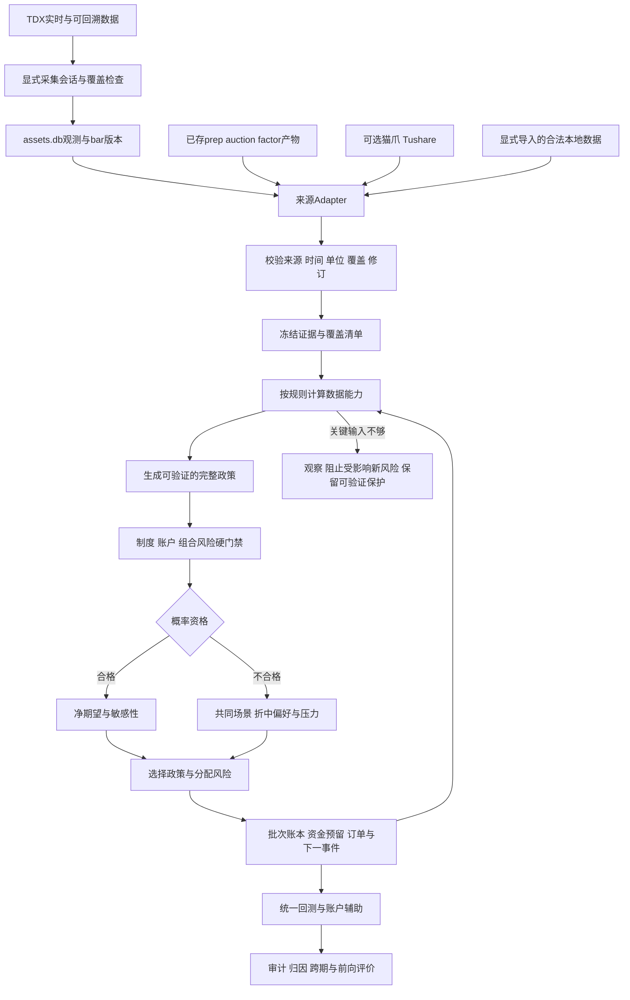
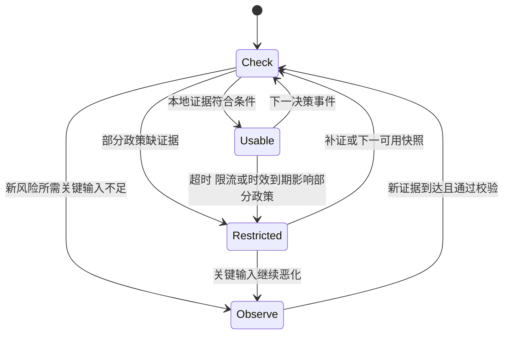
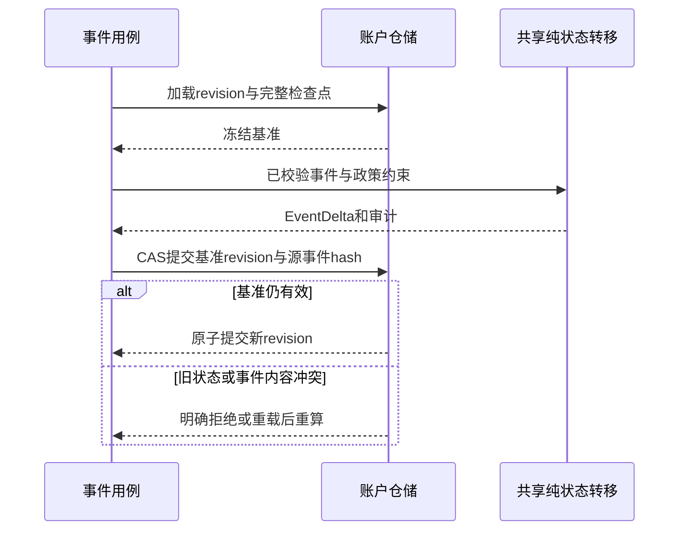
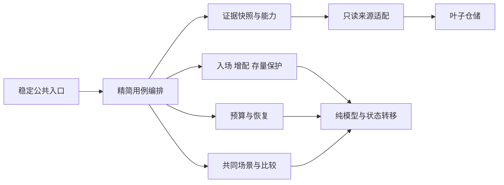

# BS 账户决策系统技术方案（完整首版，含无 API Key 降级）

日期：2026-11-18；基线：3e3daeb；状态：实施中（用户已授权后续工作流）。W0–W2返工方向与独立审查已核对，W3账本实现中（含审查警告修正），W4–W5开放；首版尚未完成。本文件收敛前两轮框架与数据调研。

## 1. 已确认目标与边界

需求依据：[BS 策略指导纲领](bs策略.md)（原路径：项目根目录 `bs策略.md`）。目标是账户层面减少严重亏损和回撤、增加净收益并保留盈利右尾，不承诺所有环境同时改善。完整覆盖 G1–G8：绝对资格、备选入场、试探增配、逻辑失效、趋势与回吐、组合风险、持有换仓、收缩恢复。

用户决定：

- 数据取证顺序：现有tmdx → stock-ana → 互联网；**TDX持续采集与本地历史积累是主路线**，新增收费源只作可选旧历史补数，不要求用户先买账号。
- **完整能力齐备才算首版**；可分内部工作包，不以单票策略或缺组合/加仓的版本交差。
- 成交无法被当前模型支持时按未成交处理，显示执行受限并做压力测试；不要求逐单队列级还原。
- 前序仅授权方案；最新已授权Claude实现/测试/自审与main验收，外部副作用边界见第14节。

非目标：自动券商下单；复现真实委托队列；用收益承诺代替检验；让新策略接管旧仓；改变现有buy-all产品语义；默认切换现行交易规则。

**关键区分**：工程模块完整、某次数据能用、策略效果得到验证是三件事。无key降级是首版必须完整实现的行为，不是把付费数据缺口或长期证据不足算成通过。首版仍须覆盖全部G项，并在真实可得证据范围内完成约定验证；无法验证的目标继续列未完成。

## 2. 已证实现状与取舍

| 事实域 | 本地证据 | 对方案的约束 |
|---|---|---|
| 策略与运行时 | `review_account/strategy/{buy,sell,risk,execution,runtime}.py`；`STRATEGY.md` | 复用四类买点、卖出链、已有ATR/风险预算和冻结归属，不重建交易平台 |
| 账户表达力 | `engine.py:step/_fill/_account_dict`；`models.py:Position`；`strategy_sdk/types.py` | 当前拒绝加仓、卖后当天禁买、单entry_date、有限上下文；需新协议和批次账本，插件不能独立完成 |
| 研究 | `review_account/experiments.py`、`evaluation.py`、`research/stats.py` | 复用冻结输入、对照与指标；固定参数分窗不冒充完整滚动训练 |
| 数据 | `review_account/data.py`、`infra/provider/tdx.py`；本机tmdx3.0.1 | 账户旧链默认雪球；新BS链另做TDX不复权/历史定位/错误语义适配，不能直接把现有provider互换 |
| 降级纪律 | `prep/review/gates.py`；`docs/agent/premarket.md` | unknown不等于blocked、不补零；盘前只读不触发采集；不因数据缺失取消已有保护 |

上一轮真实TDX探测：三个股票五分钟offset10000有2026-01-07记录；历史成交响应头确认2025-01-15日期。只是覆盖样本，不保证全量。MAC分钟默认时间实测已为右端时刻，设置end出现二次平移；新适配须核验，禁止盲目加周期。本机取证JSON位于 `/private/tmp/dq-bs-research-20261118/`，不作为实现运行时依赖；以下结论均可在隔离环境重新验证。

stock-ana：已有分页排序经验及11份小样本缓存；主配置指向的数据库文件当前不存在。历史竞价与主题接口仅完成文档核查，没有鉴权验证。外部事实出处见第13节。

候选路径：

| 方向 | 好处 | 代价与结论 |
|---|---|---|
| A 强制两个key，无key全局拒绝 | 简化数据前置条件 | 强绑外部费用，丢掉TDX/本地已足够的机会，不采用 |
| B 无key静默退回旧策略/用代理字段替代 | 表面上始终有结果 | 改变策略、污染对照与风险边界，不采用 |
| C 同一完整内核，按规则需要的数据限制动作 | 无key可正常使用，缺证据不伪造 | 需要显式能力表、可用时点、动作门禁与对照分组；**推荐** |

## 3. 架构与模块归属

沿用 `cli → commands → review_account公共门面 → 用例 → strategy/engine`；研究走既有 `research → review_account`，Web通过门面取投影。新职责放现有模块内，实际文件名为本方案建议，实施前依框架定稿，不创建根级bs包。



| 落点 | 承担职责与依赖 |
|---|---|
| `infra/provider/tdx.py`及相邻provider | 公共原始行情适配；如引入付费provider，仍在此层隔离鉴权与限流。不依赖交易策略 |
| `data_capture/`（新增公共采集能力） | 观察计划、调度会话、注册采集器、数据覆盖；经provider和assets公共接口，不依赖交易评分 |
| `infra/assets/schema.py`及observations仓储职责文件 | 原始观测/bar版本/计划与采集报告；不import采集器/provider/因子业务 |
| `review_account/data.py`及同模块证据职责文件 | 事件时间/复权/历史定位适配，EvidenceSnapshot与能力选择；不把源错误吞成停牌 |
| `review_account/strategy/` | 资格、PolicyPlan、场景比较、预算和恢复，纯计算；不读key或I/O |
| `models.py/engine.py/strategy/execution.py` | 分批持仓、账户状态、订单与成交记账、系统不变量 |
| `strategy/runtime.py/strategy_sdk/types.py` | 版本化账户政策扩展、只读上下文、冻结身份；旧协议保留 |
| `review_account/storage.py`及只读仓储接口 | 新记录持久化与旧记录读取兼容；不反向import因子 |
| `experiments.py/evaluation.py/research/` | 冻结对照、覆盖、成熟标签、效果指标与归因 |
| 现有CLI/Web入口与presenter | 能力、限制、原因与补证入口；不复制业务判断 |

模式：**Adapter**处理TDX/可选HTTP源/导入数据的时间与字段差异；**Strategy**隔离EV与场景偏好两种比较器；退出沿用责任链。数据能力用显式表和纯函数检查，不造通用规则DSL、依赖注入容器或万能状态平台。

因子层只经既有可用时点接口供给数据；不让 `infra.factor` import策略，不让存储import因子。跨模块取数使用公共门面，避免循环依赖。现有`premarket`只读边界保持；BS取数由自己的显式用例承担。

## 4. 数据契约：能力不等于持有key

建议的数据对象（均为版本化普通结构，不要求每个对象一类一文件）：

| 对象 | 关键字段与语义 |
|---|---|
| `EvidenceSnapshot` | snapshot_id、cutoff、source_manifest、facts、coverage、content_hash、schema_version；原始证据可追溯 |
| `EvidenceFact` | capability、code/market、event_time、bar_interval、received_at、available_at、valid_until、revision、units、value、quality；无值不补零 |
| `EvidenceNeed` | rule_id、required_capabilities、scope、granularity、时效与时点条件；入场/增配/退出分别声明 |
| `CapabilityCheck` | usable/missing/stale/invalid/future/unverified；附覆盖范围、原因、来源和实际受影响动作 |
| `PolicyPlan` | plan_id、起始账户、后续触发/取消/证伪、风险/资金、证据依赖、退出受阻处理、冻结版本 |
| `DecisionRecord` | timestamp、snapshot_id、policy_version、required/used/missing、rejected_plans、action_limits、selected_plan、reason_codes |

能力至少分：daily_bars、intraday_bars、auction_final、auction_path、market_context、theme_membership、account_state、tradability、probability_sample。每项按代码/日期/粒度判断，不能因一个字段可用就判全市场可用。

来源状态另记 `disabled/missing_key/auth_failed/permission_denied/rate_limited/unavailable/ready`，不与数据能力混成一个状态。例如：key缺失，但已存历史竞价完整且时点合格，auction_path依然可用；key存在但空结果或只有半页则不可用。

PIT规则：数据必须满足该用途的信息可得条件。后下载的历史K可作标明性质的历史重建；不能把received_at改成过去日期。公开价格历史重建与当时已采集快照分开记证据等级；历史修订、成员归属或专有模型值首次可用时间未知时，不凭trade_date伪造available_at。需要严格PIT的结论不能用不合格重建数据证明。

## 5. 无key的默认降级协议

### 5.1 决策顺序

1. 先取本轮允许的本地有效快照/冻结数据；有无key不影响合法缓存的可用性。
2. 显式取数用例才可访问数据源。key未配置时跳过相应provider构造和网络探测；不注册、不登录、不弹强制购买流程、不自动使用stock-ana凭证。
3. TDX与既有合格免费/本地产物能满足同一能力时复用；不得把同名字段视为语义相同。收费源关闭时也不影响已有数据读取。
4. 对每条政策逐项检查需要的数据；只剔除或限制受影响的政策，记录原始候选，禁止删去缺数据样本后宣称全覆盖。
5. 剩余政策仍通过相同账户/风险/成交门禁。无合格新增政策时输出等待/观察，已有仓不自动清空。

数据采集配置按provider设enabled与key引用：没有key时不请求；显式disabled即使有key也不请求。执行和只读查看只消费已准备数据，不因存在key自动联网。取数预算来源于本机配置的账号权益；不把供应商默认套餐当本账号权限。

### 5.2 具体能力矩阵

| 缺口 | 无key时允许的行为 | 禁止的替代/限制的结论 |
|---|---|---|
| 猫爪历史竞价过程 | 用合格已存过程；否则停用依赖竞价变化的政策。仅在开盘后独立买点和所需证据成立时比较进入/等待 | 不用开盘价/竞价终态冒充过程；不开盘前确认买入；不宣称历史过程规则已验证 |
| 只有当日竞价过程，无可确认终态 | 可描述已知过程，等待终态/开盘后独立条件；记录尚未完成 | 不把09:24:57当09:25最终成交；不擅自放行既有auction资格闸门 |
| Tushare历史题材成员 | 优先用已存当时归属；新数据可由TDX当前归属显式留存，从采集时点向后建立历史 | 不拿今天成员回填过去，不用行业表冒充完整题材历史 |
| 当前部分持仓/候选题材不明 | 纳入共同未知风险组，按完全共振的保守压力处理；已知主题仍逐项检查。未知风险同时计入每个可能重叠的已知主题上限；总预算/未知组额度不够就禁止新增或增配 | 不把未知当独立分散；不因行业不同就假设无共振；不自创更高预算 |
| 没有有效概率样本 | 走场景偏好通道、展示ρ敏感性和概率资格不足 | 不填通用胜率，不把H写成EV；若场景损失本身也无法估计则不新增风险 |
| 分钟行情不足、日K存在 | 对本身按日频定义的研究单列输出；仍可估值和做可计算的压力分析 | 不证明/执行依赖分钟的入场、增配或退出；新BS不继承旧日K补盘中成交的近似 |
| 风险预算、现金、持仓或可卖批次缺失 | 允许无账户的证据报告/研究；有完整模拟初始条件才可跑模拟账户 | 不输出真实账户仓位或伪造成交；实际账户模式阻止受影响动作 |
| 必要行情/可交易状态缺失 | 保持未成交、冻结受影响新风险，估值标过期/不可用，继续检查其余可验证持仓 | 不零价清仓、不静默按成本估值；不能以过期权益支持加仓 |

免费模式的损失必须披露：可检验历史更短、依赖竞价过程的机会减少、未知主题限制可能压低暴露；不称与增强数据模式等价。免费路径能逐步靠真实前向积累补证，但积累完成前不能宣称历史已齐全。

### 5.3 动作上限与已有仓保护

`最终动作 = 原政策可执行动作 ∩ 数据允许动作 ∩ 制度约束 ∩ 账户/组合风险额度`。

- 缺增强字段不会自动禁掉全部策略；但其他必需闸门未通过时，不能因“免费模式”绕开。
- **入场/增配**增加风险，必须具备其所需的行情、场景压力、预算和可交易证据。
- **持有**不等于零风险：存量风险继续计入组合预算；无法可靠估值时账户权益标不可用，禁用依赖它的增配与恢复。
- **减仓/退出**不能仅因增强源掉线停用；已有可验证价格、批次可卖量和冻结保护规则足够时继续执行。若连报价/卖量都不可信，只记录待处理风险，不能伪造成交。
- 既有仓位按开仓冻结策略和归属退出；新BS方案不能暗改旧仓规则。新仓政策事前定义其证据缺失保护路径。
- 数据缺失不强制全退；恢复后也不自动恢复最大风险。满足新鲜度、覆盖、预算与原计划恢复条件才允许新增风险。

## 5.4 主路线调整：TDX持续采集与历史留存

### 决定与现有基础

按用户补充，**本地持续采集/持久化是无key模式的主路线**，不再把历史接口缺失直接映射为长期停用；猫爪/Tushare降为可选的旧历史补数或交叉核对源。今日采集从今日逐步建立可审计历史，不能逆向补造过去没有留下的证据。

这不是从零建竞价表。现有 `auction_assets` 已按(trade_date,code)保存TDX竞价items与quote；`auction_snapshots`保存算法结果；`prep_assets`已有多类原始数据。`auction.collect.run_auction`命中当日快照会直接返回，`save_auction_asset`会同日UPSERT覆盖。因此不能简单每分钟调用旧auction命令或把“最后一版每日资产”当作完整时点观测史。旧表继续作兼容产物，新增采集观测层保留观测时间与修订。

来源：已读 `docs/agent/prep-auction.md`、`assets.md`、`infra/assets/ASSETS_ARCHITECTURE.md`、`schema.py`、`db.py:save_auction_asset`、`auction/collect.py:run_auction`。架构文档有“同步仍M1”等旧描述，当前代码已有全表同步注册，以代码和assets owner文档为准，本方案不据旧状态重建同步系统；实施时同步修正对应文档冲突。

### 采集母集：先登记，再观察，结果不能反选

每天盘前冻结观察计划，默认覆盖**当时已知的最近5个真实交易日全部龙头记录、T-1 prep全部review_candidates（包括0/null/被过滤项）、已有持仓与仍待成熟的历史观察标的**。从既有数据中登记，不新增选股评分；记录池源、scan_id/快照版本、首次获知/入池时间、纳入原因及覆盖缺口。

这里的“全部”指该研究母集内所有记录，不宣称全市场。原始scan/prep在上游已截断的候选，不会因本采集器而凭空补齐；截断范围也须记录。若研究以后要评价上游筛选本身，必须另扩事前对照母集并声明口径变化。

- 当天盘后才入选的龙头，从实际入选时刻纳入，最迟进入下一交易日竞价计划；不能事后算作当天9:15已观察。
- 盘中新增标的追加一个计划修订，保留首次获知时间，不能回写盘前母集。
- 不因没买、跌了、退出推荐就立刻停止跟踪；按事前评价期限持续到相关买卖/退出后标签成熟，再退役。历史持有期未结束继续跟踪，不用未来表现决定保留谁。
- 资源不足时明确哪些代码/时槽漏采；优先存量保护和临到期不可补数据，但不能把未采标的从母集删除或把任务标全覆盖成功。

### 数据目录：保存有明确消费者的原始事实

“可能用到的数据”落实为首版注册清单，注册项必须注明消费者、母集、粒度、时间窗、可回补性、原始/单位版本、完整性条件与保留期限。不是无上限地把tmdx全部接口/全市场逐笔每秒永久抓取。

| 数据类别 | 默认范围与采集安排（建议目标，非性能保证） | 持久化与用途 |
|---|---|---|
| 竞价过程 | 观察母集，默认约09:26取当日累计序列；需验证竞价内时点时启用竞价期间定期观测 | 保留原始序列/修订与每次收到时间；支撑竞价路径及未来历史回看 |
| 竞价成交终态 | 09:25后独立核查当日可信成交事实与行情字段 | 与09:24末笔虚拟匹配分开保存；终态未确认就不写ready |
| 个股分钟K | 观察母集盘中按已完成周期增量获取，盘后检查缺根；一分/五分按策略实际需要 | 原始不复权、周期区间与修订；五分钟可由已验收完整一分聚合，但标derived且不当独立证据；五分不能还原一分 |
| 日K/复权事件 | 观察母集+必要预热，盘后增量与缺口补采 | 价格执行用不复权；除权事件单独存版本，不拿今天QFQ回填旧决策 |
| 行情/盘口与交易状态 | 观察母集关键时点，实际执行辅助所需频率由预算确定 | 保存真实采样间隔、价格/档位/涨跌停/状态；离散快照不是连续盘口或本单队列 |
| 行业/概念/地区归属 | 盘前读取已知最新快照；当日首次获取与后续变化追加版本，盘后复核 | 多对多归属与观测时点；当日盘后才看到的归属不能用于当日上午 |
| 板块/指数与市场环境 | 先登记必要宽基、候选关联板块；低频全市场宽度/板块清单，盘后定稿 | 避免只用候选股假装全市场；当前列表与历史全集严格区分 |
| 计划、候选与策略版本 | 每次扫描/prep/决策发生时冻结引用 | 原因/拒绝/等待/未成交/版本留痕，不只保存成功交易 |
| 账户与成交状态 | 在账户内核既有持仓/订单/成交事务落账 | 不从TDX推断真实账户；私人资金明细仍归账户存储，不混到原始市场资产 |

高成本的全日成交记录默认仅对确需该证据的观察标的启用；未订阅就标not_collected，不声称已有逐单精度。财务/公告若被具体资格规则消费，复用现有资产并存首次可用与修订，不因“将来或许有用”全量下载无关文件。

### 时间安排与调度方式

采用**显式启用的系统调度触发 + 短采集任务/必要时的有界会话**，不让dashboard/普通import变成后台守护进程。不安装通用分布式调度平台；macOS可接launchd，Linux/Windows分别接宿主定时器；先出配置，系统安装仍需另行授权。

以下为本方案安排，而非声称当前CLI已有对应命令或供应商保证频率：

- 盘前：在竞价开始前加载交易日历、冻结母集和任务清单，建议09:10起准备；无法证明交易日时先标calendar_unknown，不能直接记休市成功。只允许已配置的日历取数补证，不自动交易。
- 竞价基础任务：默认约09:26取得当日累计序列与终态候选，09:30前只补失败/不完整项，不反复全池重抓。这可支撑实际收到之后的开盘后决策；源若已不可返回就标缺口，不承诺任意时间仍可补。
- 竞价内时点观测：当规则/研究确需09:20、09:24当时信息时，才启用建议09:14启动、09:15–09:25采样的有界会话；09:25–09:30核对终态。步长由母集大小、单请求耗时、上游采样/限流预算实测决定，不能承诺全池每3秒更新。基础任务与会话复用同一仓储和覆盖，避免双抓。
- 盘中：按需要持久化已完成分钟K、环境与行情快照，午休/休市不空转；盘中新入池从该时刻开始采。
- 盘后：完成最后已结束bar/竞价当日保留序列的补采、缺口核查及当日版本封存；既有prep仍遵守16:40门禁。不能在09:26不断对尚未结束的当天分钟数据判“收盘缺根”。
- 调度状态持久化，开机恢复只补可回补窗口；错过的不可恢复窗口标missed。周一至五不等于真实交易日；机器睡眠/断电意味着实际漏采，不能承诺定时器让离线机器采到数据。

已有 `skills/dragon-quant/references/schedule.md` 是人工安装的命令编排模板，不是已经运行的可靠采集服务。旧auction的快照短路与单日覆盖语义也不适合承担连续采集；新会话直接调用窄采集用例，不使用force循环重跑评分。

### 模块与数据模型（新增建议）

该能力有独立采集生命周期、被竞价/策略/研究共同消费，新增内聚模块 `dragon_quant/data_capture/` 是有必要的；它不属于策略评分器，也不能塞进原始存储层让存储反向依赖provider。

导航：`cli → commands/assets.py薄入口 → data_capture公共门面 → collect_once/run_session → registry中的collector → provider`；原始仓储经 `infra.assets` 公共API，策略与研究只读；命令装配层通过现有仓储取得持仓代码等依赖。`data_capture`不导入买卖评分算法，`infra.assets`不import采集器/provider/因子业务。

仓储建议在现有assets.db新增四类职责表，DDL仍集中schema.py，仓储实现放同模块observations职责文件，不能每业务模块另建一套市场历史库：

| 表职责（建议名） | 最小语义/索引 |
|---|---|
| `capture_plans` | plan_id、交易日、不可变revision、pool/source_refs、members_json（逐code首次获知/纳入原因/跟踪截止）、任务配置版本；按日/plan查询 |
| `capture_runs` | run_id、plan_id、phase、计划时槽/开始结束、lease_owner/token、deadline、逐项成功/失败/缺失及coverage；计划与时槽唯一、防重入 |
| `market_observations` | 市场/代码或范围、类型、source_event_time、received_at、首次可用时点、来源/单位/schema版本、payload与hash、修订号；按date/type/code/time/版本查询 |
| `market_bar_versions` | 市场/代码/周期/start/end、不复权OHLCV、来源、观测/可用时间、revision/hash/最终性；按code/period/interval/版本唯一，覆盖按区间查询 |

同秒数据没有源序号时，不能只用time做去重键丢掉不同内容；相同语义键且内容相同的网络重试幂等，内容不同追加修订。同一观测的重复抓取由run关联到既有内容，避免把整段累计竞价序列无变化重复存满库；归一层可增量拼接，但原始内容与当次可见版本必须可追溯。

已有auction_assets/prep_assets保持兼容的“每日可消费视图”；新的观测层才是时点历史证据。每日投影由显式物化步骤从已验收原始数据生成，只有目标日/代码所需覆盖达到才更新为更完整状态，后一次失败不能抹掉先前健康数据。旧created_at是最后刷新时间，不能冒充首见时点。已有factor_sector_snapshots只作派生引用，不让存储反向import因子，也不把其可覆盖行当不可变观测史。

### 接口与状态

采集器统一输入 `CaptureRequest(plan_id, topic, scope, window, cutoff, cursor, request_budget)`，输出 `CaptureResult(raw_records, source_times, next_cursor, observed_at, expected_scope, actual_scope, errors)`；不直接返回“股票值得买”。装配时使用Registry选择竞价/分钟/归属等Collector，Adapter隔离来源字段；没有单一消费者的假想通用DSL。

运行项状态 planned/running/partial/complete/missed/failed/skipped；skipped必须带合法原因（非交易日已证明/该阶段未到等），缺key不是整个任务成功的理由。`complete`只说明该计划范围的数据要求达到，不等于全市场覆盖、标签成熟或策略有效。写入成功、源响应完整、池覆盖完整、可得时点合格分别记录。

“数据未变”和“没采到”分开；一次成功最后一页不代表前面页无缺口。源返回空、transport错误、停牌、窗口没结束、源不支持历史分别分流。容量不足/超时/机器离线的缺口按日期+代码+topic+interval进入覆盖清单。

同一数据根同一时槽使用跨进程租约和递增fencing token：BEGIN IMMEDIATE只做短原子抢占/续租/提交，网络请求在事务外；过期worker提交须校验token后拒绝，避免恢复后旧worker覆盖新状态。任务超时、重启、手工重跑幂等，不能只靠单进程threading.Lock。

### 可回补性与PIT

- TDX当日累计竞价若仍可返回，可于当日补存，但记录为same_day_recovered。09:26第一次收到的09:20源记录可供09:26之后的研究/决策，不证明系统09:20时已看到。
- 当天收盘后日K/分钟补存可用于标明性质的历史路径研究，不可把received_at写成bar_time或用其证明当日实际执行。
- 归属从实际采集开始积累，不能把首次抓到的当前名单复制给更早日期；没有“成员变更接口”也可以定期抓取完整当前名单并保留差异/版本。差异仅在两次快照对同一范围都完整且来源/schema一致时判定，缺页/取数失败不能记为成员移出；变化发生时间只定位到两次观测区间，不能写成精确变更时刻。
- 竞价末点可能不是09:25真实成交，不能用“已保存整段”解除终态缺失；量、额、手/股单位需对照验证，仍不可因tmdx有字段就直接判semantics_verified。
- 对同一决策使用first_received_at≤cutoff的当时版本；后续修订只影响新的回放版本。source_time≠系统可用时间。

### 留存、备份与容量

默认长期保留研究母集、计划/覆盖/版本与不可再生竞价/归属观测；日/分钟数据按明确研究期限与预热保留，不能清理仍被冻结run、未成熟标签或未结束持仓引用的数据。去重、分区压缩后也保留校验指纹。磁盘空间不足先告警并显式限制可重采的大流量任务，绝不静默删除不可再生原始证据。

容量按 `代码数×有效采样数×实测压缩字节×保留天数` 分数据类测量；上线前给出实测CPU/带宽/SQLite写入/WAL大小与磁盘预算。未做测量前不承诺每秒全池采集或无限留存。网络批次结果可短事务批量入库，策略读取冻结视图，避免与scan/prep长锁相互阻塞。

复用已有assets push/pull/verify，对新增表按原始观测语义注册分区/身份/修订合并与哈希，测试schema/表注册/恢复一致性；运行租约/fencing token等本机协调字段不从云端恢复为有效锁，活跃任务不允许被恢复写入覆盖；不是建表后就自动享有备份。重算/派生清理不得删除原始观测；版本冲突保留内容不同的修订，不用单一最新时间覆盖。

云端仍仅是可选备份，没云端key不妨碍本地采集；本地资产可做显式一致性备份，不直接复制正在写入的DB而漏WAL。观察计划含持仓关注信息，是否同步遵循显式同步范围，账户金额与真实成交私有账本仍留原账户域，不自动上云。

### 对无key降级与首版验收的影响

1. 初次启动：已有合格历史直接消费；缺口启动显式采集计划，从现在开始留证。尚未积累的能力按第5.2节受限，不能假装立刻完成历史。
2. 持续运行：竞价/主题等逐日补齐；达到某规则所需覆盖和成熟条件后，只在下次冻结研究/原政策允许的新事件中启用，不回写旧动作。
3. 长历史需求：已有TDX可回溯数据先补；不可回溯的旧缺口保持未知，用户可选择等前向积累或另用外部补数。没有key不再意味着永久依赖缺失。
4. 数据资产与完整策略同属首版交付：采集、计划、断点、覆盖、持久化、恢复、只读消费都要完成；真实验证尚不充分时依旧不能宣称策略有效或首版验收全过。

新增验收 KR8：无两个付费key，能为事前登记的母集完成跨交易日采集与只读回放；有竞价/分钟/主题版本、来源/单位/可用时点、代码时槽覆盖和成熟状态。必须覆盖故障与修订，不以单次成功取数或“有表”代替此KR。

必要新增测试：竞价未到/进行中/已结束；后采不能前用；两worker抢同槽与租约过期旧写入；快照存在仍能增量采而不重评分；同秒不同内容修订；代码中途加入、过滤后继续跟踪与标签未成熟不可退役；空响应/分页缺失/单位不明；睡眠错过、同日补回与隔日不可补；SQL/schema同步注册、原始清理保护、备份恢复重放。全部用临时根、fake clock/provider，真实长周期采集另做前向验收，不触碰E2E真实数据边界。


## 6. 运行中断、恢复与可复现性



状态按候选/持仓/政策分别维护，页面只汇总，不用账户级一个degraded开关控制所有股票。来源限流状态不会永久污染已经合格的历史数据。

一次研究run冻结候选母集、能力策略、数据内容、来源版本与参数；中途加key或补数不改变该run。下一次run才能使用新证据并生成新指纹。实时run可接受后续事件的新证据，但不能回写过去，且只能按原冻结政策恢复；提升能力集合/启用新规则需新版本或新会话，不能静默变策略。

新数据缺失时立即取消/收缩尚未成交的受影响新增风险计划，释放对应预留；已成交部分仍计风险且不得回滚。减风险挂单不因付费源掉线而无条件取消。恢复后的新增单必须重新评估，不复活过期买单。

限流处理：按来源/账号保守共用预算、批量与断点续传、去重、有限重试、读取服务端等待指示；权限/参数错误直接明确失败。持续故障熔断；失败/无数据/停牌/未拉完分别保存，不永久缓存错误为空集。无key不产生无意义鉴权请求或日志风暴。

## 7. 完整政策、场景与账户风险

风险偏好ρ、风险预算和证据质量分别输入。每个政策含等待/不参与及后续入场、加减仓、失败退出、趋势退出、时间失效和恢复条件。

共同场景按同一市场/题材/股票外部路径推进；政策只能读该路径当前已到时点的信息。历史类比只使用决策前可得、结果已成熟窗口；压力假设单独标识，不强塞概率。计算账户净损益含存量、现金、费用、未成交与期末盯市；同一终点、同一再投资约定下比较。

剔除违反制度/资金/风险门禁的政策，先看支配关系和中间路径。概率合格时比较EV及敏感性，不合格时计算Hρ并展示中间结果、尾部和敏感性；两者不当同一“置信分”。已建模场景下限不是真实保证损失上限。

G6风控同时包括单票、已知重叠主题、未知共振组和全账户共同退潮压力；不能以单主题额度替代整体压力。对于未能排除重叠的已知主题t，校验 `risk(t)=已知属于t的压力损失+全部未知归属持仓/预留的压力损失`，同时校验未知组和全账户上限；不把未知组当与已知主题独立的另一桶。不能确认可排除的主题就按可能重叠处理；压力损失无法合理估计时不得新增。未知组保守归并也须评价错过收益，不以少交易冒充有效改进。缺足够场景或预算时限制新增，不能凭极窄止损反算大仓位。

G8包括主动处理存量暴露和分阶段恢复，不只停开新仓；G7比较当前状态的增量价值，扣换仓双边摩擦和执行失败，不以成本锚定未来。

### G1–G8与无key行为的逐项映射

| 指导 | 完整实现职责 | 无key时的边界 |
|---|---|---|
| G1 绝对资格 | 市场/个股/可执行性先于择强 | 可用本地证据继续；必需资格未知则观察，排名不能放行 |
| G2 竞争入场 | 突破/回踩/等待/不做的完整政策 | 缺竞价过程仅限制相应政策，独立开盘后政策仍可比较 |
| G3 试探增配 | 新证据、合计预算和批次T+1 | 不因缺key删除模块；新证据不足时不增配，原仓继续管理 |
| G4 逻辑失效 | 价格/时间证伪与灾难保护 | 缺增强数据不停止已具备可执行证据的保护 |
| G5 趋势与回吐 | 续持/部分退/全退与回吐预算 | 只能凭可验证趋势续持；不能用缺失字段延长授权 |
| G6 风险共振 | 单票/多主题/未知归属/共同压力 | 未知归属与可能重叠的已知主题合并，不伪造分散 |
| G7 当前增量价值 | 持有/减仓/换仓、费用与失败路径 | 仅比较数据合格且可执行的替代；缺新票证据不触发换仓 |
| G8 收缩恢复 | 限新增、处理存量、分阶段恢复 | 失联不等于自动清仓或最大恢复，按可验证保护和恢复条件执行 |

## 8. 批次、执行和兼容

- 以批次保存quantity、remaining、entry时间、可卖日、成本、初始冻结风险及strategy_ref；聚合视图保留旧Position字段供展示，唯一账务真值为成交腿与批次。
- 新增账户政策协议明确目标数量/增量数量，不重解释旧position_pct；旧SDK entry/exit与0.5/1退出语义保持。
- 订单记录 proposed/reserved/pending/partially_filled/filled/cancelled/rejected；稳定订单和成交腿ID幂等。占用预算包括未成交预留，撤销释放；只对真实记录的模拟成交/实际回报改现金与仓位。
- 当日新增批次不可卖；旧批次可卖量与新批次分开。是否允许新版本同日卖旧买新显式配置，默认旧策略行为不变。换仓先按实际卖出与可用资金推进，买卖不假装原子完成。
- 保守撮合不是所有交易一律不成交：普通可交易场景按明示、验证的下一事件价格/容量规则模拟；封死涨跌停、停牌、缺行情或模型无法支持的成交保持未成交。模拟成交标simulation，不声称真实成交回报。
- 同一根K不反向激活该根内保护；15:00不倒填收盘成交；公开聚合成交记录不能推断本单队列。

建议数据表职责：BS运行与输入引用、决策审计、订单/成交腿/批次由review_account存储owner统一管理；原始市场证据/覆盖按第5.4节归assets.db，账户只引用证据ID与hash，不另存一套市场原始历史。具体DDL与旧表扩展列由后续实现工作包按现有schema定稿，版本化和索引须支持run/date/code/strategy_ref关联。

迁移顺序：只读旧数据 → 新schema可选启用 → 旧仓映射单批并保留归属 → 影子账务一致性 → 新协议显式试运行。旧run不重算、不补造历史批次；升级先备份。回退关闭新运行入口，旧读取仍可用；不通过有损压回单批来“恢复”新仓。方案未授权实际迁移。

### 8.1 事件提交与共享执行契约

账本以 `(ledger_id, revision, checkpoint)` 为加载基准；事件在事务外用有限纯状态转移计算，短事务用期望revision做CAS后一次落账。仅有 `BEGIN IMMEDIATE` 不足以防止旧快照覆盖新状态。账户内实体ID必须属于账本命名空间，订单创建身份、原始批次与成交腿不可被后续事件改写；重复源事件同内容幂等、异内容冲突，不能因timestamp已处理就不校验内容。

资金预留、可卖量预留与压力风险预算分别计量。部分成交只转换实际份额，剩余预留保留到成交/撤销/到期；无价格/风险参考不建立零预算买单。报价跳变不能消耗未获准的增量风险；归属使用完整冻结身份与计划，不能只比较策略ID和参数hash。

场景和账户执行共享同一有限订单/批次转移，通过适配器提供行情和读取结果。观察事件才产生的条件必须在后续合格执行事件成交；报价保留源执行时点、可得时点、语义与明示容量，不能把旧quote换成当前事件时钟。检查点保存估值新鲜度、确认消耗/增配次数、恢复状态、订单条件/依赖/预留和审计引用，重启不能改变后续结果。



## 9. 输出与用户体验

查看/帮助零联网、零注册、零业务存储初始化；配置缺key是正常状态，不在每次启动时重复弹窗；在本机配置外部数据源，凭证不进入策略快照、因子、报告、异常URL、子进程参数或版本指纹。

无key但可用时，摘要例：

> 正在使用TDX与本地已存数据。历史竞价过程不足：相应政策未评估；历史主题效果不足：该项未得结论。分批、组合风控、持有与退出模块可用，实际动作仍按各项门禁。

关键数据不足时，明确“等待补证/新增风险受限”，不显示“系统故障请先购买”。支持本地积累/合格导入/配置外部源三个补证途径，导入也须检查来源、schema、时点和完整性。

建议原因码归本模块单一owner：missing_api_key、external_source_disabled、auth_failed、permission_denied、rate_limited、source_unavailable、coverage_incomplete、history_auction_path_missing、theme_membership_missing、evidence_stale、pit_unverified、intraday_missing、account_state_missing、risk_budget_missing、probability_unqualified。来源原因与动作原因分开；已有有效缓存时仅提示缺key，不无故把动作降级。

运行输出包含used/missing_capabilities、restricted_actions、affected_codes、coverage、provenance、evidence_grade、research_status。值可计算但证据不足时只展示描述性结果，整体status为partial/insufficient_data，不能写evaluated=true掩盖覆盖缺口。

CLI研究显式严格模式遇必要覆盖缺口非零退出并带结构化原因；观察型报告可成功返回结构化受限状态。错误码沿既有命令约定，不随意重定义全仓退出码。Web使用同一投影，不自行决定回退。

## 10. 研究与首版验收

无key与增强数据两种条件必须都测试；无key运行不是“阉割版内核”。同政策、同候选母集、同初始资本和成本先比较数据能力影响，再比较策略本身，禁止用增强源的效果证明无key路径。能力状态、缺失样本与未成交均进入母集覆盖，分母为0输出null。

历史数据不合格区间只报告覆盖缺口；日频结果单列，不混到分钟口径。反事实错过收益只能来自同资金与可执行条件的有效政策，未来最高价仅诊断。标签按实际结束时点成熟，训练/验证/测试隔离重叠，试验次数留档。

完整首版同时要求：

| KR | 成功条件 | 失败判据/验证位置 |
|---|---|---|
| KR1 八项能力完整 | G1–G8每项有实现、正常/受限路径与审计 | 缺加仓/组合/换仓/主动收缩即未完成；strategy/engine/execution集成 |
| KR2 无key可运行 | 不构造缺key付费provider，不联网鉴权；已有合格数据可用，无关键数据时返回明确受限 | 故障伪装无信号、强制买key、无故全局禁用均失败；装配/能力/CLI测试 |
| KR3 门禁一致 | 数据未知不补零、不绕过已有资格；存量保护独立于增强源 | 缺题材被当独立分散、掉key停止所有卖出均失败；能力/风险/双引擎测试 |
| KR4 账务正确 | 批次T+1、现金/数量守恒、部分成交与重试幂等、冻结归属兼容 | 当日新增批次卖出、卖不掉却释放换仓资金均失败；账本/恢复集成 |
| KR5 可得时点正确 | 无未来数据泄漏，异常时间/单位被拒绝，修订可追溯 | 默认end二次平移、今日成员回填历史、未来训练标签均失败；扰动/冻结测试 |
| KR6 评价完整 | 净收益/尾部/回撤持续/右尾/资源/摩擦/错过/恢复全部交付，覆盖与样本成熟度透明 | 全空仓、仅虚构样本或挑选成功子集不能证明策略完成；research集成与真实证据 |
| KR7 首版范围不缩水 | 全功能、两种数据条件、旧路径兼容及约定真实验证均通过 | 仅局部模块或证据不足就宣称首版完成为失败；main按映射终审 |
| KR8 无key持续留证 | 事前母集跨交易日采集、修订/PIT/覆盖与恢复可重放 | 只建表、仅最后快照、漏采当成功或后采前用均失败；capture/资产同步/前向验收 |

必要场景至少包括：

- 两key全缺/仅一个存在/显式禁用/权限不足/过期key/额度耗尽/超时；不记录key。
- 无key但有有效历史数据、缓存过期、future数据、半页数据、代码缺行与全空覆盖。
- 无竞价过程但有独立开盘后机会；缺其他资格时仍不可买；恢复不反向改变过去决策。
- 已知/未知主题交叠，已有存量风险占满额度；不能只给新仓降权而忽视旧仓。
- 无概率样本有可信场景、无场景；分别走场景通道和不新增，而非强填EV。
- 日K存在分钟缺失，仍拒绝分钟规则有效性结论；旧策略golden保持。
- 关键源运行中断开时挂买单/半成交/减风险挂单，各自取消、保留、预算对账。
- 当日加仓后卖旧批、新仓不可卖；换仓旧仓卖出失败、现金不足、恢复重放。
- 数据恢复、增key、换策略前后run与旧仓冻结身份一致，未知风险不自动清零。

验证命令（节点执行证据与验收状态见第15节；下列检查通过不代表完整首版通过）：

```bash
.venv/bin/python dragon_quant/tests/e2e/harness/runner.py --self-check
.venv/bin/python -m pytest dragon_quant/tests/e2e/test_harness_safety.py dragon_quant/tests/e2e/test_architecture_rules.py -q
.venv/bin/python -m pytest dragon_quant/tests -q --ignore=dragon_quant/tests/e2e --ignore=dragon_quant/tests/smoke
.venv/bin/python -m pytest dragon_quant/tests/e2e -q
```

针对新契约先跑小范围单元/集成；CLI新增节点同步coverage-map，批准的新行为方可变golden。真实数据只通过明确取数/研究任务验证，不进E2E真实目录；测试缺真实源不能伪造通过。前向采集或用户提供合格历史可以补证，不必把key本身当首版验收条件；但当前尚未具备这些全量证据。

## 11. 实施工作包与回退

全部是内部依赖切片，不是可降低首版范围的里程碑；阶段3仅经本机Bridge执行，按依赖串行交接。

| 包 | 唯一修改归属 | 产出/依赖 | 验收/回退 |
|---|---|---|---|
| W0 采集与市场资产 | data_capture/、assets仓储/schema/sync、assets命令入口、对应owner文档 | 事前母集、注册目录、有界会话、四类存储、覆盖/恢复；为W1提供冻结证据 | 时点/并发/漏采/备份；关闭调度入口，保留所有原始数据只读 |
| W1 数据与能力 | provider适配、review_account证据及只读读取 | 明确时间/复权/覆盖/错误；能力协议，供其余包消费 | 无key/异常源/时间扰动；独立关闭新适配，旧源契约保留 |
| W2 政策与场景 | strategy纯计算、研究场景职责 | PolicyPlan、共同路径、EV/偏好资格与动作交集；依赖W1 | 无概率/未知主题/等待等真实差异；新策略default-off |
| W3 批次与账户 | models/engine/execution/storage/runtime/SDK | W0/W1/W2固定协议后串行，唯一schema与公共协议写者 | 账务/T+1/换仓/恢复/兼容；新入口关闭且保留新数据只读 |
| W4 研究与展示 | experiments/evaluation/research及CLI/Web薄层 | 全矩阵、覆盖与受限原因；依赖W1–W3 | 冻结重跑/分母/母集/未成交；回退展示不改账本 |
| W5 集成与文档 | 测试、对应owner文档/README | 正常与无key双路径、G1–G8证据映射 | self-review后main终审，未完成项不当首版通过 |

每个包实际派工前补完整文件范围、精确接口、schema和验证命令；不允许执行器自行改变缺数据动作边界。共享models/runtime/schema串行，非独立状态不并发修改。

旧策略默认不变，新能力显式选择；不用用户“不提供key”授权旧策略自动接管。本次不改全局AGENTS，后续实现同次同步trading/workspace/相关模块owner文档与README，必要时更新STRATEGY.md；新增跨模块硬约束才改根。

## 12. 未决与当前可交付范围

普通技术决定已由本方案给出：可选key、按能力降级、TDX优先、来源隔离、保守撮合、冻结对照和完整首版验收。

仍需真实证据/配置才能启用或验收：目标历史区间与候选母集覆盖、真实账户输入、风险预算/未知组额度/恢复阈值、收益风险非劣容忍、概率校准与场景方法的跨期证据。它们不能从key存在推导，不能用文档自审代替。当前方案不指定未经检验的仓位/胜率/ρ“最优值”。

无key时也可能最终用本地持续采集完成约定研究，但样本积累时间与覆盖现在未被证明；如完整验证仍缺关键证据，首版保持未验收，并明确缺哪项、补证路径与成本，不隐瞒为“已自动降级所以完成”。

## 13. 取证来源与证据强度

本地实现事实：`docs/agent/{trading,workspace,premarket}.md`、上述源码与根bs策略；TDX样本为2026-11-18实际只读查询，非回测成绩。

外部来源（已于前两轮核查，未鉴权验收）：

- tmdx发布者说明：https://pypi.org/project/tmdx/
- 猫爪历史竞价过程：https://meoz.cn/docs/query/stock/daily_auc_detail?view=detail
- 猫爪权益/限流：https://meoz.cn/pricing
- Tushare历史TDX成员：https://tushare.pro/document/2?doc_id=377
- Tushare权限频次：https://tushare.pro/document/1?doc_id=290
- Tushare历史竞价终态：https://tushare.pro/document/2?doc_id=369

以上官方文档仅证明接口契约，不证明本账号权限、长期稳定性或完整历史。前序详细研究留存在 `/private/tmp/dq-bs-research-20261118/data-round2/`，实施不依赖该临时目录。

## 14. 实施定稿：公共入口、参数与交付契约

2026-11-18 用户授权在方案完成后交Claude继续后续工作流；已授权实现/测试/自审与main验收，不包括commit/push、真实账户交易、系统定时器安装、生产数据库迁移、云端推送或购买/调用新增鉴权源。

### 14.1 公共入口与参数（实现状态见第15节）

- 新增 `assets capture` 子树：`plan`（本地生成观察计划）、`once`（显式一次取数）、`session`（显式有deadline的取数会话）、`coverage`（只读）、`schedule`（只输出宿主模板，不安装）。共同支持`--json`；`plan`/`once`支持明确的dry-run。`plan --date YYYYMMDD`只读已有候选生成计划，不隐式scan/prep；`once/session`接受`--plan-id`和topic/预算参数，不推断真实持仓；`coverage`可按日期、code、topic筛选。具体help排序/参数别名可沿既有CLI规范完善。
- 新策略稳定ID为 `builtin:bs_account_decision`，沿 `strategy list/validate` 和 `review-account --strategy` 接入；默认仍为原内建策略，不自动写workspace选择。不要把BS逻辑堆成旧策略的一串默默开启的配置，也不要仅暴露纯函数而不接用户入口。
- 新策略通过可选、版本化账户政策runtime协议接入；旧SDK entry/exit不改语义，新账户上下文含全持仓/批次/预留/新鲜度的只读数据。内建策略清单、冻结解析与Web元数据支持新ID，旧持仓按原ref退出。
- 新 `research bs-advice` 用同一账户政策内核，显式输入经schema校验的账户快照文件（`--account-file`）及证据cutoff；只输出建议/审计，不下单，不把信号影子账户当真实资金。账户文件缺批次/可卖量等必要字段时返回受限，不猜值。旧buy/sell仍为原产品语义；若其接口选择了账户级BS但无法提供所需上下文，应明确拒绝并指向上述入口，不静默按buy-all套用。
- 新策略研究接入既有research experiments冻结输入与对照链，补齐BS能力/覆盖/未成交/右尾等输出；同一CLI与Web账户结果投影读取这些字段，不复制规则。无需另做新网站或重设计全部页面。

### 14.2 策略风险参数

新增显式BS配置入口（建议`--bs-policy <JSON>`，由命令层加载/校验并把规范化内容冻结进有效参数，而不是只冻结文件路径）。schema_version=1至少包含：preference.rho；单笔/总账户/主题/未知组压力预算；回吐预算；试探及确认后上限；价格/时间失效与恢复条件；评价期限和场景规格。金额/百分比单位明确，finite检查和交叉约束统一在领域配置中执行。

不替用户发明风险偏好或自动套现有1%/25%实验参数。旧策略不传此文件不受影响；选新策略却缺关键配置时，观察报告明确`risk_budget_missing/preference_missing`并不新增风险，严格研究任务拒绝无可解释配置的运行。测试和示例可以使用标明“教学假设、非推荐”的固定profile；真实收益研究所用参数必须被显式记录，不能调到好看后覆盖旧参数。

读取完整持仓文件不等于已获得券商连接或真实成交确认；输出清楚区分用户输入状态、模拟账务与实际回报。新增字段/配置哈希、snapshot身份与增量恢复必须一致。

### 14.3 Schema与实现自由度

四类市场留存表职责及账户批次/订单职责已定。执行者可基于实际SQL约束完善列、索引与具体文件组织，但不得改变原始市场资产归assets.db、账户账本归账户存储、时点修订不可变、旧run不改写、租约不恢复为活跃锁的核心契约。最终报告提供真实DDL/API清单及变更位置。没有必要引入新第三方依赖或分布式平台。

### 14.4 首版工程交付与长期验证

本次实现目标是W0–W5和KR1–KR8全部工程能力及其集成验证，不能交付局部能力后称完整首版。前向真实样本、用户风险参数和供应商历史完整性不能即时凭空生成：工程报告中分别列工程验收与真实效果证据，后者不足就保持`insufficient_data`，main也不得宣称收益已改善或完整效果验收通过。

完成采集能力不代表已安装系统任务或已连续采了若干天；用户需手动显式启用模板/采集入口，后续是否安装系统任务另行授权。


## 14.5 交付与授权更新

2026-11-20：用户已明确最终验收（含独立只读终审与 W5 集成/安全核验）通过后，授权对当前 feature 分支 feat/manage 精确 commit/push；本节点及此前实现节点**尚未执行** commit/push，未 merge/release/deploy。原 §14 的“不含 commit/push”为当时历史基线，以本条更新为准；原始 `bs策略.md` 只读不改。

## 15. 执行节点协调（main）

2026-11-18：Claude已交付W0采集层及一处不复权日K适配，W1–W5尚未完成；采集层34项针对性检查由main复验通过，但时点/原子fencing/缺失语义/覆盖完整性需要返工，尚未验收W0为通过。main保持完整首版范围，决定依赖顺序分节点执行而不缩功能：当前原会话返工W0并完成W1，再按W2、W3、W4/W5串行交接与集成验收。总KR1–KR8和真实证据门禁不变。

本节点必须修改：真实接收时钟与仓储原子fence；读库/JSON损坏不吞成空；OHLC缺失不补0且未验证/未结束bar不可冒充合格；区间/时槽覆盖而非有一条就完成；coverage查询有SQL聚合/分页边界。main意见与后续处置在Bridge节点报告main_acceptance留痕，不替代最终实际验证。

2026-11-18 W1节点验收更新：main复验70项通过，原M1–M5返工方向已核对；W1仍有深不可变/冻结加载校验和单位门禁阻塞，已携确定性复现交下一Claude节点修复后实现W2。W3–W5及真实效果验证继续开放；不以当前测试通过宣称完整首版完成。

2026-11-18 W2单次验收：W1 E1–E3修复方向核对通过，main独立复验118项定向检查与diff检查通过。W2仍有五类必须修改：全账户强制保护可能被等待/缺场景绕开；场景权益使用未来末态且未执行完整后续政策；新主题漏加未知组压力；批次可卖量错误回退聚合值；独立确认与概率/证据PIT缺少可核对身份和时点。main已将B1–B5一次性交原Claude会话返工，W3任务草案已准备但未开工。完整首版、独立审查与集成验收继续开放。交付报告格式引发的回调中断已恢复，不影响用户授权或已有产物。

2026-11-19返工交付更新：执行者已报告B1–B5和用户追加M1–M5完成；main独立复验170项、diff检查与AST规模核对通过。证据模块11文件最大337行、政策32文件最大367行、采集仓储8文件最大300行，核心编排由数百行收敛到30–95行；这些度量不代替职责/时序验收。已启动干净上下文只读独立审查关键结果，W2终验待审查结论，W3–W5仍开放。真实源版本化校准接入仍是后续必做，局部TDX实测不等于全源已可用或策略效果通过。

2026-11-19独立审查与W3交接：只读审查无BLOCKER，另验198项定向和71项架构安全检查通过；main接受前置返工方向，进入W3。审查的3 WARNING/3 NIT由main明确转为W3前置R1–R6：reduce执行剩余义务量、混合新旧行稳定批次映射、证据门面惰性I/O以隔离纯核、正确退出审计状态、终态采集报告不被迟到诊断覆盖、批次冻结归属完整。W3同时统一观察触发到下一可执行事件的时序、真实交易日历、场景与运行时口径，不能用本阶段审查的局部通过豁免真实账务约束。账本包已交Claude新会话，W4–W5/生产校准与真实效果证据仍开放。

2026-11-19 W3单次验收：main复验40项通过，但隔离反例确认旧状态覆盖新状态、跨账户同名批次覆盖、部分成交全部释放预留、无参考价零预留买单、冻结版本混同、估值检查点丢失、异内容事件被忽略、未知可卖日放行及坏quote被刷新成可成交等缺口；W3未通过。已一次性交原会话L1–L7返工，包含共享状态转移、完整政策/恢复链和真实G3/G4/G6/G7/G8证据。R1/R3/R4/R5等有效修复保留；不得以单测通过或known_issues豁免账务硬条件。W4/W5继续等待前置收敛，完整首版未完成。

2026-11-19 W3继续实施决定：执行者已报告revision/CAS、账户命名空间、不可变身份、检查点/源哈希、保守报价容量和预留等增量修复，main定向42项与diff检查通过；这只是工程检查点。非现金压力预算、真实G3/G7/G8状态链、各归属自身冻结保护、场景/账本单一执行转移仍明确未完成。main决定继续原会话，按“共享执行与风险→归属保护→真实政策状态/历史审计”三个可验证切片完成；允许修正本feature新场景核的错误执行语义和对应测试，不改变旧策略golden，也不降低完整首版。用户已授权完整终验后commit/push，由main在W4/W5和最终验收通过后执行，当前节点不得提前提交。

2026-11-19执行包调整：同一剩余项再次未完成，main保留账务/账户侧转移检查点，改以新上下文串行闭环C1（场景接入共享转移与逐事件一致性）、C2（各冻结归属保护）、C3（真实G3/G8与历史DecisionRecord），再接W4/W5。共享转移允许两个输入/输出适配器，核心不变量不得分叉；风险0为零额度、缺配置未知时禁止新增，不能默认0不限。新W2保护必须由观察step后的合格事件成交，修改该错误基线已授权，不再重复请求许可。最新全量单测存在一项终端回显时序失败，单跑通过不记为全套通过，最终验收需核实。

### 用户追加的结构与风格验收

2026-11-18：用户明确要求注重设计模式、模块化与编码风格。main确认实施中快照的新增kernel约1719行（主编排函数465行）、evidence约1615行、observations约1212行，存在多变化原因堆积。原Claude会话继续B1–B5，建立行为回归基线后，在独立的保行为结构切片中整改，再交W3；此要求适用于后续全部新增代码。

证据职责分为模型/完整性、来源语义、快照读取、能力判定；政策职责分为入场与增配、全账户保护、预算、恢复、场景/比较与结果投影。公共入口只编排，模型与纯策略不依赖存储实现；原调用路径保留明确兼容。采集仓储按计划、租约运行、观测/bar和原子提交职责组织，拆分不改变事务/fencing边界。约400行是职责复查信号，超100行函数须解释内聚性；不以机械切文件或压缩语句达标。

模式选择继续采用有实际消费者的Adapter、比较器Strategy与窄Facade；拒绝无变化点的继承树、通用规则DSL和依赖注入容器。每片先验证行为，再迁移职责并验证；报告附职责/规模变化、模式取舍、依赖与兼容证据。新文件沿现有ruff/120列风格，不批量重写旧CLI/provider或无关测试，不以测试通过替代结构验收。



2026-11-19 C1共享执行节点返工验收：main独立90项通过及3个风险反例重放已核验S1–S5；非法额度拒绝、未知存量风险不计零、未知主题叠加已有主题、缺T+1日历不买、FILLED父腿合法均成立。仅接受本节点，不代表完整W3/首版完成。转C2各冻结归属保护；C3仍需统一真实策略撤单与G3/G7/G8/历史审计。并发first-connect曾发生database locked，本轮全套通过不能消除此验证缺口，留W5查因修复/明确证据。C2后继续W4/W5及已授权的最终commit/push。

2026-11-19 C2冻结归属/scope返工验收：main132项通过，O1–O3原反例确认预算按真实覆盖量抵扣（100退出+900收缩）、重叠scope逐批扣锁、新BS完整冻结字段强制。只接受归属/scope节点。旧exit真实峰值/半仓/首日与混合入场批次事实仍未完整，转C3a运行事实+历史审计，再C3b实际G3/G7/G8与策略撤单parity。完整首版/W4/W5及最终commit/push继续开放，不把当前mark下界当完整冻结规则效果。

2026-11-19 C3a异常交接恢复：旧上下文两次READY因后台任务标记deferred，已保留代码并退役；新只读核验会话成功回调，独立unit3744/E2E372真实exit0。main接受事实/CAS/history/settlement基础方向，不接受缺源时间补新鲜、未来源/旧行情覆盖、忽略已可得bar high、坏库空历史与决定输入hash不全等缺口豁免。P1–P4必须交C3b先修，再完成真实G3/G7/G8与撤单parity；完整W3/首版仍未通过，W4/W5/最终授权commit push继续开放。

2026-11-19 C3b1检查点：main53项通过，缺时效规格不新增、bar high需明确完全买后区间、坏库显式错误和文档同步已核验。完整输入hash仍遗漏interval及真实运行配置，列F5随C3b2实际G3/命令身份装配必修。C3b2聚焦真实试探确认加仓与scope/checkpoint，C3b3随后完成G7/G8/fullpolicy parity，再W4a/W4b/W5；本次不是整个C3b/首版验收通过。

2026-11-19 G3返工收敛：main真实SQLite重放确认已授权partial合法余量继续、明确价格/market/envelope撤销先于撮合；原price8仍补买反例现cancel250/400且无buy、持仓650保留。code家族隔离和runtime成交证明门禁方向通过。C3b3新会话接真实G7/G8与公共policy replay，同时补pure非fixture proof边界、冻结硬失效每执行事件先验与BatchView family，不能只测试循环代替正式入口。整体W3/首版仍未完，W4a/W4b/W5和最终commit push继续。

2026-11-19 C3b3 M1–M5返工方向核验：main86项通过及原3反例重放正确（当前DD30%当次触发、周六不升阶段、资金100/900花800后余200）；静态资金与触发scope新用例通过。完整输入/新episode方向通过，旧active缺targets不得猜历史scope，转W4a非fixture failclosed。另9个真实dragon.db-shm元数据变化teardown错误未有外部进程因果证明，后续pass不消除安全缺口，留W5严格查因，完整终验/最终Git仍未通过。现转生产装配和策略CLI，后续冻结研究/全指标/Web与最终独立集成保持完整。

2026-11-20 G8 公共恢复生命周期节点：修复 `bs_policy/recovery._recovery_decision` 把「已捕获的合法空 scope」误覆盖为 `target_snapshot_missing` 的重叠分支（正式 `fixture=False` 现金账户此前永久锁死 stage 0，教学 fixture 因每次重建掩盖）；同时把 `can_resume` 限定为**本事件前已锁存**的 episode，新触发的冷却从触发日重算，旧 episode 天数/锚不延续。公共 `build_experiment_pack`/`run_bs_experiment` 已补 T1 空 scope 真实触发→冷却→每真实交易日最多一级（跨周末精确计数）→毕业→毕业后新 episode 重触发、legacy active 缺捕获证明仍受限，T2 冻结 owner 已入场批次真实存量减仓 sell fill 与现金/数量/T+1、恢复期新批次不被旧目标反复半仓，T4 `freeze.load_experiment_inputs`+`replay_frozen` 逐事件完整重放。仅接受 G8 节点；G5 与整体 BS 终验、W4/W5 及最终 Git 仍未通过。

2026-11-20 G5 公共存量生命周期节点：以公共 `build_advice`/`build_review_pack`/`run_bs_experiment` 验证趋势持有/回吐/时间失效与 scope，并修三处公共缺口——（1）`facts.market_facts` 趋势当前价不再回退账户 `mark`/as_of（缺合格当前价 → `unknown`/`current_price_missing`），并把趋势窗口、主题本地/账户并集来源、压力 `max(本地,账户)` 与**本事件实际**`held_days_by_batch` 落入 `DecisionRecord.runtime_audit`；（2）事件事实日历 = 调用方交易日历 ∪ 本地日K交易日，日K缺口不再缩小日历把断档当连续（`non_consecutive_trading_days`）；（3）`position_plans` 在存在逐批价/时间/灾难义务时不再生成 code 聚合 `exit/reduce` 计划动作（义务 action 已带 `batch_ids`），未超期批次不因聚合最大 held_days 误退出。公共测试覆盖 G5-1 趋势 up 合法续持、趋势 down 与回吐预算破坏分别具名并产生真实减仓/退出 fill、缺日K/非连续/迟到/无当前价 unknown 且存量保护仍生效；G5-2 混合批次/同码不同 owner 逐批时间失效、后续买入批次由当前 state 补全 held_days 与 T+1；G5-3 账户主题/压力按 as_of 保留并进公共 risk_checks；G5-4 freeze→typed decode→replay 逐事件完整一致。仅接受 G5 节点；整体 BS 终验/W4/W5 与最终 Git 仍未通过。

2026-11-20 G5 整改 M1–M3：main 单次验收确认公共链通过，但要求 scope 与政策合同整改。（M1）`position_plans` 原先以 code+action 建 `codes_obliged`，把其它 owner 的旧批义务当成当前 owner 的强制退出，阻断 active 合格新批 hold；现按**完整 owner 身份 + 实际 batch scope/数量**匹配，他人必需保护仍注入所有政策并真实执行，但不能使本 owner 合格持仓失去自主 hold/减仓资格（新增反向 owner 公共用例：other 旧批退出、active 新批 hold 被选中且不卖）。（M2）撤销「有 exit 义务就删除全部聚合自主动作」的临时偏离：区分**必需保护**与**可比较自主政策**，必需保护按 owner+batch 数量从剩余 scope 抵扣且不重复卖；`hold`/`partial_reduce`/`full_exit` 的动作与 legs 携带剩余 batch scope/目标量（`PolicyPlan.owner` + `PlanLeg.batch_ids/qty`），剩余量为 0 时不再冒充自主全退（可执行仅由逐批必需保护表达并写明 scope），剩余量 > 0 时自主 `full_exit` 真正退出活动 owner 剩余可执行余量，T+1 未释放留 pending；场景模拟与账本按同一 scope 解释（`ScenarioRun` 批次 scope、账本投影批次身份不再二次加后缀、as-of 已释放批次在相对场景中按已释放处理）。未超期新批不因旧批到期强制退出，但独立政策比较真实选中自主全退时按该计划自身 scope/理由退出，两种语义分开测试。（M3）同步 trading owner 文档；新增反向 owner 与 M1/M2 合同断言，重跑 public G5/G8/G3/owner 保护/冻结/场景-账户 parity 定向小集（589 passed）。仅接受 G5 节点整改；最后集成/独立 delta/main 终验仍由 main 安排。
