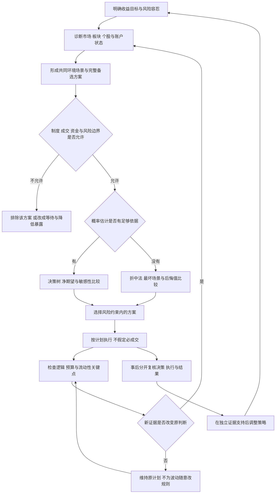

# BS 策略：以管理学决策原理争取更高下限与更高上限

> 日期：2026-11-18
>
> 定位：**策略指导纲领，不是技术方案，不是已验证策略。**
>
> 目标：在可承受风险内，减少严重亏损与账户回撤，同时增加净收益并保留大盈利机会。
>
> 范围：dragon-quant 的 A 股现货买入、持有、加减仓、退出及组合决策。本文不修改现行规则、不预设实现架构、不承诺收益；后续技术调研负责研究如何落地。

**阅读导航**：先读第一、二节确认目标与取舍；第六、七节看折中法及其他准则；第九节是八项核心策略指导；第十一节看完整场景；第十三、十五节供下一阶段调研使用。

## 一、结论先行：不是增加规则数量，而是改变决策方式

建议确立的总纲是：

**先明确目标与风险边界，再判断环境和资源是否适合行动；把买入、等待、空仓、持有、减仓、退出作为可比较的方案；用与信息质量匹配的方法选择方案，并根据新证据追踪调整。**

这份指导围绕两个目标组织，而不是围绕“把尽可能多的管理学名词写进代码”组织：

- **保下限**：减少不值得承担的风险、主题共振损失、错误加码和执行失控；不要等亏损发生后才想到风控。
- **争上限**：把风险资源留给真正合格的机会，避免所有赢家被同一个机械止盈规则提前截断；不是靠普遍加仓、放宽止损来追求收益。
- **处理冲突**：更紧的退出可能减小一次损失，也可能增加反复止损；更宽的趋势退出可能保留大赢家，也会增加浮盈回吐。两者必须一起评价，不许只挑好看的那一面。

上述是本文的**原创策略综合方向**，不是教材或外部作者共同验证过的结论。教材提供决策与控制原理，网络原文提供可借鉴的交易机制，本项目是否受益仍需独立验证。[1][3][4][6][7]

### 1.1 如何阅读证据

全文区分三层：

1. **教材依据**：马工程《管理学》2019 版，标注的是用户扫描件的 **PDF 页序**，不是印刷页码。
2. **外部策略依据**：策略作者的公开规则、原论文及官方交易规则，说明原市场、周期和局限。
3. **本项目指导／研究假设**：把前两者结合后提出的方案。除明确的数学推导外，不把“有合理机制”写成“已经提高收益”。

所有演示数字均为**人为构造的教学假设**，不来自行情、账户或回测。

## 二、先把两个目标定义准确

### 2.1 “最小期望值”需要拆开

为了让后续研究不会答非所问，本文把用户希望提高的“下限”拆成以下对象；这是评价约定，不是认为一个指标可以包办一切。

| 目标对象 | 本文口径 | 不能混同的概念 |
|---|---|---|
| 平均收益能力 | 固定周期、扣除费用后的账户收益及可被检验的收益期望 | 不是某次实现的最大盈利 |
| 场景下限 | 事前列出的压力场景中，某方案最差的账户净损益 | 不是市场所有可能结果的保证下界 |
| 尾部损失 | 最差交易、最差持有期、亏损尾部及极端成交损失 | 不等于平均亏损，也不等于止损距离 |
| 路径风险 | 最大回撤、回撤持续时间、修复时间 | 不由单笔期望值直接决定 |
| 收益上限的争取 | 总净收益、盈利交易的右尾贡献、重大有效行情的参与程度 | 不是抓住事后最高价，也不是把最高单笔盈利做大就算成功 |

**本文优先寻找：净收益更高且风险不恶化，或风险更小且收益不恶化的方案。** 若暂时做不到，就显式展示收益—风险的交换关系，让风险偏好决定选择；不隐瞒代价，也不声称存在所有环境下同时更安全、更赚钱的万能策略。

这是将教材“目标多样性、相对重要程度、方案可行性和资源约束”的要求用于交易评价的推演。（PDF p85–88，第三章第三节）[1]

### 2.2 评价的主体必须是账户

- 个股有更高上涨空间，不代表投入更多资金后账户的风险收益更好。
- 多只股票分别看都能接受，不代表它们在同一题材退潮时同时亏损也能接受。
- 空仓能避免**新增**风险，但已有持仓不卖出并不会因为“今天不买”而消失。
- 不能把满仓方案的个股收益率和试探仓的账户收益率放在同一列比较。
- 不能用几乎不交易换来的低回撤，冒充两个目标同时达成；必须同时披露收益、投入风险和有效机会的错过情况。

**指导：以账户净值为共同分母，同时看绝对结果与等风险条件下的效率。** 后者是诊断工具，不能把一个已降低暴露的方案事后无限放大，假称实际可得收益。

## 三、管理学原理如何真正进入 BS 决策

以下不是必须逐项实现的功能清单，而是需要贯穿决策过程的规则。

| 教材原理及出处 | 转化成 BS 指导 | 对下限／上限的作用方向 | 必须承认的副作用 |
|---|---|---|---|
| 目标性、整体性、动态性；PDF p84–85 | 不只优化某条买点胜率；评价买入—持有—退出—组合的完整效果 | 防止局部“更准”却整体少赚或多亏 | 整体评价更复杂，不能只报一个总分 |
| 环境分析与权变；PDF p85、p97–99 | 相同形态在不同市场／板块环境下可有不同资格和预算 | 减少环境错配，保留适境机会 | 环境识别会错、会滞后 |
| 风险型与不确定型决策；PDF p82–83 | 概率有依据才用概率期望；估不准就用场景和偏好准则 | 避免伪精确概率，仍允许比较方案 | 无概率准则不提供盈利保证 |
| 有限理性、满意准则；PDF p99–102 | 追求证据足够、风险可接受、可复核，而非声称找到了全市场最优解 | 防止过度拟合、无限加规则 | 可能放弃少数极端但难解释的机会 |
| 定性与定量结合；PDF p106–108 | 先把逻辑、证据和反证说清，再算损益与资源；不可量化项允许未知 | 降低把错误叙事数字化的风险 | 主观判断需要一致标准 |
| 预算、零基预算；PDF p125–126 | 每次新增风险先分配额度；已有仓位也需重新证明值得占用预算 | 限制错误加码，给更好机会释放资源 | 频繁重估可能诱发过度换手 |
| 决策追踪与调整、非零起点；PDF p126–129 | 买后依据当前状态再决策，但承认已有仓位、摩擦和退出限制 | 不死守已证伪逻辑，也不机械兑现赢家 | “重新决策”不等于每次价格变化都翻案 |
| 前馈／现场／反馈控制；PDF p268–270 | 开仓前防错，持有中监督，平仓后校正 | 把风控由被动止损扩展成闭环 | 前馈预测不准，现场执行也可能失效 |
| 关键控制点、标准协调与相对稳定；PDF p274–277 | 重点观察逻辑失效、组合超限、流动性异常；规则之间不能互相打架 | 减少无效干预，同时保留真正的保护 | 关键点选择本身要验证 |
| 风险避免、试探承担、损失减低、风险保留；PDF p317–320 | 不做／小仓试验／分散与减仓／明确承受剩余风险 | 不把所有风控任务都压给卖出价格 | 分散与保护有成本，未被消除的风险仍由账户承担 |

本表的管理学描述来自教材；交易含义与作用方向是本文的待验证推演。[1]

### 3.1 两个不应生搬硬套的地方

- **多指标不等于多个独立专家。** 同一价格序列生成的均线、突破、涨幅可能重复表达同一信息，不能按票数就把置信度抬高。建议区分价格结构、板块联动、流动性、账户约束等证据组，并记录反对证据。这是借鉴群体决策利弊，而非宣称算法指标独立。（PDF p83–84）[1]
- **多看几根 K 线不是德尔菲法。** 教材的德尔菲法依赖专家背靠背意见及多轮反馈；连续观察行情更适合称为证据更新与决策追踪。（PDF p106、p126–129）[1]

## 四、完整闭环：先解决“能不能做”，再解决“选哪个”



这是策略顺序，不是软件架构。**风险边界是门禁，不是可被上涨潜力抵消的扣分项。** 新策略是否值得执行，与“当前接口是否支持”是不同阶段的问题。

### 4.1 决策前要回答的五个问题

1. **为什么有机会？** 是趋势延续、突破确认、回调结束，还是仅仅因为最近上涨？
2. **为什么是现在？** 再等一段时间会获得什么证据，又会失去多少价格优势或机会？
3. **什么会证明判断错了？** 价格结构、时间、板块或市场条件中的哪些变化构成反证？
4. **错了可能损失多少账户资源？** 包括不能及时卖出的压力，而不只是计划止损。
5. **对了如何不提前结束？** 趋势仍有效时怎样持有，什么新证据允许增配，什么条件撤销授权？

这相当于把教材的目标、备选、5W2H、实施监督用于每笔交易的行动计划，而不是只记录一个“买”字。（PDF p85–88、p106）[1]

## 五、环境与备选方案：给“等待”和“不操作”正式席位

### 5.1 环境不是一个万能总分

建议形成下列研究性状态描述；名称不等于已经准确识别，划分标准后续再研究。

| 研究性环境 | 应优先比较的方案 | 防下限重点 | 争上限重点 |
|---|---|---|---|
| 趋势与主线证据相互支持 | 确认买入、分步进入、合格持仓续持 | 防追价过远、同主题过度集中 | 不过早退出持续有效的赢家 |
| 结构震荡、强弱反复 | 等待、小规模且有边界的试探、退出无效仓 | 避免连续假突破和高摩擦 | 保留确认后重新参与的能力 |
| 板块／市场明显恶化 | 取消新增风险、减仓、退出、等待恢复 | 降低共同下跌及无法退出的暴露 | 保留资金和恢复参与机制 |
| 信息缺失或信号冲突 | 等待补证、小风险研究性试探或不做 | 不把未知默认为安全 | 不把所有未知一律永久封禁 |

**未知不是看空，也不是中性。** 若关键数据连基本可交易性或压力损失都不能支持判断，则不应仅凭“赔率看起来高”开放风险；若只有次要证据不足，可以比较等待和有限试探的成本。

### 5.2 SWOT 的主体是账户／策略，不是给股票写宣传稿

教材的 SWOT 强调内部资源与外部机会、威胁的联动。（PDF p97–99）[1]

本项目可按以下方式理解，但不必生成机械的四格评分：

- **内部优势／劣势**：账户可用风险额度、现有敞口、数据质量、执行能力、该类机会的历史证据。
- **外部机会／威胁**：主线延续、相对强度、结构性突破，以及市场退潮、流动性下降、拥挤交易等。
- 同样的外部机会，在已有大量同主题持仓的账户中，可能应选择“不新增”；在低暴露且有预算的账户中，才可能进入候选。

### 5.3 比较的是完整政策，不是一串买入点

备选方案至少应考虑：不新增风险、等待确认、小仓试探、确认后进入、继续持有、部分退出、完全退出，以及卖旧买新。不是每次都强制生成全部方案，而是不能事先把合理的“不操作”排除。

每个方案应说清：**触发条件、进入与加减仓路径、失败退出、有效趋势退出、资金占用、成本，以及未成交或不能退出时怎么办。**

例如“现在买”“等确认再买”不能只比较首次成交价。等待方案还包括“没有确认就不买”的路径；立即买入方案则承担确认前可能继续恶化的风险。

## 六、定量主例：用折中法把风险偏好放进方案选择

### 6.1 教材原理与补充方法的边界

教材在不确定性情境下明确列出的四种准则是：乐观准则、悲观准则、等概率准则、最小后悔准则，见 PDF p89–90，第三章第三节。已核对 p89 原图；**该处没有单独列出折中法**。[1]

用户提出的思路可用 **Hurwicz 折中准则**补充：将各方案最好与最坏结果按偏好权重组合。Gaspars-Wieloch 的原始研究给出该经典公式，同时讨论只看两端的局限。[2]

### 6.2 先建立可比较的净损益矩阵

设：

- `a`：一个完整的行动方案，包含仓位及退出政策。
- `s`：共同的未来环境场景，不是为不同方案各自编造的“最有利行情”。
- `X(a,s)`：同一决策时点、同一评价终点下，该方案对应的**账户净收益**。
- `L(a) = min_s X(a,s)`，`U(a) = max_s X(a,s)`。

比较前必须统一账户起点、持有窗口、费用、滑点、可成交条件和期末估值口径；提前卖出的方案，剩余时间的现金收益或再投资政策也必须一致约定。持仓状态改变后，要重新形成从**当前状态出发**的比较，不能把历史成本混入未来增量收益。

`L` 和 `U` 是事前场景内的估计，不得拿后来真实最高价／最低价倒填。历史分位数、同类样本、结构目标和压力假设可以是输入线索，但必须注明其性质；分位数并不等于真正最大／最小值，历史极值也不是未来边界。

### 6.3 风险系数怎样定义

为避免不同文献符号相反，本文定义：

- `ρ ∈ [0,1]`：**保守／悲观系数**，越大越看重场景下限。
- `1−ρ`：对场景上限的权重。

```text
Hρ(a) = ρ × L(a) + (1−ρ) × U(a)
在通过资格与风险门禁的备选集中，选择 Hρ 最大的方案。
```

`ρ=1` 退化为重视最坏结果的准则，`ρ=0` 退化为重视最好结果的准则。[2]

**Hρ 是偏好评分，不是统计意义上的期望收益；ρ 不是亏损概率，1−ρ 不是上涨概率。** 用户的风险承受偏好、账户剩余承受能力、概率估计的可信程度是三件不同的事，不能共用一个数字。

建议风险系数由事前约定表达偏好，风险额度随账户及环境调整；若未来研究动态改变系数，也必须事前规定映射并接受独立验证，不能一涨就乐观、一跌就悲观。

### 6.4 完整演示：同一矩阵，不同风险偏好

**以下是教学假设，绝非真实市场预测或回测。** 假设统一评价未来 5 个交易日，表中均为同一起始账户净值的净收益百分比，已假设计入各自政策的成本；无存量持仓，现金利息在本例中忽略。

| 完整备选政策 | 场景 S1：机会失效 | 场景 S2：反复震荡 | 场景 S3：趋势兑现 | L | U |
|---|---:|---:|---:|---:|---:|
| 不参与、保持现金 | 0.00% | 0.00% | 0.00% | 0.00% | 0.00% |
| A：小规模试探，未确认不扩张 | -0.50% | +0.40% | +4.00% | -0.50% | +4.00% |
| B：证据确认后按计划进入 | -2.00% | +1.00% | +8.00% | -2.00% | +8.00% |
| C：较激进地提前暴露 | -5.00% | -0.50% | +12.00% | -5.00% | +12.00% |

该表只是为了展示准则会怎样选择，**并不声称真实交易中 B 会稳定比 A 多赚，或小仓必然只亏表中数值**。每一列代表同一条外部行情路径；各政策因等待、成交、仓位与退出选择不同而得到不同结果，不能让每个方案各自挑选一套有利场景。

由公式计算：

| 保守系数 ρ | 现金 H | A 的 H | B 的 H | C 的 H | 未加额外风险约束时的选择 |
|---|---:|---:|---:|---:|---|
| 0.90 | 0.000% | -0.050% | -1.000% | -3.300% | 现金 |
| 0.80 | 0.000% | +0.400% | 0.000% | -1.600% | A |
| 0.65 | 0.000% | +1.075% | +1.500% | +0.950% | B |
| 0.30 | 0.000% | +2.650% | +5.000% | +6.900% | C |

例如 `ρ=0.65` 时，`H(B)=0.65×(-2%)+0.35×8%=1.50%`。

**再加一道独立约束**：假设账户不愿接受本次场景评估中低于 `-2.50%` 的结果，那么 C 应在评分之前被排除。即使用户较激进、C 的 H 最高，也不能越过这个约束；`-2.50%` 仅是本例偏好，不是推荐参数。该约束限制的是允许承担的**已建模风险**，不保证真实损失不会越界。

### 6.5 不让折中法成为“乐观故事计算器”

折中法最有价值的地方，是把偏好显式化；最危险的地方，是人为夸大 U、低估 L 后仍得到一个精确数字。[2]

建议增加以下评价纪律：

1. **下限来源与上限来源都要解释**，不能止损填得近、目标填得远就认为价值很高。
2. **补看中间场景与路径**；两端相同的方案仍可能有完全不同的常见结果和持有压力。
3. **检查偏好敏感性**：ρ 附近轻微改变、费用上调、退出延迟，排名是否剧烈反转？脆弱结论不宜支持大额暴露。
4. **先剔除被支配方案**：若一个完整政策在所有共同场景中不优于另一个，至少一个场景更差，且无额外资源优势，就没有必要仅凭叙事选择它。这是本矩阵定义下的逻辑判断，不等于有限场景覆盖了全部市场。
5. **场景越差越不能删除**：跳空、流动性枯竭、连续无法退出，应作为独立压力问题，而不能藏进“按止损价成交”。

## 七、不能只有折中法：按信息条件选择决策方法

### 7.1 概率有可靠依据时：风险型决策与决策树

教材区分风险型与不确定型决策，并用决策树比较各方案的概率加权净收益。（PDF p82–83、p108–109）[1]

本文建议在数据和定义支持时使用：

```text
EV(a) = Σs p(s | 决策当时的信息) × X(a,s)
```

分支应互斥且在模型内覆盖主要路径，概率非负且和为 1；多阶段决策需要条件概率，不能把高度相关的竞价、量能、涨幅证据直接当独立事件相乘。

继续用上面的**教学矩阵**，再人为假设 S1／S2／S3 的概率是 0.40／0.35／0.25：现金 EV 为 0，A 为 0.94%，B 为 1.55%，C 为 0.825%。这只是说明 **EV 与 Hρ 可以得出不同排序**，不是提供这些场景的真实概率。

概率使用的纪律：

- 说明获胜事件、持有期限、退出政策、买点类型和环境；“曾经上涨过”不等于完整交易扣费后盈利。
- 样本只用当时可得且结果已成熟的数据；不能用今天之后的交易结果校准今天的概率。
- 说明样本量、估计误差与适用范围，不能把样本少、过时或异质的胜率当精确常数。
- 对概率下修、盈利幅度下降、亏损和摩擦上升分别做敏感性分析；必要时比较一组合理概率下的保守 EV，而非只看点估计。
- 没有依据就标记未知，回到场景比较、等待或有边界的试验；不为了强制填写 EV 而硬编码一个胜率。

**目标收益位不等于平均盈利，止损触发位不等于平均亏损。** 二元公式 `p×平均盈利−(1−p)×平均亏损` 只适用于事件定义一致、金额口径一致且覆盖结果的分组；多腿退出、持平和无法成交不能被随意省略。

### 7.2 不知道概率时：四种准则各有角色

教材的四种准则可用于展示方案对偏好的敏感程度，但不建议无条件任选一个作为永久交易开关。（PDF p89–90）[1]

| 准则 | 在本项目中的研究价值 | 不能声称的效果 |
|---|---|---|
| 乐观准则 | 显示某方案对上限的追求程度，识别高右尾候选 | 强市就一定应该选最乐观的方案 |
| 悲观准则 | 检查最差已建模场景，审视保全资源的价值 | 它能给真实损失提供担保 |
| 等概率准则 | 当作显式的基准假设，比较不偏重某一场景时的选择 | 没有信息就证明所有场景等概率 |
| 最小后悔准则 | 审视选错方案的机会损失与取舍 | 它天然防追高、天然提高胜率 |

最小后悔的计算，应在**同一场景**下求最佳可行方案收益，再减去所选方案收益。为了单独演示准则，先暂不施加第六节额外引入的 `-2.50%` 场景约束：用原教学矩阵计算，现金、A、B、C 的最大后悔分别为 12、8、4、5 个账户收益百分点，因此该矩阵下选择 B；这不表示 B 在现实中更好。实际应用时必须先确定可行集，再用该集合重算每个场景的最佳结果与后悔值，不能继续拿已被排除的方案作可执行基准。

尤其要纠正一个直觉：**最小后悔不一定抑制追高。** 构造两个场景：现金收益均为 0，激进方案为 -1／+20；现金最大后悔为 20，激进方案为 1，准则反而选择激进方案。此为数学反例，而非市场数据。因此不能沿用 issue #43 中“默认最小后悔就能抑制追高”的未经验证判断。[10]

### 7.3 概率、偏好、预算分开

- **概率／收益分布**：回答可能发生什么，有多少证据。
- **偏好／效用／折中系数**：回答用户愿意如何取舍。
- **预算／资格约束**：回答账户究竟允许承担多少。

三者分别决定，最后共同形成动作。**效用函数描述某个结果或财富水平对用户的价值；若使用期望效用，仍需要相应概率。Hurwicz 则是在概率未知时表达取舍的一种准则，两者不能直接互换为同一个“风险参数”。** 不要把同一风险反复算进概率折扣、效用惩罚、环境仓位折扣，导致无法解释的多重压缩；也不能因为某一层乐观就绕过另一层约束。

## 八、公开 BS 策略中真正值得借鉴什么

以下仅提取原作者机制，不移植其历史收益、参数或市场条件。

| 原始来源 | 原规则／研究要点 | 原市场与周期 | 本文借鉴的机制与限制 |
|---|---|---|---|
| Curtis Faith《The Original Turtle Trading Rules》 | 通道突破入场、波动尺度定规模、顺势分单位增加、失败与盈利退出构成完整系统 | 美国期货、日线尺度、多空 | 借鉴完整政策与风险单位，不直接照抄通道长度；原版突破入场不等于等待回踩确认。[3] |
| Moskowitz／Ooi／Pedersen《Time Series Momentum》 | 用自身过去收益的方向及事前波动尺度形成趋势暴露；论文也记录趋势骤反的损失 | 跨资产期货／远期、月度调整 | 借鉴趋势与风险规模分工；多空跨资产的保护不能迁移成单边股票的崩盘保护。[4] |
| Antonacci 双动量论文 | 先选相对强者，再检验其是否通过相对现金基准的绝对门槛 | 多资产模块、月频 | 借鉴“最强”与“值得承担风险”分开判断；原文未扣交易成本，不能推出短线换仓仍有利。[5] |
| Faber 战术资产配置论文 | 月末按价格与均线关系决定持有或现金，不因达到固定盈利数额就退出 | 多资产指数、月频 | 借鉴趋势资格与现金备选；作者讨论横盘反复和强牛市落后，且原回测成交、成本假设不能照搬。[6] |
| Kaminski／Lo 止损研究 | 止损的收益作用依赖收益过程和观察尺度；在 IID 且原策略期望高于安全资产的设定下，实际触发退出会降低期望收益，始终不退出时不产生该收益拖累 | 理论模型及美国股指／国债期货样本 | 提醒我们把生存保护与收益增强分开验证，不把更紧止损包装成免费改进。[7] |

本轮没有找到足以直接证明“龙头／连板短线某组参数同时提高净收益、降低回撤”的同等级一手证据。中文社区的龙头、分歧转一致、弱转强等思路，可以作为本项目既有模式的研究语言，但**不填入无法审计的所谓通用胜率、固定安全高开区间或确定的最佳仓位**。

## 九、八项面向双目标的核心策略指导

以下每项都是**研究假设**，不是建议现在切换默认策略。每项同时交代保护机制、增长机制和反作用。

### G1．先有绝对资格，再在合格集内择强

**理论结合**：环境分析、权变与目标—资源匹配，结合双动量的绝对／相对两阶段思想。（PDF p85、p97–99）[1][5]

**决策指导**：

- 市场、主线、个股结构和可执行性先回答“是否允许新增风险”；相对强度只回答“允许的机会里优先研究谁”。
- 不因某股排第一就必须买；整个合格集为空时，现金／等待是正式结果。
- 趋势较强但价格远离合理失效位置时，比较降低规模、等待与不做，而不是单凭排名忽略风险距离。

**保下限**：试图减少“弱市里买最不弱”的系统性暴露。**争上限**：把有限预算集中到有资格且更有证据的机会。

**代价／证伪**：资格过滤可能错过反转起点。应比较被过滤机会的后续可执行结果、减少的损失和错过的盈利，不能只报告剩余交易胜率提高。

### G2．把突破、回踩、等待确认为竞争方案，不预设谁更高级

**理论结合**：备选方案生成、情景分析、定性定量结合，结合海龟突破入场思想；额外等待是本项目的新假设，不冒称原版海龟要求。（PDF p87、p98–99、p106–108）[1][3]

**决策指导**：

- 同一机会可以比较“即时突破进入”“等结构确认”“回踩承接”“不参与”；每个方案都带独立的失效条件和完整退出政策。
- 等待需要说明新增什么信息，不能只是机械地晚几分钟；回踩需要观察承接证据，不能把下跌本身当作更划算。
- 对不同政策计算共同场景下的账户损益，再按概率条件或折中偏好选择。

**保下限**：有机会用新增证据过滤部分假信号。**争上限**：保留对强势直接延续行情的参与方案，避免一律等不到回踩。

**代价／证伪**：确认可能抬高成本、扩大失效距离并错失机会；更低买价也可能伴随逻辑恶化。比较政策的净结果、失败率、风险距离和未成交机会，而非只比较成交均价。

### G3．有限试探—证据确认—预算内扩张，不做亏损摊平的借口

**理论结合**：教材风险避免中的“试探承担部分风险”，结合顺势分单位增加的思想。（PDF p317–318）[1][3]

**决策指导**：

- 第一次承担有限风险，是为了参与并观察一个明确假设；之后是否加码必须依赖事前约定的新证据，而非仅仅“已经赚钱了”。
- 每次增配重新评估新旧仓合计的压力损失、主题暴露、资金占用和剩余上涨空间。
- 不因浮盈就把原仓风险当零；新仓的成交价、可卖时间和退出约束与旧仓可能不同。
- 失败后不自动加码“摊低成本”；需要改变原判断时，应作为一次新的决策而非补救原决策的面子。

**保下限**：错误在尚未证明前不获得大额预算。**争上限**：有效机会获得更多资源，不必所有机会一开始都满配。

**代价／证伪**：试探也会亏损，分批会增加摩擦，后续成交更贵。普通股票当日新买部分存在回转限制，不能假定试错后能立即撤销；相关制度见第十节。[9] 应检验追加部分的边际净贡献和额外尾部损失，而非只看整笔最终盈利。

### G4．买入时同时写清价格失效与时间失效

**理论结合**：前馈控制、关键控制点、时间标准与追踪调整，结合交易系统的失败退出。（PDF p269、p274–277、p126–129）[1][3]

**决策指导**：

- 为每类买入逻辑写出“不该继续持有”的证据，例如结构失守、预期承接未发生、规定观察窗口内未出现承诺的走势。
- 时间期限应来自该逻辑需要何时兑现，不能统一认为所有机会持有相同天数就失效。
- 结构退出与灾难风险控制分工；合理的结构止损若超出账户可承受范围，优先减小投入或不做，不应为了下单硬把止损挤进正常噪声区。
- 任何退出都是触发后争取成交的行动，不是承诺按触发价成交。

**保下限**：试图更早识别交易理由消失，避免小错拖成大错。**争上限**：不把正常整理、慢启动与真正失败混为一谈。

**代价／证伪**：假跌破和时间止损后再启动会产生误杀。应比较止损避免的后续损失、误杀的可执行机会成本、再入费用和净账户结果；不能从“及时卖出了一只下跌股”推出规则有效。[7]

### G5．盈利仓采用“趋势资格＋回吐预算”，不要用固定目标封死所有右尾

**理论结合**：动态决策、相对稳定与弹性控制，结合海龟／Faber 的趋势退出思想。（PDF p85、p125、p277）[1][3][6]

**决策指导**：

- 达到某个盈利数额可以触发复核，但不应自动等于全部退出；继续持有必须有仍然成立的结构与环境依据。
- 将全退、减一部分并留趋势仓、继续持有作为备选；不能先规定永远减半，再寻找解释。
- 在不提高账户允许风险的前提下，研究按波动或结构容忍正常回撤；浮盈回吐预算与本金风险额度分别管理。
- “让利润奔跑”不是利润无限回吐，也不是为了保右尾取消灾难保护；更宽的回撤容忍必须与更小仓位、已减仓或其他资源调整一起评价。

**保下限**：约束可接受回吐和账户风险。**争上限**：减少被机械固定止盈过早清掉的大赢家。

**代价／证伪**：留仓可能失去本可兑现的利润，减仓也可能削弱右尾贡献。比较总净收益、赢家贡献、盈利转亏、实现利润与可观察浮盈的回吐情况；未来最高价只作诊断，绝不能当作当时可实现收益。

### G6．以风险而非资金等额分配，并控制主题共振

**理论结合**：预算管理、整体性风险评估、损失减低与适度分散，结合海龟与时间序列动量的波动尺度思想。（PDF p125–126、p312–315、p319–320）[1][3][4]

**决策指导**：

- 同样投入金额不代表同样风险；考察失效距离、波动、流动性和退出受阻，再决定规模。
- 从组合额度中分配单笔、单票及共同风险来源的份额；多只同主题股票不能自动算作独立分散。
- 资金可以闲置，退出某模块后的预算不必强行塞给其余标的。
- 对组合做共同压力场景，而非简单相加各自“最可能损失”；也不必假设历史相关性在压力时保持不变。

可用作思考的近似式为：

```text
投入金额 ≈ 允许的计划损失金额 ÷ 压力损失比例
```

这不是成交公式或保险：比例估计错、跳空、停牌、连续无法卖出，实际损失都可能超过计划。若压力损失难以合理估计，不应靠极窄止损计算出极大仓位。

**保下限**：降低单次判断和同题材共同失败的冲击。**争上限**：把预算留给证据、空间与风险匹配更好的机会。

**代价／证伪**：波动估计滞后，低波动未必低风险；分散可能稀释最强机会。比较同风险额度下的结果，同时检查资金利用率、集中收益来源及组合压力。

### G7．持有与换仓用“当前状态的增量价值”比较，摆脱成本锚定

**理论结合**：零基预算、非零起点、沉没成本与决策追踪，结合相对选择与趋势资格变化。（PDF p125–129）[1][5][6]

**决策指导**：

- 继续持有不是默认正确，卖出也不是默认正确；用当前可得信息比较持有、减仓、全退、换仓的未来路径。
- 不能因为亏着就等回本，也不能因为赚着就立即兑现；历史成本用于会计和预算，不是对未来涨跌的证据。
- 比较换仓时计入卖出旧仓、买入新仓的全部成本、延迟、不可成交与新增不确定性。
- 风险硬约束触发时先处理风险，不为等待一个可能更高的 EV 而拖延；无硬约束时，也不能把任何微小排名变化都当换仓理由。

**保下限**：减少抱住证伪仓位和追逐新热点的双重错误。**争上限**：有效赢家不会仅因“已经涨很多”被自动清掉，更好机会也有争取预算的通道。

**代价／证伪**：重估可能诱发过度交易。应检查换仓后的边际净贡献，而不是只比较新票后来是否上涨；反事实必须遵守同一资金、时点与可成交条件。

### G8．账户失控时收缩风险，恢复时也要有规则

**理论结合**：前馈／反馈控制、例外原则和风险保留；不是把连亏本身当未来必跌的预测。（PDF p268–270、p317–320）[1]

**决策指导**：

- 当回撤、连亏、流动性或数据异常说明原预算可能不再适合时，比较暂停新增、降低规模、减少集中暴露，而不是加码追回损失。
- 停止新增不等于已持仓风险已处理；必要时另行比较减仓与退出。
- 同时设计恢复条件：什么证据表明环境、执行或模型问题得到改善，先恢复多少资源，如何继续监督。
- 不能无限停机到“历史回测最舒服的那一天”再恢复；恢复过程同样应接受前向检验。

**保下限**：限制错误扩散和报复性加仓。**争上限**：避免保护机制一旦启动就错过后续所有恢复行情。

**代价／证伪**：正常连亏也可能发生，暂停后可能恰逢反弹。评价暂停与恢复整个政策的结果，单列少亏和错过收益，不能只展示熔断前后的回撤变化。

## 十、A 股迁移边界：保护动作不等于一定能执行

上交所《交易规则（2026年修订）》第 3.1.4 条规定，买入证券交收前不得卖出，实行回转交易的除外；第 3.1.5 条列有当日回转交易品种。本文面向普通 A 股现货，不能套用期货“入场后随时反向退出”的条件。该版自 2026-07-06 起施行；不同市场、板块和品种的细则，后续落地时须分别核对，不把 ETF 等品种一概等同普通股票。[9]

策略指导中必须容纳：

- 当日新买仓位不能被假定可随时止损；已有可卖数量与新增锁定数量应分别看待。
- 涨跌停、停牌、价格跳跃、流动性和申报队列可能使计划行动延迟或失败；不能把触及价格当作成交证明。
- 分钟周期的信号、日线周期的形态、月度论文的证据不能互相替代。
- 手续费、税费、滑点、整手及资金占用应进入方案净结果；外文论文忽略的摩擦不能在本项目里继续忽略。
- 计划风险只是主动承担的风险配置；无法按计划退出的剩余风险，需要额度和资金准备，而不是一句“已有止损”了事。

项目当前产品契约也明确下一可执行事件、T+1 与不可假定涨跌停成交等边界；本文沿用这些研究纪律，不对当前执行模块做改造设计。[10]

## 十一、两个贯穿始终的决策场景

以下是**政策演绎，不是行情判断**，不提供任何实际个股、价位或阈值。

### 场景 A：主线延续，如何既不过度暴露，又不卖飞所有赢家

1. **环境与资格**：市场、板块、个股证据相互支持，但账户已有一部分同主题暴露。
2. **形成方案**：保持原仓不新增；有限试探；确认后增加；等待回踩；全部不参与。
3. **先查下限**：共同退潮场景下，新旧持仓合计能否承受？若不能，新增方案即使上限高也要排除或缩减。
4. **再比价值**：有可靠概率则比较完整政策 EV；没有就用共同场景和折中系数，并检查确认成本和错过成本。
5. **执行与增配**：只有新增证据满足事前条件，才重新分配预算；不因一根阳线就升级为重仓。
6. **盈利后**：若趋势仍有效，比较续持、减部分留仓与全退；结构失败或回吐预算越界则撤销持有授权。
7. **验收**：若大赢家参与度提高却组合尾部显著恶化，不能仅因总收益提高就声称双目标完成。

**这一场景的重点**：用投入规模和组合边界承担保护任务，争取给仍有效的趋势留空间；不是简单放宽所有止盈。

### 场景 B：高位机会看起来很强，随后环境转坏

1. **买前**：最强排名只是相对比较，不代替绝对资格。若只能用乐观上限解释入场，压力损失却无法承受，则等待或不做。
2. **试探后**：若关键证据没有出现、板块共同走弱，取消扩张计划；小仓不自动获得“再补一点”的权限。
3. **持仓中**：比较剩余仓位续持、减仓和退出的增量价值，同时识别哪些数量现在能卖、哪些不能卖。
4. **退出受阻**：停止新增相关风险，按可成交条件处理；记录执行受限，不能在报告里补写按止损价已经离场。
5. **恢复参与**：重新形成有效机会与预算后再评估，而非因想回本或因害怕错过一次反弹而直接加码。
6. **验收**：比较保护避免的实际损失、反复进出成本和错失反弹，不用一次成功逃顶证明政策正确。

**这一场景的重点**：优先保全还能使用的资源；将逻辑证伪、执行失败、行情反转分别归因，不把一切亏损都归为“运气”。

## 十二、反馈控制：把“决策对不对”与“这次赚没赚”分开

教材要求决策—实施—再决策的连续过程，也强调控制标准的协调、相对稳定和可比性。（PDF p87–88、p126–129、p274–277）[1]

建议事后分别回答四组问题：

| 复核层 | 应记录的问题 | 不接受的解释 |
|---|---|---|
| 信息与决策 | 当时知道什么、缺什么，选了哪些方案，为何排除其他方案 | 事后拿最高价证明当时应该买 |
| 执行 | 触发、申报、成交和未成交是否一致，实际摩擦多大 | 发出卖出信号就算已经规避损失 |
| 结果 | 净损益、风险单位表现、持有路径和组合贡献 | 盈利就证明原理正确，亏损就证明应该改规则 |
| 模型与环境 | 概率是否校准，场景是否漏项，失效集中在哪类环境 | 赚钱归能力，亏钱全归市场 |

### 12.1 风险单位与概率校准各回答什么

- **风险单位记账**：事前定义的计划风险金额作为分母，实际净损益作为分子，用于比较投入一单位计划风险换回什么。初始分母应冻结，不能事后调整让结果好看；实际亏损完全可能超过一单位风险。
- **概率校准**：若确实输出了某个事件的概率，事后按同一定义、同一观察期限检查该事件是否发生，并看可靠性分组或概率误差。不能用“股价一度上涨”去验证“完整交易盈利”的概率。
- **模型变化**：校准会改变未来概率；一旦概率进入门禁、排序或仓位，就可能改变交易行为，不能把它视为永远纯观测。

上述是评价指导，不要求现在新增具体字段或采用某种统计工具。样本少时明确证据不足；不能用一两次违背预测就认定概率失效。

### 12.2 后悔值与错过机会要受现实约束

研究“如果不卖／如果买另一只”时，应只使用当时真实可选方案，并维持同一资金、仓位、成本与成交条件；跨日信号未产生的方案不能装作当时就知道。

未来最高涨幅、最低跌幅可以用于描述退出后的路径，但不是可保证实现的反事实利润。被拒绝的候选与未成交候选也应进入研究母集，避免只看成功存活的交易。

### 12.3 不能每次复盘都改变偏好或参数

多次试验后挑表现最好的方案，本身就可能制造虚假发现。Bailey 等人的回测过拟合研究讨论了这种策略选择风险，单次留出检验也不能自动消除问题。[8]

本文据此建议：记录尝试过的假设和参数、预先规定评价口径、按时间检验稳定性并保留前向观察；看到结果后改出来的规则，必须视为新的假设，不能继续把已经看过的样本称作独立验证。

## 十三、怎样证明真正服务了两个核心目标

本阶段不回测、不设收益承诺；这里只规定后续研究应如何判断“值得继续”，避免技术实现完成却偏离目标。

### 13.1 必须同时交付的评价面板

| 维度 | 应观察的对象 | 典型伪改进 |
|---|---|---|
| 净收益 | 相同期初资本与区间的净收益、复利路径、已实现与未实现的完整权益 | 只报最好交易或忽略期末持仓 |
| 下行 | 最大回撤及持续期、尾部损失、最差交易／窗口、退出受阻压力 | 仅看平均亏损变小 |
| 上行 | 盈利右尾对总净收益的贡献、重大有效机会的参与与退出政策差异 | 把未来最高价当能拿到的利润 |
| 资源 | 资金利用率、风险暴露、主题集中度、等风险效率 | 全部不买后声称策略更优 |
| 摩擦与行为 | 交易数、换手、滑点、费用、误杀与恢复参与 | 胜率提高但收益减少、费用增加 |
| 稳定性 | 不同环境／时间段、参数邻域、成本与延迟压力 | 只展示单一最优区间 |
| 信息质量 | 真实可得时点、缺失、数据粒度、概率样本量和策略版本 | 把收盘信息用于开盘决策 |

这些是本研究的评价约定。指标是否可计算、具体阈值与统计方法，留到后续技术调研；不能因为某项暂时没有数据，就悄悄改成只评价剩余指标。

### 13.2 比较纪律

- 同一候选母集、可得信息、初始账户、成本、数据粒度和版本下比较；新增候选来源的效果要与决策规则效果分开。
- 先分别检验环境资格、入场政策、退出政策、风险分配，再检查组合后的交互；不是所有好组件叠起来都更好。
- 所有过滤都统计少亏与错过收益；所有延长持有都统计新增右尾与新增回吐；所有降仓都披露收益被削弱的部分。
- 时间相邻和同题材交易并非天然独立样本；少量高度相关交易不能包装成大样本。
- 历史数据不能支撑竞价或分钟级判定时，不用日线近似替它证明有效；采用降级结论或前向收集证据。
- 市场状态只能按当时信息定义，不能事后按未来涨跌给“趋势／退潮”贴标签，再宣称识别准确。
- 小样本、版本不一致、成本不清或测试反复被窥视时，结论应是“证据不足”，不是“先默认开启试试”。

### 13.3 结果应如何定性

| 实际证据 | 应作判断 |
|---|---|
| 净收益提高，下行指标未恶化，且具有跨期与压力稳定性 | 双目标改进候选，仍需前向验证 |
| 下行明显改善，但净收益下降 | 防守型交换，需用户接受代价，不能称双赢 |
| 收益提高，但尾部或回撤明显变差 | 进攻型交换，检查是否突破容忍边界 |
| 只有样本内最佳参数好看 | 不足以推广 |
| 改善来自几笔不可成交的交易或未来信息 | 该证据无效，重做比较 |
| 交易太少或关键数据不足 | 保留假设，不得宣布有效或无效 |

## 十四、相对 issue #43 的收敛与修正

#43 提出的“环境—定性—定量—校准”值得保留，但不应把其中每个工具都升级为必做项。[10]

1. **保留**环境、资源、备选、风险预算前置和反馈闭环；它们直接服务两个核心目标。
2. **补充**折中法及风险偏好的正式地位；但不把折中评分当概率期望，不用事后极值填输入。
3. **修正**“每笔必须有精确 p／EV”——缺少证据时允许未知，明确走不确定型决策；否则形式完整反而掩盖估计风险。
4. **修正**“EV 为正就值得买”——它只是可能的必要判断之一，不代替尾部、集中度、资源和可成交条件；未知 EV 也不等于已证实负 EV。
5. **修正**“最小后悔天然防追高”——第七节已给反例，应视为备选准则而非默认安全装置。
6. **修正**“止损价格提供损失上限”——触发线不是成交保证；结构距离、组合压力和可卖约束应一起进入决策。
7. **暂缓默认采用凯利**——胜率和收益分布未被可靠估计前，分数凯利同样可能错误放大风险；目标 RR 也不是实际平均赔率。它可作为后续研究工具，不是本纲领的首要机制。
8. **不固定损失厌恶倍数**——不能用一个通用常数替代用户风险偏好，也不能把描述人类偏差的理论直接当最优交易处方。
9. **校准不是天然不改变交易**——当 p 影响动作时，更新 p 就会改变行为，需纳入同一比较纪律。
10. **不是从零建设所有能力**——当前代码已经有四类买点、卖出责任链、ATR／分级移动止盈、风险预算及账户风险控制等基础；部分能力默认关闭或有特定口径。本文不复写现行数值，不把已有能力误称缺失，也不把信号 buy-all 当成真实资金组合配置。[10]

## 十五、后续调研的优先问题，而非实现排期

| 优先级 | 需要先回答的问题 | 与目标的直接关系 |
|---|---|---|
| P0 | 怎样形成不含未来信息、可比较且覆盖执行受阻的场景损益？ | 不低估下限、不虚构上限，所有定量方法的基础 |
| P0 | 如何把用户偏好、风险额度与估计可信度分开？ | 避免一个风险系数承担所有职责 |
| P0 | 哪些当前亏损来自环境错配、集中暴露、退出受阻或误杀？ | 把精力投向真正限制下限的原因 |
| P0 | 大盈利贡献被哪些退出政策削弱，放宽后又增加多少回吐？ | 找到真正限制上限的原因 |
| P1 | 哪些环境下适合突破、回踩、等待或分阶段进入？ | 不以一种买点覆盖所有市况 |
| P1 | 哪些风险预算／持有政策能形成稳定的收益—风险改进？ | 验证完整政策而非只改触发阈值 |
| P1 | 什么条件足以支持使用概率，以及如何表达样本不足？ | 决定 EV 是否有资格进入动作 |
| P2 | 后悔值、效用、凯利、模拟等工具是否提供额外且稳健的价值？ | 防止复杂度超过证据收益 |

**优先级是研究方向，不是批准修改默认策略、增加依赖或启动实验。** 本文件不规定模块、类、表结构或开发阶段；具体实现与验证资源由下一阶段技术方案决定。

## 十六、最终策略承诺与边界

我们可以承诺的是研究纪律：

- 每项探索都要说明是在保护下限、争取上限，还是在两者之间交换。
- 对每项保护都追问“错过了什么”，对每项增长都追问“多承担了什么”。
- 对每个数字追问“是事实、估计、偏好还是假设”，对每项行动追问“能否执行、何时失效”。
- 管理学负责组织决策逻辑，交易原文提供机制启发，真实证据决定保留还是放弃。

**不能承诺的是两项目标必然同时改善。真正值得做的方向，是让风险在事前可见、让资源分配有理由、让有效盈利有空间、让错误判断能够及时退出并得到纠正。**

## 参考文献

以下网络来源检索／读取日期为 2026-11-18；教材与项目来源按实际核读范围标注。引用用于支持原理或原规则，不为本文原创交易假设背书。海龟与双动量为署名原文镜像，未对镜像与最初发行文件作逐字一致性认证。

[1] 马工程《管理学》，高等教育出版社，2019，用户提供扫描件。源文件：`~/Downloads/马工程《管理学》.pdf`；逐页 OCR：`~/Desktop/文职考纲/马工程管理学_OCR/pages/`。核心核读范围：PDF p80–90（决策）、p97–109（环境与方法）、p125–129（预算与调整）、p268–270／p274–277（控制）、p312–320（风险）。p89 四准则另经页面原图核对。正文为概括转述，不作 OCR 逐字长引。

[2] Helena Gaspars-Wieloch, *Modifications of the Hurwicz’s decision rule*, Central European Journal of Operations Research 22, 779–794（2014；2013 年在线发布），DOI 10.1007/s10100-013-0302-y。重点 §2–4，公式（5）–（6）；研究同时揭示传统两端准则的局限，本文未声称采用其全部改进算法。
```
https://link.springer.com/content/pdf/10.1007/s10100-013-0302-y.pdf
```

[3] Curtis Faith, *The Original Turtle Trading Rules*（2003）。重点 Complete Trading System、Position Sizing、Entries、Stops、Exits。读取署名原文镜像，不直接采用历史参数与杠杆条件。
```
https://www.x-trader.net/wp-content/uploads/2022/01/turtlerules.pdf
```

[4] Tobias J. Moskowitz, Yao Hua Ooi, Lasse Heje Pedersen, *Time Series Momentum*, Journal of Financial Economics 104（2012）, 228–250。重点 §2.4、§3.2、§4.1、§4.3。作者网站原文；研究周期与市场不等于本项目场景。
```
http://docs.lhpedersen.com/TimeSeriesMomentum.pdf
```

[5] Gary Antonacci, *Risk Premia Harvesting Through Dual Momentum*，读取 2013-01-28 稿（初稿 2012-04-18）。重点引言、§2、稳健性与结论；注意月度评价及未扣交易成本。读取原论文镜像。
```
https://emiratescapitalassetmanagement.com/uploads/2/5/5/4/25541321/risk_premia_harvesting_through_dual_momentum.pdf
```

[6] Mebane T. Faber, *A Quantitative Approach to Tactical Asset Allocation*，读取 2013 年更新稿，作者网站。重点买卖规则、Practical Considerations、FAQ；不移植信号日收盘成交及忽略摩擦的假设。
```
https://mebfaber.com/wp-content/uploads/2016/05/SSRN-id962461.pdf
```

[7] Kathryn M. Kaminski, Andrew W. Lo, *When Do Stop-Loss Rules Stop Losses?*, Journal of Financial Markets 18（2014）, 234–254。MIT 原始稿日期 2013-06-28，重点 §3–5。IID 结论有原策略收益高于安全资产等前提，不混用旧稿样本。
```
https://dspace.mit.edu/server/api/core/bitstreams/0ac4d64e-37c1-48e4-9dac-04b657804f64/content
```

[8] David H. Bailey, Jonathan M. Borwein, Marcos López de Prado, Qiji Jim Zhu, *The Probability of Backtest Overfitting*。读取作者网站 February 2015 revised version，重点引言与策略选择风险。本文只借鉴研究纪律，不声称采用或复现论文的 PBO／CSCV 计算。
```
https://www.davidhbailey.com/dhbpapers/backtest-prob.pdf
```

[9] 上海证券交易所，《上海证券交易所交易规则（2026年修订）》，上证发〔2026〕41 号，2026-04-24 发布，2026-07-06 施行。已核读发布通知及附件原文第 3.1.4–3.1.5 条；本条用于交收／回转边界，不替代所有市场和品种规则核查。
```
https://www.sse.com.cn/lawandrules/sselawsrules2025/stocks/exchange/c/c_20260424_10816482.shtml
```

[10] dragon-quant 项目背景，核读基线提交 `3e3daeb`，未运行交易／回测：
- `dragon_quant/review_account/strategy/STRATEGY.md` §1–8；
- `dragon_quant/review_account/strategy/buy.py:66–115`：买入资格与规则分派；
- `dragon_quant/review_account/strategy/sell.py:75–194`：移动退出、时间退出与责任链；
- `dragon_quant/review_account/strategy/risk.py:10–49`：账户风险控制；
- `dragon_quant/review_account/strategy/execution.py:64–76`：风险预算与费用约束；
- `docs/agent/trading.md:18–33,53–67`：执行边界、buy-all 与账户配置区别；
- GitHub issue #43：正文与评论已读，本文件是对其方向的策略层补充与修正，不代表 issue 已实施。
```
https://github.com/gitBingxu/dragon-quant/issues/43
```
