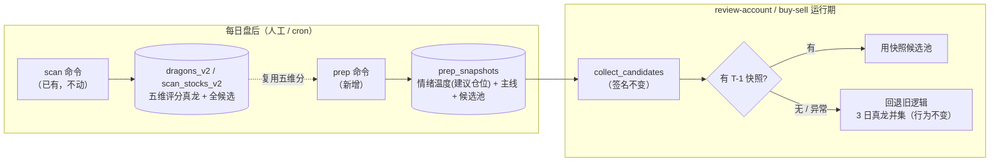
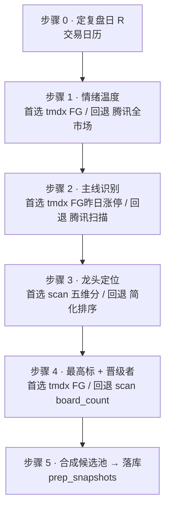

# 盘后复盘候选池 — 技术方案（Phase 1）
> **当前状态（2026-10-25 整仓结构重构 M0–M12）**：本文中的 `dragon_quant/cli_commands.py` / `dragon_quant/review_account/prep.py` 等实现位置已迁移：命令入口在 `dragon_quant/commands/<command>.py`（经 `commands.dispatch`），prep 在 `dragon_quant/review_account/prep/` 包（service/collectors/compute/rebuild），auction 编排在 `dragon_quant/auction/service.py`，assets CLI 装配在 `dragon_quant/assets_sync/cli_service.py`。历史设计正文保留原样；当前结构与命令以 `AGENTS.md`「架构总览」为准。


> 目标：用「盘后复盘」产出的候选池，替代 review-account / buy-sell 里硬编码的「最近 3 日真龙并集」。
> 核心机制：**新增 `prep` CLI 命令每日盘后执行复盘并落库为快照**；review-account 运行期**消费快照**；快照缺失则**回退旧逻辑**。
> 约束：不破坏 scan / orchestrator / scorers / review / dragons 等已有命令背后的逻辑。

---

## 1. 架构总览



**为什么必须是"快照落库"而不是"运行期实时拉取"**：review-account / buy-sell 是**历史回放**（`--from --to`、`--date` 指定过去日期），而 tmdx FG 板块、腾讯行情只返回**当前**数据、拿不到历史某天的涨停名单/涨跌家数。唯一能拿到历史复盘数据的办法，就是每日盘后把当天的复盘结果**快照落库**，回测时按日期回放。tmdx 的日 K / 板块成分可历史拉取，但「涨停名单/涨跌家数」这类**点截面**数据只能靠每日落库。

---

## 2. `prep` 命令事件流

> 命令形态（建议名，可改）：`python -m dragon_quant prep [--date YYYYMMDD] [--source v2]`
> 复盘日 R 默认 = 最近一个已收盘交易日；`--date` 可显式指定（用于补跑历史）。



> 各步骤的「首选 → 回退 → 最终兜底」完整矩阵见下方数据源优先级总表。

### 步骤 0 — 确定复盘日 R
- **数据源**：本地交易日历（`utils/trading.py`；缺省时用上证指数日K推断）。
- **失败兜底**：日历不可得 → 命令直接报错退出（无日历无法定 R）。

### 步骤 1 — 情绪温度（涨跌停家数比 / 涨跌家数比 / 量能）
- **首选**：tmdx FG 板块「昨日涨停」「昨日跌停」成员数 + `MarketStat`（若有）拿涨跌家数、两市成交额。
- **回退**：腾讯全市场批量行情（~25 批 × 200 只）扫 `pct` 计涨停/跌停/涨跌家数、汇总成交额。
- **最终兜底**：该因子置空（`sentiment=None`），**不中断**命令，后续步骤照常；情绪温度仅在可用时作为候选池过滤，缺失不影响候选池生成。
- **产出**：`{up_cnt, down_cnt, limit_up_cnt, limit_down_cnt, total_amount, temperature_score, position_advice, position_pct}`。温度分 → 建议仓位（空仓 / 轻仓 / 正常 / 重仓），阈值集中在 `prep` 模块内常量，便于调参。

### 步骤 2 — 主线识别（涨停分布集中度）
- **首选**：tmdx FG 板块「昨日涨停」成员名单（code 集合）+ tmdx 行业归属映射（HY 板块成分反查，进程内缓存）→ 按行业归组计数，取涨停家数最多的 1-3 个行业为主线。
- **回退**：腾讯全市场扫描得涨停名单 + 行业映射（同上，或复用 scan 已存的 `concepts`/`primary_sector`）。
- **最终兜底**：用 R 日 `dragons_v2` 的领涨板块（`concepts`）近似主线；再无则主线为空。
- **产出**：`main_boards = [{board_code, board_name, limit_up_count}]`。

### 步骤 3 — 龙头定位（主线板块内选龙头）
- **首选**：主线板块内涨停股，复用 **scan 已存的五维评分**（`scan_stocks_v2` / `dragons_v2` 按 R 日读，字段 `composite_score/rank/board_count`）。
- **回退**：scan 无 R 日数据时，用简化排序（连板高度 desc → 成交额 desc → 市值 asc）替代五维分。
- **产出**：主线板块龙头名单（top K，K 默认 3）。

### 步骤 4 — 全市场最高标 + 昨日涨停晋级者
- **首选**：tmdx FG 板块「最近多板」（连板梯队）+「昨日连板」成员，取连板最高者 + 连板 ≥2 者（= 昨日涨停晋级）。
- **回退**：scan 已存的 `board_count`（`scan_stocks_v2`）取最高标与连板 ≥2。
- **产出**：`{highest_board_code, promoted_codes[]}`。

### 步骤 5 — 合成复盘结果 JSON + 落库
- 合并 步骤 1（情绪/建议仓位）+ 步骤 2（主线）+ 步骤 3（主线龙头）+ 步骤 4（最高标、晋级者），按 code 去重（保留综合分更高者），**打包为一个格式化 JSON 文档整体落库**。
- **可扩展性设计**：快照存单列 `result_json`（整个文档）。后续新增字段（如资金流、炸板率、题材热度）= 往 JSON 加 key，**无需改表 / 迁移 schema**。
- JSON 结构（示意，字段可增）：

```json
{
  "trade_date": "2026-10-10",
  "version": "0.1",
  "sentiment": {
    "up_cnt": 3200, "down_cnt": 1800,
    "limit_up_cnt": 72, "limit_down_cnt": 10,
    "total_amount": 98000000000,
    "temperature_score": 72,
    "position_advice": "正常", "position_pct": 0.6
  },
  "main_boards": [
    {"board_code": "880xxx", "board_name": "半导体", "limit_up_count": 12}
  ],
  "candidates": [
    {
      "code": "000001", "name": "平安银行", "trade_date": "2026-10-10",
      "rank": 1, "composite_score": 85.0, "board_count": 3,
      "open_px": 10.0, "close_px": 11.0, "high_px": 11.1, "low_px": 9.9,
      "pct": 10.0, "turnover_rate": 8.5, "amount": 1200000000,
      "market_cap": 5000000000, "concepts": ["银行"], "is_true_dragon": true
    }
  ]
}
```

- 候选 dict 字段**与 `get_dragons_by_date` 返回结构一致**（`trade_date` 不可缺，`strategy.py` 据此写 `candidate_trade_date`）；下游硬依赖字段仅 `code`，其余 `.get()` 软依赖，保证 engine/strategy 零改动。
- **写入** `prep_snapshots` 表（`trade_date` 唯一）。
- **失败兜底**：写库失败 → 命令报错但不影响已跑完的其它交易日（幂等，重跑覆盖）。

### 数据源优先级总表

| 步骤 | 首选 | 回退 | 最终兜底 |
|---|---|---|---|
| 情绪温度 | tmdx FG + MarketStat | 腾讯全市场扫描 | 置空，不空池 |
| 主线识别 | tmdx FG「昨日涨停」+ 行业映射 | 腾讯扫描 + 行业映射 | dragons_v2 领涨板块近似 |
| 龙头定位 | scan 五维评分 | 简化排序 | 该板块空（候选池仍由其它来源构成） |
| 最高标/晋级 | tmdx FG「最近多板/昨日连板」 | scan board_count | 置空 |

---

## 3. review-account 消费与回退

`collect_candidates(calendar, day, cfg, loader)` 改造（**签名不变**，`simulator.py:30` / `trader.py:64` 调用点不动）：

1. 计算复盘日 R = `candidate_dates(calendar, day, 1)[-1]`（T-1）；**加守卫**：`candidate_dates` 返回空时（日历无 `< day` 日）直接走回退，不抛 IndexError。
2. 读 `prep_snapshots` 表 R 日快照。
3. **有快照** → 返回快照候选池（仍按 `is_true_dragon` / `min_score` 过滤，复用现有 `candidate_key` 排序）。
4. **无快照 / 快照空 / 快照读取异常** → 走旧 `loader` 逻辑（3 日真龙并集），**行为与现在完全一致**（这是"回退不破坏"的保证；`tests/test_review_account.py` 传 mock loader 且库内无快照，依赖此静默回退）。

> 快照是"T-1 盘后选、T 日买"的单日候选；不再做 3 日并集（快照本身已含主线龙头 + 最高标 + 晋级者，覆盖了 3 日并集想覆盖的"近期强势"）。
> `sentiment`（含 `position_advice`/`position_pct`）在 Phase 1 **仅落库供人工 / 后续策略消费**，review-account 当前只取 `candidates` 字段；据此改仓位属 strategy/engine 改动，**不在本次范围**（避免破坏现有命令）。

---

## 4. 改动文件清单

| 文件 | 改动 |
|---|---|
| `dragon_quant/providers/tdx.py` | **新增** `get_fg_board_members(board_name)`：FG 板块名→code 映射缓存 + `get_board_members` 封装（additive，不改现有方法） |
| `dragon_quant/storage/db.py` | **新增**：`prep_snapshots` 表 DDL 挂进 `BASE_SCHEMA`（列：`trade_date` + `source` + `result_json` + `created_at`，`UNIQUE(trade_date, source)`；不进 `_tables(source)` 的 v1/v2 路由，与 `review_account_*`/`buy_sell_signals` 等非版本表先例一致） |
| `dragon_quant/storage/prep.py` | **新增**：`save_review_snapshot` / `get_review_snapshot` / `has_review_snapshot`（存/取整个 JSON 文档到 `result_json`；source 自由文本，**不过 `_normalize_source`**） |
| `dragon_quant/review_account/prep.py` | **新增**：`run_prep(date)` 编排步骤 0-5，数据源优先级 + 兜底 |
| `dragon_quant/cli.py` + `cli_commands.py` | **新增** `prep` 子命令 + `_cmd_prep` |
| `dragon_quant/review_account/market.py` | **改造** `collect_candidates`：优先读快照，缺失回退旧逻辑 |
| `AGENTS.md` / `README.md` | 同步新增 `prep` 命令、`prep_snapshots` 表说明（按铁律） |

**不碰**：`orchestrator.py`、`scorers/*`、`review.py`、`storage/dragons.py`、`storage/scans.py`（只读它们）、`review_account/strategy.py`、`engine.py`、`data.py`。

---

## 5. 风险点与未来函数检查

1. **未来函数**：`prep` 只使用 R 日及之前数据（R 收盘后运行）；快照按 R 日落库；review-account 在 T 日只读 T-1 快照。无次日数据泄漏。
2. **FG 板块"昨"字头语义**：tmdx「昨日涨停」= 最近一个已收盘交易日。`prep` 在 R 日盘后运行，需在实现期验证盘后是否已翻到 R 日（否则是 R-1，差一天）。用成员 `pre_close` 日期锚定 + 腾讯交叉校验；不一致以腾讯为准。
3. **行业归属映射成本**：128 行业成分反查需缓存；失败不影响主线识别（可用 scan 已存 concepts 兜底）。
4. **快照与 scan 的时序依赖**：`prep` 优先复用 scan 的五维评分，需 scan 已跑过 R 日；scan 未跑时降级为简化排序，不报错。
5. **腾讯全市场扫描速率**：~25 批，复用 `RateLimiter` 分组串行防封；仅作回退路径，正常走 tmdx。
6. **buy/sell 同步变化**：`trader.py:64` 复用同一 `collect_candidates`，快照逻辑对 buy/sell 同样生效（符合预期，已与用户确认）。
7. **source 隔离**：快照消费**仅对 `cfg.source == "v2"` 生效**；`--source v1` 的 review-account 直接走旧逻辑（`prep_snapshots.source` 记为 `v2`，v1 查询不读 v2 快照，避免误消费）。
8. **同日多 run 择优**：步骤 3 读 scan 五维分时，若同日存在多个 scan run（不同 top_n），参照 `rebuild_dragons_for_date` 的规则择优：rank 最小 → composite_score 最高 → created_at 最新。
9. **部分失败的组合语义**：主线识别 =「涨停名单 + 行业映射」两步都成功才算成功；涨停名单成功但行业映射缺失 → 降级用 scan 已存 `concepts` 归组；两者皆无 → 主线为空，候选池仅由最高标/晋级者构成（不中断）。

---

## 6. 落地顺序

1. `storage/prep.py`（表 + 读写函数）→ 2. `tdx.py` FG 封装 → 3. `review_account/prep.py`（编排）→ 4. `cli` 注册 `prep` → 5. `market.py` 消费改造 → 6. 单测（快照读写、兜底回退、候选 dict 兼容）→ 7. 文档同步。
