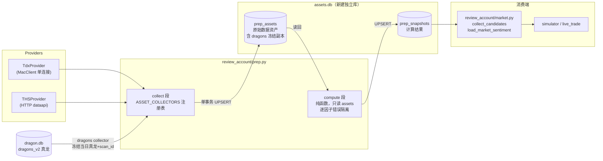
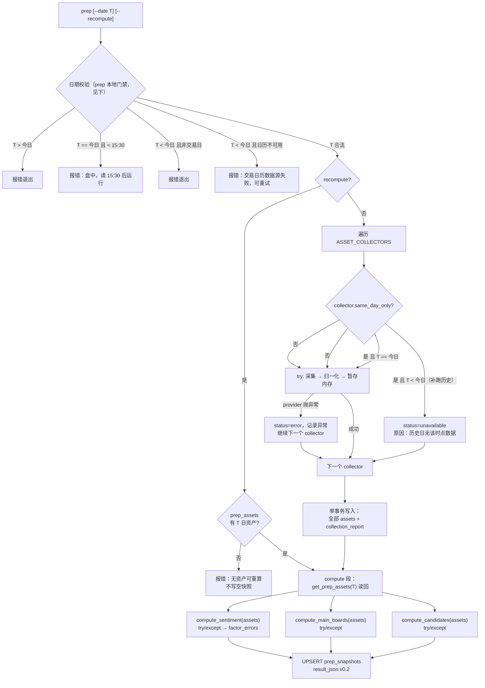

# prep 复盘因子扩展 + 独立快照库 技术方案
> **当前状态（2026-10-25 整仓结构重构 M0–M12）**：本文中的 `dragon_quant/cli_commands.py` / `dragon_quant/review_account/prep.py` 等实现位置已迁移：命令入口在 `dragon_quant/commands/<command>.py`（经 `commands.dispatch`），prep 在 `dragon_quant/review_account/prep/` 包（service/collectors/compute/rebuild），auction 编排在 `dragon_quant/auction/service.py`，assets CLI 装配在 `dragon_quant/assets_sync/cli_service.py`。历史设计正文保留原样；当前结构与命令以 `AGENTS.md`「架构总览」为准。


> 版本 v1.2 · 2026-10-18 · 基于已通过 research-reviewer 审查的调研报告 V4（`~/.claude/skills/deep-research/workspace/draft.md`）
> v1.1：按 solution-reviewer 第 1 轮 REVISE findings（12 MAJOR + 12 MINOR）修订
> v1.2：按 solution-reviewer 第 2 轮 REVISE findings（2 MAJOR + 3 MINOR，均为修复引入的新问题）修订
> v1.3（2026-10-20）：存储层重构，`assets.db`/`storage/assets_db.py` 统一为 `assets.db`/`storage/assets_db.py`；表结构与业务语义不变（下文路径已同步）。
> 数据源约束：**排除东财全部接口；tmdx（MacClient 单连接）优先，THS 次之；零新增 pip 依赖**

---

## 1. 需求回顾（阶段 0 已确认）

1. prep 复盘扩展因子：情绪面补强（市场宽度五合一 + THS 涨停池）、题材主线（THS block_top）、涨停归因（reason_type）、龙头资金流（main_net_amount）、L0 消息面（cninfo 公告标记）。
2. **新建独立 SQLite 库**（不用原 dragon.db），内含 2 张表：
   - `prep_assets` — 参与复盘的**原始数据资产** JSON（不可再生数据，每日落库、时间换历史）；
   - `prep_snapshots` — 复盘模块**计算后的结果**（表结构从老库原样迁移；无历史数据，无需数据迁移）。
3. 范围锁死：**只做 L0（cninfo 公告）+ L1（THS 涨停原因/题材主线）+ 情绪面补强**；L2 主动新闻流放弃。
4. **prep 固定 source="v2"**：移除 `--source v1` 入口（v1 已废弃，不新增任何 v1 写入/分支）；prep_snapshots 保留 source 列仅为读取兼容，只写 'v2'。

### 非目标

- L2 新闻流/舆情；880005/880006 统计指数（实测不可用）；北向资金（已停披露）；龙虎榜席位明细（东财独占）；880699 情绪指数与 get_unusual 异动（调研标「可选」，本期不采）；老库 prep_snapshots 数据迁移（无数据）。

---

## 2. 候选设计

### 方案 A（推荐）：两段式流水线 + 采集器注册表

`run_prep` 拆为**采集段**与**计算段**，两段以 `prep_assets` 表为唯一边界：

```
collect 段：遍历采集器注册表 → 每个 collector 独立 try/except → 全部 payload 在内存集齐后
            同一事务写入 prep_assets（含 collection_report）
compute 段：只从 prep_assets 读回资产（不消费采集段内存值）→ 纯函数计算（逐因子错误隔离）
            → UPSERT prep_snapshots
```

- **采集器注册表（策略模式）**：`ASSET_COLLECTORS: dict[str, CollectorSpec]`，每个 asset_type 一个可插拔 collector，`CollectorSpec` 声明 `same_day_only`（非当日采集跳过）与空值敏感度。新增因子 = 注册一行 + 一个函数，不动流水线骨架。
- **R 日真龙也是一等资产**：`dragons` collector 把 dragon.db 的当日真龙列表（含 scan_id/version）冻结进 prep_assets，compute 不再直接读 dragon.db——**快照 = 资产的纯函数**成立，`--recompute` 可复现（ dragons_v2 可能被 rebuild 改写，落库即冻结）。
- **计算段纯函数化 + 逐因子 try/except**：任一资产 payload 畸形只让对应因子置 null 并记入 `factor_errors`，快照照常产出。
- **`prep --recompute`**：跳过采集段，用已存资产重算快照；无资产时明确报错、不写空快照。
- 设计模式动机：**策略模式**隔离「每类资产怎么采」的变化；**模板方法**固定「采集→单事务落库→读回→计算→落库」骨架；**门面模式**收口 assets_db 连接/schema。

### 方案 B（非常规）：Append-only 资产事件流 + 血缘追踪

`prep_assets` 不用 UPSERT，每次采集 **append 新版本**（同一 (trade_date, asset_type) 多行，`created_at` 区分），`prep_snapshots` 记录所消费资产行的 id 集合（血缘）。

- 优点：重采不覆盖旧值，可审计「当时看到的原始数据是什么」；数据源后台纠错时能拿到前后对比证据链。
- 缺点：表体积数倍膨胀；所有读取都要「取最新版本」窗口逻辑；快照血缘显著增加实现与测试复杂度。在「单人每日一次」的使用强度下收益边际极低。
- **结论：不推荐本期。** 其「血缘」思想以弱化形式吸收进方案 A：`collection_report` 资产记录每次采集的成败/降级原因，`sentiment.factor_sources` 记录因子来源资产，`dragons` 资产 payload 记录 scan_id/version。

### 方案 C（对照）：直采直算 + assets 旁路 dump

计算段直接消费采集段的内存返回值，`prep_assets` 只是顺带 dump 备份。

- 优点：代码最少。缺点：assets 与 snapshot **不保证一致**（compute 中途失败 → assets 已落库、snapshot 缺失或用了未落库的中间值），永久失去可重算性。
- **结论：不推荐。**

### 推荐

**方案 A**。理由：① `prep_assets` 成为 compute 的唯一输入，快照是资产的纯函数，天然支持 `--recompute`；② 采集失败可独立降级、可事后单独重采某类资产；③ 复杂度可控（注册表 + 两个循环），不为假设的未来需求引入抽象。

---

## 3. 架构设计

### 3.1 数据流架构



### 3.2 run_prep 两段式流程（含采集门禁）



**门禁规则（prep 本地日期校验，不依赖雪球日历）**：
- `T > 今日` → CLI 直接报错；
- `T == 今日`：**不做「非交易日」判定**（雪球日历 15:05 前不含当日，会误判），直接进时点门禁——当前时间（Asia/Shanghai）< 15:30 → CLI 报错「盘中，请 15:30 后运行」（TDX 盘后刷新缓冲；prep 是盘后工具，盘中快照一律拒绝）；
- `T < 今日`（补跑历史）：用 **TDX 指数日K 自建交易日历**（复用 `TdxProvider.get_kline("SH000001")`，不引入雪球 Cookie 依赖）校验 `T` 是否交易日——`T` 不在日历 → 报错「非交易日」；**日历本身不可用（TDX 失败/为空）→ 报错「交易日历数据源失败，可重试」**（与「非交易日」严格区分，不误判）；
- `T` 合法且 `T < 今日` → same_day_only 资产 `unavailable(historical)`；
- 每个 same_day_only 资产 payload 记录 `as_of`（数据实际所属交易日）；compute 发现 `as_of != trade_date` 时按 degraded 处理，不静默使用。

---

## 4. 数据模型

### 4.1 新库文件

`storage/paths.py` 新增：

```python
ASSETS_DB_PATH = DATA_DIR / "assets.db"   # 随 DQ_DATA_DIR 覆盖，跨平台
```

- `storage/manager.py` 的 `clear_all()` 只清 cache/results/logs/shared 目录，本就不触碰任何 .db 文件——assets.db 天然免于误清；**`storage status` 增加 assets.db 的 exists/bytes 展示**（用户可见体积），文档注明 clear --all 不清理资产库。
- `assets_db` **不做 import 时建库**（不照搬 db.py 的模块级 `init_db()`），采用 `storage/prep.py` 同款「每次操作内 `_ensure_schema(conn)`」模式——测试 patch `assets_db._connect` 即可完全隔离，`--help` 等命令零副作用。

### 4.2 表结构（`storage/assets_db.py` 内建 schema）

```sql
-- 原始数据资产：不可再生数据，每日落库
CREATE TABLE IF NOT EXISTS prep_assets (
    id           INTEGER PRIMARY KEY AUTOINCREMENT,
    trade_date   TEXT NOT NULL,
    asset_type   TEXT NOT NULL,
    payload_json TEXT NOT NULL,
    created_at   TEXT DEFAULT (datetime('now','localtime')),
    UNIQUE(trade_date, asset_type)
);
CREATE INDEX IF NOT EXISTS idx_prep_assets_date ON prep_assets(trade_date);

-- 复盘计算结果：结构从老库 dragon.db 原样迁移（含 source 兼容列，只写 'v2'）
CREATE TABLE IF NOT EXISTS prep_snapshots (
    id           INTEGER PRIMARY KEY AUTOINCREMENT,
    trade_date   TEXT NOT NULL,
    source       TEXT NOT NULL DEFAULT 'v2',
    result_json  TEXT NOT NULL,
    created_at   TEXT DEFAULT (datetime('now','localtime')),
    UNIQUE(trade_date, source)
);
```

- `prep_assets.UNIQUE(trade_date, asset_type)`：同日同类资产 UPSERT 幂等；粒度到 asset_type，**单类资产可独立重采**（如 THS 403 后只重跑涨停池）。
- UPSERT 的 `ON CONFLICT DO UPDATE` **同时刷新 `created_at`**——该列语义为「最后采集时间」，配合单事务提交保证同一交易日的整组资产时间一致。
- **采集段单事务提交**：所有 payload 在内存集齐后，由 `save_prep_assets(trade_date, payloads, report)` 一个调用在同一事务内写入全部 assets + collection_report——进程中途崩溃不留「部分新部分旧」的混合状态。

### 4.3 资产类型注册表

| asset_type | 采集器（provider 方法） | same_day_only | payload 内容 | 用途 |
|---|---|---|---|---|
| `ths_limit_up_pool` | `THSProvider.get_limit_up_pool(date)` | 否（实测 ≥4.5 月可补跑） | `{trade_date, api_date, total, rows:[原始行]}` | 涨停/连板家数（权威）、reason_type、封板数据、炸板(open_num) |
| `ths_block_top` | `THSProvider.get_block_top(date)` | 否（≥4.5 月） | `{trade_date, api_date, rows:[原始行]}` | 题材主线：涨停家数/最高板/成分名单 |
| `market_breadth` | `TdxProvider.get_market_breadth_rows()` | **是**（实时快照） | `{as_of, up_cnt,down_cnt,flat_cnt,limit_up[],broken[],limit_down[],total_amount,sample_n}` | 红盘率/跌停/成交额；涨停/炸板交叉验证 |
| `fg_boards` | `TdxProvider.get_fg_boards(names)`（批量，一次板块列表解析） | **是**（T-1 语义） | `{as_of, boards:{name:{rows:[...], status}}}` | 昨日涨停溢价、晋级率交叉、龙虎榜名单（昨日上榜） |
| `fund_flow` | `TdxProvider.batch_get_quotes(候选 codes)` | **是** | `{as_of, quotes:{code:{main_net_amount,pct,turnover_rate,amount}}}` | 候选股主力净额 |
| `cninfo_announcements` | `TdxProvider.get_announcements(code)` × N 候选 | 否（**分页回溯 + 未来公告过滤**，见下） | `{as_of, window_days, items:{code:[{title,type,date,url}]}}` | L0 消息面标记 |
| `dragons` | `db.get_dragons(trade_date, source="v2")` | 否（本地库读取） | `{trade_date, scan_id?, version?, count, rows:[真龙列表]}` | 冻结 R 日真龙，compute 唯一真龙来源 |
| `collection_report` | 流水线自身 | — | `{asset_type:{status,error?,note?}}`，status ∈ `ok/empty/unavailable/error` | 采集成败/降级留痕（区分「无数据」vs「采集失败」） |

**cninfo 防未来公告污染（look-ahead 防护）**：`CninfoClient.get_announcements(code, count, page)` 无日期区间参数、按最新在前返回。采集器必须**逐页翻至 `date <= trade_date` 为止**，只保留 `[trade_date - window_days, trade_date]` 窗口内公告（window_days 默认 7），payload 记录 `as_of`（采集日）与每 code 的 `max_announcement_date`；单测断言「历史日资产不含晚于 trade_date 的公告」。**翻页上限保护（≤5 页/code）触顶时**：若已取到的最旧公告日期仍 > `trade_date - window_days`（说明未翻到窗口），该 code 标记 `truncated`，collection_report 记 `unavailable(truncated)` 而非 ok/empty——「翻页被截断」与「窗口内真空公告」必须可区分（单测覆盖该分支）。

**market_breadth 无效行/停牌行过滤**：① 无效行 `close<=0 or pre_close<=0` 不参与任何统计；② **停牌行 `vol<=0 and amount<=0`**（停牌股通常保留前收价，close/pre_close>0，单靠价格判据剔不掉）不参与 `up/down/flat_cnt` 与红盘率；`total_amount` 为全部行 amount 求和；过滤口径写入 payload；`sample_n` 记录参与统计行数，`sample_n < 3000` 视为 `empty_suspicious` 降级。（停牌判据列入交易日实测核对项：若实测 TDX 对停牌股直接返回 close=0，则以实测口径为准修订文档。）

**fund_flow 零值检测**：字段存在不代表数据源已填充（周六实测全 0）。采集器判定：候选 quotes 的 `main_net_amount` **全为 None 或全为 0** → 该资产记 `empty_suspicious` + note，compute 按 degraded 处理（候选字段 null），collection_report 明确留痕「数据源未填充」而非「真实无流入」。交易日实测 checklist 保留「至少一只非零」为验收项。

**日期格式**：THS dataapi 需 `YYYYMMDD`，CLI/DB 统一 `YYYY-MM-DD`——转换点固定在 THS 采集器内（`trade_date.replace('-', '')`），payload 同时记录两种格式。

### 4.4 result_json v0.2（只增 key，向后兼容）

```jsonc
{
  "trade_date": "2026-10-19",
  "version": "0.2",
  "sentiment": {
    // —— v0.1 已有 key（保留）——
    "up_cnt": 2100,            // 填充：market_breadth（缺失/降级时 null）
    "down_cnt": 2900,
    "limit_up_cnt": 59,        // = limit_up_cnt_ths（T 日权威）；THS 缺失时为 null（不再用 T-1 冒充 T）
    "limit_down_cnt": 3,       // = breadth 跌停数；缺失时 null
    "total_amount": 1550000000000,
    "temperature_score": 65.2, // limit_up/(limit_up+limit_down)*100（两数可得时）
    "position_advice": "正常",
    "position_pct": 0.5,
    // —— v0.2 新增：双口径并列，血缘可追 ——
    "limit_up_cnt_ths": 59,        // T 日（THS 权威）
    "limit_down_cnt_ths": null,    // THS pool 不含跌停 → 恒 null（占位）
    "limit_up_cnt_t1_fg": 55,      // T-1 日（FG 昨日涨停，交叉观察，不进公式）
    "limit_down_cnt_t1_fg": 2,     // T-1 日（FG 昨日跌停，交叉观察）
    "position_input": {"limit_up_cnt": "ths_t", "limit_down_cnt": "breadth_t"},  // 公式输入血缘
    "broken_cnt": 18,          // 炸板数：market_breadth 主 / THS open_num>0 备
    "broken_rate": 0.234,
    "yesterday_premium_pct": 1.8,  // FG 昨日涨停成员当日平均涨幅
    "promotion_rate": 0.31,        // 今日连板家数 / 昨日涨停家数（连板判定见下注）
    "max_board_height": 4,         // block_top high「4天2板」解析
    "lhb_cnt": 42,                 // FG 昨日上榜（龙虎榜名单数）
    "factor_sources": {"limit_up_cnt_ths": "ths_limit_up_pool", ...},
    "factor_errors": {"main_boards": "KeyError: high"},   // compute 逐因子错误隔离留痕
    "degraded": ["market_breadth"]
  },
  "main_boards": [
    // block_top 主路径：
    {"board_name": "低空经济", "limit_up_num": 23, "high": "4天2板", "dragon_count": 2}
    // 回退路径（block_top 缺失）：{"board_name": "...", "dragon_count": n}
    // 合约：limit_up_num/high 可缺失，消费方必须 .get()；当前 main_boards 无代码消费方，仅供人工观察
  ],
  "candidates": [
    // v0.1 结构之上，每候选只增 key：
    {"code": "...", "reason_type": "低空经济+飞行汽车",
     "limit_up_type": "换手板", "open_num": 0, "is_again_limit": false,
     "first_limit_up_time": "093015",
     "main_net_amount": 12345678.0,      // 单位：元；null=未知（区别于 0=无流入）
     "announcements": [{"title": "...", "type": "...", "date": "..."}]}
  ],
  "dragon_source": {"trade_date": "2026-10-19", "scan_id": "v2_20261019_top25", "version": "...", "count": 5}
}
```

**`promotion_rate` 连板判定**：优先用 THS pool 的数值连板字段（实现时实测字段名）；若 pool 只有 `is_again_limit`（布尔），则指标改名 `again_limit_rate = 回封/连板家数 ÷ 昨日涨停家数`，不冒充晋级率。

**⚠️ 有意的行为变更（需用户知悉）**：v0.1 的 `limit_up_cnt` 来自 FG（T-1 近似值），v0.2 切换为 THS（T 日精确值）。`position_advice` 阈值启发式（80/5/30/10）不变，但输入口径从 T-1 变为 T——这正是本次升级的目的（v0.1 的 FG 计数是文档承认的近似缺陷）。两个口径的原始值都保留在 JSON 中可对比；`position_input` 记录实际消费口径，THS 缺失回退 FG 时标记 `degraded` 且 `position_input.limit_up_cnt="fg_t1"`，消费端可据此选择不信任该日仓位建议。此变更将写入 commit message。

---

## 5. 接口定义

### 5.1 StockProvider 新增可选方法（基类默认 `raise NotImplementedError`，项目硬性约束）

```python
# providers/base.py
def get_market_breadth_rows(self, count: int = 6000) -> list[dict]:
    """全 A 实时行情行（已归一化为 native 类型，NaN→None）"""
    raise NotImplementedError(...)

def get_limit_up_pool(self, date: str) -> dict:
    """THS 涨停池 dataapi，date=YYYYMMDD；返回 {'total','rows'}"""
    raise NotImplementedError(...)

def get_block_top(self, date: str) -> dict:
    """THS 题材主线榜 dataapi；返回 {'rows'}"""
    raise NotImplementedError(...)

def get_announcements(self, code: str, count: int = 30, page: int = 1) -> list[dict]:
    """cninfo 个股公告单页（title/type/date/url），最新在前"""
    raise NotImplementedError(...)

def get_fg_boards(self, names: list[str]) -> dict[str, dict]:
    """FG 板块批量成员：一次板块列表解析 + 逐板块成员；{name: {'rows': [...], 'status': 'ok'|'missing'}}"""
    raise NotImplementedError(...)
```

**新方法错误契约（与存量方法的「异常吞掉返回 []」不同，显式声明）**：transport 层失败（超时/403/连接错误）**抛异常**，由 collector 捕获记 `status=error`；仅「请求成功但确无数据」返回空——collector 据此区分 `empty` 与 `error`。不可能为空的资产（market_breadth、fg_boards 全空）额外标记 `empty_suspicious`。

### 5.2 TdxProvider 实现

- `get_market_breadth_rows()`：`client.get_stock_quotes_list(Category.A, start=0, count=count, fields=PresetField.COMMON)`（**必须显式传 count≈6000**，默认 80；内部自动分页多次串行请求，复用现有 `_lock`）。返回前经 `_normalize_rows()` 归一化：numpy 标量 → native int/float，非有限值 → None。
- `get_fg_boards(names)`：一次 `get_board_list(FG)` 解析全部目标板块 code，再逐个 `get_board_members`；逐板块记录 `status`（`ok`/`missing`）；transport 异常上抛。存量 `get_fg_board_members` 保留（内部可复用批量方法）。
- `get_announcements()`：easy_tdx 内置 `CninfoClient.get_announcements(code, count, page)` 单页包装（HTTP，独立于 MacClient），惰性导入；分页/过滤逻辑在 prep 采集器（见 §4.3）。
- `_to_quote()` 增映射：`main_net_amount = _f(r["main_net_amount"]) if "main_net_amount" in r else None`（存在性检查，缺失保持 None）；`Quote` dataclass 增字段 `main_net_amount: float | None = None`——腾讯/雪球不回填，避免「0」被误读为「无主力流入」。

### 5.3 THSProvider 实现

- `get_limit_up_pool(date)` / `get_block_top(date)`：GET `data.10jqka.com.cn/dataapi/limit_up/{limit_up_pool|block_top}?date=YYYYMMDD`。
- **抽出共享 `_fetch_with_retry(url, referer='', gbk=False, attempts=3, backoff=0.8, raise_on_exhaust: bool)`**：现有 403 退避循环内联在 `get_sector_ranking`，本次抽为公共函数。**存量 `get_sector_ranking` 以 `raise_on_exhaust=False` 调用**——持续 403 时返回 None → 维持现有「`continue` 跳过该页、最终返回已收集结果/空列表」的旧契约（orchestrator Phase A 依赖此行为，绝不允许异常上抛到 scan 主流程）；仅 `get_limit_up_pool`/`get_block_top` 以 `raise_on_exhaust=True` 调用，退避耗尽后抛异常（符合 §5.1 新契约）。回归测试：连续 3 次 403 时 ranking 返回 [] 而非抛异常。
- 鉴权画像（调研实测）：仅需现有 `UA`（Chrome 120）+ `Referer: https://data.10jqka.com.cn/`；无 Cookie/token；**响应 UTF-8 JSON（非 GBK）**。

### 5.4 存储层（`storage/assets_db.py`，新模块）

```python
# 独立门面：自带 _connect/_ensure_schema/_lock（WAL + 每操作独立连接 + 操作内 ensure_schema）
def save_prep_assets(trade_date: str, payloads: dict[str, dict], report: dict) -> None
    """单事务 UPSERT 全部资产 + collection_report；ON CONFLICT 同时刷新 created_at。
       json.dumps(..., ensure_ascii=False, allow_nan=False, sort_keys=True)"""
def get_prep_asset(trade_date: str, asset_type: str) -> Optional[dict]
def get_prep_assets(trade_date: str) -> dict[str, dict]   # 整日全部资产，compute 段入口
def save_prep_snapshot(trade_date: str, result: dict, source: str = "v2") -> None # UPSERT
def get_prep_snapshot(trade_date: str, source: str = "v2") -> Optional[dict]
def has_prep_snapshot(trade_date: str, source: str = "v2") -> bool
```

- **不**经 `storage/db.py` 门面再导出；消费方显式 `from dragon_quant.storage import assets_db`，与 dragon.db 物理隔离一目了然。
- 老库清理：`storage/db.py` BASE_SCHEMA 移除 `prep_snapshots` 定义、删除 `storage/prep.py` 及 facade 导出（老库文件里的残留空表无害，文档注明）。

### 5.5 消费端与 CLI 改动

- `review_account/market.py`：`db.get_prep_snapshot` → `assets_db.get_prep_snapshot`（`collect_candidates` 与 `load_market_sentiment` 两处）。
- `cli.py`：prep 子命令**移除 `--source` 参数**（固定 v2），新增 `--recompute`（`action='store_true'`）。
- `cli_commands.py::_cmd_prep`：日期校验（T>今日/非交易日报错）；调用 `run_prep(trade_date, recompute=args.recompute)`；输出附 `collection_report` 降级摘要；recompute 模式打印所用资产时间。
- `review_account/prep.py::run_prep(trade_date: str, recompute: bool = False)`（不再有 source 参数）。

---

## 6. 错误处理与降级矩阵

| 资产缺失/失败 | 降级行为 |
|---|---|
| `ths_limit_up_pool` | `limit_up_cnt`/`limit_up_cnt_ths`=null；position 公式输入回退 `fg_t1` 并标 degraded + `position_input` 记录；候选 reason_type 等字段 null |
| `ths_block_top` | `main_boards` 回退 v0.1 真龙 concepts 计数（元素仅 `board_name`/`dragon_count`）；`max_board_height`=null |
| `market_breadth` | `up/down/total_amount/broken_*`=null（现状行为）；limit 侧由 THS 兜底 |
| `fg_boards` | 溢价/晋级交叉/lhb_cnt/双口径 FG 值 = null |
| `fund_flow` | 候选 `main_net_amount` = null |
| `cninfo_announcements` | 候选 `announcements` = [] |
| `dragons` | candidates 为空（与现状无真龙行为一致）；main_boards 回退路径亦为空 |
| 补跑历史日 / 盘中 | same_day_only 资产 `unavailable`，对应因子 null |
| 单资产字段畸形 | compute 逐因子 try/except → 该因子 null + `factor_errors` 留痕，其余因子照常 |
| 不可能为空的资产返回空 | `empty_suspicious` 记入 collection_report，按缺失降级 |

原则：**任何单点失败不中断 prep**（collect 段逐 collector 隔离 + compute 段逐因子隔离）；失败进 `collection_report` + result_json `degraded`/`factor_errors`；`position_pct` 只在公式输入两数可得时产出，否则 null（消费端对 null 已有降级：sizing 1.0、禁买不生效）。

---

## 7. 测试策略

1. **`tests/test_assets_db.py`（新）**：tmp 库 round-trip；UPSERT 幂等 + `created_at` 刷新；`save_prep_assets` 单事务（中途异常 → 全不落库）；`get_prep_assets` 聚合；`allow_nan=False` 对 NaN payload 抛错；两表互不影响。patch `assets_db._connect`。
2. **`tests/test_prep.py`（重写）**：
   - compute_* 纯函数：真实采集留档 fixture（`tests/fixtures/prep/`）→ 断言全字段；
   - 降级矩阵逐行参数化（每类资产 missing/error/畸形 → 断言回退 + `degraded`/`factor_errors` 标记）；
   - **cninfo look-ahead 防护**：含未来公告的分页数据 → 断言历史日资产只含窗口内公告；
   - **采集门禁**：T>今日报错；**T==今日 10:00 → 报「盘中」而非「非交易日」**（不查雪球日历）；T<今日非交易日报错；**日历为空/不可用 → 报「数据源失败」而非「非交易日」**；`as_of != trade_date` → degraded；
   - recompute：确定性（同一 assets 两次 compute 一致；派生集合输出全部 `sorted`，JSON `sort_keys=True`）；无资产时报错不写快照；
   - numpy/NaN 归一化 round-trip；停牌行（close/pre_close≤0）不计入涨跌家数；日期格式转换（`YYYY-MM-DD`→`YYYYMMDD`）。
3. **provider 单测**：ths `_fetch_with_retry` 403 序列（两次 403 后成功 / 三次失败抛异常）；**ranking 回归：连续 3 次 403 → 返回 [] 不抛异常**（raise_on_exhaust=False 保旧契约）；dataapi fixture 离线解析；tdx `_normalize_rows`；`get_fg_boards` 批量 + 逐板块 status；Quote.main_net_amount 存在性检查（缺失 → None）；**停牌 fixture（close==pre_close>0 且 vol==0）不计入 up/down/flat**；**fund_flow 全 None/全 0 → empty_suspicious**。
4. **`tests/test_review_account_timing.py`**：patch 目标 `dragon_quant.storage.db.get_prep_snapshot` → `dragon_quant.storage.assets_db.get_prep_snapshot`；新增「prep 拒绝 source=v1」测试。
5. 全部单测零网络。**交易日实测 checklist**（⚠️ 调研遗留）：
   - ✅ **已实测（2026-10-18，读上一交易日快照）**：全 A 扫描 `get_stock_quotes_list(Category.A, count=6000)` 返回 **5580 行、耗时 3.6s**，行含 `buy_price_limit/sell_price_limit/amount` —— 五合一聚合可行且开销可接受；FG 批量 `get_fg_boards` 3 板块 **0.7s**，成员字段含 `market_cap`（旧契约完整）；THS 涨停池实测 `total` 命中 59/32/118（多日），分页单页即可。
   - ⚠️ **仍待交易日复验**：① quote `main_net_amount` 非零与单位（周末为 0，已由 `empty_suspicious` 检测兜底）；② THS 涨停池 `high_days` 连板数值语义（当前用「N天M板」解析，若语义不符则 `promotion_rate` 保持 null）；③ 超过 200 行的超大涨停日分页路径（已有离线单测，待真实日印证）。

---

## 8. 已知风险与缓解

| 风险 | 缓解 |
|---|---|
| 全 A 扫描 ~5000 只分页串行请求耗时未实测（prep 可能从秒级变分钟级） | 单连接一次调用（内部分页）；交易日实测；超时/失败按 §6 降级为「THS+FG 版」，不阻塞主流程 |
| THS dataapi 历史窗口超 4.5 月未知 | 资产每日落库即自有历史，越早接入起点越早；文档标注补跑上限 |
| `main_net_amount` 交易日复验（周六为 0） | 为 0 则 fund_flow 资产整体降级，候选字段 null，不影响其他因子 |
| FG 板块 T-1 语义被误用为 T 日数据 | 双口径字段命名（`_t1_fg` 后缀）+ `as_of` 校验 + 不进 position 公式（除非 THS 缺失且显式标记） |
| position_advice 输入口径 T-1→T 的行为变更 | §4.4 明示 + 双口径值并列留存 + `position_input` 血缘 + commit message 标注；用户可在门禁否决 |
| cninfo 分页回溯深度（长窗口需多页请求） | window_days 默认 7；翻页上限 ≤5 页/code，**触顶且未到窗口 → 该 code 记 truncated（unavailable），不与真空混淆**；候选股数量有限（≤30） |
| assets.db 体积膨胀 | 估算 100–300KB/日，年 ~30–70MB 可接受；`storage status` 可见；retention 命令后续再说（非本期） |

### 8.1 用户在需求中未明确、但设计必须覆盖的点

1. **补跑数据污染（三向防护）**：same_day_only 注册表标记 + 交易日历/盘中门禁 + `as_of` 校验——FG/实时行情类资产绝不会被记到历史日或未来日名下。
2. **「无数据」vs「采集失败」可区分**：新 provider 方法失败抛异常（契约）+ collection_report 四态枚举（ok/empty/unavailable/error）。
3. **快照可复现性**：dragons 作为一等资产冻结（含 scan_id/version），`--recompute` 不依赖 dragon.db 当前状态。
4. **Quote 资金字段默认值语义**：默认 `None`（未知）而非 `0.0`（无流入）。
5. **老库残留**：BASE_SCHEMA 移除 prep_snapshots 后，老 dragon.db 中的空表无害残留；新装环境不再建该表。
6. **新因子只观察不进公式**：broken_rate/溢价/晋级率等 v0.2 因子先落 JSON 供人工观察与回测，**不改 position_advice 阈值**（项目铁律：未验证参数不自动推广）。
7. **文档同步（强制）**：同一 commit 更新 `AGENTS.md`（新库/新表/prep 命令/数据源段）与 `README.md`。

---

## 9. 实施清单（文件级）

| 文件 | 动作 |
|---|---|
| `dragon_quant/storage/paths.py` | +`ASSETS_DB_PATH` |
| `dragon_quant/storage/assets_db.py` | **新建**：独立门面 + 两表 schema + 事务批量写 + 6 个 API |
| `dragon_quant/storage/db.py` | BASE_SCHEMA 移除 prep_snapshots；移除 storage/prep.py 导出 |
| `dragon_quant/storage/prep.py` | 删除 |
| `dragon_quant/storage/manager.py` | `storage status` 增加 assets.db exists/bytes |
| `dragon_quant/providers/base.py` | +5 个可选方法（默认 NotImplementedError；文档注明新方法错误契约） |
| `dragon_quant/providers/tdx.py` | +`get_market_breadth_rows`/`get_fg_boards`/`get_announcements`；`_normalize_rows`；`_to_quote` 映射 main_net_amount（存在性检查） |
| `dragon_quant/providers/ths.py` | 抽 `_fetch_with_retry`；+`get_limit_up_pool`/`get_block_top` |
| `dragon_quant/models/types.py` | Quote +`main_net_amount: float \| None = None` |
| `dragon_quant/review_account/prep.py` | 重写：采集器注册表 + 单事务两段式 run_prep + 纯函数 compute（逐因子隔离） |
| `dragon_quant/review_account/market.py` | db.get_prep_snapshot → assets_db.get_prep_snapshot（2 处） |
| `dragon_quant/cli.py` | prep 移除 `--source`；+`--recompute` |
| `dragon_quant/cli_commands.py` | `_cmd_prep`：日期校验 + recompute + 降级摘要输出 |
| `tests/test_assets_db.py` / `tests/test_prep.py` / `tests/test_review_account_timing.py` | 新增/重写/改 patch 目标 + v1 拒绝测试 |
| `AGENTS.md` / `README.md` | 同 commit 文档同步 |

---

## 10. v1.1 修订记录（对应 solution-reviewer 第 1 轮 findings）

| finding | 修订 |
|---|---|
| M1 cninfo look-ahead | §4.3 分页回溯 + 窗口过滤 + as_of/max_announcement_date + 单测 |
| M2 纯函数不成立 | dragons 升为一等资产（含 scan_id/version 冻结），compute 只读 assets |
| M3 same_day_only 门禁绕过 | §3.2 完整门禁：T>今日报错/非交易日报错/盘中跳过/as_of 校验 |
| M4 失败与空不可区分 | §5.1 新方法错误契约（失败抛异常）+ collection_report 四态 |
| M5 FG「当日等价」误述 | §4.4 删除等价表述；双口径字段 `_t1_fg` 命名；THS 为 T 日权威 |
| M6 _fetch 无退避 | §5.3 抽共享 `_fetch_with_retry` + 403 序列单测 |
| M7 v1 写入路径 | §1/§5.5 prep 移除 --source，固定 v2；拒绝测试 |
| M8 资产写入非原子/created_at | §4.2 单事务 save_prep_assets + ON CONFLICT 刷新 created_at |
| M9 compute 无错误隔离 | §3.2/§6 逐因子 try/except + factor_errors |
| M10 cli.py 遗漏 | §9 补 cli.py；run_prep 签名明确 |
| M11 numpy/NaN JSON | §5.2 `_normalize_rows` 归一化 + allow_nan=False + round-trip 单测 |
| M12 position 口径静默变更 | §4.4 明示为有意变更 + 双口径并列 + position_input 血缘 |
| m1 promotion_rate 字段未确认 | §4.4 实现时实测；无数值字段则改名 again_limit_rate |
| m2 _to_quote 存在性 | §5.2 `in r` 检查，缺失保持 None |
| m3 集合顺序确定性 | §7 派生输出 sorted + sort_keys=True |
| m4 import 时建库 | §4.1 操作内 ensure_schema，无 import 副作用 |
| m5 assets.db 不可见 | §4.1/§9 storage status 展示 |
| m6 main_boards 形状不一致 | §4.4 合约声明 + 双路径单测 |
| m7 日期格式转换点 | §4.3 固定转换点 + 双格式 payload + 单测 |
| m8 fg 6×双重拉取 | §5.1/§5.2 `get_fg_boards` 批量（一次列表解析）+ 逐板块 status |
| m9 停牌行过滤 | §4.3 过滤规则 + sample_n/empty_suspicious |
| m10 THSProvider 命名 | 全文统一 |
| m11 recompute 空资产 | §3.2 明确报错不写快照 |
| m12 dragons 血缘 | dragons 资产 payload 含 scan_id/version（dragon_source 字段） |

## 11. v1.2 修订记录（对应 solution-reviewer 第 2 轮 findings，均为修复引入的新问题）

| finding | 修订 |
|---|---|
| N1(MAJOR) 门禁依赖雪球日历且与盘中语义矛盾 | §3.2 重写：T==今日不查日历直接时点门禁（<15:30 报「盘中」）；T<今日改用 TDX 指数日K自建日历；「日历不可用」与「非交易日」报错严格区分；配套 2 条单测 |
| N2(MAJOR) _fetch_with_retry 上抛会破坏 ranking 旧契约 | §5.3：`raise_on_exhaust` 参数——ranking=False（持续 403 返回 None→continue，旧行为不变），dataapi=True；回归测试「3×403 → ranking 返回 [] 不抛异常」 |
| N3 cninfo 翻页触顶与真空不可区分 | §4.3：触顶且最旧公告仍晚于窗口起点 → 该 code 记 truncated/unavailable；§8 风险表同步；单测覆盖 |
| N4 停牌判据不成立（停牌股 close/pre_close>0） | §4.3：停牌行判据改为 `vol<=0 and amount<=0`，口径写 payload；停牌 fixture 单测；列入交易日实测核对项 |
| N5 fund_flow 全 None/全 0 无降级标记 | §4.3：全 None/全 0 → empty_suspicious + note，compute 按 degraded；单测 + 交易日实测「至少一只非零」验收项 |

第 2 轮 reviewer 已确认第 1 轮 24 条 findings 中 22 条实质解决，其余 2 条（m9 停牌过滤、M3 门禁）由上述 N4/N1 闭环。两轮迭代预算已用完，最终门禁交由用户裁决。
