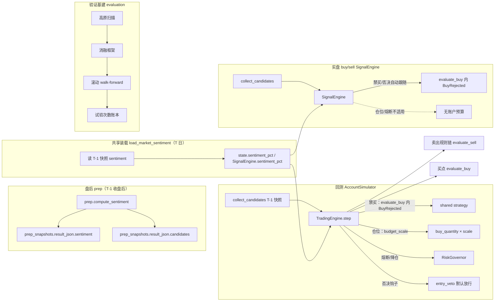
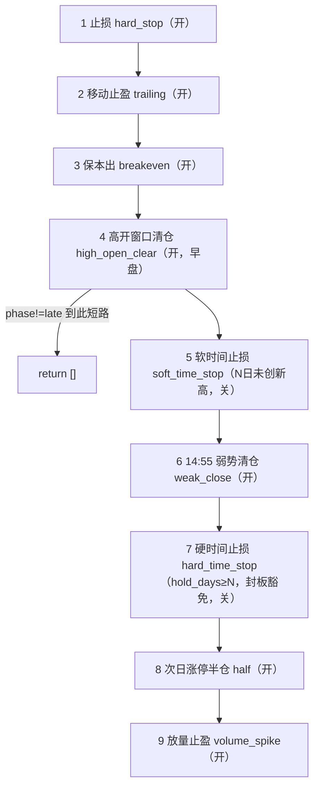
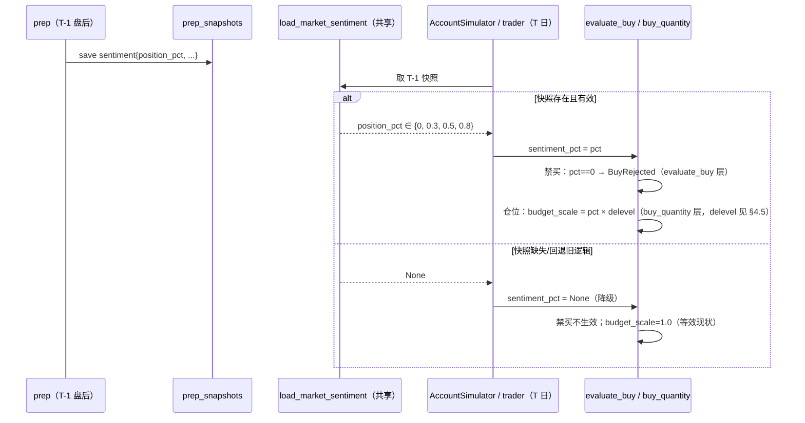
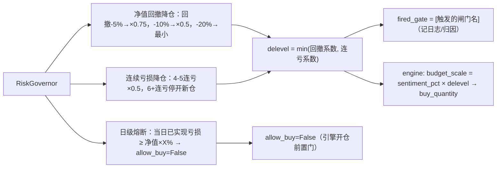

# 择时与仓位优化 —— 技术方案（阶段 2）

> 方案日期：2026-10-14 · 分支 feat/reviewa-account-op
> 输入：阶段 0 决策 + 阶段 1 已 APPROVE 的《择时与仓位调研.md》+《现状策略基线.md》
> 落地范围：诊断 + 改进现有 `review_account` 策略（不新建独立模块）；竞价仅留 `entry_veto` 钩子，本次不接；仓位管理与择时并重；龙头短线为主。
> 版本：v1.2（solution-reviewer 二轮 REVISE 修订版；修订点见 §12）

---

## 1. 目标与验收口径

### 1.1 目标（与阶段 0 决策一一对应）

| 决策 | 本方案落点 |
|------|-----------|
| ① 诊断+改进现有策略 | 不改架构，在 `review_account/` 内增量改造；改造前先建「验证基建」作为诊断工具 |
| ② 竞价本次不接、留 veto 口 | `entry_veto(cfg, cand, row)` 共享钩子，默认放行；集合竞价强度未来作为一票否决挂载 |
| ③ 仓位管理与择时并重 | 择时=卖点分级/时间止损/龙回头；仓位=情绪→仓位→禁买/集中度/组合熔断；两者同权重交付 |
| ④ 龙头短线为主 | 所有规则以 2-5 日持仓、T+1、10% 涨跌停、候选池当日快照为约束 |

### 1.2 阶段 1 提炼的「最值得做」清单（本方案只做这些）

> 完整结论见调研报告。本方案只落地「高确定性 + 高期望收益」项，**明确不做**调研 §7.5 数据约束内的项。

| 优先级 | 改造项 | 期望收益 | 落地形态 |
|--------|--------|---------|---------|
| P0 | 情绪→仓位→禁买 组合层链路（现状「只产不用」断点） | 高（控回撤主来源） | 【新增接入】+【新增开关】 |
| P0 | 验证基建（高原扫描/消融/试验账本/回撤分解/滚动 walk-forward） | 方法论（防自欺） | 【新增工具】 |
| P0 | 组合熔断 + 连续亏损降仓 + 净值回撤降仓 | 中-高（纯回撤控制） | 【新增】 |
| P0 | `entry_veto` 竞价否决预留口 | 用户决策② | 【新增钩子】 |
| P1 | 时间止损（接通 `max_hold_days` 死参数 + 软时间止损） | 中 | 【改造】+【新增】 |
| P1 | 分级移动止盈 | 中-高 | 【新增】 |
| P1 | 龙回头/二波买点（数据约束下唯一可完整历史验证的新买点） | 中 | 【新增】 |
| P2 | 保本出阈值上调 + 集中度/风险比例参数扫描 | 中（回撤指标改善） | 【现有参数消融】 |
| P2 | 温度指标增强（炸板率/最高连板/昨日涨停溢价） | 中（前向积累） | 【改造 prep】 |

---

## 2. 现状问题与改造点（基线摘要）

> 逐条已在《现状策略基线.md》代码核实，此处只保留方案需要的结论。

1. **情绪断点**：`prep.compute_sentiment()` 产出 `position_pct`（0/0.3/0.5/0.8），落库 `prep_snapshots.result_json.sentiment`，但 `market.collect_candidates()` 只读 `snap["candidates"]`，engine/strategy/execution 全文零引用。
2. **卖出规则链硬编码**：`strategy.evaluate_sell()` 7 条 if 分支，代码顺序即优先级、命中即短路，**无单条开关**——消融实验无法做。
3. **`max_hold_days=5` 是死参数**：`StrategyConfig` 有、`evaluate_sell` 未消费。
4. **无否决口**：`engine.step` 中买入信号在 `evaluate_buy` 产出后直接 `state.pending.append()`，无 veto 插拔点。
5. **集中度保护形同虚设**：`max_position_pct=100`，`buy_quantity` 中 `budget = min(cash, equity × 100%)` → 单笔全可用现金。
6. **验证框架弱**：`compare_strategies` 4 个 variant 写死、无夏普、无 reason_code 归因、无参数敏感度、无试验次数记录。
7. **回测↔实盘分叉风险**：`live_trade.SignalEngine` 复刻 `TradingEngine.step`，无账户/权益；engine 层新增逻辑**不会自动传导**（仅共享函数层自动跟随）。

---

## 3. 候选设计（≥2，含 1 个反直觉路径）

### 3.1 候选 A（推荐）：均衡落地 —— 规则链表化 + 情绪链路 + 组合风控 + 验证基建

**内容**：卖出规则从 if 链重构为「责任链 + 策略模式」的规则表（每规则带开关），同时打通情绪→仓位→禁买链路、加组合熔断、接通时间止损、加龙回头买点与分级移动止盈，并完整交付验证基建。

**优点**：
- 覆盖用户「择时与仓位并重」的全部要求；
- 规则表化直接解锁消融实验（阶段 1 反复强调的「先消融定规则集，后扫参数高原」）；
- 所有新规则 default-off，行为向后兼容。

**缺点**：
- 改动面最大（strategy/engine/execution/market/prep/evaluation 六文件），一次交付风险高；
- 新规则（龙回头、分级止盈）在 <100 笔/年的样本下有过拟合风险，需强制消融门控。

### 3.2 候选 B（反直觉）：极简干预 —— 只做组合层风控 + 验证基建，买卖规则一行不动

**内容**：完全不新增/微调任何买卖规则（连 `max_hold_days` 都只接通、不调阈值）。全部精力放在：① 情绪→仓位→禁买；② 组合熔断/连续亏损降仓/净值回撤降仓；③ 集中度参数扫描；④ 验证基建。理由是**阶段 1 的「一句话总纲」：最大期望收益在组合层链路，不在买点/卖点微调；微调在极小样本下大概率是噪声拟合**。

**优点**：
- 干预最小、回归面最小、最快可验证「组合层链路是否真的带来期望收益」；
- 天然规避卖点微调的过拟合陷阱。

**缺点**：
- 不完全满足用户「择时并重」——择时侧只交付了「诊断工具」，未交付「改进动作」；
- 若组合层验证结论偏弱，等于阶段 3 只交付了工具，没有策略收益改进。

### 3.3 推荐：候选 A，但**用候选 B 的纪律分阶段**

采纳 A 的完整改造集，但**实现顺序 = B 的顺序**（先组合层+验证基建 → 后新规则），且每个新规则进入默认参数前必须通过消融+高原门控。这样：

- 阶段 3 第一批交付的是「零新规则、可回退」的组合层风控与诊断工具（低风险）；
- 第二批新规则（龙回头/软时间止损/分级止盈）以第一批的消融/高原框架为**前置证据**，证据不足即不推广（回退到 default-off）。

### 3.4 实现技术维度的权衡（补充：规则表化 vs 轻量开关）

> 针对「规则表化是否过度设计」的补充论证（候选 A/B 是「范围」维度对比，此处补「实现技术」维度）。

| 技术路径 | 实现 | 优点 | 缺点 |
|---------|------|------|------|
| **轻量 guard** | 保留 if 链，每条前加 `if not toggles.get(name, True): continue` | 回归面最小、黄金基准维护成本最低 | if 链依旧扁平、顺序隐式、新增规则继续「贴膏药」；消融与新增规则的统一抽象缺失 |
| **规则表化（本方案采用）** | `SellRule(name, late_only, evaluate)` 有序 list，命中短路 | 顺序显式、开关统一、新规则（时间止损）作为新规则对象自然插入；`late_only` 显式承载「阶段门」 | 需一次重构 + 黄金基准对比锁行为 |

**取舍理由**：本次同时要「消融（开关）+ 新增两条时间止损规则 + 显式锁定顺序」，规则表化的「统一顺序/开关/阶段门」三合一抽象值得其黄金基准维护成本；若本次只做消融、不新增规则，则轻量 guard 更省。这是「面向接口而非实现」在收益-成本上占优的情形，非为炫技抽象。

---

## 4. 推荐方案详细设计

### 4.1 架构总览



### 4.2 设计模式应用（点明模式与动机）

| 模式 | 应用位置 | 动机 |
|------|---------|------|
| **责任链（Chain of Responsibility）** | `evaluate_sell` 规则链重构：有序规则列表、命中即短路 | 现有 7 条 if 分支本就是责任链，显式化后「顺序=优先级、单条可开关」直接服务消融实验 |
| **策略模式（Strategy）** | `SellRule` 对象：每条卖出规则是一个 `name + late_only + fn(ctx)` 单元 | 隔离变化——新增/关闭规则不影响其它规则，消除 7 段 if 的重复结构 |
| **模板方法（Template Method）** | `TradingEngine.step` 的「决策→下一可执行事件成交」两段式，`SignalEngine` 复刻 | 已有约定，本次保持；引擎层新增逻辑通过共享 helper 而非复制 |
| **钩子（Hook / 观察者变体）** | `entry_veto(cfg, cand, row)` 默认 no-op | 竞价强度未来作为一票否决挂载，不侵入主流程、不引入条件分支 |
| **异常即早退（Exception-as-early-exit）** | `BuyRejected` 承载「否决/禁买」的**原因码**在 `evaluate_buy` 顶部早退 | 否决/禁买是「短路 + 带因」的异常路径；用异常携带 `reason_code` 既不污染 `Optional[dict]` 返回类型，又能让 `explain_buy_candidate` 精确回显「被否决」而非「无买点」 |
| **参数对象（Parameter Object）** | `StrategyConfig`（已有）扩字段 | 单一参数入口，`from_dict` 统一校验，避免散落魔法数 |
| **门面/控制器（Controller）** | `RiskGovernor` 聚合「日级熔断 + 净值回撤降仓 + 连续亏损降仓」三个正交闸门 | 三类账户维度风控收敛到一个 `budget_scale` + `fired_gate` 输出，engine 只消费结果、归因可查 |

> 权衡说明（CLAUDE.md「优先简单」）：不为「未来可能的分级止盈三档以上」引入可热插拔的规则注册表/插件系统；规则表是模块内一个**有序 list**，够用即可，不引入类注册表或反射。§3.4 已论证规则表化相对轻量 guard 的取舍。

### 4.3 卖出规则链重构（责任链 + 策略模式）

**现状**：`strategy.evaluate_sell` 7 条 if 分支，顺序即优先级、命中短路（`strategy.py:229-270`）。

**目标结构**：

```python
@dataclass
class SellRule:
    name: str                          # 稳定规则名（sell_rule_toggles 键）
    late_only: bool                    # 仅 late 阶段评估（phase 门）
    evaluate: Callable[[SellContext], Optional[dict]]  # 命中返回信号 dict，否则 None

@dataclass
class SellContext:
    position: Position
    row: dict
    hold_days: int
    cfg: StrategyConfig
    intraday_bars: Optional[list]

_DEFAULT_OFF = {"soft_time_stop", "hard_time_stop"}   # 新增规则默认关

def evaluate_sell(position, row, hold_days, cfg, intraday_bars=None) -> list[dict]:
    ctx = SellContext(position, row, hold_days, cfg, intraday_bars)
    for rule in _SELL_RULES:                          # 有序，命中即短路
        if rule.late_only and row["phase"] != "late":
            continue
        if not cfg.sell_rule_toggles.get(rule.name, rule.name not in _DEFAULT_OFF):
            continue
        sig = rule.evaluate(ctx)
        if sig:
            return [sig]
    return []
```

**规则表（9 条，代码顺序=优先级；`late_only` 承载 phase 门，等价于现有 `if phase != late: return` 的位置）**：

| # | name | reason_code | late_only | 默认 | 说明 |
|---|------|-------------|:---:|:---:|------|
| 1 | `hard_stop` | first_day_stop_loss / hard_stop_loss | ✗ | 开 | 首日 -3.5% / 此后 -5% |
| 2 | `trailing` | trailing_take_profit | ✗ | 开 | 含分级/ATR 变体（§4.9） |
| 3 | `breakeven` | profit_back_to_cost_take_profit | ✗ | 开 | 成本保护 |
| 4 | `high_open_clear` | high_open_7pct/5pct_no_limit_* | ✗ | 开 | 早盘窗口（自身条件限时） |
| 5 | `soft_time_stop` | soft_time_stop | ✓ | **关** | N 日未创新高（新增，§4.8） |
| 6 | `weak_close` | next_day_close_below_open / close_below_open_stop / break_intraday_ma_stop | ✓ | 开 | 14:55 弱势 |
| 7 | `hard_time_stop` | hard_time_stop | ✓ | **关** | hold_days≥max_hold_days，封板豁免（接通死参数，§4.8） |
| 8 | `half` | next_day_limit_up_half | ✓ | 开 | 次日涨停半仓 |
| 9 | `volume_spike` | volume_spike_take_profit | ✓ | 开 | 放量止盈 |



**顺序决策说明（定稿，唯一顺序）**：

- **软时间止损（5）在弱势（6）之前**：软时间止损管「逻辑证伪」（买入后 N 日未创新高），比「当日弱势」更早暴露问题，且其覆盖的是 trailing 未激活（浮盈<8%）的空档，与弱势族正交。
- **弱势（6）在硬时间止损（7）之前**：弱势是更具体的当日归因；硬时间止损是「持有过久」的兜底。两者同触发时以「弱势」归因更可解释。**本顺序采纳调研 §7.2 原建议「硬时间止损置于弱势清仓之后」**（v1.0 图/附录曾笔误为「硬在弱势之前」，已统一）。
- **硬时间止损到点封板豁免**：`close >= limit_up × 0.999` 时跳过，交给半仓规则（8）处理，避免与 `next_day_limit_up_half` 冲突。

**关键约束（保行为不变的「黄金基准」）**：重构必须产出与现有 if 链**逐信号一致**的输出。送审前置 = **在删除旧 if 链之前**，先用既有回测窗口采集旧实现的期望信号序列（golden master），再以新规则表对同一输入重放、逐信号 diff 一致。重构阶段**不引入任何行为变化**，新规则（5/7 及 §4.9 分级）在重构后另行插入（default-off）。

### 4.4 情绪→仓位→禁买 数据流

**禁买落层（定稿）**：禁买放在**共享策略层 `evaluate_buy`**，通过显式入参 `sentiment_pct` 传入；`evaluate_buy` 顶部判 `sentiment_pct is not None and sentiment_pct <= 0` 时抛 `BuyRejected("sentiment_ban", "情绪空仓，禁买")`。仓位（sizing）落在 `buy_quantity` 的 `budget_scale`（引擎层）。二者共用同一温度输入。

**载体（定稿）**：`AccountState` 增 `sentiment_pct: Optional[float] = None`（§6.1）；`SignalEngine` 增同名可选属性。**装载点（定稿）**：由**拥有交易日历的调用方**写入——`AccountSimulator.run` 日循环内 `state.sentiment_pct = load_market_sentiment(self._calendar, day, cfg)`，`trader` 回放前 `engine.sentiment_pct = load_market_sentiment(calendar, day, cfg)`；engine 只读 `state.sentiment_pct`（`TradingEngine` 无 calendar，不负责装载）。engine 调用 `evaluate_buy`/`explain_buy_candidate` 时把该值作为 `sentiment_pct` 入参传入。



**一致性结论（定稿，修正 v1.0 表述）**：禁买**判定逻辑**位于共享 `evaluate_buy`，故回测与实盘自动一致；但 `sentiment_pct` 的**装载**在 `AccountSimulator.run` 与 `trader` 两处（二者拥有 calendar），经同一 `load_market_sentiment` helper 完成，engine 只读 `state.sentiment_pct`——即「判定逻辑单一、装载点 2 处、engine 零装载逻辑」。§9/§10 据此陈述，不再笼统说「禁买自动跟随」。

**仓位公式（定稿，统一 §4.4 与 §4.5）**：`budget_scale = sentiment_pct × delevel`，其中 `sentiment_pct`（市场维度目标仓位，∈[0,1]，None/无快照 → 1.0）× `delevel`（账户维度系数 = `RiskGovernor.scale` 输出 = min(回撤系数, 连亏系数)，各默认 1.0）。**市场与账户两个正交维度相乘，账户维度内部两个降仓系数取 min**（避免叠加至近零）。§4.5 不再单独定义跨维度的 min 语义。

**口径对齐（关键）**：回测消费「T-1 prep 快照的 sentiment」、实盘消费「T-1 prep 快照」——两侧同源、同为「T-1 盘后温度、T 日生效」，无前视。回退路径（`collect_candidates` 走 3 日真龙并集、无快照）下**显式降级为 sizing 1.0、禁买不生效**（调研 §7.1 已定）。

**历史有效性标注（不回避）**：`prep_snapshots` 历史行的 sentiment 是「补跑时点近似」（`prep.py:26-28` 注释已声明），系统内无全市场历史温度数据源。故本次历史回测中情绪链路的结论一律标注「近似/前向验证」，落地方向为调研 §4.4 路径 B（前向积累），不宣称历史证据。

### 4.5 组合风控（RiskGovernor）

新增 `review_account/risk.py`，输出 `delevel`（账户维度系数）与 `fired_gate`（触发闸门列表，供 UI/归因消费）；engine 在开仓前结合 `sentiment_pct` 计算 `budget_scale = sentiment_pct × delevel`：



**聚合语义（定稿，与 §4.4 统一）**：`RiskGovernor` 只负责**账户维度**（回撤/连亏），输出 `delevel = min(回撤系数, 连亏系数)`（各默认 1.0；账户维度内部用 `min` 而非相乘，避免两个降仓因子叠加至近零）。市场维度（`sentiment_pct`）**不在 RiskGovernor 内**，由 engine 在开仓前做 `budget_scale = sentiment_pct × delevel`（市场×账户正交维度相乘，见 §4.4 仓位公式）。为可归因，`RiskGovernor.scale` 返回 `(delevel, fired_gate)`，`fired_gate` 记入结构化日志与快照 detail，与 §8.2 `drawdown_decomposition` 联动。

三个闸门全部 default-off（`max_daily_loss_pct=0`、`drawdown_delevel_pct=0`、`streak_delevel_enabled=False`），逐项消融。`AccountState` 增字段：`realized_today`（日切换时归零）、`consecutive_losses`（平仓时按 realized_pnl 正负累加/归零）、`sentiment_pct`。

### 4.6 entry_veto 钩子（竞价否决预留口）

```python
class BuyRejected(Exception):
    def __init__(self, code: str, text: str):
        self.code, self.text = code, text
        super().__init__(text)

def entry_veto(cfg: StrategyConfig, cand: dict, row: Optional[dict]) -> Optional[str]:
    """买入信号否决钩子。默认放行（返回 None）；未来集合竞价强度一票否决在此挂载。
    返回非 None 的否决理由，由 evaluate_buy 包装为 BuyRejected("vetoed", reason) 抛出。"""
    return None
```

**放置决策（对调研 §7.3「engine 层」措辞的显式偏离，理由如下）**：调研建议「engine 买入信号入 pending 前」加钩子，但 engine 层插入点有两个（`TradingEngine` 与 `SignalEngine`），需两处镜像、有分叉风险。本方案改为**在共享策略层 `evaluate_buy` 顶部调用** `entry_veto`，返回非 None 时抛 `BuyRejected("vetoed", reason)`。理由：单一调用点，回测与实盘 `buy/sell` 自动一致，符合「消除重复、面向接口」原则。未来挂载竞价否决时只需替换 `entry_veto` 实现，读 `auction_snapshots[cand["code"]]` 判 `is_weak`。

**否决原因回显（消除双评估 + 精确归因）**：`engine.step` 现于 `engine.py:99` 经 `explain_buy_candidate`（内部 `strategy.py:212` 已调一次 `evaluate_buy`）产出 detail，又在 `engine.py:104` 二次调 `evaluate_buy`。修订为：`explain_buy_candidate` 捕获 `BuyRejected` 并回显 `reason_code=vetoed/sentiment_ban` 与 `reason_text`，同时在其返回中附带**完整信号**（`full_signal` 字段）；engine 只用 `explain` 返回的 `full_signal` 入 `pending`，**删除二次 `evaluate_buy` 调用**。这样否决不会显示成「未触发买点」，且每候选单次评估。

### 4.7 龙回头/二波买点（P1，default-off）

**数据**：`hist_rows`（≥20 日日 K，含 `ma10/ma20/volume/close/high/low/pct/is_limit_up_close`）在 T-1 及之前完全可用，**无前视**。在 `evaluate_buy` 的 `phase=="open"` 分支内新增，priority=250（介于 MA5 承接 300 与突破前高 200 之间）。

**判定（粗分箱，非连续寻优）**：
1. **第一波质量**：T-1 往前 15 日内存在一段累计涨幅 ≥ `dragon_comeback_min_rise_pct`(30%) 且含 ≥ `dragon_comeback_min_boards`(2) 个涨停收盘的上涨段（峰值日 `peak_idx`）。
2. **回调天数**：峰值日到 T-1 的交易日数 ∈ `[dragon_comeback_pullback_days_min, dragon_comeback_pullback_days_max]` = `[3, 10]`。
3. **回调深度**：`(峰值收盘 - 回调最低) / 峰值收盘 × 100` 落在第一波涨幅的 30%~50%（黄金分割），且未破 `ma20`（`ma10` 为预警线）。
4. **缩量**：回调期最大单日量 < 峰值量 × `dragon_comeback_volume_ratio`(1/3)。
5. **启动确认（T-1 已发生）**：T-1 收放量阳线且 `pct ≥ dragon_comeback_confirm_pct`(3%)、收盘 > T-2 收盘（吞没），或 T-1 为涨停收盘。

失败特征（任一出现则放弃）：回调期放量下跌、回调期出现大阳线反抽、跌破 `ma20`、第一波涨幅 > 100%（动能耗尽）。

> 过拟合警示：维度多，只做粗分箱、不做连续参数寻优；`dragon_comeback_enabled=False` 默认，消融通过后才评估推广。

### 4.8 时间止损（P1）

- **硬时间止损（接通死参数，default-off）**：规则 7（§4.3），`hold_days >= max_hold_days` 且未封板（`close < limit_up × 0.999`）→ `hard_time_stop`。封板豁免，交给半仓规则。**default-off**（`sell_rule_toggles["hard_time_stop"]` 未显式 True 时不开），保证默认行为与现状一致（见 §9 与既有测试说明）。
- **软时间止损（新增，default-off）**：规则 5（§4.3），`hold_days >= soft_time_stop_days`(default 0=关) 且 `position.highest_return < trailing_activate_pct`（未激活 trailing）且 `close <= entry_price × (1 + soft_time_stop_floor_pct/100)`（未脱离成本区）→ `soft_time_stop`。

### 4.9 分级移动止盈（P1，default-off）

- `tiered_trailing_enabled=False`：现行为 `trailing_drawdown_pct` 单值（保持）。
- 开启后按 `highest_return` 分档选 `drawdown`：`≥trailing_activate_pct(8)→3.5`；`≥trailing_tier2_activate_pct(15)→trailing_tier2_drawdown_pct(5)`；`≥trailing_tier3_activate_pct(25)→trailing_tier3_drawdown_pct(8)`。
- ATR 化（`trailing_atr_multiple`）保持现状，与分级正交，均可消融。

---

## 5. 接口定义（函数签名变更）

| 函数 | 位置 | 变更 | 签名 |
|------|------|------|------|
| `evaluate_buy` | strategy.py | 顶部加 veto（抛 BuyRejected）+ 情绪禁买；open 分支加龙回头 | `(candidate, row, cfg, prev_row=None, hist_rows=None, intraday_bars=None, sentiment_pct=None)`（**加 `sentiment_pct`**） |
| `explain_buy_candidate` | strategy.py | 捕获 BuyRejected 回显原因；返回附带 `full_signal` | `(candidate, row, cfg, prev_row=None, hist_rows=None, intraday_bars=None, sentiment_pct=None)`（加 `sentiment_pct`，返回增 `full_signal`） |
| `evaluate_sell` | strategy.py | if 链 → 规则表 | `(position, row, hold_days, cfg, intraday_bars=None)` **不变** |
| `entry_veto` | strategy.py（新增） | 新钩子，返回否决理由或 None | `(cfg, cand, row) -> Optional[str]` |
| `BuyRejected` | strategy.py（新增） | 否决/禁买异常 | `(code: str, text: str)` |
| `buy_quantity` | execution.py | 加 `budget_scale` | `(cash, equity, price, cfg, budget_scale=1.0) -> int` |
| `load_market_sentiment` | market.py（新增） | 读 T-1 prep 快照 sentiment，返回 pct 标量 | `(calendar, day, cfg) -> Optional[float]` |
| `RiskGovernor.scale` | risk.py（新增） | 账户维度两闸门聚合 | `(cfg, state, equity) -> tuple[float, list[str]]`（delevel, fired_gate） |
| `AccountState` | models.py | 加 3 字段 | `realized_today`, `consecutive_losses`, `sentiment_pct` |
| `SignalEngine` | live_trade/signal_engine.py | 加可选属性 | `sentiment_pct: Optional[float]`（构造或回放前由 trader 注入） |
| `compare_strategies` | evaluation.py | 加声明式 variant 网格 + 试验账本 | `(date_from, date_to, data, cfg=None, variant_grid=None) -> dict` |
| `plateau_scan` / `ablation` / `drawdown_decomposition` | evaluation.py（新增） | 验证工具 | 见 §8 |

**兼容性（修正 v1.0）**：`evaluate_buy`/`explain_buy_candidate` 签名**有变**（新增尾参 `sentiment_pct=None`，带默认值向后兼容）；`evaluate_sell`/`buy_quantity` 不变（`budget_scale` 带默认值）。`live_trade` 侧两处调用 `evaluate_buy`/`explain_buy_candidate` 需在调用处显式传 `sentiment_pct`（由 `SignalEngine.sentiment_pct` 提供），否则退化为「禁买不生效」——这是唯一需要同步修改的 live_trade 点。

---

## 6. 数据模型

### 6.1 StrategyConfig 新增字段（全部 default-off 或 = 现值，向后兼容）

| 字段 | 类型/默认 | 用途 |
|------|----------|------|
| `sentiment_sizing_enabled` | bool=False | 情绪→仓位 |
| `sentiment_ban_enabled` | bool=False | 情绪禁买（position_pct==0 → BuyRejected） |
| `sell_rule_toggles` | dict[str,bool]（`field(default_factory=dict)`） | 卖出规则开关：**空=用各规则默认（存量规则开、新增规则 soft_time_stop/hard_time_stop 关）**；显式键覆盖对应规则 `name`（§4.3 表） |
| `soft_time_stop_days` | int=0 | 软时间止损天数（0=关；开关由 `sell_rule_toggles["soft_time_stop"]` 或 >0 生效） |
| `soft_time_stop_floor_pct` | float=0.0 | 软时间止损「未脱离成本区」阈值 |
| `tiered_trailing_enabled` | bool=False | 分级移动止盈 |
| `trailing_tier2_activate_pct` / `trailing_tier2_drawdown_pct` | float=15.0/5.0 | 分级档 2 |
| `trailing_tier3_activate_pct` / `trailing_tier3_drawdown_pct` | float=25.0/8.0 | 分级档 3 |
| `dragon_comeback_enabled` | bool=False | 龙回头买点 |
| `dragon_comeback_min_rise_pct` / `dragon_comeback_min_boards` / `dragon_comeback_pullback_days_min` / `dragon_comeback_pullback_days_max` / `dragon_comeback_volume_ratio` / `dragon_comeback_confirm_pct` | 30.0/2/3/10/0.333/3.0 | 龙回头粗分箱阈值 |
| `max_daily_loss_pct` | float=0.0 | 日级熔断（0=关） |
| `drawdown_delevel_pct` | float=0.0 | 净值回撤降仓（0=关） |
| `streak_delevel_enabled` | bool=False | 连续亏损降仓 |

> **`from_dict` 校验改动（唯一）**：现状 `models.py:68-78` 仅校验 bool/int/float，**dict 字段当前被静默跳过（不校验）**。本次需为 `sell_rule_toggles` 新增显式校验分支（键 ∈ 9 个规则 `name`、值 ∈ bool），补齐校验而非「放行」。
> **`sell_rule_toggles` 默认值**：dataclass 不可用 `={}`（可变默认值——Python≥3.11 直接报 `ValueError: mutable default`，3.9/3.10 下所有实例共享同一 dict 有串改风险），须用 `field(default_factory=dict)`。这是 StrategyConfig 首次引入容器字段，`default_factory` 与 `from_dict` 的 dict 校验分支一并实现。

> **硬时间止损开关化（解决 MAJOR-3）**：`max_hold_days=5` 默认存在，但「硬时间止损」作为**新增规则 default-off**（`sell_rule_toggles` 空时 `hard_time_stop` 关），故默认行为与现状逐比特一致。既有测试 `tests/test_review_account.py::test_half_only_once_and_no_max_hold_exit`（断言无 max_hold 退出）在 default-off 下**继续通过**；P1 消融通过、决定开启 `hard_time_stop` 时，需同步修改该测试并记录理由。

### 6.2 sentiment JSON 增强（prep.py）

`prep_snapshots.result_json.sentiment` 增加字段（AGENTS.md 约定「加字段=加 JSON key，无需改表」）：

| 新字段 | 来源 | 口径与状态 |
|--------|------|-----------|
| `blowup_rate`（炸板率） | TDX 是否存在对应 FG 板块名**待核实** | 若无可标注「暂无源，前向积累待定」；实施前先确认，避免阶段 3 才发现不可得 |
| `max_board_height`（最高连板） | `dragons_v2` 当日真龙连板天数 | **子集代理**：dragons_v2 仅覆盖领涨行业扫描候选，非全市场涨停榜，直接作退潮信号会低估，需标注该局限 |
| `prev_limit_up_avg_gap`（昨日涨停今日溢价） | 需全市场涨停榜（无源） | 可 None，前向积累 |

**不阻塞主链路**：情绪→仓位只用既有 `limit_up_cnt/limit_down_cnt`；增强字段仅供 P2 情绪退潮主动止盈与未来回放，且 `max_board_height`/`blowup_rate` 的口径局限需在消费处显式标注。

### 6.3 无新表

全部新增配置走 `StrategyConfig`（`--config` JSON / `strategy_params` 已支持）；温度增强走 `prep_snapshots` JSON 键。**不新建 SQLite 表**，避免迁移成本。

---

## 7. 错误处理策略

| 场景 | 处理 |
|------|------|
| sentiment 快照缺失 / 回退旧逻辑 | 显式降级：sizing=1.0、禁买不生效（等效现状），不抛错 |
| `position_pct` 越界（<0 或 >1） | clamp 到 [0,1]，并记结构化日志 |
| 龙回头 hist_rows 预热不足（<20 日） | 返回 None（跳过买点），不抛错 |
| `sell_rule_toggles` 含未知 `name` | 校验期拒绝（§6.1）；运行期防御记 warning 并忽略 |
| 熔断计算 equity ≤ 0 | 跳过降仓闸门、allow_buy 保持现状，记 warning |
| 规则表重构行为漂移 | 黄金基准对比失败即 CI 阻断（§8.1），禁止带漂移合入 |
| `hard_time_stop` 到点日封板 | 豁免（交半仓规则），避免与 `next_day_limit_up_half` 冲突 |
| 否决/禁买异常路径 | `BuyRejected` 在 `evaluate_buy` 顶层抛出、`explain_buy_candidate` 捕获回显，不外泄到 engine 主循环 |
| 日 K 兜底日（无分时） | 分时无关规则（时间止损/分级止盈退化为日 K 近似）正常跑；分时依赖规则自然跳过（现有机制） |

---

## 8. 测试策略

### 8.1 单元测试（纯函数，无网络）

| 被测 | 断言 |
|------|------|
| `entry_veto` 默认 | 返回 None；挂载假 veto 后 `evaluate_buy` 抛 `BuyRejected("vetoed", ...)` |
| 情绪禁买 | `sentiment_pct=0` 时 `evaluate_buy` 抛 `BuyRejected("sentiment_ban", ...)`；`sentiment_pct=None` 时禁买不生效 |
| `explain_buy_candidate` | 捕获否决/禁买并回显 `reason_code=vetoed/sentiment_ban`（非 no_buy_pattern）；返回含 `full_signal` |
| `buy_quantity` × `budget_scale` | scale=0.5 预算减半；scale=0 qty=0；scale=1 与现状一致 |
| 卖出规则表（每条） | 开关 off 跳过、on 命中；`late_only` 阶段门正确；**黄金基准：在删除旧 if 链之前采集旧实现期望信号序列，新规则表同输入逐信号一致** |
| 时间止损 | hold_days 达阈值触发、封板豁免、软(5)/弱势(6)/硬(7)顺序正确 |
| 分级止盈 | 各档位 drawdown 选择正确；off 时等于单值行为 |
| 龙回头 | 用构造的 hist_rows 逐一验证 5 条判定 + 失败特征 |
| `load_market_sentiment` | 快照命中返回 pct、缺失返回 None |
| `RiskGovernor.scale` | 三闸门 min 聚合、`fired_gate` 正确、default-off 时 scale=1.0 |

### 8.2 验证基建（evaluation.py 新函数）

| 工具 | 输入 | 输出 |
|------|------|------|
| `plateau_scan` | (param_a, param_b) 网格 + 指标 | 热力图矩阵 + 高原判定（邻域均值/梯度），只接受高原中央 |
| `ablation` | 完整规则集 vs 逐条移除 | 每条规则的边际贡献表（指标变化量） |
| `drawdown_decomposition` | `result["trades"]` + 同期 sentiment + RiskGovernor fired_gate | 三桶归因（个股止损失效/系统性退潮/滑点） |
| 滚动 walk-forward | 按月滚动窗口 | OOS/IS 效率比 |
| 试验次数账本 | 本轮 variant_grid 大小 | `trial_count` 字段，N>20 结论自动降信 |

### 8.3 送审前置（自测证据，阶段 3 必须附）

1. `python -m pytest tests/ -k review_account` 通过（含既有 `test_half_only_once_and_no_max_hold_exit`，因 hard_time_stop default-off 应继续通过）；
2. 黄金基准对比脚本输出「重构前后信号一致」（采集时机：删除旧 if 链之前）；
3. 一个真实回测窗口的 `compare_strategies` 报告（含 plateau_scan/ablation 产物），证明验证基建可运行；
4. 情绪链路在「有快照」与「无快照（回退）」两种路径下各跑一次，输出 sizing 1.0 与 pct 生效的对照。

---

## 9. 已知风险与缓解

| 风险 | 缓解 |
|------|------|
| **小样本过拟合**（真龙 <100 笔/年，测试集可能 <30 笔） | 试验次数账本（N>20 降信）+ 高原扫描拒绝尖峰 + 滚动 walk-forward + bootstrap 区间 |
| **情绪链路历史无效**（补跑时点近似） | 结论标注「近似/前向验证」；只走路径 B 前向积累；不宣称历史证据 |
| **回测↔实盘分叉**（引擎层逻辑不自动跟随 SignalEngine） | 禁买/veto 的**判定逻辑**放共享 `evaluate_buy`（自动一致）；熔断/仓位放引擎层，`SignalEngine` 无账户故天然不适用；`sentiment_pct` 装载经共享 `load_market_sentiment` 由两个 engine 各自薄注入。分叉声明落于**新建 `review_account/STRATEGY.md`** 并同步 AGENTS.md/README.md（见 §11） |
| **规则表重构引入行为漂移** | 黄金基准测试（重构零行为变化，新规则另行 default-off 插入） |
| **硬时间止损接通改变默认行为** | default-off（`sell_rule_toggles` 空时关），默认参数与现状逐比特一致；既有测试继续通过 |
| **龙回头/分级止盈过拟合** | 粗分箱 + default-off + 消融门控，不通过不推广 |
| **涨跌停不可成交 / T+1 穿透** | 继承现有 `fill_price` 越界拒绝、跳空不补填；新规则不新增当日买卖路径 |
| **集中度/风险比例改动放大交易成本** | 双倍滑点压力测试（现有机制）+ `min_amount` 流动性门槛 |
| **P0 组合层改动影响已有回测结果** | 全部 default-off，默认参数行为与现状逐比特一致；开启项在独立 variant 验证 |

---

## 10. 用户未考虑到、但影响设计的点（主动发散）

1. **回测↔实盘的「自动跟随」是部分性的**：AGENTS.md 的「buy/sell 自动跟随」只覆盖共享函数层，引擎层新增逻辑（熔断/仓位）不会传导。方案用「共享层放禁买/veto 判定、引擎层放熔断/仓位、`sentiment_pct` 装载走共享 helper 两处薄注入」解决，并如实声明装载点有 2 处。
2. **情绪链路的「历史有效性」是个坑**：用户可能默认「prep 有历史快照就能回测情绪」。实际 prep 历史 sentiment 是补跑时点近似，直接回测会得出「看似有效实则伪造」的结论。方案显式降级 + 标注。
3. **卖出规则链的「短路顺序」被低估**：新增时间止损/分级止盈若位置不对会与现有高开窗口/半仓规则打架。方案已逐条定序（§4.3，采纳调研「硬在弱势后」原意）并把「顺序」作为黄金基准的一部分锁定。
4. **`max_position_pct` 从 100 降到 25 会改变「每日最多买一次」下的实际暴露**：集中度扫描不是独立参数，与 `max_daily_buys=1`、`max_positions=5` 联动。方案把集中度作为「消融变体」而非「直接改默认」。
5. **龙回头买点可能撞上「幸存者偏差」的既有防护**：现有候选池是「当日快照驱动」，龙回头必须沿用该候选池，**不能**改从全库事后筛「曾经是龙头的票」——否则破坏系统最重要的反幸存者偏差设计（调研 §6.5-4）。
6. **`sell_rule_toggles` 是 dict 字段，现状 `from_dict` 并不校验 dict**：会静默接受非法 dict（非「破坏」校验，而是「缺失」校验）。方案在 §6.1 明确「新增 dict 校验分支」，避免实现者误以为现有校验会拦截。

---

## 11. 实施计划（候选 A 结构 + 候选 B 分阶段纪律）

| 批次 | 内容 | 风险 | 门控 |
|------|------|------|------|
| **P0-a 验证基建** | 规则表重构（零行为变化）+ 高原扫描 + 消融 + 试验账本 + 回撤分解 + 滚动 walk-forward | 中（重构面大但行为不变） | 黄金基准通过 |
| **P0-b 组合层** | 情绪→仓位→禁买 + 集中度扫描 + 组合熔断/降仓 + entry_veto 钩子 | 低（全 default-off） | 双路径对照（有/无快照） |
| **P1 择时** | 时间止损（接通死参数 + 软）+ 分级移动止盈 + 龙回头买点 | 中（新规则过拟合） | 消融 + 高原证据，不通过不推广 |
| **P2 参数与增强** | 保本出阈值/风险比例消融 + 温度指标增强 | 低 | 阶段 3 内评估是否本轮交付 |
| **文档同步（每批次必附）** | 更新 `AGENTS.md`（账户级模拟交易/实盘辅助交易两节）+ `README.md`（review_account 规则描述）+ **新建 `review_account/STRATEGY.md`**（分叉声明、规则链顺序、新增字段说明） | — | 与代码同 commit（项目硬性约定） |

> 送审策略：P0-a 完成即送 `code-reviewer` 一次（可回退的最小交付）；P0-b / P1 分别作为增量复审。避免六文件一次性大改导致 reviewer 失焦。
> 文档同步说明：本次新增 StrategyConfig 字段、新增 evaluation 函数、改变 review_account 行为路径（情绪链路/风控/规则表），AGENTS.md「账户级模拟交易」「实盘辅助交易」两节与 README.md 的 review_account 描述均需同步；`STRATEGY.md` 在仓库中**尚不存在**（AGENTS.md/README 以链接引用），本次一并新建。

---

## 12. 附：修订记录与偏离调研的显式说明

### 12.1 修订记录（v1.1 首轮 REVISE 修订）

| # | 原 finding | 修订 |
|---|-----------|------|
| MAJOR-1 | 禁买落层矛盾、sentiment 载体缺失 | 定稿：禁买在 `evaluate_buy` 层 + `sentiment_pct` 入参 + `BuyRejected`；补 `AccountState.sentiment_pct` 与 `load_market_sentiment`；§5 签名修正、§9/§10 修正「自动跟随」表述 |
| MAJOR-2 | 软/硬时间止损顺序矛盾 | 定稿唯一顺序「软(5)→弱势(6)→硬(7)→半仓(8)→放量(9)」，采纳调研「硬在弱势后」，四处同步 |
| MAJOR-3 | 硬时间止损接通改默认行为、破既有测试 | default-off（纳入 `sell_rule_toggles`，空=存量开/新增关）；说明 `test_half_only_once_and_no_max_hold_exit` 处理 |
| MAJOR-4 | 文档同步缺失 | §11 增「文档同步」批次（AGENTS.md + README.md + 新建 STRATEGY.md） |
| MINOR | RiskGovernor min 语义 + fired_gate / 否决回显与双评估 / STRATEGY.md 不存在 / dict 措辞 / 子集代理 / 炸板率可得性 / 规则表 vs 轻量 guard / 黄金基准采集时机 | 均已并入 §4.5/§4.6/§3.4/§6.1/§6.2/§8.1/§9/§11 |

**v1.2（solution-reviewer 二轮 REVISE 修订，均为 v1.1 修复引入的新问题）**：

| # | 原 finding | 修订 |
|---|-----------|------|
| MAJOR | §4.4「pct×risk_scale」与 §4.5「min(sentiment,回撤,连亏)」互斥 | 定稿两层公式 `budget_scale = sentiment_pct × delevel`（市场×账户正交相乘；账户维度内部回撤/连亏取 min）；删除未定义的 risk_scale |
| MINOR | `load_market_sentiment` 装载点/返回类型矛盾（engine 无 calendar） | 装载点定为 simulator/trader（拥有 calendar），engine 只读 state；返回类型统一 `Optional[float]` |
| MINOR | `sell_rule_toggles` dict 可变默认值 | 用 `field(default_factory=dict)`，§6.1 注明 |

**v1.3（code-reviewer 首轮 BLOCK 修订，补实现 + 记录收窄）**：

| 原 finding | 修订 |
|-----------|------|
| BLOCKER：滚动 walk-forward 未实现 | 补 `walk_forward`（固定 cfg 滚动样本外 + OOS/IS 效率比 + 红旗），`evaluation.py` |
| WARNING：fired_gate 未持久化 | simulator 把 `result["fired_gate"]` 并入当日 TimelineEvent（HOLD/IDLE 或当日首个事件） |
| WARNING：plateau_scan 收窄为 1D | 记录：单参数网格（优先简单），二维热力图矩阵为后续扩展 |
| WARNING：trial_count「自动降信」与实现不符 | `compare_strategies` 补 `overfitting_risk` 标注（>20），文档措辞同步 |
| WARNING：龙回头「放量阳线」口径矛盾 | 记录：确认改为「缩量回调 + 阳线吞没（pct≥3% 且 收>开 且 收>T-2）」，因缩量检查已覆盖回调段含 T-1 |
| NIT ×5 | to_json_dict 深拷贝 sell_rule_toggles；market.py 补 Optional 导入；龙回头删死参 prev_row + seg 空守卫；evaluate_buy ma5/gap 与龙回头解耦 |

### 12.2 偏离调研的显式记录

1. **entry_veto 放置层**：调研建议 engine 层 → 本方案放共享策略层 `evaluate_buy`，理由（单调用点、无分叉）见 §4.6。属「改进偏离」，已记录。
2. **软/硬时间止损顺序**：调研 §7.2 标记「待决」，本方案定稿为「软(5)→弱势(6)→硬(7)→半仓(8)→放量(9)」，其中「硬在弱势后」采纳调研原建议，理由见 §4.3。
3. **分级移动止盈用 flat 字段而非 tier map**：为兼容 `from_dict` 类型校验与「优先简单」，用 3 个 `tierN_*` 平铺字段，不引入 list/dict 参数。
4. **禁买落层**：调研 §7.1 表述「evaluate_buy 整体返回 None」，本方案落地为「`evaluate_buy` 抛 `BuyRejected`」以保留原因码回显——语义等价（都阻止买入），实现更利于诊断。
