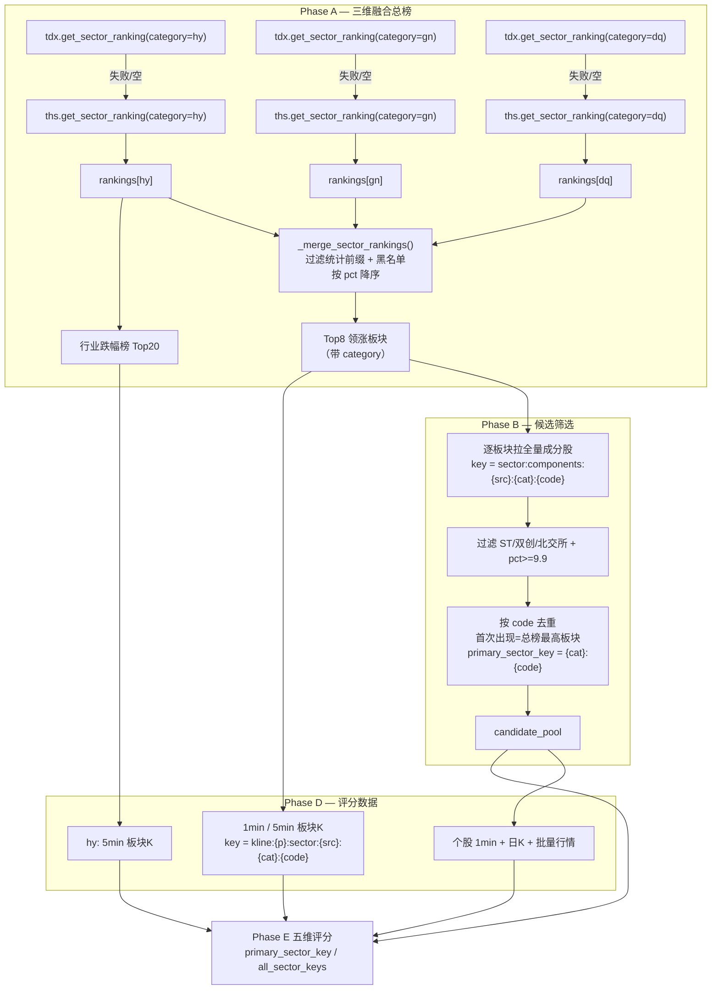
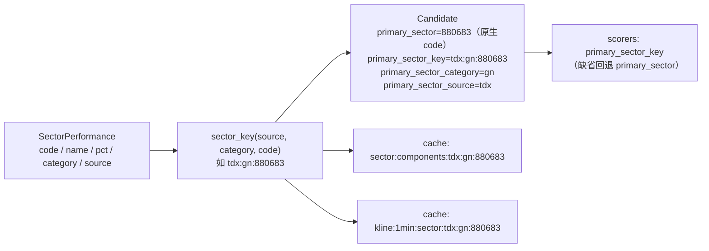
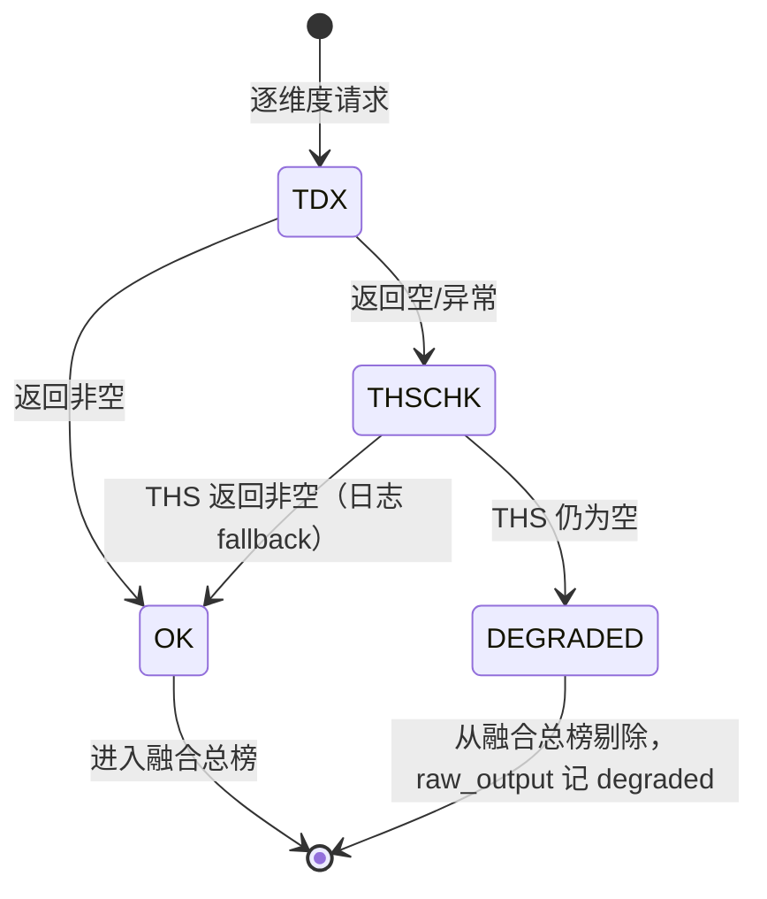

# TDX 板块三维融合（行业 / 概念 / 地区）— 技术方案
> **当前状态（2026-10-25 整仓结构重构 M0–M12）**：本文中的 `dragon_quant/cli_commands.py` / `dragon_quant/review_account/prep.py` 等实现位置已迁移：命令入口在 `dragon_quant/commands/<command>.py`（经 `commands.dispatch`），prep 在 `dragon_quant/review_account/prep/` 包（service/collectors/compute/rebuild），auction 编排在 `dragon_quant/auction/service.py`，assets CLI 装配在 `dragon_quant/assets_sync/cli_service.py`。历史设计正文保留原样；当前结构与命令以 `AGENTS.md`「架构总览」为准。


- 日期：2026-10-20
- 分支：`feat/tdx-sector-merge`
- 前置调研：`docs/research/2026-10-20-tdx-sector-merge-research.md`
- 范围：`scan` 主流程 Phase A/B/D/E 的板块口径；不改评分权重、门槛与存储结构

## 1. 背景与目标

当前 `scan` 的 Phase A 只取 TDX **行业板块**（`BoardType.HY`，881xxx）领涨前 5，再从这些行业里筛涨停股。行业粒度粗、成分少，会漏掉当日真正的题材主线：2026-10-20 盘后基线扫描中，行业 Top5 只筛出 3 只候选，而当日涨幅最高的板块是 `星闪概念`/`工业软件`/`AI眼镜` 等概念板块；按「三维融合 Top8」实测可筛出 10 只唯一候选（重复率 50%）。

目标：把**行业、概念、地区**三类板块合并为一个总榜，按涨幅排序取前 8 个板块，再从这 8 个板块筛当日涨停股参与现有五维评分。

### 已确认口径（不可偏离）

1. 三维融合总榜，不按维度配额，统一按涨幅降序取前 `SECTOR_TOP_N = 8`（模块常量，不新增 CLI 参数）。
2. 涨停筛选沿用现有 Phase B 规则：`pct >= 9.9`，排除 ST / 30 / 68 / 8 / 92。
3. 领跌 Top20 保持**行业**口径（资金承接语义不变）。
4. 跨板块重复个股按**总榜排名最高的板块**定 `primary_sector`。
5. 板块缓存键按维度命名空间隔离。
6. TDX 失败逐维度回退 THS；单维度不可用只标 `degraded`，不中断整次扫描。
7. 不改存储表结构、`scan_id`、黑名单语义、候选池全部评分、Top N 排名、五日去重；不动 review / review-account / buy / sell / auction / prep / assets_sync。

## 2. 候选设计

### 设计 A（推荐）：三源分类抓取 + 本地融合 + 规范化板块键

- Phase A 分别调用 `get_sector_ranking(category="hy"|"gn"|"dq")`，每类独立走 TDX → THS 回退，结果打上 `category` 后本地合并、按 `pct` 降序取前 8。
- 板块身份升级为规范化键 `category:code`（如 `gn:880683`），贯穿缓存键、评分器读取与候选归属；输出仍保留原始 `primary_sector` code 以兼容。
- 领跌榜只从 `hy` 类别的完整列表里取 20。

**优点**：维度可见（可逐维降级/回退）、排序口径可审计、缓存键无歧义、对评分器改动最小。
**缺点**：比单次调用多 2 次排行请求（实测每类 0.10–0.16s）。

### 设计 B：直接用 `BoardType.ALL`（服务端一次返回）

- 一次 `get_board_list(BoardType.ALL)` 拿到 560 条，过滤掉 FG 风格板块后排序取前 8。

**否决理由**：实测 ALL 混入 FG（`科创成长层`/`业绩预增` 等），且**缺少 27 个 FG 统计板块**，不是三维并集；返回行不带维度标签，无法逐维降级、无法做命名空间，也无法在日志/`raw_output` 里说明某维度是否回退。收益（省 2 次 0.1s 请求）远小于可观测性损失。

### 设计 C（非常规/反直觉）：自下而上，先全市场涨停再反查板块

- 先取全 A 涨停股（TDX 全市场行情一次拉取），对每只股票 `get_belong_board` 反查所属板块，取每只股票「最强板块」的涨幅，再按板块聚合选出 Top8。

**优点**：彻底消除「板块 TopN 盲区」——不会因为板块榜第 9 名而漏掉牛股；去重天然成立。
**否决理由**：①`get_belong_board` 每只股票一次请求，涨停 50–100 只 = 50–100 次串行调用，叠加 0.3s limiter 延迟至少 +15~30s，超出 2 倍性能预算；②语义从「先选板块再选股」变成「先选股再归属」，与用户明确的总榜口径不符；③`get_belong_board` 返回的是「个股所属板块」全集，仍需一套归属策略。可作为未来「宽口径候选召回」的独立演进方向，不纳入本次。

### 设计 D（用户最初提过，后自行放弃）：分维度配额

- 例如 行业 Top3 + 概念 Top3 + 地区 Top2，各自取头部再合并。

**否决理由**：维度配额会把弱势维度（如当日地区最高仅 1.75%，远低于概念 3.9%）强行塞进候选，同时可能挤掉总榜第 4–8 名的强概念板块，与「和 TDX 客户端一致的统一涨跌幅榜」目标冲突。保留为对比项，不实施。

### 推荐

**设计 A**。它在「口径一致性、可观测性、改动面、性能」四项上同时占优，且不改变任何评分规则。

### 2.1 采用的设计模式与动机

| 模式 | 落点 | 动机 | 为什么不用更重的抽象 |
|---|---|---|---|
| **值对象（Value Object）** | `sector_key(source, category, code)` / `split_sector_key` | 板块身份从「一个裸字符串」升级为不可变三元组，缓存键、评分器入参、去重都以它为准，消除歧义 | 不建 `Sector` 类：现有代码大量以字符串传参，引入对象会穿透 5 个评分器与缓存层，收益不抵改造成本 |
| **策略 + 注册表（Strategy + Registry）** | `SECTOR_CATEGORIES`、`_BOARD_TYPE_BY_CATEGORY`、THS 的 `_RANKING_URLS/_DETAIL_URLS/_PAGE_URLS` | 维度→数据源行为集中在一处，新增维度只加一行映射；排序/回退逻辑与维度解耦 | 不为三个维度建三个类：映射表 + 分支已足够，过度封装反而难读 |
| **适配器（Adapter）** | TDX / THS provider 把各自的维度与 code 体系适配成统一的 `SectorPerformance(source, category, code, pct)` | 上层融合逻辑不感知数据源差异 | 已有 provider 层就是适配器，不新增抽象层 |
| **模板方法（Template Method）的轻量版** | `_fetch_category_ranking`：先主链路、再回退、再降级 | 三个维度共用同一取数骨架，差异只在 provider 调用 | 不引入基类钩子：闭包 + 参数化即可，避免为「三步流程」造框架 |
| **空对象 / 优雅降级（Null Object + Graceful Degradation）** | 任一取数失败返回 `[]` + `degraded` 标记，而不是抛异常中断扫描 | 单维度失败不得影响整次扫描（硬性决定 #4） | 不用异常传播：扫描是批处理，局部失败应可观测地降级 |

**简单性权衡**：本次不新增类层次、不引入配置系统、不加 CLI 参数；新增代码以模块级纯函数（`sector_key` / `_merge_sector_rankings` / `_build_candidates` / `_drop_code_collisions`）为主，便于单测且不扩大运行时状态。

## 3. 架构设计

### 3.1 Phase A/B 数据流



### 3.2 板块身份模型



### 3.3 单维度降级状态机



## 4. 接口定义

### 4.1 新增模块 `dragon_quant/sectors.py`

```python
CATEGORY_INDUSTRY = "hy"
CATEGORY_CONCEPT  = "gn"
CATEGORY_REGION   = "dq"
SECTOR_CATEGORIES = (CATEGORY_INDUSTRY, CATEGORY_CONCEPT, CATEGORY_REGION)
CATEGORY_CN = {"hy": "行业", "gn": "概念", "dq": "地区"}

# 板块身份 = (source, category, code)：TDX 概念 880xxx 与 THS 概念 3xxxxx 不同构，
# 且 board code 在协议层并非全局唯一（HY2/YJ 复用 881xxx），必须带维度与来源。
def sector_key(source: str, category: str, code: str) -> str:   # ("tdx","gn","880683") → "tdx:gn:880683"
def split_sector_key(key: str) -> tuple[str, str, str]          # "tdx:gn:880683" → ("tdx","gn","880683")
                                                               # 非三段 → ("", "", raw)，保留旧式裸 code 兼容

# 缓存键统一构造：orchestrator 与 5 个 scorer 共用，禁止各处重复拼字符串
def sector_cache_key(prefix: str, key: str) -> str:            # "kline:1min:sector" + key
def components_key(key: str) -> str:                           # "sector:components:{key}"
def sector_1min_key(key: str) -> str:                          # "kline:1min:sector:{key}"
def sector_5min_key(key: str) -> str:                          # "kline:5min:sector:{key}"
```

`split_sector_key` 对空/非法输入**不抛异常**，返回 `("", "", raw)`：评分器在缺省调用路径下仍可能收到裸 code（历史调用、单测），抛 `ValueError` 会让「未传新参数」的向后兼容路径直接崩。该契约由单测固定。

纯函数、无 I/O、无状态，便于单测。

### 4.2 `StockProvider` 扩展（全部带默认值，向后兼容）

```python
@abstractmethod
def get_sector_ranking(self, asc: bool = False, category: str = "hy") -> list[SectorPerformance]: ...

@abstractmethod
def get_sector_components(self, sector_code: str, page: int = 1,
                          all_pages: bool = False, page_size: int = 50,
                          category: str = "hy") -> list[StockInfo]: ...

@abstractmethod
def get_sector_5min_kline(self, sector_code: str, bars: int = 100,
                          category: str = "hy") -> list[KBar]: ...

def get_sector_1min_kline(self, sector_code: str, bars: int = 240,
                          category: str = "hy") -> list[KBar]: ...        # 默认 raise NotImplementedError（现状）

def get_sector_5min_kline_history(self, sector_code: str, days: int = 10,
                                  category: str = "hy") -> list[KBar]: ...  # 默认 raise NotImplementedError（现状）
```

- **不新增抽象方法**；`get_sector_1min_kline` / `get_sector_5min_kline_history` 保持普通方法 + `raise NotImplementedError`（满足项目硬性约束）。
- 默认 `category="hy"`，`data.py`、`cli_commands.py`、现有测试与第三方调用无需改动。

### 4.3 TDX Provider

```python
_BOARD_TYPE_BY_CATEGORY = {"hy": "HY", "gn": "GN", "dq": "DQ"}

def get_sector_ranking(self, asc=False, category="hy"):
    board_name = _BOARD_TYPE_BY_CATEGORY.get(category)
    if board_name is None:
        raise ValueError(f"未知板块维度: {category!r}")   # 编程错误，不伪装成 api 失败
    et = _import_easytdx()
    board_type = getattr(et.BoardType, board_name)
    ...  # 现有调用
    rows = [_to_sector(r, category, source="tdx") for r in ...]
```

- **`source` 的唯一赋值点 = provider 构造 `SectorPerformance` 时**：TDX 用 `_to_sector(r, category, source="tdx")`，THS 在 `_parse_ranking_html` / `_parse_region_ranking_html` 中写 `source="ths"`。调用方不逐处补 source。
- 成分股与 K 线只需 `category` 透传（TDX 用 code 路由），日志 note 带上维度。
- **未知 category 一律抛 `ValueError`**（不是返回空 + api error 日志）：它只可能来自编程错误，若记为 api 失败会污染 `_report_api_failures` 对真实网络故障的归因。orchestrator 的 `_fetch_category_ranking` 用 try/except 兜底降级。

### 4.4 THS Provider

```python
_RANKING_URLS = {
    "hy": "http://data.10jqka.com.cn/funds/hyzjl/field/zdf/order/desc/page/{page}/",
    "gn": "http://data.10jqka.com.cn/funds/gnzjl/field/zdf/order/desc/page/{page}/",
}
_DETAIL_URLS = {
    "hy": "http://q.10jqka.com.cn/thshy/detail/code/{code}/",
    "gn": "http://q.10jqka.com.cn/gn/detail/code/{code}/",
    "dq": "http://q.10jqka.com.cn/dy/detail/code/{code}/",
}
_PAGE_URLS = {
    "hy": "http://q.10jqka.com.cn/thshy/detail/order/desc/page/{page}/code/{code}/",
    "gn": "http://q.10jqka.com.cn/gn/detail/order/desc/page/{page}/code/{code}/",
    "dq": "http://q.10jqka.com.cn/dy/detail/order/desc/page/{page}/code/{code}/",
}
REGION_RANKING_URL = "http://q.10jqka.com.cn/dy/"
```

- `get_sector_ranking(asc, category)`：`hy`/`gn` 复用现有 3 页抓取 + `_parse_ranking_html`（两者表结构一致，实测）；`dq` 用新增 `_parse_region_ranking_html`（单页 33 行，td[2]=涨跌幅）。两个解析器都写入 `category` 与 `source="ths"`。
- `_parse_components_html` 改为**遍历全部 `<tbody>`**（概念详情页有 2 个 tbody，成员表在第 2 个；行业/地区页仍兼容）。只接受 `td[1]` 为 6 位代码的行。
- `_get_inner_code(sector_code, category="hy")`：按 `_DETAIL_URLS[category]` 解析 `clid`；`hy` 的 881xxx 快捷路径保留。进程内缓存键改为 `f"{category}:{code}"`。
- K 线方法透传 category。
- 未知 category → **抛 `ValueError`**（与 TDX 一致），不写 api error 日志。

## 5. 数据模型改动

| 类型 | 字段 | 默认 | 用途 |
|---|---|---|---|
| `SectorPerformance` | `category: str = ""` | `""` | 维度标签，融合与路由 |
| `SectorPerformance` | `source: str = ""` | `""` | 来源（tdx/ths），写入板块身份 |
| `Candidate` | `primary_sector_key: str = ""` | `""` | 规范化板块键 `source:category:code`，评分器缓存读取与同板块比较 |
| `Candidate` | `primary_sector_category: str = ""` | `""` | 输出/日志用 |
| `Candidate` | `primary_sector_source: str = ""` | `""` | 输出/日志用；跨源对比必须带此字段 |

- 新字段全部追加在 dataclass 末尾，**不改变现有位置参数的语义**。
- **不新增数据库列**：`scan_stocks_v2` 不存 `primary_sector`；`raw_output` 是 JSON，新增字段天然兼容。
- `primary_sector` 继续保存**原生 code**（如 `880683` 或 THS 的 `300816`），报告/旧消费者语义不变；跨源身份由 `primary_sector_source + primary_sector_category + primary_sector` 三元组确定。
- **硬约束：任何进入 `top_up` / `top_down` / `candidate_pool` 的 `SectorPerformance`，其 `source` 与 `category` 必须非空。** Phase A 在合并前断言（缺失则记 error 并把该行剔除），否则会生成 `sector:components::hy:881101` 这类空 namespace 键，导致 TDX/THS 两源静默共用缓存。单测断言顶部/领跌板块的 `source`/`category` 非空，且 Phase B/D 实际写入键 == scorer 读取键。

## 6. 缓存键与向后兼容

| 数据 | 改造前 | 改造后 |
|---|---|---|
| 板块排行 | `sector:ranking:{source}` | `sector:ranking:{source}:{category}` |
| 成分股 | `sector:components:{code}` | `sector:components:{source}:{category}:{code}` |
| 板块 1min | `kline:1min:sector:{code}` | `kline:1min:sector:{source}:{category}:{code}` |
| 板块 5min | `kline:5min:sector:{code}` | `kline:5min:sector:{source}:{category}:{code}` |

- `data_cache._TYPE_REGISTRY` 按前缀匹配（`sector:components:`、`kline:1min:sector:` 等），**新键无需新增注册项**。
- 旧缓存文件不被新代码读取，自然过期，**不做迁移、不删除**；`--no-cache` / `--refresh-provider-cache` 行为不变。
- 为什么键里要带 `source` 和 `category`：
  1. **category**：TDX 的 GN 与 DQ 共用 `880` 前缀，仅靠数值区间区分；HY2/YJ 又复用 `881xxx`。命名空间避免缓存串号。
  2. **source**：THS 概念 code 为 `3xxxxx`（innerCode `885xxx`）、地区为 `882xxx`，与 TDX 不同构；同一维度回退后若沿用旧键，会把 TDX 成分/THS 成分混用（HY 的 `881xxx` 两源相同，风险最实在）。
- **协议层的限制必须说清**：`get_board_members(board_symbol)` 与 `get_stock_kline(market, code)` 都不携带 board_type，若两个维度真的出现同 code，服务端会把它们解析为同一板块。命名空间只能防止缓存串号，**不能消歧请求**。因此 Phase A 还要做运行期不相交校验（见 §8.1）。

## 7. 错误处理与降级

| 场景 | 行为 |
|---|---|
| 某维度 TDX 返回空/异常 | 该维度回退 THS；`logger.warn("fallback:sector_ranking", "…{维度}…")`；`sector_sources[cat]="ths"` |
| 某维度 TDX 与 THS 均为空 | 从融合榜剔除该维度；`degraded.append(cat)`；`logger.warn("degraded:sector_ranking", …)`；**不抛异常** |
| 三个维度全部失败 | 与现状一致：返回 `{"error": "未获取到领涨板块"}` |
| `hy` 维度失败 | 领跌榜为空 → absorption 走既有「有效对手板块不足」降级；扫描继续 |
| 某板块成分股为空 | 该板块贡献 0 候选；其余板块继续（现状），记日志 |
| 某维度所有板块成分股为空 | `raw_output` 记 `components_unavailable`；板块仍占 Top8 名额（0 候选），不换源 |
| 某板块 K 线缺失 | 对应评分器既有降级路径（drive/anti_drop/liquidity/absorption） |
| TDX 未安装 | 行为与现状一致：全部走 THS，`_try` 不记回退日志 |
| 选中维度 code 相交 | `logger.error("degraded:sector_code_collision")`，按 `hy > gn > dq` 优先级**逐板块**剔除冲突 code（保留该维度其余板块）；维度仅在全部板块被剔除时才降级 |

**降级语义的硬约束**（与调研 §6.5 一致）：

1. 回退是**维度级**：同一维度的排行、成分股、1min、5min 必须来自同一 source；不做板块级换源。
2. 维度可用性**只在排行阶段判定**；成分/K 线失败属于板块级降级，不触发换源。
3. 零候选维度仍占 Top8 名额（名额由涨幅排名决定，不顺延）。
4. 跨维度允许不同 source——这正是「某维度不可用则用可得维度融合」的实现方式。
5. 在 Phase A 结束时做 **code 冲突校验**：按 `hy > gn > dq` 优先级逐板块保留首个占用者，剔除后出现维度中冲突 code 的板块（不是整维剔除）；冲突明细写入 `raw_output.sectors.collisions`。

`raw_output` 新增：

```json
"sectors": {
  "up":   [{"code": "880683", "name": "星闪概念", "pct": 3.92, "category": "gn"}],
  "down": [{"code": "881287", "name": "地面兵装", "pct": -3.02, "category": "hy"}],
  "degraded": ["dq"],
  "sources": {"hy": "tdx", "gn": "tdx", "dq": "unavailable"}
}
```

## 8. 扫描流程改动明细

### 8.1 Phase A

```python
rankings: dict[str, list[SectorPerformance]] = {}
sector_sources: dict[str, str] = {}
degraded: list[str] = []

for cat in SECTOR_CATEGORIES:
    rows, src = _fetch_category_ranking(cat)   # tdx → ths → ([], "")
    if rows:
        rankings[cat] = rows
        sector_sources[cat] = src
    else:
        degraded.append(cat)

# 防御：进入融合榜的板块必须带维度与来源，否则会生成空 namespace 缓存键
for cat in list(rankings):
    rankings[cat] = [s for s in rankings[cat] if s.source and s.category]
    if not rankings[cat]:
        rankings.pop(cat)
        sector_sources.pop(cat, None)
        degraded.append(cat)

# 协议层 get_board_members/get_stock_kline 不携带 board_type：
# 同 code 会被解析为同一板块。按板块级剔除冲突 code（不是整维剔除）。
rankings, collisions = _drop_code_collisions(rankings, logger)
for cat in list(rankings):
    if not rankings[cat]:
        rankings.pop(cat)
        sector_sources.pop(cat, None)
        degraded.append(cat)

top_up = _merge_sector_rankings(rankings, top_n=SECTOR_TOP_N, keep=_sector_ok)
top_down = sorted([s for s in rankings.get("hy", []) if _sector_ok(s)],
                  key=lambda s: s.pct)[:RANK_DOWN_COUNT]
sector_providers = {cat: (tdx if sector_sources[cat] == "tdx" else ths)
                    for cat in rankings}
sources_out = {cat: sector_sources.get(cat, "unavailable")
               for cat in SECTOR_CATEGORIES}
```

- `_fetch_category_ranking(cat)`：**两段 provider 调用都包 try/except**（不依赖 provider 内部自吞异常），先 `_cf_sync(f"sector:ranking:tdx:{cat}", ...)`，空则 `sector:ranking:ths:{cat}` 并写回退日志；两端都空返回 `([], "")`。
- `_drop_code_collisions(rankings, logger)`：按 `hy > gn > dq` 优先级为每个 code 保留首个占用者，**只丢弃后出现维度中该 code 的板块**（冲突是 per-code 的，整维剔除会让概念维度整体失效）。返回 `(过滤后的 rankings, [(category, code), ...])`；冲突明细写入 `raw_output.sectors.collisions`。
- 维度只有在**全部板块都被剔除后**才进入 `degraded`。
- `_merge_sector_rankings(rankings, *, top_n, keep)`：合并 → 过滤 → 按 `sector_key(source, category, code)` **去重** → 按 `(-pct, code)` 排序 → 截断。纯函数，便于单测。
- 黑名单与 `STATISTICAL_CONCEPT_PREFIXES` 过滤函数 `_sector_ok` 不变（名称级、跨维度生效），对所有维度应用。
- 领跌只从 `hy` 取，避免资金承接语义变化。
- `sources_out` 保证三个维度键始终存在；被剔除/失败的维度显示 `unavailable`，与 `degraded` 不矛盾。

### 8.2 Phase B

```python
for s in top_up:
    key = sector_key(s.source, s.category, s.code)
    _cf(s.source, components_key(key),
        lambda s=s: sector_providers[s.category].get_sector_components(
            s.code, page=1, all_pages=True, category=s.category))
        # 注意：不传 namespace；隔离靠 key 内的 source+category

candidate_pool = _build_candidates(top_up, filtered_by_key, limit_up_pct=9.9)
```

`_build_candidates(top_sectors, filtered_by_key, limit_up_pct)`：

```python
out: dict[str, Candidate] = {}
for s in top_sectors:                     # 已按 pct 降序
    key = sector_key(s.source, s.category, s.code)
    for st in filtered_by_key.get(key, []):   # filtered_by_key 已过 _is_valid_candidate
        if st.pct < limit_up_pct:
            continue
        cand = out.get(st.code)
        if cand is None:
            out[st.code] = Candidate(
                code=st.code, name=st.name, concepts=[s.name],
                primary_sector=s.code,                 # 原生 code，最高排名板块
                primary_sector_key=key,                # 规范化键 source:category:code
                primary_sector_category=s.category,
                primary_sector_source=s.source)
        else:
            cand.concepts.append(s.name)              # 后续板块只补标签
return out
```

- `filtered_by_key` 由 Phase B 的 `[c for c in components if _is_valid_candidate(c)]` 构建，**ST/双创/北交所过滤在此处完成**；`_build_candidates` 只再做 `pct >= 9.9` 筛选。
- **去重与归属**由「遍历顺序 = 总榜降序」保证，不需要额外排序或比较。
- 移除 Phase B 末尾对 `cache.set("sector:components:…")` 的重复写入（`_cf` 已写内存；磁盘命中时 `load_for_trade_date` 也会回填内存）。

### 8.3 Phase D

```python
for s in top_up + top_down:               # 5min 历史（up 三类 + down hy）
    key = sector_key(s.source, s.category, s.code)
    _cf(s.source, sector_5min_key(key),
        lambda s=s: sector_providers[s.category].get_sector_5min_kline_history(
            s.code, days=10, category=s.category))
for s in top_up:                          # 当日 1min（仅 up）
    key = sector_key(s.source, s.category, s.code)
    _cf(s.source, sector_1min_key(key),
        lambda s=s: sector_providers[s.category].get_sector_1min_kline(
            s.code, category=s.category))
```

- 不传 namespace（与现状一致）；隔离全部由 key 内的 `source:category:` 完成。
- 成分股行情并集、批量 200/80 分批逻辑不变。

### 8.4 Phase E

```python
down_keys = [sector_key(s.source, s.category, s.code) for s in top_down]
cache.set("__meta__:sector_codes", down_keys)
sector_name_map = {sector_key(s.source, s.category, s.code): s.name
                   for s in top_up + top_down}
cache.set("__meta__:sector_name_map", sector_name_map)

evaluate(code, cache,
         candidate_pool=candidate_pool,
         primary_sector=cand.primary_sector,
         primary_sector_key=cand.primary_sector_key,
         all_sector_keys=down_keys,
         sector_name_map=sector_name_map)
```

评分器改动（5 个文件，均为机械替换，统一使用 `sectors.py` 的键构造器）：

```python
key = primary_sector_key or primary_sector
sector_min = cache.get(sector_1min_key(key)) or []
```

- `aggregator.evaluate` 新增 `primary_sector_key: str = ""`、`all_sector_keys: Optional[list[str]] = None`，透传给各维度。
- `leadership._same_sector` 改用 `cand.primary_sector_key or cand.primary_sector` 与当前 `primary_sector_key or primary_sector` 比较。**单元素 peer 组**：n≤1 时 `desc_rank_score` 返回 0（既有行为），概念板块切分后单元素组概率上升，属已披露的分布变化。
- `absorption`：`key` 与 `keys` 同源；`all_sector_keys` 缺省时回退 `all_sector_codes` / `__meta__:sector_codes`。
- 任何评分器在缺少新参数时行为与改造前**完全一致**（`primary_sector_key=""` → 用 `primary_sector`）。

**`sector_name_map` 的全部读取点**（改名后必须同步）：

| 读取点 | 改造后写法 |
|---|---|
| `orchestrator._score_one` → `primary_sector_name` | `sector_name_map.get(cand.primary_sector_key or cand.primary_sector, "")` |
| `orchestrator` 控制台/报告 | 同上（统一走 `_score_one` 的 `primary_sector_name`） |
| `absorption._detect_events` | 用 `sector_name_map.get(key, …)`，key 来自 `all_sector_keys` |
| `drive` / `leadership` | 不读取 name map；leadership 只用 `primary_sector_key` 分组 |

**缓存键存在性自检**（防静默降级）：Phase D 结束、Phase E 开始前，**逐候选**检查（含 absorption 依赖的 5min 键）：

```python
def _has_sector_data(c: Candidate) -> bool:
    k = c.primary_sector_key or c.primary_sector
    return bool(cache.get(components_key(k))
                or cache.get(sector_1min_key(k))
                or cache.get(sector_5min_key(k)))

all_miss = bool(candidate_pool) and all(not _has_sector_data(c) for c in candidate_pool)
if all_miss:
    logger.error("degraded:sector_cache",
                 "所有候选的板块缓存键均未命中，疑似键名失配（评分将整体降级）")
    output["sector_cache_miss"] = True
```

单个候选未命中属于正常降级（已有 `degraded` 明细）；**全部候选全部键未命中**才是系统性失配信号。

### 8.5 输出与日志

- `_score_one` 结果新增 `primary_sector_key` / `primary_sector_category` / `primary_sector_source`；`primary_sector_name` 统一用 `sector_name_map.get(cand.primary_sector_key or cand.primary_sector, "")`（读取点见 §8.4 表）。
- Phase A 控制台按维度打印：`↑ 星闪概念(880683, 概念) +3.92%`。
- `logger.phase("A", ..., up=len(top_up), down=len(top_down), degraded=degraded)`。
- 分维度 source、降级与冲突信息写入 `raw_output.sectors`：

```json
"sectors": {
  "up":   [{"code": "880683", "name": "星闪概念", "pct": 3.92, "category": "gn", "source": "tdx"}],
  "down": [{"code": "881287", "name": "地面兵装", "pct": -3.02, "category": "hy", "source": "tdx"}],
  "degraded": ["dq"],
  "sources": {"hy": "tdx", "gn": "tdx", "dq": "unavailable"},
  "collisions": []
}
```

**回退日志归因**：fallback 日志类别保持 `fallback:sector_ranking`（兼容 `_report_api_failures`），但消息与 `data` 带维度；provider 的 `api` 失败日志也带 `dimension=category`。`_report_api_failures` 的 `rescued` 改为按 `(endpoint, dimension)` 比对，避免「hy 已回退成功」掩盖「dq 两端全失败」。补一条归因单测。

## 9. 测试策略

| 层 | 用例 |
|---|---|
| `tests/test_sectors.py`（新增） | `sector_key` / `split_sector_key` 往返；空 key / 非法 key 返回 `("", "", raw)`；`components_key` / `sector_1min_key` / `sector_5min_key` 前缀正确 |
| `tests/test_orchestrator_helpers.py` | ①三维合并按 pct 降序；②Top8 截断；③黑名单/统计前缀跨维度过滤；④同 code 跨板块去重且 `primary_sector` = 最高排名板块、`concepts` 收齐；⑤三个维度使用独立缓存键（构造同 code 不同维度验证不串）；⑥某维度 TDX 空 → THS 回退 + `sector_sources`/`sources` 标记；⑦某维度两端都空 → `degraded` 且扫描继续；⑧领跌仍取 hy Top20；⑨同 code 冲突时**仅剔除后出现维度的该板块**，同维度其余板块保留；⑩全部候选板块键未命中时输出 `sector_cache_miss`；⑪概念成分含 ST / 300 / 688 / 8 / 92 开头 → 不进入候选；⑫`primary_sector_name` 非空、`sources` 三键齐全且与 `degraded` 不矛盾；⑬顶部/领跌板块 `source`/`category` 非空；⑭Phase B/D 实际写入键 == scorer 读取键；⑮现有全链路评分/持久化/五日去重测试不回归 |
| `tests/test_provider_tdx.py` | category → `BoardType` 映射（HY/GN/DQ）；未知 category 抛 `ValueError` 且不产生 api error 日志 |
| `tests/test_ths.py` | ①概念排行 URL/解析（category/source 正确）；②地区排行解析（td[2]）；③多 tbody 成分股解析（概念页）；④`_get_inner_code` 按 category 路由与缓存键；⑤地区成分股翻页 URL；⑥未知 category 抛 `ValueError` |
| `tests/test_provider_cache.py` | 新命名的键（`sector:components:tdx:hy:881101`、`kline:1min:sector:ths:gn:880683`）能被 `_resolve_type` 正确还原 |
| `tests/test_scorers.py` | 传入 `primary_sector_key` 时读取规范化缓存键（构造键 `tdx:gn:X` 放数据，断言 score 非降级）；不传时行为不变；absorption 用 `all_sector_keys` |
| `tests/test_models.py` | 新字段默认值 / JSON 往返 |

运行：`.venv/bin/python -m pytest -q`（全量）。

## 10. 验收：性能与评分对照

### 10.1 主链路性能（TDX）

- 基线：2026-10-20 盘后 `scan --force`（临时 `DQ_DATA_DIR`）**14s / 44 次 tdx 调用**（N=3 候选），反推 0.32s/次（0.3s 为 limiter 固定延迟）。
- 改造后：同一交易日 **69 次调用**（3 排行 + 8 成分 + 28 板块5min + 8 板块1min + 10 日K + 10 个股1min + 1 大盘1min + 1 行情），线性预估 **22s（20–24s）**。
- 预算：**≤ 2 × 同日基线 = 28s**。
- 验证方式（强制）：实现后在**同一交易日**、全新临时 `DQ_DATA_DIR` 跑 `scan --force`，记录 `elapsed_s` 与 `logger.api_stats()`；与基线 14s 对比。
- 超标处理顺序：①核对实际调用次数是否与 69 一致（多出的通常是地区板块成分翻页或行情分批）；②在日志里按 Phase 输出耗时定位；③最后才考虑并发（tdx provider 内部持锁，并发收益有限）。

### 10.2 回退链路性能（THS-only，硬性决定 #4 必须可用）

2× 预算不能只覆盖 TDX happy path。THS 的固定延迟是 0.3–0.6s/任务，且概念成分 10/页，量级与 TDX 不同：

| 项 | 请求量（估算） | 说明 |
|---|---|---|
| 排行 hy+gn+dq | 3+3+1 = 7 | 页间 0.5s，约 3.5s |
| 成分股 8 板块 | 每板块 1 详情 + 最多 4 翻页；概念约 2–3 页 | 受 `all_pages` 上限约束 |
| 板块 5min 历史 | 28 任务 × ~0.45s ≈ 12.6s | 每任务 1–2 次 fetch（innerCode 有进程缓存） |
| 板块 1min | 8 任务 × ~0.45s ≈ 3.6s | |
| 个股日K/1min/行情 | 走雪球/腾讯兜底，不计入 THS | 依赖 Cookie |

**收敛措施（写入实现）**：THS 概念/地区成分股最多翻 3 页（概念 ≈30 只、行业/地区 ≈60 只），并在 `raw_output.sectors.sampled` 标记被截断的板块；这是与现有 THS 行业采样口径一致的既有取舍，不降低 TDX 主链路的数据完整性。

**验收方式（强制）**：实现后跑一次「模拟 TDX 不可用」的 `scan --force`（测试脚本把 `TdxProvider.get_sector_ranking` / 成分股 / 板块K 置空），记录耗时；预算为 **≤ 2 × 同口径 THS-only 基线**（同一天、同样禁用 TDX 的旧代码，或直接用旧代码的 `--source ths` 等价路径）。若仍超标，再把 THS 每维只取 Top3 板块作为最后手段，并在报告中说明。

### 10.3 评分对照（区分「预期分布变化」与「评分回归」）

本次「不改评分语义」的准确含义是：**权重、门槛、阈值、聚合与排名规则一行不改**；`primary_sector` 变为概念/地区后，peer group 与板块基准变化是需求的直接后果。为避免把回归误判为预期变化，实现后追加同交易日对照：

- 用旧代码（基线 commit）与新代码分别跑同一交易日，记录：真龙数量、`composite` 均值/中位数、各维度均值、`rank` 变化、`degraded` 比例。
- 关注 `leadership` 单元素 peer 组（`desc_rank_score` n≤1 → 0）与 `liquidity` 换手分位分母变化；若某维度均值偏移超过 ±10 分或真龙数量变化超过 2 只，在交付报告中显式说明并上报 main 裁决，不自行调参。
- 对照结果写入交付报告的 `self_test_evidence` 与 `residual_risks`。

不引入新依赖，不新增 CLI 参数。

## 11. 已知风险与缓解

| # | 风险 | 影响 | 缓解 |
|---|---|---|---|
| R1 | 概念/地区板块宽窄差异大（实测成员 4–147），板块共鸣/换手分位的分母变化 | 分数分布变化（非功能错误） | 不改权重/门槛；报告保留 `degraded` 与明细；作为语义变化在 AGENTS/README 披露 |
| R2 | 地区板块登上 Top8（近 20 日 3 次）时成员 100+ | 候选数与行情批次上升 | 已按 200/80 分批；实测预算内；若超预算再评估 |
| R3 | 概念板块可能含 `次新股`/`ST板块`/宽基主题 | 弱主线进入 Top8 | 维持现有黑名单（名称级、跨维度生效）+ 统计前缀过滤；**是否补种黑名单由用户决策**（本次不动） |
| R4 | THS 概念成分股 10/页（约 50 只上限），弱于 TDX 全量 | 回退时候选召回下降 | `sector_sources`/`degraded` 可见；TDX 为主链路 |
| R5 | THS 地区排行单页、字段布局不同 | 解析失败风险 | 独立解析器 + 单测；失败只降级该维度 |
| R6 | 旧缓存键残留 | 磁盘占用 | 不迁移、不删除，自然过期 |
| R7 | 候选 `concepts` 变长，Phase C `(board_count, len(concepts))` tie-break 变化 | 仅影响评估顺序 | 全部候选都评分，不影响结果 |
| R8 | `primary_sector` 语义从「行业」变为「板块」，四个维度相对分基准随之变化 | 分数分布变化；易被误判为回归 | 新增 `primary_sector_category` / `primary_sector_source`；§10.3 同交易日新旧评分对照；文档披露「不改规则≠分布不变」 |
| R9 | **board code 全局不唯一**（HY2/YJ 复用 881xxx；GN 逼近 881xxx），协议层请求不带 board_type | 同 code 被解析为同一板块 | 运行期逐板块冲突剔除（hy>gn>dq 优先级）+ 单测 |
| R10 | **跨源 code 不同构**（THS 概念 3xxxxx/885xxx、地区 882xxx） | 同板块跨源身份不同 | 板块身份含 `source`；缓存键含 source；输出带 `primary_sector_source` |
| R11 | **键改名静默降级**（`DataCache.get` 未命中返回 None） | 若漏改读取点，多维度同时降级且不报错 | 9 处读取点清单（调研 §9.1）+ Phase D 后逐候选存在性自检（含 5min）+ 单测断言 |
| R12 | **THS-only 回退路径性能**：固定延迟 0.3–0.6s、概念成分 10/页 | 回退日可能超过 2× 预算 | §10.2 收敛措施（成分最多 3 页 + `sampled` 标记）+ 强制 THS-only 实测；超标再降为每维 Top3 |

## 12. 需求方未考虑但影响设计的点

1. **黑名单是名称级、跨维度生效**：过滤函数不变，但输入集合扩大到三维融合榜；同名行业/概念会被同时过滤。若用户想排除 `次新股`/`ST板块`/`融资融券` 类宽基概念，需要在 `blacklist` 中显式维护。本次不改种子（属于人为决策）。
2. **board code 不是全局唯一**：HY2/YJ_LEVEL2 复用 HY 的 881xxx；协议层成分/ K 线请求不带 board_type。因此缓存键必须带 `source:category:`，且 Phase A 要做运行期不相交校验。
3. **跨源身份**：THS 概念 `3xxxxx`（inner `885xxx`）、地区 `882xxx`，与 TDX 不同构；`primary_sector` 保留原生 code，跨源比较必须带 `primary_sector_source`。
4. **地区板块成员可达 147 只**：近 20 日有 3 天上榜；成分股拉取（2 次分页）与行情批次会上升，已在预算内。
5. **`concepts` 字段语义扩展**：从「所属行业」变为「所属入选板块」，报告中的板块共鸣/领涨性 peer 分组随之变为概念/地区，这是需求的直接后果，不是回归。
6. **`RANK_UP_COUNT` 命名失效**：改为 `SECTOR_TOP_N`，同步清理 `rank_up_count` 局部变量，避免「up 仍指行业」的误导。
7. **评分器向后兼容**：所有新参数都有缺省值，单元测试与外部直接调用 `score(...)` 的路径不变。
8. **Provider 接口纪律**：只给现有板块方法加 `category` 默认参数，**不新增 abstractmethod**；`get_sector_1min_kline` / `get_sector_5min_kline_history` 维持普通方法 + 默认 `raise NotImplementedError`，否则 `create_providers()` 实例化 4 个 provider 会崩。
9. **文档同步范围与具体句式**（同一 commit）：
   - `AGENTS.md`：①开头「板块口径已切换为行业板块…不再用概念板块」→「板块口径为**行业+概念+地区三维融合总榜**（TDX HY/GN/DQ，按涨幅取前 8），**领跌 Top20 仍为行业**」；②执行流程表 Phase A「领涨 Top5」→「三维融合 Top8」、Phase B「每个领涨行业」→「每个入选板块」；③数据源说明补充 TDX 三维与 THS 回退（概念/地区支持、采样口径）。
   - `README.md`：①数据源表「行业板块排行」→「行业/概念/地区板块排行」；②`blacklist` 说明补一句「名称级、跨维度生效」；③评分表下方补「主板块为总榜最高板块，可为行业/概念/地区」。
   - `archived_md/score/评分器Refactor.md`：把「板块使用同花顺行业板块…不是概念板块」改为「板块为行业+概念+地区三维融合，领跌仍为行业」。
   - **注意**：`archived_md/score/评分器Refactor.md` 在 git 中为已跟踪文件（`git status` 可验证；`git ls-files` 对中文路径做转义，直接 grep 中文会漏），与代码同 commit 更新。AGENTS/README 里指向 `dragon_quant/scorers/评分器Refactor.md` 的链接是既有失效链接，本次不改，仅在交付报告中登记为遗留项。

## 13. 实施与提交拆分

1. `feat: 新增 sectors 规范化键与 Provider 维度参数（hy/gn/dq）` —— `sectors.py`、models、base、tdx、ths、xueqiu/tencent 签名、THS 解析增强。
2. `feat: scan 板块口径改为三维融合 Top8` —— orchestrator Phase A/B/D/E、scorers 键透传、输出字段。
3. `test: 覆盖三维合并/去重/回退/缓存隔离` —— 新增与更新单测。
4. `docs: 同步 AGENTS.md / README.md / 评分器Refactor.md 板块口径` —— 文档同 commit 或紧随其后（项目要求同一 commit 内同步，最终 squash 前合并为同一提交）。

> 说明：项目规范要求「功能变更与文档更新在同一 commit」。实现时先完成代码与测试，最终以一个包含代码+测试+文档的 commit 提交；如需分步调试可临时多次提交，收尾时 squash。

## 14. 非目标

- **不改变评分规则**：五维权重、门槛、阈值、聚合、排名算法一行不改。「不改评分语义」的准确含义是「不改规则」；`primary_sector` 从行业变为概念/地区导致 peer group 与板块基准变化，是本次需求的直接后果，已在 §10.3 用同交易日评分对照量化披露。
- 不改变领跌 Top20 的行业口径与资金承接语义。
- 不新增 CLI 参数、不新增运行时依赖。
- 不动 `review` / `review-account` / `buy` / `sell` / `auction` / `prep` / `assets_sync`。
- 不改 SQLite 表结构、`scan_id` 格式、黑名单过滤语义（过滤函数不变；输入集合扩大到三维，名称级跨维度生效）、五日去重与 Top N 排名规则。
