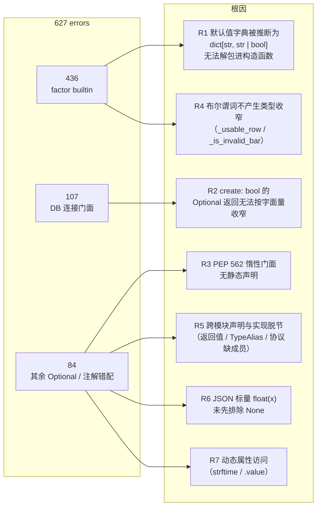
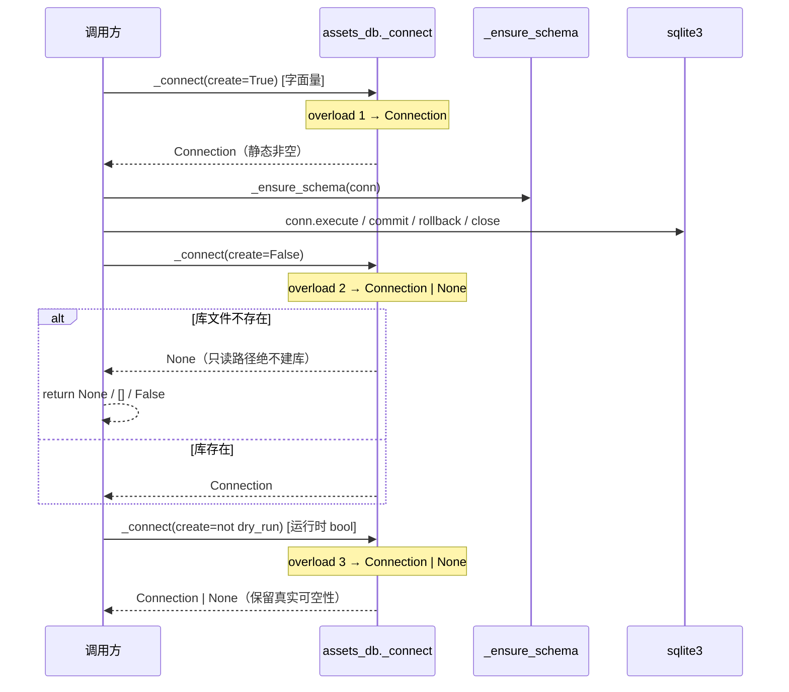
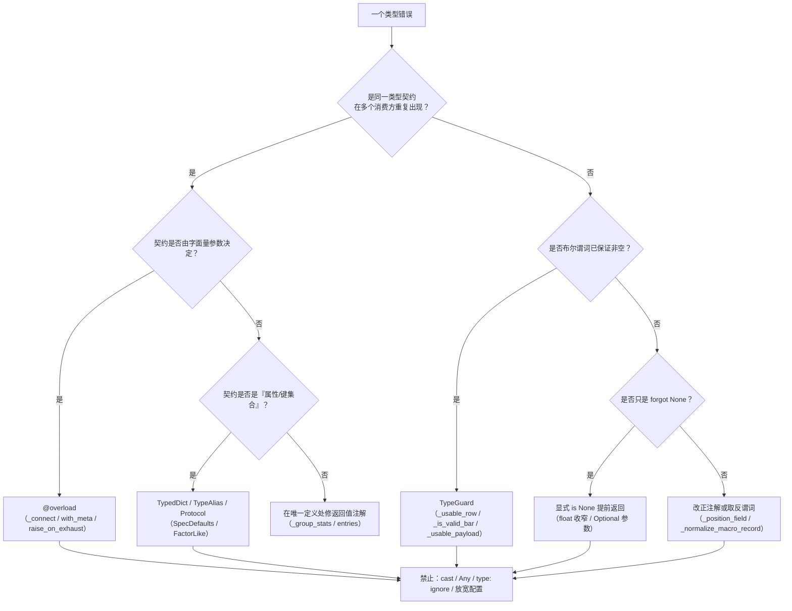

# 类型错误清零技术方案（pyright Python + TS strict）

- 日期：2026-10-27
- 阶段：阶段 2（技术方案 + solution-self-review）
- 工作分支：`feat/refactor-archi`（工作树干净）
- 目标：按仓库**现有检查范围**把 `pyright` 错误清零到 0，且 frontend TypeScript strict 保持 0 错误、`npm run build` 通过
- 非目标：Python 测试代码与 `web_ui` Python 文件（继续按 `pyrightconfig.json` 排除）；不新增类型检查工具/依赖；不 commit

---

## 1. 基线证据（真实只读命令，未做任何修改）

### 1.1 工作树与配置

```
$ git status --porcelain     # 无输出（干净）
$ git rev-parse --abbrev-ref HEAD
feat/refactor-archi
```

`pyrightconfig.json`（现状，本方案**不修改**）：

```json
{
  "include": ["dragon_quant"],
  "exclude": ["**/__pycache__", "web_ui", "dragon_quant/tests"],
  "pythonVersion": "3.10",
  "typeCheckingMode": "basic",
  "reportUnknownMemberType": false,
  "reportUnknownVariableType": false,
  "reportUnknownParameterType": false,
  "reportUnknownArgumentType": false,
  "reportUnknownLambdaType": false,
  "reportMissingTypeStubs": false,
  "reportMissingImports": false,
  "reportUnusedImport": false,
  "reportUnusedVariable": false,
  "reportUnusedCallResult": false,
  "reportPrivateUsage": false,
  "reportUnnecessaryTypeIgnoreComment": false
}
```

### 1.2 Python（pyright 1.1.414）

```
$ .venv/bin/pyright
627 errors, 14 warnings, 0 informations
```

`--outputjson` 的 `summary`：

```
{'filesAnalyzed': 179, 'errorCount': 627, 'warningCount': 14,
 'informationCount': 0, 'timeInSec': 1.872}
```

**错误码分布**（合计 627）：

| 错误码 | 数量 |
|---|---|
| `reportArgumentType` | 487 |
| `reportOptionalMemberAccess` | 109 |
| `reportAttributeAccessIssue` | 10 |
| `reportOptionalOperand` | 6 |
| `reportCallIssue` | 5 |
| `reportGeneralTypeIssues` | 3 |
| `reportOptionalSubscript` | 3 |
| `reportReturnType` / `reportOperatorIssue` / `reportAssignmentType` / `reportRedeclaration` | 各 1 |

**包分布**：`infra` 579 / `review_account` 32 / `review` 10 / `commands` 5 / `scan` 1；涉及 36 个文件。

**文件 Top（错误数）**：

```
109  dragon_quant/infra/factor/builtin/auction.py
 91  dragon_quant/infra/factor/builtin/five_dim.py
 90  dragon_quant/infra/factor/builtin/prep.py
 81  dragon_quant/infra/factor/builtin/financial.py
 65  dragon_quant/infra/factor/builtin/vpa.py
 40  dragon_quant/infra/assets/db.py
 29  dragon_quant/infra/factor/finance_store.py
 27  dragon_quant/infra/factor/sql.py
 10  dragon_quant/review/main.py
  9  dragon_quant/infra/assets/sync/tables.py
  8  dragon_quant/review_account/evaluation.py
  7  dragon_quant/infra/factor/evaluation.py / infra/provider/tdx.py
  6  dragon_quant/infra/assets/dragons_mirror.py
  5  dragon_quant/infra/factor/decision.py / matrix.py / review_account/strategy/buy.py
```

**结论**：627 个错误里 537 个（85.6%）只来自两个根因——`_SPEC_FIELDS` 字典打包（430）与 `assets.db._connect` 的 `Optional` 返回（107）。错误总数大，但**根因数量少**，不存在「627 个独立问题」。

### 1.3 TypeScript

```
$ cd web_ui/frontend && npx tsc --noEmit
TSC_EXIT=0
（无输出）
```

`tsconfig.json`：`strict=true`、`noUnusedLocals/noUnusedParameters=true`、`include: ["src"]`；`package.json` 的 build 为 `tsc --noEmit && vite build`；`node_modules` 已存在。

**结论**：验收标准 2 的「TS strict 0 错误」**当前已满足**。方案不改任何 TS 代码与 tsconfig；阶段 3 只需跑一次完整 `npm run build` 留证据（本轮不执行 vite，不写 `dist`）。

### 1.4 14 个 warning（不阻塞）

全部为 `reportUnsupportedDunderAll`（PEP 562 惰性门面 + `__all__` 静态不可见）：`dragon_quant/__init__.py`(2)、`review/__init__.py`(2)、`review_account/prep/__init__.py`(1)、`review_account/strategy/__init__.py`(1)、`scan/__init__.py`(1)、`scan/storage/__init__.py`(7)。

验收只要求 0 errors，因此这 14 条**不进入必做范围**。**main 已于 2026-10-27 单次验收明确裁决：warning 不在本轮范围**（见 §14-2）。

### 1.5 根因假设的实测验证

为避免「猜测式修复」，以下 4 个修复原语在本机用隔离探针（`/tmp/pyrprobe*`，不触碰仓库）逐条验证过：

| 原语 | 探针结果 |
|---|---|
| `TypedDict` 解包进 dataclass 构造（`**_SPEC_FIELDS`） | 通过：参数逐项匹配，无关参数仍报错（说明确实在按类型校验，而非被 `Any` 吞掉） |
| `@overload` + `Literal[True]` / `Literal[False]` | 通过：`_connect()` → `Connection`；`_connect(create=False)` → `Connection \| None` |
| 包 `__init__` 的 `if TYPE_CHECKING: from .main import X`（惰性代理的静态影子） | 修复前 `type of "CleanConfig" is "ModuleType \| Any"`；修复后 `type[CleanConfig]` |
| `TypeGuard[dict]` + `if not guard(x): continue` 收窄 `dict \| None` | 通过，0 errors |

---

## 2. 根因分层总览



**设计原则**：按根因修（`R1..R7` 共 7 类），不按行修。每个根因只在**唯一定义处**修一次，消费方零改动。

---

## 3. 逐组修复映射

> 列含义：`组` / 文件:行 / 错误码 / 根因 / 修复方式 / 行为风险 / 回归测试。
> 「零风险」= 只改静态类型信息，运行期字节码语义不变。

### 批次 A：默认值字典解包（430 错误，1 个根因）

| 组 | 位置 | 错误码 | 根因 | 修复方式 | 行为风险 |
|---|---|---|---|---|---|
| A1 | `infra/factor/types.py` | — | 无 `_SPEC_FIELDS` 的键集类型 | 新增 `class SpecDefaults(TypedDict, total=False)`：`frequency/source/available_phase/pit_rule/lookback/default_enabled/owner/params`；`params` 声明为 `Mapping[str, object]`（**不用** `Any`，探针已验证可赋值给 `FactorSpec.params: Mapping[str, Any]`） | 无（新增类型） |
| A2 | `builtin/{five_dim,vpa,prep,auction,financial}.py` 的 `_SPEC_FIELDS = dict(...)` | 430 × `reportArgumentType` | `dict(...)` 被推断为 `dict[str, str \| bool]`（`default_enabled=True` 把值类型并成 `str \| bool`），`**` 解包时每个形参都收到 `str \| bool` | 把 `dict(k=v)` 改为 **`SpecDefaults(k=v)`** 构造调用（TypedDict 的调用形式；运行期仍返回普通 dict，语义与 `dict(...)` 完全一致）。探针已验证：`dict(...)` 的结果不能赋值给 TypedDict 注解，而 `SpecDefaults(...)` 可以 | 零风险。键/值/顺序不变，`compute_version` 哈希不变 |
| A3 | `builtin/auction.py:110,126,143,148,170,195` | 6 × `reportOptionalMemberAccess` | `rows.get(code)` 返回 `dict \| None`，`_usable_row(row)` 返回 `bool`，不产生收窄 | `_usable_row(row: object) -> TypeGuard[dict]`（函数体不变），调用点 `if not _usable_row(row): continue` 后 `row` 收窄为 `dict` | 零风险（`TypeGuard` 只在静态层，运行期仍返回原 bool） |

> 注：`financial.py` 多一个 `lookback=0` 与 `params=_COHORT_PARAMS`，同样在上述 TypedDict 键集内。

### 批次 B：`assets.db` 连接门面（107 错误，1 个根因）

现状（`infra/assets/db.py:100`）：

```python
def _connect(create: bool = True, path=None) -> Optional[sqlite3.Connection]:
```

`create=False` 时库不存在返回 `None`（只读路径绝不建库，这是**真实契约**）；所有写路径用默认 `create=True`，运行期必非 `None`，但 pyright 无法按字面量收窄。

| 组 | 位置 | 错误码 | 修复方式 | 行为风险 |
|---|---|---|---|---|
| B1 | `infra/assets/db.py` | 40（8 argType + 32 optionalMember） | 加 3 个 `@overload`：`Literal[True]→Connection`、`Literal[False]→Optional`、`bool→Optional`（第三个覆盖 `create=not dry_run` 这类运行时 bool） | 零风险。`@overload` 只影响静态层；模块属性 `_connect` 仍是同一个实现函数对象 → 测试对 `assets_db._connect` 的 monkeypatch 语义不变 |
| B2 | `infra/factor/finance_store.py` | 29 | 无需改代码：`assets_db._connect(path=...)` 由 B1 收窄 | 零风险 |
| B3 | `infra/factor/sql.py` | 27 | 同上 | 零风险 |
| B4 | `infra/assets/dragons_mirror.py` | 6 | `_mirror_conn(*, create: bool)` 同样加 3 个 overload（`Literal[True]→Connection`） | 零风险 |
| B5 | `infra/assets/sync/tables.py:629-653` | 5 | `restore()` 的 `_connect(path=...)` 由 B1 收窄 | 零风险 |

> **为什么不把返回类型直接改成 `Connection`**：`create=False` 的读路径确实可能返回 `None`（如 `get_prep_asset`），抹平 `Optional` 会把 `None.close()` 变成运行期崩溃，属真实的隐藏缺陷，明确排除。

### 批次 C：门面与协议（4 错误）

| 组 | 位置 | 错误码 | 根因 | 修复方式 | 行为风险 |
|---|---|---|---|---|---|
| C1 | `infra/factor/__init__.py` | 3 × `reportCallIssue`（`commands/factor.py:49/55/62`） | 包 `__init__` 只有 `__getattr__`，pyright 把 `from ... import CleanConfig` 解析为 `ModuleType \| Any`（探针已复现） | 加 `if TYPE_CHECKING:` 静态影子：从 `.main` 导入 13 个批准出口（与 `main.__all__` 一致） | 零风险。`TYPE_CHECKING` 块运行期不执行，惰性语义与 `importlib` 代理完全不变 |
| C2 | `infra/assets/db.py:289` `get_prep_snapshot` | 1 × `reportArgumentType`（`factor/engine.py:374` 解包） | `with_meta: bool` 的返回是 `dict \| None \| tuple[dict\|None, dict]` 联合，`snapshot, meta = ...` 无法解包 | 加 2 个 overload：`Literal[False]→Optional[dict]`、`Literal[True]→tuple[Optional[dict], dict]` | 零风险。调用方（`market.py:75` 默认参数 / `engine.py:375`）不变 |

### 批次 D：数据结构与动态属性（16 错误）

| 组 | 位置 | 错误码 | 根因 | 修复方式 | 行为风险 |
|---|---|---|---|---|---|
| D1 | `infra/assets/sync/tables.py:438,442,562,584` | 4 × `reportArgumentType` | `TableSpec.static_partition: str \| None`，调用点靠 `partition_kind == "static"`（运行期约定）保证非空 | 给 `TableSpec` 加只读属性 `static_key`（`None` 时 `raise RuntimeError`，与 `_validate_specs` 同语义）；调用点改用 `spec.static_key` | **零可观测差异**：`_validate_specs()` 在**模块导入期**执行（`tables.py:268`），非法组合会让模块导入失败，因此 `static_key` 的 `RuntimeError` 分支不可达 |
| D2 | `infra/provider/tdx.py:265,976` | 2 × `reportOptionalMemberAccess` | `t.strftime(...) if hasattr(t,"strftime")` —— `hasattr` 不把 `Unknown \| None` 收窄 | 改为 `fmt = getattr(t, "strftime", None); ts = fmt("%H:%M:%S") if callable(fmt) else str(t or "")` | 零风险，语义等价（`hasattr` 为真 ⟺ `getattr` 非 `None` 且可调用，对 datetime.time/pandas.Timestamp 均成立） |
| D3 | `infra/provider/tdx.py:373` | 5 × `reportAttributeAccessIssue/OptionalMemberAccess` | `hasattr(normalized, "value")` 后访问 `.value`，联合标量类型无法收窄 | 改为 `value_attr = getattr(normalized, "value", _MISSING); if value_attr is not _MISSING: normalized = value_attr` | 零风险（`_MISSING` 哨兵为模块私有；`.value` 恰为 `None` 时同样赋值，与 `hasattr` 一致） |

### 批次 E：Optional 契约与收窄（19 错误）

| 组 | 位置 | 错误码 | 根因 | 修复方式 | 行为风险 |
|---|---|---|---|---|---|
| E1 | `infra/provider/ths.py:168,483,516` | 3 | `_fetch_with_retry(..., raise_on_exhaust: bool) -> Optional[str]`：`True` 时永不返回 `None` | 加 2 个 `@overload`（`Literal[True]→str`、`Literal[False]→Optional[str]`）+ 兜底 `bool` overload | 零风险（overload 不改运行期） |
| E2 | `infra/assets/sync/service.py:343` | 1 | `remote` 可为 `None`，`_source_fresh()` 内部已对 `None` 返回 `False`，但静态上不构成收窄 | 条件里补 `remote is not None`：`if (not dry_run and not all_dates and remote is not None and _source_fresh(...))` | 零风险（因 `_source_fresh(None)` 必 `False`，短路结果完全相同） |
| E3 | `infra/assets/sync/service.py:1034` | 1 | `entries: list[tuple[str, str, object]]` 的第三元素被显式注成 `object` | 改为 `list[tuple[str, str, ManifestEntry]]` | 零风险（纯注解纠正） |
| E4 | `infra/assets/sync/sources.py:78,88,90` | 2 | `row.get("asset_type")` → `Unknown \| None` 传给 `str` 形参 | 保持 `_check_asset_type` 签名与**返回值**不变（`-> None`），只把收窄放在消费点：`_check_asset_type(self.name, asset_type)` 之后写 `if isinstance(asset_type, str): shards.append(codec.build_shard(..., asset_type, ...))` | **零可观测差异**：`_check_asset_type` 已含 `if not isinstance(asset_type, str) or not regex: raise ValueError(...)`，非 str 必然先抛；`isinstance` 判断恒真，不新增异常分支，异常/文案/`failed` 里的原值全部不变。`prep_assets.asset_type` 为 `TEXT NOT NULL`（`assets/schema.py:37`）。备选（若偏好 guard 风格 API）：把 `_check_asset_type` 改成 `-> TypeGuard[str]`，但那会改变其返回值（`None`→`True`），故**不采用** |
| E5 | `review_account/strategy/buy.py:163,185,186,187` | 5 | `BuyCheckContext.prev_row: Optional[dict]`；`_open_common_gate` 已拦截 `prev_row` 为 `None`，但返回 `tuple[Optional[str], bool]` 不携带该事实 | 在两个规则函数内、gate 之后加**不可达守卫**：`if prev_row is None: return RuleResult(False, "缺少上一交易日MA5/量能基准", unavailable=True)`（逐字复用 gate 的既有文案） | 零风险（真不可达）；但会改动 `_rule_ma5_pullback` / `_turn_strong_preconditions` 的函数体 → 触发策略源码哈希基线，见 §7 R1 |
| E6 | `review_account/strategy/checks.py:316` | 1 | `signal` 为真时 `row` 静态仍可为 `None` | `if signal and row is not None:` → 调用 `explain_buy_checks` | 零风险（`row is None` 时不产生 `signal`）；同样触发哈希基线 |
| E7 | `review_account/prep/rebuild.py:44` | 1 | `__package__` 类型为 `str \| None` | `package = sys.modules.get(__package__ or "")` | 零风险（`__package__` 在包内恒非空） |
| E8 | `review_account/market.py:222` | 1 | `cand.get("code")` → `Unknown \| None` 作字典键 | `code = cand.get("code"); snap_cand = verdict_map.get(code) if isinstance(code, str) else None` | 零风险（原行为 `verdict_map.get(None)` 必 miss，结果同为 `None`） |
| E9 | `review_account/live_trade/service.py:79` | 2 | `BUY_CHECK_STATUS_LABELS.get(status, status or "未知")`，`status` 为 `Unknown \| None` | `label = BUY_CHECK_STATUS_LABELS.get(status) if isinstance(status, str) else None`，再 `return label or (status if isinstance(status, str) else "") or "未知"` | 零风险（枚举/默认分支逐字等价） |
| E10 | `review_account/live_trade/trader.py:92` | 1 | `until: int \| None`，`forced` 分支运行期保证非空 | `cutoff = min(target, until) if (forced and until is not None) else target` | 零风险（`forced` 且 `until is None` 不可达） |
| E11 | `review_account/data.py:115` | 1 | 形参 `codes: set[str]` 被重绑为 `list[str]` | 局部改名：`ordered_codes = sorted(codes)`，后续使用改名 | 零风险 |
| E12 | `review_account/advice.py:137` | 1 | `trade_date: Optional[str]` 直接传给 `fromisoformat` | 循环前解析一次：`reference = _parse_iso_date(trade_date)`，`None` 时跳过 stale 计算 | 零风险（原行为必抛 `TypeError` 被 `except` 吞掉 → 结果为空，与直接跳过等价） |
| E13 | `scan/storage/main.py:182` | 1 | `calendar` 形参无注解，`callable()` 后仍为 `object \| Unknown` | 注解为 `set[str] \| Callable[[], Optional[set[str]]] \| None`（**不新增 `= None` 默认值**，保持既有必填签名）；现有 `callable()` + `is None` 检查即可完成收窄 | 零风险（纯注解） |

### 批次 F：数值与 JSON 标量收窄（19 错误）

| 组 | 位置 | 错误码 | 根因 | 修复方式 | 行为风险 |
|---|---|---|---|---|---|
| F1 | `review_account/evaluation.py:124,130,131` | 6 | `_position_field()` 无返回注解 → `Any \| None`；`float(None)` 静态不允许 | `_position_field(...) -> float \| int \| str \| None`；两个 `try: float(...)` 前加 `if raw is None: raise ValueError` 等价的显式分支（保持既有 `except (TypeError, ValueError)` 兜底） | 零风险（`None` 原本就走 `except → 0.0` 兜底） |
| F2 | `review_account/evaluation.py:377` | 1 | `per_window[i-1] not in (None, 0)` 不产生收窄 | 改为 `per_window[i-1] is not None and per_window[i-1] != 0 and per_window[i] is not None`；`_run_metric(...) -> Optional[float]` | 零风险（`0.0 == 0`，排除集合相同） |
| F3 | `review_account/evaluation.py:138` | 1 | `sector_loader` 形参被同名内嵌 `def` 遮蔽（`reportRedeclaration`） | 内嵌函数改名 `_lazy_sector_loader`，其余不变 | 零风险 |
| F4 | `review_account/strategy/priority.py:110` | 2 | `block.get("score")` → `Unknown \| None` | `score` 为 `None` 时提前返回 `FACTOR_RANK_MISSING`（原路径 `float(None)` → `TypeError` → 同一返回） | 零风险 |
| F5 | `review_account/auction/report.py:25,32` | 4 | 同上（`float(Unknown \| None)`） | 同上：先 `is None` 提前返回 | 零风险 |
| F6 | `infra/factor/evaluation.py:174,175` | 4 | `_bar_attr(start_bar, "open")` → `Unknown \| None` | 先 `is None` 判断再 `float(...)`（保持既有 `if start_open <= 0` 语义） | 零风险 |

> F1–F6 统一用「`None` 提前返回/显式分支」而非 `cast` 或 `# type: ignore`。原因：这些位置的 `None` **本来就是**由既有 `except (TypeError, ValueError)` 处理的路径，显式化后静态与运行期完全一致。

### 批次 G：因子层内部契约（13 错误）

| 组 | 位置 | 错误码 | 根因 | 修复方式 | 行为风险 |
|---|---|---|---|---|---|
| G1 | `infra/factor/decision.py:270` | 1 | `values = [_finite(...) for index in ranked]` → `list[float \| None]` 传给 `average_ranks(Sequence[float])`；`ranked` 的入选条件已保证全部有限 | 改为显式循环累积 `values: list[float]`，`None` 分支 `continue`（不可达，注释标注） | 零风险（不可达分支；若真触发，原实现 `sorted` 会在 `None` 上抛 `TypeError`） |
| G2 | `infra/factor/decision.py:473,487,499,529` | 4 | `FactorLike = FactorModel` 是**变量赋值**而非 `TypeAlias`，注解 `model: FactorLike` 被当成「类对象类型」；且 `FactorModel` 协议缺 `required_factors` / `factor_versions` / `score_with_meta` | ① `FactorLike: TypeAlias = FactorModel`；② `FactorModel` 协议补两个**只读 `@property`**（`required_factors: tuple[str, ...]`、`factor_versions: Mapping[str, str]`）——**必须用 property 形式**：以「可变属性」声明时 pyright 判定 `required_factors is invariant because it is mutable`，property 实现不满足协议（探针已复现该失败）；property 形式同时兼容 `EqualWeightRankModel` 的 property 与普通实例属性；③ `score_with_meta` 用独立的 `_MetaScoringModel(Protocol)` + `isinstance`（`runtime_checkable`，等价于现有 `hasattr`） | 零风险。`EqualWeightRankModel` 已实现全部成员；`isinstance` 对 `runtime_checkable` 协议即属性存在性检查 |
| G3 | `infra/factor/matrix.py:96` | 1 | `mad` 在 `centre is None` 判断之前计算，`value - centre` 的 `centre` 为 `Optional` | 把 `mad = ...` 移入 `centre is not None` 的 else 分支 | 零风险（`sample` 非空 ⇒ `median` 不返回 `None`，原路径不会走到该计算） |
| G4 | `infra/factor/matrix.py:267,273,301,302` | 4 | `skipped: dict[str, object]` 异构聚合桶：`object` 无 `append`，也不可迭代 | 分两处：① 日级结果新增 `class _DaySkip(TypedDict, total=False)`（`winsorize_skipped: str` / `normalize_skipped: str`），`_clean_cross_section` 的 `skipped` 形参改用它；② **聚合级**改为具名局部变量（`winsorize_skipped: Optional[str]`、`winsorize_skipped_dates: list[str]`、`normalize_skipped`、`normalize_skipped_dates`、`dropped_rows: int`、`dropped_codes: list[str]`），`for key in (...)` 循环展开为两个显式分支，最后统一组装 meta dict | 零风险（键集合与输出 JSON 完全不变，见 `test_factors_matrix` / e2e `factor/export_meta.json`） |
| G5 | `infra/factor/matrix.py:258-262` | 1 | 列表推导里 `.get(name) is not None` 不作用于元素本身 | 改为显式 `for` 循环 + `value = ...; if value is None: continue; pairs.append((code, value))` | 零风险（筛选条件相同） |
| G6 | `infra/factor/evaluation.py:295` | 1 | 声明返回 `tuple[..., Optional[float]]`，实际第三元素是 `list[dict[str, int]]` | 修正注解为 `tuple[list[dict], Optional[float], list[dict[str, int]]]` | 零风险（注解与实现对齐） |
| G7 | `infra/factor/evaluation.py:553` | 1 | 上一条的连带错误 | 由 G6 自动消除 | 零风险 |
| G8 | `infra/factor/evaluation.py:138` | 1 | `getattr(self.data, "calendar", None)` 经 `callable()` 收窄为 `Callable[..., object]`，返回值不可迭代 | 取回结果后加 `isinstance(raw, (list, tuple, set))` 守卫 | 零风险（`_Market.calendar` 恒返回 `tuple[list[str], list[str]]`） |

### 批次 H：review 严格口径（10 错误）

| 组 | 位置 | 错误码 | 根因 | 修复方式 | 行为风险 |
|---|---|---|---|---|---|
| H1 | `review/main.py:90,92,94` | 9 | `if None in (open_px, high, low, close)` 不产生逐变量收窄 | 改为四个独立的 `if open_px is None: return True` 等（或 `or` 链），逐变量收窄 | 零风险（语义完全等价）。**不**改成 `isinstance` 判断——那会把「非数值」从 `TypeError` 变成「无效 bar」，属行为变化 |
| H2 | `review/main.py:147` | 1 | `_is_invalid_bar(bar)` 返回 `bool`，不产生 `bar` 收窄 | 改为 `_is_valid_bar(bar: object) -> TypeGuard[dict]`（`_is_invalid_bar` 逻辑取反），调用点写 `if not _is_valid_bar(bar): return _cannot_evaluate()` | 零风险（同一判定，取反后 `bar["open"]` 静态可解） |

### 批次 I：其余零散（8 错误）

| 组 | 位置 | 错误码 | 修复方式 | 行为风险 |
|---|---|---|---|---|
| I1 | `review_account/prep/collectors.py:554,656` | 2 | 新增内部窄化包装 `_usable_payload(...) -> Optional[dict]`：`asset_health(...) is not None` 或非 `dict` → `None`；调用点 `if checked is None: degraded.append(...); continue` | 零风险（`asset_health` 对非 dict 已必返 `"missing"`/`"malformed"`，分支等价） |
| I2 | `review_account/prep/compute.py:531` | 1 | `_normalize_macro_record(rec: object, ...)`（函数体已有 `isinstance(rec, dict)` 守卫） | 零风险（纯注解放宽到 object，守卫不变） |
| I3 | `review_account/prep/service.py:187` | 2 | `_guard` 返回值先 `isinstance(dict)` 落到 `sentiment: dict[str, object]`；`factor_errors` 用 `isinstance(existing, dict)` 合并；`degraded` 先 `isinstance(existing, list)` 再 `set()` | **零可观测差异**（本次修订后不再有 deviation）：① `existing = sentiment.get("factor_errors")`，`merged = dict(existing) if isinstance(existing, dict) else {}` 再 `update(errors)` —— 键缺失时与旧 `{**{}, **errors}` 完全一致；② `base = sentiment.get("degraded")`，`base_list = base if isinstance(base, list) else []`，再 `sorted(set(base_list) \| ...)` —— 键缺失时与旧 `or []` 完全一致。两条 `else` 分支均为死分支：`compute_sentiment` 的两个返回点恒为 `"degraded": sorted(set(degraded))`（`compute.py:241`）与兜底 `{"degraded": ["compute_error"]}`，`factor_errors` 恒为 `dict[str, str]`（`compute.py:244`） |
| I4 | `commands/assets.py:119` | 2 | 列表推导内用 walrus + `isinstance(reason, str)` 过滤后才 `join` | 零风险（原运行期 `join` 也会因 `None` 抛错；现有真值条件已排除 `None`，只是静态未知） |

**组表合计核对**（与 §1.2 的 627 逐组对齐）：

```
A 436 + B 107 + C 4 + D 11 + E 21 + F 18 + G 13 + H 10 + I 7 = 627
```

> 任何一个组在实施中如果发现实际数量与上表不符（例如 pyright 版本差异），必须**先解释差异**再继续，不允许「剩下的随便修修」。每批结束时用 `--outputjson` 按文件核对。

---

## 4. 接口与数据模型影响

| 变更 | 类型 | 运行期可见性 |
|---|---|---|
| `assets_db._connect` / `dragons_mirror._mirror_conn` / `ths._fetch_with_retry` / `assets_db.get_prep_snapshot` 增 `@overload` | 静态签名 | **无**（overload 桩被实现覆盖；模块属性仍是同一函数对象，monkeypatch 语义不变） |
| `FactorModel` 协议增 `required_factors` / `factor_versions` | 公开协议扩展 | 无（`EqualWeightRankModel` 已具备；`infra.factor.main` 的 13 个批准出口清单不变） |
| `FactorLike` 由变量改为 `TypeAlias` | 类型别名语义修正 | 无（同名可继续 import） |
| 新增 `SpecDefaults(TypedDict)`（`infra/factor/types.py`）、`_SkipReason(TypedDict)`（`matrix.py`） | 纯类型 | 无 |
| `TableSpec` 增 `static_key` 只读属性 | 新属性 | 无（新增，不改既有属性） |
| `_group_stats` 返回注解修正 | 注解 | 无 |
| `_is_invalid_bar` → `_is_valid_bar(TypeGuard)`、新增 `_usable_payload`、`_position_field` 返回注解 | 内部 | 无 |
| 数据库表结构 / JSON 快照键 / CLI 参数与输出 | — | **无改动** |

**文档同步评估**：本次不新增/修改命令、数据源、表结构或公共出口清单，按 AGENTS「文档同步（强制）」不触发 `AGENTS.md` / `README.md` 同步；协议成员扩展属内部类型契约，随本方案文档留痕即可。

---

## 5. 候选设计（≥2，含 1 个非常规路径）

### 候选 1（推荐）：根因收窄（narrowing-first）

按 §2 的 7 类根因、§3 的 22 组修复；原语只用：`TypeGuard` / `@overload` / `TypedDict` / `TypeAlias` / 显式 `None` 检查 / 纠正错误注解。

- 优点：与验收标准 3（禁止批量 `Any`/泛化 `cast`/新增 ignore）和 4（不改行为）逐条对齐；diff 集中在**定义处**，消费方几乎不动；每批可独立验证。
- 缺点：`Optional` 语义保留，读路径仍需 `if conn is None` 分支（但这正是真实契约）。
- 预计 diff：约 30 个文件、~250 行（其中 5 个 `_SPEC_FIELDS` 文件占 ~60 行）。

### 候选 2（非常规/反直觉）：dict 契约全面模型化

把所有跨模块的裸 `dict` 契约升级为 TypedDict 数据模型：`KlineBar`（review 严格口径）、`PrepSnapshot`/`Sentiment`、`SnapshotRow`、`AssetRow`、`SidecarMeta` 等，一次性消灭 `dict[Unknown, Unknown]` 家族。

- 优点：长期收益最大，能从根上阻止「键名拼写错/缺键」类缺陷；`dict[Unknown, Unknown]` 相关错误永不复现。
- 缺点：diff 是候选 1 的 3–5 倍；与项目既有设计**直接冲突**——`prep_snapshots.result_json` 明确以「加字段 = 加 JSON key」演进，`auction` 序列化与 `--json` 契约是**逐字段不变**的对外契约，全面 TypedDict 化会把这些开放性绑死，并大幅提高 golden 误伤概率。
- 结论：本轮**不采用**；建议把其中风险最低、收益最高的两个（`KlineBar`、`TableSpec` 分区键）作为后续独立 feat，各自走完整工作流。

### 候选 3（反例，明确否决）：边界 cast 工厂

在少数边界（连接、provider、快照）集中使用 `cast(Connection, ...)` / `Any` 别名，把 Optional 一次抹平。

- 优点：diff 最小（~10 行），能迅速把 627 降到个位数。
- 否决理由：① 直接违反验收标准 3（泛化 `cast` / 批量 `Any`）；② 把**真实的** `create=False` 可能返回 `None` 抹平，会把「读路径老实地不建库」变成潜在的 `AttributeError: 'NoneType'`，属于制造隐藏缺陷；③ 无法通过 code-self-review 的"不掩盖"审查。

**推荐：候选 1**。理由：它是唯一同时满足「0 errors、不掩盖、不改行为、可分批验证」的方案；候选 2 的收益应通过后续独立 feat 获得，而不是塞进类型清零任务。

---

## 6. 采用的设计模式与动机

> 遵循「优先简单」：只在能**消除重复 / 隔离变化 / 面向接口**的地方引入结构。

| 模式 | 落点 | 动机 |
|---|---|---|
| **代理的静态影子（Proxy + Static Shadow）** | `infra/factor/__init__.py` 的 `if TYPE_CHECKING:` 块 | 保留 PEP 562 惰性代理的运行期收益（导入零加载），同时给类型检查器一条静态路径。这是「代理模式」在类型系统里的标准补全，不是新增抽象 |
| **规范/谓词模式的静态化（Specification + TypeGuard）** | `_usable_row`、`_is_valid_bar`、`_usable_payload` | 让「判定即收窄」——可用性谓词本来是唯一真源，升级为 `TypeGuard` 后调用方无需重复判定，也不会与判定逻辑漂移 |
| **重载即契约（Overload as Contract）** | `_connect` / `_mirror_conn` / `_fetch_with_retry` / `get_prep_snapshot` | 把「字面量参数 → 返回是否可空」这条隐式契约显式化，避免拆成两个函数（拆分会破坏既有 monkeypatch 目标） |
| **参数默认值包 → TypedDict** | `SpecDefaults` | `_SPEC_FIELDS` 本质是「构造器参数包」，TypedDict 正是它的类型；比引入工厂函数更简单（不新增调用层） |
| **哨兵值（Sentinel）** | `tdx._finance_record` 的 `getattr(..., _MISSING)` | 比 `hasattr + 访问` 更精确地表达「属性存在与否 ≠ 值是否为 None」 |

**刻意不引入**：统一数值转换模块（会跨 `infra`/`review_account` 分层并新增公共 API，收益不抵成本）；`_SPEC_FIELDS` 工厂函数（5 处字面量差异小，工厂只增一层间接）。

---

## 7. 错误处理

1. **不新增任何 `except`**：所有修复都复用既有 `try/except (TypeError, ValueError)` 或既有守卫；不改异常类型与捕获范围。
2. **死分支显式化**：E5/E10/G1 的 `None` 检查是「上游已保证」的分支，代码注释统一标注「不可达：由 <上游函数> 保证」，避免后来者误删上游守卫。
3. **失败语义不改**：`assets.db` 读路径保持「库不存在 → 返回 `None`/`[]`/`False`」，绝不因为类型修复而改成抛异常。
4. **注册期校验保留**：`TableSpec.static_key` 在非法注册时抛 `RuntimeError`（与 `validate_specs` 同风格），不静默返回 `None`。
5. **本轮无任何可观测行为差异**（经 main 单次验收要求重评后确认）：
   - `sync/sources`：**不动** `_check_asset_type`（签名与 `-> None` 返回值不变），只在消费点用 `if isinstance(asset_type, str):` 包裹 append —— 校验条件 / 异常类型 / 异常文案 / `failed` 条目里的 `asset_type` 原值**逐字不变**，不新增异常分支；
   - `prep/service`：`factor_errors` / `degraded` 的 `isinstance` 分支是死分支——两个生产点恒返回 `list[str]` / `dict[str, str]`（`compute.py:241/244` 与兜底字面量），键缺失路径与旧 `or []` / `{**{}, **errors}` 完全一致。
   因此本轮 **deviations 仅剩策略基线重录一项**；上述两处不进入 deviation 清单，也无需为它们编写畸形输入回归测试（但仍补一条不变量守卫测试，见 §8.5-3）。

---

## 8. 测试策略

### 8.1 每批的强制检查点

```bash
# 每批改动后（计数必须单调下降，且不得出现新错误码/新文件）
.venv/bin/pyright
.venv/bin/pyright --outputjson   # 对比 errorCount 与文件分布
```

### 8.2 分批实施顺序（先拿 85% 的信号）

| 批次 | 组 | 预计消除 |
|---|---|---|
| 1 | A2（430）+ A3（6）+ B（107） | 543 |
| 2 | C（4）+ D（11）+ E（21） | 36 |
| 3 | F（18）+ G（13） | 31 |
| 4 | H（10）+ I（7） | 17 |
| 5 | 收尾核对：`pyright` 0 errors + 全量离线测试 + `npm run build` | — |

> 合计 543 + 36 + 31 + 17 = 627，与 §1.2 一致。
> **14 个 warning 明确不在本轮范围**（main 已裁决），批次 5 不含任何 warning 清理工作，也不作为交付内容。

> 每批独立提交单元（不 commit，仅本地分批），保证任一回归可二分定位。

### 8.3 定向回归测试（按受影响模块）

```bash
# 批次 1（因子 SPEC / 连接门面）
.venv/bin/python -m pytest dragon_quant/tests/test_factors_registry.py \
  dragon_quant/tests/test_factors_storage.py dragon_quant/tests/test_factors_engine.py \
  dragon_quant/tests/test_factors_facade.py dragon_quant/tests/test_factors_gaps.py \
  dragon_quant/tests/test_assets_db.py dragon_quant/tests/test_dragons_mirror.py \
  dragon_quant/tests/test_lazy_storage.py dragon_quant/tests/test_storage_single_connection.py -q

# 批次 2（门面 / 同步 / provider）
.venv/bin/python -m pytest dragon_quant/tests/test_assets_sync_tables.py \
  dragon_quant/tests/test_assets_sync_manifest.py dragon_quant/tests/test_assets_sync_service.py \
  dragon_quant/tests/test_assets_sync_sources.py dragon_quant/tests/test_assets_sync_codec.py \
  dragon_quant/tests/test_assets_sync_full_sync.py dragon_quant/tests/test_provider_tdx.py \
  dragon_quant/tests/test_ths.py dragon_quant/tests/test_infra_provider.py -q

# 批次 3（因子矩阵 / 评估 / 决策）
.venv/bin/python -m pytest dragon_quant/tests/test_factors_matrix.py \
  dragon_quant/tests/test_factors_evaluation.py dragon_quant/tests/test_factors_decision.py \
  dragon_quant/tests/test_factors_pit.py dragon_quant/tests/test_p2_integration.py \
  dragon_quant/tests/test_priority_factor.py -q

# 批次 4（review 严格口径 / prep / 策略上下文）
.venv/bin/python -m pytest dragon_quant/tests/test_review.py \
  dragon_quant/tests/test_review_strict.py dragon_quant/tests/test_prep.py \
  dragon_quant/tests/test_macro.py dragon_quant/tests/test_strategy_split.py \
  dragon_quant/tests/test_buy_checks.py dragon_quant/tests/test_priority.py \
  dragon_quant/tests/test_live_trade.py dragon_quant/tests/test_review_account.py -q
```

### 8.4 全量门禁（交付前）

```bash
.venv/bin/python -m pytest dragon_quant/tests -q \
  --ignore=dragon_quant/tests/e2e --ignore=dragon_quant/tests/smoke
.venv/bin/python -m pytest dragon_quant/tests/e2e -q
npm --prefix web_ui/frontend run build      # tsc --noEmit && vite build
.venv/bin/pyright                            # 期望 "0 errors"
```

### 8.5 需要新增的守卫测试（3 个，防「修复被回退」/ 锁不变量）

1. `TableSpec` 注册非法（`partition_kind="static"` 但 `static_partition=None`）时，`static_key` 抛 `RuntimeError` —— `test_assets_sync_tables.py`。
2. `_clean_cross_section` 的 `skipped` 输出键集合仍为 `{winsorize_skipped, normalize_skipped}`（TypedDict 化的行为锁定）—— `test_factors_matrix.py`。
3. **sentiment 形态不变量**：`compute_sentiment(...)` 的 `degraded` 恒为 `list[str]`、`factor_errors`（存在时）恒为 `dict[str, str]` —— `test_prep.py`。该测试锁定 §3-I3 两条死分支所依赖的前提；若未来生产点改了形态，测试会先红，而不是让 `prep/service` 静默忽略降级信息。

> 其余修复为纯静态、零可观测差异（§7-5 已论证），不新增测试；用既有用例 + e2e golden 作为回归证据。**不使用 deviation 记录替代任何测试。**

### 8.6 策略源码哈希基线（必须单独说明）

`dragon_quant/tests/fixtures/strategy_functions_baseline.json` 用 **AST 规范化源码 sha256** 锁定 `review_account/strategy` 的函数等价性，`test_strategy_split.py` 明文规定「只允许比对，不允许重写」。

E5（`_rule_ma5_pullback`、`_turn_strong_preconditions`）与 E6（`explain_buy_candidate`）必须改函数体，因此**必然**触发该基线。处置：

```bash
DQ_STRATEGY_BASELINE_WRITE=1 .venv/bin/python -m pytest \
  dragon_quant/tests/test_strategy_split.py::test_baseline_write_is_opt_in_and_records_every_function
git diff --stat dragon_quant/tests/fixtures/strategy_functions_baseline.json
# 期望：仅 3 行变化（_rule_ma5_pullback / _turn_strong_preconditions / explain_buy_candidate）
```

- 这 3 个函数的改动均为**类型收窄的死分支守卫**，不改变任何可执行路径；
- 必须在提交信息中写明「基线重录：3 个函数仅类型守卫，行为不变」，供终审核对；
- `git diff` **只允许这 3 行**。若出现第 4 个策略函数变化，**或任何函数出现语义（非纯类型）变化** → **立即停止并以 `NEED_DECISION` 上报**，不得自行回退后继续或扩大批准范围；
- **main 已于 2026-10-27 阶段 2 单次验收明确批准本项**（见 §14-1），无需再次请示。

---

## 9. 风险与缓解

| # | 风险 | 影响 | 缓解 |
|---|---|---|---|
| R1 | 策略函数哈希基线重录被误认为「悄悄改策略」 | 高（策略是核心资产） | **main 已批准**（2026-10-27 阶段 2 单次验收）。只允许 3 行 diff；提交信息 + `deviations` 双登记；阶段 3.5 逐行核对 diff。出现第 4 个函数变化或任何语义变化 → 停止并 `NEED_DECISION` |
| R2 | `@overload` 影响测试对 `assets_db._connect` 的 monkeypatch | 中 | overload 不生成额外运行期对象；阶段 3 必跑 `test_lazy_storage` / `test_assets_sync_*` / e2e |
| R3 | 死分支守卫被后续重构删除，错误回归 | 中 | 守卫处注释标注上游保证 + 上游守卫（`_open_common_gate` / `forced` 分支）已有测试覆盖 |
| R4 | `FactorModel` 协议扩成员被第三方实现破坏 | 低 | 仓库内唯一实现是 `EqualWeightRankModel`；`score_with_meta` 走独立协议 + `isinstance`，不强制进主协议 |
| R5 | 非数值 K 线（str）仍在 `_is_valid_bar` 中抛 `TypeError` | 低 | **刻意保留**原行为（改成 `isinstance` 会把崩溃变成静默无法评测，属行为变化）；如需加固应单独立项 |
| R6 | golden（`factor/export_meta.json` 等）因输出键变化误伤 | 中 | 所有修复保持键集合与值不变；批次 G 完成后立即跑 `e2e` 全套 |
| R7 | pyright 版本漂移导致「今天清零明天又红」 | 低 | 记录并沿用 `1.1.414`；本方案不改 `pyrightconfig.json`，不降级任何规则 |
| R8 | 14 个 `reportUnsupportedDunderAll` warning 被误认为未完成 | 低 | **main 已裁决：不在本轮范围**。验收口径是 **0 errors**；warning 不进批次 5、不进交付清单、不进入任何验收映射 |

**warning 处置（main 已裁决）**：14 个 `reportUnsupportedDunderAll` **不在本轮范围**，不做清理、不新增 `TYPE_CHECKING` 声明（`review_account/prep` 的 `NameProxyModule` 动态类能否静态声明亦未验证）。阶段 3 交付时 `pyright` 输出允许保留 `0 errors, 14 warnings`。

---

## 10. 验收映射

| 验收标准（任务包原文） | 方案落点 | 验证方式 |
|---|---|---|
| 1. `.venv/bin/pyright` 用现有 config（include dragon_quant、排除 tests/web_ui、basic、3.10）达到 **0 errors**，不扩大 include、不降低级别 | §3 全部 22 组；§8.2 五批收敛 | `.venv/bin/pyright` → 期望 `0 errors`；`git diff pyrightconfig.json` 必须为空 |
| 2. frontend `src` TS strict 无错误，`npm --prefix web_ui/frontend run build` 通过 | 基线已 0 错误，不改 TS 代码/tsconfig | `npx tsc --noEmit` exit 0（已实测）；阶段 3 跑 `npm run build` 记录输出 |
| 3. 不用批量 `Any`、泛化 `cast`、新增 ignore 或放宽配置 | §5 候选 3 明确否决；全部修复原语为 TypeGuard/overload/TypedDict/TypeAlias/None 检查；**零 `Any`、零 `cast`、零 `# type: ignore`** | `git diff` 中 grep `: Any` / `cast(` / `type: ignore` 必须无新增；`git diff pyrightconfig.json` 为空 |
| 4. 尽量不改变运行行为；必须改行为需单独说明并补回归测试 | §7-5 论证**全轮零可观测行为差异**；§9 R1/R5；deviations 仅剩「策略基线重录」1 项（已获批） | 全量 pytest + e2e golden；3 条守卫测试（§8.5） |
| 5. 完成后相关测试 + 完整离线 Python 测试 | §8.3 / §8.4 | 定向 + 全量命令输出摘要（阶段 3 提供） |
| 非目标：Python 测试代码与 web_ui Python 文件继续排除 | 不改 `exclude` | `git diff pyrightconfig.json` 为空 |

---

## 11. 附：连接门面收窄的数据流（为什么只在定义处改一次）



> 关键：**不**把 `Optional` 抹平。97 个写路径错误因 overload 1 消失，10 个读路径错误因「`if conn is None` 本就存在」消失，真实契约（只读不建库）完整保留。

---

## 12. 附：收窄原语的选择决策



---

## 13. 交付清单（阶段 3 预期产物）

- 约 30 个源文件（含 5 个 `builtin/*.py` 的 `SpecDefaults(...)` 改写）
- 1 个测试 fixture：`strategy_functions_baseline.json`，**仅 3 行**（已获批，见 §8.6 / §14-1）
- 3 个新增守卫测试（§8.5）
- `pyrightconfig.json` / `tsconfig.json` / `package.json`：**零改动**
- 零新增 `Any` / `cast` / `# type: ignore`
- 零 warning 清理工作（main 裁决不在本轮）
- **deviations 仅 1 项**（策略基线重录）；无其它可观测行为差异
- 证据：`pyright`（期望 `0 errors`，允许 `14 warnings`）、`tsc`（0）、`npm run build`、定向 pytest、全量离线 pytest、e2e

---

## 14. main 单次验收处置（阶段 2，2026-10-27）

| # | main 意见 | 级别 | 处置 | 落点 |
|---|---|---|---|---|
| 1 | 批准 `strategy_functions_baseline.json` 重录：仅 `_rule_ma5_pullback` / `_turn_strong_preconditions` / `explain_buy_candidate` 三函数 3 行 AST hash 变化，且函数 diff 必须是行为不变的类型守卫；出现第 4 个策略函数变化或任何策略语义变化 → 停止并 `NEED_DECISION`；14 个 warning 不在本轮，批次 5 不得把 warning 清理作为交付内容 | 必须落实 / 批准 | **已落实**：§8.6 写入批准与停止条件；§8.2 批次 5 改为纯收尾核对；§9-R8 / §1.4 / §13 统一为「不在本轮」 | §1.4、§8.2、§8.6、§9-R1/R8、§13 |
| 2 | §7 两处可观测差异须优先改为零成本完全保持原行为；若保留任一差异，必须在 §8.5 增加定向回归测试并列入交付清单，不得只用 deviation 记录代替测试 | 必须修改 | **已落实为零差异**：`sync/sources` 不动 `_check_asset_type`，仅用 `if isinstance(asset_type, str)` 包裹 append（异常/文案/原值逐字不变）；`prep/service` 的 `isinstance` 分支为死分支（两个生产点恒返回 `list[str]` / `dict[str,str]`），键缺失路径与旧写法逐字一致。另经复核，D1 的 `TableSpec.static_key` 也零差异（`_validate_specs()` 在模块导入期执行）。**deviations 从 3 项降为 1 项**（仅策略基线）；补 3 条守卫测试（§8.5），不以 deviation 替代测试 | §3-D1/E4/I3、§7-5、§8.5、§13、本表 |
