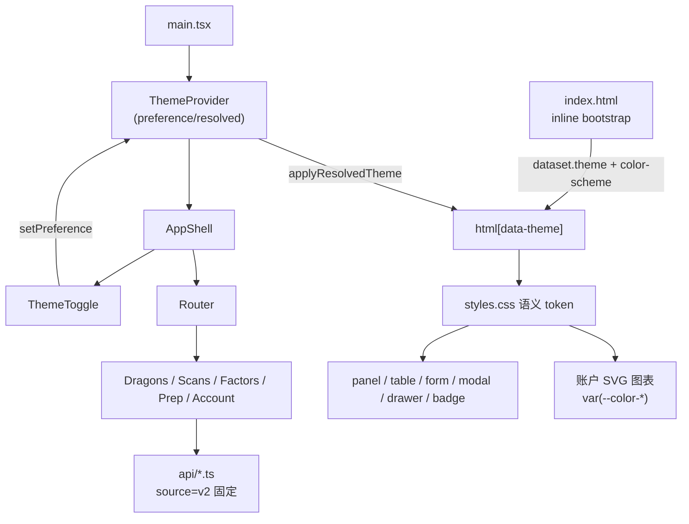
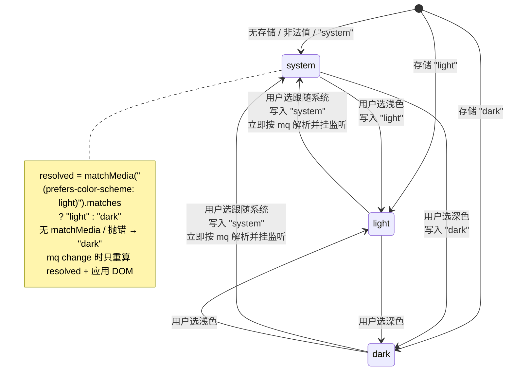
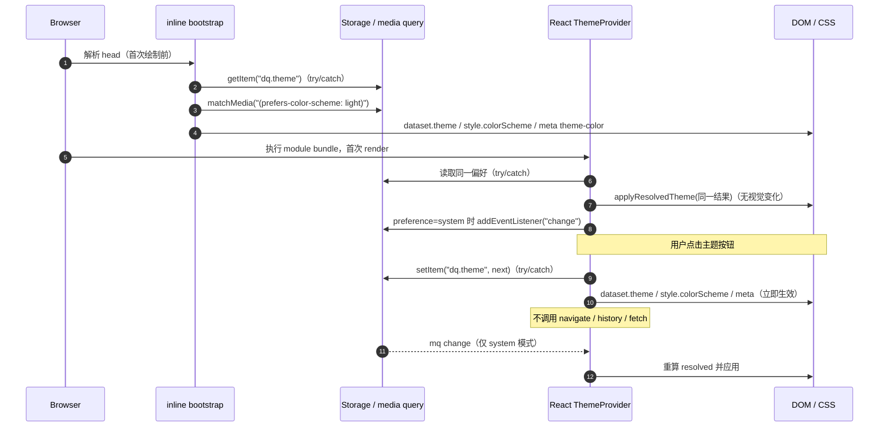
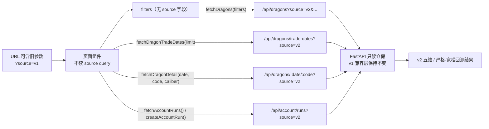

# dashboard 前端 v2 收敛 + 三态主题 · 技术方案（2026-10-31）

> 阶段 2 产物。上游输入（**全部照收，不推翻**）：
> - 阶段 0 需求与验收标准（用户已确认，见 §1）。
> - main 已定核心框架与取舍：CSS 语义变量 + `html[data-theme]` + 小型 React Theme Provider/Hook；`index.html` 首屏内联脚本；system/light/dark 三态偏好，实际只解析为 light/dark；主题事件不导航、不请求；v2 收敛只限 dashboard 前端展示逻辑，后端 v1 兼容层/历史数据/CLI 全保留。
>
> 本文只补 main 未覆盖的执行细节：文件改动地图、主题状态与首屏时序、token 分组与硬编码色治理、v1 深链行为、可访问性、异常边界、测试策略与真实可执行验证命令、风险与缓解。
> **不写生产代码**；阶段 3 按 §13 顺序实施。所有路径相对仓库根 `/Users/bing/Repo/dragon-quant`。

## 0. 结论摘要

1. **v2 收敛是「拆掉前端 source 管道」，不是加默认值**：删除 `AppShell` 的「数据体系 / v2 五维 / v1 历史」分段控件；`api/dragons.ts`、`api/account.ts` 在 fetch 内固定 `source=v2`；页面组件不再接收 `source` prop；`lib/caliber.ts` 删除 v1 恒 loose 分支。旧 `?source=v1` 深链**忽略 query**，按 v2 渲染；不做重定向/404/URL 改写。
2. **主题采用策略模式的两层隔离**：React 层只管「偏好 → 解析后的 light/dark」；颜色层只认 `html[data-theme]` 下的 CSS 语义变量。业务页面、图表、表格不感知 `matchMedia` 与 `localStorage`。
3. **首屏不闪烁靠 head 内联脚本**：在 React bundle 之前读取 `localStorage["dq.theme"]`、按 `prefers-color-scheme` 解析，设置 `html[data-theme]`、`style.colorScheme` 与 `meta[name=theme-color]`。脚本短、全 try/catch，无 `matchMedia` 时回落 dark。
4. **一个必须遵守的 Tailwind v4 事实**：在 `@theme` 静态 token 上使用斜杠透明度（如 `border-critical/35`、`bg-white/5`、`bg-panel-2/60`）会在构建期固化成字面量颜色，**不会随 `[data-theme=light]` 变化**。因此主题化颜色一律走「显式语义 token」或 CSS `color-mix()`，禁止对 `--color-*` 使用斜杠透明度。这是本方案新增的硬约束，已贯穿 §5 与文件地图。
5. **测试不引入前端测试框架**：项目现有门禁是 `tsc --noEmit && vite build` + Python 单测/E2E。新增一个零依赖的 Python「构建产物契约测试」守护 dist 内的主题脚本、浅色 token、v1 文案清理；主题行为（持久化/系统响应/跨路由/旧链接）用阶段 3 的 Playwright 手动清单取证，不新增 npm 依赖。
6. **dark 视觉不变**：新增 token 的 dark 默认值等于现有字面量；浅色是新覆盖层，不改布局、不改红涨绿跌语义、不改图表几何。

---

## 1. 验收标准对照

| # | 验收标准（阶段 0 原文） | 本文落点 | 阶段 3 验证 |
|---|------------------------|----------|-------------|
| 1 | 顶部移除「数据体系/v2 五维/v1 历史」；总览、账户固定 v2；清理前端 v1 专属文案/分支；旧 `?source=v1` 深链按 v2 展示；后端 v1 历史查询 API/表/CLI 全保留 | §2.3、§7、§6 | 构建产物 grep + Playwright 旧链接 + 后端既有 `test_web_api.py` v1 用例 |
| 2 | 三态主题（跟随系统/浅色/深色），默认 system；system 下监听 `prefers-color-scheme`；手动偏好持久化当前浏览器，回 system 恢复自动 | §2.1、§4、§9 | Playwright：localStorage、emulateMedia、重载 |
| 3 | 切换主题不改路由、不刷新、不重新请求业务数据；首屏尽量避免闪烁 | §4.5、§3.3、§9 | Playwright：URL/network 日志；DOMContentLoaded 首帧断言 |
| 4 | 浅色覆盖所有页面、表格、表单、弹窗、抽屉、徽章、账户 SVG 图表；保持暗色终端风与红涨绿跌，不重做布局 | §5、§8 | 逐页截图 + 计算样式抽查 + 对比度表 |
| 5 | TS + Vite build，更新入库 `web_ui/dist`；验证持久化/系统响应/跨路由/旧 v1 链接/既有测试；同步 owner 文档与必要 README | §6、§10、§14 | `npm run build` + 新增契约测试 + 全量 pytest + 文档 diff |

---

## 2. 关键设计决策（候选比较）

### 2.1 主题首屏与状态：head 内联脚本 + Provider（推荐）

| 候选 | 概要 | 评价 |
|------|------|------|
| **A（推荐）`index.html` 同步内联脚本 + React `ThemeProvider`** | 脚本在 head 解析偏好并设置 `data-theme`；Provider 负责后续监听与持久化 | 首屏在第一次绘制前就有正确属性；无额外请求；脚本约 20 行；缺点是键名/解析规则在脚本与 TS 各有一份，用构建契约测试守护 |
| B 仅 CSS `@media (prefers-color-scheme: light)` | 不写脚本，纯 CSS 跟随系统 | 无法表达「手动浅色/深色」；手动偏好必须靠 JS；回 system 时也无法在 JS 中统一解析 |
| C 外链阻塞脚本 `theme-bootstrap.js` | 把 bootstrap 独立成文件 | 多一次网络请求，首屏关键路径变长；构建/缓存多一个产物；收益只是「不内联」，对本项目无价值 |
| D 不 bootstrap，等 React 挂载后再设置 | 最少代码 | 系统浅色 + 手动深色等组合会先闪一帧错误主题；直接违反验收 3 |

**动机（策略模式）**：`ThemePreference` 是策略选择（system/light/dark），`resolveTheme` 是纯函数策略解析，DOM/CSS 是唯一输出端。首屏与运行时共用同一解析规则，但输出动作只有 `applyResolvedTheme` 一个 seam。`api/*.ts` 固定 `source=v2` 则是最小门面（Facade）：页面只表达业务过滤，不需要知道数据版本。

### 2.2 颜色隔离：CSS 语义变量 + `data-theme`（main 已定，照收）

| 候选 | 概要 | 评价 |
|------|------|------|
| **A（推荐，main 已定）`@theme` 语义 token + `[data-theme=light]` 覆盖** | 组件只写 `text-ink` / `bg-panel` / `var(--color-up)`；浅色只覆盖 token | 消除每组件重复的 dark: 类；图表/内联 SVG 也能吃到；切换只改根属性 |
| B 组件内大量 `dark:` 反色类 | Tailwind dark variant | main 已拒绝：重复、图表 SVG/内联色难统一、漏改点多 |
| C 运行时生成整套 light/dark stylesheet 并替换 `<link>` | 动态样式表 | main 已拒绝：首屏与切换复杂，无收益；还会触发额外样式重算与网络/内存成本 |
| D CSS `filter: invert()` 整体反色 | 一行实现 | 会把品牌红/涨跌红绿一起反色，违反 A 股语义；图片/SVG 也失真 |

**本方案新增的子决策：斜杠透明度治理。** 经实测当前 `web_ui/dist/assets/*.css`：

```css
.border-critical\/35{border-color:#e5484d59}
.bg-panel-2\/60{background-color:#171c2999}
.ring-brand\/30{--tw-ring-color:#8c6ff04d}
.bg-white\/5{background-color:#ffffff0d}
```

这些值在构建期已固化为字面量，`[data-theme=light]` 覆盖 `--color-*` 不会影响它们。因此：

- **禁止**对主题化颜色使用 `border-x/35`、`bg-x/60`、`ring-x/30` 这类斜杠透明度；
- 需要 alpha 的组合色，使用显式 token（`--color-*-soft` / `-line` / `-focus`）或 CSS `color-mix(in oklab, var(--color-x) 35%, transparent)`；
- `bg-white/...`、`bg-black/...`、`bg-panel-2/60` 这类硬编码表面全部替换为语义表面 token。

### 2.3 旧 `?source=v1` 深链：忽略 query（推荐）

| 候选 | 概要 | 评价 |
|------|------|------|
| **A（推荐）页面完全不读 `source` query，固定 v2 渲染** | 旧链接仍可用，只是数据是 v2 | 最小改动；不改 URL、不写 history、不触发额外导航；符合「旧深链仍按 v2 展示」 |
| B 检测到 `source=v1` 后 `history.replaceState` 去掉参数 | URL 变干净 | 多一次 history 写入与组件副作用；对用户无可感收益；还会让「切换主题不改路由」的验证多一个干扰项 |
| C 返回 404 / 提示已废弃 | 语义最显式 | 破坏旧书签；验收明确要求「仍按 v2 展示」，直接冲突 |

### 2.4 偏好存储：显式存 `"system"`（推荐）

| 候选 | 概要 | 评价 |
|------|------|------|
| **A（推荐）始终写 `"system" | "light" | "dark"`** | 回 system 有明确持久值；读侧只需白名单校验；调试时能区分「没存过」与「显式 system」的差异（虽然行为相同） |
| B 回 system 时删除 key | 少一个值 | 「未设置」与「显式回到自动」无法区分；读侧仍要回落 system；没有额外收益 |

存储键：`dq.theme`。非法值（旧版本、手工篡改）一律按 `system` 处理，**不主动删除**，避免读路径产生写副作用。

### 2.5 前端 v2 收敛方式：拆掉 source 管道（推荐）

| 候选 | 概要 | 评价 |
|------|------|------|
| **A（推荐）删除页面/组件的 `source` prop 与 URL 读取，fetch 内固定 `source=v2`** | 前端只可能请求 v2 | 类型层面就杜绝误用；清理 v1 分支最彻底；旧链接自然按 v2 展示 |
| B 保留 `source` prop，页面固定传 `"v2"` | 改动小 | 分支仍可被未来代码重新打开；「清理 v1 专属分支」不彻底；prop 变成无意义参数 |
| C 保留 URL 驱动，只在 v1 时强制改 v2 | 兼容旧交互 | 保留了一套已废弃的状态机；切换/重置/状态白名单都要继续维护 v1 分支 |

---

## 3. 架构与数据流

### 3.1 组件与依赖方向



依赖方向：`pages/components → api/lib`；`ThemeProvider → theme/theme.ts`；`AppShell → ThemeToggle → theme`。`ThemeProvider` 只依赖 `theme/theme.ts`，**不依赖 router 或 api**；业务页面与 `api/lib` 不 import theme。这样主题状态不可能触发导航或请求。

### 3.2 主题偏好状态机



### 3.3 首屏加载与运行时切换时序



### 3.4 v2 请求流（含旧深链）



关键点：`source=v1` 只可能出现在用户旧书签的地址栏，**不会进入任何 fetch 参数**；后端 `/api/dragons?source=v1` 仍然独立可用（外部脚本/历史查询），与本前端无关。

---

## 4. 主题状态与首屏时序

### 4.1 存储与解析契约

新增 `web_ui/frontend/src/theme/theme.ts`（纯函数，零 React）：

```ts
export type ThemePreference = "system" | "light" | "dark";
export type ResolvedTheme = "light" | "dark";

export const THEME_STORAGE_KEY = "dq.theme";
export const THEME_META_COLORS: Record<ResolvedTheme, string> = {
  light: "#F4F6FB",
  dark: "#0B0E14",
};

export function isThemePreference(v: unknown): v is ThemePreference;
export function readStoredPreference(): ThemePreference;      // 非法/异常 → "system"
export function writeStoredPreference(p: ThemePreference): void; // try/catch，失败静默
export function systemPrefersLight(): boolean | null;         // 无 matchMedia/抛错 → null
export function resolveTheme(
  preference: ThemePreference,
  systemPrefersLight: boolean | null
): ResolvedTheme;
export function applyResolvedTheme(theme: ResolvedTheme): void;
```

规则：

- `resolveTheme("light"|"dark", _)` 直接返回该值；`resolveTheme("system", true) → "light"`；`system === false` 或 `null → "dark"`。
- 读取 `window.localStorage` 本身也可能抛错（隐私模式），必须把**属性访问**一起包进 try/catch，而不是只包 `getItem`。
- `applyResolvedTheme` 同时设置三处，避免 `color-scheme` 内联样式与 `data-theme` 失配：
  ```ts
  root.dataset.theme = theme;
  root.style.colorScheme = theme;
  document.querySelector('meta[name="theme-color"]')?.setAttribute(
    "content", THEME_META_COLORS[theme]
  );
  ```
- **键名双处契约**：`index.html` 内联脚本无法 import TS，键名与合法值在脚本和 `theme.ts` 各写一份。两处都加注释指向对方；构建契约测试同时断言 `web_ui/frontend/index.html` 与 `web_ui/dist/index.html` 含 `dq.theme` / `prefers-color-scheme`，防止只改一处。

### 4.2 `index.html` 首屏内联脚本

位置：`<meta name="color-scheme">` 之后、favicon/title 之前，确保在首次绘制前同步执行。

```html
<script>
  (function () {
    var KEY = "dq.theme";
    var root = document.documentElement;
    var pref = "system";
    try {
      var stored = window.localStorage && window.localStorage.getItem(KEY);
      if (stored === "light" || stored === "dark" || stored === "system") pref = stored;
    } catch (e) {}
    var resolved = pref;
    if (pref === "system") {
      try {
        resolved = window.matchMedia &&
          window.matchMedia("(prefers-color-scheme: light)").matches ? "light" : "dark";
      } catch (e) { resolved = "dark"; }
    }
    root.dataset.theme = resolved;
    root.style.colorScheme = resolved;
    var meta = document.querySelector('meta[name="theme-color"]');
    if (meta) meta.setAttribute("content", resolved === "light" ? "#F4F6FB" : "#0B0E14");
  })();
</script>
```

`<head>` 其余改动：

- `meta[name=theme-color]` 保留初值 `#0B0E14`（脚本会覆盖）。
- `meta[name=color-scheme]` 改为 `content="dark light"`（声明两种都支持，dark 为品牌默认；实际由脚本/ CSS 覆盖）。
- 不在 `<body>` 里放主题逻辑；不引入外链脚本。

### 4.3 Provider / Hook

新增 `web_ui/frontend/src/theme/ThemeProvider.tsx`：

```tsx
interface ThemeContextValue {
  preference: ThemePreference;
  resolved: ResolvedTheme;
  setPreference: (next: ThemePreference) => void;
}

export function ThemeProvider({ children }: { children: React.ReactNode });
export function useTheme(): ThemeContextValue; // 无 Provider 时抛错
```

行为：

1. `preference` 懒初始化：`readStoredPreference()`。
2. `resolved` 懒初始化：`resolveTheme(preference, systemPrefersLight())`。
3. `useEffect([preference])`：
   - 创建 `matchMedia("(prefers-color-scheme: light)")`（无则 `null`）；
   - `apply()`：`resolveTheme(preference, mq?.matches ?? null)` → `setResolved` + `applyResolvedTheme`；
   - 立即 `apply()` 一次（保证 React 首帧与内联脚本一致）；
   - 仅当 `preference === "system" && mq` 时挂 `change` 监听；cleanup 移除；
   - 兼容旧 Safari：`addEventListener` 不存在时退回 `addListener` / `removeListener`。
4. `setPreference(next)`：`setPreferenceState(next)` + `writeStoredPreference(next)`；**不调用** `navigate`、`history`、`fetch`。
5. `main.tsx` 包一层：
   ```tsx
   <React.StrictMode>
     <ThemeProvider>
       <AppShell><Router /></AppShell>
     </ThemeProvider>
   </React.StrictMode>
   ```
   Provider 在 Router 之外，主题状态变化不会 remount 页面；`children` 是 `main.tsx` 的稳定元素，Provider 重渲染不会让整棵业务树重渲染，只有 `useTheme()` 消费者（`ThemeToggle`）更新。

### 4.4 主题切换控件

新增 `web_ui/frontend/src/components/ThemeToggle.tsx`，复用现有 `.seg` 风格：

```tsx
<div className="seg" role="group" aria-label="主题模式">
  <button type="button" className="seg-item" data-active={p === "system"}
          aria-pressed={p === "system"} aria-label="跟随系统" title="跟随系统">
    <IconMonitor size={14} /><span className="hidden sm:inline">系统</span>
  </button>
  <!-- 浅色 / 深色同理 -->
</div>
```

- 选项：`system` = 跟随系统、`light` = 浅色、`dark` = 深色。
- 可见短标签「系统 / 浅色 / 深色」；`sm` 以下只显示图标，`aria-label` 提供完整名称，避免挤压 header。
- 新增 3 个图标到 `web_ui/frontend/src/components/icons.tsx`：`IconMonitor`、`IconSun`、`IconMoon`，沿用现有 `Svg` 包装与 stroke 风格。

### 4.5 首屏闪烁分析与保证

- 内联脚本是经典同步脚本，位于 `<head>`，在浏览器首次绘制前执行；Vite 注入的 `type="module"` bundle 默认 defer，React 渲染一定在脚本之后。
- 内联脚本与 Provider 使用同一 `resolveTheme` 规则；Provider 首次 `apply()` 的结果与脚本一致，因此不会出现「脚本 light → React dark」的二次跳变。
- `root.style.colorScheme` 由脚本与 `applyResolvedTheme` 同步维护；如果只在脚本里设置，后续手动切换会被旧内联样式覆盖，这是本方案明确规避的坑。
- 即使 `localStorage`/`matchMedia` 抛错，脚本也至少设置 `data-theme="dark"` 与 `colorScheme="dark"`，不会停留在无属性状态。
- 无 JS / React 加载失败：页面停在 `html` 无 `data-theme` 的 dark 默认（`:root` token），不属于支持场景（SPA 本身无法渲染）。

---

## 5. token 分组与硬编码色治理

### 5.1 分层规则

| 层 | 位置 | 职责 |
|----|------|------|
| A. Tailwind 主题 token | `@theme` | 生成 `text-*` / `bg-*` / `border-*` / `ring-*` 工具类；dark 默认值，保持现有暗色视觉 |
| B. 浅色覆盖 | `@layer base { [data-theme="light"] { ... } }` | 覆盖 A 的 `--color-*`，以及 C 的 CSS-only 变量；base 层在 theme 层之后，稳定生效 |
| C. CSS-only 变量 | `@layer base { :root { ... } }` | 仅组件内部使用的颜色/阴影/渐变/滤镜；不生成无用工具类 |
| D. 组件类 | `@layer components` | `.panel` / `.btn-*` / `.input` / `.dt` / `.seg` / `.switch` / `.badge-*` / `.alert-critical`，组合 A/C 变量 |

**硬性规则**：

1. 组件里不再出现 `bg-white/...`、`bg-black/...`、`bg-panel-2/60`、`text-[#...]`、`rgba(255,255,255,...)`（图表/组件 CSS 内的 alpha 必须来自变量）。
2. 主题化颜色不使用 Tailwind 斜杠透明度；需要 alpha 时用 `-soft` / `-line` / `-focus` token，或在 CSS 里 `color-mix()`。
3. 新增颜色先进 token，再在组件使用；不直接写 hex/rgba。
4. dark 默认值必须等于现有字面量（允许 ±0.01 alpha 的合并误差），保证暗色视觉不漂移。
5. 依赖 Tailwind v4 的层顺序 `theme < base < components < utilities`：浅色覆盖放在 `@layer base`，组件颜色类放在 `@layer components`，因此能稳定覆盖 `@theme` 的默认值。

### 5.2 `@theme` 新增（dark 默认，生成工具类）

```css
@theme {
  /* 表面 / 交互 */
  --color-raise: rgba(255, 255, 255, 0.015);
  --color-raise-strong: rgba(255, 255, 255, 0.035);
  --color-hover: rgba(255, 255, 255, 0.05);
  --color-hover-strong: rgba(255, 255, 255, 0.08);
  --color-header: rgba(11, 14, 20, 0.82);
  --color-input: #0f131d;
  --color-scrim: rgba(0, 0, 0, 0.65);
  /* 语义色 */
  --color-critical-text: #ff9093;
  --color-critical-line: rgba(229, 72, 77, 0.35);
  --color-warn-line: rgba(240, 180, 41, 0.35);
  --color-brand-focus: rgba(140, 111, 240, 0.35);
}
```

对应工具类：`bg-raise`、`bg-raise-strong`、`bg-hover`、`hover:bg-hover`、`bg-header`、`bg-input`、`bg-scrim`、`text-critical-text`、`border-critical-line`、`border-warn-line`、`ring-brand-focus`。

### 5.3 `:root` CSS-only 变量（dark 默认）

```css
@layer base {
  :root {
    --color-halo: rgba(255, 255, 255, 0.06);
    --color-selection: rgba(140, 111, 240, 0.35);
    --color-selection-text: #ffffff;
    --color-scrollbar: rgba(255, 255, 255, 0.12);
    --color-scrollbar-hover: rgba(255, 255, 255, 0.20);
    --color-switch-off: rgba(255, 255, 255, 0.12);
    --color-switch-thumb: #ffffff;
    --color-on-brand: #ffffff;

    --app-glow-1: rgba(140, 111, 240, 0.10);
    --app-glow-2: rgba(74, 158, 255, 0.06);
    --panel-sheen: linear-gradient(180deg, rgba(255, 255, 255, 0.018), rgba(255, 255, 255, 0) 140px);
    --shadow-panel: inset 0 1px 0 rgba(255, 255, 255, 0.03), 0 18px 44px -28px rgba(0, 0, 0, 0.9);
    --shadow-overlay: 0 30px 80px -24px rgba(0, 0, 0, 0.95);
    --shadow-primary: 0 6px 18px -10px rgba(140, 111, 240, 0.9);
    --date-icon-filter: invert(0.72);
    --spin-opacity: 0.35;
  }
}
```

### 5.4 浅色覆盖

```css
@layer base {
  [data-theme="light"] {
    /* 表面 */
    --color-void: #f4f6fb;
    --color-panel: #ffffff;
    --color-panel-2: #f7f8fc;
    --color-panel-3: #eef1f8;
    --color-header: rgba(244, 246, 251, 0.82);
    --color-input: #ffffff;
    --color-scrim: rgba(16, 24, 40, 0.38);

    /* 描边 / 文字 */
    --color-hairline: rgba(16, 24, 40, 0.10);
    --color-hairline-2: rgba(16, 24, 40, 0.18);
    --color-ink: #101828;
    --color-ink-2: #475467;
    --color-ink-3: #667085;

    /* 品牌 / 涨跌 / 状态 */
    --color-brand: #6d4bd8;
    --color-brand-bright: #5b3bc4;
    --color-brand-soft: rgba(109, 75, 216, 0.10);
    --color-up: #c42434;
    --color-up-soft: rgba(196, 36, 52, 0.10);
    --color-down: #0e7a5a;
    --color-down-soft: rgba(14, 122, 90, 0.10);
    --color-warn: #8a5a00;
    --color-warn-soft: rgba(138, 90, 0, 0.12);
    --color-info: #1d63c9;
    --color-info-soft: rgba(29, 99, 201, 0.10);
    --color-critical: #c62828;
    --color-critical-soft: rgba(198, 40, 40, 0.10);
    --color-critical-text: #b42318;

    /* 交互 / 组合线 */
    --color-raise: rgba(16, 24, 40, 0.03);
    --color-raise-strong: rgba(16, 24, 40, 0.06);
    --color-hover: rgba(16, 24, 40, 0.05);
    --color-hover-strong: rgba(16, 24, 40, 0.08);
    --color-brand-focus: rgba(109, 75, 216, 0.30);
    --color-critical-line: rgba(198, 40, 40, 0.30);
    --color-warn-line: rgba(138, 90, 0, 0.30);
    --color-halo: rgba(16, 24, 40, 0.10);

    /* CSS-only */
    --color-selection: rgba(109, 75, 216, 0.18);
    --color-selection-text: #101828;
    --color-scrollbar: rgba(16, 24, 40, 0.16);
    --color-scrollbar-hover: rgba(16, 24, 40, 0.26);
    --color-switch-off: rgba(16, 24, 40, 0.18);
    --color-switch-thumb: #ffffff;
    --color-on-brand: #ffffff;
    --app-glow-1: rgba(109, 75, 216, 0.06);
    --app-glow-2: rgba(29, 99, 201, 0.05);
    --panel-sheen: linear-gradient(180deg, rgba(16, 24, 40, 0.02), rgba(16, 24, 40, 0) 140px);
    --shadow-panel: inset 0 1px 0 rgba(255, 255, 255, 0.9), 0 12px 32px -24px rgba(16, 24, 40, 0.28);
    --shadow-overlay: 0 24px 64px -24px rgba(16, 24, 40, 0.30);
    --shadow-primary: 0 6px 18px -10px rgba(109, 75, 216, 0.35);
    --date-icon-filter: none;
    --spin-opacity: 0.55;
  }
}
```

同时：

```css
html { color-scheme: dark; }
html[data-theme="light"] { color-scheme: light; }
```

### 5.5 硬编码 → token 映射

| 现有写法 | 出现位置（代表） | 替换为 |
|----------|------------------|--------|
| `bg-[rgba(11,14,20,0.82)]` | `AppShell` header | `bg-header` |
| `hover:bg-white/5` / `bg-white/5` | nav、Pagination、RunPicker；Badge neutral 底 | `hover:bg-hover` / `bg-hover` |
| `bg-white/[0.012]` / `[0.015]` | RecentDragons、Drawer、Prep、Factors、CurrentPosition | `bg-raise` |
| `bg-white/[0.03]` | EmptyState、CurrentPosition 图标底 | `bg-raise-strong` |
| `bg-panel-2/60` | AccountTimeline 非空仓卡片 | `bg-panel-2` |
| `bg-black/65` / `bg-black/60` | Modal / Drawer 遮罩 | `bg-scrim` |
| `text-[#ff9093]` | 7 处错误条 + RunPicker hover | `text-critical-text` |
| `border-critical/35` | 错误条 | `.alert-critical`（内部用 `--color-critical-line`） |
| `border-warn/35` | DragonDetailDrawer 否决块 | `border-warn-line` |
| `ring-brand/30` / `ring-brand/35` | AppShell 导航 active、Pagination active | `ring-brand-focus` |
| `border-white/10` / `border-white/15` | Badge neutral/outline | Badge 类内部改用 `--color-hairline-2` |
| `shadow-[0_...rgba(0,0,0,...)]` | Modal / Drawer / RunPicker | 行内 `style={{ boxShadow: "var(--shadow-overlay)" }}`（避免 Tailwind arbitrary shadow 对 CSS 变量的包装差异） |
| `rgba(139,144,160,0.5)` / `0.3` | AuctionSection 不可用/未知强度条 | `color-mix(in oklab, var(--color-ink-3) 50%, transparent)` / `30%` |
| `boxShadow: "0 0 0 4px rgba(255,255,255,0.06)"` | AccountTimeline 时间点光环 | `var(--color-halo)` |
| `stroke="rgba(255,255,255,0.22)"` | EquityPlot hover 十字线 | `var(--color-hairline-2)` |
| `stroke="rgba(255,255,255,0.12)"` | EquityTooltip 边框 | `var(--color-hairline-2)` |
| `GRID = "rgba(255,255,255,0.06)"` | equityTheme | `var(--color-hairline)` |
| `AXIS = "rgba(255,255,255,0.14)"` | equityTheme | `var(--color-hairline-2)` |
| `#0f131d` | `.input/.select` | `var(--color-input)` |
| `#fff`（按钮/开关） | `.btn-primary` / `.switch` | `var(--color-on-brand)` / `var(--color-switch-thumb)` |
| `rgba(255,255,255,0.12/0.2)` | 滚动条 | `var(--color-scrollbar*)` |
| `rgba(255,255,255,0.08)` | `.meter` | `var(--color-hover-strong)` |
| `rgba(140,111,240,0.35)` | `::selection` | `var(--color-selection)` |
| `filter: invert(0.72)` | 日期选择器图标 | `var(--date-icon-filter)` |

> 例外：`AppShell` 的 BrandMark / favicon 是品牌资产，红渐变与白色 K 线在两种主题共用，**不 token 化**；这是有意保留，不是遗漏。

### 5.6 对比度（浅色，WCAG AA）

| 前景 / 背景 | 对比度 |
|-------------|--------|
| `ink` / `panel` | 17.75:1 |
| `ink-2` / `panel` | 7.69:1 |
| `ink-3` / `panel` | 4.97:1 |
| `brand` / `panel` | 5.76:1 |
| `brand-bright` / `brand-soft` | 6.25:1 |
| `up` / `panel`；`up` / `up-soft` | 5.75:1；4.90:1 |
| `down` / `panel`；`down` / `down-soft` | 5.32:1；4.64:1 |
| `warn` / `panel`；`warn` / `warn-soft` | ≈5.5:1；5.00:1 |
| `info` / `panel`；`info` / `info-soft` | 5.71:1；4.93:1 |
| `critical` / `panel`；`critical-text` / `critical-soft` | 5.62:1；5.76:1 |
| 白字 / `brand`（主按钮） | 5.76:1 |

暗色现有值不变（styles.css 注释已记录 ink 14.6 / ink-2 5.6 / brand 4.8 / up 5.0 / down 5.9）；新增 `critical-text #ff9093` 在 panel 上 8.24:1。

### 5.7 组件 CSS 调整

```css
.panel {
  background: var(--panel-sheen), var(--color-panel);
  border: 1px solid var(--color-hairline);
  box-shadow: var(--shadow-panel);
}

.btn-primary {
  color: var(--color-on-brand);
  box-shadow: inset 0 1px 0 rgba(255, 255, 255, 0.18), var(--shadow-primary);
}

.btn-ghost { background: var(--color-raise-strong); }
.btn-ghost:hover { background: var(--color-hover-strong); }
.btn-subtle:hover { background: var(--color-hover); }
.btn-danger { border-color: var(--color-critical-line); color: var(--color-critical-text); }
.btn-danger:hover { background: color-mix(in oklab, var(--color-critical) 22%, transparent); }

.icon-btn:hover { background: var(--color-hover-strong); }
.input, .select { background: var(--color-input); }
.input:focus, .select:focus {
  box-shadow: 0 0 0 3px color-mix(in oklab, var(--color-brand) 16%, transparent);
}

.dt tbody tr:hover { background: var(--color-hover); }
.dt tbody tr[data-clickable="true"]:hover {
  background: color-mix(in oklab, var(--color-brand) 8%, transparent);
}

.seg { background: var(--color-raise-strong); }
.seg-item { gap: 6px; }
.seg-item[data-active="true"] {
  background: var(--color-brand-soft);
  color: var(--color-brand-bright);
  box-shadow: inset 0 0 0 1px color-mix(in oklab, var(--color-brand) 35%, transparent);
}

.switch { background: var(--color-switch-off); }
.switch::after { background: var(--color-switch-thumb); }
.meter { background: var(--color-hover-strong); }
```

Badge 的 8 个 tone 从 TSX 长类名迁到 CSS 颜色类（布局类保留在 TSX）：

```css
.badge-neutral { border-color: var(--color-hairline-2); background: var(--color-hover); color: var(--color-ink-2); }
.badge-brand   { border-color: color-mix(in oklab, var(--color-brand) 35%, transparent); background: var(--color-brand-soft); color: var(--color-brand-bright); }
.badge-up      { border-color: color-mix(in oklab, var(--color-up) 35%, transparent); background: var(--color-up-soft); color: var(--color-up); }
.badge-down    { border-color: color-mix(in oklab, var(--color-down) 35%, transparent); background: var(--color-down-soft); color: var(--color-down); }
.badge-warn    { border-color: color-mix(in oklab, var(--color-warn) 35%, transparent); background: var(--color-warn-soft); color: var(--color-warn); }
.badge-info    { border-color: color-mix(in oklab, var(--color-info) 35%, transparent); background: var(--color-info-soft); color: var(--color-info); }
.badge-critical{ border-color: var(--color-critical-line); background: var(--color-critical-soft); color: var(--color-critical-text); }
.badge-outline { border-color: var(--color-hairline-2); background: transparent; color: var(--color-ink-2); }
```

错误条统一为 `.alert-critical`（保留各处布局类）：

```css
.alert-critical {
  border: 1px solid var(--color-critical-line);
  background: var(--color-critical-soft);
  color: var(--color-critical-text);
}
```

**dark 视觉微差（阶段 3 需截图对比，可接受则记录到 `deviations`）**：

| 位置 | 现状 | 收敛后 | 差异 |
|------|------|--------|------|
| Drawer 遮罩 | black 0.60 | `--color-scrim` black 0.65 | 略深 |
| Badge neutral | white/10 边框 + white/5 底 | hairline-2 + `bg-hover`（0.05） | 边框 0.10→0.12 |
| Badge critical | critical/40 边框 | critical-line 0.35 | 略淡 |
| 导航 active ring | brand/30 | brand-focus 0.35 | 略亮 |
| AccountTimeline 非空仓卡 | panel-2/60 | panel-2 实色 | 暗色略亮 |
| `.meter` / `.seg` 底 | white 0.08 / 0.04 | hover-strong 0.08 / raise-strong 0.035 | 基本一致 |

---

## 6. 文件改动地图

### 6.1 新增

| 文件 | 内容 |
|------|------|
| `web_ui/frontend/src/theme/theme.ts` | 类型、存储键、读写、`systemPrefersLight`、`resolveTheme`、`applyResolvedTheme` |
| `web_ui/frontend/src/theme/ThemeProvider.tsx` | Context / Provider / `useTheme` / matchMedia 监听 |
| `web_ui/frontend/src/components/ThemeToggle.tsx` | 三态 seg 控件、`aria-pressed` |
| `dragon_quant/tests/test_web_frontend_theme.py` | dist 构建产物契约测试（§10.1） |
| `docs/solutions/2026-10-31-dashboard-v2-theme-design.md` | 本文 |

### 6.2 修改：主题基础设施

| 文件 | 改动 |
|------|------|
| `web_ui/frontend/index.html` | 内联 bootstrap；`theme-color` / `color-scheme` meta |
| `web_ui/frontend/src/main.tsx` | `<ThemeProvider>` 包裹 `AppShell` |
| `web_ui/frontend/src/AppShell.tsx` | 删除数据体系 seg / `changeSource` / `useSearchParams` / `navigate`；插入 `ThemeToggle`；header/nav 换 token |
| `web_ui/frontend/src/styles.css` | `@theme` 新增 token；`:root` / `[data-theme=light]` 覆盖；`color-scheme`；panel/btn/input/table/seg/switch/meter/selection/scrollbar/date 图标；`.badge-*` / `.alert-critical` |
| `web_ui/frontend/src/components/icons.tsx` | 新增 `IconMonitor` / `IconSun` / `IconMoon` |
| `web_ui/frontend/src/components/Badge.tsx` | tone 改用 `.badge-*` 类；neutral/outline 去掉 white alpha |
| `web_ui/frontend/src/components/EmptyState.tsx` | `bg-raise-strong` |
| `web_ui/frontend/src/components/Pagination.tsx` | `hover:bg-hover`、`ring-brand-focus` |
| `web_ui/frontend/src/components/Modal.tsx` | `bg-scrim`、行内 `boxShadow: var(--shadow-overlay)` |
| `web_ui/frontend/src/components/Drawer.tsx` | `bg-scrim`、行内 `boxShadow: var(--shadow-overlay)` |

### 6.3 修改：v2 收敛

| 文件 | 改动 |
|------|------|
| `web_ui/frontend/src/api/dragons.ts` | `DRAGON_SOURCE = "v2"`；`fetchDragons` 固定 source；`fetchDragonTradeDates(limit)`、`fetchDragonDetail(date, code, caliber?)` 去掉 source 参数；`DragonFilters` 去掉 `source` |
| `web_ui/frontend/src/api/account.ts` | `fetchAccountRuns()` 固定 `source=v2`；`CreateAccountRunInput` 去掉 `source`，`createAccountRun` 内部补 `source:"v2"` |
| `web_ui/frontend/src/lib/caliber.ts` | 删除 v1 恒 loose 分支，`effectiveCaliber(caliber?)` |
| `web_ui/frontend/src/pages/dragons/DragonsPage.tsx` | 删除 `useSearchParams` / `urlSource` / source 同步 effect / `initialFilters(source)`；重置不再带 source |
| `web_ui/frontend/src/pages/dragons/FilterBar.tsx` | 删除 `source`、`disabled`、v1 固定口径提示；口径从 `filters.review_caliber` 解析 |
| `web_ui/frontend/src/pages/dragons/SummaryCards.tsx` | 删除 `isV1` 分支与「v1 无严格口径」文案；宽松/严格字段固定 v2 |
| `web_ui/frontend/src/pages/dragons/RecentDragons.tsx` | 删除 `source` prop；固定 v2；`bg-raise` |
| `web_ui/frontend/src/pages/dragons/DragonDetailDrawer.tsx` | 删除 `source` prop 与 `source {detail.source}` 徽章；固定 v2；错误条/表面换 token |
| `web_ui/frontend/src/pages/account/AccountPage.tsx` | 删除 `useSearchParams` / `source`；`loadRuns()` 无参；`CreateRunModal` 无 source；错误条换 `.alert-critical` |
| `web_ui/frontend/src/pages/account/CreateRunModal.tsx` | 删除 `source` prop 与 v1/v2 分支；描述固定；payload 由 API 层补 v2；错误条换 token |

### 6.4 修改：浅色覆盖的其余页面/组件

| 文件 | 改动 |
|------|------|
| `web_ui/frontend/src/pages/account/AccountTimeline.tsx` | `bg-raise` / `bg-panel-2`、`var(--color-halo)` |
| `web_ui/frontend/src/pages/account/CurrentPosition.tsx` | `bg-raise-strong` / `bg-raise` |
| `web_ui/frontend/src/pages/account/RunPicker.tsx` | `hover:bg-hover`、`text-critical-text`、行内 `boxShadow: var(--shadow-overlay)` |
| `web_ui/frontend/src/pages/prep/AuctionSection.tsx` | 错误/表面 token；不可用/未知强度条 `color-mix(ink-3)` |
| `web_ui/frontend/src/pages/account/EquityPlot.tsx` | hover 十字线 `var(--color-hairline-2)` |
| `web_ui/frontend/src/pages/account/EquityTooltip.tsx` | tooltip 边框 `var(--color-hairline-2)` |
| `web_ui/frontend/src/pages/account/equityTheme.ts` | `GRID` / `AXIS` 换 hairline token |
| `web_ui/frontend/src/pages/prep/PrepPage.tsx` / `AuctionSection.tsx` / `SnapshotSection.tsx` | `.alert-critical` / `bg-raise` |
| `web_ui/frontend/src/pages/scans/ScansPage.tsx` / `ScanDetailPage.tsx` | `.alert-critical` |
| `web_ui/frontend/src/pages/factors/FactorsPage.tsx` / `DayValues.tsx` | `.alert-critical` / `bg-raise` |

### 6.5 构建产物与文档

| 文件 | 改动 |
|------|------|
| `web_ui/dist/**` | `npm run build` 重新生成；旧 hash 资产由 `emptyOutDir` 清理；必须与源码同 commit |
| `publish.sh` | 在写入版本号与任何 git add/commit/tag/push 之前执行 `npm --prefix web_ui/frontend run build`，确保 dist 进入发布提交；失败由 `set -e` 停止；不自动 npm install/ci |
| `docs/agent/development.md` | Web UI 段新增「三态主题 / v2 固定 / 斜杠透明度禁令 / 构建契约测试」 |
| `docs/agent/architecture.md` | 目录树 `frontend/src/...` 增加 `theme/` |
| `README.md` | dashboard 快速使用处加一行主题说明 |
| `dragon_quant/tests/e2e/coverage-map.json` | **不改**；无新增 CLI 命令/parser 节点 |

---

## 7. v2 收敛与旧链接行为

### 7.1 行为矩阵

| 入口 | 行为 |
|------|------|
| `/?source=v1` | `DragonsPage` 不读 query，fetch `/api/dragons?source=v2...`，渲染 v2；地址栏保留旧参数（不 rewrite） |
| `/account?source=v1` | `AccountPage` 不读 query，`/api/account/runs?source=v2`，渲染 v2 |
| `/scans`、`/factors`、`/prep` | 不涉及 source，行为不变 |
| 顶部导航点击 | `Link` 的 `to` 不含 query，旧参数自然消失 |
| 直接调用 `/api/dragons?source=v1` | 后端保持原行为（外部脚本/历史查询）；前端不再产生该请求 |
| `--source v1` CLI / v1 表 | 完全不动 |

### 7.2 API 层签名（阶段 3 目标态）

```ts
// api/dragons.ts
export const DRAGON_SOURCE = "v2" as const;

export interface DragonFilters {
  review_caliber?: ReviewCaliber;
  code?: string;
  name?: string;
  date_from?: string;
  date_to?: string;
  score_min?: string;
  score_max?: string;
  return_min?: string;
  return_max?: string;
  drawdown_min?: string;
  drawdown_max?: string;
  version_min?: string;
  version_max?: string;
  status?: string;
  sort_by: string;
  sort_dir: string;
}

export async function fetchDragons(
  filters: DragonFilters
): Promise<{ data: Dragon[]; count: number; summary: Summary }>;

export function fetchDragonTradeDates(limit = 5);
export function fetchDragonDetail(tradeDate: string, code: string, caliber?: ReviewCaliber);

// api/account.ts
export function fetchAccountRuns(): Promise<{ data: AccountRun[]; count: number }>;
export function createAccountRun(input: CreateAccountRunInput): Promise<...>;
```

`Dragon` / `Summary` / `AccountRun` 响应类型里的 `source: "v1" | "v2"` **保留**：它们描述服务端响应契约，不是前端请求能力。`DragonTable` 的 `rowKey` 继续用 `row.source`，无副作用。

### 7.3 文案清理清单（构建产物 grep 目标）

以下字符串在 `web_ui/dist/assets/*.js` 中必须消失：

- `数据体系`
- `v1 历史`
- `v1 无严格口径`
- `v1 历史固定旧口径`

以下字符串必须存在（主题控件）：

- `跟随系统`
- `浅色`
- `深色`

### 7.4 明确不动

- `web_ui/backend/**`：routers、deps、params、schemas、static 全部不改。
- `/api/meta` 的 `sources` / `default_source` 字段保留；前端不展示。
- `dragon_quant/commands/*`、`--source`、v1 表、历史查询 API。
- `web_ui/frontend/package.json` / `package-lock.json`：零新增依赖。

---

## 8. 可访问性

1. **控件语义**：`role="group" aria-label="主题模式"`；三个 `button` 各带 `aria-label`（跟随系统/浅色/深色）与 `aria-pressed`，当前项 `data-active="true"` 仅作视觉。
2. **键盘**：原生 button 可 Tab 聚焦、Enter/Space 激活；复用全局 `:focus-visible` 轮廓。
3. **移动端**：`sm` 以下只显示图标，`aria-label`/`title` 保证可读名称；不靠颜色单独区分（当前项有 `aria-pressed` + 背景）。
4. **对比度**：§5.6 全部达到 WCAG AA 正文阈值；小号 Badge 11px 也按 4.5:1 校验（up/down/warn 的浅色值已为此调深）。
5. **图表**：`EquityChart` 已有 `role="group"` + `aria-live` 读数；主题切换不改变该结构。红涨绿跌不是唯一信息：曲线位置、数值与 aria 文本同时存在。
6. **不新增动画**：主题切换复用现有 140ms 颜色过渡；不引入闪烁/脉冲。若后续需要，可单独加 `prefers-reduced-motion` 处理，本期不做。

### 8.1 安全

- 主题脚本不拼接任何用户输入；`localStorage` 值只做白名单校验，最终只用固定字面量设置 `dataset.theme` / `style.colorScheme` / `meta.content`，不存在把存储值写入 HTML/脚本的注入面。
- 不新增网络请求、Cookie、权限或第三方脚本；主题偏好不是敏感数据。
- 内联脚本是静态常量；当前无 CSP。若未来引入 CSP，需要为内联脚本加 hash/nonce，否则首屏会回 dark、Provider 挂载后再纠正（见 §9）。

---

## 9. 异常与边界

| 场景 | 行为 | 实现点 |
|------|------|--------|
| 无 `matchMedia` | system 解析为 dark；不挂监听；手动 light/dark 仍可用 | `systemPrefersLight()` 返回 `null`；Provider `mq=null` |
| `matchMedia(...)` 抛错 | 同无 matchMedia，回 dark | try/catch |
| `localStorage` 属性访问抛错（隐私模式） | 读取回 system；写入静默失败；本次会话内切换仍生效 | `safeStorage()` 包属性访问 + `getItem/setItem` |
| 非法存储值（`"purple"` / 旧格式） | 按 system 处理；不主动删除 | `isThemePreference` 白名单 |
| 用户回 system | 立即按当前 mq 解析并挂监听 | `setPreference("system")` + effect |
| 系统主题在手动模式下变化 | 不响应（监听未挂） | effect 只在 system 挂 |
| 系统主题在 system 模式下变化 | 重算 resolved + 更新 DOM/meta，无请求 | mq `change` |
| StrictMode 双挂载 | effect cleanup 移除监听；DOM 属性幂等 | effect 返回 cleanup |
| 旧 Safari 无 `addEventListener` | 退回 `addListener/removeListener` | 能力检测 |
| CSP 禁止内联脚本（未来） | 首屏回 dark，Provider 挂载后纠正（会闪一次）；当前无 CSP | 若加 CSP 需给内联脚本 hash/nonce |
| 旧 dist 被服务 | 旧页面照常工作（无主题功能）；不报错 | dist 整体替换，index no-store |
| 构建失败 / dist 不完整 | 不提交；构建契约测试检查 index 引用的 assets 存在 | §10.1 |
| 无 JS / React 未挂载 | 停在 dark 默认；SPA 本身不可用，非支持场景 | `:root` dark 默认 |
| 跨标签页修改主题 | 本期不同步；刷新后按存储值 | 非目标（`storage` 事件不接） |
| 主题切换时页面重渲染 | 只有 `useTheme` 消费者重渲染；页面不 remount | Provider 在 Router 外；无 theme 依赖的 effect |

---

## 10. 测试策略与验证命令

### 10.1 新增构建产物契约测试

`dragon_quant/tests/test_web_frontend_theme.py`（纯离线、零依赖）：

1. `web_ui/frontend/index.html` 与 `web_ui/dist/index.html` 都含：`dq.theme`、`prefers-color-scheme`、`dataset.theme`（或等价 `data-theme`）、`theme-color`。
2. `web_ui/frontend/src/theme/theme.ts` 同时含 `dq.theme` 与 `"system" | "light" | "dark"` 三个字面量；若内联脚本或 TS 一侧改了键名/合法值，测试失败（源码级双处契约）。
3. `web_ui/dist/index.html` 中内联主题脚本位于 `</head>` 之前且不是 `type="module"`（经典同步脚本，解析期执行），保证先于 defer 的 module bundle；同时 dist index 含 module script。
4. `web_ui/dist/assets/*.css` 含浅色覆盖选择器（`[data-theme=light]` 或 `[data-theme="light"]`）与 `--color-void` 覆盖。
5. 拼接全部 `web_ui/dist/assets/*.js`：不含 §7.3 的 4 个 v1 文案；含「跟随系统 / 浅色 / 深色」。
6. `web_ui/dist/index.html` 引用的每个 `/assets/...` 文件真实存在（防止半构建/旧 index）。
7. 不读取真实数据库、不发网络请求；只读仓库文件。

作用：把「dist 必须与源码同步」「主题脚本必须进产物」「v1 文案不能回流」变成可执行门禁；不引入 npm 测试框架。

### 10.2 既有测试（必须全绿）

```bash
# 构建（含 tsc --noEmit）
cd /Users/bing/Repo/dragon-quant/web_ui/frontend && npm run build

# 新增契约测试 + Web 后端单测（含 v1 API 契约）
cd /Users/bing/Repo/dragon-quant
.venv/bin/python -m pytest \
  dragon_quant/tests/test_web_frontend_theme.py \
  dragon_quant/tests/test_web_backend.py \
  dragon_quant/tests/test_web_backend_lazy.py \
  dragon_quant/tests/test_dashboard_command.py \
  dragon_quant/tests/test_web_server_lifecycle.py -q

# Web E2E（静态托管/缓存头/SPA fallback/v1 查询）
.venv/bin/python -m pytest \
  dragon_quant/tests/e2e/test_dashboard.py \
  dragon_quant/tests/e2e/test_web_api.py -q

# 全量离线门禁
.venv/bin/python -m pytest dragon_quant/tests -q \
  --ignore=dragon_quant/tests/e2e --ignore=dragon_quant/tests/smoke
.venv/bin/python -m pytest dragon_quant/tests/e2e -q
```

说明：`test_web_api.py` 里既有 `source=v1` 用例是后端 v1 保留的回归证据，**不得改断言**；本方案不改后端，预期原样通过。

### 10.3 Playwright 手动验收清单（阶段 3 取证）

启动：临时 `DQ_DATA_DIR`（空态或 E2E fixtures 种子）运行
`.venv/bin/python -m dragon_quant dashboard --no-browser --port 0`，记录真实端口。

| # | 操作 | 期望 |
|---|------|------|
| 1 | `emulateMedia({ colorScheme: "dark" })`，清空 `dq.theme`，打开 `/` | `html[data-theme=dark]`；body 背景 `rgb(11,14,20)` |
| 2 | `emulateMedia({ colorScheme: "light" })`（偏好仍 system） | 自动变 `html[data-theme=light]`；URL 不变；network 无新 `/api/*` |
| 3 | 点击「浅色」，再 `emulateMedia dark` | 保持 light；`localStorage["dq.theme"]="light"`；network 无新 `/api/*` |
| 4 | 刷新 | 首帧即 light；`domcontentloaded` 时 `dataset.theme` 已是 light |
| 5 | 点击「跟随系统」 | 立即跟随当前 emulated scheme；`dq.theme="system"` |
| 6 | 逐页 `/scans`、`/factors`、`/prep`、`/account` | `data-theme` 保持；panel 背景白色；表头 `#f7f8fc`；表单/select 白底 |
| 7 | `/account` 打开「生成回测记录」Modal | 遮罩 `rgba(16,24,40,0.38)`；面板白底；错误条文字 `#b42318` |
| 8 | 打开龙头 Drawer | 抽屉白底；Badge 边框非白色 alpha；报告区 `bg-raise` 可见 |
| 9 | 账户有数据时看 SVG | 权益线红/绿为浅色 token；网格为 `rgba(16,24,40,0.10)`；tooltip 白底 |
| 10 | 访问 `/?source=v1` | 请求参数含 `source=v2`；页面无「数据体系/v1 历史/v1 无严格口径」；总览正常 |
| 11 | `localStorage["dq.theme"]="purple"` 后刷新 | 按 system；不崩溃 |
| 12 | 禁用 localStorage（initScript 抛错） | 页面正常；默认 system；本次切换可用 |
| 13 | `window.matchMedia=undefined` | 页面正常；system 回 dark；手动 light/dark 可用 |
| 14 | 键盘 Tab 到主题组，Enter/Space 切换 | `aria-pressed` 同步；焦点轮廓可见 |

截图：dark/light 各页 1 张、Modal/Drawer/图表各 1 张，存入阶段 3 交付证据（不入库）。

### 10.4 dist 同步纪律

- 每次改 `web_ui/frontend/**` 后必须 `npm run build`；`web_ui/dist/index.html` 与 `dist/assets/*` 同 commit。
- 契约测试只看 dist；源码改了不 build 会直接失败，避免「源码/产物脱节」。
- 不手工编辑 dist。
- 发布走 `publish.sh` 时，脚本在写入版本号与任何 git add/commit/tag/push 之前先执行 `npm --prefix web_ui/frontend run build`，保证 dist 进入发布提交；发布机需有 Node/npm 且已安装 `web_ui/frontend` 的 devDependencies（脚本不自动 npm install/ci，缺失时原生命令直接失败）。

---

## 11. 风险与缓解

| 风险 | 影响 | 缓解 |
|------|------|------|
| 内联脚本与 `theme.ts` 键名/规则漂移 | 首屏与 React 状态不一致，闪烁 | 两处注释互指；契约测试断言两处都含 `dq.theme`；解析规则仅 3 个合法值 |
| Tailwind 斜杠透明度再次混入 | 浅色主题局部仍是暗色/白色 alpha | §5.1 规则 + 阶段 3 grep：`rg "bg-white/|text-\[#|border-white/|bg-panel-2/" web_ui/frontend/src` 应为空 |
| 浅色对比度不足（尤其 Badge 11px） | 可读性/无障碍回归 | §5.6 预算值；up/down/warn 已调深；阶段 3 抽查计算样式 |
| 图表内联 SVG 不随主题 | 曲线/网格在浅色下不可见 | 全部走 CSS 变量（现有代码已如此）；`equityTheme.ts` 去字面量 |
| 旧 dist / 半构建 | 页面 404 或旧 UI | index no-store + hash 资产；契约测试检查引用文件存在；构建后再提交 |
| header 空间不足（三按钮 + 导航） | 小屏溢出 | `sm` 以下图标-only；导航已有 `overflow-x-auto`；不新增可见标签 |
| Provider 重渲染导致页面 remount/请求 | 违反「不重新请求」 | Provider 在 Router 外；页面 effect 不依赖 theme；Playwright network 日志验证 |
| StrictMode/热更新重复监听 | 系统变化多次应用 | effect cleanup + 能力检测；DOM 设置幂等 |
| 浅色视觉「不像原设计」 | 用户不接受 | dark 默认值不变；浅色只覆盖 token、不改布局/字体/几何；先出一版截图给 main 验收 |
| `bg-panel-2/60` 改实色导致暗色卡片略变 | 极小视觉差异 | dark 用 `bg-panel-2` 实色替代 60% 透明，差异可接受；在 `deviations` 记录 |
| 无自动化 JS 单测 | 存储/媒体逻辑回归靠人工 | 纯函数集中 + 构建契约 + Playwright 清单；不新增测试依赖（项目现状） |

---

## 12. 非目标

- 不新增路由、不改 CLI、不改 `default_source` 公共入口。
- 不删除/修改后端 v1 API、v1 表、`--source v1`、历史查询。
- 不做服务端主题持久化、账户同步、跨设备/跨标签页同步。
- 不做逐页主题、主题编辑器、自定义强调色。
- 不引入 `next-themes`、`react-router`、Vitest 等任何新依赖。
- 不做浅色版的品牌插画/图片资源重绘；现有 BrandMark/favicon 两主题共用。
- 不做 URL `source` 参数清理/重定向。
- 不重做布局、不改组件尺寸/间距/字体、不改图表几何与红涨绿跌语义。
- 不把 v1 文案清理扩展到 backend 文案/日志（后端保持兼容）。

---

## 13. 阶段 3 实施顺序

1. **token 基础（暗色不漂移）**：`styles.css` 新增 token 与组件类，替换 `.panel/.btn/.input/.dt/.seg/.switch/.meter/scrollbar/selection`；此时**不接主题开关**，`npm run build` 后目视确认暗色与现状一致。
2. **主题状态**：`theme/theme.ts` → `ThemeProvider.tsx` → `ThemeToggle.tsx` → `icons.tsx` → `main.tsx` → `index.html` 内联脚本 → `AppShell` 接入；`npm run build`。
3. **v2 收敛**：`api/dragons.ts`、`api/account.ts`、`lib/caliber.ts`、Dragons/Account 页面与子组件；删除 source 管道与 v1 文案；grep §7.3 清单。
4. **浅色全覆盖**：逐页替换剩余硬编码（Prep/Scans/Factors/Account 子组件、Badge、Modal/Drawer、图表），用 §10.3 清单走一遍，按需微调 token。
5. **门禁与产物**：新增契约测试；`npm run build`；跑 §10.2 全部命令；更新 `docs/agent/development.md`、`docs/agent/architecture.md`、`README.md`；按 §14 给归档的 predecessor 方案加「后续变更」注记；确认 `web_ui/dist` diff。
6. **提交建议**：v2 收敛与主题是两个可独立审阅的改动。若用户要求拆分：commit 1 = v2 收敛 + 对应 dist；commit 2 = 主题 + 对应 dist（两次 build）。若不拆分，一个 commit 亦可，但提交信息需同时说明两件事。

---

## 14. 文档同步清单

| 文档 | 更新内容 |
|------|----------|
| `docs/agent/development.md` | Web UI 段新增：前端固定 v2；旧 `?source=v1` 忽略；三态主题与 `dq.theme`；首屏内联脚本；`data-theme` token 策略；**禁止对主题 token 用斜杠透明度**；`test_web_frontend_theme.py` 契约测试 |
| `docs/agent/architecture.md` | 目录树 `web_ui/frontend/src/{pages,api,lib,router}` → 增加 `theme/` |
| `README.md` | dashboard 快速使用加一行：顶部主题切换（跟随系统/浅色/深色），偏好保存在当前浏览器；界面固定 v2 五维 |
| `archived_md/web_ui/2026-10-31-web-ui-dashboard-design.md` | 按归档文档同步规则，在文首加「后续变更」注记，并把 §「source 上下文」标注为已被本方案取代（指向本文）；历史正文保留，不重写 |
| `archived_md/README.md` | 若合入时把本文归档，按归档动作补一行索引；未归档前不动 |
| `AGENTS.md` | **不改**：没有新增跨模块硬约束；根体量门禁优先 |
| `dragon_quant/tests/e2e/coverage-map.json` | **不改**：无新增命令/parser 节点 |

---

## 15. 自审记录

### 15.1 `solution-self-review` round 1

- verdict: **APPROVE**（无 CRITICAL；MAJOR/MINOR 见下，均已在文中落点或登记为已知限制）
- 审查维度：架构合理性 / 可扩展性 / 安全性 / 可维护性 / 一致性 / 发散度 / 配图与模式，另加项目硬性要求（文档同步、Mermaid、无新依赖、dist 入库、不破坏后端 v1）。

| # | 严重级 | 维度 | finding | 落点 / 处置 | change_my_mind |
|---|--------|------|---------|-------------|----------------|
| 1 | MAJOR | 可维护性 | 主题行为（存储、系统监听、持久化）没有自动化测试，只有构建契约 + 手动 Playwright | 纯函数集中到 `theme.ts`；§10.3 给出 14 步 Playwright 清单；不新增测试依赖（项目现状）。登记为 known_issue | 项目引入 JS 测试框架/Node 测试入口后，应补 `readStoredPreference/resolveTheme` 单测 |
| 2 | MAJOR | 可维护性 | 首屏内联脚本与 `theme.ts` 双份键名/解析逻辑，存在漂移风险 | 脚本压到约 20 行；两处注释互指；§10.1 增加「源码级双处字面量契约」与「脚本在 module 之前」断言 | 若脚本逻辑增长到超过纯解析（如增加迁移/多键），改为 Vite 注入或独立 bootstrap 文件 |
| 3 | MAJOR | 一致性 / 视觉 | 合并 alpha 值会带来少量 dark 视觉微差（scrim、Badge 边框、panel-2/60 等） | §5.7 列出微差表；阶段 3 截图对比，可接受则记 `deviations`，不可接受则调 token | 若 main/用户认为 dark 视觉漂移不可接受，则保留原字面量并单独加语义 token |
| 4 | MINOR | 可访问性 | 三态控件用 `role=group` + `aria-pressed`，不是 `radiogroup` + 方向键 | 避免实现 roving tabindex；原生 button + Tab/Enter/Space 已满足可用性 | 若 a11y 审计要求单选组语义，再升级为 radiogroup |
| 5 | MINOR | 架构 | Context 同时暴露 `preference` 与 `resolved`，当前只有 toggle 消费 | 保留 `resolved` 供未来图表/调试使用；只有一个消费者，重渲染成本可忽略 | 若消费者增多且 `resolved` 变化频繁，拆分 context 或用 `useSyncExternalStore` |
| 6 | MINOR | 可维护性 | 构建契约测试依赖中文字符串字面量，未来压缩器若转义 Unicode 会误报 | 当前 Vite/esbuild 保留中文；测试失败会显式报错，便于调整 | 若压缩策略变化，改为断言 `\u` 转义形式或断言 DOM 结构 |
| 7 | MINOR | 安全性 | 内联脚本与未来 CSP 的兼容性 | §8.1 / §9 记录；当前无 CSP | 若引入 CSP，加 hash/nonce |
| 8 | MINOR | 可扩展性 | 浅色是第二个大 token 块；第三主题需要再复制 | 双主题是本期范围；token 命名已按语义分组，未来可抽主题文件 | 若新增第三主题，改为按主题拆分 CSS 文件或构建时生成 |
| 9 | MINOR | 一致性 | 跨标签页主题不同步 | 明确列为非目标；刷新后按存储值 | 若用户要求实时同步，加 `storage` 事件监听 |

### 15.2 项目硬性要求核对

| 要求 | 结论 |
|------|------|
| 文档同步（owner 文档 + README） | §14 已列出 `docs/agent/development.md`、`docs/agent/architecture.md`、`README.md`；不改根 `AGENTS.md` |
| Mermaid 配图 | §3 共 4 张：组件依赖、偏好状态机、首屏/切换时序、v2 请求流 |
| 无新依赖 | `package.json` / lockfile 不变；仅用原生 `matchMedia` / `localStorage` / CSS `color-mix` |
| 前端 dist 入库 | §6.5、§10.4：每次 build 后同 commit；契约测试守护 |
| 不破坏后端 v1 历史查询 | §7.4、§10.2：后端零改动，既有 `test_web_api.py` v1 用例原样跑 |
| B1 惰性初始化 | 仅改前端与 dist；不触碰 `web_ui/backend` / `dragon_quant` 存储初始化 |
| 红涨绿跌语义 | dark token 不变；light up/down 仅调明度，不交换色相；图表 `segmentColor` 不变 |
