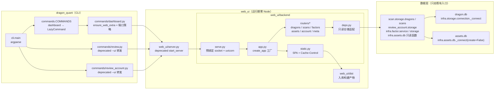
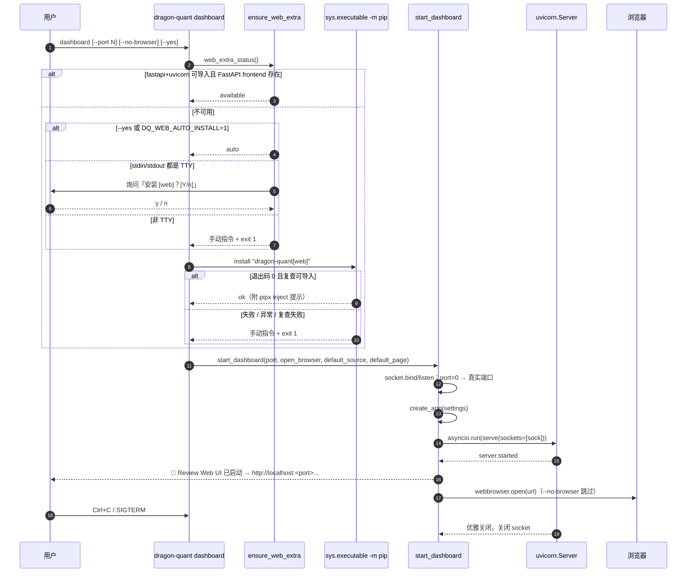
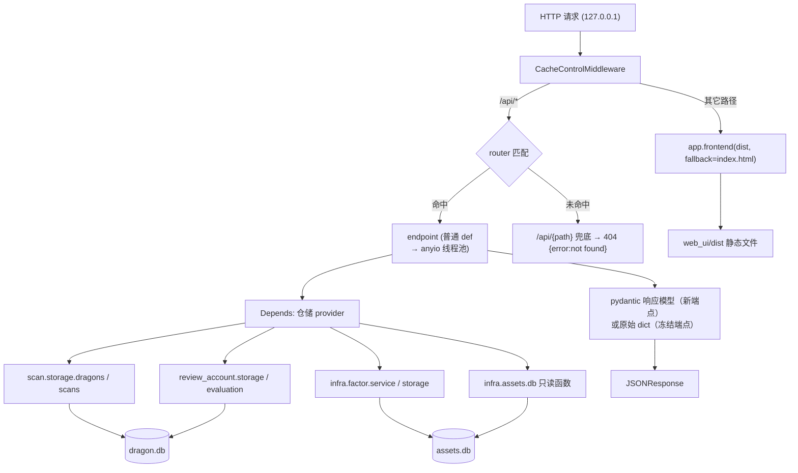
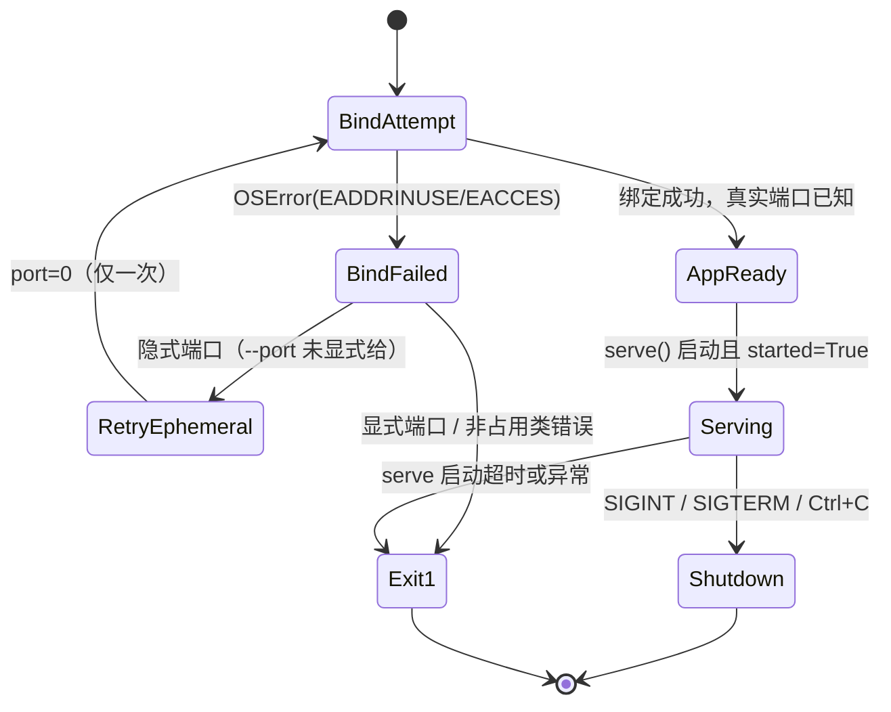
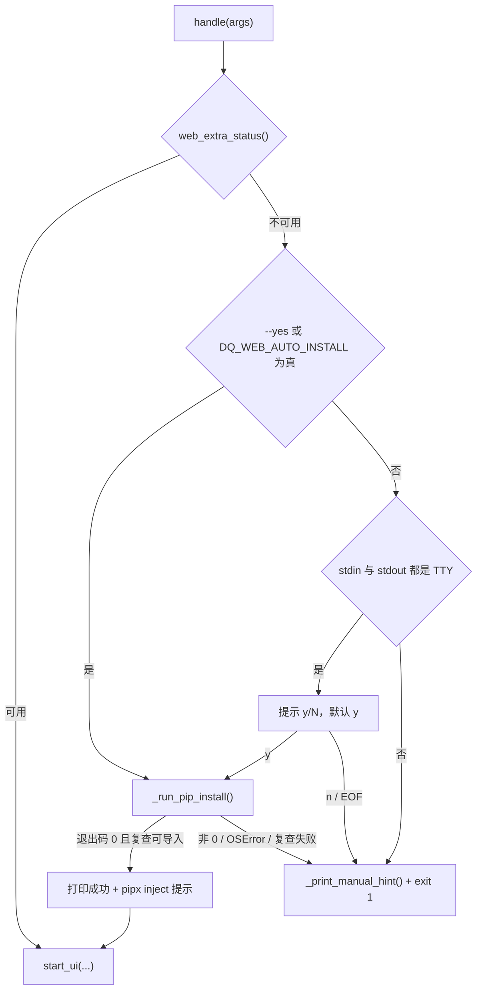

# web_ui FastAPI 重构 + `dashboard` 命令 · 技术方案（2026-10-31）

> 阶段 2 产物。上游输入（**全部照收，不推翻**）：
> - 阶段 1 调研：[`2026-10-31-fastapi-web-ui-research.md`](2026-10-31-fastapi-web-ui-research.md)（版本选型、`app.frontend()`、uvicorn 生命周期、`[web]` extra、兼容红线 E 表）。
> - main 已定框架：目录/打包/命令/兼容红线/P0 五页功能面/非目标（见任务包）。
>
> 本文只补 main 未覆盖的执行细节：API 全量定义、backend 模块结构、CLI 集成、前端结构、错误处理、测试策略、文档同步、分期边界、风险与 Mermaid 图。
> 不写生产代码；阶段 3 按 §15 的顺序实施。

> **后续变更（2026-10-31，dashboard v2 收敛 + 三态主题）**：本方案的「面板 source 上下文」（§8.4 及 §6.6 中「v1 由面板筛选进入」）已被 [`dashboard v2 收敛 + 三态主题`](2026-10-31-dashboard-v2-theme-design.md) 取代：dashboard 前端固定 v2，删除顶部「数据体系」选择器，旧 `?source=v1` 深链忽略 query 按 v2 渲染；后端 v1 API / 表 / `--source v1` CLI 全部保留。历史正文保留不重写。

## 0. 结论摘要

1. **进程模型**：`web_ui/backend/serve.py` 预绑定 socket → 编程式 `uvicorn.Server.serve(sockets=[sock])`。预绑定让 `EADDRINUSE` 在本项目代码内同步抛出（保持今天 `review` 的 `OSError` 语义），`port=0` 在启动前就能拿到真实端口，SIGTERM 仍由 uvicorn `capture_signals` 处理。
2. **数据访问**：FastAPI `Depends` + `deps.py` 只读适配层，**只调用既有仓储函数**（白名单见 §5），`web_ui` 内零 `sqlite3`、零新 SQL、零写表（唯一例外是既有账户回测动作，见 §6.2 说明）。
3. **兼容面**：`/api/dragons`、`/api/summary`、`/api/account/*` 共 10 个端点**逐键保形**（不设 `response_model`，避免 pydantic 裁剪/改名），`web_ui.server.start_server` 降级为 deprecated 薄壳，`review --ui` / `review-account --ui` 只加一行弃用提示、调用形状不变（既有单测断言可原样通过）。
4. **前端**：极简 pathname 路由表（约 60 行，零新依赖），`AccountApp.tsx`（1222 行）按「容器 / 图表 / 表格 / 弹窗」拆分；`dist/` 契约不变。
5. **自装引导**：状态机式纯函数 + `sys.executable -m pip install "dragon-quant[web]"` 单一 I/O seam；非 TTY / 拒绝 / pip 失败 一律 stderr 手动指令 + `exit 1`，禁止 `--break-system-packages`。
6. **测试**：W1–W9 断言语义全部保留（命令与文件重排，不断言降级）；新增 `dashboard` 的 non-TTY 引导与 pip 失败两条离线 E2E（子进程用 PYTHONPATH shim 隐藏 `fastapi`，pip 被 E2E procguard 拒绝即视作安装失败）；coverage-map 53/15 → 54/16。

---

## 1. 验收标准对照（阶段 0 已确认）

| # | 验收标准 | 本文落点 |
|---|----------|----------|
| 1 | 基础安装不带 fastapi/uvicorn；首调 `dashboard` 给引导，同意后装并启动；拒绝/失败/非 TTY 给手动指令退出 | §7.1–§7.3 |
| 2 | 五页可访问，数据只读自 dragon.db + assets.db | §6.3、§5 |
| 3 | `review --ui` / `review-account --ui` 仍打开对应页面（弃用提示一次） | §7.4 |
| 4 | E2E 断言语义不降级（SIGTERM/port=0/URL 行/无 Node/不碰真实库） | §11.2 |
| 5 | B2 惰性初始化不破坏 | §5.3、§11.1 |
| 6 | `--source v1` 查询语义不丢失 | §6.6 |
| 7 | dist 入库、随 wheel 分发、运行期零 Node | §8.5、§12 |
| 8 | `/api/dragons` summary 联动契约保留 | §6.5 |

---

## 2. 关键设计决策（≥2 候选，含非常规路径）

### 2.1 进程与端口：预绑定 socket + 编程式 uvicorn（推荐）

| 候选 | 概要 | 评价 |
|---|---|---|
| **A（推荐）预绑定 socket + `Server.serve(sockets=[sock])`** | 本项目先 `bind/listen`，把已绑定 socket 交给 uvicorn | `EADDRINUSE` 在 `bind()` 同步抛出，端口冲突策略无需解析 uvicorn 日志；`port=0` 真实端口立刻可得；SIGTERM 仍走 uvicorn `capture_signals` |
| B `uvicorn.run(app, port=...)` | 脚本式启动 | `uvicorn.Config.bind_socket()` 在 `OSError` 时内部 `sys.exit(1)`，端口冲突语义被吞成退出码，无法区分 `EACCES`；`port=0` 只能事后从 `server.servers[0].sockets` 反查 |
| C（非常规）保留 stdlib 静态服务 + 仅 `/api` 挂 FastAPI | 双栈并存 | 两套错误通道/两套缓存逻辑/两套生命周期，且慢端点阻塞问题仍在；与调研结论 3 冲突 |
| D 线程里跑 `serve()` 为主路径 | `block=False` 的形态直接当生产路径 | SIGTERM 捕获只在主线程生效（`capture_signals` 判定 main thread），生产路径会失去 W8 语义 |

**动机**：把「端口冲突 / 真实端口 / 信号」三个 E2E 契约留在本项目可控代码内，uvicorn 只承担 ASGI 运行。`block=False` 仍保留（线程 + `DashboardHandle`），仅供嵌入/单测，文档注明其不捕获信号。

### 2.2 数据访问：`Depends` + 只读适配层（推荐）

| 候选 | 概要 | 评价 |
|---|---|---|
| **A（推荐）`web_ui/backend/deps.py` 提供仓储 provider** | 每个 endpoint 声明 `dragon=Depends(dragon_repository)` | 只复用既有仓储函数；测试用 `app.dependency_overrides` 注入假仓储，零 DB；分层边界可 AST 校验 |
| B router 内直接 `from dragon_quant.scan.storage import dragons` | 少一层 | 测试要么真建库要么 patch 模块字符串；边界靠人肉遵守；新增端点容易滑向直连 SQL |
| C（非常规）`web_ui` 内新建专用 SQLite 读仓（裸 SQL） | 「读得快、字段自由」 | 绕过 `infra/storage/connection._connect` 与 `assets.db._connect(create=False)`，违反「双库只读、连接不绕过」硬约束，且会与表契约（v2 分表、source 白名单）二次漂移 |
| D 把读能力加到各 feature 门面 | 由 feature 拥有 | 为 UI 形状改 feature 公共 API，扩大回归面；P0 只读现有字段即可满足 |

**动机（适配器 / Ports & Adapters）**：`deps.py` 是唯一的「UI → 内部仓储」适配点，routers 只面向函数签名；将来表结构迁移只需改 adapter。

### 2.3 兼容端点响应模型：不设 `response_model`（推荐）

| 候选 | 评价 |
|---|---|
| **A（推荐）冻结端点直接返回 dict，键集由契约测试钉住** | 与今天的 `json.dumps(rows)` 逐键一致；不会因为模型缺字段而丢 `strict_*` / `derived_status` / 未来新增键 |
| B 全量 pydantic `response_model` | `query_dragons` 行字段与 `summarize_review_rows` 汇总键很多，模型必然长且易漂移；pydantic v2 默认 `response_model` 会裁剪未声明键，等于隐性改契约 |
| C `response_model` + `model_config = ConfigDict(extra="allow")` | 保留额外键但失去校验价值，噪声大 |

新 P0 端点**全部**使用 pydantic 响应模型（作为对外契约），冻结端点显式豁免并加契约测试（§11.1）。

### 2.4 前端路由：极简 pathname 表（推荐）

| 候选 | 评价 |
|---|---|
| **A（推荐）`router.tsx` 正则表 + `history.pushState` + `popstate`** | 约 60 行、零依赖、无 lockfile 变更；路由数量少且扁平；服务端已有 SPA fallback，刷新可用 |
| B `react-router-dom` v6 | 能力过剩（嵌套/loader/loader 错误边界都不用）；新增依赖与 40+ 包 lockfile 变更，运行期仍零 Node 但构建链更重 |
| C（非常规）Hash 路由（`#/scans`） | 完全绕开服务端 fallback，但 `/account` 深链与 `?source=` 契约会变，E2E W1/R9 断言与 README 链接全部失效 |

**动机**：路由表是「数据驱动的小表 + 一个分发函数」，不需要抽象成框架；`/scans/:scanId` 用一条正则捕获组即可，不为假设的未来需求引入嵌套路由。

### 2.5 旧 `web_ui.server`：deprecated 薄壳（推荐）

保留 `start_server(port, open_browser, default_source, default_page, *, block=True)` 名字与参数顺序，内部委托 `web_ui.backend.serve.start_dashboard`。

理由：`test_commands.py` / `test_cli.py` 有 8 处 `patch("web_ui.server.start_server")` 并断言调用形状；保留同名 seam 让 `review` / `review-account` 的行为与单测几乎零改动（只多一行 stderr），也让第三方嵌入者不立刻报 ImportError。`ReviewHandler`、`_resolve_static`、`_get_db` 等实现细节删除（对应单测改写，见 §11.2）。

### 2.6 自装引导位置：commands 层纯决策 + 单一 I/O seam（推荐）

| 候选 | 评价 |
|---|---|
| **A（推荐）`dragon_quant/commands/dashboard.py`** | CLI 关注点（stdin/exit code/stderr 文案）留在命令层；`web_ui` 不感知 pip；决策函数可单测；与 `cli.main` 里 `warn_if_unavailable()` 的「命令启动前能力自检」骨架一致（但本特性需要交互，故不在 `cli.main` 全局执行） |
| B `web_ui/backend/bootstrap.py` | 让可选的 `web_ui` 包承担安装自己的职责，`web_ui` 在未装 fastapi 时仍被导入，职责混淆 |
| C（非常规）`sys.meta_path` 导入钩子在 `ImportError` 时自动 pip | 静默联网安装，无同意、难测、违反最小惊讶 |

### 2.7 设计模式落点（用户全局约定）

| 模式 | 落点 | 动机 |
|---|---|---|
| 工厂 Factory | `create_app(settings)`、`routers/__init__.py` 的 `ROUTERS` 元组 | 应用装配与请求处理解耦，测试可构造最小 app |
| 依赖注入 | `Depends(dragon_repository)` 等 | 以参数而非 import 表达协作，测试替换无副作用 |
| 适配器 Adapter | `deps.py`（仓储端口）、`compat.py`（旧 JSON 形状防腐层） | 隔离内部仓储/表契约变化 |
| 装饰器 Decorator | `CacheControlMiddleware`（纯 ASGI，不用 `BaseHTTPMiddleware`） | 在响应流上叠加缓存头，不改路由实现 |
| 状态机 / 策略 | `ensure_web_extra`：`availability → confirmation → install → verify` 四态；安装动作是唯一可替换策略 | 每次分支都可单测，不把交互埋在 `if` 森林里 |
| 外观 Facade | `web_ui.server` deprecated 薄壳 | 旧入口稳定，新实现可演进 |

不为「可能的第二期」提前抽象仓储接口类（Protocol/ABC）；`deps.py` 返回模块对象已足够。

---

## 3. 总体架构

### 3.1 组件与依赖



### 3.2 `dashboard` 启动 + 自装引导（时序）



### 3.3 请求-数据流



### 3.4 端口/生命周期状态机



---

## 4. 目录与文件清单

### 4.1 `web_ui/backend/`（新增）

| 文件 | 职责（一句话） | 关键约束 |
|---|---|---|
| `__init__.py` | PEP 562 惰性导出 `create_app` / `start_dashboard` / `DashboardSettings` / `DashboardHandle` | 导入本包**不得** import fastapi/uvicorn、不得触库/建目录 |
| `settings.py` | `DashboardSettings` frozen dataclass：`dist_dir`、`project_root`、`default_source`、`default_page` | 只做路径常量，不做 I/O |
| `app.py` | `create_app(settings)`：挂 routers、异常处理器、`/api` 404 兜底、静态中间件、frontend | 全部 import 在函数内（fastapi 延迟） |
| `serve.py` | 预绑定 socket、`uvicorn.Config/Server`、启动通告、浏览器、`DashboardHandle`（`port`/`stop()`） | 唯一 socket/uvicorn 接触点 |
| `deps.py` | 仓储 provider（函数内 lazy import），返回模块对象 | 只允许 §5 白名单函数 |
| `errors.py` | `install_error_handlers(app)`：`RequestValidationError→400 invalid_request`、兜底 `Exception→500 {"error": str(e)}`、`ApiError→{code,detail}`；**不注册全局 `ValueError→400`** | 保留基线：GET 账户端点的 `ValueError` 今天就是 500；新端点自行显式转 400 |
| `params.py` | `normalize_date`（`YYYYMMDD` / `YYYY-MM-DD`）、`parse_source`（v1/v2 白名单）、`clamp_limit` | 纯函数 |
| `static.py` | `CacheControlMiddleware`、`BUILD_HINT`、`mount_frontend(app, dist_dir)` | `/assets/*` immutable；HTML no-store；其余 no-cache；dist 缺失走 build hint |
| `compat.py` | 冻结端点的业务组装（dragons/summary/account rows→payload、benchmark series、positions stats），输入仓储参数化 | 键集与今天逐键一致；不新增键 |
| `routers/__init__.py` | `ROUTERS = (meta.router, dragons.router, scans.router, factors.router, assets.router, account.router)` | 注册顺序即路由顺序 |
| `routers/meta.py` | `GET /api/meta`：版本、数据目录、两库是否存在、dist 是否构建、可用 source | 只 `Path.is_file()`，不建库 |
| `routers/dragons.py` | `/api/dragons`、`/api/summary`（冻结）、`/api/dragons/trade-dates`、`/api/dragons/{trade_date}/{code}` | 冻结端点禁用 `response_model` |
| `routers/scans.py` | `/api/scans`、`/api/scans/{scan_id}`、`/api/scans/{scan_id}/stocks` | 只读 `scans_v2` / `scan_stocks_v2` |
| `routers/factors.py` | `/api/factors`、`/api/factors/values`、`/api/factors/runs` | 静态路径先于参数路径注册 |
| `routers/assets.py` | `/api/prep/dates`、`/api/prep/{trade_date}`、`/api/prep/{trade_date}/snapshot`、`/api/auction/dates`、`/api/auction/{trade_date}` | 只读 `assets.db`，`create=False` |
| `routers/account.py` | 既有 7 个 `/api/account/*`（含 POST/DELETE）、单飞锁 | 兼容端点的唯一写路径 |
| `schemas.py` | 共享模型 `ErrorResponse`、`ListEnvelope`、`DateStr`/`CodeStr` 校验别名 | 新端点复用 |

### 4.2 `web_ui/frontend/src/`（改造）

| 文件 | 职责 |
|---|---|
| `main.tsx` | 挂载 `AppShell` + `Router`；MantineProvider 不变 |
| `router.tsx` | 极简路由表、`usePathname`、`navigate`、`Link`、`Navigate` |
| `AppShell.tsx` | Mantine `AppShell` 顶栏/侧栏导航（总览/扫描/因子/复盘/账户）+ source 上下文 |
| `api/client.ts` | `getJson` / `postJson` / `deleteJson`，统一 `ApiError`（解析 `{error, detail}`） |
| `api/dragons.ts` / `api/account.ts` | 从现 `api.ts` 平移（类型 + fetch） |
| `api/scans.ts` / `api/factors.ts` / `api/assets.ts` / `api/meta.ts` | 新域类型与调用 |
| `pages/dragons/DragonsPage.tsx` | 现 `App.tsx` 平移：卡片 + 筛选 + 表格 + 近几日分组 |
| `pages/dragons/DragonDetailDrawer.tsx` | 五维明细（JOIN `scan_stocks_v2`）、严格/宽松对照 |
| `pages/scans/ScansPage.tsx` | `scans_v2` 列表 → 选中进详情 |
| `pages/scans/ScanDetailPage.tsx` | 全榜（top N / `is_true_dragon` / `reject_reason` / 五维） |
| `pages/factors/FactorsPage.tsx` | 注册表清单 + 选中因子 → 当日值（PIT）+ build 审计 |
| `pages/prep/PrepPage.tsx` | 13 类数据资产水位 + collection_report 健康度 + 快照结构化呈现 |
| `pages/account/AccountPage.tsx` | 原容器瘦身：状态/取数/布局 |
| `pages/account/EquityCurve.tsx` | 净值曲线（从 `AccountApp` 抽出） |
| `pages/account/TradesTable.tsx` / `PositionsTable.tsx` / `Timeline.tsx` / `EntryReasonStats.tsx` / `CurrentPosition.tsx` / `CreateRunModal.tsx` / `DeleteRunModal.tsx` | 平移动画零行为变化 |
| `components/DragonTable.tsx` 等 3 个 | 保留 |
| `components/Section.tsx` / `StatCard.tsx` / `EmptyState.tsx` | 新页面复用的小件 |
| `lib/chart.ts` | `buildChart/scale/linePath/areaPath/ticks/dateTicks/nearestIndex` 纯函数 |
| `lib/format.ts` | `fmtMoney/fmtPct/fmtNum/pnlColor/fmtCompactMoney` |
| `lib/pagination.ts` | `usePagination` |
| 删除 `App.tsx` / `AccountApp.tsx` / `api.ts` / `caliber.ts`（`caliber.ts` 并入 `lib/` 或 `api/dragons.ts`） | — |

### 4.3 CLI 侧

| 文件 | 改动 |
|---|---|
| `dragon_quant/cli.py` | 新增 `dashboard` 子命令块（§7.1）；顶部 docstring/epilog 增补示例 |
| `dragon_quant/commands/__init__.py` | `COMMANDS["dashboard"] = LazyCommand("dragon_quant.commands.dashboard", needs_providers=_never_providers)` |
| `dragon_quant/commands/dashboard.py`（新增） | `handle`、`ensure_web_extra`、`web_extra_status`、`_run_pip_install`、`is_addr_in_use`、`start_ui` |
| `dragon_quant/commands/review.py` | `_start_ui` 增一行弃用提示；`_is_addr_in_use` 保留为 `dashboard.is_addr_in_use` 的别名 |
| `dragon_quant/commands/review_account.py` | `_start_ui` 增一行弃用提示 |
| `web_ui/__init__.py` | 保留 `start_server` 惰性导出（deprecated），新增 `create_app`/`start_dashboard` 惰性导出 |
| `web_ui/server.py` | 重写为 deprecated 薄壳（保留 `python -m web_ui.server` 入口与参数） |
| `pyproject.toml` | `[project.optional-dependencies] web = [...]`、`dev = [...]`（§5.1） |

---

## 5. 依赖、分层与惰性初始化

### 5.1 `pyproject.toml`

```toml
[project.optional-dependencies]
web = ["fastapi>=0.162.0", "uvicorn>=0.54.0"]
dev = ["fastapi>=0.162.0", "uvicorn>=0.54.0", "httpx>=0.27"]
```

- `web`：裸 uvicorn（不带 `[standard]`），只写下界，与 `playwright>=1.30` / `tmdx>=3.0` 风格一致；`pydantic` 由 fastapi 传递安装。
- `dev`：仅供贡献者 `pip install -e ".[dev]"`；`TestClient` 依赖 httpx，**不**进 `[web]`，基础安装仍只有 playright/tmdx。
- 许可证：fastapi/pydantic = MIT，uvicorn/starlette = BSD-3-Clause，全部与 MIT 兼容且活跃维护；`AGENTS.md` 依赖段与 README 同步（§12）。

### 5.2 `web_ui.backend` 允许 import 的白名单（硬约束）

| 来源 | 允许的函数/对象 | 用途 |
|---|---|---|
| `dragon_quant.scan.storage.dragons` | `query_dragons`、`summarize_review_rows`、`get_review_summary`、`resolve_caliber`、`get_dragons`、`get_dragons_by_date`、`list_dragon_trade_dates`、`get_dragon_meta` | 龙头/回测 |
| `dragon_quant.scan.storage.scans` | `list_scans`、`get_scan`、`get_scan_stocks` | 扫描 |
| `dragon_quant.review_account.storage` | `query_review_account_runs/snapshots/trades/positions/events`、`get_review_account_run`、`delete_review_account_run` | 账户读 + 兼容删除 |
| `dragon_quant.review_account.main` | `run_review_account` | **仅** `POST /api/account/runs` 兼容写路径 |
| `dragon_quant.review_account.evaluation` | `entry_reason_stats` | positions 统计 |
| `dragon_quant.infra.assets.db` | `get_prep_assets`、`get_prep_snapshot`、`has_prep_snapshot`、`list_prep_asset_dates`、`list_prep_snapshot_dates`、`list_auction_snapshots`、`list_auction_assets`、`list_auction_asset_dates`、`list_auction_snapshot_dates` | prep/auction 只读 |
| `dragon_quant.infra.factor.service` | `list_factors`、`query`、`status` | 因子注册表/值 |
| `dragon_quant.infra.factor.storage` | `list_registry`、`list_build_runs` | 注册表 DB 快照 / build 审计 |
| `dragon_quant.infra.storage.paths` | `DB_PATH`、`ASSETS_DB_PATH` | 仅 `/api/meta` 的 `is_file()` 探测 |
| `dragon_quant.infra.provider.xueqiu` | `XueqiuProvider` | **仅** `/api/account/benchmark`（既有行为，普通 def） |

明确禁止：
- `web_ui` 内出现 `import sqlite3`、`sqlite3.connect`、任何建表/写表 SQL；
- import `scan.scores.*`、`review_account.auction/*`、`infra.provider.*`（benchmark 例外）、`playwright`；
- 绕过 `infra.storage.connection` / `infra.assets.db` 自建连接。

> **因子分层硬约束**：`infra/storage/*` / `infra/assets/*` 禁止 import `infra/factor/*`，本方案不触碰该方向；`web_ui` 位于 `dragon_quant` 之外，同时调用两侧既有只读 API 不构成违规。

### 5.3 B2 / B1 惰性初始化

- `import web_ui`、`import web_ui.backend`、`import web_ui.backend.serve`：**零** fastapi/uvicorn import、零目录、零 DB、零网络。
- `import dragon_quant` / `-h` / `-v`：不变（既有 B1 门禁）。
- 首次真实副作用只发生在：①`create_app` 之后首个请求里仓储 `_connect()`（dragon.db 建库/schema，与今天 `/api/dragons` 一致）；②`assets.db` 读函数（`create=False`，**不建库**）；③`dashboard` 绑定端口。
- `web_ui/backend/__init__.py` 用与 `web_ui/__init__.py` 相同的 PEP 562 `__getattr__` 模式，禁止 module-level `from fastapi import ...`。

---

## 6. API 定义

### 6.1 通用约定

- **路径前缀**：全部 `/api/*`；服务只绑定 `127.0.0.1`（不提供 `--host`）。
- **方法**：除兼容的 `POST/DELETE /api/account/runs` 外全部 `GET`。
- **同步端点**：全部使用普通 `def`（anyio 线程池，默认 40）；`/api/account/benchmark` 与 `POST /api/account/runs` 是长阻塞端点，禁止写成 `async def`。
- **列表信封**：`{"data": [...], "count": N}`；分页端点另加 `total` / `truncated`。
- **错误形状**：
  - 冻结端点保持今天的单键 `{"error": "<message>"}`（400/404/500 均如此）；
  - 新端点使用 `{"error": "<code>", "detail": "<message>"}`，`code ∈ {not_found, invalid_request, run_in_progress, internal_error}`；
  - `/api/{任意未匹配路径}` 一律 `404 {"error": "not found"}`（E2E 冻结）。
- **冻结端点的参数解析必须手工、逐字复用今天的行为**：`/api/dragons` 的数值筛选遇到非法值今天是**静默忽略**（`except ValueError: pass`），声明成 pydantic 数值参数会变成 400；`/api/account/*` 的 `run_id` 缺失在 GET 今天是 **500 `{"error":"missing run_id"}`**、在 DELETE 是 **400**。因此冻结端点接收 `Request`/原始 `dict` body，复用 `compat.py` 中原样搬运的 `_parse_filters/_parse_run_id/_normalize_api_date`，**禁止**用类型化 Query/Body 模型改写这些语义。新端点才使用 pydantic 参数与响应模型。
- **日期参数**：接受 `YYYYMMDD` 与 `YYYY-MM-DD`，响应统一回显 `YYYY-MM-DD`（与库内一致）。
- **source 白名单**：`v1` / `v2`，非法值回退 `v2`（与今天 `_parse_source` 一致）；新端点不接收 `source`（只读 v2 产物）。
- **排序**：新端点服务端排序；`rank IS NULL` 一律排在有 rank 之后（Python 侧稳定排序，避免 SQLite `NULLS FIRST` 差异）。
- **文档**：保留 `/docs` 与 `/openapi.json`（FastAPI 自带）。冻结端点 `include_in_schema=True`，但显式 `response_model=None` 并注明契约冻结。

### 6.2 兼容端点（10 个，逐键保形）

| # | 方法 & 路径 | 参数 | 响应 | 行为差异 |
|---|---|---|---|---|
| 1 | `GET /api/dragons` | `code,name,date_from,date_to,score_min,score_max,return_min,return_max,drawdown_min,drawdown_max,status,version_min,version_max,sort_by,sort_dir,review_caliber,source` | `{data, count, summary}` | 无。summary 仍由 `summarize_review_rows(rows, source, include_derived_counts=True, caliber=...)` 计算，客户端分页不切片 |
| 2 | `GET /api/summary` | `source` | `get_review_summary(source)` 的旧键集 | 无（legacy，不接收口径） |
| 3 | `GET /api/account/runs` | `source, limit` | `{data, count}` | 无；`limit` 非数字今天回退 20，保留 |
| 4 | `POST /api/account/runs` | JSON：`date_from,date_to,source,strategy_name,name/display_name,initial_cash,strategy_params` | `201 {data, run_id}` | 参数错误仍 `400 {"error": msg}`（手工校验、文案逐字保留）；新增单飞锁（并发请求 → `409 {"error": "account run already in progress"}`） |
| 5 | `DELETE /api/account/runs?run_id=` | `run_id` | `{deleted, run_id}` / `404 {"error":"run not found"}` | 无；缺 `run_id` 仍是 `400 {"error":"missing run_id"}` |
| 6 | `GET /api/account/snapshots?run_id=` | `run_id` | `{data}` | 无；缺 `run_id` → `500 {"error":"missing run_id"}`（基线） |
| 7 | `GET /api/account/benchmark?run_id=&code=` | `run_id, code`（默认 SH000001） | `{data, code, name}` | 无（普通 def；雪球 K 线在线程池，不阻塞事件循环）；缺 `run_id` → 500（基线） |
| 8 | `GET /api/account/trades?run_id=` | `run_id` | `{data}` | 无；缺 `run_id` → 500（基线）；未知 run_id → 200 空列表（基线） |
| 9 | `GET /api/account/positions?run_id=` | `run_id` | `{data, stats}` | 无（`entry_reason_stats` 计算留在 `compat.py`）；缺 `run_id` → 500（基线） |
| 10 | `GET /api/account/events?run_id=` | `run_id` | `{data}` | 无；缺 `run_id` → 500（基线） |

> 上表「500（基线）」是 `test_web_api.py::test_w5_w6_account_run_lifecycle_and_series` 明确冻结的现状（GET 路由的 `ValueError` 落到 `except Exception` → 500；只有 POST/DELETE 手工映射为 400）。本期不改这一语义；`compat.py` 原样搬运 `_parse_run_id` 等函数，避免「顺手统一成 400」打破 E2E。

> **「双库只读」边界说明**：main 框架的「只读」指 P0 新增端点；#4/#5 是既有面板的账户回测动作（用户显式点击「新建/删除回测」），删除会改变产品行为，故按原语义保留，写路径仍走 `run_review_account` 与 `review_account.storage`，不新增任何写 SQL。若 main 要求第一期彻底只读，需明确决定移除这两项 UI 能力（见 §16 NEED-DECISION 候选 1）。

### 6.3 新增 P0 端点（14 个）

#### 6.3.1 meta

**`GET /api/meta`**
响应模型：

```python
class Meta(BaseModel):
    version: str
    data_dir: str
    dragon_db: bool          # DB_PATH.is_file()
    assets_db: bool          # ASSETS_DB_PATH.is_file()
    dist_built: bool         # dist/index.html 存在
    sources: list[str]       # ["v1","v2"]
    default_source: str
    default_page: str
    routes: list[str]        # 前端路由清单，供调试/导航
```

数据源：`dragon_quant._version.__version__`、`infra.storage.paths`、`settings`。**不建库**。

#### 6.3.2 龙头总览（增强）

**`GET /api/dragons/trade-dates?source=v2&limit=10`** → `{data, count}`

```python
class DragonDateEntry(BaseModel):
    trade_date: str
    count: int
    preview: list[DragonPreview]      # 最多 3 条，按 rank（null 最后）再 composite desc

class DragonPreview(BaseModel):
    code: str; name: str
    rank: int | None; composite_score: float | None
    is_true_dragon: bool | None
```

实现：`list_dragon_trade_dates(source)` 取最近 `limit` 个（升序返回 → 反转），逐日 `get_dragons(date, source)` 计数与取前 3。N ≤ 10 的 N+1 查询可接受；二期若需要一次聚合再在 `scan.storage` 增加专用只读函数（不在本期）。

**`GET /api/dragons/{trade_date}/{code}?source=v2&caliber=strict`** → 明细

```python
class DragonDetail(BaseModel):
    trade_date: str; code: str; name: str; source: str
    scan_id: str | None
    rank: int | None; composite_score: float | None; board_count: int | None
    concepts: list[str]; report_text: str
    is_true_dragon: bool | None
    quote: QuoteFields                 # open/close/high/low/pct/turnover_rate/amount/market_cap
    review_loose: ReviewFields         # buy_date/buy_price/max_return_5d/max_drawdown_5d/max_return_hold_days/review_status
    review_strict: ReviewFields | None # strict_*；缺行 → null
    derived_status: str | None         # 与 /api/dragons 同口径
    caliber: str
    dims: Dims | None                  # JOIN scan_stocks_v2
    dims_source: Literal["scan_stocks", "scan_stocks_missing", "scan_missing"]
    reject_reason: str | None
```

实现：`query_dragons({"date_from": d, "date_to": d}, source=..., caliber=...)` → 按 `code` 精确匹配（`code_like` 只用于模糊筛选，不用它取单只）；`dims` 由 `get_scan_stocks(scan_id)` 过滤 `code` 得到。找不到 → `404 {"error":"not_found", ...}`。

#### 6.3.3 扫描

**`GET /api/scans?limit=50`** → `{data: list[ScanSummary], count}`

```python
class ScanSummary(BaseModel):
    id: str; scan_date: str
    elapsed_s: float | None; top_n: int
    candidates_n: int | None; workers: int | None
    created_at: str; source: str
```

**`GET /api/scans/{scan_id}`** → `ScanSummary` + `{has_raw_output: bool, raw_output_bytes: int | None}`；`raw_output` 本体**不返回**（体积大，第一期不需要）。`get_scan` 返回无 `raw_output` 键时 `has_raw_output=false`。

**`GET /api/scans/{scan_id}/stocks?true_only=false&limit=200&offset=0`**

```python
class ScanStock(BaseModel):
    code: str; name: str
    rank: int | None; composite_score: float | None; board_count: int | None
    concepts: list[str]
    dims: Dims                       # drive/leadership/anti_drop/liquidity/absorption
    is_true_dragon: bool | None
    reject_reason: str | None
    report_text: str

class ScanStocksPage(BaseModel):
    data: list[ScanStock]; count: int; total: int; truncated: bool
```

实现：`get_scan_stocks(scan_id)` 全量取（单次扫描候选量级 ≤ 数百），在 adapter 内排序（rank null 最后，再 composite desc、code）+ 过滤 `true_only` + 切片。`get_scan_stocks` 返回 `dim_*` 平铺键，adapter 映射到 `dims`（显式契约，测试覆盖）。

#### 6.3.4 因子

**`GET /api/factors?source=&enabled_only=false`** → `{data: list[FactorSpecView], count}`

```python
class FactorSpecView(BaseModel):
    name: str; label: str | None
    direction: str; unit: str | None
    frequency: str; source: str
    available_phase: str; pit_rule: str
    lookback: int
    enabled: bool                    # 代码注册表 default_enabled
    depends_on: list[str]
    valid_from: str | None; deprecated_at: str | None
    description: str | None
    code_version: str; code_version_source: str
    db_version: str | None           # factor_registry 最新版本（按 created_at desc）
    db_registered: bool
    params: dict | None              # factor_registry.params_json
    spec_hash: str | None
```

实现：`infra.factor.service.list_factors()`（代码注册表，唯一真值）+ `infra.factor.storage.list_registry()`（DB 快照，按 `factor_name` 取首行，SQL 已按 `created_at DESC, factor_version DESC`）。`source` 过滤在 adapter 内完成。

**`GET /api/factors/values?trade_date=&name=&code=&version=`**（`trade_date` 必填，缺失 → 400）

```python
class FactorDayView(BaseModel):
    trade_date: str
    resolved_versions: dict[str, str]
    missing_versions: list[str]
    rows: list[FactorValueRow]       # 扁平：code/factor_name/value/available_at/source_scan_id
    coverage: dict[str, FactorCoverage] | None
    coverage_source: Literal["build_run", "build_run_missing"]
    build_id: int | None

class FactorValueRow(BaseModel):
    code: str; factor_name: str; value: float
    available_at: str                # PIT 时点（Asia/Shanghai）
    source_scan_id: str | None

class FactorCoverage(BaseModel):
    coverage: float | None; rows: int | None
    status: str | None; warnings: list[str]
```

实现：`infra.factor.service.query(date=..., name=..., code=..., version=...)`（内部走 `get_day_values`，版本解析规则不变，`resolved_versions` 必带）；coverage 由 `list_build_runs(trade_date=date, limit=1)` 的 `report["factors"][name]` 提取（`coverage/rows/status/warnings`），无 build run → `coverage=None, coverage_source="build_run_missing"`。未知因子名 → `400 {"error":"invalid_request","detail":"未知因子: ..."}`（复用 service 的 `ValueError`，由错误处理器转 400）。

**`GET /api/factors/runs?trade_date=&limit=20&include_report=false`**

```python
class FactorRun(BaseModel):
    id: int; trade_date: str
    started_at: str | None; finished_at: str | None; created_at: str
    ok: bool | None; scan: dict | None
    warnings: list[str]
    factors: list[FactorRunFactor] | None   # status/rows/coverage/reason
    report_error: str | None
    report: dict | None                     # include_report=true 时返回原始 report
```

实现：`infra.factor.storage.list_build_runs(trade_date=..., limit=...)`；默认只抽摘要键，避免把整个 report（含每因子 meta）灌给前端。

#### 6.3.5 prep / auction 水位与复盘

**`GET /api/prep/dates?limit=30`** → `{asset_dates: [...], snapshot_dates: [...], count}`

实现：`list_prep_asset_dates()` + `list_prep_snapshot_dates()`，取并集最近 `limit` 个（升序切片）。**不加载任何 payload**。

**`GET /api/prep/{trade_date}`** → 资产水位

```python
class PrepAssetStatus(BaseModel):
    asset_type: str
    present: bool
    status: str | None               # collection_report 状态；无条目 → null
    note: str | None
    error: str | None
    as_of: str | None                # payload 顶层 as_of；无则 null
    usable_display: bool             # 仅展示级判定（见下），不是 compute 语义

class PrepCollectionReport(BaseModel):
    asset_type: str
    status: str | None               # ok / empty / empty_suspicious / unavailable / error
    note: str | None
    error: str | None

class PrepWatermark(BaseModel):
    trade_date: str
    available: bool                  # assets.db 存在且该日有任意资产
    assets: list[PrepAssetStatus]    # 固定 13 类数据资产，缺项 present=false
    collection_report: list[PrepCollectionReport]   # 第 14 类，健康度块单独呈现
    missing: list[str]
    degraded: list[str]              # status ∈ {error, empty_suspicious, unavailable} 或 as_of 不匹配
    has_snapshot: bool
```

实现：`get_prep_assets(date)`（`create=False`，缺失 → `{}`）+ `has_prep_snapshot(date)`。注意该函数会解析该日全部 payload（含 `stock_daily` 的百根 K 线），单次请求成本约数十毫秒；本端点只回传状态不回转 payload，不为此新增 SQL（二期若成为瓶颈，再在 `infra.assets.db` 增加只读表头函数）。`prep_assets` 共 **14 类**：13 类数据资产（`dragons`、`ths_limit_up_pool`、`ths_block_top`、`market_breadth`、`fg_boards`、`holdings`、`fund_flow`、`cninfo_announcements`、`macro_global`、`stock_daily`、`prev_plan`、`auction_feedback`、`t1_intraday`）进 `assets`，`collection_report` 单独进 `collection_report`。`usable_display` 只做「present + status 非坏 + 必非空资产非 empty + as_of 匹配」的展示级判定，明确**不复制** prep 内部 `asset_health` 的业务分支（避免两份语义）；权威定义在 `prep-auction.md`，字段名刻意带 `_display` 防止被下游误当决策口径。

**`GET /api/prep/{trade_date}/snapshot?source=v2&slim=true`**

```python
class PrepSnapshotView(BaseModel):
    trade_date: str
    version: str | None              # result_json.version（当前 0.8）
    created_at: str | None
    blocks_present: list[str]        # sentiment/main_boards/macro/candidates/review/...
    sentiment: dict | None
    main_boards: list[dict] | None
    macro: dict | None
    dragon_source: dict | None
    candidates: list[dict] | None
    review_candidates: list[dict] | None   # 含 role/dimensions/gate_trace/eligibility/position_pct
    review: dict | None
    feedback: dict | None
    plan_review: dict | None
    slim: bool
    raw_size_bytes: int
```

- 数据源：`get_prep_snapshot(date, source, with_meta=True)`；无快照 → `404 {"error":"not_found"}`。
- `slim=true`（默认）时移除体积大且无展示价值的键：顶层 `raw_candidates`（若存在）、`review_candidates[].legacy`；其余原样透传（JSON 由 prep 侧 schema 负责，前端按块渲染，缺块显示「未启用/数据不足」）。
- `blocks_present` 从 `result_json` 现有键推导（当前可能包含 `sentiment/main_boards/macro/candidates/review/review_candidates/strategy_context/feedback/plan_review/dragon_source/raw_candidates`），不补键、不猜。
- 不重算、不补键：`v0.7` 快照缺 `review`/`plan_review` 时对应块为 `null`，`blocks_present` 如实反映。

**`GET /api/auction/dates?limit=30`** → `{snapshot_dates, asset_dates, count}`（`list_auction_snapshot_dates` + `list_auction_asset_dates`）

**`GET /api/auction/{trade_date}?source=v2&with_assets=false`**

```python
class AuctionSnapshotRow(BaseModel):
    code: str
    version: str | None
    is_weak: bool | None
    strength: float | None
    level: str | None
    direction: str | None
    rank: int | None
    validation_status: str | None
    data_quality: dict | None
    risk_events: list | None
    reject_reason: str | None
    error: str | None                # 逐行 JSON 损坏隔离

class AuctionDayView(BaseModel):
    trade_date: str
    available: bool
    count: int
    snapshots: list[AuctionSnapshotRow]
    summary: dict[str, int]          # strong/medium/weak/vetoed/unavailable/unknown
    assets_count: int | None         # with_assets=true 时由 list_auction_assets 计数
```

实现：`list_auction_snapshots(date, source)`（已摊平 `analysis_json`）；`with_assets=true` 才调 `list_auction_assets(date)` 取长度。`summary` 按 `level` + `is_weak` + `unverified`/`data_quality.status` 分类，未知一律计入 `unknown`，不猜。

### 6.4 新旧端点映射表

| 旧（重写前） | 新实现位置 | 是否变化 |
|---|---|---|
| `GET /api/dragons` → `ReviewHandler._serve_api_dragons` | `routers/dragons.py::list_dragons` + `compat.py::dragons_payload` | 无（键集冻结） |
| `GET /api/summary` | `routers/dragons.py::legacy_summary` | 无 |
| 7 个 `/api/account/*` | `routers/account.py` + `compat.py` | 无（新增单飞 409） |
| — | `GET /api/meta` | 新增 |
| — | `GET /api/dragons/trade-dates`、`GET /api/dragons/{date}/{code}` | 新增 |
| — | `GET /api/scans`、`/{scan_id}`、`/{scan_id}/stocks` | 新增 |
| — | `GET /api/factors`、`/values`、`/runs` | 新增 |
| — | `GET /api/prep/dates`、`/{date}`、`/{date}/snapshot` | 新增 |
| — | `GET /api/auction/dates`、`/{date}` | 新增 |
| 静态 `GET /` `/account` `/*` | `app.frontend` + `CacheControlMiddleware` | 语义等价（缓存头见 §9） |

### 6.5 `/api/dragons` summary 契约兼容策略

- 调用链保持不变：`resolve_caliber` → `query_dragons` → `summarize_review_rows(include_derived_counts=True)`；返回 `{data, count, summary}`。
- **禁止**：服务端分页（除非先汇总再切片）、新增/重命名顶层键、把 `summary` 改成异步/懒计算。
- `review.md` 必须继续包含 `GET /api/dragons`、`summarize_review_rows`、`derived_completed`、`derived_pending`、`derived_status` 五个 token（`test_docs_consistency.py::test_web_ui_summary_contract_preserved` 冻结）。
- 新增契约测试：未筛选时 `summary` 去掉 `derived_*` 后与 `/api/summary` 逐键等值；筛选时 `summary.total == count == len(data)`。
- 冻结端点不设 `response_model`，避免 pydantic 裁剪。

### 6.6 `--source v1` 查询语义

| 位置 | v1 处置 | 结论 |
|---|---|---|
| `GET /api/dragons?source=v1` | 保留；强制 `loose` 口径；`strict_*` 为 null | 保留 |
| `GET /api/summary?source=v1` | 保留 | 保留 |
| `/api/account/*?source=v1` | 保留 | 保留 |
| 新增 scans/factors/prep/auction 端点 | 无 v1 概念（这些产物只有 v2/资产库） | 不提供 `source` 参数 |
| `dashboard` CLI | 无 `--source` 参数，默认 `v2`；v1 通过 `review --ui --source v1`（deprecated 别名）或面板「体系」筛选进入 | 无丢失 |

**建议**：第一期不裁撤任何 v1 查询；等 `dragons_v1` 数据清空后再由 main 决策下线。

**v1 表不存在时的行为（与今天一致，不做特判）**：在从未写入过 v1 表的库上，任何 v1 查询（含今天的 `/api/dragons?source=v1`）都会触发 `no such table: dragons_v1` → 500。本期保持同一语义，前端以区块级错误提示呈现；不为此引入「捕获所有异常返回空」的兜底（会掩盖真实库损坏）。

---

## 7. CLI：`dashboard`

### 7.1 argparse

```python
dashboard_p = sub.add_parser(
    "dashboard",
    help="启动本地 Web 仪表盘（龙头/扫描/因子/复盘/账户）",
    usage="dragon-quant dashboard [--port PORT] [--no-browser] [--yes]",
    description="启动 127.0.0.1 上的可视化面板。首次使用时若未安装可选依赖 [web]，"
                "会询问是否自动安装 fastapi/uvicorn；--yes 跳过询问。",
    epilog="""Examples:
  dragon-quant dashboard
  dragon-quant dashboard --port 9000 --no-browser
  dragon-quant dashboard --yes
""",
)
dashboard_p.add_argument("--port", type=int, default=None,
                         help="监听端口 (默认 8765；被占用时自动改用系统分配端口)")
dashboard_p.add_argument("--no-browser", action="store_true", help="不自动打开浏览器")
dashboard_p.add_argument("--yes", action="store_true",
                         help="[web] 未安装时直接安装，不再询问（等同 DQ_WEB_AUTO_INSTALL=1）")
```

- `--port` 用 `None` 哨兵表示「未显式给」，语义默认 8765（与 `review --ui` 完全一致）；argparse help 写「默认 8765」。
- 注册：`COMMANDS["dashboard"] = LazyCommand("dragon_quant.commands.dashboard", needs_providers=_never_providers)`。
- `cli.py` 顶部 docstring 与 parser epilog 增加示例；`warn_if_unavailable()` 现状不变。

### 7.2 端口策略

| 场景 | 行为 | 与今天的关系 |
|---|---|---|
| `--port` 未给，8765 被占 | stderr 警告一次 → `port=0` 重试一次 | 与 `review` 一致 |
| `--port 0`（显式） | 交给 OS 分配，URL 取真实端口，永不出现 `:0` | 一致（E2E 依赖） |
| `--port N` 被占 | stderr 可操作错误 + `SystemExit(1)`，不换端口 | 与 `review` 一致（`review-account` 原本不重试，保留其转发行为） |
| 非端口占用 `OSError`（如 `EACCES`） | 原样抛出 | 一致 |

判定复用 `is_addr_in_use(exc)`（`errno.EADDRINUSE` 或 Windows `winerror=10048`），实现从 `commands/review.py::_is_addr_in_use` 移到 `commands/dashboard.py`，`review.py` 保留同名别名（既有单测直接调用它）。

### 7.3 `[web]` 自装引导

**检测（纯函数）**

```python
def web_extra_status() -> tuple[bool, str | None]:
    try:
        import fastapi
        import uvicorn  # noqa: F401
    except Exception as exc:
        return False, f"{type(exc).__name__}: {exc}"
    if not hasattr(fastapi.FastAPI, "frontend"):
        return False, "fastapi 版本过低（需要 >=0.162.0，app.frontend 缺失）"
    return True, None
```

> 检测必须用**真实 import**（不用 `importlib.util.find_spec`）：这样能同时发现「半装/损坏」的安装，也让 E2E 可以用 PYTHONPATH shim 制造「未安装」而不改产品代码（§11.3）。

**决策流程**



**安装动作（唯一 I/O seam）**

```python
def _run_pip_install() -> bool:
    import subprocess, sys
    try:
        proc = subprocess.run(
            [sys.executable, "-m", "pip", "install", "dragon-quant[web]"],
            check=False,
        )
    except Exception as exc:          # 必须捕获 Exception，而非仅 OSError：
        print(f"dashboard: 无法执行 pip：{type(exc).__name__}: {exc}", file=sys.stderr)
        return False                  # 子进程被沙箱/策略拒绝（RuntimeError）也走失败路径
    return proc.returncode == 0
```

- 捕获范围是 `Exception`：`subprocess.run` 除 `OSError`（可执行文件缺失/权限）外还可能抛 `RuntimeError`（例如受限制环境拒绝创建子进程）；任何异常都必须降级为「安装失败 + 手动指令」，绝不能向上冒泡成 traceback。
- 绝不含 `--break-system-packages` / `--user`；`sys.executable` 保证装进当前解释器环境（venv 正确；pipx 场景恰好进入其隔离 venv）。
- 安装后：`importlib.invalidate_caches()` + 再跑 `web_extra_status()`；仍不可用 → 打印「已安装但当前进程无法导入，请重新运行 `dragon-quant dashboard`」+ exit 1。

**文案（固定，便于 E2E 断言）**

手动指令（拒绝 / 非 TTY / 失败共用）：

```text
Web 仪表盘需要可选依赖 [web]（fastapi + uvicorn）：<原因>
请先手动安装后重试：
  python -m pip install "dragon-quant[web]"
pipx 安装的用户：
  pipx inject dragon-quant "dragon-quant[web]"
```

成功：

```text
✅ 已安装 [web] 可选依赖。
提示：pipx 用户建议使用 pipx inject dragon-quant "dragon-quant[web]"，以保持包元数据一致。
```

环境变量：`DQ_WEB_AUTO_INSTALL`（真值：`1/true/yes/on`，大小写不敏感）跳过询问；未设置/假值不改变交互。**不新增**任何其它环境变量。

**退出码**：安装失败 / 拒绝 / 非 TTY → 1；端口显式冲突 → 1；其它运行期异常照常抛出（argparse 参数错误 → 2，由 argparse 负责）。

### 7.4 deprecation 转发

| 旧用法 | 新行为 |
|---|---|
| `review --ui-only` | 先 `ensure_web_extra(auto=False)`（尊重 `DQ_WEB_AUTO_INSTALL`，但该命令没有 `--yes`）；随后 stderr 打印一次：`review: --ui/--ui-only 已弃用，请改用 dragon-quant dashboard（后续版本将移除）`；再 `start_server(port=仍按 review 策略, open_browser=..., default_source=args.source)` → 页面 `/ ?source=<source>` |
| `review --ui` | 先照常回测，再同上（安装门禁放在启动 UI 之前，失败时回测结果已写库，符合「回测成功但面板打不开」的既有容错） |
| `review-account --ui-only` | 先 `ensure_web_extra(auto=False)`；随后 stderr 打印一次：`review-account: --ui/--ui-only 已弃用，请改用 dragon-quant dashboard（后续版本将移除）`；`start_server(..., default_page="account")` → `/account?source=<source>`；端口行为/默认值**完全不变**（不重试） |
| `review-account --ui` | 先照常回测，再同上 |

- **为什么别名也要走安装门禁**：否则裸 `pip install dragon-quant` 下执行 `review --ui` 会直接抛 `ImportError` traceback，与验收标准 1 的引导体验不一致；main 框架也要求别名「转发 dashboard 语义」。
- 「一次性」= 每次进程调用打印一次（同一命令不会重复刷屏）。
- `--source` 映射为 URL query `source=`（与今天一致）；`default_page` 映射为路径（`review`→`/`，`account`→`/account`）。
- 实现上仍调用 `web_ui.server.start_server`（同名 seam），因此 `test_commands.py` / `test_cli.py` 的 patch 与调用形状断言**无需修改**；但涉及 UI 分支的单测需 `patch("dragon_quant.commands.dashboard.ensure_web_extra")`（或 patch `web_extra_status` 为可用），避免测试依赖真实 fastapi 安装（§11.1）。

### 7.5 启动行与信号

- 启动行逐字保持：`🐉 Review Web UI 已启动 → http://localhost:<port>{path}?source=<source>`（`flush=True`）；`tests/e2e/harness/web.py` 的 `_URL_RE = http://localhost:(\d+)` 依赖它。
- 打印时机：`server.started` 为真之后（异步编排：`create_task(serve())` → 轮询 `started`（10s 超时）→ 打印 + 开浏览器 → `await task`）。这样「已启动」只在真正监听后出现。
- 第二行保留 `   按 Ctrl+C 停止服务`；KeyboardInterrupt 后打印 `👋 服务器已停止`。
- SIGTERM：uvicorn `capture_signals`（仅主线程）→ `should_exit` → 关闭 socket；`finally` 再 `sock.close()`（幂等）确保端口释放。

---

## 8. 前端

### 8.1 路由表

| path | 页面 | 备注 |
|---|---|---|
| `/` | `DragonsPage`（龙头总览 + 回测增强） | 保持 `?source=`、`?review_caliber=` 兼容 |
| `/scans` | `ScansPage` | 列表 → 点击进入详情 |
| `/scans/:scanId` | `ScanDetailPage` | 全榜 + 五维 + 否决原因 |
| `/factors` | `FactorsPage` | 注册表 + 当日值 + build 审计（`?trade_date=&code=&factor=`） |
| `/prep` | `PrepPage` | 资产水位 + 复盘快照（`?date=`） |
| `/account` | `AccountPage` | 原账户面板 |
| 其它 | `Navigate to="/"` | 服务端 fallback 保证刷新可达 |

> **深链与相对 base 的坑（必须同时修）**：现 `vite.config.ts` 的 `base: "./"` 会让 `/scans/<id>` 深链下的相对资源解析成 `/scans/assets/...`（目录基准），刷新后白屏。当前只有 `/` 与 `/account` 两个单段路径才碰巧不触发。因此本期把 `base` 改为 `"/"`（绝对路径），与「服务端总在站点根托管」的部署形态一致；替代方案见 §8.5。

`router.tsx` 形态：

```tsx
type RouteDef = { match: RegExp; render: (m: RegExpMatchArray) => React.ReactNode };

const ROUTES: RouteDef[] = [
  { match: /^\/$/, render: () => <DragonsPage /> },
  { match: /^\/scans$/, render: () => <ScansPage /> },
  { match: /^\/scans\/([^/]+)$/, render: (m) => <ScanDetailPage scanId={decodeURIComponent(m[1])} /> },
  { match: /^\/factors$/, render: () => <FactorsPage /> },
  { match: /^\/prep$/, render: () => <PrepPage /> },
  { match: /^\/account$/, render: () => <AccountPage /> },
];

export function usePathname() { /* popstate 订阅 + 返回 window.location.pathname */ }
export function navigate(to: string, opts?: { replace?: boolean }) {
  opts?.replace ? history.replaceState(null, "", to) : history.pushState(null, "", to);
  window.dispatchEvent(new PopStateEvent("popstate"));
}
export function Link({ to, children }) { /* <a href={to} onClick={preventDefault + navigate}> */ }
```

查询参数用自写 `useSearchParams()`（`URLSearchParams` + 同一 `popstate` 订阅），不引入依赖。

### 8.2 页面与组件拆分

- **AccountApp 拆分**（目标：容器 < 220 行，纯函数全部出栈）：
  - 容器 `AccountPage`：`runs/runId/snapshots/...` 状态与加载副作用；
  - `EquityCurve`：含 `useElementSize`、hover 与 `HoverTip`、`Legend`；
  - `lib/chart.ts`：`chartGeometry/buildChart/scale/linePath/optionalLinePath/areaPath/ticks/dateTicks/nearestIndex`；
  - `TradesTable` / `PositionsTable` / `Timeline` / `TimelineItem` / `EntryReasonStats` / `CurrentPosition` / `CreateRunModal` / `DeleteRunModal` / `EmptyRuns` / `Stat` / `Pager` 独立文件；
  - `lib/pagination.ts`：`usePagination`；
  - `lib/format.ts`：`fmtNum/fmtPct/pnlColor/fmtMoney/fmtCompactMoney/defaultRunName/...`。
- **App.tsx**：改名为 `pages/dragons/DragonsPage.tsx`，新增「近几日榜单」分组（`trade-dates` 预览）与「明细抽屉」（`DragonDetailDrawer`，展示五维 + 严格/宽松对照）。筛选/口径/请求序号守卫/客户端排序逻辑原样保留。
- **新页面**用统一的 `Section` / `StatCard` / `EmptyState`；表格统一 `DataTable`（Mantine `Table` + 前端分页），但**不**为四张表强造抽象，字段差异大时直接写 `Table`。
- **空态文案**面向操作：例如 assets.db 不存在时提示「未找到 assets.db，请先运行 `dragon-quant prep`」；因子无行时提示「该日无因子值（缺失=无行）」。

### 8.3 `api/` 类型对齐

- 类型以本文 §6 的响应模型为准，保持 snake_case（与后端/现有 `api.ts` 一致）。
- `client.ts` 统一错误：解析 `{error, detail}` → `ApiError(status, code, message)`；兼容旧 `{error: "<message>"}`（`code` 为 `message` 本身）。
- 每个端点一个函数 + 一个类型文件，禁止页面内手写 `fetch`。
- 类型只能从 `api/*` 导入，页面不得直接依赖后端内部键名之外的猜测字段；缺字段用 `| null` 显式表达（与契约一致）。

### 8.4 交互细节

- **source 上下文**（⚠ 已被 2026-10-31「dashboard v2 收敛 + 三态主题」取代：前端固定 v2、删除选择器、旧 `?source=v1` 忽略 query；下文为历史设计）：`AppShell` 从 URL `?source=` 读取并渲染选择器；切换时 `navigate("?source=v1")`（保持当前 path）。总览/账户两页消费；其余页面不发送 source。
- **caliber**：只在总览页 FilterBar 出现（严格默认，v1 强制宽松），行为与今天逐项一致。
- **下钻**：总览行 → `DragonDetailDrawer`（不发新页面）；扫描列表 → `/scans/:id`；因子 → 右侧详情面板（URL `?factor=`）；复盘 → 日期下拉（URL `?date=`）。
- **请求竞态**：沿用 `requestSeq` 模式；页面卸载后丢弃响应。
- **loading / error**：每个区块独立错误（`Alert`），不整页白屏。

### 8.5 构建与 `dist/`

**静态资源 base 决策**（多段路由引入后的硬约束）：

| 候选 | 评价 |
|---|---|
| **A（推荐）`vite.config.ts` 的 `base` 改为 `"/"`** | 任何深链（`/scans/<id>`）刷新后都从站点根加载 `/assets/*`；托管形态固定为 origin 根，无副作用 |
| B 保留 `base: "./"`，只允许单段路由（详情用 `?scan_id=` 查询参数） | 零构建改动，但 `/scans/<id>` 这类可分享路径无法使用，URL 语义变差 |
| C（非常规）每次请求注入 `<base href="/">` | 需要服务端改写 HTML，破坏 `dist` 字节契约（E2E 断言 `page.body == index_html`） |

采用 A；构建产物路径变化属于批准的行为变更，`dist` 与 `vite.config.ts` 同一 commit。

- `npm run build`（`tsc --noEmit && vite build`）输出到 `web_ui/dist`（`outDir: "../dist"` 不变），`base: "/"`。
- `dist/` 继续入库（`git ls-files web_ui` 现有 19 个文件，含 dist 3 个）并随 wheel 分发（`[tool.setuptools.package-data] web_ui = ["dist/**/*"]`）；**运行期零 Node**。
- `web_ui/frontend/package.json` 不加路由依赖；仅按需升级 Mantine 不在此期。
- 构建产物改动的 commit 必须与前端源码同一 commit；`dist` 与源码不一致视为缺陷（阶段 3 自查项）。

---

## 9. 静态托管、缓存与 SPA 回退

- 托管：`app.frontend("/", directory=str(dist_dir), fallback="index.html")`（fastapi ≥0.162）；path operation 优先命中；fallback 只对 `Accept: text/html` 的 GET/HEAD 生效。
- dist 缺失（未 `npm run build`）：不调用 `app.frontend`，注册 `GET /` + `GET /{path:path}` 返回今天的 `_BUILD_HINT` HTML（200）。保证 `/api/*` 仍可用。
- `/api/*` 兜底：在挂 frontend **之前**注册 `@app.api_route("/api/{rest:path}", methods=[...])` → `404 {"error": "not found"}`，避免 `Accept: text/html` 的未知 API 请求被 fallback 成 index.html。
- 缓存头（`CacheControlMiddleware`，等价今天 `server.py:169-178`）：

| 响应 | Cache-Control |
|---|---|
| `/assets/*` 且 200 | `public, max-age=31536000, immutable` |
| `text/html`（index 或 fallback） | `no-cache, no-store, must-revalidate` |
| 其余静态文件 | `no-cache` |
| `/api/*` JSON | `no-cache`（今天未设置；新增但无副作用） |

- 目录穿越：由 Starlette `StaticFiles` 处理；`/../README.md`、`/%2e%2e/%2e%2e/etc/passwd` 要么 404 要么返回 index，绝不返回仓库/系统文件（W1 断言保留）。
- 只绑 `127.0.0.1`：无 CORS、无鉴权；如需远程访问由用户自行 SSH 隧道（第二期再评估）。
- **Host 头校验（新增最小加固）**：`TrustedHostMiddleware(allowed_hosts=["localhost", "127.0.0.1", "[::1]"])`，抵御 DNS rebinding 把恶意域名解析到本机端口后读写面板数据（一期新增了更多只读数据面，值得这 3 行成本）。单测里 `TestClient(app, base_url="http://127.0.0.1")`，避免默认 `testserver` 主机被拒。
- 跨源写保护：`POST/DELETE` 请求带 `Content-Type: application/json`，浏览器需 CORS 预检且本服务不返回 CORS 头，跨站脚本无法直接触发；不额外引入 CSRF token。

---

## 10. 错误处理与降级矩阵

| 场景 | 行为 | 返回 |
|---|---|---|
| dragon.db 不存在（首次请求） | 仓储 `_connect()` 幂等建目录 + schema（与今天一致） | 正常空集 |
| dragon.db 损坏/权限错误 | 异常冒泡到兜底处理器 | `500 {"error": "<message>"}` |
| assets.db 不存在 | `get_*` 用 `create=False` → 空结果；`/api/meta.assets_db=false` | `200`，空态 |
| 表存在但当日无数据 | 空列表 + `count=0`，不伪造 0 值 | `200` |
| 单只/单行 JSON 损坏（prep/auction/factor） | 既有仓储已逐行隔离（`error`/`report_error`）；API 原样透出 | `200` |
| dist 未构建 | build hint HTML；`/api/meta.dist_built=false` | `200` |
| 未知 API 路径 | `{"error":"not found"}` | `404` |
| 未知资源（scan_id / 日期快照 / 单只龙头） | `{"error":"not_found","detail":...}` | `404` |
| 参数非法（新端点：日期格式/limit 越界/factor 名未知） | 端点内显式 `ApiError(400)` 或 pydantic 校验 | `400 {"error":"invalid_request","detail":...}` |
| 兼容 POST 参数错误 | 手工校验（文案逐字保留） | `400 {"error":"<message>"}` |
| 兼容 GET 缺 `run_id` | 基线语义（落到兜底 500） | `500 {"error":"missing run_id"}` |
| 兼容 `/api/dragons` 数值筛选取值非法 | 基线语义（静默忽略该筛选） | `200` 正常结果 |
| 并发 `POST /api/account/runs` | 单飞锁 | `409 {"error":"account run already in progress"}` |
| 未捕获异常 | `{"error":"internal_error","detail":...}`（无 traceback） | `500` |

**旧库幂等补列风险（第一期）**：本期只读 `dragons_v2` / `scans_v2` / `scan_stocks_v2` / `dragon_review_strict` / `review_account_*` / `factor_*` / `prep_*` / `auction_*`，全部由当前 `infra/storage/schema.py` 与 `infra/assets/schema.py` 的 `CREATE TABLE IF NOT EXISTS` 覆盖；`buy_sell_signals` 等存在旧列迁移风险的表**本期不触碰**（`holdings` 资产由 prep 内部读取，不经过 backend）。因此第一期无旧列缺失风险；`assets.db` 读路径的 `auction_assets.quote_json` 补列只发生在写路径，读路径已按缺列 NULL 处理。

---

## 11. 测试策略

### 11.1 单元测试（TestClient + 假仓储）

新增/改写于 `dragon_quant/tests/`（不在 wheel 内）：

| 文件 | 覆盖 |
|---|---|
| `test_web_backend_app.py` | `create_app` 路由/`/api` 404/错误处理器；cache header 三档；dist 缺失 build hint；`/api/meta`；Host 头白名单（非允许 Host → 400） |
| `test_web_backend_dragons.py` | 冻结端点逐键（含 `derived_*`、`strict_*`、`derived_status`）；`summary.total==count==len(data)`；caliber 切换；trade-dates；detail（含 `scan_stocks_missing`） |
| `test_web_backend_scans.py` | 列表/详情（无 raw_output）/stocks 排序与 true_only/分页截断 |
| `test_web_backend_factors.py` | 注册表合并（代码真值 + DB version/params）；values 的 `resolved_versions`/PIT/coverage；runs 摘要与 `include_report` |
| `test_web_backend_assets.py` | prep 13+1 类固定清单、`collection_report` 映射、快照 slim 裁剪、auction 汇总分类、assets.db 缺失空态 |
| `test_web_backend_account.py` | 7 个兼容端点（用假仓储）；positions stats；benchmark 组装的 provider 假注入；POST 参数校验 400；并发 409 |
| `test_web_backend_lazy.py` | 子进程 + 隔离 HOME/DQ_DATA_DIR：`import web_ui` / `import web_ui.backend` / `-h` 不建任何文件、不 import fastapi |
| `test_dashboard_command.py` | argparse 形状；`web_extra_status` 三分支；TTY y/n/EOF；`--yes`；`DQ_WEB_AUTO_INSTALL`；pip 失败/异常/复查失败；成功文案含 pipx；端口策略（隐式重试一次、显式 exit 1、EACCES 透传） |
| `test_web_server_lifecycle.py`（改写） | `start_dashboard`：`port=0` 真实端口、显式冲突 `OSError`、`block=False` handle `.port/.stop()` 释放端口、导入无警告 |
| `test_integration.py`（两处改写） | `test_positions_api_*` 改为 TestClient + `app.dependency_overrides[account_repository]` |

契约测试（新增，钉住不漂移）：
- `FROZEN_KEYS["/api/dragons"]`、`FROZEN_KEYS["/api/summary"]` 精确集合断言；
- `/api/dragons` 未筛选 summary 去 `derived_*` 后与 `/api/summary` 等值；
- 静态缓存头精确字符串断言。

测试隔离补充：`test_commands.py` / `test_cli.py` 中所有 `--ui` / `--ui-only` 用例 patch `dragon_quant.commands.dashboard.ensure_web_extra`（置为 no-op），保证不依赖开发环境是否装 fastapi；`test_dashboard_command.py` 自身用假 `web_extra_status` + 假 `_run_pip_install` 覆盖全部分支。

### 11.2 E2E 映射（W1–W9 不降级）

| 现有用例 | 处置 | 断言 |
|---|---|---|
| W1/W3/W4/W7 `test_w1_w3_w4_w7_review_ui_routes_and_404` | 保留；命令换/并存 `dashboard`；补 `/scans`、`/factors`、`/prep` SPA 路由 | index 字节、API 键集、404、目录穿越 |
| W9 `test_w9_review_caliber_switch` | 原样保留 | 口径切换逐值不变 |
| W8 `test_w8_sigterm_exits_and_releases_port` | 原样保留（`review --ui-only`）；新增 `dashboard` 同语义用例 | SIGTERM 后端口立即可绑定、`:0` 不出现 |
| W5/W6 account lifecycle | 保留 | 兼容端点（含 POST/DELETE）；显式保留「GET 缺 `run_id` → 500、DELETE 缺 → 400、未知 run_id → 200 空」基线 |
| R9/R10/R11 | 保留；R9/R10 追加 stderr 含「已弃用」断言 | 回测先于启动、写入失败仍 exit 0 |
| RA7 两个用例 | 保留；追加弃用断言 | `/account` SPA、`--ui-only` 零回测 |
| `test_web_runner_cleans_up_when_server_fails_to_start` | 保留（harness 不变） | 启动失败清理 |

**新增 dashboard E2E**（`test_web_api.py` 或新 `test_dashboard.py`，需同步 coverage-map）：

1. **D1 正常启动**：`dashboard --no-browser --port 0` → URL 行、`/api/meta`、`/api/scans`、`/api/prep/dates` 200；SIGTERM 端口释放；stdout 含 `Review Web UI 已启动`。
2. **D2 未装 `[web]` + 非 TTY**：子进程 PYTHONPATH 前置「隐藏模块 shim」目录（`fastapi.py`/`uvicorn.py` 内 `raise ImportError(...)`），`stdin=DEVNULL` → exit 1、stderr 含 `python -m pip install "dragon-quant[web]"`、无 traceback、**未创建子进程**。
3. **D3 `--yes` + pip 失败**：同一 shim + `--yes` → 触发 `_run_pip_install` → E2E `procguard` 抛 `SubprocessBlocked` → 捕获后 exit 1 + 手动指令；断言 stderr 不含 `Traceback`、不含 `--break-system-packages`。
4. **D4 静态缓存**：`/` → `no-cache, no-store, must-revalidate`；`/assets/<hash>.js` → `immutable`。
5. **D5 P0 端点冒烟**：`seed_db` 写入 dragon.db（`scans_v2`/`scan_stocks_v2`/`dragons_v2`）与 assets.db（`factor_registry`/`factor_values`/`factor_build_runs`/`prep_assets`/`prep_snapshots`/`auction_snapshots`），断言四个域端点的主要键；种子缺口用新 fixture builder 补齐（`fixtures/seed_builders.py` 已有 prep/auction/factor 种子，新增 scan 两张表的 builder）。

> E2E 安全边界不变：真实 CLI 子进程、独立临时根、fake providers、禁止外网/真实库/Node。**pip 永不在 E2E 真跑**：D2 走 non-TTY 分支（不执行安装），D3 由 procguard 在子进程创建前拒绝，等价于「安装失败」。该设计不引入产品侧测试后门。

### 11.3 coverage-map 与文档门禁

| 门禁 | 改动 |
|---|---|
| `coverage-map.json` | `parser_snapshot.node_count` 53→54、`top_level_count` 15→16、新增 `dashboard` 节点（flags `-h/--help/--port/--no-browser/--yes`）；`coverage.nodes.dashboard.tests`；`independent_entries.web.tests` 追加 D1–D5；`description` 数字同步 |
| `test_coverage_map.py` | 函数名与断言 53/15 → 54/16 |
| `test_cli_global.py` | `TOP_LEVEL_COMMANDS` 增 `dashboard` |
| `test_skill_routes.py::test_top_level_commands_covered_by_safety` | 必须在同一 commit 更新 `skills/dragon-quant/references/safety.md`（新增 `dashboard` 行，T0）与 `commands.md`（routes 表新增行） |
| `test_docs_consistency.py` | 不改断言；确保 `review.md` 五 token 仍在；根 `AGENTS.md` 仍 ≤20 KB/240 行 |
| `dragon_quant/tests/e2e/README.md` | 计数 51/15 → 54/16 |

### 11.4 基线事实（阶段 3 必须先记录）

当前工作树跑 `test_cli_global.py::test_g2_version_matches_package_version` **已失败**：断言硬编码 `dragon-quant 0.7.2`，实际 `0.7.4`。这不是本方案引入的回归。阶段 3 要求：

1. 动手前先跑一次基线（至少 `pytest dragon_quant/tests/e2e -q`）并记录通过/失败清单；
2. 在同一 feat 内把 g2 改为从 `dragon_quant._version.__version__` 读取（测试卫生修复，独立小 commit 或在本 commit 说明），否则「E2E 全绿」无法成立；
3. 不得通过放宽断言掩盖其它基线失败。

### 11.5 门禁命令（阶段 3 自测）

```bash
.venv/bin/python -m pip install -e ".[dev]"
.venv/bin/python -m pytest dragon_quant/tests -q --ignore=dragon_quant/tests/e2e --ignore=dragon_quant/tests/smoke
.venv/bin/python -m pytest dragon_quant/tests/e2e -q
npm --prefix web_ui/frontend run build
npm test
```

---

## 12. 文档同步清单（同一 commit 内）

| 文件 | 要改的小节 | 内容 |
|---|---|---|
| `docs/agent/development.md` | 「Web UI 前端构建」→ 重写为「Web UI 架构与 `dashboard`」 | backend/frontend/dist 三层；`start_dashboard` 公共入口；`web_ui.start_server` deprecated；自装引导（`DQ_WEB_AUTO_INSTALL`、pipx 建议、禁止 `--break-system-packages`）；端口策略；`[web]`/`dev` extra |
| `docs/agent/development.md` | 「测试与 E2E 细则」 | 53/15 → 54/16；新增 dashboard E2E 说明（PYTHONPATH shim + procguard 代替真实 pip）；golden 纪律不变 |
| `docs/agent/development.md` | 「打包边界」 | `dist/**` 入库随 wheel；`[web]` 可选 extra；`docs/` 仍不进发布物 |
| `docs/agent/review.md` | 「Web UI 指标联动」 | 保留全部冻结 token；补一句「面板由 `dashboard` 命令承载，`review --ui` 为 deprecated 别名；`/api/dragons` 契约不变；账户页 `/account`」 |
| `docs/agent/architecture.md` | 目录树 | `web_ui/` 下新增 `backend/`（app/serve/routers/deps/static）与 `frontend/src/{pages,api,lib,router}` |
| `docs/agent/architecture.md` | 命令导航与入口 | 顶层命令表加 `dashboard`；公共入口改 `web_ui.backend.serve.start_dashboard`，注明 `web_ui.start_server` 兼容壳 |
| `README.md` | 「快速使用」 | `pipx install "dragon-quant[web]"`（或首次 `dragon-quant dashboard` 自动引导）；`dragon-quant dashboard`、`dashboard --no-browser`、`dashboard --yes`；弃用 `review --ui` 说明 |
| `README.md` | 「稳定性说明」表 | 新增 `dashboard` 行（快速迭代中 / 预期稳定时间） |
| `README.md` | 「目录结构」 | `web_ui/ # 可视化面板（FastAPI + React，dist 入库）` |
| `AGENTS.md` | 「常用入口」 | 增 `python -m dragon_quant dashboard`；「运行时依赖」段增 `[web]` 可选 extra（fastapi MIT / uvicorn BSD-3，Python≥3.10，未装不影响其它命令） |
| `skills/dragon-quant/references/commands.md` | routes 表 | 新增 `dashboard` 路由（T0，长驻，可能初始化 schema） |
| `skills/dragon-quant/references/safety.md` | safety 表 | 新增 `dashboard` 行（T0）；否则 `test_skill_routes` 失败 |
| `CHANGELOG.md` | `[Unreleased]` | Added：`dashboard` 命令 + P0 五页 + `[web]` extra；Changed：web_ui 后端 FastAPI 重写、`review --ui` 弃用；Fixed：g2 版本断言（若在本 feat 修） |
| `dragon_quant/tests/e2e/README.md` | 计数说明 | 51/15 → 54/16（含 dashboard） |

---

## 13. 分期边界（第一期不做）

**明确不做**
1. `scan` / `prep` / `auction` 触发与参数表单（只读已有产物）。
2. Cookie 管理（查看/设置/抓取）。
3. 「新建因子」、因子启停/调参/默认启用集修改（第二期）。
4. 实盘信号页（buy/sell 信号、持仓管理）（第二期）。
5. `scans_v2.raw_output` 完整 JSON 端点（体积大）。
6. 因子区间时序端点 `/api/factors/{name}/series`（第二期；前端暂不画 sparkline）。
7. 服务端分页/服务端排序替换 `/api/dragons` 的客户端模型。
8. 远程访问、鉴权、多 worker、`--reload`、WebSocket/SSE、导出 CSV。
9. 删除 `--source v1` 查询路径。
10. 把 `web_ui` 拆成独立发行包。

**已经完成、不在本期重复的事**：`dist` 托管与打包、`review_caliber` 双口径、账户回测五表 API。

---

## 14. 风险与缓解

| 风险 | 级别 | 缓解 |
|---|---|---|
| uvicorn `Config.bind_socket()` 在 `OSError` 内 `sys.exit(1)`，冲突语义被吞 | 高 | 采用预绑定 socket（§2.1 A），冲突在本项目代码同步抛出 |
| uvicorn `capture_signals` 仅主线程；`block=False` 线程模式不处理 SIGTERM | 中 | 生产路径用主线程 `block=True`；`block=False` 在文档标注「不接管信号，调用方负责 stop」；E2E 只测主线程路径 |
| `app.frontend` 是较新 API（0.138+） | 低 | 下界 `fastapi>=0.162.0`；`web_extra_status` 检测 `FastAPI.frontend` 缺失时给出升级提示 |
| 兼容端点被 `response_model` 隐性裁剪 | 中 | 冻结端点禁用 response_model + 键集契约测试 |
| 自装覆盖 editable/开发安装（`pip install dragon-quant[web]` 会装 PyPI 版本） | 中 | 文档写明源码开发者用 `pip install -e ".[web]"`；E2E 永不真跑 pip；`residual_risks` 跟踪 |
| pipx 下直接 pip 注入绕过 pipx 元数据 | 低 | 交付文案附 `pipx inject` 建议（调研结论 6） |
| PEP 668 环境安装失败 | 中 | 捕获失败 → 手动指令 + exit 1；绝不 `--break-system-packages` |
| `/api/*` 被 SPA fallback 吃掉 | 中 | `/api/{path}` 404 兜底在 `app.frontend` 之前注册 |
| 并发创建账户回测 | 低 | 单飞锁 409；前端禁用按钮 |
| 首次请求自动建 dragon.db 被误判为破坏 B2 | 低 | B2 只约束 import/-h；首个真实存储访问建库与今天一致（AGENTS.md B1） |
| dist 与源码不同步 | 中 | 同 commit 规则 + 代码评审检查；阶段 3 自查 `npm run build` 后 diff 为空 |
| 多段路由 + `base: "./"` 导致深链刷新白屏 | 高 | §8.5 改为 `base: "/"`，并加手工验证项：直接访问 `/scans/<id>` 刷新后资源全 200 |
| Windows `SO_REUSEADDR` 允许绑定被占用端口，冲突检测弱于 POSIX | 低 | 与今天 `HTTPServer.allow_reuse_address` 行为一致，非回归；E2E 仅在 POSIX 跑端口冲突 |
| 别名安装门禁让单测依赖 fastapi 安装状态 | 低 | 单测统一 patch `ensure_web_extra`（§11.1），E2E 用真实 dev 安装验证正路径 |
| 前端路由新增后 `?source=` 深链行为漂移 | 低 | `AppShell` 统一读写 query；`Link` 自动携带当前 `source`；W1/R9/R10/RA7 保留断言 |
| E2E shim 依赖「import 检测」而非 `find_spec` | 低 | 产品侧固定用 import 检测（§7.3），文档注明原因 |
| 一期只读约束与账户写端点冲突 | 中 | §6.2 明确边界；若 main 要求严格只读需移除 UI 能力（§16-1） |

---

## 15. 阶段 3 实施顺序（建议给 main 拆任务包）

1. **依赖与骨架**：`pyproject.toml` extra；`.venv/bin/pip install -e ".[dev]"`；`backend/{settings,errors,params,deps,static,app}.py` + `/api/meta`；`backend/__init__` 惰性导出；B2 测试。
2. **兼容面**：`compat.py` + `routers/{dragons,account}.py` + `serve.py` + `web_ui/server.py` 薄壳；跑通 W1/W5/W6/W8/W9/R9/R10/R11/RA7（先记录基线，见 §11.4）。
3. **新只读端点**：`routers/{scans,factors,assets}.py` + 各自单测；D5 冒烟。
4. **CLI**：`commands/dashboard.py` + argparse + 注册 + 弃用转发；`test_dashboard_command.py`；D1–D3。
5. **前端**：路由/AppShell/页面拆分/`api/*`/`AccountApp` 拆解；`npm run build` 更新 dist；D4 与手工点检五页。
6. **门禁收口**：coverage-map 54/16、`TOP_LEVEL_COMMANDS`、skill safety/commands、文档同步（§12）、全量单测 + E2E + npm test；g2 基线修复说明。

每步自测命令见 §11.5；偏离方案必须登记交付报告 `deviations`。

---

## 16. 开放项 / NEED-DECISION 候选

1. **账户面板的写端点是否保留**（`POST/DELETE /api/account/runs`）：本方案按兼容保留（否则 `review-account --ui` 页面的「新建/删除回测」消失，属于产品行为变化）。若 main 的「双库只读」是第一期绝对红线，需要明确决定裁撤该 UI 能力——本方案默认**保留**，请 main 终审确认。
2. **`dashboard` 是否增加 `--source {v1,v2}`**：本方案不加（保持 main 列的三个参数最小面），v1 由面板筛选或 deprecated 别名进入。若希望命令行直达 v1，可在第二期加。
3. **`/api/factors/{name}/series` 是否纳入 P0**：本方案排除（页面暂不画时序）。若产品要求因子趋势图，需要追加端点与 `get_series` 适配。
4. **g2 版本断言修复归属**：建议在本 feat 内作为测试卫生修复（独立 commit），否则无法宣称 E2E 全绿；请 main 确认是否接受跨范围小修。

除此之外无阻塞项；阶段 2 未改变 main 已定的任何方向（目录、打包、命令、兼容红线、功能面均保持）。
