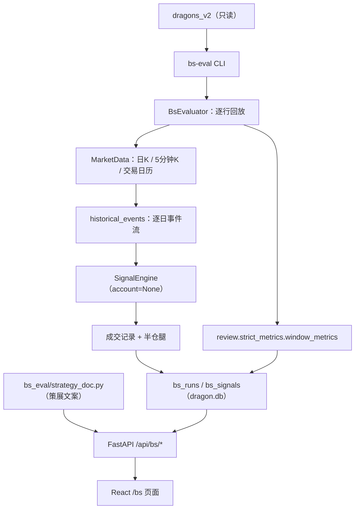
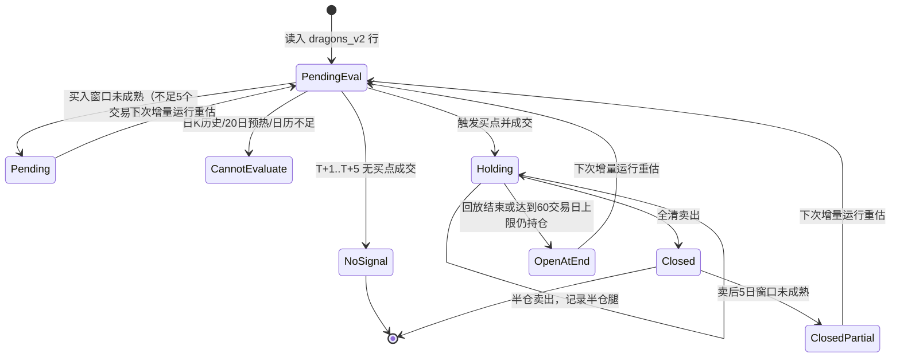
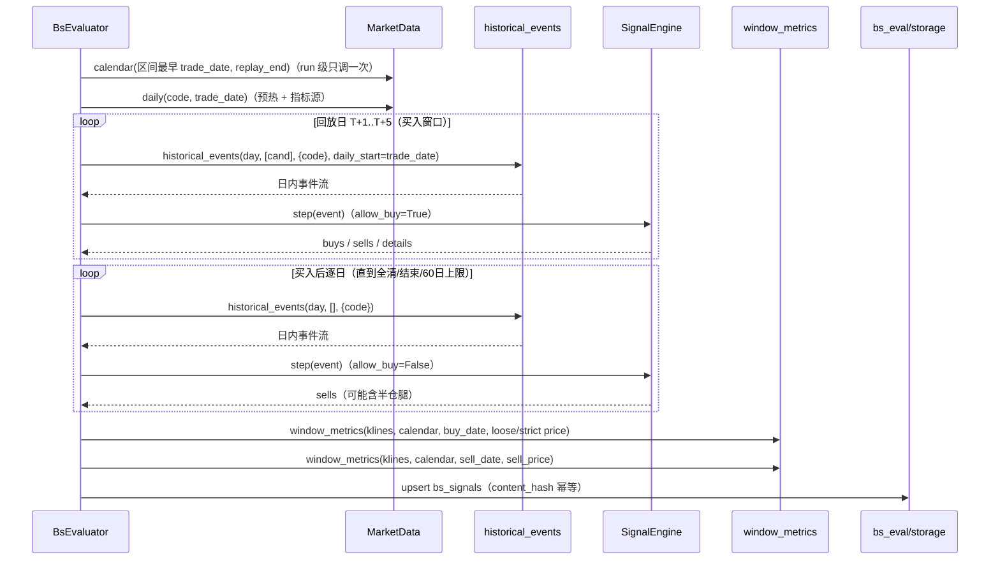

# dashboard「BS策略」页技术方案（2026-11-02）

> 阶段：2 技术方案（execute_agent 完善 + 自审）· 状态：待 solution-self-review
> 范围：新增离线批量回放命令 `bs-eval`、`dragon.db` 两张派生表、只读 Web API 与 `/bs` 页面；策略文本以代码内策展数据提供。
> 非目标：不改 `buy` / `sell` / `review-account` / `review` 的任何行为与存储；不模拟资金、仓位、组合风控；不做参数寻优/消融；v1 不支持。
>
> 上游输入（照收，不推翻）：
> - main 任务包：阶段 0 已由用户确认的需求、五条口径决策、六条验收标准；main 已定架构方向（独立 feature 包 + 逐龙头驱动复用 `SignalEngine`）、存储、命令、Web 与文案方案。
> - owner 文档：`dragon_quant/review_account/strategy/STRATEGY.md`（四类买点、十条卖出规则、T+1 语义）、`docs/agent/trading.md`（buy/sell 与信号表契约）、`docs/agent/architecture.md`（命令导航链/表清单）、`docs/agent/development.md`（E2E/覆盖映射/前端构建）。
> - 代码契约：`review_account/live_trade/signal_engine.py`、`review_account/live_trade/trader.py`、`review_account/data.py`、`review_account/market.py`、`review_account/strategy/buy.py`、`review_account/candidate_view.py`、`review/strict_metrics.py`、`infra/storage/schema.py`、`scan/storage/dragons.py`、`web_ui/backend/*`。
>
> 本文只写方案：阶段 2 不改产品代码 / 测试代码 / owner 文档，不跑测试，不执行任何 git 操作。

---

## 0. 结论摘要

1. **单一买卖判定实现**：新增 `dragon_quant/bs_eval/`，工作单元 = `dragons_v2` 行；每行一个 `SignalEngine(account=None, sentiment_pct=None, evaluate_sells=True)`，事件流由 `review_account.data.historical_events` 逐日供给。bs_eval 只做「批量驱动 + 窗口度量 + 落库」，**不复制任何买点/卖点/成交规则**。
2. **买入**：入选日 T 后第 1~5 个交易日逐日评估四类买点，首次成交即买入；随后逐日回放十条卖出规则链，直到全清、回放结束或 60 个交易日持有上限。
3. **双口径入场**：宽松 = 信号日日 K 最低价；严格 = 引擎实际成交价。两套 5 日窗口指标分别落库；卖出单口径 = 引擎实际卖出价，卖后 5 日窗口锚定最终全清日/价。
4. **存储**：`dragon.db` 新增 `bs_runs`（批次元数据）+ `bs_signals`（一行 = 一只龙头，`UNIQUE(trade_date, code)`）；与实盘 `buy_sell_signals` 完全隔离。
5. **幂等**：终态行跳过；`pending` / `open` / 卖后窗口未成熟 `closed` / `cannot_evaluate` 重估；`content_hash` 相同不写；`--force` 全量重算。策略哈希变化时自动按当前策略重算选中范围，并在页面暴露旧版本残留行数。
6. **只读页面**：`/api/bs/overview|buys|sells` + `/bs` 页面；策略说明来自 `bs_eval/strategy_doc.py` 纯数据模块，页面无重跑按钮。
7. **零行为回归**：`buy_sell_signals`、`review_account_*`、`review-account`、`review` 双口径均不改；Web 层仍零 `sqlite3`、零自建连接，只经 `deps.py` 白名单。

设计模式（在 main 已定方向上点名）：

- **Strategy / Template Method（复用而非继承）**：买卖判定与成交语义唯一实现在 `review_account/strategy/*` 与 `SignalEngine`；`LiveTrader`（实盘驱动）与 `BsEvaluator`（批量驱动）是同一策略的两个驱动器，消除重复、隔离变化。
- **Repository**：`bs_eval/storage.py` 独占 `bs_runs` / `bs_signals` 读写（比照 `live_trade/storage.py`），其余模块不写 SQL。
- **Presenter（纯投影）**：`web_ui/backend/presenters/bs_view.py` 只做「仓储行 → 视图模型」的纯函数投影；路由只解析参数，聚合口径在 `bs_eval/aggregate.py` 单点实现。
- **Facade / 数据模块**：`bs_eval/strategy_doc.py` 是纯数据模块，Web 只序列化，不在运行时解析 `STRATEGY.md`。

---

## 1. 需求、口径与非目标

### 1.1 用户故事与验收标准（任务包原文）

用户要在 dashboard 新增「BS策略」页：

1. 页面展示当前操盘策略的买卖点判断逻辑（尽可能简单的话语）；
2. buy 列表：假想买入信号 × 买后 5 日表现，衡量买点正确性；
3. sell 列表：假想卖出信号 × 卖后 5 日表现，衡量卖点正确性；
4. 数据为后续优化操盘策略服务。

验收标准（方案必须逐条映射，见 §9）：

| # | 验收标准 |
|---|---------|
| A1 | `bs-eval` 对全部 `dragons_v2` 批量回放：每行产出 0/1 买入记录、0/1 卖出记录落库；重复运行幂等（终态行跳过，partial/未成熟行重估），`--force` 全量重算 |
| A2 | 买入记录字段：信号日、买点类型（四类之一）、宽松/严格入场价、两套 5 日窗口指标、`data_quality` |
| A3 | 卖出记录字段：卖出日、卖出规则 `reason_code`、卖出价、卖后 5 日最大收益/回撤；半仓腿作信息列，sell 窗口锚定最终全清日/价 |
| A4 | dashboard 新增「BS策略」页：策略说明卡（四类买点 + 十条卖出规则通俗描述）、汇总卡（样本数/触发率/双口径胜率/平均收益/卖飞率等）、buy 列表、sell 列表 |
| A5 | 窗口不足的近期记录标 partial，不算胜也不算负 |
| A6 | E2E 覆盖新命令与新 API；`coverage-map.json` 同步（当前 55 parser 节点 / 17 顶层命令）；`buy_sell_signals` 等既有表零改动 |

### 1.2 已确认口径（用户拍板，不可更改）

| # | 决策点 | 结论 |
|---|--------|------|
| 1 | 数据来源 | 批量回放全部 `dragons_v2` 历史龙头，生成假想 buy/sell 信号落库 |
| 2 | 评估范围 | 一视同仁：每只龙头入选后逐日评估四类买点，不套 prep 快照资格闸门 / 情绪闸门 / 组合风控 |
| 3 | buy 入场价双口径 | 宽松 = 信号日最低价；严格 = 引擎回放实际成交价 |
| 4 | sell 口径 | 单口径，引擎实际卖出价 |
| 5 | 存储 | 新表，与实盘 `buy_sell_signals` 完全隔离 |

### 1.3 非目标（明确不做）

- 不改 `buy` / `sell` / `review-account` / `review` 任何行为、表结构、JSON 键集；不写 `buy_sell_signals`。
- 不模拟资金、仓位、组合风控、情绪 sizing；`account=None`，`sentiment_pct=None`。
- 不做参数寻优、消融、walk-forward；不提供 `--config`，固定默认 `StrategyConfig`，仅记录配置快照与哈希供追溯。
- 不支持 `--source v1`；v1 已废弃，bs 结果只基于 `dragons_v2`。
- 不做页内触发回放（只读页面）；不做写操作 API。
- 不新增第三方依赖；不改 `infra/factor/*`。

---

## 2. 架构方向与候选对比

### 2.1 选定方向

**新独立 feature 包 `dragon_quant/bs_eval/`，逐龙头驱动复用 `SignalEngine`。**

工作单元 = `dragons_v2` 的一行 `(trade_date, code)`；每行一个引擎实例；事件流逐日供给；幂等粒度 = 行（`UNIQUE(trade_date, code)`），天然可续跑、可 `--limit`、可单行重算。

### 2.2 候选对比（保留选型记录）

| 候选 | 做法 | 优点 | 弃用/采纳理由 |
|---|---|---|---|
| **D1（采纳）** 逐龙头回放 | 每行一个 `SignalEngine`，`account=None` 旁路组合风控；`historical_events` 逐日供给 | 幂等粒度细、可续跑/限量/单行重算；在 A 口径（buy-all、无账户闸门）下与全池回放等价；不引入第二套策略 | 采纳 |
| D2（弃） 复用 `LiveTrader` 逐日全池回放 | 自定义 candidate loader + 换存储 | 复用现成 trader 循环 | 引擎状态需跨日跨行持久化、幂等粒度粗、每日加载全池数据成本高；A 口径下结果与 D1 等价但复杂度更高 |
| D3（弃，非常规） 纯 SQL + 日 K 近似重实现四类买点 | 不跑引擎 | 实现短 | 违背「买卖判定只有一份」的项目铁律，必然与实盘语义漂移；否决 |

### 2.3 依赖方向与边界

```text
cli → commands.bs_eval → bs_eval.main → bs_eval.evaluator
                                      → bs_eval.storage（bs_* 表）
                                      → bs_eval.sources（只读 scan.storage.dragons）
                                      → review_account.data / market / live_trade.signal_engine
                                      → review.strict_metrics
web_ui.backend.routers.bs → deps.bs_repository → bs_eval.storage
web_ui.backend.presenters.bs_view ← 纯 dict（不 import bs_eval 实现）
```

- `bs_eval` **可以** import `review_account` / `review` / `infra` / `scan.storage`（只读）；`review_account` / `review` / `scan` **不得** import `bs_eval`。
- `bs_eval` 不 import `web_ui` / `commands` / `app`。
- 项目代码零 `import pandas`；本方案不新增 pandas。
- B1：`dragon_quant/bs_eval/__init__.py` 不建目录、不建库；`import dragon_quant` 体系不受影响；首次真实连接仍由 `infra.storage.connection._connect` 惰性建 schema。
- `bs_eval/storage.py` 是 `bs_*` 两表唯一写入方；`scan/storage/dragons.py` 只读调用。

---

## 3. 数据流与回放状态机

### 3.1 整体数据流



### 3.2 逐龙头回放状态机



### 3.3 单行回放时序（引擎事件）



---

## 4. 模块 / 文件级设计

### 4.1 新增文件清单

```text
dragon_quant/bs_eval/
├── __init__.py            # 惰性门面：仅 __all__/lazy 导出 run_bs_eval，不 import 副作用
├── constants.py           # 状态、阈值、窗口、持有上限、BS_EVAL_NOTIONAL_CASH、evaluator 版本
├── strategy_doc.py        # 四类买点 + 十条卖出规则通俗文案（纯数据）
├── candidates.py          # dragons_v2 行 → 评测候选 dict（闸门中立）
├── sources.py             # dragons_v2 只读查询（日期列表 + 逐日行）
├── evaluator.py           # 单行回放、双口径成交、窗口指标、data_quality
├── aggregate.py           # 汇总统计（纯函数，CLI 与 Web 共用）
├── storage.py             # bs_runs / bs_signals Repository（唯一写入口）
└── main.py                # run_bs_eval：选行、run 记录、增量/force/limit、计数器
```

配套改动（不是新文件）：

| 文件 | 改动 |
|---|---|
| `infra/storage/schema.py` | `BASE_SCHEMA` 追加 `bs_runs` / `bs_signals` DDL 与索引 |
| `review_account/data.py` | `historical_events` 增加**可选** `daily_start=None` 关键字参数（默认行为逐字不变），供同 code 多日回放复用日 K 缓存 |
| `commands/__init__.py` | `COMMANDS["bs-eval"] = LazyCommand("dragon_quant.commands.bs_eval")`，provider 策略 always |
| `commands/bs_eval.py` | 薄 handler：参数解析/打印/退出码，调用 `run_bs_eval` |
| `cli.py` | 新增 `bs-eval` parser（顶层第 18 个命令） |
| `web_ui/backend/deps.py` | 新增 `bs_repository` / `bs_strategy_doc` / `bs_aggregate` 三个惰性 provider |
| `web_ui/backend/routers/bs.py` | 新增只读路由 |
| `web_ui/backend/routers/__init__.py` | 注册 `bs.router` |
| `web_ui/backend/presenters/bs_view.py` | 纯投影：行 → 视图、买卖判定标签、半仓腿展开 |
| `web_ui/backend/routers/meta.py` | `ROUTE_LIST` 增加 `/bs` |
| `web_ui/frontend/src/api/bs.ts` | 类型 + fetch 封装 |
| `web_ui/frontend/src/pages/bs/*` | 新页面与子组件 |
| `web_ui/frontend/src/router.tsx` / `AppShell.tsx` | `/bs` 路由与导航「BS策略」 |
| `web_ui/dist/**` | `npm --prefix web_ui/frontend run build` 同批入库 |
| `dragon_quant/tests/fixtures/architecture_baseline.json` | 重新生成 `dragon_schema`（只允许新增两表/索引的 delta） |
| `dragon_quant/tests/e2e/coverage-map.json` | node_count 55→56、top_level_count 17→18、新增 `bs-eval` 节点与测试映射 |
| `dragon_quant/tests/e2e/fixtures/scenario_bs_eval.json` | 新增 fake provider 场景（日 K/5 分钟 K/日历），由 `scenario_account.json` 派生并加入确定性的买卖触发序列 |
| `dragon_quant/tests/e2e/test_bs_eval.py` | 新增 BS1–BS6 E2E 用例 |
| `dragon_quant/tests/e2e/test_coverage_map.py` | 函数名/断言 55/17→56/18，`coverage_audit` 引用同步 |
| `dragon_quant/tests/test_commands.py` / `tests/e2e/test_cli_global.py` | 顶层命令列表加 `bs-eval` |
| `docs/**` | 见 §12 |

### 4.2 dragons_v2 只读查询

`bs_eval/sources.py` 只调用既有只读 API：

```python
from dragon_quant.scan.storage import dragons as dragon_store

def list_dragon_dates(date_from=None, date_to=None) -> list[str]:
    return dragon_store.list_dragon_trade_dates(date_from, date_to, source="v2")

def list_dragons_for_date(day: str) -> list[dict]:
    return dragon_store.get_dragons_by_date(day, top_n=None, source="v2")
```

- `get_dragons_by_date` 已返回 `trade_date / code / name / rank / composite_score / is_true_dragon / ...`，无需新增查询函数；**bs_eval 不写 scan 表**。
- `top_n=None` 关闭 LIMIT（`get_dragons_by_date` 仅在 `if top_n` 时拼接 LIMIT）。
- 全量行数上界 ≈ 交易日 × 每日真龙数（当前量级数千），一次性载入内存可接受；`--limit` 在选行阶段截断。

### 4.3 候选构造与闸门中立（关键实现点）

`bs_eval/candidates.py`：

```python
def eval_candidate(row: dict) -> dict:
    return {
        "code": row["code"],
        "name": row.get("name") or "",
        "trade_date": row["trade_date"],
        "rank": row.get("rank"),
        "composite_score": row.get("composite_score"),
        "is_true_dragon": True,
        # A 口径：显式声明“允许进入形态判定”。这两个字段是 0.8 兼容视图的
        # 唯一可买标记；置 True 后 evaluate_buy / _divergence_preconditions 的
        # review_not_eligible、旧身份、min_score 三道前置闸门全部不触发。
        "review_pool": True,
        "review_eligible": True,
    }
```

依据（已核对代码）：

- `is_review_pool(cand)` 只读 `cand["review_pool"] is True`；`is_review_eligible` 只读 `review_pool is True and review_eligible is True`。
- `evaluate_buy` 的两道闸门：
  - `if is_review_pool(cand) and not is_review_eligible(cand): raise review_not_eligible`；
  - `if not is_review_eligible(cand) and (is_true_dragon is False or composite_score < min_score): return None`。
- `_divergence_preconditions` 有同样的重检。
- 因此 `review_pool=True + review_eligible=True` 是**零伪造分数**的闸门中立方式；不依赖 `dragons_v2.composite_score` 是否为空，也不会把假的分数写进信号 JSON。
- 反向候选（弃）：仅设 `is_true_dragon=True`，当 `composite_score is None` 时仍会落回 `0 < min_score` 被静默跳过；若用 `min_score` 补值则伪造分数。故不采用。
- 单测必须钉住：`composite_score=None` / `is_true_dragon=False` 的候选仍能进入四类买点判定（证明 A 口径生效）。

### 4.4 BsEvaluator：单行回放

`bs_eval/evaluator.py` 的公开入口：

```python
class BsEvaluator:
    def __init__(self, cfg: StrategyConfig, data: MarketData, calendar: list[str],
                 replay_end: str):
        ...

    def evaluate(self, row: dict) -> dict:
        """回放一只龙头，返回 bs_signals 行 payload（不落库）。"""
```

#### 4.4.0 引擎记账口径（避免隐性资金约束）

`SignalEngine._fill_buy` 用 `notional_quantity(cfg, price)` 计算虚拟数量；默认 `initial_cash=100_000` 时，股价高于 1000 元会因「不足一手」返回 0，导致高价龙头静默不成交，违背 A 口径「一视同仁」。因此：

- `BsEvaluator` 持有一份 `StrategyConfig` 的**副本**，仅把 `initial_cash` 覆盖为 `BS_EVAL_NOTIONAL_CASH = 10_000_000.0`；`max_position_pct=100`、`risk_per_trade_pct=0` 保持不变。
- 该值**只用于引擎内部 qty / 费用记账**，不模拟资金、仓位或组合风控（`account=None`，`risk_governor` 不调用）；不是产品策略参数，也不会写入 `buy_sell_signals`。
- `bs_runs.strategy_params_json` 记录**生效的**引擎配置（含该覆盖值），`strategy_hash` 同样基于生效配置；reviewer/main 可据此复现。
- 单测必须钉住：高价股（如 1700 元）也能成交至少 1 手，且 `buy_strict_price` 不因 qty 改变。
- 备选（§13 待确认）：保持默认 100k，代价是高价股永远无法进入严格口径，样本存在系统性缺口。

#### 4.4.1 时间与窗口

- **买入窗口**：`buy_window = [d for d in calendar if d > trade_date][:BUY_WINDOW_DAYS]`，`BUY_WINDOW_DAYS = 5`（与现有 5 日候选窗口同口径；独立常量，不被未来 `StrategyConfig` 默认值漂移影响）。若 `len(buy_window) < 5` → `eval_status="pending"`，不评估、不落终态。
- **回放结束日**：`replay_end` = 「最近已收盘交易日」（`infra.clock`；当日 15:05 前不含当日，15:05 后含当日），**与 `--to` 无关**；`--to` 只过滤入选日。这样 `--to` 不会把卖后 5 日窗口人为截短。
- **持有上限**：`MAX_REPLAY_TRADING_DAYS = 60`。买入后第 60 个交易日仍未全清 → 停止回放，`eval_status="open"`，`eval_note="hold_cap_reached"`，按终态处理（避免无穷重放）。买入窗口本身最多 5 日，不影响该上限。
- **日历只算一次**：`run_bs_eval` 用本次选中行的最早 `trade_date`（或 `--from`）到 `replay_end` 调一次 `data.calendar(start, replay_end)`，把结果列表传给每行 evaluator；evaluator 只做 `> trade_date` 切片。**禁止**每行用不同 `trade_date` 重新调 `calendar`（`MarketData.daily` 的缓存键含 `days`，会按行重复拉 SH000001）。
- `calendar` 抛 `DataCoverageError`（SH000001 历史不足/区间无交易日）→ 命令层快速失败（见 §7），不产生半套 run。

#### 4.4.2 事件流与引擎

```python
engine = SignalEngine(cfg, positions=None, held_codes=None,
                      sentiment_pct=None, account=None, evaluate_sells=True)
cand = eval_candidate(row)
bought = False
for day in replay_days:
    candidates = [cand] if (not bought and day in buy_window) else []
    for event in historical_events(day, candidates, {code}, data,
                                   daily_start=trade_date):
        event.allow_buy = bool(candidates)
        result = engine.step(event)
        ...
```

- `account=None` → `risk_governor` 不调用，`risk_allow_buy=True`，`_sold_today=False`；`sentiment_pct=None` → 情绪禁买不生效。
- 买入窗口内 `allow_buy=True`；买入后或窗口外 `allow_buy=False`，引擎仍逐事件评估卖出（卖出评估不依赖 `allow_buy`）。
- 买入后不再传候选，保证「每行最多 1 条买入记录」；即使传入，`held` 也会拦截重复买入。
- 买入当天不评估卖出由引擎内建（`evaluate_sell` 的 `position.entry_date >= row["date"]` 守卫 + `event.timestamp <= entry_ts`）。
- `historical_events` 的 `daily_start=trade_date` 是**新增可选参数**（默认 `None` = 现状）：让同一 code 的多日回放共用同一个 `MarketData.daily` 缓存键，避免回放窗口内每天用不同 `days` 重复拉日 K。
- **无前视保证**：预取的日 K 列表可能包含回放日之后的 bar，但 `build_row` / `build_daily_row` 只使用 `event_date < day` 的预热行与 `day` 当日行，`last_close` 也只取 `< day`；引擎永远看不到未来 bar。单测必须用「把未来 bar 改成极端值不影响当日买入/卖出决策」钉住该不变量。

#### 4.4.3 买入字段

| 字段 | 取值 |
|---|---|
| `buy_date` | `result["buys"][0]["entry_date"]`（信号日 = 成交日） |
| `buy_rule_code` | `result["buys"][0]["reason_code"]`（四类之一） |
| `buy_rule_text` | `result["buys"][0]["reason_text"]` |
| `buy_strict_price` | `result["buys"][0]["entry_price"]`（引擎实际成交价，含滑点） |
| `buy_loose_price` | 信号日日 K 的 `low`；日 K 无效 → `null` |
| 两套 5 日指标 | `window_metrics(klines, calendar_set, buy_date, loose/strict price)` |
| `buy_max_return_hold_days` | 两套共用（峰值日距买入日的交易日数） |
| `buy_window_partial` | 任一 `window_metrics` 返回 `None` 或 `partial=True` → 1 |
| `buy_data_quality` | 信号日事件行的 `data_quality or "strict_5min"` |

- 买入成交失败（不可成交价/预算不足）不记为买入，继续评估后续买入窗口日；窗口结束仍无成交 → `no_signal`。
- 日 K 历史不足 20 日预热 → `cannot_evaluate`，`eval_note="warmup_insufficient"`。
- 宽松价无效不影响严格口径：`buy_loose_price=null`，宽松样本在聚合时被排除（见 §4.9）。

#### 4.4.4 卖出字段与半仓腿

- 引擎 `sells` 列表中：
  - `partial=True` 的条目 → 半仓腿信息列：`sell_half_date / sell_half_price / sell_half_qty / sell_half_rule_code`（按现有语义，同一信号最多一条半仓腿）。
  - `partial=False` 的条目 → 最终全清：`sell_date / sell_price / sell_rule_code / sell_rule_text / sell_hold_days`。
- **卖后窗口锚定最终全清日/价**：`window_metrics(klines, calendar_set, sell_date, sell_price)`。
- 回放结束仍持仓 → `eval_status="open"`，卖出字段为 `null`；半仓腿若已发生仍落信息列。
- 反复出现半仓 + 最终全清 → 只记录最后一次全清与唯一半仓腿；不记录中间持仓明细。

#### 4.4.5 data_quality 汇总

逐回放日记录：

```text
day_quality = "daily_fallback" if 当日事件行 data_quality == "daily_fallback"
              else "strict_5min"
```

- `buy_data_quality` = 信号日 day_quality；`sell_data_quality` = 全清日 day_quality。
- 行级 `data_quality`：全部 `strict_5min` → `strict_5min`；全部 `daily_fallback` → `daily_fallback`；混合 → `mixed`；未回放 → `null`。
- 停牌日（无 rows）记 `suspended_days += 1`，不改变 quality；`replay_days` / `fallback_days` 一并落库，供页面提示。
- 不伪造缺失价格：日 K 兜底日由既有 `build_daily_row` 保守近似；5 分钟缺失日由 `historical_events` 自动日 K 兜底。

### 4.5 幂等、终态与 `--force`

`eval_status` 与终态（`is_terminal`）的唯一派生规则：

| `eval_status` | 条件 | `is_terminal` |
|---|---|---|
| `pending` | 买入窗口不足 5 个交易日 | 0 |
| `cannot_evaluate` | 日 K/预热/日历不足 | 0 |
| `no_signal` | 买入窗口已满且无成交 | 1 |
| `open` | 已买入未全清；未达 60 日上限 | 0 |
| `open` | 已买入未全清；已达 60 日上限（`eval_note="hold_cap_reached"`） | 1 |
| `closed` | 已全清；卖后窗口未成熟（`sell_window_partial=1`） | 0 |
| `closed` | 已全清；卖后窗口成熟（`sell_window_partial=0`） | 1 |

选行与写入：

- 增量选行：区间内 `is_terminal=0` 的行，按 `COALESCE(last_attempt_at,'') ASC, trade_date ASC, code ASC` 排序；`--limit N` 取前 N 行后评估。按「最久未尝试」轮转，避免永久 `cannot_evaluate` 行在 `--limit` 下饿死其它行。
- 终态行：默认跳过（计入 `rows_skipped_terminal`）；`--force` 时全部重算。
- 行级幂等：`content_hash = sha256(稳定字段 JSON)`，稳定字段含 `strategy_hash`、`evaluator_version`、全部业务字段与 `is_terminal`；非 `--force` 且哈希相同 → **不写业务字段**，但仍更新 `last_attempt_at`（轻量写，用于轮转）；哈希不同 → upsert 并更新 `updated_at`。`created_at` 永不变。
- `--force`：忽略终态与哈希，全部重算并写新 `run_id`。
- 策略/评测器变更：当前 `strategy_hash` **或** `evaluator_version` 与最近一次 run 不同 → 本次自动按 `--force` 语义重算选中范围，`bs_runs.note="strategy_or_evaluator_changed_auto_force"`；`bs_signals` 同时存 `strategy_hash`，页面默认只统计当前策略哈希的行，并显示 `stale_rows`（旧策略残留行数）。
- 不删除 `dragons_v2` 已不存在的 code 的行：bs 结果是历史评测快照，保留供追溯；如需重算请 `--force`。

### 4.6 存储 Repository 与 DDL 草案

`bs_eval/storage.py` 独占两表读写，写入持 `infra.storage._base._lock`，每次操作独立连接（沿用 `live_trade/storage.py` 惯例）。

#### DDL（写入 `infra/storage/schema.py` 的 `BASE_SCHEMA`）

```sql
CREATE TABLE IF NOT EXISTS bs_runs (
    id                    INTEGER PRIMARY KEY AUTOINCREMENT,
    started_at            TEXT NOT NULL DEFAULT (datetime('now','localtime')),
    finished_at           TEXT,
    range_from            TEXT,
    range_to              TEXT,
    limit_n               INTEGER,
    force                 INTEGER NOT NULL DEFAULT 0,
    evaluator_version     TEXT NOT NULL,
    strategy_name         TEXT NOT NULL,
    strategy_params_json  TEXT,
    strategy_hash         TEXT NOT NULL,
    rows_scanned          INTEGER NOT NULL DEFAULT 0,
    rows_skipped_terminal INTEGER NOT NULL DEFAULT 0,
    rows_evaluated        INTEGER NOT NULL DEFAULT 0,
    rows_no_signal        INTEGER NOT NULL DEFAULT 0,
    rows_bought           INTEGER NOT NULL DEFAULT 0,
    rows_sold             INTEGER NOT NULL DEFAULT 0,
    rows_partial          INTEGER NOT NULL DEFAULT 0,
    rows_error            INTEGER NOT NULL DEFAULT 0,
    note                  TEXT
);

CREATE TABLE IF NOT EXISTS bs_signals (
    id                        INTEGER PRIMARY KEY AUTOINCREMENT,
    run_id                    INTEGER REFERENCES bs_runs(id) ON DELETE SET NULL,
    trade_date                TEXT NOT NULL,
    code                      TEXT NOT NULL,
    name                      TEXT,
    source                    TEXT NOT NULL DEFAULT 'v2',
    strategy_hash             TEXT NOT NULL,
    evaluator_version         TEXT NOT NULL,
    eval_status               TEXT NOT NULL,
    eval_note                 TEXT,
    is_terminal               INTEGER NOT NULL DEFAULT 0,
    data_quality              TEXT,
    replay_days               INTEGER NOT NULL DEFAULT 0,
    fallback_days             INTEGER NOT NULL DEFAULT 0,
    suspended_days            INTEGER NOT NULL DEFAULT 0,
    buy_date                  TEXT,
    buy_rule_code             TEXT,
    buy_rule_text             TEXT,
    buy_loose_price           REAL,
    buy_strict_price          REAL,
    buy_data_quality          TEXT,
    buy_loose_max_return_5d   REAL,
    buy_loose_max_drawdown_5d REAL,
    buy_strict_max_return_5d  REAL,
    buy_strict_max_drawdown_5d REAL,
    buy_max_return_hold_days  INTEGER,
    buy_window_partial        INTEGER NOT NULL DEFAULT 0,
    sell_date                 TEXT,
    sell_rule_code            TEXT,
    sell_rule_text            TEXT,
    sell_price                REAL,
    sell_hold_days            INTEGER,
    sell_data_quality         TEXT,
    sell_half_date            TEXT,
    sell_half_price           REAL,
    sell_half_qty             INTEGER,
    sell_half_rule_code       TEXT,
    sell_max_return_5d        REAL,
    sell_max_drawdown_5d      REAL,
    sell_max_return_hold_days INTEGER,
    sell_window_partial       INTEGER NOT NULL DEFAULT 0,
    content_hash              TEXT,
    last_attempt_at           TEXT,
    created_at                TEXT NOT NULL DEFAULT (datetime('now','localtime')),
    updated_at                TEXT NOT NULL DEFAULT (datetime('now','localtime')),
    UNIQUE(trade_date, code)
);

CREATE INDEX IF NOT EXISTS idx_bs_signals_trade_date ON bs_signals(trade_date);
CREATE INDEX IF NOT EXISTS idx_bs_signals_code ON bs_signals(code);
CREATE INDEX IF NOT EXISTS idx_bs_signals_buy_date ON bs_signals(buy_date);
CREATE INDEX IF NOT EXISTS idx_bs_signals_sell_date ON bs_signals(sell_date);
CREATE INDEX IF NOT EXISTS idx_bs_signals_status ON bs_signals(eval_status, is_terminal);
CREATE INDEX IF NOT EXISTS idx_bs_signals_attempt ON bs_signals(is_terminal, last_attempt_at);
CREATE INDEX IF NOT EXISTS idx_bs_signals_run ON bs_signals(run_id);
CREATE INDEX IF NOT EXISTS idx_bs_runs_created ON bs_runs(started_at);
```

存储选择说明：

- 放 `dragon.db` 的理由：bs 结果完全可重算，属派生数据；`assets.db` 是不可再生资产仓，不应被 `storage clear --all` 连带。先例：`dragon_review_strict` 也在 `dragon.db`。
- 不放 `buy_sell_signals`：字段语义（假想回放 vs 实盘信号）与唯一索引（`status='open'`）完全不同，混表会污染实盘。
- `architecture_baseline.json` 需同步重新生成 `dragon_schema`；只允许新增 `bs_runs` / `bs_signals` 及其索引，其他表逐字不变。

Repository API：

```python
start_run(...) -> int
finish_run(run_id, counters, note=None) -> None
latest_run() -> dict | None
list_existing(date_from, date_to) -> dict[tuple[str, str], dict]
upsert_signal(payload, *, force: bool) -> bool
query_signals(*, side: str, filters: dict, sort_by: str, sort_dir: str,
              strategy_hash: str | None = None) -> list[dict]
count_stale(strategy_hash: str, evaluator_version: str) -> int
```

- `count_stale` 的口径：`strategy_hash != 当前` **或** `evaluator_version != 当前` 的行数；页面 `stale_rows` 同此口径。

- 所有查询使用参数化 SQL；`sort_by` 只经白名单映射到物理列，`sort_dir` 只接受 `asc/desc`，禁止拼接用户输入。
- 读路径不写库；写路径持 `_lock` + 行级事务；`query_signals` 对 `side="buy"` 额外加 `buy_date IS NOT NULL`，对 `side="sell"` 额外加 `sell_date IS NOT NULL`。

### 4.7 CLI：`bs-eval`

```
python -m dragon_quant bs-eval [--from YYYYMMDD] [--to YYYYMMDD]
                               [--limit N] [--force] [--source v2] [--json]
```

| 参数 | 语义 |
|---|---|
| `--from` / `--to` | 按**入选日** `trade_date` 过滤（闭区间）；支持 `YYYYMMDD` / `YYYY-MM-DD`；缺省不限。**不**截断回放行情：回放截止日固定为最近已收盘交易日，保证卖后窗口完整 |
| `--limit N` | 增量选行后取最老 N 行（`trade_date ASC, code ASC`）；`N<=0` 非法 |
| `--force` | 忽略终态与 `content_hash`，区间内全量重算 |
| `--source` | 仅接受 `v2`（`choices=["v2"]`），不提供 v1 |
| `--json` | 输出机器可读汇总（不输出逐行，避免超大 JSON） |

行为：

- 参数非法（日期格式、`from > to`、`limit <= 0`）→ stderr 单行错误，exit 2。
- 运行时失败（DB/schema 写失败、交易日历整体不可用）→ stderr 单行错误，exit 1。
- 行级数据问题（单 code 日 K 缺失/预热不足）→ 记 `cannot_evaluate` 行并继续，exit 0，汇总含 `errors`。
- 人读输出：run id、区间、扫描/评估/跳过/无信号/买入/卖出/partial/错误计数、耗时；一行提示「页面只读，重跑请再执行 bs-eval」。
- `commands/__init__.py` 注册 `"bs-eval": LazyCommand("dragon_quant.commands.bs_eval")`（always providers）；`cli.py` 新增 parser；`coverage-map.json` 节点 flags 与 parser 一一对应。
- `--from` 必须使用 `dest="date_from"`（`--to` → `dest="date_to"`），handler 只经 `getattr(args, "date_from")` 读取；禁止 `args.from`（Python 语法错误）。

### 4.8 聚合与统计口径（唯一实现：`bs_eval/aggregate.py`）

输入 = `bs_signals` 行列表（已按页面筛选或全量）。输出结构：

```python
{
  "rows_total": int,
  "status_counts": {"pending": n, "no_signal": n, "open": n,
                    "closed": n, "cannot_evaluate": n},
  "buy": {
    "triggered": int,
    "trigger_rate": float | None,          # triggered / evaluable
    "strict": {"samples": n, "wins": n, "win_rate": float | None,
               "avg_return": float | None, "avg_drawdown": float | None},
    "loose":  {...同 strict...},
    "rule_breakdown": [{"rule": code, "label": str, "count": n}, ...],
  },
  "sell": {
    "triggered": int,
    "samples": n,
    "good": n, "good_rate": float | None,
    "flew": n, "flew_rate": float | None,
    "neutral": n, "neutral_rate": float | None,
    "avg_return": float | None,
    "avg_drawdown": float | None,
    "rule_breakdown": [{"rule": code, "label": str, "count": n}, ...],
  },
}
```

精确定义：

- **触发率分母** = `eval_status in {no_signal, open, closed}` 的行（已成熟、可买或已买）；排除 `pending`（窗口未成熟）与 `cannot_evaluate`。分母 0 → `null`，页面显示 `—`。
- **buy 严格/宽松样本** = 有 `buy_date`、对应口径价格非空、`buy_window_partial=0`、指标非空的行。`partial` 行不计入胜/负，也不计入平均收益。
- **buy 胜利** = `max_return_5d > 0 且 max_drawdown_5d > -5`（沿用 review 严格大于语义）。
- **sell 样本** = 有 `sell_date`、`sell_window_partial=0`、指标非空的行。
- **sell 判定（互斥，先卖飞再卖得对）**：
  - `卖飞(flew)`：`sell_max_return_5d >= 5`；
  - `卖得对(good)`：不满足卖飞，且 `sell_max_drawdown_5d <= -3`；
  - `中性(neutral)`：其余。
  - 页面同时展示两个阈值；阈值来自 `strategy_doc.THRESHOLDS`，代码内单一来源。
- 平均收益/平均回撤 = 对应样本的算术均值；`null` 不参与。
- `rule_breakdown`：四类买点 / 十条卖出规则固定全量输出（0 也输出），便于发现「从未触发」的规则。
- 四舍五入 2 位小数；比率用百分数（0–100）。

### 4.9 策略说明模块（`bs_eval/strategy_doc.py`）

纯数据，无 I/O：

```python
STRATEGY_DOC_VERSION = "1.0"

BUY_SIGNALS = [
    {"code": BUY_SIGNAL_MA5_PULLBACK, "label": "开盘回踩MA5",
     "window": "09:30 开盘", "summary": "...", "details": [...]},
    ...
]

SELL_RULES = [
    {"name": "first_day_stop", "label": "首日止损减半",
     "default_enabled": False, "summary": "...", "trigger": "..."},
    ...
]

# 一条规则可产出多个 reason_code；页面用 reason_code 反查规则名与标签。
SELL_REASON_TO_RULE = {
    "first_day_stop_half": "first_day_stop",
    "first_day_disaster_stop": "first_day_stop",
    "first_day_stop_loss": "hard_stop",
    "hard_stop_loss": "hard_stop",
    "trailing_take_profit": "trailing",
    "profit_back_to_cost_take_profit": "breakeven",
    "high_open_7pct_no_limit_5m_clear": "high_open_clear",
    "high_open_5pct_no_limit_30m_clear": "high_open_clear",
    "soft_time_stop": "soft_time_stop",
    "next_day_close_below_open": "weak_close",
    "close_below_open_stop": "weak_close",
    "break_intraday_ma_stop": "weak_close",
    "hard_time_stop": "hard_time_stop",
    "next_day_limit_up_half": "half",
    "volume_spike_take_profit": "volume_spike",
}

THRESHOLDS = {
    "buy_window_days": 5,
    "window_skip": 1, "window_size": 4,
    "buy_win_return_gt": 0.0,
    "buy_win_drawdown_gt": -5.0,
    "sell_good_drawdown_le": -3.0,
    "sell_fly_return_ge": 5.0,
    "max_replay_trading_days": 60,
}
```

- 数值常量（窗口、上限、notional cash）唯一来源是 `bs_eval/constants.py`；`strategy_doc.THRESHOLDS` 从它派生，`aggregate.py` 只读 `strategy_doc.THRESHOLDS`/`constants`，避免两份阈值。
- `SELL_REASON_TO_RULE` 的键取自 `strategy/sell.py` 的全部 `_sell(...)` 常量；单测断言 `set(SELL_REASON_TO_RULE) == 从 sell.py 提取的 reason_code 集合`（提取失败则测试红，逼同步）。
- 单测断言：`BUY_SIGNALS` 覆盖 `models.BUY_SIGNAL_CODES` 全部四类；`SELL_RULES` 覆盖 `models.SELL_RULE_NAMES` 全部十条且顺序一致；`default_enabled` 与 `DEFAULT_OFF_SELL_RULES` 一致。
- 文案与策略版本同仓库演进；**不**运行时解析 `STRATEGY.md`（避免文档格式变化导致页面崩溃）。

---

## 5. Web 后端设计

### 5.1 `deps.py` 白名单新增

```python
def bs_repository():
    from dragon_quant.bs_eval import storage
    return storage

def bs_strategy_doc():
    from dragon_quant.bs_eval import strategy_doc
    return strategy_doc

def bs_aggregate():
    from dragon_quant.bs_eval import aggregate
    return aggregate
```

- 惰性 import；`import web_ui` 不触库、不触 bs_eval。
- 路由只经 `Depends` 取仓储/聚合/文案，不新建连接、不写 SQL。
- 测试用 `app.dependency_overrides[deps.bs_repository] = ...` 注入 fake。

### 5.2 API 契约

#### `GET /api/bs/overview`

```json
{
  "run": {
    "id": 12, "started_at": "2026-11-02 15:30:00", "finished_at": "...",
    "range_from": "2026-06-01", "range_to": "2026-11-02",
    "evaluator_version": "bs_eval/1", "strategy_name": "dragon_pullback_daily",
    "strategy_hash": "a1b2c3d4e5f6",
    "counters": {"rows_scanned": 1200, "rows_evaluated": 800,
                 "rows_skipped_terminal": 400, "rows_no_signal": 600,
                 "rows_bought": 200, "rows_sold": 150,
                 "rows_partial": 30, "rows_error": 2}
  },
  "strategy": {
    "version": "1.0",
    "buy_signals": [{"code": "...", "label": "...", "window": "...",
                     "summary": "...", "details": ["..."]}],
    "sell_rules": [{"name": "...", "label": "...", "default_enabled": true,
                    "summary": "...", "trigger": "..."}],
    "thresholds": {"buy_window_days": 5, "...": 0}
  },
  "summary": { ... §4.8 结构 ... },
  "stale_rows": 0
}
```

- 无 run：`run=null`，`summary` 全 0 / `null`，`stale_rows=0`。
- `summary` 只统计 `strategy_hash == 当前最新 run.strategy_hash` **且** `evaluator_version == 当前版本` 的行；旧版本行只进入 `stale_rows` 计数，不混入胜率。`rows_total` 同此口径。
- `run` 是**最近一次调用**的批次元数据（可能只跑了一个区间）；`summary` 是**当前策略版本下全部行**的汇总。页面需分别标注「最近一次运行」与「全量样本」，不得把两者混为同一分母。
- `strategy_hash`：页面展示前 6 位；`stale_rows` = `bs_signals` 中 `strategy_hash != 当前最新 run.strategy_hash` **或** `evaluator_version != 当前版本` 的行数。
- 只读；无 POST/DELETE。

#### `GET /api/bs/buys`

查询参数（沿用 dragons 惯例）：

| 参数 | 语义 |
|---|---|
| `date_from` / `date_to` | 入选日范围（`YYYY-MM-DD` 或 `YYYYMMDD`，`params.normalize_date`） |
| `code` / `name` | LIKE 模糊匹配 |
| `rule` | 买点代码，白名单（四类之一；非法值忽略） |
| `partial` | `include`（默认）/ `exclude`；`exclude` 时只返回窗口成熟样本 |
| `sort_by` | 白名单：`trade_date` / `buy_date` / `code` / `strict_max_return_5d` / `loose_max_return_5d` / `strict_max_drawdown_5d` / `loose_max_drawdown_5d`；未知回退 `buy_date` |
| `sort_dir` | `asc` / `desc`；未知回退 `desc` |

响应：

```json
{
  "data": [{
    "trade_date": "2026-09-04", "code": "600001", "name": "龙头A",
    "buy_date": "2026-09-07", "buy_rule_code": "buy_open_ma5_pullback",
    "buy_rule_label": "开盘回踩MA5",
    "buy_loose_price": 10.00, "buy_strict_price": 10.02,
    "buy_loose_max_return_5d": 8.0, "buy_loose_max_drawdown_5d": -4.0,
    "buy_strict_max_return_5d": 7.8, "buy_strict_max_drawdown_5d": -4.2,
    "buy_max_return_hold_days": 3, "buy_window_partial": false,
    "loose_win": true, "strict_win": true,
    "data_quality": "strict_5min", "buy_data_quality": "strict_5min",
    "eval_status": "closed"
  }],
  "count": 1,
  "summary": { ...buy 汇总... }
}
```

- `loose_win` / `strict_win`：窗口成熟且指标非空 → bool；`partial` 或指标缺失 → `null`（前端显示「窗口不足」）。
- `summary` 只含 **buy 侧**统计（`samples/wins/win_rate/avg_return/avg_drawdown/rule_breakdown`），基于返回的 buy 行计算；**触发率与状态分布只在 `/api/bs/overview` 给出**，避免 buy 列表缺少 `no_signal` 行导致分母失真。
- `rule` 过滤只影响 `data`；`summary` 用同一 `date_from/date_to/code/name/partial` 基集计算（不含 `rule`），保证切换买点类型时胜率分母稳定。

#### `GET /api/bs/sells`

参数同上（`rule` 为**规则名**，取值 `SELL_RULES[*].name` 十条之一；实现经 `SELL_REASON_TO_RULE` 展开为 reason_code 集合过滤；非法值忽略。`sort_by`：`trade_date` / `sell_date` / `code` / `sell_max_return_5d` / `sell_max_drawdown_5d`；未知回退 `sell_date`）。

响应行：

```json
{
  "trade_date": "2026-09-04", "code": "600001", "name": "龙头A",
  "sell_date": "2026-09-08", "sell_rule_code": "next_day_close_below_open",
  "sell_rule_label": "次日弱势清仓", "sell_price": 10.50, "sell_hold_days": 1,
  "sell_max_return_5d": 3.1, "sell_max_drawdown_5d": -2.0,
  "sell_max_return_hold_days": 2, "sell_window_partial": false,
  "verdict": "neutral", "verdict_label": "中性",
  "half_exit": {"date": "2026-09-07", "price": 10.4, "qty": 500,
                "rule_code": "next_day_limit_up_half"},
  "sell_data_quality": "strict_5min", "data_quality": "strict_5min",
  "eval_status": "closed"
}
```

- `half_exit` 无半仓腿 → `null`。
- `verdict`：`flew` / `good` / `neutral` / `partial`（窗口不足时 `partial`，不伪造判定）。

### 5.3 Presenter（纯投影）

`web_ui/backend/presenters/bs_view.py`：

- `present_buy_row(row, labels) -> dict`：补 `buy_rule_label`、`loose_win`、`strict_win`、`partial`。
- `present_sell_row(row, labels) -> dict`：补 `sell_rule_label`、`verdict`/`verdict_label`、`half_exit`。
- `present_overview(run, strategy_payload, summary, stale_rows) -> dict`。
- 无 I/O、无 SQL、无时钟；标签来自传入的 `strategy_doc` 数据，不在 presenter 内 import bs_eval。
- 4096/None 处理：所有指标 `None` 原样输出 `null`，前端显示 `—`；不补 0。

### 5.4 路由注册与顺序

- `web_ui/backend/routers/__init__.py` 的 `ROUTERS` 元组追加 `bs.router`。
- `/api/bs/*` 全部是静态路径，不存在与动态 `{trade_date}` 抢匹配的问题；仍保持「静态路由先于动态」的既有注册顺序说明。
- `meta.ROUTE_LIST` 追加 `"/bs"`；`test_web_frontend` / `test_web_backend` 的 routes 断言同步。
- SPA fallback 已覆盖任意非 `/api` 路径；E2E `test_w1b_spa_fallback_for_dashboard_routes` 的路径列表追加 `/bs`。

---

## 6. Web 前端设计

### 6.1 路由与导航

- `router.tsx`：`{ match: /^\/bs$/, render: () => <BsPage /> }`。
- `AppShell.tsx` NAV：在「账户」之后加入 `{ to: "/bs", label: "BS策略", icon: IconTrendUp, match: p => p === "/bs" }`。
- `api/bs.ts`：`fetchBsOverview() / fetchBsBuys(params) / fetchBsSells(params)`，复用 `api/client.ts`。

### 6.2 页面区块（自上而下，固定顺序）

| # | 区块 | 内容 | 组件 |
|---|---|---|---|
| 1 | 页头 | 标题「BS策略」+ 一句说明（假想买卖点回放，服务策略优化） | `PageHeader` |
| 2 | 策略说明卡 | 左：四类买点（名称/判定窗口/一句话）；右：十条卖出规则（名称/默认开关/一句话）；底部阈值 chips（5 日窗口、胜 +0%/-5%、卖得对 -3%、卖飞 +5%、60 日上限）；右上角策略版本与哈希 | `Section` + `StrategyCard` |
| 3 | 汇总卡 | 样本数、买入触发率、严格胜率、宽松胜率、买入平均最大收益、卖出样本数、卖得对率、卖飞率 | `StatCard` 网格 |
| 4 | buy 列表 | 入选日/代码名称/买点/信号日/宽松价/严格价/宽松 5 日收益·回撤/严格 5 日收益·回撤/结果/数据质量 | `PaginatedDataTable` |
| 5 | sell 列表 | 入选日/代码名称/卖出规则/卖出日/卖出价/卖后 5 日收益·回撤/判定/半仓腿/数据质量 | `PaginatedDataTable` |

- 无 run：整页空态，提示执行 `python -m dragon_quant bs-eval`；不显示 0 值假数据。
- `stale_rows > 0`：汇总卡上方黄色提示条「有 N 行来自旧策略版本，建议 `--force` 重算」。
- 筛选条：入选日范围、代码/名称、规则下拉、显示窗口不足开关；筛选变化重新请求 API。
- 表格排序：点击表头走 API 白名单 `sort_by/sort_dir`；分页用 `PaginatedDataTable`（默认 10 行/页）。
- 窗口不足行：收益/回撤显示 `—`，结果列显示「窗口不足」，不参与胜率（后端 summary 已排除）。
- 半仓腿：卖出列表的「半仓腿」列显示「日期 @ 价格 × qty / 规则」，无则 `—`。

### 6.3 样式与构建约束（项目硬性要求）

- 复用既有主题 token 与组件；不新增颜色、不引入 npm 依赖。
- 禁用 `text-xs` / `text-sm` / `<14px` 文案类；使用既有 `text-body` / `text-caption` 等语义令牌。
- 禁止 Tailwind 斜杠透明度（如 `bg-white/5`）；需要 alpha 用 `-soft` / `-line` / `-focus` token。
- 改前端必须 `npm --prefix web_ui/frontend run build`，`web_ui/dist` 与源码同批入库。
- 新增 `test_web_frontend_bs.py`：零依赖源码/`dist` 文本扫描，钉住页面标题、四类买点与十条卖出规则文案、阈值、`PaginatedDataTable`、导航 `/bs`、dist 已构建。

---

## 7. 错误处理与降级矩阵

| 场景 | 行为 | 状态/退出码 |
|---|---|---|
| `dragons_v2` 为空 / 区间无行 | 创建空 run，计数器全 0；页面空态 | exit 0 |
| 交易日历整体不可用（SH000001 日 K 失败） | 不开始评估，stderr 单行错误 | exit 1 |
| 单 code 无日 K / 20 日预热不足 | 该行 `cannot_evaluate`，`eval_note=...`，继续 | exit 0，`rows_error+1` |
| 单行任意异常（provider/解析/未知） | 捕获 `Exception`（不含 `KeyboardInterrupt` / `SystemExit`），该行 `cannot_evaluate`，`eval_note` 只记异常类型 + 短消息；继续 | exit 0，`rows_error+1` |
| 单 code 某日停牌/日 K 缺失 | 该日跳过；`suspended_days` / `fallback_days` 记录；不伪造价格 | 继续 |
| 5 分钟 K 缺失/不完整 | `historical_events` 自动日 K 兜底；`data_quality` 标记 | 继续 |
| 买入成交失败（涨跌停/预算 0） | 不记买入；继续后续买入窗口日 | 继续 |
| 卖后 5 日窗口不足 | `*_window_partial=1`，指标可为 NULL；不计胜/负 | 继续 |
| 买入/卖出价格缺失 | 对应口径字段 NULL；聚合排除 | 继续 |
| 行写入 DB 失败 | 当前行事务回滚，命令快速失败（不继续计数） | exit 1 |
| 策略哈希变化 | 自动 force 选中范围；run.note 标记 | exit 0 |
| Web 无 run / 无行 | 200 + 空数据；前端空态 | 200 |
| Web 参数非法 | 400 `ApiError("invalid_request")` | 400 |
| Web 仓储异常 | 500 单键 `{"error": ...}`（沿用既有错误处理器） | 500 |
| 前端请求失败 | 错误横幅 + 重试；不清空已显示数据 | — |

---

## 8. 测试策略

### 8.1 单元 / 集成测试（`pytest dragon_quant/tests -q --ignore=e2e --ignore=smoke`）

| 文件 | 覆盖 |
|---|---|
| `tests/test_bs_eval_candidates.py` | `eval_candidate` 闸门中立：`composite_score=None` / `is_true_dragon=False` 仍进入四类买点；字段不被伪造 |
| `tests/test_bs_eval_evaluator.py` | FakeData：买入四类至少各 1 例可触发；双口径价格与指标；T+1 不卖；半仓腿；全清；`pending` / `no_signal` / `open` / `cannot_evaluate`；60 日上限；停牌/日 K 兜底 quality；宽松价无效；高价股成交；**无前视**（未来 bar 改极端值不影响当日决策） |
| `tests/test_bs_eval_storage.py` | run 创建/完成；upsert 唯一约束；`content_hash` 幂等不写；`--force` 写；终态选行；latest_run；query 过滤/排序白名单；`count_stale` |
| `tests/test_bs_eval_aggregate.py` | 触发率分母；partial 排除；双口径胜率；卖飞/卖得对互斥与优先级；NULL 分母；rule_breakdown 0 行；四舍五入 |
| `tests/test_bs_eval_strategy_doc.py` | 四类买点/十条规则全覆盖且顺序一致；默认开关与 `DEFAULT_OFF_SELL_RULES` 一致；阈值单一来源 |
| `tests/test_review_account_data.py`（增补） | `historical_events(daily_start=...)` 与默认行为在既有场景逐字等价；缓存键稳定 |
| `tests/test_web_backend.py`（增补） | `/api/bs/overview|buys|sells` 形状、筛选、排序白名单、partial/verdict、无 run 空态、400/500 语义；meta routes 含 `/bs` |
| `tests/test_web_frontend_bs.py` | 源码 + dist 文本契约（四类买点/十条规则/阈值/分页/导航/空态） |
| `tests/test_storage_schema_registry.py` / `test_architecture_baseline.py` | 基线重新生成后通过；`dragon_schema` 仅新增两表 |
| `tests/test_commands.py` | `TOP_LEVEL_COMMANDS` / `COMMANDS` 含 `bs-eval`；handler 模块映射 |
| `tests/test_architecture_rules.py`（增补或新文件） | `review_account` / `review` / `scan` 不 import `bs_eval`；`bs_eval` 不 import `pandas` |

### 8.2 E2E（`pytest dragon_quant/tests/e2e -q`）

新增 `dragon_quant/tests/e2e/test_bs_eval.py`（真实 CLI 子进程 + fake provider + 临时库）：

| 用例 | 断言 |
|---|---|
| `test_bs1_buy_signal_dual_prices_and_metrics` | 种子 `dragons_v2` 行 + `scenario_bs_eval.json`；`bs-eval --from --to` exit 0；`bs_signals` 1 行；`buy_rule_code` 四类之一；宽松=信号日最低价、严格=实际成交价；两套 5 日指标；`data_quality` |
| `test_bs2_idempotent_terminal_and_force` | 第二次运行终态行跳过、行数不变、`updated_at` 不变；`--force` 后 `run_id` 变化；无重复行 |
| `test_bs3_pending_no_signal_and_cannot_evaluate` | 近期行 `pending`；无买点行 `no_signal`；无日 K 行 `cannot_evaluate`；页面 API 相应过滤 |
| `test_bs4_sell_closed_half_leg_and_partial_window` | 全清行 `sell_*` 锚定最终卖出；半仓腿信息列；卖出窗口不足 `sell_window_partial=1` 且 `verdict=partial` |
| `test_bs5_daily_fallback_quality_is_observable` | 5 分钟缺失日自动日 K 兜底；`buy_data_quality/sell_data_quality` 标记；不伪造 strict |
| `test_bs6_dashboard_serves_bs_api_and_spa` | 复用 `start_web_server`；`/api/bs/overview|buys|sells` 返回回放结果；`/bs` 返回 index.html |

覆盖映射增量（`coverage-map.json`）：

- `parser_snapshot.node_count`: 55 → **56**；`top_level_count`: 17 → **18**；新增节点：
  ```json
  {"command": "bs-eval",
   "flags": ["-h", "--help", "--from", "--to", "--limit", "--force", "--source", "--json"]}
  ```
- `coverage.nodes["bs-eval"].tests` → `test_bs1..test_bs5`。
- 新增 `coverage.cross_cutting.bs_eval_api` → `test_bs6_dashboard_serves_bs_api_and_spa`（notes：只读 API + SPA fallback）。
- `coverage.cross_cutting.web_spa_fallback` 的 `/bs` 由 `test_w1b_spa_fallback_for_dashboard_routes` 覆盖（测试路径列表追加）。
- `test_coverage_map.py`：`test_parser_snapshot_has_55_nodes_and_17_top_level_commands` 重命名为 `..._56_nodes_and_18_top_level_commands` 并更新断言；`coverage_audit` 引用同步；`development.md` 计数同步。
- `test_cli_global.py::TOP_LEVEL_COMMANDS` 加 `bs-eval`；帮助文本断言覆盖。
- `test_commands.py::TOP_LEVEL_COMMANDS` 加 `bs-eval`，`MODULE_NAMES["bs-eval"]="bs_eval"`，`PROVIDER_ALWAYS` 加 `bs-eval`。

### 8.3 验证命令

```bash
# 新增单测
.venv/bin/python -m pytest dragon_quant/tests/test_bs_eval_*.py \
  dragon_quant/tests/test_web_frontend_bs.py -q

# 既有回归（排除 e2e/smoke）
.venv/bin/python -m pytest dragon_quant/tests -q \
  --ignore=dragon_quant/tests/e2e --ignore=dragon_quant/tests/smoke

# 新命令 + 新 API E2E
.venv/bin/python -m pytest dragon_quant/tests/e2e/test_bs_eval.py \
  dragon_quant/tests/e2e/test_coverage_map.py \
  dragon_quant/tests/e2e/test_cli_global.py \
  dragon_quant/tests/e2e/test_web_api.py -q

# 前端构建（dist 同批入库）
npm --prefix web_ui/frontend run build
```

---

## 9. 验收标准 → 实现位置 → 验证方式映射

| # | 验收标准 | 实现位置 | 验证方式 |
|---|---|---|---|
| A1 | `bs-eval` 全量回放：每行 0/1 买、0/1 卖；幂等；`--force` 全量 | `bs_eval/main.py::run_bs_eval`、`bs_eval/storage.py::upsert_signal`、`bs_eval/constants.py`（终态规则）、`commands/bs_eval.py` | 单测 `test_bs_eval_storage.py`（终态选行/哈希幂等/force）；E2E `test_bs2_idempotent_terminal_and_force`（行数、`updated_at`、`run_id`） |
| A2 | 买入字段：信号日、四类买点、宽松/严格价、两套 5 日指标、data_quality | `bs_eval/evaluator.py`（buy 字段）、`infra/storage/schema.py`（`bs_signals` DDL）、`bs_eval/aggregate.py`（双口径胜率） | 单测 `test_bs_eval_evaluator.py`（四类买点/双价格/指标）；E2E `test_bs1_buy_signal_dual_prices_and_metrics` |
| A3 | 卖出字段：卖出日、reason_code、卖出价、卖后 5 日收益/回撤；半仓腿信息列；锚定最终全清 | `bs_eval/evaluator.py`（sell/half）、`bs_signals` DDL、`presenters/bs_view.py` | 单测 evaluator（半仓/全清）；E2E `test_bs4_sell_closed_half_leg_and_partial_window` |
| A4 | `/bs` 页面：策略说明卡、汇总卡、buy/sell 列表 | `web_ui/frontend/src/pages/bs/*`、`api/bs.ts`、`router.tsx`、`AppShell.tsx`、`routers/bs.py`、`presenters/bs_view.py`、`bs_eval/strategy_doc.py` | `test_web_frontend_bs.py`（源码+dist 文案/区块/分页）；`test_web_backend.py`（API 形状）；E2E `test_bs6` |
| A5 | 窗口不足标 partial，不算胜/负 | `bs_eval/evaluator.py`（`*_window_partial`）、`aggregate.py`（样本筛选）、`bs_view.py`（verdict=partial） | 单测 `test_bs_eval_aggregate.py`（partial 排除/分母）；E2E `test_bs4` |
| A6 | E2E 覆盖新命令与新 API；coverage-map 同步；既有表零改动 | `tests/e2e/test_bs_eval.py`、`coverage-map.json`、`test_coverage_map.py`、`test_cli_global.py`、`test_commands.py`；`buy_sell_signals` 代码零改动 | `pytest dragon_quant/tests/e2e/test_bs_eval.py test_coverage_map.py test_cli_global.py test_web_api.py -q`；`git diff --stat` 确认 `live_trade/storage.py` 等零改动 |

---

## 10. 阶段 3 实施顺序

1. **Schema + 基线**：`infra/storage/schema.py` 加 DDL → 更新 `architecture_baseline.json` 的 `dragon_schema`（优先手工补两表，或 `DQ_BASELINE_WRITE=1` 重生成后逐项核对 `golden_sha256` / `factor_versions` / `assets_schema` 无 diff）→ `test_storage_schema_registry` / `test_architecture_baseline` 通过。
2. **纯数据/纯函数层**：`constants.py`、`strategy_doc.py`、`aggregate.py` + 单测。
3. **只读数据源与回放器**：`sources.py`、`candidates.py`、`evaluator.py`；`review_account/data.py` 增加 `daily_start` 并补等价性测试；FakeData 单测。
4. **Repository 与命令**：`storage.py`、`main.py`、`commands/bs_eval.py`、`cli.py`、`commands/__init__.py`；命令层单测/快速 smoke。
5. **Web 后端**：`deps.py`、`routers/bs.py`、`presenters/bs_view.py`、`routers/__init__.py`、`meta.py`；`test_web_backend.py`。
6. **Web 前端**：`api/bs.ts`、`pages/bs/*`、`router.tsx`、`AppShell.tsx`；`npm run build`；`test_web_frontend_bs.py`。
7. **E2E 与覆盖映射**：`test_bs_eval.py`、`coverage-map.json`、`test_coverage_map.py`、`test_cli_global.py`、`test_commands.py`、`test_web_api.py`。
8. **文档同步**（§12）与全量自测。

---

## 11. 风险与缓解

| 风险 | 影响 | 缓解 |
|---|---|---|
| 冷启动数据量大（全量 dragons × 每日 5 分钟 K） | 首次回放慢、易触发数据源限流 | 复用 `MarketData` 内存/磁盘缓存；`daily_start` 固定日 K 缓存键；**日历 run 级只算一次**；`--from/--to/--limit` 分批；顺序执行不并发；建议先小范围 canary |
| 默认 10 万 notional 导致高价股不足一手 | 高价龙头静默不成交，A 口径样本有偏 | `BS_EVAL_NOTIONAL_CASH=10,000,000` 仅作引擎记账覆盖（§4.4.0）；单测钉住高价股成交；配置快照记录覆盖值 |
| `notional_cash` 影响费用/保本线 | 与实盘 10 万口径的保本判定略有差异 | 明确 bs 评测不是资金模拟；大 notional 使最低佣金摊薄，差异最小；阈值与口径在页面/文档标注 |
| Run 级日历起点取最早入选日 | 极老记录可能超出 SH000001 日 K 覆盖 | 日历失败快速失败；建议 `--from` 限定可评估区间；`cannot_evaluate` 记录原因 |
| 历史 5 分钟 K 覆盖不足 | 较老记录大量日 K 兜底 | 既有 `data_quality` 标记；页面显示 strict/daily/mixed；不伪造 |
| 旧 `dragons_v2` 超出 SH000001 日 K 覆盖 | 日历/预热失败 → `cannot_evaluate` | 明确 `eval_note`；页面计入样本外；建议用 `--from` 限定可评估区间 |
| 卖出链默认规则可能长期不触发 | 持仓回放无界、成本随日期增长 | 60 个交易日持有上限 + `open/hold_cap_reached` 终态；页面展示上限阈值 |
| 策略参数/文案演进导致跨版本混算 | 胜率不可比 | `strategy_hash` 落库；哈希变化自动 force 选中范围；页面默认只统计当前哈希并显示 `stale_rows` |
| `dragons_v2` 重建/回填改变行内容 | 终态行跳过导致旧结果残留 | 页面显示 run 时间与策略哈希；文档建议重建后 `--force`；`content_hash` 可检测变化 |
| 候选闸门依赖 `candidate_view` 内部实现 | 未来改动可能误伤 A 口径 | `eval_candidate` 单测钉住「score=None / is_true_dragon=False 仍评估」；改动 candidate_view 时测试即红 |
| `window_metrics` 口径复用 | 与 review 严格口径漂移 | 直接 import 共享核，不复制公式；单测覆盖 partial/NULL |
| 页面一次返回全部行 | 大样本内存/渲染压力 | 量级为 dragons 行数（数千）；客户端分页；API 排序/筛选白名单；后续可加 limit |
| 并发运行 `bs-eval` | 同键竞争、run 计数错乱 | 文档建议单实例运行；SQLite WAL + `UNIQUE` + 写入锁保证不重复；run 级计数以最后一次为准 |
| `storage clear --all` 清掉 bs 表 | 历史评测丢失 | bs 是派生数据，可重跑；文档明确；不迁 assets.db |
| 新增表影响既有 schema 基线 | 架构基线测试失败 | 同批重新生成 `dragon_schema` 基线，只允许新增 delta |
| 前端 dist 未同步 | 页面 404/旧代码 | CI/自测强制 `npm run build`；`test_web_frontend_bs.py` 扫描 dist |

---

## 12. 文档同步清单（阶段 3 同一 commit）

| 文档 | 改动 |
|---|---|
| `docs/agent/bs_eval.md`（新增，owner） | 触发/权威：`bs-eval` 命令契约、`bs_runs`/`bs_signals` 字段与状态机、幂等/force、聚合口径、只读 API、页面区块、数据质量与上限 |
| 根 `AGENTS.md` | 模块文档索引新增一行 `[bs_eval](docs/agent/bs_eval.md)`（触发：改 `bs-eval`、`bs_*` 表、`/bs` 页、买卖点回放口径）；不新增跨模块硬约束，不复制正文 |
| `docs/agent/architecture.md` | 目录树加 `bs_eval/`；命令数 17→18；表清单加 `bs_runs` / `bs_signals`（owner bs_eval）；公共入口加 `bs_eval.main.run_bs_eval` |
| `docs/agent/development.md` | 覆盖映射 55/17→56/18；新增 `bs-eval` E2E 说明；前端 `/bs` 构建说明 |
| `README.md` | 命令表/快速使用加 `bs-eval`；dashboard 页面列表加 `/bs`（BS 策略：买卖点假想回放） |
| `docs/agent/trading.md` | 追加一句边界说明：`bs_*` 与 `buy_sell_signals` 隔离，`bs-eval` 不改实盘/回测行为 |
| `docs/agent/review.md` | 追加一句：bs_eval 复用 `review.strict_metrics.window_metrics` 共享核（5 日窗口口径），不改 review 双口径 |
| `coverage-map.json` / `test_coverage_map.py` / `test_cli_global.py` / `test_commands.py` | 按 §8.2 同步计数、节点与测试映射 |
| `dragon_quant/tests/fixtures/architecture_baseline.json` | 重新生成 `dragon_schema`（仅新增两表/索引） |

---

## 13. 待 main 确认的实现选择（不阻塞方案审查）

1. **卖出判定优先级**：本方案取「先判卖飞（`+5%`），再判卖得对（`-3%`），互斥」；若 product 更关心避跌，可改为先判卖得对。阈值与文案页面已参数化，切换只改 `aggregate.py` 一处。
2. **60 个交易日持有上限**：用于避免卖出链长期不触发导致无界回放；达到上限记 `open/hold_cap_reached` 并按终态处理。若要求「无限回放直到触发」，需另设成本上限。
3. **`historical_events` 增加可选 `daily_start`**：默认 `None` 保持现有调用逐字不变；仅 bs_eval 传入 `trade_date` 复用日 K 缓存。若不接受改共享模块，退化方案是每行自行预取日 K 并接受每日重复拉取。
4. **`--json` 参数**：additive，沿用 `buy --json` 惯例，只输出汇总；不影响命令语义。
5. **策略哈希变化自动 force + 页面默认按当前哈希统计**：避免跨策略版本混算；`stale_rows` 提示旧行。若希望默认展示全部历史行，可改为显式开关。
6. **引擎记账 notional 覆盖为 1000 万**：默认 `StrategyConfig.initial_cash=100_000` 会让股价 >1000 元的龙头因不足一手不成交，违反 A 口径「一视同仁」。方案选择仅在 bs_eval 的引擎副本中覆盖 `initial_cash`（不模拟资金，仅影响 qty/费用），并在 `strategy_params_json` 记录生效值。若 main 要求严格使用默认配置，则退化为「高价股无法成交」并在页面标注样本缺口。

---

## 附录 A：策略说明文案草案（供 `strategy_doc.py` 与页面使用）

### A.1 四类买点（尽可能简单）

| 代码 | 名称 | 判定窗口 | 一句话 |
|---|---|---|---|
| `buy_open_ma5_pullback` | 开盘回踩 MA5 | 09:30 开盘 | 今天开盘价刚好回到昨天的 5 日均线附近，且昨天量能/换手达标，视为回踩有承接。 |
| `buy_open_turn_strong` | 弱转强 | 09:35 首根 5 分钟 K | 开盘高开并突破昨天最高价，第一根 5 分钟 K 明显放量换手，视为弱转强。 |
| `buy_divergence_first_break` | 分歧买龙 | 09:35–10:00（默认 6 根） | 连续缩量一字板后今天开板，前 6 根 5 分钟 K 没跌破昨收且收盘企稳，视为分歧换手。 |
| `buy_dragon_comeback` | 龙回头 | 09:30 开盘（日 K 形态） | 第一波大涨后缩量回调 3–10 天，昨天出现涨停或阳线吞没，视为二波启动。 |

### A.2 十条卖出规则（按优先级顺序）

| # | 规则 | 默认 | 一句话 |
|---|---|---|---|
| 1 | 首日止损减半 `first_day_stop` | 关 | 买入第一天盘中亏到 -3.5% 先卖一半；灾难线（默认关）直接清仓。 |
| 2 | 硬止损 `hard_stop` | 开 | 首日亏到 -3.5%，之后亏到 -5%，触及就清仓。 |
| 3 | 移动止盈 `trailing` | 开 | 曾经赚过 8% 后，从最高点回撤 3.5% 卖出；或 14:55 跌破 5 日均线。 |
| 4 | 保本止盈 `breakeven` | 开 | 曾经赚过 6% 后跌回成本价，卖出保本。 |
| 5 | 高开未封板 `high_open_clear` | 开 | 高开 7% 看 5 分钟、高开 5% 看 30 分钟，仍未涨停就清仓。 |
| 6 | 软时间止损 `soft_time_stop` | 关 | 买入 N 天后既没创新高也没脱离成本区，说明逻辑没走出来，退出。 |
| 7 | 弱势收盘 `weak_close` | 开 | 14:55 收得弱（收<开且跌超 1%，或跌破 5 日均线/昨收）就清仓。 |
| 8 | 硬时间止损 `hard_time_stop` | 关 | 持有到最大天数仍未封板，清仓。 |
| 9 | 次日涨停减半 `half` | 开 | 买入后第一个可卖日 14:55 仍封涨停，先卖一半。 |
| 10 | 放量止盈 `volume_spike` | 开 | 14:55 成交量达到昨天 1.3 倍且未封板，清仓。 |

### A.3 页面阈值 chips

- 买入评估窗口：入选后第 1–5 个交易日
- 收益窗口：买入后第 2–5 个交易日
- 卖出窗口：**卖出日之后 5 根有效日 K**（不含卖出当日、不跳次日；`bs_eval/2` 起改用 `post_exit_stats`），不再复用买入窗口 `window_metrics`
- 买点胜：5 日最大收益 > 0% 且最大回撤 > -5%
- 卖得对：卖后 5 日最大回撤 ≤ -3%
- 卖飞：卖后 5 日最大收益 ≥ +5%
- 回放上限：买入后 60 个交易日
