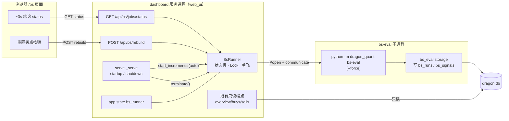
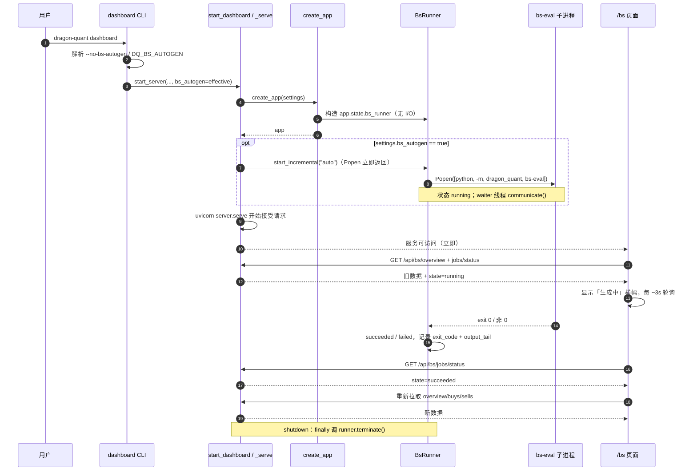
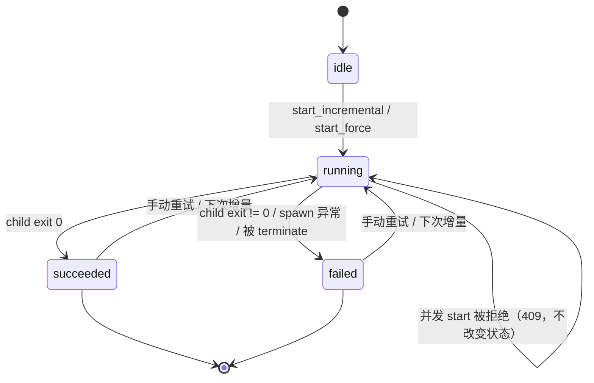
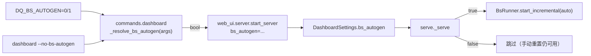

> **后续演进（2026-11-05）**：`dashboard` 的 BS 启动自动生成已改为**默认关闭**，需显式 `--bs-autogen` / `DQ_BS_AUTOGEN=1` 开启；`--no-bs-autogen` / `DQ_BS_AUTOGEN=0` 始终优先。下文历史段落中的“默认后台增量生成”描述不再适用。

# dashboard「BS策略」自动生成与手动重置技术方案（2026-11-03）

> 范围：在既有 BS 策略假想回放（`bs-eval` / `bs_*` / `/bs`）之上新增两件事：
> **dashboard 启动时后台自动增量生成**、**页面「重置买点」按钮触发全量重生成**。
> 本方案只覆盖增量，不重写既有回放口径、聚合口径与 CLI。
> 本文结论取代 `archived_md/web_ui/2026-11-02-bs-strategy-page.md` 中「页面只读 / 页面不提供重跑按钮 / 不做页内触发回放」的表述；回放与聚合口径仍以该文与 `docs/agent/bs_eval.md` 为准。

## 0. 结论摘要

- **生成机制**：Web 后端通过 `subprocess.Popen([sys.executable, "-m", "dragon_quant", "bs-eval", ...])` 委派 CLI 子进程（命令委派 / 防腐层）。`web_ui` 继续保持零 `sqlite3`、零自建连接、零直接写库；写入发生在子进程的 `bs_eval.storage`。
- **任务编排**：新模块 `web_ui/backend/bs_runner.py` 提供单飞状态机（`idle → running → succeeded | failed`），`threading.Lock` 保护状态，命令工厂与 spawn 可注入，`communicate()` 收输出防管道死锁，服务关闭时 terminate。
- **启动自动生成**：**没有使用 FastAPI lifespan**——现状 `serve.py` 显式 `lifespan="off"`（E2E 冻结语义），因此在 `serve._serve()` 中 `create_app` 之后、`server.serve()` 开始接受请求之前调用 `runner.start_incremental("auto")`（`Popen` 立即返回，不阻塞启动），并在 `finally` 中 terminate。`create_app()` 只装配 `app.state.bs_runner`，不启动任务。
- **开关**：`dashboard` CLI 默认开启；`--no-bs-autogen` 与 `DQ_BS_AUTOGEN=0` 关闭；`DashboardSettings.bs_autogen` 默认 **False**（程序化 / 测试安全默认）。
- **API**：`GET /api/bs/jobs/status` + `POST /api/bs/rebuild`（202 / 409 / 500），注册进既有 `routers/bs.py`。
- **前端**：汇总卡区新增「重置买点」按钮（`Modal` 二次确认），running 时禁用并显示顶部横幅，~3s 轮询 status，成功后自动重拉 overview/buys/sells，失败显示 `output_tail` 摘要并可重试。
- **E2E 安全**：`EnvSandbox.env()` 统一注入 `DQ_BS_AUTOGEN=0`；`procguard` 仍禁止业务子进程创建，因此 E2E 中自动生成与手动重建都不会真正 spawn；真实生成行为只在单元/集成层用 fake spawn 验证。

## 1. 需求、口径与非目标

### 1.1 用户故事

1. 用户启动 `dragon-quant dashboard` 后，无需再手动执行 `bs-eval`，页面数据在后台自动补齐（终态行跳过，新增/未成熟行补算）。
2. 用户希望彻底重算时，点击页面「重置买点」按钮即可全量重新生成（等价 `bs-eval --force`），并能看到进度与结果。

### 1.2 已确认口径（用户拍板，不可更改）

- **A：后台异步**。dashboard 立即启动并服务页面，页面先显示「生成中」态，生成完成自动刷新；**不做启动前同步阻塞**。
- 生成语义：启动自动生成 = `bs-eval` 默认增量行为；「重置买点」= `bs-eval --force` 全量重算。
- 「重置买点」是用户指定的按钮名称。

### 1.3 验收标准（本增量）

| 编号 | 验收标准 |
|---|---|
| B1 | dashboard 启动后后台自动增量生成；可通过 `--no-bs-autogen` / `DQ_BS_AUTOGEN=0` / settings 关闭 |
| B2 | 页面「重置买点」按钮触发全量重生成（force 语义） |
| B3 | 同一时刻最多一个生成任务（单飞）；页面有进度/结果反馈；运行中重复触发被拒绝 |
| B4 | 自动生成失败不阻塞 dashboard 启动；失败状态可在页面看到并可重试 |
| B5 | E2E / CI 零触网、零写真实库（不得 spawn 真实 `bs-eval`） |
| B6 | 既有 BS 功能与 dashboard 其他页面零回归 |

### 1.4 非目标（明确不做）

- 不改 `bs-eval` CLI 契约、回放状态机、`bs_runs` / `bs_signals` 表结构、聚合口径。
- 不做启动前同步生成、不做生成进度百分比（子进程不提供结构化进度）。
- 不引入 Celery / APScheduler / RQ 等任务队列或新依赖。
- 不做多 dashboard 实例间的跨进程互斥（见 §11 风险）。
- 不做超时强杀（v1 无超时，文档注明；关闭服务会 terminate）。
- 不改 `/api/meta` 的 `routes`（只列页面路由，见 §5.6）。

## 2. 架构方向与候选对比

### 2.1 选定方向：命令委派 + 单飞状态机 + 依赖注入



**采用的设计模式与动机**

| 模式 | 落点 | 动机 |
|---|---|---|
| 命令委派 / 防腐层（Adapter） | `BsRunner` 只拼 argv 并调用 CLI，不 import `bs_eval` | Web 层与业务写入解耦；同一代码路径避免双份回放逻辑；进程隔离让崩溃/卡死不拖垮服务 |
| 状态机（State） | `idle / running / succeeded / failed` 单一状态源 | 把「正在跑、上次结果、能否再触发」收敛到一个对象，避免散落的布尔量 |
| 依赖注入（DI） | `command_factory` / `popener` 构造参数；FastAPI `Depends` 提供 runner | 测试用 fake 进程验证轮询/失败/单飞，不触网不 spawn |
| 模板方法（可选，不新增抽象） | `_start(mode, trigger)` 复用 spawn → watch → finalize | 增量与 force 只差 argv，不复制两份流程 |

### 2.2 候选对比（含非常规路径）

| 候选 | 做法 | 优点 | 缺点 | 结论 |
|---|---|---|---|---|
| **A（选定）子进程委派** | `Popen(sys.executable -m dragon_quant bs-eval)` | Web 层零写库；崩溃隔离；可 terminate；与 CLI 完全同路径；dashboard 已有 `pip` 子进程先例 | 双解释器内存；只能拿文本输出；启动有import成本 | **采用** |
| **B（非常规）进程内后台线程直接调 `run_bs_eval`** | `threading.Thread(target=run_bs_eval)` | 无序列化开销；可直接拿 result dict；代码短 | 破坏「web_ui 零写库」硬约束；线程无法安全终止，关闭服务时可能写一半；重模块（provider 栈）进 Web 进程；失败会污染服务进程 | 否决 |
| **C FastAPI `BackgroundTasks`** | 在请求内注册后台任务 | 框架自带 | 任务与请求生命周期绑定，不能在启动时触发；无单飞/取消语义；异常不可见 | 否决 |
| **D 外部定时任务 / cron 调 `bs-eval`** | 与 dashboard 解耦 | Web 完全只读 | 无法满足「dashboard 启动时生成」与页面按钮即时触发 | 否决 |

**为什么不选 B（重点）**：`bs_eval` 的写入发生在 `bs_eval.storage`，若在 Web 进程内调用，`web_ui` 就从「零 sqlite3 / 零写库」变成写库方，必须给 `deps.py` 开写白名单，且线程无法在 shutdown 时安全中止，长任务会拖住 uvicorn 退出。A 用操作系统的进程边界换取这条硬约束，代价可接受。

## 3. 启动时序



## 4. 作业状态机



- `state` 只由 `BsRunner` 内部修改；HTTP 层永远不直接写状态。
- `last_run` 记录最近一次任务（含失败）；从未运行过为 `null`。
- `running` 时 `finished_at`、`exit_code`、`output_tail` 为 `null`；页面按 running 渲染，不把它当作完整结果。
- 进程重启后状态回到 `idle`（内存态，不落库）；历史结果仍在 `bs_runs` / `bs_signals`，`/api/bs/overview` 照常可读。

## 5. 模块 / 文件级设计

### 5.1 新增：`web_ui/backend/bs_runner.py`

```python
JobState = Literal["idle", "running", "succeeded", "failed"]
JobMode = Literal["incremental", "force"]
JobTrigger = Literal["auto", "manual"]

@dataclass(frozen=True)
class JobSnapshot:
    mode: JobMode
    trigger: JobTrigger
    started_at: str
    finished_at: str | None = None
    exit_code: int | None = None
    output_tail: str | None = None

class BsJobBusy(RuntimeError):
    """已有任务在运行（路由转 409）。"""

class BsRunner:
    def __init__(
        self,
        *,
        command_factory: Callable[[JobMode], Sequence[str]] | None = None,
        popener: Callable[..., Any] | None = None,  # 默认 subprocess.Popen
        output_lines: int = 50,
        output_chars: int = 4000,
    ) -> None: ...

    def start_incremental(self, trigger: JobTrigger) -> JobSnapshot: ...
    def start_force(self, trigger: JobTrigger) -> JobSnapshot: ...
    def status(self) -> dict[str, Any]: ...      # {"state": ..., "last_run": ...|None}
    def terminate(self, timeout: float = 3.0) -> None: ...
```

**契约要点**

- **命令工厂**：默认
  ```python
  [sys.executable, "-m", "dragon_quant", "bs-eval", "--source", "v2"]
  # force 追加 "--force"
  ```
  测试注入 fake 返回固定 argv，验证模式映射。
- **spawn**：`popener(argv, stdout=PIPE, stderr=STDOUT, stdin=DEVNULL, text=True, encoding="utf-8", errors="replace", env={**os.environ, "PYTHONIOENCODING": "utf-8"})`；不继承 shell，不写临时文件。显式 UTF-8 避免 Windows 子进程输出按 locale 解码成乱码。
- **单飞**：`_lock` 下检查 `state == "running"` → `raise BsJobBusy`；Popen 也在锁内完成（毫秒级），保证并发 POST 只产生一个子进程。
- **等待**：spawn 成功后启动 daemon waiter 线程执行 `proc.communicate()`；不得在锁内 communicate。退出码取 `proc.returncode`。
- **输出**：stdout/stderr 合并；保留尾部 `output_lines` 行且不超过 `output_chars` 字符；running 期间不提供部分输出（`communicate` 结束才有）。
- **失败归类**：Popen 同步抛异常 → `failed`，`output_tail = "spawn_failed: <Type>: <msg>"`；子进程非 0 → `failed` + 实际退出码与输出。
- **终止**：`terminate()` 在锁内取 proc；`terminate()` → `wait(timeout)` → 超时 `kill()`；waiter 线程随后把状态置为 `failed`。重复调用幂等。
- **时间**：`datetime.now(timezone(timedelta(hours=8))).isoformat(timespec="seconds")`；不 import `dragon_quant`，保持 Web 层惰性。
- **无 I/O 导入**：模块只 import 标准库；构造 runner 不建目录、不连库、不 spawn。

### 5.2 启动钩子（关键实现修正）

| 事实 | 结论 |
|---|---|
| `web_ui/backend/app.py` 的 `create_app()` 当前没有 lifespan / startup handler | 不能依赖 `@app.on_event("startup")` |
| `web_ui/backend/serve.py` 显式 `uvicorn.Config(..., lifespan="off")` | 即使注册 lifespan 也不会执行 |
| E2E 依赖 `lifespan="off"` 的启动/退出语义 | **不改成 `lifespan="on"`**，避免扩大回归面 |

落点：

1. `create_app(settings)` 末尾：`app.state.bs_runner = BsRunner()`（仅构造，无 I/O）。
2. `_serve()` 在 `app = create_app(settings)` 之后、`asyncio.create_task(server.serve(...))` **之前**触发：
   ```python
   runner = getattr(app.state, "bs_runner", None)
   if runner is not None and settings.bs_autogen:
       try:
           runner.start_incremental(trigger="auto")
       except Exception as exc:  # 自动生成失败必须 fail-soft
           print(f"dashboard: BS 自动生成启动失败：{type(exc).__name__}: {exc}", file=sys.stderr)
   ```
   **顺序原因**：`Popen` 立即返回、不阻塞启动；放在服务开始接受请求之前，页面首次加载必然看到 `running` 或已完成态，不会出现「页面读到 idle 后不再轮询、后台任务却已启动」的竞态。
3. `_serve()` 的 `finally`：`runner.terminate()`；异常吞掉，绝不阻塞服务退出。触发点必须落在该 `try/finally` 覆盖范围内（若因顺序需要提前，则在外层再包一层 `try/finally`），保证任何启动异常都不会遗留子进程。
4. 程序化直接 `uvicorn` 跑 `create_app` 的用法不会自动生成——文档注明，属已知边界。

### 5.3 三层开关传递链



**优先级（高 → 低）**

1. `DQ_BS_AUTOGEN` ∈ `{0,false,no,off}` → 关闭（安全总开关，E2E 使用）。
2. `--no-bs-autogen` → 关闭。
3. `DQ_BS_AUTOGEN` ∈ `{1,true,yes,on}` → 开启。
4. `dashboard` 命令默认 → 开启。
5. `DashboardSettings.bs_autogen` 字段默认 **False**（程序化 / 测试默认安全）。

- `review --ui` / `review-account --ui` 继续走 `web_ui.server.start_server` 默认值 **False**，本增量不自动生成（与「dashboard 启动时」口径一致；页面按钮仍可用）。若 main 希望这些入口也自动生成，属后续开关决策。
- `DashboardSettings` 新增字段为 `bs_autogen: bool = False`，frozen 语义不变。
- `web_ui.server.start_server` 新增 keyword-only `bs_autogen: bool = False`；既有参数默认值不变（`test_start_server_signature_is_frozen` 仍通过），并转发给 `DashboardSettings`。
- `_resolve_bs_autogen` 一律用 `getattr(args, "no_bs_autogen", False)` 读取，兼容既有测试里的 `SimpleNamespace`；env 解析与 `DQ_WEB_AUTO_INSTALL` 同款（大小写不敏感，`0/false/no/off` 与 `1/true/yes/on`）。

### 5.4 API 契约（`web_ui/backend/routers/bs.py`）

#### `GET /api/bs/jobs/status`

```json
{
  "state": "succeeded",
  "autogen_enabled": true,
  "last_run": {
    "mode": "incremental",
    "trigger": "auto",
    "started_at": "2026-11-03T09:31:02+08:00",
    "finished_at": "2026-11-03T09:33:41+08:00",
    "exit_code": 0,
    "output_tail": "BS 回放完成：run #12 ...\n扫描 120 · 评估 37 ..."
  }
}
```

- `state ∈ {idle,running,succeeded,failed}`；`autogen_enabled` 取 `settings.bs_autogen`（本进程启动时的有效值）。
- `last_run` 从未运行 → `null`；字段集合固定，不随状态增删。
- 只读端点，异常沿用 `stable_errors` 单键 500。

#### `POST /api/bs/rebuild`

- 成功启动：**202**
  ```json
  {"state":"running","autogen_enabled":true,
   "last_run":{"mode":"force","trigger":"manual","started_at":"...","finished_at":null,"exit_code":null,"output_tail":null}}
  ```
- 已在运行：**409**
  ```json
  {"error":"job_running","detail":"BS 数据生成已在进行中","state":"running","last_run":{...}}
  ```
- spawn 同步失败：**500** `{"error":"spawn_failed","detail":"<Type>: <msg>"}`（状态已置 `failed`，后续 status 可读）。
- 无请求体；忽略客户端 body。仅监听 `127.0.0.1` + `TrustedHostMiddleware`，无鉴权（与既有本地面板一致）。
- **跨站请求防护（新增）**：`POST /api/bs/rebuild` 校验 `Origin` 头——若存在且 host 不属于 `{localhost, 127.0.0.1, [::1]}`，返回 403 `{"error":"invalid_origin"}`；无 `Origin` 的本地工具（curl）放行。原因：`TrustedHostMiddleware` 只防 DNS rebinding，不防恶意网页用表单/`text/plain` 跨站 POST 触发子进程。既有 `POST /api/account/runs` 未做此校验，本增量只加固新增端点，不改旧端点行为。
- 手动重建**不受** `DQ_BS_AUTOGEN` 影响：该开关只管启动自动生成。

**这是 Web 层写操作的唯一新增例外**：HTTP 处理函数仍不写库，写入完全在子进程。

### 5.5 依赖注入与路由接线

- `deps.py` 新增：
  ```python
  def bs_runner(request: Request):
      return request.app.state.bs_runner
  ```
  与 `dashboard_settings` 同构；测试用 `app.dependency_overrides[deps.bs_runner] = lambda: fake`。
- `routers/bs.py` 新增两条路由；`POST` 用 `Depends(bs_runner)` 与 `Depends(dashboard_settings)`。
- `routers/__init__.py` 无需改（`bs.router` 已注册）。
- `routers/meta.py` 的 `ROUTE_LIST` **不改**：它只列页面路由（`/bs` 已在），`/api/*` 从不进入该列表；新增 API 不触发前端导航变化。

### 5.6 前端设计

**文件**

| 文件 | 变更 |
|---|---|
| `web_ui/frontend/src/api/bs.ts` | 新增 `BsJobRun` / `BsJobStatus` 类型、`fetchBsJobStatus()`、`postBsRebuild()`（复用 `getJson` / `postJson`） |
| `web_ui/frontend/src/pages/bs/BsPage.tsx` | 按钮、确认 Modal、横幅、轮询、成功后刷新、失败展示 |
| `web_ui/dist/**` | `npm --prefix web_ui/frontend run build` 同批更新 |

**交互与状态**

- 挂载时并行拉取 `/api/bs/overview` 与 `/api/bs/jobs/status`。
- 「重置买点」按钮提取为页内 `<RebuildButton />`，**两处渲染、同一 handler**：有数据时放在汇总卡 `Section` 的 `right` 槽；无 `overview.run` 时放在 `EmptyState` 的 `action` 槽——保证空库首次启动也能手动触发（B2 不依赖已有数据）。
- `job.state === "running"`：
  - 汇总卡右侧「重置买点」按钮 `disabled`；
  - 顶部横幅（`role="status" aria-live="polite"`）：「数据生成中…（增量生成 / 全量重置）」+ 模式与开始时间；
  - 每 3000ms 轮询 `GET /api/bs/jobs/status`；组件卸载或状态离开 running 时清除定时器。单次轮询失败不改变状态，保留最后一次已知状态并继续；连续 5 次失败则停止轮询并显示「状态读取失败」，按钮恢复可用。
  - 不因 running 清空已有表格（保留上一批数据）。
- `running → succeeded`：停止轮询，递增 `reloadToken`，触发 overview + buys + sells 重新拉取（沿用现有 `overview?.run` 依赖）。
- `running → failed`：停止轮询，红色横幅显示 `exit_code` 与 `output_tail`（`<details>` 折叠，默认只显示摘要行），按钮恢复可重试。
- 页面首次加载且 `job.state === "running"`、`overview.run` 为空：空态文案改为「数据生成中…」，但仍保留 `python -m dragon_quant bs-eval` 提示（契约测试依赖该字符串）。
- 点击按钮：先用项目既有 `components/Modal.tsx` 二次确认（标题「重置买点？」；说明「将全量重新回放 dragons_v2，可能耗时数分钟并写入 bs_* 派生表」）；确认后 `POST /api/bs/rebuild`。
- `POST` 返回 409：不做错误提示，直接进入 running 横幅并开始轮询（幂等体验）。
- `POST` 返回 500：显示 `spawn_failed` 错误横幅，按钮可重试。

**错误文案**

| 场景 | 页面 |
|---|---|
| 启动自动生成失败 | 打开页面即见 `last_run.mode/trigger=failed` 红色横幅 + output_tail |
| 手动重建失败 | 同上，按钮可重试 |
| 状态接口本身失败 | 沿用现有 `加载失败：<msg>` 顶部错误条，不阻塞表格 |

**文案同步（必须删除旧说法）**

- 删除两处「页面只读，不提供重跑按钮」。
- `stale_rows` 提示改为「可点击「重置买点」全量重算，或在终端执行 `python -m dragon_quant bs-eval --force`」。
- 页头说明补一句「启动 dashboard 时后台自动增量生成」。

**构建约束**

- 新代码只用既有字号 token，禁止 `text-xs` / `text-sm`；主题色禁止 Tailwind 斜杠透明度。
- 改完必须重新构建 `web_ui/dist`，源码与产物同批。

## 6. E2E 安全边界专项

### 6.1 三层防线

| 层 | 措施 | 作用 |
|---|---|---|
| 1. E2E 环境 | `EnvSandbox.env()` 固定注入 `DQ_BS_AUTOGEN=0` | 所有 E2E 子进程（含 dashboard web server）默认不自动生成 |
| 2. 进程守卫 | `dragon_quant/tests/e2e/injection/procguard.py` 默认拒绝 `subprocess.Popen` / `os.fork` 等 | 即使开关被误开，子进程也创建不出来，`bs_runner` 捕获后置 `failed`（fail-soft） |
| 3. 数据哨兵 | `DQ_DATA_DIR` 指向临时沙箱；`RealDataSentinel` 校验真实目录不变 | 真实 `dragon.db` / `assets.db` / `prep.db` 不被读写 |
| 4. 默认值 | `DashboardSettings.bs_autogen=False`；单元测试 `start_server` / `create_app` 不传开关 | 非 CLI 路径（含 `test_web_server_lifecycle`）不会意外 spawn 真实子进程 |

### 6.2 E2E 能测与不能测

- **能测**：dashboard 正常启动 + `/api/bs/jobs/status` 返回 `idle` / `autogen_enabled=false`；页面 SPA fallback；既有 BS 只读 API；`DQ_BS_AUTOGEN` 未设时 fail-soft（若加 D13）。
- **不能测**：真实子进程生成。`procguard` 是一刀切策略，不为本需求开放 allow-list；真实生成由单元/集成层用 fake spawn 覆盖，CLI 本身已有 BS1–BS6 E2E。
- **不得**在 E2E 中调用 `POST /api/bs/rebuild` 期望成功；若调用，只会得到 `500 spawn_failed`（已捕获，不产生副作用）。可测这一负路径，但不强制。

### 6.3 新增 / 调整的 E2E 用例

| 用例 | 内容 |
|---|---|
| 扩展 `test_d1_dashboard_starts_and_serves_meta` | 增加 `GET /api/bs/jobs/status`：200，`state=="idle"`，`autogen_enabled is False`；证明沙箱默认关闭 |
| 新增 `test_d13_bs_autogen_fail_soft_when_unset`（必做，覆盖 B4） | 用 `env_override={"DQ_BS_AUTOGEN": None}` 启动 dashboard；`/api/meta` 仍 200；轮询 status 直到 `failed`，`output_tail` 含「E2E 禁止创建子进程」；真实库哨兵不变 |
| `coverage-map.json` | `dashboard` 节点 `flags` 增 `--no-bs-autogen`；把新增 E2E 测试登记到 `dashboard` 节点（`test_coverage_map` 要求每个测试函数都被映射） |

> 计数结论：`coverage-map.json` 的 **56 个 parser 节点 / 18 个顶层命令不变**。新增 flag 不改节点数；`test_coverage_map.py` 只校验节点数与 flags 非空，`development.md` 的 56/18 无需改数字。

## 7. 错误处理矩阵

| 场景 | `BsRunner` 状态 | HTTP | 页面行为 |
|---|---|---|---|
| 自动增量成功 | running → succeeded，exit 0 | 200 status | 横幅消失，自动刷新 |
| 子进程 exit 1（运行期失败） | running → failed，exit 1 | 200 status | 红条 + output_tail + 可重试 |
| 子进程 exit 2（参数错误，理论不发生） | failed，exit 2 | 200 status | 同上（提示检查 CLI） |
| Popen 同步异常（无解释器 / procguard / 权限） | failed，exit_code=null，output_tail=spawn_failed | 自动：200；手动：500 | 红条 + 可重试 |
| 重复 POST（running） | 不变 | 409 + 当前状态 | 不报错，进入轮询 |
| POST 的 `Origin` 非本机 | 不变 | 403 `invalid_origin` | 正常不应出现；显示操作失败 |
| 子进程被终止（服务关闭） | running → failed | — | 页面已关闭 |
| 失败/中断的 run 在 `bs_runs` 留下 `finished_at=null` 行 | — | 后续 overview 的 `latest_run` 可能指向未完成 run | 本次不刷新页面；重开页面会看到未完成 run（见 §11） |
| 自动生成启动时已有任务（理论不发生） | 抛 `BsJobBusy`，被 `_serve` 吞掉 | — | — |
| 服务关闭时 running | terminate → failed（进程已不可见） | — | — |
| 子进程长时间卡住 | running（v1 无超时） | 200 | 持续轮询；文档注明可关闭服务终止 |
| `output_tail` 超大 | 截断 50 行 / 4000 字符 | — | 折叠展示 |
| 状态接口仓储异常 | — | 500 单键（既有 `stable_errors`） | 顶部错误条，表格不受影响 |
| 生成期间页面读 overview | 既有数据 + 未完成 run（`finished_at=null`） | 200 | 保留旧表 + running 横幅；完成后刷新 |

## 8. 测试策略

### 8.1 单元 / 集成（`pytest dragon_quant/tests -q --ignore=e2e --ignore=smoke`）

| 文件 | 增量 |
|---|---|
| 新增 `test_bs_runner.py` | 命令工厂两种模式；成功路径（fake proc 返回 0）；失败路径（非 0）；spawn 异常；单飞（第二次 start 抛 `BsJobBusy`）；output_tail 截断（含中文 UTF-8）；terminate 幂等；status 快照字段 |
| `test_web_backend.py` | `GET /api/bs/jobs/status`（fake runner / `dependency_overrides`）；`POST /api/bs/rebuild` 202 / 409 / 500 / 403（非法 `Origin`）；`autogen_enabled` 来自 settings |
| `test_dashboard_command.py` | 开关优先级（env 0 / flag / env 1 / 默认）；`_start_server` 收到 `bs_autogen` |
| `test_web_server_lifecycle.py` | 保持既有「生命周期不触库」：默认 settings 关闭，不 spawn（不新增真实子进程） |
| `test_web_frontend_bs.py` | 源码 + dist 含「重置买点」「/api/bs/jobs/status」「/api/bs/rebuild」；保留 `python -m dragon_quant bs-eval`；无 `text-xs` / `text-sm` |
| `test_coverage_map.py` | 随 coverage-map 更新后继续通过 |
| `test_skill_content.py` | safety.md 保持 T0/T1、无禁用词 |

### 8.2 E2E（`pytest dragon_quant/tests/e2e -q`）

- 扩展 D1（status idle + autogen false）。
- 新增 D13 fail-soft（可选，覆盖 B4）。
- 其余 dashboard E2E 不改；`DQ_BS_AUTOGEN=0` 由 harness 统一注入。

### 8.3 验证命令

```bash
# 新增单测
.venv/bin/python -m pytest dragon_quant/tests/test_bs_runner.py dragon_quant/tests/test_web_backend.py -q
.venv/bin/python -m pytest dragon_quant/tests/test_dashboard_command.py dragon_quant/tests/test_web_frontend_bs.py -q

# 既有回归（排除 e2e/smoke）
.venv/bin/python -m pytest dragon_quant/tests -q --ignore=dragon_quant/tests/e2e --ignore=dragon_quant/tests/smoke

# E2E 安全边界 + BS + dashboard
.venv/bin/python -m pytest dragon_quant/tests/e2e/test_harness_safety.py dragon_quant/tests/e2e/test_architecture_rules.py -q
.venv/bin/python -m pytest dragon_quant/tests/e2e/test_coverage_map.py dragon_quant/tests/e2e/test_bs_eval.py dragon_quant/tests/e2e/test_dashboard.py -q

# 前端构建（dist 同批入库）
npm --prefix web_ui/frontend run build
```

## 9. 文档同步清单（阶段 3 同一 commit）

| 文件 | 变更 |
|---|---|
| `docs/agent/bs_eval.md`（owner） | 自动生成契约（启动即增量、可关闭）、`GET /api/bs/jobs/status` / `POST /api/bs/rebuild`、页面「重置买点」、单飞/无超时、开关优先级、Web 写操作例外 |
| `docs/agent/development.md` | `dashboard` 新增 `--no-bs-autogen`；Web UI 写操作例外（`bs_runner` 子进程委派）；E2E 沙箱注入 `DQ_BS_AUTOGEN=0`；56/18 不变 |
| `docs/agent/architecture.md` | 把「长驻只读面板」修订为「长驻面板（查询为主；BS 派生数据经子进程生成）」；目录树/公共入口提及 `bs_runner`（若树里列 web_ui 后端文件） |
| `README.md` | `dashboard` 示例旁注明启动自动增量生成与关闭方式；`/bs` 段删除「页面只读」，改为「启动自动生成 + 重置买点按钮」 |
| `skills/dragon-quant/references/safety.md` | dashboard 仍 T0，notes 改为：「长驻；启动后默认后台增量生成 BS 派生数据（只写 bs_* 派生表并读取行情；不写账户/交易业务记录）；可用 `--no-bs-autogen` 或 `DQ_BS_AUTOGEN=0` 关闭；禁止 `--yes` 自动安装」；确认话术同步更新 |
| `skills/dragon-quant/references/commands.md` | dashboard 行 `key_flags` 增 `--no-bs-autogen`；备注同步「默认后台增量生成 BS 派生数据，不回测」 |
| `skills/dragon-quant/references/operations.md` | UI 生命周期「不回测」处补一句 BS 派生数据自动生成与关闭方式；不改成「会回测」 |
| `dragon_quant/commands/bs_eval.py` | 模块 docstring 与末尾人读提示「页面只读，重跑请再执行 bs-eval」改为「可再次执行 bs-eval，或在 `/bs` 页面点击「重置买点」」；冷启动提示「首次使用建议先 `--limit 5` 试跑」保留（E2E 断言依赖） |
| `dragon_quant/tests/e2e/coverage-map.json` | dashboard flags + 新增测试映射 |

> 根 `AGENTS.md` 不新增跨模块硬约束，不改；`archived_md/web_ui/2026-11-02-bs-strategy-page.md` 是历史方案，不回写正文，由本文声明取代其页面只读表述。

## 10. 验收标准 → 实现位置 → 验证方式

| 标准 | 实现位置 | 验证方式 |
|---|---|---|
| B1 启动自动增量、可关闭 | `serve._serve` 启动钩子；`commands/dashboard._resolve_bs_autogen`；`DashboardSettings.bs_autogen`；`bs_runner.start_incremental` | `test_bs_runner` 成功/失败；`test_dashboard_command` 开关优先级；E2E D1 status idle/autogen false；D13 fail-soft |
| B2「重置买点」全量重生成 | `BsPage` 的 `RebuildButton`（汇总卡 + 空态两处）+ `Modal` + `postBsRebuild`；`POST /api/bs/rebuild` → `start_force` → argv `--force` | `test_bs_runner` 验证 force argv；`test_web_backend` 202；`test_web_frontend_bs` 文案/调用；dist 构建 |
| B3 单飞 + 进度/结果反馈 | `BsRunner` 锁与状态机；409；前端 3s 轮询与横幅 | `test_bs_runner` 单飞；`test_web_backend` 409；前端契约测试 |
| B4 自动生成失败不阻塞 dashboard | `_serve` try/except + fail-soft；`failed` 状态；页面红色横幅 | E2E D13（procguard 触发 spawn 失败，`/api/meta` 仍 200）；`test_bs_runner` spawn 异常 |
| B5 E2E/CI 零触网零写真实库 | `EnvSandbox.env()` 注入 `DQ_BS_AUTOGEN=0`；`procguard`；settings 默认 False | E2E harness safety + sentinel；D1 断言 autogen false；`test_web_server_lifecycle` 不触库 |
| B6 既有功能零回归 | 只新增模块/端点/按钮；不动 `bs_eval` 与既有 GET | 全量单测 + E2E（BS1–BS6、D1–D12）+ 前端构建契约 |

## 11. 风险与缓解

| 风险 | 影响 | 缓解 |
|---|---|---|
| 自动生成是长任务且 v1 无超时 | 页面长时间 running；关闭服务可终止 | 文档注明；shutdown terminate；后续可加超时 |
| 两个 dashboard 实例共享 `DQ_DATA_DIR` | 两个 `bs-eval` 进程并发写，可能 SQLite busy | v1 明确「单实例」；`bs_eval.storage` 独立连接 + WAL；后续可加跨进程文件锁 |
| 子进程 import 慢（tmdx/pandas） | 首次 running 持续时间长 | 页面横幅与轮询；不阻塞服务 |
| `sys.executable -m dragon_quant` 在异常安装环境不可用 | 自动生成失败 | fail-soft + output_tail 暴露；手动 CLI 仍可用 |
| 自动生成写 bs 派生表被误解为「业务写入」 | 影响 Skill T0 判定 | safety.md 明确「派生表、可重跑、不写账户/交易」；提供关闭开关 |
| 运行中页面读到未完成 run（`finished_at=null`） | 汇总短暂不完整 | 前端 running 时保留旧表不刷新；完成后统一刷新 |
| 失败 / 被 terminate 的 run 在 `bs_runs` 留下 `finished_at=null` 的行 | 重开页面时 `latest_run` 指向未完成 run，汇总可能为 0 或部分 | 本次不改 `latest_run` 契约（会波及既有 CLI/页面语义）；页面仍显示 running/failed 横幅；文档注明可再次「重置买点」覆盖；后续评估在聚合层过滤未完成 run |
| 恶意网页跨站 POST 触发重建 | 本机资源被占用 / 触网 | 新增 `Origin` 校验（§5.4）；仅放行本机 Origin 或无 Origin 的本地工具 |
| E2E 无法覆盖真实 spawn | 真实链路仅单测 fake 覆盖 | 既有 `bs-eval` E2E 覆盖真实 CLI；runner 只做 argv/状态；真实联调由开发机人工确认 |
| 前端轮询与用户筛选请求竞争 | 表格闪动 | 轮询只用 status；数据刷新仅在任务结束时触发一次 |

## 12. 阶段 3 实施顺序

1. `web_ui/backend/bs_runner.py` + `test_bs_runner.py`（先状态机与 fake 测试）。
2. `app.py` 装配 runner；`serve.py` 启动/关闭钩子；`settings.py` 字段。
3. `commands/dashboard.py` 开关解析 + `web_ui/server.py` 透传；CLI 帮助与测试。
4. `deps.py` + `routers/bs.py` 两个端点；`test_web_backend.py`。
5. 前端 `api/bs.ts` + `BsPage.tsx`（按钮/Modal/轮询/横幅/文案）；`npm run build`。
6. E2E harness `DQ_BS_AUTOGEN=0`；D1 扩展；D13；coverage-map。
7. 文档同步（§9）。
8. 全量单测 + E2E + 构建 + 自测证据。

## 13. 待 main 确认的实现选择（不阻塞本方案审查）

1. **启动钩子不用 lifespan**：现状 `lifespan="off"`，改为在 `_serve` 中 `create_app` 后、server 开始接受请求前触发；程序化 `create_app` 不自启。若 main 要求「任何 ASGI 启动方式都自动生成」，需单独评估打开 lifespan 的回归面。
2. **`review --ui` / `review-account --ui` 不自动生成**：本增量只覆盖 `dashboard` 命令；页面按钮在这两个入口仍可用。
3. **手动重建不受 `DQ_BS_AUTOGEN` 限制**：开关只管启动自动生成。
4. **单实例假设**：v1 不做跨进程锁，文档注明。
