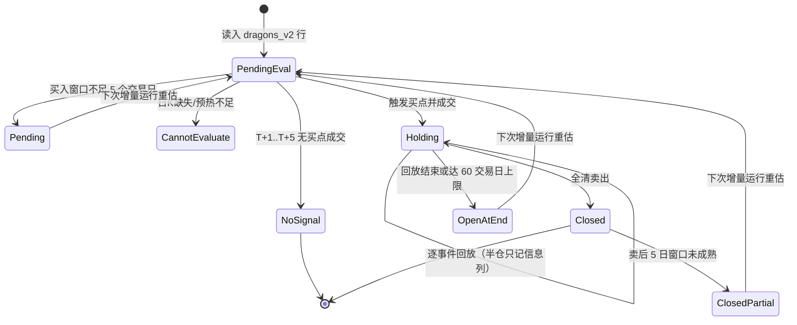
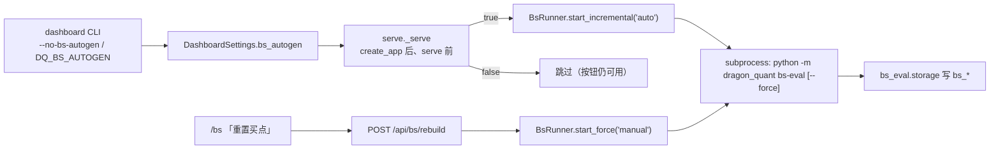

# bs_eval — BS 策略假想回放（`bs-eval` / `bs_*` / `/bs`）

> 触发：改 `bs-eval` 命令、`bs_runs` / `bs_signals` 表、`/bs` 页面、`/api/bs/*`、买卖点回放口径或窗口聚合时读本文。
> 本文权威：命令契约、回放状态机、两表字段语义、幂等/force、聚合口径、只读 API 与页面区块、数据质量与回放上限。
> 上游权威：`review_account/strategy/STRATEGY.md`（买卖规则与 T+1 语义）、[trading](trading.md)（信号表边界）、[review](review.md)（窗口指标共享核）、[scan](scan.md)（`dragons_v2` 只读口径）。

## 定位

`bs_eval` 是**离线批量回放**层：以 `dragons_v2` 的一行为工作单元，逐日驱动
`review_account.live_trade.signal_engine.SignalEngine`（`account=None`），记录假想
买入/卖出信号与买后/卖后 5 日窗口指标，落 `dragon.db` 的 `bs_runs` /
`bs_signals`。它**不复制**任何买点/卖点/成交规则，也不改 `buy` / `sell` /
`review-account` / `review` 的行为、表或 JSON 键集。

- 数据来源：只读 `dragons_v2`（v1 已废弃，`--source` 仅接受 `v2`）。
- 存储：`bs_runs`（批次元数据）+ `bs_signals`（一行 = 一只龙头，`UNIQUE(trade_date, code)`），与实盘 `buy_sell_signals` 完全隔离。
- 页面：`/bs` 查询为主；`dashboard` 启动时后台自动增量生成，页面「重置买点」按钮等价 `bs-eval --force` 全量重算。生成由 Web 后端子进程委派，写入仍只发生在 `bs_eval.storage`。

## 命令契约

```bash
python -m dragon_quant bs-eval [--from D] [--to D] [--limit N] [--force] [--source v2] [--json]
```

| 参数 | 语义 |
|------|------|
| `--from` / `--to` | 按**入选日** `trade_date` 过滤（闭区间，`YYYYMMDD` / `YYYY-MM-DD`）；**不截断回放行情** |
| `--limit N` | 增量选行后只处理最久未尝试的 N 行（canary）；`N<=0` 非法 |
| `--force` | 忽略终态与 `content_hash`，区间内全量重算 |
| `--source` | 固定 `v2` |
| `--json` | 输出机器可读汇总（不输出逐行） |

- 参数非法 → stderr 单行，exit 2；运行期失败（日历/DB）→ stderr 单行，exit 1。
- 行级数据问题（单 code 日 K 缺失/预热不足/异常）→ `cannot_evaluate` 行，继续，exit 0。
- 人读输出含一行冷启动提示「首次使用建议先 `--limit 5` 试跑」。
- 回放截止日固定为**最近已收盘交易日**（`infra.clock`；当日 15:05 前不含当日），与 `--to` 无关，避免卖后窗口被截短。

## 状态机



`is_terminal` 唯一派生规则：

| `eval_status` | 条件 | `is_terminal` |
|---|---|---|
| `pending` | 买入窗口不足 5 个交易日 | 0 |
| `cannot_evaluate` | 日 K/预热/日历不足 | 0 |
| `no_signal` | 买入窗口已满且无成交 | 1 |
| `open` | 已买入未全清；未达 60 日上限 | 0 |
| `open` + `eval_note=hold_cap_reached` | 已买入未全清；达 60 日上限 | 1 |
| `closed` + `sell_window_partial=1` | 已全清；卖后窗口未成熟 | 0 |
| `closed` + `sell_window_partial=0` | 已全清；卖后窗口成熟 | 1 |

## 回放与窗口口径

- **买入窗口**：入选日后第 1~5 个交易日；首次成交即买入，之后不再投候选（每行最多 1 条买入记录）。
- **引擎记账**：`StrategyConfig` 副本仅把 `initial_cash` 覆盖为 `BS_EVAL_NOTIONAL_CASH = 10_000_000`，让高价股也能成交至少一手；不模拟资金/仓位/组合风控（`account=None`、`sentiment_pct=None`）。生效配置写入 `bs_runs.strategy_params_json`。
- **双口径入场**：宽松 = 信号日日 K 最低价；严格 = 引擎实际成交价（含滑点）。两套 5 日窗口分别落库。
- **卖出**：单口径 = 引擎实际卖出价；窗口锚定最终全清日/价。半仓腿只作信息列（`sell_half_*`）。
- **窗口指标**：复用 `review.strict_metrics.window_metrics`（`WINDOW_SKIP=1` / `WINDOW_SIZE=4`），不复制公式。
- **数据质量**：逐回放日 `daily_fallback` / `strict_5min`；行级 `strict_5min` / `daily_fallback` / `mixed` / `NULL`。停牌日计入 `suspended_days`，不伪造价格或质量。
- **窗口 partial**：`buy_window_partial` 以严格口径未成熟为准；宽松价缺失时只看严格窗口（宽松价无效不污染严格样本）。
- **持有上限**：买入后第 60 个交易日仍未全清 → 停止回放，`open/hold_cap_reached` 按终态处理。

## 幂等、选行与策略版本

- 增量选行：区间内 `is_terminal=0` 的行，按 `COALESCE(last_attempt_at,'') ASC, trade_date ASC, code ASC` 排序；`--limit` 取前 N 行，避免永久 `cannot_evaluate` 行饿死其它行。
- 终态行默认跳过；`--force` 全量重算。
- 行级幂等：`content_hash = sha256(稳定业务字段 + strategy_hash + evaluator_version + is_terminal)`。非 force 且哈希相同 → 不写业务字段，只更新 `last_attempt_at`；`created_at` 永不变。
- 当前 `strategy_hash` **或** `EVALUATOR_VERSION` 与最近 run 不同 → 本次自动按 force 语义重算选中范围，`bs_runs.note=strategy_or_evaluator_changed_auto_force`。
- 页面默认只统计当前 run 的 `strategy_hash` + 当前 `EVALUATOR_VERSION` 行；旧版本行只进入 `stale_rows` 计数。

## 聚合口径（`bs_eval/aggregate.py`，CLI/Web 共用）

- 触发率分母 = `eval_status in {no_signal, open, closed}`；排除 `pending` / `cannot_evaluate`；分母 0 → `null`。
- buy 样本 = 有 `buy_date`、对应口径价格非空、`buy_window_partial=0`、指标非空。胜利 = 5 日最大收益 > 0 且最大回撤 > -5%。
- sell 样本 = 有 `sell_date`、`sell_window_partial=0`、指标非空。
- sell 判定互斥：`flew`（卖后最大收益 ≥ +5%）优先；否则 `good`（最大回撤 ≤ -3%）；否则 `neutral`。窗口不足 `partial` 不伪造判定。
- `rule_breakdown` 固定输出四类买点 / 十条卖出规则（0 也输出）。比率保留两位小数，均值保留两位小数，NULL 不参与。

## 只读 API 与页面

`web_ui/backend/routers/bs.py` 只经 `deps.bs_repository / bs_strategy_doc / bs_aggregate` 取数；
`presenters/bs_view.py` 只做纯投影；Web 层零 `sqlite3`、零自建连接、零写库。

| 端点 | 说明 |
|---|---|
| `GET /api/bs/overview` | 最近一次 run 元数据 + 当前策略全部行的汇总 + 策略说明 + `stale_rows`；无 run → `run=null`、全 0 |
| `GET /api/bs/buys` | buy 行（`rule`/`partial`/日期/代码/排序白名单）；`summary` 基于同一基集但不含 `rule`（切换买点时分母稳定） |
| `GET /api/bs/sells` | sell 行（`rule` 为规则名，经 `SELL_REASON_TO_RULE` 展开）；行内 `verdict` / `half_exit` |
| `GET /api/bs/jobs/status` | `{state, autogen_enabled, last_run}`；`state ∈ {idle,running,succeeded,failed}`，`last_run` 从未运行 → `null` |
| `POST /api/bs/rebuild` | 启动全量重算（`--force`）：202 启动 / 409 已在运行 / 500 spawn 失败 / 403 非本机 `Origin` |

页面 `/bs` 固定区块：页头 → 策略说明卡（四类买点 + 十条卖出规则 + 阈值 chips）→ 汇总卡 →
buy 列表 → sell 列表。无 run 显示空态并提示 `python -m dragon_quant bs-eval`；
`stale_rows > 0` 显示旧策略版本提示条（可点「重置买点」或执行 `bs-eval --force`）。
运行中显示 `role="status"` 横幅并每 ~3s 轮询 status；成功后自动重拉 overview/buys/sells；
失败显示 `exit_code` 与折叠的 `output_tail`，按钮可重试。连续 5 次轮询失败停止轮询并提示。

## 自动生成与「重置买点」（`dashboard`）



- **开关优先级**（高 → 低）：`DQ_BS_AUTOGEN ∈ {0,false,no,off}` → 关闭；`dashboard --no-bs-autogen`
  → 关闭；`DQ_BS_AUTOGEN ∈ {1,true,yes,on}` → 开启；`dashboard` 默认开启。
  `DashboardSettings.bs_autogen` 默认 **False**（程序化 / 测试安全默认）。`review --ui` /
  `review-account --ui` 不自动生成（页面按钮仍可用）。
- **Web 写操作唯一例外**：`web_ui` 仍零 `sqlite3` / 零自建连接 / 零写库；HTTP 层只委派
  `web_ui.backend.bs_runner.BsRunner` 启动子进程，写入完全在子进程内。`bs_runner.py` 只 import
  标准库，不 import `bs_eval`。
- **单飞与无超时**：同一时刻最多一个任务（`threading.Lock` + `BsJobBusy` → 409）；v1 **没有超时强杀**，
  长任务持续 `running`，关闭服务时 `terminate()`。多个 `dashboard` 实例共享 `DQ_DATA_DIR` 时
  **没有跨进程锁**（v1 按单实例使用，SQLite 走 WAL）。
- **失败可见**：spawn 同步失败 / 子进程非 0 / 被 terminate → `failed`，`output_tail` 保留尾部
  50 行（≤4000 字符）；自动生成失败不阻塞 dashboard 启动。
- **E2E 安全**：`EnvSandbox.env()` 固定注入 `DQ_BS_AUTOGEN=0`；`procguard` 禁止业务子进程，
  真实生成只在单元层用 fake spawn 覆盖。

## 依赖方向与测试

```text
cli → commands.bs_eval → bs_eval.main → evaluator → review_account (data/market/signal_engine)
                                      → bs_eval.storage（bs_* 表）
                                      → bs_eval.sources（只读 scan.storage.dragons）
web_ui.routers.bs → deps.bs_repository → bs_eval.storage
                  → presenters.bs_view（纯投影）
web_ui.serve / routers.bs → bs_runner.BsRunner（标准库 only）
                  → subprocess(python -m dragon_quant bs-eval)，写入只发生在子进程
```

- `bs_eval` 可以 import `review_account` / `review` / `infra` / `scan.storage`（只读）；反向禁止。
- 项目代码零 `import pandas`；`bs_eval/__init__.py` 保持惰性（import 不建目录/库）。
- 单测：`test_bs_eval_candidates/evaluator/storage/aggregate/strategy_doc.py`、
  `test_bs_runner.py`（状态机/单飞/截断/终止）、`test_web_backend.py`（BS 端点 +
  `jobs/status` / `rebuild` 202/409/500/403）、`test_web_frontend_bs.py`、`test_review_account_data.py`。
- E2E：`tests/e2e/test_bs_eval.py` BS1–BS6（真实 CLI + fake provider + 临时库；BS6 真实 Web 子进程）；
  `test_dashboard.py` D1 断言沙箱 `autogen_enabled=false`、D13 断言开关打开但 `procguard` 禁止
  子进程时 fail-soft（`failed` + `spawn_failed`，`/api/meta` 仍 200）。
- 覆盖映射：`coverage-map.json` 56 个 parser 节点 / 18 个顶层命令（dashboard flags 含 `--no-bs-autogen`）。
