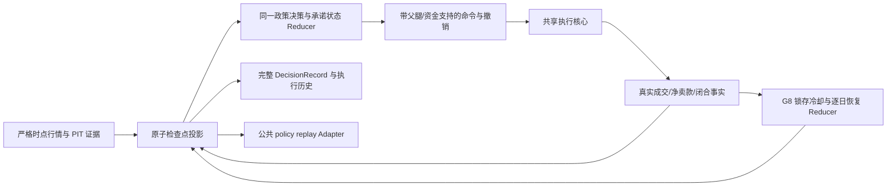

# trading — review-account 与 buy/sell 的产品与运维契约

> 触发：改动 `review-account` 回测、`buy` / `sell` 实盘辅助、候选池消费、数据分级、`buy_sell_signals` 信号表、`/account` API、费用与评估口径时读本文。
> 本文权威：账户回测与实盘辅助的产品/CLI/运维契约（候选池消费、数据分级、信号表语义、`/account` API、费用与评估口径）。
> 上游权威：AGENTS.md（硬约束与项目路由）；策略规则、参数、卖出链、P/A、买点诊断的判定与数值以 [策略规则](../../dragon_quant/review_account/strategy/STRATEGY.md) 为准（本文只引用、不复制）。

## 账户级模拟交易

```bash
python -m dragon_quant review-account --from 20260501 --to 20260601
python -m dragon_quant review-account --from 20260501 --to 20260601 --capital 200000 --ui
python -m dragon_quant review-account --ui-only --source v2
```
`review-account` 不替代 `review`。统一实现位于 `review_account/`：`market.py` 负责候选与时间/指标切片，`data.py` 校验日K和完整5分钟K，`strategy/` 产生信号（`buy.py` 买点、`checks.py` 诊断、`sell.py` 责任链、`execution.py` 撮合/仓位/费用），`engine.py` 顺序推进账户。`simulator.py` 与 `review_account/live_trade/signal_engine.py` 必须复用同一 `evaluate_buy`/`evaluate_sell`/`fill_price`/`fee`，不得复制买卖/成交规则。

- 候选池优先读**盘后复盘快照**（`prep_snapshots`，`prep` 命令产出）；快照消费仅对 `source=="v2"` 生效。`version=0.8`：直接取 `review_candidates` 中 `eligibility=="eligible" ∧ position_pct>0`，不叠加旧 `min_score`/旧身份/旧 verdict；有效决策的空池不回落 legacy。`version<=0.7` 历史快照仍按旧规则：`prep_verdict_filter_enabled=True` 时 `verdict=ignore` 出池；推荐集（strong/light）为空/快照缺失/读取异常/无资格时回退旧逻辑（0.8 的空池不回落）——取之前 **5** 个真实交易日的**全部真龙**并集（`assets.db.dragons` 镜像经 `candidate_loader("v2")`；`--source v1` 例外读 `dragons_v1`），共享层过滤否决/低于50分，按 code 去重保留综合分更高者。回退池**不再应用 ignore 过滤**，P 按快照 verdict 如实标注（ignore→False、无该 code→Unknown），输出 `fallback_reason`。回测额外加载区间前交易日，首日可开仓。**研究基线声明**：`candidate_lookback_days` 默认 3→5 是策略默认参数变更，历史 run 与本基线**不可直接比较**；复现旧基线请显式 `candidate_lookback_days=3`（prep 命中路径不受该参数影响）。

- Asia/Shanghai 时序与四类买点判定（开盘回踩 MA5、首根 5 分钟 K 突破确认、分歧买龙、龙回头）的阈值与窗口见 [策略规则 §8](../../dragon_quant/review_account/strategy/STRATEGY.md)。硬性约束：**不允许用未来信号倒选**；日K兜底日不触发首根 5 分钟 K 突破确认。

- 择优（P/A 三值）与竞价排序/否决开关由 `priority.rank_key` 单一实现、`TradingEngine` 与 `SignalEngine` 共用，语义与默认值见 [策略规则 §7](../../dragon_quant/review_account/strategy/STRATEGY.md)。产品层契约：`buy` 保持 buy-all（排序只影响 pending 顺序）；`buy` / `review-account` 共用排序，输出 `ranking_mode` 与 `fallback_reason`，被否决但本可买入的标的在 `details` 带 `vetoed_signal`。

- 信号待下一可执行事件成交，实时需更晚的新鲜报价；封死涨跌停不假定成交，跳空不能补填止损或成本线。T+1不卖当日仓，但跟踪买入后峰值；同一根K的高点不能反向激活该根K内的保护。

- 卖出为 10 条 `SellRule` 责任链（顺序即优先级、命中短路），规则清单、默认开关与 `sell_rule_toggles` 语义见 [策略规则 §1/§2](../../dragon_quant/review_account/strategy/STRATEGY.md)。硬性时序：15:00 只估值与更新峰值，不以最终收盘价补成交。

- **首日止损 `first_day_stop`（D3 首日浮亏减半，默认关）**：半仓减仓、灾难线优先整清、`took_profit_half` 单一半仓腿、`first_day_risk_distance_pct()` 风险距离口径见 [策略规则 §1.1](../../dragon_quant/review_account/strategy/STRATEGY.md)。**运维契约：开启后 T+1 必须至少运行一次 `sell`**（`buy` 不评估卖出），否则首日窗口静默错过。

- 当天卖出后不买入；不因下午卖出而取消早上交易。默认每日最多买一次，仓位基线仍使用可用现金；共享配置可开启单票25%/风险1%、MA5距离/趋势、ATR移动止盈实验，未验证参数不自动推广。
- `--config` JSON 原样传给共享 StrategyConfig；滑点0.2%、佣金0.03%、卖出印花税0.05%、每笔最低佣金5元。`evaluation.compare_strategies` 按60/20/20时间划分、最少交易数与双倍滑点验证，不自动换默认参数。

- 择时与仓位/组合风控/`entry_veto`/龙回头由共享 `StrategyConfig` 字段驱动，字段与默认值见 [策略规则 §3/§4](../../dragon_quant/review_account/strategy/STRATEGY.md)。**基线声明**：`dragon_comeback_enabled` 默认开启（显式 `false` 可复现旧基线），默认开启后历史回测结果不可直接与旧基线比较；其余改造 default-off，未验证参数不自动推广。

- 数据分级：历史交易日按 code 三态判定——完整 48 根 5 分钟 K → 严格盘中撮合；无分时但当日日K有效 → 整日**日K兜底**（开盘价买、当日 OHLC 判卖，分时相关规则自然跳过）；当日日K缺行或 `volume` / `amount` 双零且无分时 → **停牌**（不进 `rows`、不评估买卖、按最近可得收盘价估值）。剔除停牌后再判整日兜底；分时可用但当日日K缺行记 `daily_unavailable`（不建行、不静默消失）。日K无历史/预热不足/无效 OHLC 仍报 `DataCoverageError`，不持久化部分结果；当日（盘中与收盘后）不做停牌分类，保持旧契约硬报错。兜底成交价保守近似，结果标 `data_quality`（`strict_5min` / `mixed` / `daily_fallback`）、`fallback_days`、`suspended_days` / `suspended_codes` / `suspended_days_count` / `unavailable_days` / `data_degraded`；停牌候选仍在 `details` 带 `reason_code=suspended`。行情按日期/周期/不复权口径隔离缓存；`SH000001` 用于交易日历，个股 `000001` 仍是平安银行。状态机与回测↔实盘一致性见 [策略规则 §5](../../dragon_quant/review_account/strategy/STRATEGY.md)。

- `/account` 生成/删除和历史批次查询保持不变；API可传 `strategy_params`，快照增量补 `positions_json` 存全部持仓（查询返回 `positions`），旧数据仍可读取；已平仓表保持原语义。完整规则见 `review_account/strategy/STRATEGY.md`。
- **回测落库完整性（全量 / 增量共用，硬约束）**：每条 `review_account_runs` 行的 `date_to` 必须等于该 run 最后一条快照的 `trade_date`。全量回测的请求结束日若为「当日 15:05 前 / 非交易日 / 休市日」，`MarketData.calendar` 不含该日，落库时收敛到实际最后快照日，原始请求日写入 `run_meta.requested_date_to`，并置 `run_meta.date_to_clamped=true`（历史交易日数据缺失同样收敛，后续增量会补齐该日；默认名 `起点 ~ 终点` 同步改写为真实终点）；增量路径仍以 `_assert_snapshot_end` 严格拒绝不一致。`_persist_result` 在写库前二次断言该不变量，不一致抛中文域错误「回测快照终点（X）与结束日期（Y）不一致，拒绝落库」。run 行与 snapshots / trades / positions / events 在**同一 SQLite 事务**内提交，任一子表失败整体回滚，不留下空 run（否则增量会以「基准记录快照与结束日期不一致」拒绝续算）。
- **增量回测（`POST /api/account/runs/incremental`）**：请求 `{"run_id": N}`，从基准 run 的最后收盘快照恢复 `cash` / `positions` / 峰值 / 连亏，在**原有 `TradingEngine` 与买卖成交规则**上续算基准 `date_to` 之后、`infra.clock` 15:05 口径下最近已收盘交易日之间的交易日，并把新快照 / 交割单 / 持仓 / 事件**原地追加到同一条 run**（不新建记录；单事务提交，失败整体回滚）。成功后 201 `{data, run_id}`，`run_id` 即基准 run：`date_from` 与 `display_name` 不变，`date_to` 推进到增量终点，`final_equity` 为新最后快照权益，`total_return = final_equity / initial_cash - 1`（整条 run 口径），`max_drawdown` 取全部快照最小值，`trade_count` 为基准 + 本段，`win_rate` 按全部已平仓行重算，`run_meta.incremental_segments` 记录每段 `{date_from, date_to}` 并合并 data_quality / 回退 / 停牌等字段。首条新快照必须晚于既有最后快照，否则 400「增量快照与既有快照日期重叠，拒绝追加」。基准必须是 `source=="v2"`，否则 400「仅支持对 v2 回测记录做增量」；其余域错误一律 400 中文文案（快照缺失/不一致/旧数据缺持仓明细/策略快照缺失/初始资金无效/无新增交易日「基准记录已覆盖最近已收盘交易日（YYYY-MM-DD），无新增数据」/落库前行情未覆盖解析终点「增量日历与行情快照不一致（终点 X，最后快照 Y），请重试」，这些场景不写入任何子表），基准不存在 404，生成与增量共用单飞锁（并发 409）。峰值 = 基准快照权益最大值与 `drawdown` 反推峰值的较大者。**已知限制**：基准期盘中峰值未落库，`streak_delevel_enabled` / `drawdown_delevel_pct` 默认关时无影响；旧版独立增量 run（`base_equity` 非空、名称带「· 增量」）保留可读，但再次增量会 400「旧版增量记录不支持继续增量，请在对应的全量记录上操作」，新版本不再产生该类记录。
- **`review_account_runs.base_equity`**：可空列（幂等 ALTER 迁移）。2026-11-06 之前的旧版增量 run 写入基准最后快照 `total_equity`；新版本增量改为原地追加，不再写该列（全量与追加后的 run 均为 NULL）。`/api/account/runs` 行继续返回该键（旧 run 为 null），`/api/account/benchmark` 的指数等效权益起点为 `base_equity or initial_cash`，旧数据逐位不变。
- `/account` 前端：`PageHeader` 在「生成回测记录」后提供「增量回测」按钮（问号提示内嵌在按钮内、逐字「在当前回测记录与操盘策略的基础上对增量数据执行回测」），成功后自动选中新记录，失败在独立 `actionError` 条展示；按钮无选中记录或运行中禁用。
- **清仓后窗口指标**：回测结束后由 `service.run_review_account` 调用 `simulator.annotate_post_exit`（**不在 `AccountSimulator.run()` 内**，回测核心保持纯 as-of），对每条已平仓记录按 code 取一次日K计算 `post_exit_max_return` / `post_exit_max_drawdown` / `post_exit_window_days`，失败逐条降级为 NULL/0、不中断回测。窗口为清仓日**之后**的 5 根有效日K（停牌占位行不计入、不足按实际、无 bar 为 NULL/0 天），允许越出 `date_to`（事后评估）；最高盈利 =（窗口最高−卖出）/卖出×100，最大回撤 = min(0,（窗口最低−卖出）/卖出×100)。旧 run 不回溯，三列为 NULL。
- **买点统计**：`evaluation.entry_reason_stats(positions, initial_cash)` 按 `BUY_SIGNAL_CODES` 四类（开盘回踩MA5/弱转强/分歧买龙/龙回头，0 笔也输出）+ 未知 code + 合计行，输出笔数/盈利笔数/胜率/平均每笔收益/累计贡献；胜率与 `_result()["win_rate"]` 同源（`realized_return > 0`）。累计贡献为近似值 `Σ(realized_return/100×entry_price×qty)/initial_cash×100`（忽略买入佣金）。`GET /api/account/positions` 返回 `{"data": [...], "stats": {...}}`（只增键），旧 run 也可实时聚合。
- `/account` 前端：`AccountStats` 之后新增「买点统计」卡片；「单票收益汇总」新增「清仓5日内最高盈利」「清仓5日内最大回撤」两列（NULL 显示 `—`，窗口不足 5 根标注实际天数，表头提示可能含回测区间外数据）。

## 实盘辅助交易（buy / sell）

```bash
python -m dragon_quant buy --date 20260907 --at 10:00
python -m dragon_quant buy --json        # 完整 JSON（details[].checks 含四类买点诊断）
python -m dragon_quant sell --date 20260908 --at 14:55
python -m dragon_quant buy --force      # 非交易时段强制跑当日回放（09:30 前仍拒绝）
python -m dragon_quant sell --force
```
`buy/sell` 底层与 `review-account` 完全复用同一 `review_account` 策略与成交函数（`evaluate_buy`/`evaluate_sell`/`fill_price`/`fee`/`apply_sell_fill`/`track_peak` 等），只做信号记账、**不维护真实账户**：只要候选池标的触发买点就记一条买入（buy-all，不再择优取第一只）；`sell` 从 `buy_sell_signals` 筛出「买入日之前且 as-of 未平仓」的信号，回放当日行情判定卖出。策略调参只需改 `review_account` + 回测，`buy/sell` 自动跟随。`buy` 与 `review-account` 共用 P/A 三值排序与否决；输出 `ranking_mode`（`auction`/`auction_unverified`/`prep_only`/`legacy`）、`fallback_reason`，被否决但本可买入的标的在 `details` 中带 `vetoed_signal`。

- **四类买点诊断（checks）**：`buy` 对每个候选（买入与未买入）逐条输出 ① 开盘回踩MA5 / ② 弱转强 / ③ 分歧买龙 / ④ 龙回头 的状态与带数值原因；状态枚举 `passed` / `failed` / `pending` / `window_closed` / `unavailable` / `skipped`（不伪造失败）。判定窗口、阈值与取帧/去重语义见 [策略规则 §8](../../dragon_quant/review_account/strategy/STRATEGY.md)。产品契约：`checks` 为 detail 的只增字段，不写入 `buy_sell_signals`；`buy --json` 的 `details[].checks` 每项含 `rule` / `label` / `window` / `status` / `selected` / `reason`，detail 另带 `observed_at` / `phase`；事件级闸门（风控/已卖出）输出 `buy_eval_skipped` + 四条 `skipped`，买点命中但未成交（不可成交价/超时/预算不足/回放结束）仍展示四类并标 `selected`。

- **buy 前置闸门（0.8）**：`review_pool is True` 且 `review_eligible is not True` → 直接拒绝 `review_not_eligible`；`review_eligible is True` 跳过旧 `is_true_dragon`/`min_score`；其余（0.7/legacy）保持原逻辑。形态、卖出、费用与优先级本体不变。
- `SignalEngine`（`review_account/live_trade/signal_engine.py`）复刻 `TradingEngine.step` 的「决策 → 下一可执行事件成交」两段式与峰值跟踪，去掉资金/仓位/次数限制；卖出数量用 `notional_quantity`（`initial_cash × max_position_pct`，与回测首仓同口径）落库冻结，保证 `break_even_price` 与回测精确一致；买入不足一手时与回测一样不建仓。卖出/半仓的仓位记账经共享 `apply_sell_fill`，峰值经共享 `track_peak`，两引擎不复制规则。
- **半仓记账**：`next_day_limit_up_half` 或 `first_day_stop_half` 触发时 `half_close_signal` 冻结 `half_exit_qty/price/reason_*`（`half_exit_reason_code` 区分止盈/止损减半）且保持 `status='open'`，剩余半仓继续跟踪；后续规则可再次触发 `close_signal` 全清。`took_profit_half` 是「该信号已完成一条半仓腿（不分盈亏）」的唯一性守卫，两条半仓原因码共用 → 同一信号不会出现两条半仓腿。
- **影子风控**：`review_account/live_trade/shadow.py` 从 `buy_sell_signals` 全量记录按回放时点（`as_of=target`）重建 `AccountState`，逐事件调用同一 `risk_governor`；日级熔断/连亏熔断跟随，`equity<=0` 额外触发破产闸；delevel 降仓在无 sizing 场景不适用。`build_shadow_state` 的 `cash` 是净值轧差项（不是现金主张），run 内买入同步扣减。
- 数据分级：buy/sell 的 `codes` 均为「候选 ∪ as-of 持仓」，任一分时缺失即整日走日K兜底；结果带 `data_quality` 与 `degraded` 提示。历史交易日停牌标的（当日日K缺行或双零量且无分时）按 code 跳过：停牌持仓冻结（不评估卖出、按最近可得收盘价保持净值），结果带 `suspended_codes`，`degraded` 增加停牌说明；当日不做停牌分类。
- 历史日期必须同时传 `--date YYYYMMDD --at HH:MM`（重放当日截至该时点的5分钟K，as-of 过滤也以该时点为准）；实时今日回放截至当前已完成的5分钟K。绝不使用当前腾讯报价。
- **非交易时段 `--force`**：`buy`/`sell` 均支持，放行「午间休市（11:30–13:00）」与「已收盘（≥15:06）」两个时段闸门；**09:30 前仍拒绝**（无完整5分钟K，强制无意义，保留原「当前尚未开盘」报错）。15:00–15:06 属既有收盘宽限窗口（本来就允许运行），`--force` 在该窗口不生效，日K兜底仍按收盘价成交。`--force` 不解除任何数据/日期校验（非交易日、历史日期缺 `--at`、无完整5分钟K 照常报错）；与 `--at` 同给时 `--at` 优先、force 静默无效。强制模式的事件流截断到最后一个已完成5分钟K（午休=11:30、收盘=15:00），影子状态 as-of 仍取真实当前时点，**不伪造收盘价成交**（日K兜底日的 15:00:00.001 收盘成交腿被截断，15:00 的 late 决策事件仍执行但不成交）。强制运行照常写 `buy_sell_signals`：`signal_json` 带 `"forced": true` 便于事后辨认，人读输出打印一行强制模式提示（交易时段内加 `--force` 不打印、不标记）。
- 信号表 `buy_sell_signals`：`insert_signal` 对同一未平仓 code 幂等（部分唯一索引 `idx_buy_sell_open`），返回 `(id, created)`；`list_open_signals(before_date=...)` 只取买入日早于目标日的持仓，`list_all_signals` 供影子重建；峰值经 `update_signal_peaks` 跨日写回供移动止盈/保本判定。
- 运维契约：峰值新鲜度依赖每个交易日至少运行一次 `buy` 或 `sell`（buy 也会写回既有持仓峰值）；历史重放会写库，幂等命中时输出标注「未落库」。
- 同输入/参数/信号状态下买卖决策与回测一致；实时延迟与成交条件仍可能导致结果不同，不保证收益。
- `buy` 输出首行显示**建议仓位**（来自盘后复盘快照 `sentiment.position_pct`，`load_market_sentiment` 读取，缺失时显示 `—`）。该值**仅供人工参考，不参与下单**：`SignalEngine` 不维护真实账户（仅有影子状态），只把它用于禁买判定（`sentiment_ban_enabled` 开启且 `position_pct==0` 时否决买入）。`sell` 不显示仓位。

## 账户侧与信号表契约

| 表 | 用途 | 关键点 |
|----|------|--------|
| `review_account_runs` | 账户级 review 批次 | 保存 UI 记录名称、策略参数、区间、初始资金、最终权益、收益率、最大回撤 |
| `review_account_snapshots` | 账户每日快照 | 保存现金、市值、总权益、收益曲线、当前持仓 |
| `review_account_trades` | 账户交割单 | 每笔买卖含 `reason_code` / `reason_text` / `signal_json` |
| `review_account_positions` | 已平仓持仓 | 保存买入/卖出价、退出原因、持有天数、实现收益；`post_exit_max_return` / `post_exit_max_drawdown` / `post_exit_window_days` 为清仓后 5 个交易日的窗口指标（事后评估，不参与交易决策；窗口可越出回测区间；旧记录三列为 NULL，不回溯重算） |
| `review_account_events` | 账户决策时间线 | 保存买入、卖出、持仓和空仓原因，供 UI 解释每日决策 |
| `buy_sell_signals` | 实盘辅助买卖信号 | buy 记录买入、sell 按规则平仓；未平仓 code 唯一（部分唯一索引 `idx_buy_sell_open`），含最高浮盈/价、`qty`（买入日冻结）、半仓腿（`half_exit_date/price/qty/reason_*/signal_json`）、平仓原因与持有天数 |

> **边界**：`bs_*`（`bs_runs` / `bs_signals`）是 BS 策略假想回放的派生表，与
> `buy_sell_signals` 完全隔离；`bs-eval` 不改实盘/回测行为、不写本表。契约见
> [bs_eval](bs_eval.md)。

## 运行追溯与本段归因（2026-11-05，A7/A8/D2）

- `review_account_runs` 幂等新增可空列：`base_run_id` / `start_equity` /
  `start_positions_json` / `start_realized_pnl` / `run_meta_json`。旧 run 保持 NULL（unknown），
  不推断历史业务值。
- `review_account_positions` 新增 `initial_cost` / `realized_pnl` / `period_pnl` /
  `period_start_value` / `inherited`。继承持仓以**期初盯市价值**为成本基准计算本段盈亏；
  本段新仓取含费用整笔净盈亏。旧批次无金额字段时贡献显式标 `legacy_approximation`。
- 生命周期胜率（整笔 `realized_return>0`）与「本段权益贡献」（分母 = 本段起点权益）分区；
  `/api/account/positions` 的 `stats.start_equity/contribution_basis` 与
  `GET /api/account/summary` 提供已平仓/未平仓、平均盈亏、净盈亏比、期望、费用、
  已实现/未实现、最大单笔亏损、Sharpe；0/全赢/全亏返回不可计算（None）。
- 链式增量沿 `base_run_id` 保留追溯与期初状态；旧快照缺盯市价时
  `attribution_quality=legacy_approximation`。
- **旧 run 缺字段（2026-11-05 修复）**：旧版本 `positions_json` 可能没有 `mark` 字段，
  期末盯市价值未知。`period_ledger` 遇到 `end_value is None` 时把该批次 `unrealized_part /
  period_pnl` 置 `None`、整段 `quality="unknown"`，**绝不与浮点相减、也绝不 fill 0**；
  `/api/account/positions` 与 `/api/account/summary` 对旧 run 均返回 200，前端明确显示
  「未知（旧数据缺期初估值 / 盯市价）」与「旧数据近似」。`AccountPage` 的四个核心请求
  改为 `Promise.allSettled` 逐项降级：单个统计端点失败只显示「部分数据暂不可用」，
  已加载的快照/交割单/持仓不被清空；请求序号仍防串批。

## research 账户读回与对照实验（2026-11-06）

- `review_account/research_reads.py` 提供专用只读查询（runs / snapshots / trades / positions / events / signals / experiments），`mode=ro`、不触发回测、不建 schema。研究 `account --view summary` 复用既有 `evaluation.metrics_from_rows`；胜率分母与贡献口径不变，缺 run 是空态而非 0 账户。
- `review-account --json` 是兼容回执：只新增 JSON 输出（`run_id` + 区间/汇总），人读默认格式不变。Agent 必须先取真实 `run_id`，再用 `research account --run-id` 读回；禁止猜“最新批次就是本次”。
- 对照实验的共享用例在 `dragon_quant/research/experiments.py`：Web 与 CLI 共用冻结期初/上游、未知 sell-rule 参数错误、进程内锁 + `locks/account_experiment.lock` 进程级互斥与异常释放；`list/show` 只读且不建锁文件。`no_change` / `insufficient_evidence` 不是改进。

## workspace 策略接入（2026-11-11）

- `buy` / `sell` / `review-account` 新增 `--workspace`、`--strategy`；`review-account` 另在 Web 表单与 `/api/account/runs` 接受 `strategy_id`。
- 选择优先级：显式 `--strategy` > 已保存选择 > 内建默认。`sell --strategy ID` 只筛选该归属持仓，不替换退出规则；旧持仓无 `strategy_ref` 走 legacy 内建。
- 引擎经 `review_account/strategy/runtime.py` 统一决策；T+1、成交、费用、手数、仓位与同 code 幂等仍由系统执行。详见 [workspace](workspace.md)。

## 证据快照与能力检查（W1，只读公共契约）

`review_account/evidence/`（公共入口仍是 `review_account.evidence`）把 `assets.db` 的采集观测变成**当时可用**的窄公共契约，供 W2 政策/场景与 W3 账本消费；本层不执行交易、不构造 provider、不读真实账户。

```python
from dragon_quant.review_account import evidence

snapshot = evidence.build_snapshot(
    cutoff="2026-11-18T09:26:00+08:00", codes=["600001", "600002"],
    capabilities=["intraday_bars", "auction_path"])       # 冻结请求母集 + 事实
check = evidence.check_need(snapshot, evidence.EvidenceNeed(
    rule_id="intraday-entry", capability="intraday_bars", scope=("*",),
    period="1min", expected_intervals=("2026-11-18T09:31:00+08:00",),
    required_inputs=(evidence.INPUT_ACCOUNT_STATE,),
    protects=evidence.PROTECT_NEW_RISK, affected_actions=("open",)))
summary = evidence.summarize_checks([check])
coverage = evidence.coverage_summary(snapshot)   # 请求范围/分页限制/截断披露
```

- **类型（schema v2）**：`EvidenceFact` / `EvidenceSnapshot` / `EvidenceRequest` / `EvidenceNeed` / `CapabilityCheck` 均为不可变 dataclass；`payload` / `units` / `calibration` / `source_manifest` / `coverage` 是递归只读 `FrozenMapping`（嵌套修改直接 `TypeError`），`to_dict` 输出独立普通 JSON；修改导出 dict 不影响对象。
- **完整性**：`EvidenceSnapshot.from_dict` 校验 schema、事实形状/时间/区间、校准组件、canonical 指纹与 `snapshot_id`；`usable` 一律按能力要求**重算**，序列化布尔不可信；损坏/不支持版本/篡改（时间、价格、质量、usable、hash、schema）显式 `EvidenceError`，不吞成 empty。快照指纹覆盖 cutoff、请求母集、事实、完整校准内容与 coverage——同一校准版本但内容不同不会被等价处理。
- **PIT**：每个语义键只取 `available_at <= cutoff` 的最后可用 revision，且 `valid_until` 过期的不选；绝不取最新 revision，也不用 `first_received_at` 冒充可用时点。`check_need` 再次拒绝 `available_at`/区间晚于 cutoff 的（含手工构造的）事实。
- **请求母集（E3）**：`EvidenceRequest` 冻结 codes/trade_dates/capabilities/periods；`scope=("*",)` 表示“请求里的全部代码”，任一缺口 → `missing`；快照截断或未冻结范围永远不会返回全覆盖 `usable`（最多 `partial` + `coverage_truncated`）。请求外代码/日期显式 `scope_outside_request`。
- **来源状态与能力分离**：`source_status()` 只表达来源是否配置/有数据（meoz/tushare 无 key → `missing_api_key`，不影响本地 TDX 证据可用）；`CapabilityCheck.status` 才表达某条规则所需数据能力。
- **语义校准（逐组件）**：`SourceSemantics` 分别声明 `time_semantics` / `unit_semantics` / `content_semantics`，总 `quality` 只是汇总标签，**不能绕过组件要求**；verified 必须记录真实依据，测试/演示规格显式 `fixture=True`。生产默认只保留来源契约可证明的时间语义，单位与内容全部 unverified。
- **按能力取字段（E2）**：日/分钟 K 要有 OHLCV 有效值与量额单位；竞价过程要有价格/匹配/未匹配量与单位；竞价终态还要求 `payload.terminal_source == "exchange_final"`——`provider.get_auction_snapshot` 的末笔虚拟匹配标为 `last_tick_virtual_match`，永远不能升级成真实终态。题材成员只要求内容校准与完整名单，不套价格/数量单位。
- **能力判定**：`usable` / `missing` / `partial` / `stale` / `future` / `unverified` / `invalid`；`expected_intervals` 只评**已结束**区间，未来区间返回 `future` 而不是缺证；账户/预算/可卖量缺失只返回 `missing` + `inputs_missing`，本层不伪造账户。
- **动作限制**：`EvidenceNeed.protects` 区分 `new_risk` 与 `existing_protection`；`summarize_checks` 分别汇总，互不吞并——数据掉线不能因为“新仓被禁”而连带停用已有保护。
- **模块导航**：`schema/frozen/dates`（常量与只读值）→ `semantics`（校准/字段要求）→ `facts/snapshots`（事实/快照与指纹）→ `store_adapter`（唯一仓储读取）→ `need/checks`（需求与能力判定）；模型文件不 import 仓储，循环不靠 lazy import 维持。
- **边界**：本层不决定买卖、不维护批次/订单、不写账户存储；批次账本、`builtin:bs_account_decision`、`research bs-advice` 与 Web 由 W3–W4 接入（W4a 已接 CLI/研究入口，Web 见 W4b）。

## BS 账户政策纯核（W2 纯核）

`review_account/strategy/bs_policy/`（`kernel` 仅阶段编排；`prepare`/`candidate_stage`/`position_stage`/`scenario_stage`/`finalize` 分阶段，`protection`/`pressure`/`recovery`/`entry_plans`/`position_plans` 分职责，`simulate`+`scenario_execution`+`portfolio` 分政策推进/场景适配/触发原语，`account`/`candidates`/`scenario_contracts`/`plans`/`decision` 为值对象）是 G1–G8 的**纯计算**内核：读取 W1 冻结证据与调用方传入的只读账户/行情 view，输出 `DecisionBundle`。它不读时钟/env/数据库、不执行交易、不写账本；W3 负责批次账本/订单/成交，W4a 负责 `builtin:bs_account_decision`、`--bs-policy` 与 `research bs-advice` 入口。

```python
from dragon_quant.review_account.strategy import bs_policy

config = bs_policy.BSPolicyConfig.from_dict(policy_json)   # schema_version=1
bundle = bs_policy.evaluate_account_policy(bs_policy.PolicyContext(
    decision_time=cutoff, config=config, snapshot=snapshot,
    account=account_view, candidates=candidate_views, market=market_view,
    risk_envelope=envelope, scenarios=scenario_set,
    probability=probability_input, recovery_state=recovery_state))
```

- **配置契约**：`schema_version=1`；`preference.rho`、单笔/账户/主题/未知组/回吐/存量本金预算、试探/确认额度与增配步长、价格/时间/灾难失效、收缩触发与分阶段恢复、场景期限/费用/滑点/整手/再投资口径都显式必填，做 finite 与交叉校验。缺配置 → `observe`（`preference_missing`），严格模式直接拒绝；**不发明默认 rho/预算**。`teaching_fixture()` 是标注「教学假设，非推荐」的 fixture。`entry_mode` 显式取 `compete`（默认；省略时保持旧内容 hash）或 `probe_then_confirm`（完整入场须先有真实 probe 成交证明：无证明的 breakout/pullback/confirm/auction、无状态换仓被标 `entry_mode_probe_first`，已有 probe 的重复试探标 `entry_mode_probe_already_exists`，只允许 `add` 增配；非法值显式拒绝），过滤只改可执行性/审计原因，不改排序/评分/门禁。
- **输入**：W1 `EvidenceSnapshot`、决策时点、候选（绝对资格/可交易性/结构/压力估计/能力检查/纳入版本）、全持仓与批次、订单预留、市场状态、`RiskEnvelope`、概率资格输入、共同场景集合、上一决策/恢复状态。账户缺失只返回观察，不伪造资金。
- **强制保护先于方案（B1）**：先构造账户级 `ProtectionObligation`（价格/时间/灾难失效、浮盈回吐、主动收缩），再把同一组义务注入**所有**候选政策（含等待/入场/换仓）；`wait` 不能绕开已失效持仓。无场景/账户数据不足时仍输出保护动作意图与 `<code>:pending_exit/no_sellable_quantity/valuation_missing`，新风险受限但不丢失待处理风险；多只同时失效全部保留。
- **输出**：候选 `PolicyPlan`（进入/等待/试探/增配/持有/部分退/全退/换仓的条件、结构化 `PolicyCondition` 失效/取消路径、目标/增量数量或风险额度意图）、逐项拒绝原因、各政策各场景账户净损益矩阵与**逐 step 时间线**（现金/持仓/可卖量/政策状态/权益）、支配剔除、EV/Hurwicz、rho/成本/延迟敏感性与排序反转、选中计划、动作上限、下一观察条件、审计与冻结版本、恢复状态转移。
- **逐事件场景（B2，C1 统一执行）**：`simulate.py` 只推进政策状态并把订单/退出翻译成 `TransitionCommand`；`scenario_execution.py` 适配 step 报价/容量/日历后调用与 W3 账本**同一个** `execution_core.transition_event`（订单生命周期、成交/部分成交、费用/现金、批次 T+1、容量共享、风险预留一致），本层不再保留第二套 `ExecutionState`/`Lot` 买卖实现。语义：在 step N 观察到的触发/失效/退出**只在下一次有支持的执行事件成交**，不回同根填单；期末最后事件新下的单不成交，残余留在挂单/批次（不倒填）。时间线只记录当时状态。`ScenarioStep` 显式声明 `capacity`（每事件每代码最大可成交股数；缺省=未知→不成交）与 `available_at`（可得时点），`ScenarioPath.calendar`/step `trade_date` 是真实交易日历；教学 fixture 用**声明过的有限容量**假设，生产缺事实保持受限，不推断 `~000001` 或周末交易日。
- **确认身份（B5）**：增配必须消费已成交试探的 `PositionPolicyState`（probe_plan_id/成交时点/证据 ID/已用确认/adds_done）与 `EvidenceConfirmation`（rule_id/evidence_ids/available_at/version/snapshot_id）；旧证据重放、与试探证据重叠、未来确认、快照不一致、`max_adds` 用尽均拒绝。没有已成交试探时只声明未来条件，不生成可执行增配。`snapshot.cutoff` 晚于 `decision_time` 直接 `PolicyInputError`；概率输入必须记录 event_definition/training_end/label_matured_at/calibration_available_at 且不得晚于决策时点；历史联合路径 provenance 同时记录来源窗成熟时间与“相对模拟路径”标记，fixture 单独标记。
- **批次真值（B4）**：`BatchView` 校验 `0 <= sellable <= qty`、成本有限、日期合法，`PositionView` 要求批次数量/可卖量之和与聚合字段一致；有批次时**绝不回退**到聚合 `sellable_qty`。`AccountView.aggregated_positions()` 合并同 code 多行（保留全部批次），压力/估值按原始行累计，不因 dict 覆盖丢仓。
- **G1–G8**：绝对资格先于择强；突破/回踩/确认/不参与竞争且竞价缺口只约束相应政策；试探→独立确认→预算内增配且失败不摊平；价格/时间/灾难失效分工且触发不等于成交；持有/部分退/全退比较且回吐与本金预算分开；单票/主题/未知共振组/全账户共同压力（未知加到每个不能排除重叠的主题额度）；持有/退出/换旧买新计双边费用与未成交路径、不假设原子换仓；收缩只限制新增，存量减仓独立，恢复分阶段且不自动最大。
- **场景与概率**：所有政策共享同一时点/价格/可成交路径；历史联合路径只接受决策前已成熟冻结片段（不足 `insufficient_data`，不随机生成概率）；压力路径显式 `kind="pressure"`，只作新增风险门禁，不进入 EV/Hρ。概率资格（事件/政策/期限匹配、成熟样本、样本量、校准依据、场景集合完整且和为 1）合格才比较 EV，否则 `Hρ=ρ·L+(1−ρ)·U`（偏好分，非期望收益）。同分依次按更少新增风险、更低换手、稳定 `plan_id` 决胜。

## 账户批次账本与事件引擎（W3，内部无 CLI 入口）

`review_account/ledger/` + `strategy/account_runtime.py` + `strategy/account_event.py` + `strategy/account_engine.py` 把 W2 的政策意图落到**真实批次账本**（dragon.db 私有账务，不进 assets 市场表、不注册云同步）。本节点只做内部装配与回归，**不注册 `builtin:bs_account_decision`/`research bs-advice`/Web 入口**（W4 之责）。`account_event.AccountEventProcessor` 是引擎与公共 replay 共用的**无 I/O 事件编排**（估值/报价 → 决策 → 撤销 → 共享撮合 → 政策/恢复 Reducer）；`account_engine.AccountEngine` 只负责加载 revision、同事件幂等与 CAS 提交。

- **表职责**：`account_ledgers`（现金/峰值/回撤/连亏/事件游标/恢复阶段/政策状态/冻结归属/标记事实/闭合交易统计/**卖出净到账归属簿 `fund_credits_json`**）、`account_batches`（批次真值：原始量 `qty`/`remaining`/入场日/真实可卖日/成本/费用/`initial_risk`/`risk_themes`/`strategy_ref`/`plan_id`/`obligation_id`/`family_id`/成交腿）、`account_batch_facts`（逐批运行事实：先前已知峰值+源时点/可得时点、`took_profit_half`、`first_day_seen`、`entry_source_ts`；可变检查点，**不进入**批次不可变身份哈希）、`account_orders`（proposed/reserved/pending/partially_filled/filled/cancelled/rejected 状态机 + 合法迁移 + `reserved_risk`/`risk_amount`/`risk_themes` + `batch_ids` 明确批次 scope + 冻结价格失效线 `invalidate_below`）、`account_fills`（不可变成交腿）、`account_reservations`（买腿资金预留 `amount` 与风险 `risk_amount` 分开，预留不直接扣现金）、`account_ledger_events`（`(ledger_id,event_id)` 唯一 + 内容哈希 → 跨进程幂等；`record_version`/`decision_json`/`execution_json` 保存 append-only DecisionRecord 与执行审计）。批次是账务真值，聚合持仓由批次导出，不存在两套可改仓位数量。`fund_credits_json` 只是**可部署约束**（父卖净到账/已消耗），总体现金仍唯一以 `cash` 为准，不建第二套现金总账。`delete` 显式删子表不留隐私孤儿；读 API（`load_state`/`query_orders`/`query_fills`/`read_history`）走只读连接，库不存在返回 `None`/空页而不建库，损坏 JSON 抛 `LedgerIntegrityError`（缺失与损坏分别报告）。
- **原子落账**：一个事件的订单/成交腿/批次/现金/预留/检查点在**同一 `BEGIN IMMEDIATE` 短事务**提交；失败整体回滚；事务内不取网络/不做长计算；事件唯一键 + 成交腿内容哈希提供重复事件/跨进程竞争幂等，同 ID 不同内容显式 `LedgerConflictError`。
- **保守撮合（下一事件 + T+1）**：决策事件 `created_event=该事件 timestamp` 的订单只可能在**更晚**事件撮合（同根/更早一律未成交，不倒填观察价）；停牌/封死涨跌停/缺报价 → 保持 pending 不伪造成交；买单按含费用/滑点/明示上限预留，现金不足只缩量到可负担整手，不突破预算；卖腿只消耗**同一冻结归属**的 `sellable_date<=trade_date` 批次（同日新增批次不可卖），交易日历不足时拒买（`trade_calendar_insufficient`）以免生产不可卖仓位。
- **归属与兼容（R6/R2）**：账本批次保留完整 `strategy_ref`/`plan_id`/`obligation_id`；`AccountView` 按 `(code, 冻结归属)` 分组成独立持仓行，聚合可卖量由批次之和导出；新 BS 运行时只统计/卖出**自身冻结归属**的批次，不接管旧仓或其它策略持仓。旧行（无批次）在集中导入边界映射为语义稳定单批（`legacy:<code>:<entry>:<qty>:<cost>`，同输入同 ID），不凭空推断日期/可卖量，也不让一行缺批次吞掉其它可验证保护。
- **共享执行核心（C1）**：`review_account/execution_core/`（`models`/`matching`/`risk`/`transition`/`identity`）是 W2 场景与 W3 账本**唯一**的执行状态转移实现：订单创建/触发/到期/取消、下一合格事件成交、部分成交残余、费用/现金、批次 T+1、同事件容量共享、风险预留、`depends_on`（依赖必须先成交，同一事件内不算原子交换）。它是纯叶子：不 import `ledger`（store/projection）、`infra.storage`、`infra.assets`、provider 或策略运行时；`ledger/` 对其保留兼容导出。`review_account/execution_model.py`（`exec_cost/1`）仍是费用/滑点/整手唯一纯函数来源。
- **证据门面惰性（R3）**：`review_account.evidence` 的 `build_snapshot`/`snapshot_from_dict`/`store` 改为 PEP 562 惰性导出；`import bs_policy` 不触发 `infra.assets.db`/`observations.write`/`store_adapter`，显式用例才加载只读仓储适配。
- **保护义务与终态（R1/R4）**：保护义务按**剩余义务量**在首个可成交事件执行，容量/可卖量不足才分步，不再隐式减半（输出 `declared_qty/sold_qty/remaining_qty/trade_date`）；`simulate_plan` 终态按真实成交/残余/待退出映射 `exited/held/pending_exit`，纯存量退出也报 `exited` 而非 `not_entered`。

### W3 返工更新（revision/CAS、命名空间、检查点、严格撮合、单一转移）

- **C1 统一执行转移 + 风险边界**：W2 场景与 W3 账本共用 `execution_core.transition_event`；`RiskCaps` 中 `None` = 未知（不能新增风险）、`0` = 零额度（同样不能新增），不再把未配置当无限；`RiskBook` 汇总**已成交批次 `initial_risk` + 未成交买单 `reserved_risk`**（风险金额，不是资金预留），含未知组与多主题（未知风险保守叠加到每个已知主题），同事件多笔命令逐笔核算避免共同超额。批次/订单/预留分别保存 `initial_risk`/`reserved_risk`/`risk_amount` 与 `risk_themes`/`theme_ids`，资金预留与风险金额单位分开。**存量风险未知**（批次未声明 `initial_risk`）按 `risk_unknown_holding` 限制新增风险，只有显式教学 fixture 才能豁免；未知主题的新增风险按「已占用主题 ∪ 显式额度主题」并集逐项检查。`depends_on` 只拒绝缺父腿/已取消/已拒绝的依赖，**已 FILLED** 父腿合法，未成交父腿在严格更晚事件才解锁。缺真实交易日历（无法确定 T+1 可卖日）时买单保持未成交并输出 `trade_calendar_insufficient`，执行日历可显式携带期限外下一真实交易日。

- **revision + CAS（L1/L5）**：`account_ledgers.revision` 每次提交自增；`commit_event(expected_revision, source_hash, content_hash, delta)` 在 `BEGIN IMMEDIATE` 内校验基准 revision，过期/乱序显式 `LedgerRevisionError`（调用方 reload 后重算），同事件同源/内容幂等、异内容冲突。
- **命名空间与不可变身份（L1）**：子表主键改为 `(ledger_id, id)` 复合键，跨账户不可 REPLACE 窃取；批次不可变字段（原始量/入场/成本/归属/可卖模式）与订单创建身份以内容哈希校验，仅 `remaining/status/filled_qty/reserved_amount/locked_qty` 等可迁移字段允许更新。
- **检查点（L5）**：`marks/recovery/policy_states/last_decision/config_hash/snapshot_id/event_cursor/event_time` 与订单/成交同事务持久化；重启用 `load_state` 恢复同一决策/执行上下文。
- **来源哈希（L5，C3b3 语义版本 `c3b3/1`）**：事件 `source_hash` 覆盖**全部实际消费的行情事实**（整行规范化，不再手写会漏字段的白名单：价格/真实执行时点/可得时点/容量/可交易状态/bar 区间与 high/限制/修订/`phase` 等）、available evidence、**全部实际决定输入**（`candidates` 顺序与内容、`decision_kwargs` 的 market/envelope/scenarios/probability/recovery/confirmations/快照/决定模式/容量）以及**真实执行授权配置**（`runtime` 指纹：完整冻结 ref、`config_hash`、费用/滑点/整手 cost_model、新鲜度规格 `max_quote_age_ms`、TTL、交易日历、未知风险假设）。只接受可稳定序列化的输入（基础标量/序列/映射/带 `to_dict` 的值对象），不支持的类型显式报错（不静默忽略、不混入输出/内存地址）。同时间戳相同输入稳定幂等；不同输入（含仅 `interval_start` 或仅运行时配置不同）显式冲突。早期 C3a/C3b1/C3b2 旧语义哈希为预发布临时账本，重放按“输入不兼容”显式报错，不静默覆盖、不删除用户数据。
- **严格报价与容量（L6）**：`ExecutionQuote` 保留源执行时点 `execution_timestamp`、可得时点 `available_at`、`capacity_qty`、`tradable/stale`；未知/0 容量、可得时点晚于执行时点、停牌/封死涨跌停/过期价一律未成交；同事件跨订单共享容量。
- **结构化订单与到期（L3 基础）**：订单带 `trigger_kind/trigger_price/evidence_rule/evidence_ids/depends_on/valid_until_event/sequence`；未触发/证据未到保持等待，超过 `valid_until_event` 取消并释放预留；不解析 reason 文本。
- **预留/部分成交（L2）**：新风险必须有价格参考（否则不下单）；预留含费用/滑点/上限；部分成交只转已成交份额、剩余资金/风险/卖量保留；撤销/到期释放剩余，已成交不回滚；卖单按冻结归属锁定可卖量。
- **未知可卖（L7）**：`Batch.sellable()` 对 `sellable_mode=unknown`/无日期一律返回 0（未知不等于可卖）；数值/日期/方向/状态入口即校验，拒绝 NaN/inf/布尔伪数字。
- **完整冻结身份（L4）**：归属键复用 `ref_identity`（workspace/strategy/snapshot/params_hash/factor_versions）；快照或因子版本变化即非同一归属，卖腿只消耗同身份批次。
- **各归属自身冻结保护（C2/R6）**：`strategy/owner_protection.py` 是外层 Adapter（唯一 I/O 点）：按每个批次的完整冻结身份解析保护——活动 BS 用自身冻结配置逐批评估；旧内建/用户策略用既有已验证冻结运行时的 `exit` 语义窄适配；`builtin:bs_account_decision` 从冻结 `params.bs_policy` 解析，且 `params_hash`/`snapshot_id`/`toolkit_version` **三项完整性字段不可缺省**（新 BS 无裸 ref 兼容；旧内建非 BS ID 的只读兼容不变）。纯核只接收不可变 `ProtectionObligation`（`owner`/`batch_ids`/`plan_id`）；`PolicyContext.owner_protections` 给定时不再从聚合持仓推导价/时间失效；`owner_restrictions` 只限制新增风险。同 code 不同 owner/计划逐批按自身成本/失效线，绝不先加权平均。预算类义务（回吐/收缩）按**剩余目标**计算（原始买入量的一半减已完成量减已明确覆盖量），已退出批次只按真实覆盖数量抵扣，不整项豁免同 code 其余批次；未覆盖批次的 scope 明确传给订单。`TransitionCommand`/`AccountOrderIntent`/`Order` 携带明确批次范围（空 = 该归属全部批次的旧口径，不是把未知当明确 scope），卖腿锁量按**逐批真实分配**（兼容无 scope 旧单与相交 scope，禁止两个订单各声称全量可卖），并由 `execution_core` 单一实现供两适配器共用。坏 owner 只产生 `owner_policy_unavailable`/`owner_frozen_runtime_unavailable` 受限义务与原因，不取消其它 owner 的可确定保护。
- **已收敛（C3b3）**：真实 G3/G7/G8 状态链与公共 policy replay 已完成（见下节）；仍有 W4 用户入口/生产校准、W5 最终集成与并发首连偶发待处理。

### C3a 运行事实与历史审计（A1–A6）

- **逐批运行事实（A1/A2）**：`execution_core/runtime_facts.py` 是 W2 场景/W3 账本共用的纯叶子。`MarkFact` 保留价格+源时点+可得时点+语义（`quote`/`last_close`）+`stale`；未来可得返回 `mark_from_future`、无新行情**不刷新**旧标记新鲜度、`last_close` 只作估值不成为可执行价。`BatchFacts` 保存先前已知峰值及其源时点/可得时点、`took_profit_half`、`first_day_seen`、`entry_source_ts`。峰值只由 `source_ts > entry_source_ts` 的可执行标记抬升（买入当根高点不算买后历史；导入/旧库无历史标 unknown，不伪造）；半仓标志只由**真实部分卖出成交**推进（意图/拒单/零容量不消耗）。
- **冻结退出消费真实事实（A2）**：`strategy/owner_protection.py` 逐批构造 `Position`（自身成本/入场日/`highest_return`/`highest_price`/`took_profit_half`），不再按 code 聚合或取最小持有天数；缺历史峰值的批次显式带 `peak_history_unavailable` 且不伪造移动止盈/保本，其它可确定保护照常。`execution_core/settlement.py` 修复两处错误：**买入成交不再重置连亏**；**部分平仓不单独计连亏**，只在整组（owner+计划/入场组；无计划用稳定 `obligation:`/`batch:` 标识）持仓清零时按含买卖费用的闭合净额记录一次。
- **原子检查点（A3）**：标记事实、逐批运行事实、闭合交易统计、DecisionRecord 与订单/成交/批次在**同一** revision/CAS 事务提交；失败整体回滚不推进内存；旧行缺新字段读回 unknown，不迁移猜历史。
- **历史 DecisionRecord（A4）**：`account_ledger_events` 追加 `decision_json`（完整 `DecisionBundle`：全部方案/拒绝/比较/选中动作/保护义务/受限原因 + `cutoff`/`snapshot_id`/`config_hash`/`policy_version`/`frozen_ref`）与 `execution_json`（成交腿/关联订单/撤单/未成交/拒绝/事实快照）；无决定的事件 `decision` 为空但保留执行审计，不伪造决策。`ledger/history.py` 的 `LedgerHistory.read(limit, cursor, event_id, trade_date, since_revision, until_revision)` 提供稳定游标、显式上限（≤200）、按 `ledger_id` 隔离的只读分页；不存在 ledger 不建库、旧列缺失按 unknown、坏游标/坏 JSON 显式报错。
- **两适配器一致（A6）**：`AccountEngine`（经 `account_event.AccountEventProcessor`）与 `ScenarioRun` 都调用同一 `runtime_facts` reducer 与同一 `transition_event`（含成交结算），场景起始 `mark` 作为 `last_close` 旧估值，峰值/首日/半仓语义与账本一致；`BatchView`/纯 Scenario 批次投影携带 `family_id`/`initial_risk`，闭合/连亏/恢复口径与账本一致。完整 G3/G7/G8 真实链与公共 replay parity 见 C3b3 节。

### C3b1 事实前置返工（P1–P4，已实现）

- **源时点/新鲜度（P1）**：`MarkFact` 的源时点/可得时点必须由数据源显式给出；`observe_row` 缺源时点返回 `source_time_missing`（不补当前事件时钟），源/可得晚于事件时刻返回 `mark_from_future`。旧 source 修订不得覆盖更新 source 的当前投影（`stale_source_revision`）。`observe_last_close` 是带 `stale` 的估值，不成为可执行价。
- **新鲜度规格（main 决策2）**：**生产新增风险必须有显式且合法的新鲜度规格**（年龄毫秒，`validate_max_age_ms` 拒绝布尔/负/NaN/Inf）。核心 `execution_core.transition_event` 在无规格（`TransitionLimits.max_age_ms is None`）时对买单返回 `freshness_model_missing`，不默认新鲜；**既有保护（卖出/减仓）不受此限**，继续按真实新执行支持评估。`AccountEngine(max_quote_age_ms=...)` 是账户路径的显式装配点（W4 按 provider/周期/协议传入），未声明即新增风险受限；教学 fixture 显式声明 `TEACHING_QUOTE_MAX_AGE_MS` 假设（不流入生产默认）。场景模拟侧由 `execution_from_config` 显式声明研究/仿真规格（每个 step 自带观察价与时点）。
- **已完成 bar high（P2）**：`MarkFact` 增加 `bar_high`/`bar_complete`/`interval_start_ts`/`interval_end_ts`。只有**已完成、可得、且区间完全落在买后**（`interval_start_ts > entry_source_ts`，非入场根）的 high 才在**本事件决定之后**并入后续峰值；缺区间/跨入场区间不用 `bar_high` 冒充完整买后高点，只保留 quote 价作为已知下界；同根新高不反向触发同根退出。`ScenarioStep` 显式声明 `bar_highs`/`bar_complete`/`interval_start`/`interval_end`（事件时间域=step.index），两适配器语义一致。
- **坏库不是空历史（P3）**：`ledger/history.py` 仅对“库中确无该表”返回 unknown/空页；真实非法 SQLite/IO/权限错误抛 `LedgerIntegrityError` 并保留原因。负 revision 游标显式拒绝。

### C3b2 真实 G3 试探→独立确认→加仓（已实现）

- **政策状态由真实成交推进**：`bs_policy/policy_states.advance_policy_states` 只消费真实 `Fill` 回报——`probe` 计划首笔真实买成交建立 `PositionPolicyState`（保留首次成交时点原证据身份、`probe_order_id` 真实父买单、`probe_filled_qty`/`cumulative_filled_qty`、`pending_target_qty`、`expires_at`）；`add` 计划**每张订单首次**真实成交才 `adds_done += 1` 并消费该订单独立确认证据，同单后续部分成交只累计真实量、**不重复计数**。未成交/拒单/零容量不产生或消耗次数；`partial probe` 只按真实成交量记录，`_add_plan` 用真实已成交占比封顶加仓量，不按计划全量虚增。
- **完整归并身份**：状态查找/合并不只按 code，而是 `完整 owner + code + family`（family 默认为试探计划 ID）；`AccountEngine` 每事件把**已提交** `policy_states`/`recovery` 喂给运行时，显式只读输入与真实状态冲突时显式失败，不静默覆盖。同 code 不同 owner/独立 family 不串。
- **命令依赖身份**：`execution_core/identity.stable_order_id` 是纯公开的确定性订单 ID 工厂；`PlanAction→AccountOrderIntent→TransitionCommand` 保留 trigger/evidence/`depends_on`/`valid_until_event`/`sequence`/owner/plan/batch scope 与家族。G3 add 通过 `depends_on=(真实 probe 父买单 ID,)` 依赖实际成交；撮合按**事件开始**的成交量快照判定，父单在同事件刚成交不解锁子单，未成交 probe 不放行 add。G7 换仓仍依赖本计划真实卖腿（`_existing_sell` 仅用于 switch，不用于 G3）。
- **待执行目标与新增授权分离（R1）**：`strategy/policy_events.authorization_revocations` / `apply_revocations` 是共享纯 Reducer，把两条业务语义分开：
  - **合法剩余目标继续**：已授权买单（尤其已部分成交的原单）不因本事件未再声明、确认证据已被本单消费或 `max_adds` 已因本单首次成交计数而误撤；剩余目标继续到失效/到期/显式撤销。不新建第二张单（`_has_open_order` 去重）、不重复消费次数/加次数。
  - **明确授权撤销**：每个真实决策按本事件 PIT 事实判定并生成带 `order_id`/scope/reason 的撤销集合——冻结价格失效线被跌破（`price_invalidation`）、`market.new_risk_allowed=False`（`market_new_risk_blocked`）、`risk_envelope.halted`（`risk_envelope_halted`）；先释放未成剩余预留再撮合，只撤未成交余量、不倒销真实 fill、不取消已持仓保护。价格/授权**未知**（None）不推断失效。
  - 到期仍由 `transition._expire` 按 `valid_until_event` 撤余量；撤销原因写入事件 `execution_json.revocations`（`canceled` 仅 order_id 列表），可历史读回；同事件幂等、重启不复活余量。
- **家族闭合（R2）**：`account_batches`/`account_orders` 新增 `family_id`（旧库幂等补列，空=旧口径）。`settlement.trade_group_key` = `owner + code + family_id`（无 family 回退 plan/obligation/batch），使 `probe + 其 add`（同 code 同家族）归并同一闭合组、多次 partial 只计一次亏损；**不同 code 即使共享外部 family 字符串也各自独立**，不混入闭合时点/连亏/PnL 归因。旧 key 语义为预发布，明确不兼容，不覆盖/删除已记用户历史。
- **旧状态不得授权新 add（R3/C3b3 proof 边界）**：账户主运行链与**公共 replay**都要求真实 probe 成交证明：父买单 ID + 真实成交量 + 计划 target 齐全，否则 add 计划返回 `probe_fill_proof_missing` 且不新增；不补父单、不按 `(owner, code)` 宽松绑定别 family、不把未知比例默认成 1。`PolicyContext.__post_init__` 在 **`config.fixture=False` 时强制** `require_fill_proof=True`，调用者不能靠忘记置 True 从纯核/研究入口绕过；只有显式教学 fixture 才保留旧「无量支持」兼容。旧/导入 `PositionPolicyState` 仍可只读展示与保留可确定保护。已提交真实状态与显式只读输入（含恢复锁存）冲突继续显式拒绝。
- **两适配器同链**：`strategy/policy_events.py` 是 W2 场景政策链与 W3 `AccountEngine` 共用的适配/Reducer（已提交事实注入、意图→共享命令、显式撤单、真实成交推进政策状态）；两条路径消费同一政策、命令结构与回报 Reducer，G3 链逐事件成交量/价/费/现金一致。

### C3b3 真实 G7 换仓、G8 收缩恢复与公共 policy replay（已实现）



- **本事件真实风险（M1）**：事件开始先用本事件**已可得可执行报价**与先前真实峰值计算当前权益/回撤（不使用未来报价、`last_close` 或未知 bar high 授权）；当前估值未知时 `current_valuation_known=False` 明确限制新增风险，旧估值不充当已证明当前风险。新回撤/连亏在**当次决策**即触发 G8 并落实实际新增上限与收缩。触发前已存在的买单（含 partial）剩余同属新增风险：按本事件新授权 `contraction_revocations` 撤余量并审计（`contraction_new_risk_revoked`），已成交部分与既有保护保留；成交/费用后再做最终权益更新。
- **G7 真实换仓（父卖 + 子买，卖出净到账资助）**：`position_plans._switch_plan` 产出带完整 `owner`/`batch_ids`/`family_id` 的父卖腿与子买腿；`account_runtime._intents` 用纯 `stable_order_id` 工厂**先分配本事件父卖稳定 ID**，子买 `depends_on` 指向它（不是任意同 code 卖单）。子买只能动用**父卖真实已实现净到账**：`account_ledgers.fund_credits_json` 记录父卖 `credited`/子买 `spent`；撮合上限 = 事件开始前 credited − 已消耗 − 更早同父子单预留（先到先得），同一笔卖款不能双花。子买消耗按**逐父可用额度有界水位分配**（不是等额猜分摊），每父 `0<=spent<=credited`、总消耗不超真实净款；每笔真实卖成交都入账（子单稍后创建也不丢失净到账），但只有被子单 `depends_on` 指向的父卖可用于资助。父卖失败/拒绝/取消且零成交 → 子买被拒或 `_cancel_orphans` 撤单；partial 卖只按实际净款买入；同事件父卖刚成交**不解锁**子买（成交/资助都按事件开始快照，严格更晚事件）。默认**不并入**账户自由现金（不发明用户风险偏好），原 free cash 要参与必须未来显式计划授权。
- **G8 收缩→冷却→分阶段恢复**：`RecoveryState` 锁存 `active/stage/trigger_event/trigger_trade_date/last_advanced_trade_date/last_stage_advanced_trade_date/graduated_trade_date/confirmations`。`bs_policy/recovery.advance_recovery_days` 只按**真实交易日历**推进天数（同交易日多事件只 +1，周末/休市不在日历内不推进，缺日历保持受限不假精确）；旧行缺推进锚时锚定到首个真实观测日但**不推过去天数**。`advance_recovery_after_decision` 升阶段/毕业必须有本事件是**真实交易日**且本周期推进锚已验证（`last_advanced_trade_date == trade_date` 且在日历内），同日最多一次；周末/缺锚旧行保持受限，绝不靠外部天数逐事件抬阶段。`can_resume` 只对**本事件前已锁存**的 episode 成立：刚产生新触发的同一事件不算恢复成功，冷却从新 episode 的触发日重新起算，旧 episode 的天数/锚不会延续到新 episode。末阶段 `< 1.0` 时**保持该授权上限**（不自动回 1.0）；只有末阶段显式 `1.0` 且合法完成条件/冷静期才毕业。`scale` 实际限制新增风险与目标量（入场/试探/增配/换仓 sizing 都乘 scale），不只叙述。
- **恢复条件必须 PIT**：`RecoveryConditionConfirmation(rule_id, evidence_ids, source, available_at, snapshot_id, version)`；`available_at` 晚于决策时点（迟到修订）、snapshot 不一致、缺证据/来源/版本的确认都不解锁。裸 `RecoveryState.conditions_met` 字符串仅为旧行展示，**不作为授权依据**。
- **收缩目标按触发时点快照（M5）**：首次真实触发时保存**撮合前**的 owner/code/batch IDs、已批准目标（O1 原始一半）与逐批剩余量（`RecoveryState.contraction_targets`）；后续只按真实完成（快照剩余 − 当前剩余，已关闭批次按全量）与更强保护覆盖抵扣。恢复期/同日新增批次不在旧 scope，不改变原目标；旧 episode 不每事件重建，新 episode 在新真实触发时重新快照。**合法空 scope**（触发时确实无持仓、`target_snapshot_trade_date` 已写入）是完整捕获，不记 `target_snapshot_missing`、不阻断冷却/恢复；只有旧 active episode **既无目标又无捕获证明**才受限，且不得用当前持仓重建过去 scope。
- **冻结硬失效在无决定事件也生效**：`AccountEventProcessor` 在 `decide=False` 的每个真实行情事件先按订单冻结 `invalidate_below` 与事件报价撤未成余量再撮合（market/envelope 未知不推断），不会撤全部 pending；`decide=True` 仍叠加 market/envelope 明确撤销。无决定事件不等于撤单，合法承诺订单继续其剩余目标。
- **W2 静态反事实同一资金约束（M3）**：`simulate_plan` 的换仓买腿同样 `depends_on` 其父卖并消费 `fund_credits`（不在成交时另建第二套记账）；父卖先执行、子单稍后创建也保留已实现净款。相同初始账户/政策/事件/费用下，静态承诺路径与引擎/公共 replay 的成交/现金/残余一致；卖败不伪造子买成交。
- **公共 policy replay（产品/研究可调用）**：`strategy/policy_replay.replay_account_policy(ReplayInput)` 输入完整期初 `AccountView` + 冻结 `BSPolicyConfig`/`strategy_ref` + `ReplayEvent` 序列，纯内存运行；与 `AccountEngine` 共用 `AccountEventProcessor`（同一政策/命令/撤单/回报/恢复 Reducer），输出逐事件 DecisionRecord、成交、撤单/撤销、残余（批次/挂单/预留/资金 credit）与状态时间线（现金/权益/恢复阶段）。`ReplayEvent` 支持 `decide`/candidates/decision_kwargs/容量/证据；不访问真实 DB/网络、不自动补数，I/O 装配在外层。期末新下单保持 pending，不做收盘倒填。
- **schema/投影**：`account_ledgers` 增加 `fund_credits_json`（schema_version 6，旧库幂等补列）；`BatchView` 增加 `family_id`/`initial_risk`，`ledger.projection`、`seed_ledger_state` 与 Scenario 批次投影一并携带，卖出闭合/连亏/恢复口径与账本对齐。旧事件哈希语义 `c3b2/1` → `c3b3/1`，预发布账本重放显式不兼容。

### W4a 生产装配、策略/CLI 入口与稳定 DTO（已接入）

- **稳定策略 ID**：`builtin:bs_account_decision` 已进入 `workspace` catalog（`strategy list` 可见），默认仍为 `builtin:dragon_pullback_daily`，不自动改写已保存选择。旧 SDK entry/exit 调用者选 BS 会得到**协议错误**并指向账户入口；`FrozenRuntimeProvider.build_account(ref)` 按完整 ref/params/snapshot/toolkit 校验后构造 `AccountPolicyRuntime`（W4b 冻结实验复用）。
- **`--bs-policy <JSON>`**：`review_account` 与 `research bs-advice` 共用 `research/bs_advice/policy.load_policy_file`；加载 `BSPolicyConfig` 后保存**规范化内容 + `content_hash`**（不只存路径）。缺项/NaN/未知字段/非法值由领域配置显式拒绝；`fixture=True` 仅教学非推荐。
- **账户文件 schema v1**（`--account-file`）：货币固定 `CNY`、股数单位 `share/股`；携带现金、持仓批次（原始 `batch_id`/`owner`/`plan`/`family_id`/`initial_risk`/可卖事实）、预留、未成订单、`mark` 及 `mark_source{price,source,available_at}`、恢复状态、`policy_states`、`runtime_facts{mark_facts,batch_facts,fund_credits}` 与 `policy_ref`。缺现金/成本/入场日等事实不伪造：现金未知 → 受限；批次缺成本/入场日 → 从可执行批次排除并登记 `account_batch_incomplete`；未知可卖量不当作全部可卖。未来 marks、naive/坏时点、错单位/货币、NaN、未知 pending 字段、`policy_ref` 与 `--bs-policy` 哈希不一致 → 显式错误（不抛未捕获 Traceback）。检查点经同一 `seed_ledger_state`/`ReplayInput` 进入引擎，不接受后丢弃。
- **事前母集（A1）**：`research/bs_advice/universe.py` 按 cutoff 复用本地最近 5 个真实交易日 `dragons`（分页读取，不把单页 cap 当完整）+ 严格 T-1 `prep` 全部 `review_candidates`（含 null/0/rejected 供分母）+ 持仓 + capture 计划跟踪项；T-1 必须是真实前一交易日，否则显式 missing；日历不足/截断显式标记，strict 研究拒绝。prep eligibility 用**精确枚举**（仅 `== "eligible"` 且 position>0），ineligible/rejected/unknown/null/0 保留分母但不取得入场资格，merge 不被其它来源无声覆盖。`candidates.py` 只从**可用**证据派生价格/结构/压力/能力检查；日 K 只作结构/估值，分钟证据才证明可执行。市场授权只消费严格早于决策日的 **T-1 prep `market` 状态**（已知四态、非 partial、created_at<=cutoff）；只有个股数据/未知状态 → `new_risk_allowed=None`，breadth 仅展示。
- **`research bs-advice`**：`--account-file`（必需）+ 可选 `--bs-policy` + 带时区 `--cutoff`，输出 `research_v1` envelope（共享 `Advice/Capabilities/Coverage/Universe/Market/Candidates` DTO）。有完整配置时调用**同一 W2 政策核**（经 `AccountPolicyRuntime`）与本地成熟历史场景产出决策/意图/保护/受限原因；缺失保留显式原因。缺配置进入**观察模式**：按各持仓冻结引用解析可确定保护，列 `policy_config_missing`/`account_cash_unknown` 等缺项，不构造 dummy 配置、不取消已知保护。`--strict` 在缺配置（exit 2）或日历/证据不足/截断（exit 1）时非零退出。只读：不联网、不下单、不写真实账本/工作区。
- **review-account BS 分支（A2/A4）**：选择 `builtin:bs_account_decision`（显式或 workspace 已存选择）时**必须**提供 `--bs-policy` 与 `--account-file`，否则显式拒绝（exit 2，指向 `research bs-advice`）。执行只用本地**已校准、会话内可得**的 1min 观测：要求 `final/none/non-derived`、time/unit verified、**行内 calibration 绑定匹配且 calibrated_at<=cutoff**、`observed_at`（真实接收）可解析且不晚于 cutoff、`available_at` 在交易时段且 `max(end,available,observed,calibrated)-end <= max_lag`、OHLC/量额有限且一致、每个身份在整体 cutoff 下按可用时点取版本。**日 K 收盘/盘后发布数据不得充当成交事件**，不做“重打 execution_timestamp”的刷新；无足够分钟事件显式 `local_intraday_events_missing`，不回退旧 daily/雪球。显式运行默认持久化到 `AccountLedger`（seed + 逐事件 CAS；ledger_id 由完整初始账户/策略 hash/快照/区间/事件摘要决定，同输入幂等、不同账户/资金/事件独立），`research bs-ledger --ledger-id` 有界只读读回；`--no-persist` 仅作明确研究预览。种子批次 `:sellable/:locked` 后缀通过 `orig_batch_id` 可逆还原。
- **W4a 恢复行边界（fail-closed）**：生产（`fixture=False`）**旧 active episode 既无 `contraction_targets` 又无 `target_snapshot_trade_date` 捕获证明**时不再用当前持仓重建过去 scope——保持 `active`、新增风险受限、记录 `target_snapshot_missing` 且暂停阶段推进；只有**本次新真实触发**或显式教学 fixture 才从当前事实快照。已捕获的**合法空 scope**（触发时确实无持仓、`target_snapshot_trade_date` 已写入）是完整证明，不记 `target_snapshot_missing`、不阻断冷却与恢复。新触发仍按触发时点撮合前存量快照；完整显式恢复种子在 review/replay 生效。
- **公共 G5/G4 事实与审计（position facts）**：`research/bs_advice/facts.market_facts` 的趋势 `up/flat/down/unknown` 只消费**调用方当时可得**的当前价（事件报价 / 截至 cutoff 的候选价），**不退回**账户 `mark`/as_of 裸趋势——缺合格当前价即 `unknown`（`current_price_missing`），账户 `trend` 仅作检查点留痕。`bs_trend_ma5_v1` 要求 6 个连续完整日收盘，连续性日历 = 调用方交易日历 ∪ 本地日K交易日（日K缺一根不会缩小日历把断档当连续）；窗口不足/非连续/迟到事实分别给 `insufficient_daily_closes`/`non_consecutive_trading_days`，原因写入 `DecisionRecord.runtime_audit.trend_audit`（含逐 code 主题本地/账户并集来源与压力 `max(本地, 账户)` 有效值）。持有期按**逐批**真实交易日历由 runtime 每事件用当前 state 重算 `held_days_by_batch`，期初账户不含的后续买入批次也进入同一时间失效保护；**必须保护与自主政策分离**：价/时间/灾难/冻结退出与回吐/收缩预算只按本持仓完整 owner 匹配，并按 `batch_ids`/数量从自主决策的剩余 scope 中抵扣；自主 `hold`/`partial_reduce`/`full_exit` 的动作与 legs 都携带剩余 `batch_ids`/目标量（`PolicyPlan.owner` 标记自主归属），场景模拟与账本回放同一 scope 解释。剩余量为 0 时 hold/减仓无自主目标，`full_exit` 若可执行只由逐批必需保护表达（无自主全退动作，notes/blocked 明确 scope），不冒充另一条全退政策；剩余量 > 0 时自主 `full_exit` 真正退出活动 owner 剩余可执行余量（T+1 未释放部分留 pending）。未超期批次不因他人 owner 或 code 聚合最大 held_days 被强制退出；若独立政策比较真实选中自主全退，则按该计划自身 scope/理由退出剩余未超期批次（与「到期强制退出」区分）。`runtime_audit` 与 `DecisionRecord`/`execution_json` 同事务持久化，freeze 重放逐事件一致。

### W4b 冻结实验、KR6 指标与现有 Web（已接入）

- **一次冻结输入包（E1）**：`build_experiment_pack` 固化完整 seed（批次/marks/batch facts/policy states/recovery/订单/预留/fund credits）、规范化策略/ref、日历、费用/参与率/滞后/TTL/新鲜度、逐决策母集快照（含拒绝/未入选/缺口）、证据 manifest 与事件输入/执行实现版本，digest 实算；两个 variant 只读同一包，不重新读库。`run_ledger_id` 同步纳入 marks/policy_states/batch_facts/fund_credits/calendar/cost/quote_age/TTL/allow_unknown_risk 等身份。
- **生命周期**：`research bs-experiment run/list/show` 复用 `review_account_experiments`（`base_run_id=0`, `experiment_version=bs_experiment_v2`），先写 `running`（真实 expected_events/水位），完成/失败更新；show 精确 ID、list 版本过滤+id 游标+total/truncated。bs-review 账本运行在 `account_ledgers` 记录 `run_status/expected_events/completed_events/watermark/failure_reason/failed_cursor`，逐事件推进，失败保留 partial 但 `read_run`/list 明确 failed/running。
- **冻结对照**：`research/bs_advice/experiment.py` 在同账户/同母集/同费用/同执行支持下运行 BS 默认策略与「无新增风险」基线；输出 `metrics.bs` / `baseline_no_new_risk` / `comparison`，`data_mode=local_only`（增强源不存在不虚造 ready）。
- **KR6 指标（v2）**：`metrics.py` 纯函数：期初**权益**分母（现金+合法估值，未知 null）、净收益/费用/滑点估计/换手、尾部阈值+频度+严重度、交易日历回撤峰谷/恢复/删失持续、盈利右尾最大值/占比、订单按 ID 去重与每时点峰值占用、未成交/成交分母、恢复分段（阶段/交易日/权益）与最终阶段、实际替代政策（无新增风险基线）错过金额/收益；分母/样本/成熟度显式，0 分母/未成熟 null/insufficient；固定参数 `fixed_parameter_split` 分窗+purge 样本统计，不伪 walk-forward；未来最高价仅诊断，偏好分不称 EV。
- **母集语义**：`run_bs_review(cohort_mode="rolling"|"fixed")`——rolling 逐决策按当时 last5/严格 T-1 更新母集（候选池上界含区间内本地日K代码），fixed 用期初同一 cohort；两者分母在结果中明示。
- **Web**：现有 `/research` 页新增 BS 面板（结构化 account/policy JSON、只读建议、显式模拟回放、冻结对照、账本读回、实验列表）；后端 `/api/research/bs-{advice,review,ledger,experiments}` 走同一 W4a 解析/用例，不接受任意服务器路径/SQL/脚本；只读 GET 不写库，POST 显式运行。

### W4c-C1 持久冻结包与跨重启重放（已接入）

- **冻结输入落盘**：`research/bs_advice/freeze.py` 把一次实验 pack 转成 canonical JSON（完整账户 seed/策略/ref、事件 rows/候选/decision_kwargs 的 EvidenceSnapshot/场景/市场、calendar、费用/参与率/滞后/TTL/新鲜度、证据 manifest、逐决策母集、执行实现版本），digest 实算；存于 `review_account_experiments.request_json.frozen`（本地受控库）。
- **严格解码**：`load_experiment_inputs` 用 allowlist DTO 构造器还原（不 pickle/不执行脚本），重算 digest、校验 schema/impl 版本/未知字段/有限值/时区；被修改 pack、坏版本、外部 account/policy 与冻结输入不一致均显式拒绝。variant 只读冻结包，不再读源。
- **跨重启重放**：`research bs-experiment show [--include-frozen]` / `replay --experiment-id` 与 `POST /api/research/bs-experiments/{id}/replay`；删除原始 assets 后仍可重放相同事件/费用/最终 state/digest。旧 run 无 frozen 标 `legacy_non_replayable`，不篡造输入。
- **身份/生命周期**：`review_account_experiments.run_digest` 支持同输入幂等；`research bs-experiment resume --experiment-id` / `POST .../resume` 按旧 ID 从冻结包恢复**完整实验**（无源库、所有 variant/指标/原输出），失败/running 才写状态；`--new-attempt`/`new_attempt=true` 显式新增 append-only attempt。共享 `research/bs_advice/service.py` 统一确认/锁/冻结落盘/running/completed/failed；`account_ledgers` 记录 bs-review 运行状态/expected/completed/watermark/failure；list 版本过滤+id 游标+total/truncated。
- **原输出与投影**：完成报告保存各 variant 的逐事件 decision/execution/state/fills/final_state（`variants`）；show 默认投影剥离 variants/frozen，`--include-details` / `include_details=true` 才输出原输出，`--include-frozen` 仅本地取证。

### W4c-C2 完整可信研究评价（已接入）

- **显式研究规范**：`research/bs_advice/study.py` 定义有限、命名、严格的 `study` schema（`schema_version/study_id/variants/evaluation_cutoff/tail_threshold_pct/splits`）；每个 variant 只能是已实现的无新增风险基线（`baseline_no_new_risk`）或显式通过 `BSPolicyConfig` 校验的 `policy` 配置（最多 20 个，至少一个 policy）。不提供任意规则 DSL，不生成/推荐生产参数。
- **研究身份**：`study` 与增强冻结包内容同时进入 `build_experiment_pack` 的 payload digest，因此不同研究配置/不同增强 digest 不会碰撞复用旧 run；`resume`/`replay` 从同一冻结包恢复全部 variant、研究规范与参数尝试，不因重启丢增强证据。
- **同一内核对照**：所有 variant 用既有 `replay_account_policy` 在同一 seed/母集/费用/日历/事件支持上真实回放；每个 variant 输出 `engineering_status/effect_status/final_equity/fills/funding/unfilled_orders/gates/maturity/comparable/executable`。错过金额只对 `executable` 且同资源的实际可执行替代政策计算，未成交/全现金不当作优越。
- **能力条件与策略条件分离**：同政策下比较两能力条件（本地包 vs 已验证增强包）；增强包必须与本地包 seed/费用/日历一致且 digest 不同，否则 `enhanced_frozen=insufficient_data`（`enhanced_evidence_not_provided` / `enhanced_evidence_not_comparable_or_not_distinct`），不把同一个包当增强正证。
- **KR6 指标 v5 语义**：期初合法权益入曲线（首事件损失计入回撤，显式未知 `initial_equity=None` 不退回现金）；订单按 `order_id` 去重，已取消/未成交仍进分母，峰值/期末/交易日时间加权占用分别给出，并输出现金/持仓/预留/闲置/超额预算；费用与实际分边滑点用冻结事件行的参考执行价分解（缺参考价则 `realized=null`，仅输出明确标注的 per-side 模型估计）；尾部阈值来源显式（研究规范优先于 profile 灾难线），右尾占比带样本分母；恢复分段按事件/交易日非重叠，带权益/占用变化与删失标记。
- **成熟与分窗**：成熟来自冻结 `closed_event` + 真实日历推出 `label_end` 与 `evaluation_cutoff` 比较，研究窗前的旧闭合交易单列 `preexisting`；任何未成熟样本都让 `effect_status=insufficient_data` 并记录 `exclusions`。固定参数时间窗按 `label_end` 是否落在窗内 purge（未知 horizon 才退回显式天数），每窗用窗口首日前的权益作期初，明确 `training_performed=false`（不虚称 walk-forward）。
- **定义随结果持久化**：指标值内嵌 `metrics_version=bs_metrics/5` 与 `definitions`（定义/单位/分母/成熟依据），CLI `show/include_details` 与 Web `/api/research/bs-experiments` 共享同一投影。
- **入口**：`research bs-experiment run --study-file <json> [--enhanced-experiment-id <id> | --enhanced-file <json>]`；API `POST /api/research/bs-experiments` 接受结构化 `study` 与本地已存 `enhanced_experiment_id`（不接受服务器路径/脚本）。`replay` 同样执行完整变体重算但不落库。
- **跨进程等价**：非 fixture 的 G3 真实链（probe→独立 confirm→partial add→后续补量）以 canonical JSON 在新进程加载重放，逐事件 decision/execution/fills/fees/final_state 与原 `ReplayInput` 相等（`tests/test_bs_freeze_cross_process.py`）。

### W4c-C2 main 复检修订（M1–M3，已接入）

- **M1 成熟/分母资格**：`maturity_report` 全部用带时区 datetime 比较；date-only cutoff 明确取该研究日末（CST 23:59:59.999999），naive/非法/缺失 cutoff 记为 blocker（不再当 None 无限放宽）。已实现闭合交易在真实退出且信息收到时成熟，**不**叠加 scenario 未来期限；前向标签必须显式 `label_end` + 接收事实，缺证明列排除。报告提供稳定 `sample_id`/`matured_ids`/`exclusions`；尾部/右尾/胜负/替代比较仅用成熟且合格样本，零合格主值为 null 且 `qualified_closed_trades=0`，非合格样本单列 `descriptive_tail`。`effect_status` 同时要求成熟度、覆盖/执行支持可用；调用者 `maturity=True` 不再能放行（`maturity_unverified`）。
- **M2 资源/未成交/恢复**：共享 `state_snapshot` 增加纯审计字段（batch `initial_risk`/`risk_themes`/`mark`/`market_value`、order `risk_amount`/`risk_themes`/`reason`、`risk_book` by `RiskBook.from_state`、`marks`）。指标风险占用优先用该 `risk_book`（含存量批次与在途预留）；未知持仓/旧快照缺字段 → `risk_budget_used_peak=null` + 下界/未知计数，不伪装 0。未成交按全订单剩余数量统计（含 cancelled/rejected/partial/open pending），并给数量比/reason；全取消不会显示 0%。恢复阶段记录事件时间戳/删失/`duration_ms`，`recovery_active_trade_days` 按交易日去重（阶段 `trade_days` 求和另列，不再相加冒总时长）；再暴露用实际持仓市值占权益（缺 mark → null），价格收益另列 `equity_return_pct`。滑点从冻结输入 events 按 timestamp join 参考执行价，真实 replay 事件无 `rows` 也能分解；缺参考价保留 null/模型估计。
- **M3 每政策/能力/分窗**：每个 variant 用自身 config/horizon 计算 `splits.by_split`、成熟与分母；执行支持分类（缺能力/硬数据缺口/资金拒绝/排队未成交/零动作可行）进入 `execution_support`。替代比较只有实际可执行、同资源且双方标签合格才给 `qualified_missed_amount`（= primary − alt，正值表示主策略保留更多），原始差值另列 `descriptive_equity_diff`（= alt − primary）。增强可比性核对 research 期限/资源契约（participation/lag/quote_age/TTL/cohort/母集）与 seed/cost/calendar，并要求真实事件/证据清单差异（仅 gap/覆盖变化不算）；两种数据条件对每个显式 policy 都运行并输出 `capability`（used_added/missing_removed/event_count_delta），不再硬编码 same_seed/same_cost。
- **定义**：`definitions` 补齐 turnover、替代主体符号、尾部频度 N/阈值来源/右尾分母、风险/恢复/未成交分母与 effect 资格；不同指标可各自 restricted，JSON 机读供 C3 渲染。

### W4c-C3 普通用户投影（已接入）

- **入口**：`/research` 的 BS 统一流程带 `#bs-panel` 锚点；Account/Strategies 页分别以 `?bs=account|policy` 进入并显示可见选择提示。`CreateRunModal` 在保存选择为 BS 时不再静默回退旧默认：明确提示并链接专用流程，主动选其它策略才按旧路径运行。
- **普通视图**：结构化账户/策略/研究规范 JSON（含文件上传、清空/重置、不写 URL/localStorage/日志）→ 只读建议摘要（可用/缺失能力、受限中文原因、母集/候选/拒绝/未成交分母、已选/放弃政策、存量与未知保护、偏好分与 EV 资格）→ 显式模拟 → 账本状态/水位/失败原因、批次/订单/成交与事件分页 → 已存实验分页列表 → 详情（工程完成与效果资格分开、策略×能力矩阵、指标值/单位/定义/样本/分母/成熟截止、合格错过与描述性差值分离、恢复分段、参数尝试与原始审计折叠）。
- **后端投影**：`web_ui/backend/presenters/bs_research_view.py` 纯函数把既有 C2 报告转中文只读 DTO；路由响应保留原始 `data` 并增加 `view`。GET 只读、不创建数据、不触发 run/replay/capture；显式按钮才调用共享 service（保留 origin/lock/confirm）。null/未知显示「待证据」而非 0，全空仓/未成交不显示优于。

### W4c-C3 复检修订（P1–P4）

- **概率资格**：`present_advice` 只认领域 `audit.probability.qualified is True` 且状态非 unqualified/unknown/missing；unqualified/missing 中文标“不合格/缺失”并**不显示 EV 数值**，rho 明确不是 EV；`probability_missing` 等原码给中文原因，原码保留审计。
- **账本真实 schema**：`present_ledger` 按 `history.records[].decision/execution/event_time`（含 `bundle/intents/fills/orders/canceled/rejected/matches`）投影；`decided` 由非空 decision 判定，初始化事件单列；历史未保存事件级权益/恢复状态时显示“未保存（该历史版本）”，不回填期末状态。旧 `decision_record/execution_record` 预览形状做窄适配。
- **原因与分母**：拒绝/限制/保护先输出 `reason_label(s)`，绝不把股票代码 `code` 当拒因；`history_auction_path_missing`/`theme_membership_missing`/`missing_api_key`/`probability_missing`/`evidence_not_usable:*` 等映射中文。建议未执行显示“不适用（尚未撮合）”，拒绝条数标明是政策/计划数而非母集股票数。矩阵工程/效果/可执行/可比均有中文标签；指标表分母/样本口径/成熟截止/中文说明分开，费用类样本=fills、闭合类=合格成熟 N。
- **fixture/证据**：`web_ui/c3_bs_fixture.py` 仅允许系统临时目录下的独占子目录，`--force` 只删除带 `.dq-c3-fixture` 标记的目录；生成 A 未成交负例、B partial→完整真实成交、C 增强来源、D 失败可恢复；启动命令显式 `--no-browser --no-bs-autogen`。截图证据移到 `/tmp/dq-c3-evidence/`，不随提交。
