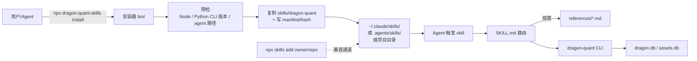

# Agent Skill 分发与安装调研（issue #29 · 阶段 1）

- 日期：2026-10-24
- 范围：dragon-quant CLI 的 Agent Skill 封装、SKILL.md 规范、跨 agent 分发、npm/npx 安装器、安全边界
- 结论：**推荐“仓库内置单一主 skill + references 渐进披露 + 根目录零依赖 npm 安装器”**；`npx skills add` 作为免费兼容通道；不发布也能用本地 `npm pack` tarball 验证。

---

## 1. 结论先行

| 决策点 | 建议 |
|---|---|
| skill 数量 | **一个主 skill** `dragon-quant`，下挂 `references/` 按需加载；不按子命令拆多个 skill |
| skill 位置 | 仓库根 `skills/dragon-quant/SKILL.md`（`skills` CLI 源码会扫描 `skills/`；远程 `owner/repo` 安装待阶段 2 实测） |
| 主分发 | 独立 npm 包 `dragon-quant-skills`，`npx dragon-quant-skills install` 复制到目标 agent 目录 |
| 兼容分发 | `npx skills add gitBingxu/dragon-quant`（不经过我们的安装器，不校验 Python 版本） |
| 不推荐 | 多 skill 拆分、Claude-only plugin、Node 重写业务、symlink 指向 npx 缓存 |
| 版本关系 | npm 版本与 Python 发布版本对齐（首发 `0.7.1`）；兼容性以 SKILL.md `metadata.min-cli-version` 为准 |
| MVP | 安装/幂等/冲突检测/卸载/`doctor` + 本地 tarball 验证 + 文档同步；不做 npm publish、不做自动更新守护 |

核心判断：**skill 是 CLI 的薄路由层，不是第二份规则文档**。评分权重、策略参数、表结构仍以 `AGENTS.md` / `dragon_quant/review_account/STRATEGY.md` 为唯一权威；skill 只做“意图 → 命令 → 前置检查 → 输出翻译 → 异常分流 → 写操作确认”。

---

## 2. 本地事实（薄封装的事实来源）

### 2.1 命令面与写操作分类

入口：`dragon_quant/cli.py`（argparse 树，888 行）+ `dragon_quant/cli_commands.py`（`_cmd_*`，1713 行）。`pyproject.toml` 提供 console script `dragon-quant = dragon_quant.cli:main`，当前版本 `0.7.1`，要求 Python >=3.10。

| 命令 | 用途 | JSON | 默认写库/外发 | skill 处理 |
|---|---|---|---|---|
| `scan` | 五维真龙扫描 | 否（`scan --date` 历史查询输出 JSON） | 写 `scans_v2` / `scan_stocks_v2` / `dragons_v2` | 确认后执行；结构化结果用 `dragons --date` |
| `prep` | 盘后复盘、候选池快照 | 是 | 写 `assets.db` | 确认后执行；强调 16:40 门禁 |
| `auction` | 集合竞价采集/重算 | 是 | 写 `assets.db` | 确认后执行；强调当日 9:25 后、`unverified` |
| `buy` | 实盘买入信号 | 是 | 写 `buy_sell_signals` | **必须显式确认** |
| `sell` | 实盘卖出信号 | 否 | 写 `buy_sell_signals` | **必须显式确认**；T+1 运维契约 |
| `review` | 龙头回测/UI | 否 | 写回 `dragons_v2` review 字段 | 确认后执行；`--ui-only` 只读 |
| `review-account` | 账户级回测/UI | 否（UI/API 可取结构化） | 写 `review_account_*` | 确认后执行；解释 `data_quality` |
| `dragons` | 导出龙头 JSON | 是（stdout） | 只读 | 自由执行 |
| `logs` | 日志查询/清理 | 否 | `clear` 写 | 查询自由；`clear` 确认 |
| `data` | 行情/Cookie 查询 | 否 | `cookie-set/fetch` 写凭据 | 查询自由；Cookie 写入确认 |
| `blacklist` | 板块黑名单 | 否 | `add/remove` 写 | **必须显式确认** |
| `storage` | 存储状态/清理 | 否 | `clear` 破坏性 | `status/size` 自由；`clear` 二次确认 |
| `assets` | 云同步/回填 | 部分（`backfill --json`） | `push` 外发、`pull --apply`/`backfill` 写 | `status/verify` 自由；其余确认 |
| `factor` | 因子构建/查询/评估 | 多数支持 `--json` | `build`/`fin sync`/`calibrate` 写 | 查询自由；构建确认 |
| `vpa` | 单股量价分析 | 否 | 默认写 `vpa_analysis`（`--no-save` 不写） | 确认后执行 |

关键事实：
- `scan` 实时模式**没有 `--json`**；需要结构化结果时优先用 `dragons --date YYYYMMDD`。`scan --date` 的历史 JSON 与扫描时的 `--top` 耦合：`--top` 不匹配会返回 `{"error": "未找到 ... top_n=..."}`，skill 路由应优先 `dragons` 并识别该 error JSON。
- `sell` **没有 `--json`**；`buy --json` 才有 `details[].checks`。
- `prep` 默认是人读 4 行摘要 + 标的清单；`--json` 才是完整快照（`version=0.6`，顶层 `sentiment` / `main_boards` / `macro` / `candidates` / `dragon_source`）。
- `auction` 的 `--json` collect 顶层键包含 `ok` / `mode` / `trade_date` / `pool_source` / `fallback_reason` / `prep_snapshot_date` / `recommended_count` / `saved_count` / `empty` / `failed` / `quote_missing` / `snapshots` 等；`snapshots[]` 才承载 `strength` / `direction` / `level` / `unverified` / `reject_reason`。
- `buy` 顶层含 `ok` / `mode` / `action` / `buys` / `details` / `sentiment_pct` / `data_quality` / `ranking_mode` / `fallback_reason` / `forced`；`details[].checks` 是四类买点诊断。
- `review-account` 的 `data_quality` 三态：`strict_5min` / `mixed` / `daily_fallback`；另带 `fallback_days` / `total_days` / `suspended_days` / `unavailable_days` / `data_degraded` / `ranking_mode(s)`。

### 2.2 现有文档与测试习惯

- `AGENTS.md`（88 KB）是项目规则权威；`README.md` 是用户入口；策略细节在 `dragon_quant/review_account/STRATEGY.md`，复盘方法论在 `archived_md/review_account/复盘方法论.md`。
- 输出契约测试分散在 `tests/test_cli.py`、`tests/test_prep.py`、`tests/test_auction_report.py`、`tests/test_buy_checks.py`、`tests/test_live_trade.py`、`tests/test_review_account.py`、`tests/test_priority.py` 等。skill 文档中的字段解释应优先引用这些测试与 CLI help，避免凭空写契约。
- 仓库**当前没有根 `package.json`**，`.github/` 只有 `CODEOWNERS`，没有 CI workflow；测试是 pytest 风格。引入 npm 包不会改变 Python 运行时依赖。
- **实测版本漂移**：`/Users/bing/.local/bin/dragon-quant -v` → `0.7.0`；`.venv/bin/python -m dragon_quant -v` → `0.7.1`。这证明 **skill/安装器必须做 CLI 存在性与版本预检**，不能假设 PATH 上的 `dragon-quant` 是最新版。
- `pyproject.toml` 的 `[project.scripts]` 是唯一官方入口；安装器不应硬编码某个虚拟环境路径，应支持 `--python` / `DQ_PYTHON` / PATH / `python -m dragon_quant` 逐级回退。

### 2.3 薄封装边界（验收标准映射）

| 验收要求 | skill 中的落点 | 事实来源 |
|---|---|---|
| 意图 → 命令路由 | `SKILL.md` 路由表 + `references/commands.md` | `cli.py` / `cli_commands.py` |
| 前置条件自检 | `SKILL.md` “执行前检查”清单 | `review_account/prep.py` 16:40、`live_trade/trader.py` 09:30/午休/收盘、`data.py` 9:25、`providers/cookie.py` |
| 输出解读 | `references/outputs.md` | 上述 CLI/JSON 契约 + 测试 |
| 异常 playbook | `references/playbooks.md` | AGENTS.md 反爬/降级/回退章节 |
| 运维契约 | `SKILL.md` 顶部 checklist（只列契约条目 + AGENTS 锚点，不复写规则数值） | AGENTS.md 运维契约 |
| 写操作安全边界 | `references/safety.md` + SKILL.md 门禁 | 本报告 §2.1 |
| 不与 AGENTS 冲突 | `SKILL.md` 明确 “AGENTS.md 优先，冲突时以 AGENTS 为准” | 项目规则 |

---

## 3. 外部规范与生态

### 3.1 SKILL.md 规范与渐进披露

来源：`https://agentskills.io/specification`（2026-10-24 访问）；`https://platform.claude.com/docs/en/agents-and-tools/agent-skills/overview`。

| 项 | 规范 |
|---|---|
| 目录 | `skill-name/SKILL.md` 必需；可选 `scripts/` / `references/` / `assets/` |
| `name` | 必填，1–64 字符，仅小写字母/数字/连字符，不可首尾连字符、不可连续连字符，**必须与父目录同名** |
| `description` | 必填，1–1024 字符，必须同时说明“做什么”和“何时使用”，包含触发关键词 |
| `license` | 可选 |
| `compatibility` | 可选，1–500 字符，环境要求 |
| `metadata` | 可选，string→string 映射；可放 `min-cli-version` / `skill-version` |
| `allowed-tools` | 可选，空格分隔的预批准工具；**实验性**，各客户端支持不一 |
| 渐进披露 | 启动只加载 name+description（约 100 tokens）；触发后加载 SKILL.md 全文（建议 <5000 tokens）；`references/` 等按需加载 |
| 体量 | SKILL.md 建议 <500 行；引用文件保持一层深度 |
| 校验 | `skills-ref validate <dir>`（Python 参考实现；其 README 自述 “intended for demonstration purposes only / not meant to be used in production”，建议仅用于 CI 前置校验，不进入运行时依赖） |

**对本项目的含义**：`SKILL.md` 应控制在 150–250 行；把逐命令参数、JSON 字段、异常话术放进 `references/`。`description` 要覆盖中文意图词（龙头、扫描、复盘、竞价、回测、买卖信号、数据资产）和英文词（dragon, scan, prep, auction, backtest, signals），且不超过 Claude Code 的 1536 字符合并截断线。

### 3.2 Claude Code 的发现路径与优先级

来源：`https://code.claude.com/docs/en/skills`（2026-10-24 访问）。

| 范围 | 路径 | 备注 |
|---|---|---|
| 企业 | managed settings 目录下 `.claude/skills/<name>/SKILL.md` | 最高优先级 |
| 用户 | `~/.claude/skills/<name>/SKILL.md` | 所有项目可用 |
| 项目 | `.claude/skills/<name>/SKILL.md` | 随仓库提交；从启动目录向上到 repo root |
| 嵌套 | `<subdir>/.claude/skills/<name>/SKILL.md` | 首次读/写该子目录后加载 |
| 插件 | `<plugin>/skills/<name>/SKILL.md` | 命名空间 `plugin:skill` |
| 旧命令 | `.claude/commands/<name>.md` | 与 skill 同名时 skill 优先 |

关键细节：
- 同名优先级：**Enterprise > personal > project**；local skill 覆盖同名 bundled skill/command，但插件技能用命名空间隔离。
- `description` 常驻上下文；全文只在触发时加载；`description` + `when_to_use` 在列表中截断到 **1536 字符/技能**。
- skill 正文加载后在后续轮次持续占用 context；compact 后重新附加最近一次调用，保留每技能前 **5000 tokens**、合计 **25000 tokens**。
- 支持 symlink；编辑 `SKILL.md` 可在当前会话热更新；新建顶层 skills 目录需 `/reload-skills`。
- Claude Code 的 frontmatter 字段全部可选（`name` 默认目录名），但跨 agent 规范要求 `name`/`description`；**以规范为准**。
- Claude Code 还支持 `when_to_use`、`disable-model-invocation`、`user-invocable`、`paths`、`context: fork` 等扩展字段；这些不是跨 agent 标准，MVP 不使用。

### 3.3 跨 agent 与开放标准

来源：`https://www.anthropic.com/news/donating-agent-skills-to-the-agentic-ai-foundation`（2026-10-24 访问）；`https://agentskills.io/llms.txt`；`https://github.com/vercel-labs/skills/blob/main/docs/agents.md`。

- Agent Skills 标准于 2025-10 发布、2025-12 开放；**2026-10-22 捐赠给 Linux Foundation 下的 Agentic AI Foundation (AAIF)**，连同名称、logo、GitHub org、`agentskills.io` 域名。
- 据 Anthropic 公告（2026-10-22，原文口径）：**70+ agent 平台**已集成，包括 ChatGPT、Cursor、GitHub Copilot、VS Code；约 100 万 skills、2.8 亿次安装。这些是公告数字，不作为选型依据。
- **`.agents/skills/` 是 vercel `skills` CLI 采用的约定路径**（Codex/Cursor/Gemini CLI 等项目级目标），**不是 agentskills.io 规范正文定义的强制路径**；Claude Code 官方只认 `.claude/skills/`。各 agent 的全局路径不同（如 `~/.claude/skills/`、`~/.agents/skills/`、`~/.cursor/skills/`、`~/.gemini/skills/`），阶段 2 应对每个目标 agent 逐个核实实际读取行为。
- 结论：**skill 文件格式可以一份多投，安装路径必须按 agent 映射**；不存在 universal global path。

### 3.4 安全与供应链

来源：Snyk “From SKILL.md to Shell Access in Three Lines of Markdown”（2026）；OWASP Agentic Skills Top 10 解读（Adversa，2026）；npm 官方 provenance 文档；`tech-leads-club/agent-skills` SECURITY.md（2026-10-24 访问）。

- Skill 以 agent 自身权限运行，SKILL.md 文本与用户指令同权；恶意 skill 可读取 `~/.ssh` / 云凭据 / 钱包并借 agent 通道外发。
- 安装器应视为“依赖管理器”：内容哈希、显式升级、安装前审查、变更监控、可卸载。
- 路径安全：拒绝 `..`、绝对路径逃逸、NUL、Windows 保留字符；读写删都用 `lstat`/`realpath` 校验目标在允许根内；防 symlink TOCTOU。
- 供应链：npm 包启用 `--provenance`（Sigstore/OIDC），发布用 Trusted Publishing；包内 `files` 白名单，禁止 secrets；安装器零运行时依赖、无 postinstall 脚本。
- 我们的 skill **不捆绑可执行脚本**，只指示 agent 调用已安装的 `dragon-quant` CLI；这显著缩小攻击面，但写操作仍需显式确认。

---

## 4. 分发方案比较

### 方案 A（推荐）：独立 npm 包 + 自定义零依赖安装器

```bash
npx dragon-quant-skills@latest install --global --agent claude-code
npx dragon-quant-skills@latest doctor
npx dragon-quant-skills@latest uninstall --global --agent claude-code
```

- 包内带 `skills/dragon-quant/` 与 `bin/`，`files` 白名单只发布 skill + 安装器。
- 安装器负责：agent 路径映射、Python CLI 版本预检、幂等、冲突检测、manifest、卸载、`--dry-run`。
- 优点：版本可控、可做前置检查、可跨 agent、可离线 tarball 验证、无运行时依赖。
- 缺点：新增 Node 工具链与 npm 发布流程；需要维护 agent 路径表。

### 方案 B（兼容通道）：仓库内置 skill + `npx skills add`

```bash
npx skills add gitBingxu/dragon-quant --skill dragon-quant -a claude-code
```

- `skills` CLI（`vercel-labs/skills`，npm `skills@1.7.4`，MIT，Node >=22.20，依赖 `tar` + `yaml`）会扫描 `skills/`、`.agents/skills`、`.claude/skills` 等目录；本地路径 `npx skills add ./skills` 也可用。
- 实测：项目安装把 skill **复制**到 `./.claude/skills/probe-skill`，并写 `./skills-lock.json`（含 `computedHash`）；全局安装写到 `~/.agents/skills/probe-skill`，锁文件 `~/.agents/.skill-lock.json`。
- 优点：零额外包、天然跨 agent、有 update/remove/check。
- 缺点：不校验 Python CLI 版本；依赖第三方 CLI 与 Node 22.20+；安装来源是 git 仓库而非 npm 版本；无法控制冲突/回滚策略。**作为“已有 skills CLI 的用户”兼容通道，不作为主推荐。**
- 基线退化：`git clone` 后手动 `cp -r skills/dragon-quant ~/.claude/skills/`（或项目 `.claude/skills/`）也是官方 README 认可的路径；零工具链，但不校验版本、无卸载/升级能力。README 可作为“最少依赖”说明，不列为推荐主路径。

### 方案 C（非常规路径）：Python 原生安装器 `dragon-quant skills install`

- 把 SKILL.md 作为 Python package data 随 `pip install dragon-quant` 分发，新增 `dragon-quant skills install [--global|--project]` 直接复制到 agent 目录。
- 优点：**完全不需要 Node**；版本与 Python 包天然一致；用户已经必须安装 Python CLI。
- 缺点：与用户“偏向 npx”的取向不一致；会扩大 Python CLI 的命令面；Windows 路径/权限测试成本；skill 内容更新必须发 PyPI 版本。
- 结论：**作为 fallback / 后续增强**；MVP 不实现，但在方案中保留接口位置（`dragon-quant skills` 子命令可后加）。

### 方案 D（不推荐为主）：Claude Code plugin marketplace

- `anthropics/skills` 使用 `/plugin marketplace add anthropics/skills` + `/plugin install ...`；`obra/superpowers` 也是按 harness 分发。
- 优点：Claude Code 原生、命名空间隔离、可带 hooks。
- 缺点：Claude-only；跨 agent 需要多套清单；与 issue 的“通用 Agent Skill 包”目标不一致。可作为未来 Claude 生态增强，不作为 MVP 主路径。

### 方案 E（评估后不选）：MCP server 暴露 CLI 工具

- 做法：起一个本地 MCP server，把 `scan` / `prep` / `auction` / `buy` / `sell` 等包装成 typed tools。
- 优点：工具 schema 强类型、MCP 客户端支持广、可按工具做权限白名单。
- 缺点：新增常驻进程与传输配置；工具粒度若照搬 CLI，会把参数面复制成第二套 schema；写操作仍需确认；agent 仍需解读 JSON/人读输出；与 issue 的“SKILL.md 按需加载”目标不同。
- 结论：**MVP 不做**。若后续需要“agent 直接调用工具”而不仅是“读文档后调 CLI”，MCP 可作为互补层；skill 仍保留为路由/解读层。阶段 2 只需说明不选理由，不实现。

### 4.5 方案对比

| 维度 | A npm 安装器 | B `npx skills add` | C Python 原生 | D Claude plugin |
|---|---|---|---|---|
| 跨 agent | 好（路径表） | 很好（公告口径 70+ agent） | 好 | 差（Claude only） |
| 版本可控 | 强 | 弱（git 仓库） | 强（PyPI） | 中 |
| Python CLI 预检 | 可做 | 不可做 | 天然 | 不可做 |
| 本地 tarball 验证 | 可（已实测） | 不适用（本地 .tgz 不解包，实测 No skills found） | 可（pip wheel） | 不适用 |
| 额外运行时 | Node >=22（支持策略；零依赖脚本技术下限可到 >=18/20） | Node >=22.20 + 第三方包 | 无 | Claude Code |
| 维护成本 | 中 | 低 | 中 | 中 |
| 结论 | **主推荐** | **兼容通道** | 后续 fallback | 不做 |

### 4.6 npm 包名与版本策略

只读检查（2026-10-24）：
- `npm view dragon-quant` → 404（npm 上暂无该包）
- `npm view dragon-quant-skills` → 404（可用）
- `npm view @dragon-quant/skills` → 404（scope 下无包；scope 是否可注册需另行确认）
- `npm view skills` → `1.7.4`，MIT，Node >=22.20，依赖 `tar@^7.5.20` / `yaml@^2.8.3`

建议：
- **包名 `dragon-quant-skills`**（无 scope，避免组织注册阻塞；名字明确表示“skill 包”，不会与 PyPI 的 `dragon-quant` 混淆）。
- 首发版本 **`0.7.1`**，与 Python 包版本对齐；每次 Python 功能发布时同步发 npm，便于用户建立“skill 版本 ↔ CLI 版本”直觉。
- 仅 skill 文案修复可单独 bump npm patch（如 `0.7.2`），但 **npm 版本只表示分发版本，不表示 CLI 版本**；兼容性唯一契约是 `metadata.min-cli-version`。`doctor` 必须同时显示“npm 包版本 / skill 版本 / CLI 版本 / min-cli-version”，README 也需写明。
- `package.json` 增加 `publishConfig.provenance: true`；发布走 GitHub Actions OIDC Trusted Publishing（MVP 可不做，但方案预留）。
- `engines.node` 建议 **`>=22`**（Node 20 已于 2026-04 结束支持）。这是**支持策略**，不是技术下限：零依赖 ESM + `node:test` 脚本本身可兼容 >=18/20；若决定支持更老 Node，需在阶段 2 明确测试矩阵，否则在 README 写明“仅支持 Node 22+”。

### 4.7 同类成熟项目案例（3 个）

| 项目 | 仓库布局 | 安装/分发 | 对本项目的启示 |
|---|---|---|---|
| `anthropics/skills` | `skills/` + `spec/` + `template/` | Claude Code plugin marketplace（`/plugin marketplace add anthropics/skills`）+ 手动复制；未用 npm | 官方参考实现；**skill 文件是核心，分发壳可以多样** |
| `vercel-labs/agent-skills` | 根 `skills/` + discovery index 构建脚本 | `npx skills add vercel-labs/agent-skills`；每次 main 变更生成不可变 GitHub Release（每个 skill 一个 artifact） | 仓库内 `skills/` 是通用发现入口；发布物可不可变、可追溯 |
| `obra/superpowers` | 根 `skills/` + 各 harness 安装文档 + 版本 bump 脚本 | 按 harness 分发：Claude marketplace、Codex/Cursor/Gemini 等各自 plugin/extension 命令；无 universal installer | 跨 agent 往往按 harness 分发；**统一安装器不是必需，但能降低用户心智负担** |

结论：三者都以 `skills/` 为源、以各 agent 的发现目录为安装目标。我们的 npm 安装器是额外的一层，不应改变源布局，也不应把 skill 内容复制进安装器代码。

---

## 5. 推荐架构与 MVP

### 5.1 仓库布局（建议）

```text
dragon-quant/
├── package.json                  # 新增：name=dragon-quant-skills, files 白名单, bin, engines>=22
├── bin/
│   └── dragon-quant-skills.mjs    # CLI 入口（install/doctor/uninstall）
├── lib/
│   ├── agents.mjs                 # agent → 路径映射
│   ├── install.mjs                # 复制/幂等/冲突/manifest
│   └── validate.mjs               # frontmatter/Python CLI 预检
├── skills/
│   └── dragon-quant/
│       ├── SKILL.md               # 150–250 行
│       └── references/
│           ├── commands.md        # 意图→命令、适用场景/禁忌（参数以 -h 为准）
│           ├── outputs.md         # JSON/人读输出解读
│           ├── playbooks.md       # Cookie/403/停牌/兜底/空池
│           ├── operations.md      # T+1、峰值、回放、并发契约
│           └── safety.md          # 写操作矩阵与确认话术
└── test/
    └── install.test.mjs           # node:test，零依赖
```



### 5.2 Skill 内容设计（单一主 skill）

**SKILL.md 建议结构（≤250 行）**：
1. 触发说明（中文/英文关键词、适用/不适用）
2. 权威顺序：`AGENTS.md` > `STRATEGY.md` > 本 skill；冲突时以 AGENTS 为准
3. 执行前检查（5 项）：Python/CLI 版本、Cookie、交易日、时段门禁、数据快照（门禁只写可观察时间点，阈值/权重不复制）
4. 路由表：意图 → 命令 + 最常用参数 + 是否写库（参数以 `-h` 为准）
5. 输出翻译原则：先结论、再关键字段、再降级/回退提示；不要原样倾倒 JSON
6. 写操作门禁：只读自由；写/外发/破坏性必须显式确认（清单链接 `references/safety.md`，不复写策略参数）
7. 异常分流：指向 `references/playbooks.md`
8. 参考文件索引：明确“何时读哪个文件”

**references 拆分理由**：逐命令参数和 JSON 字段较长，放正文会突破 500 行/5000 tokens；用“触发条件 + 文件路径”实现渐进披露。官方最佳实践明确要求说明“何时加载哪个文件”，而不是泛泛“见 references”。

**commands.md 防漂移**：只保留“意图 → 命令 + 场景 + 禁忌”，**不复制完整参数表**；参数以 `dragon-quant <cmd> -h` 为准。阶段 3 增加一个轻量测试，断言关键命令/参数存在（如 `scan --force`、`prep --recompute`、`auction --recompute`、`buy --at`），参数增删不会静默漂移。

**触发词建议**（description 内）：
- 中文：龙头、真龙、扫描、复盘、盘后、竞价、集合竞价、回测、买卖信号、持仓、数据资产、同步、黑名单
- 英文：dragon, scan, prep, auction, review, backtest, signal, buy, sell, assets sync
- 排除：不要声称提供投资建议；不要用于非 dragon-quant 仓库的通用选股。

### 5.3 安装器行为（MVP）

| 行为 | 设计 |
|---|---|
| 默认范围 | 建议 **global**（个人交易工具跨项目使用）；`--project` 显式切换 |
| 项目根解析 | `--project` 时目标根按 **显式 `--target-dir` > git toplevel > cwd** 解析；无 git 仓库时 cwd 需用户确认；`--dry-run` 必须打印最终路径；cwd 在仓库子目录时默认取 git toplevel，避免写入嵌套 `.claude/skills` |
| agent 映射 | `claude-code` → `~/.claude/skills/` 或 `.claude/skills/`；`agents` → `~/.agents/skills/` 或 `.agents/skills/`；`cursor` → `~/.cursor/skills/`；`gemini-cli` → `~/.gemini/skills/`；MVP 至少支持前两个（路径来源需在阶段 2/3 标注“实测/官方文档”） |
| 复制 vs symlink | **默认复制**。npx 包位于 npm 缓存，symlink 到缓存会在缓存清理后失效；`--symlink` 仅作为开发选项并打印风险 |
| 幂等 | 目标已存在且 manifest 版本/哈希一致 → no-op 并输出“已是最新” |
| 冲突 | 目标存在但无 manifest / 哈希不一致 → 拒绝；`--force` 才覆盖，覆盖前备份 |
| 原子性 | 先写同目录临时目录，再 rename；失败不留下半成品 |
| manifest | 安装目录内 `.dragon-quant-skill.json`：`package_version` / `files{path:sha256}` / `installed_at` / `source` |
| 升级 | 三态判定：**无 manifest** = 冲突；**磁盘哈希 == manifest** = 安全升级；**磁盘哈希 != manifest** = 用户修改，拒绝并给 diff。安全升级流程：读旧 manifest → 计算新旧文件集 diff → 写新增/修改文件 → 删除旧 manifest 中不在新包的文件 → 写新 manifest；`--force` 前备份，备份位置写入输出，支持手动回滚 |
| 跨通道 | 目标目录存在 `skills-lock.json` / `.skill-lock.json` 来源但无自有 manifest → 不静默覆盖，提示“由 npx skills 安装”，给出 `--force` 迁移或先 `npx skills remove` |
| 多 scope | `doctor` 扫描全部已映射根（global + project），输出同名 skill 的版本/哈希与生效优先级（Enterprise > personal > project）；`install` 检测到另一 scope 存在同名安装时打印提示，避免低版本静默遮蔽 |
| 安装后可见性 | 首次创建顶层 skills 目录后提示 `/reload-skills` 或重启会话；`doctor` 把“agent 能否发现”作为检查项 |
| doctor 范围 | 文件哈希、Python CLI 版本、多 scope 同名遮蔽、外来源 lock 文件；支持 `--json` 供 CI/agent 读取 |
| 卸载 | 仅删除 manifest 匹配的文件；有用户修改 → 拒绝，`--force` 才删；不删除父目录 |
| 路径安全 | 目标必须位于允许根内；拒绝 `..`、绝对路径逃逸、NUL；`lstat` + `realpath` 校验；不跟随 symlink 删除 |
| Python 预检 | 依次尝试 `--python` → `DQ_PYTHON` → `dragon-quant -v` → `python -m dragon_quant -v`；缺失/低于 `min-cli-version` → 明确提示安装命令，不自动安装 |
| 网络/遥测 | 零遥测、零 postinstall、零运行时依赖 |
| 退出码 | 0 成功/no-op；1 冲突/预检失败；2 参数错误 |

### 5.4 MVP 范围

**做**：
- `skills/dragon-quant/SKILL.md` + 5 个 references
- 根 `package.json` + `bin/` + `lib/` + `test/install.test.mjs`
- `install` / `doctor` / `uninstall` / `--dry-run` / `--project|--global` / `--agent` / `--force`
- 本地 `npm pack` tarball 端到端验证
- `npx skills add gitBingxu/dragon-quant` 兼容性 smoke
- 同 commit 更新 `AGENTS.md` + `README.md`（最终阶段要求）

**不做**：
- npm publish / GitHub Release 自动化（用户控制发布）
- 自动更新守护 / 后台检查
- 打包 `dragon-quant` Python 包或 Node 重写业务
- 多 skill 拆分
- `allowed-tools` 预授权（MVP 省略，避免隐式授权写命令）
- Python 原生 `dragon-quant skills install`（保留为后续 fallback）

### 5.5 验证方案（不发布也能测）

已实测 npx 本地 tarball 可用：

```bash
# 1) 打包
npm pack
# 2) 直接运行 tarball 默认 bin
npx --yes ./dragon-quant-skills-0.7.1.tgz install --dry-run
# 3) 显式指定 bin（多 bin 时更稳）
npm exec --yes --package=./dragon-quant-skills-0.7.1.tgz -- dragon-quant-skills install --dry-run
# 4) 隔离 HOME/目标目录做真实安装
HOME=/tmp/dq-skill-home npx --yes ./dragon-quant-skills-0.7.1.tgz install --global --agent claude-code
# 5) 幂等/冲突/卸载
npx --yes ./dragon-quant-skills-0.7.1.tgz install --global --agent claude-code   # 期望 no-op
npx --yes ./dragon-quant-skills-0.7.1.tgz uninstall --global --agent claude-code
```

补充检查：
- **实测补充**：`npx skills add ./pkg.tgz` 会把 tarball 当作本地目录，输出 “No skills found”，不会解包；因此“本地 npm pack tarball 验证”必须走本方案的自定义安装器，不能依赖通用 `skills` CLI。
- `npm pack --dry-run` 确认 tarball 只含 `bin/`、`lib/`、`skills/`、`package.json`、`README`、`LICENSE`，不含 `.env`、Cookie、`assets.db`、`node_modules`。
- `skills-ref validate skills/dragon-quant`（可在 CI 用 `uvx --from ... skills-ref`，或写一个 20 行 Node/前端校验，避免生产依赖）。
- `npx --yes skills@1.7.4 add ./skills --skill dragon-quant -a claude-code -y --copy` 在临时项目验证兼容通道。
- Node 内置 `node:test` 覆盖：路径映射、幂等、冲突、三态升级、manifest、卸载、多 scope 遮蔽、路径逃逸。
- 人工 smoke 链路：**安装 → 首次目录提示 `/reload-skills`（或重启）→ 在 Claude Code 说“今天有哪些真龙” → 确认触发并完成 `scan` + 解读，不再读 AGENTS 全文**。缺任一步都不算验收通过。

### 5.6 文档同步

最终实现阶段必须同一 commit：
- `AGENTS.md`：新增“Agent Skill 包”小节（安装命令、skill 位置、版本关系、写操作边界、与 AGENTS 的权威顺序）。
- `README.md`：安装段增加 `npx dragon-quant-skills install` 与 `npx skills add` 两种方式；说明 Node 仅用于安装，不参与业务。
- `CHANGELOG.md`：记录 skill 包首发。
- `package.json` 的 `license` 与仓库一致（MIT）；SKILL.md / references 作为新著作文本随包再分发，需在 README 安装段注明同一许可证。
- 若方案文档需要归档，按全局 §6 在 feat 完成后询问。

---

## 6. 风险与缓解

| 风险 | 影响 | 缓解 |
|---|---|---|
| skill 与 AGENTS/README 漂移 | agent 按旧口径执行 | SKILL.md 只放路由与解读，规则细节链接 AGENTS；发布前 diff 检查；最终同 commit 更新 |
| 触发词过宽/过窄 | 误触发或漏触发 | description 覆盖中英文关键词；用真实意图样本做 5–10 条 smoke；必要时用 `when_to_use`（Claude Code）但保持跨 agent 兼容 |
| PATH 上 CLI 版本过旧 | 新命令不存在/契约不同 | 安装器 + skill 预检 `dragon-quant -v`，低于 `min-cli-version` 明确报错；本次实测已发现 0.7.0/0.7.1 漂移 |
| Python 未安装/不在 PATH | skill 无法执行 | 安装器检测并给出 `pip install dragon-quant`；skill 首次执行也检查 |
| symlink 到 npx 缓存失效 | skill 突然消失 | 默认复制；`--symlink` 仅开发用 |
| 覆盖用户修改 | 丢失自定义 | manifest + 哈希；无 manifest 或哈希不一致拒绝，`--force` 前备份 |
| 路径穿越/恶意文件名 | 写到目标目录外 | 严格校验根目录、拒绝 `..`/NUL/保留字符、`lstat`+`realpath` |
| npm 供应链 | 恶意包/篡改 | 零依赖、`files` 白名单、`--provenance`、Trusted Publishing、发布前 `npm pack --dry-run` 审查 |
| 写操作被 agent 自动执行 | 误写信号/清库/外发 | skill 写操作矩阵 + 显式确认；不设 `allowed-tools`；危险命令二次确认 |
| Windows 路径/权限 | 安装失败 | 使用 `path.join`/`os.homedir`；避免 symlink 默认；测试 `fileURLToPath` |
| Node 版本差异 | npx 失败 | `engines.node >=22` + 安装器启动时友好提示；文档标明 Node 仅安装期需要 |
| `npx skills add` 通道不校验 Python | 用户装了 skill 但 CLI 不可用 | README 明确该通道的局限；主推荐自定义安装器 |

---

## 7. 待验证 / 需 main 决策

1. **npm 包位置**：根 `package.json`（最简单、`files` 白名单即可，且天然让 `npx skills add` 发现 `skills/`）vs `npm/` 子目录（需 prepack 复制，增加漂移风险）。建议根目录；阶段 2 需补：sdist 排除 `package.json`/`node_modules`、`npm publish` 仅在 CI/tag 执行、npm 与 pyproject 版本一致性测试。
2. **默认安装范围**：global（个人工具，推荐）vs project（团队仓库隔离）。建议 global，`--project` 可选。
3. **是否官方支持 `npx skills add`**：建议在 README 标注为“兼容通道”，但不作为主验收路径。
4. **`allowed-tools`**：MVP 省略，避免隐式预授权；若后续要减少确认弹窗，可只读子命令白名单，写命令仍确认。
5. **skill 正文语言**：建议中文为主、命令/字段英文；description 中英关键词并存。需确认目标 agent 用户语言。
6. **Python 原生安装器**：是否在 MVP 后补 `dragon-quant skills install`（无 Node 用户）。建议后续，不在本期。
7. **Windows 实测**：本期在 macOS 验证；Windows 的 `%USERPROFILE%`、CRLF、权限需阶段 3 补测。
8. **npm publish / provenance**：用户控制发布；本期只验证 tarball，不 publish。
9. **远程 `npx skills add owner/repo`**：当前“扫描 `skills/`”来自 `src/skills.ts` 源码，远程克隆安装待阶段 2 实测。
10. **`-a claude-code -g` 全局路径**：当前 `~/.claude/skills/` 来自官方文档，安装器需阶段 2 实测。
11. **MCP 互补层**：本期不做；若后续需要 typed tool 调用，再评估 MCP server，不在本 feat 扩展范围。

---

## 8. 来源（访问日期均为 2026-10-24）

| # | 来源 | 用途 |
|---|---|---|
| 1 | https://agentskills.io/specification | SKILL.md 字段、目录、渐进披露、校验 |
| 2 | https://platform.claude.com/docs/en/agents-and-tools/agent-skills/overview | 三级渐进披露、官方概览 |
| 3 | https://code.claude.com/docs/en/skills | Claude Code 路径/优先级/frontmatter/context 预算 |
| 4 | https://agentskills.io/skill-creation/best-practices.md | 描述、渐进披露、gotchas、默认值、验证循环 |
| 5 | https://www.anthropic.com/news/donating-agent-skills-to-the-agentic-ai-foundation | AAIF 捐赠、70+ 平台、开放标准治理 |
| 6 | https://github.com/vercel-labs/skills | `npx skills` CLI、跨 agent 安装、lockfile |
| 7 | https://github.com/vercel-labs/skills/blob/main/docs/commands.md | `add/remove/update`、本地路径、tarball、冲突 |
| 8 | https://github.com/vercel-labs/skills/blob/main/docs/agents.md | 各 agent 项目/全局路径、`.agents/skills` |
| 9 | https://github.com/vercel-labs/skills/blob/main/src/skills.ts | 仓库扫描顺序（root → skills/ → .agents/skills → …） |
| 10 | https://raw.githubusercontent.com/anthropics/skills/main/README.md | 参考实现：`skills/` + plugin marketplace + 手动 |
| 11 | https://raw.githubusercontent.com/vercel-labs/agent-skills/main/README.md | `skills/` + `npx skills add` + 不可变 GitHub Release |
| 12 | https://raw.githubusercontent.com/obra/superpowers/main/README.md | 按 harness 分发的成熟案例 |
| 13 | https://docs.npmjs.com/cli/v11/configuring-npm/package-json | `files` / `bin` / `engines` / `main` |
| 14 | https://docs.npmjs.com/cli/v11/commands/npx | `npx` 本地/远程/`--package` 语义 |
| 15 | https://docs.npmjs.com/generating-provenance-statements/ | npm provenance / Sigstore |
| 16 | https://snyk.io/articles/skill-md-shell-access/ | SKILL.md 安全威胁模型 |
| 17 | https://adversa.ai/blog/owasp-agentic-skills-top-10-explained/ | OWASP Agentic Skills Top 10 |
| 18 | https://github.com/tech-leads-club/agent-skills/blob/main/SECURITY.md | 路径穿越/symlink/lockfile 加固参考 |
| 19 | https://raw.githubusercontent.com/agentskills/agentskills/main/skills-ref/README.md | `skills-ref` 定位/`validate` 用法（自述仅演示、非生产） |

---

## 附录 A：本次实测证据（2026-10-24）

```text
$ node --version
v24.21.0
$ npm --version
11.19.0

$ npm view dragon-quant
npm error 404 Not Found
$ npm view dragon-quant-skills
npm error 404 Not Found
$ npm view @dragon-quant/skills
npm error 404 Not Found
$ npm view skills name version license engines dependencies
name = 'skills'
version = '1.7.4'
license = 'MIT'
engines = { node: '>=22.20.0' }
dependencies = { tar: '^7.5.20', yaml: '^2.8.3' }
```

本地 tarball 探测（零依赖包，隔离目录）：

```text
$ npm pack
dq-skill-tarball-probe-0.0.0.tgz
$ npx --yes ./pkg/dq-skill-tarball-probe-0.0.0.tgz hello
probe-ok hello
$ npm exec --yes --package=./pkg/dq-skill-tarball-probe-0.0.0.tgz -- dq-skill-probe world
probe-ok world
```

`npx skills add` 本地路径探测（隔离 HOME）：

```text
$ npx --yes skills@1.7.4 add ./skills --skill probe-skill -a claude-code -y --copy
✓ probe-skill (copied) → ./.claude/skills/probe-skill
$ cat skills-lock.json
{"version":1,"skills":{"probe-skill":{"source":"./skills","sourceType":"local","computedHash":"a1a7..."}}}
$ npx --yes skills@1.7.4 add ./skills --skill probe-skill -a codex -g -y
✓ probe-skill (copied) → ~/.agents/skills/probe-skill
$ cat ~/.agents/.skill-lock.json
{"version":3,"skills":{"probe-skill":{... "skillFolderHash":"a1a7..."}},"dismissed":{}}
```

`npx skills add` 直接吃本地 npm tarball（对照实验）：

```text
$ npx --yes skills@1.7.4 add /tmp/pkg/tgz-skill-probe-0.0.0.tgz -a claude-code -y --copy
◇ Local path validated
◇ No skills found
└ No valid skills found. Skills require a SKILL.md with name and description.
```

结论：本地 `.tgz` 不会被通用 `skills` CLI 解包；本地 tarball 验证必须用方案 A 的自定义安装器。

CLI 版本漂移：

```text
$ /Users/bing/.local/bin/dragon-quant -v
dragon-quant 0.7.0
$ .venv/bin/python -m dragon_quant -v
dragon-quant 0.7.1
```
