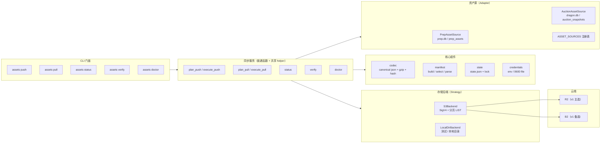
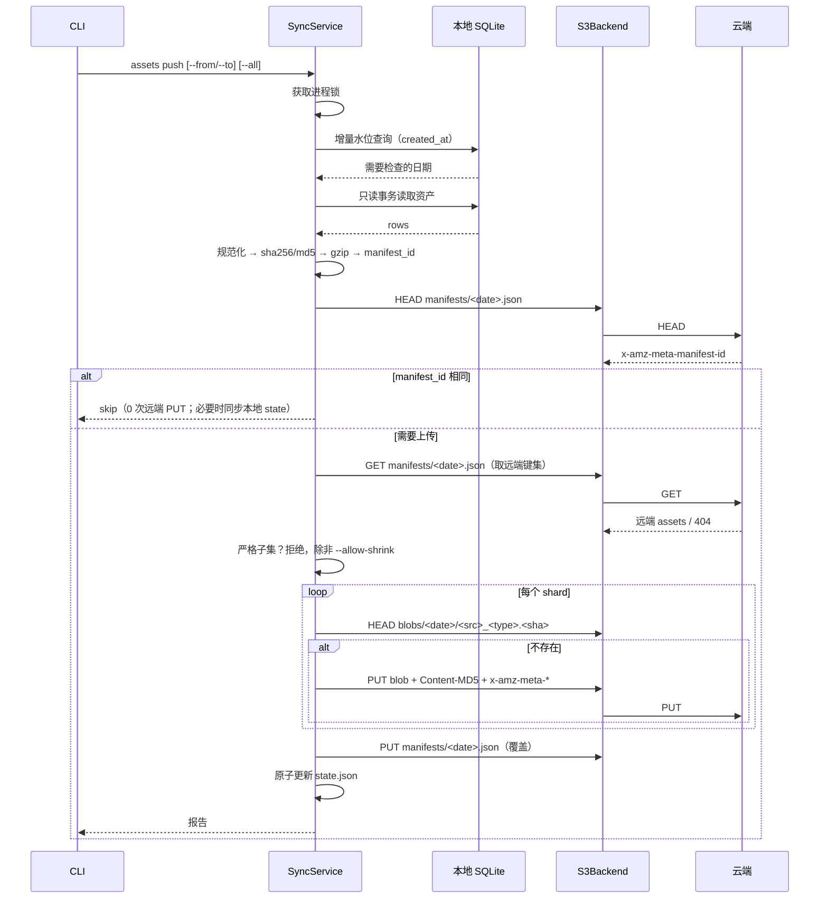
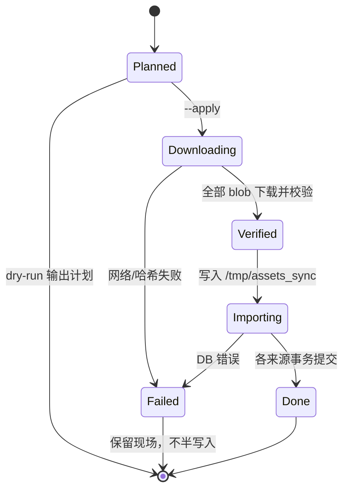
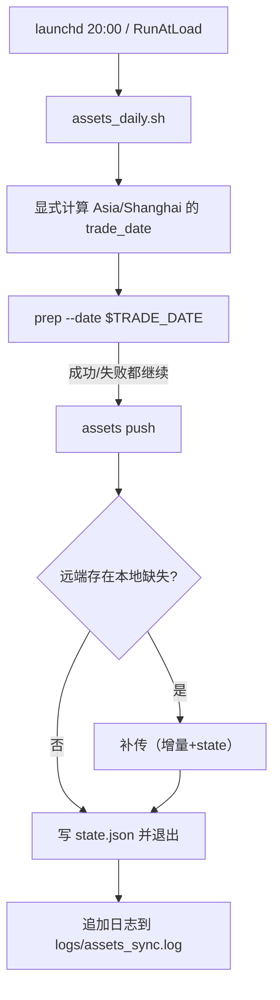

# 数据资产云端同步技术方案（v3）

> 版本：v3（2026-10-19）
> 上游：`docs/research/2026-10-18-assets-cloud-storage.md`（research-reviewer APPROVE）
> v3 修订（用户裁决）：**每日采集一次；重采覆盖同日 manifest**；blob 键改为自描述；多版本回放推迟。
> v2 修订：根据 solution-reviewer 第 1 轮（10 MAJOR / 15 MINOR）重写。
> 范围：`prep` 与 `auction` 产出的**原始数据资产**的云端备份与恢复；不含算法快照、行情缓存、扫描结果。

## 0. 最终设计（v3）

- 云端：`blobs/<date>/<source>_<type>.<sha256>.json.gz` + `manifests/<date>.json`（**覆盖写**）。
- **blob 键自描述**：日期、来源、类型、内容哈希都在键里；manifest 丢失时可用 `LIST blobs/<date>/` + HEAD 重建映射，manifest 不再是单点。
- 幂等：HEAD manifest 的 `x-amz-meta-manifest-id` 与本地计算值一致 → 0 写。
- 重采：同日期内容变化 → 新 blob 键；manifest 覆盖为新版本；旧 blob 成为孤儿（体积很小，后续可清理）。
- 多版本回放：v1 不做；后续如需按版本回放，再引入不可变 manifest 与 `--manifest-id`。

### v2 第 2 轮 6 条 MAJOR 的落点

| finding | v3 落点 |
|---|---|
| 子集覆盖丢数据 | 保留「source 级失败 → 该日不写 manifest」；增加收缩保护（严格子集需 `--allow-shrink`） |
| status 集合比对 | 逐日 HEAD manifest 比较 `manifest_id`；孤儿 blob 单列 informational |
| 增量跳过粒度 | 精确比较 `state.manifest_id` 与远端 manifest 元数据 |
| `--profile` 配置 | `default_profile + profiles{r2,b2}` |
| 退出码/JSON/日期 | §7.3 五命令退出码表 + 统一 JSON 信封 + 严格日期校验 |
| AC2 措辞冲突 | 统一为「默认只补缺失；不一致只报告，`--force` 才覆盖」 |

---

## 1. 目标与非目标

### 目标

1. 每个交易日把原始数据资产增量上传到免费对象存储（Cloudflare R2 主选 / Backblaze B2 备选，均 S3 兼容）。
2. 支持按日期范围把云端资产拉回本地，逐片校验，原子写入。
3. 本地是权威副本：上传失败、云端故障、账户停用都不影响本地数据。
4. 平台无关的纯 Python CLI；macOS/Windows/Linux 的调度器只负责触发。
5. 凭据不进入仓库、日志、manifest。
6. **零新增第三方依赖**：只用 Python 标准库（`hashlib/hmac/urllib/gzip/json/sqlite3`），不引入 boto3 等 SDK。

### 非目标（v1 明确不做）

- 云端采集（TDX/THS/雪球依赖本机网络与 Cookie）。
- **Cloudflare Worker 中转**（v2 备选；v1 只走 S3 直连，R2 不通则切 B2）。
- 同步 `prep_snapshots`、`dragons_v2`、K 线缓存、Cookie、日志。
- 多写者并发、跨机器自动冲突合并（单写者假设，见 §12）。
- 服务端加密、客户端加密。
- 自动删除云端历史版本（旧 blob 的 `--prune` 留待后续）。
- **多版本 manifest / 按版本回放**（v1 只保留每日最新；重采覆盖；后续版本再引入）。
- Web UI 展示资产。

---

## 2. 验收标准 → 设计落点

| AC | 落点 |
|----|------|
| AC1 幂等推送 | `HEAD manifests/<date>.json` 的 manifest_id 与本地一致即跳过；第二次运行 0 次远端 PUT |
| AC2 只拉缺失 | 默认只补本地缺失；哈希不一致仅报告，`--force` 才覆盖（本地权威） |
| AC3 逐片校验 | 传输层 `blob_sha256` + 内容层 `sha256`；`md5` 始终计算并记录，默认展示仅在 `--md5` |
| AC4 本地差量 | 按 `(trade_date, asset_type)` 计算内容哈希；增量水位跳过未变日期 |
| AC5 状态可见 | `assets status` 输出日期覆盖、缺失、哈希不一致、体积 |
| AC6 干净环境可重算 | `assets pull --apply` → `prep --recompute` 可读 |
| AC7 失败可补传 | 本地不删除；单分片失败隔离；未完成的日期不写 manifest，下次重跑补齐 |
| AC8 定时与补跑 | launchd/schtasks 触发器 + 平台无关幂等 CLI + `state.json` 增量 |
| AC9 凭据安全 | 环境变量 → `secrets/assets_sync.json`（0600）→ 报错；`repr=False` |
| AC10 文档同步 | 同一 commit 更新 `AGENTS.md` / `README.md` |

---

## 3. 候选方案

### 方案 A（推荐，v3 简化）：自描述 blob 键 + 每日单 manifest（覆盖写）

- 远端：
  - `blobs/<trade_date>/<source>_<asset_type>.<content_sha256>.json.gz`：不可变，键自描述。
  - `manifests/<trade_date>.json`：每日一份，**重采时覆盖**。
  - 没有 index；manifest 丢失时可用 `LIST blobs/<date>/` 重建映射。
- 推送：本地导出 → 规范化 → 内容哈希 → 只传缺失 blob → 覆盖写 manifest（提交点）。
- 拉取：GET manifest → 对比本地 → 只取缺失/需恢复的 blob → 校验 → 落库；manifest 缺失/损坏时用 LIST + HEAD 重建。
- 优点：满足分片与本地 diff；实现比多版本简单；manifest 不是单点；重采覆盖符合当前使用习惯。
- 缺点：不保留同日 manifest 历史；重采后旧 blob 成为孤儿（体积小，后续可清理）。

### 方案 B：每日单对象整包（最简）

- 远端：`days/<trade_date>.json.gz`，内含当日全部资产与内嵌清单。
- 优点：实现最少、恢复最简单。
- 缺点：**不满足「分片 + 本地 diff」**；任一资产变化都要重传整日；无法单资产恢复。

### 方案 C（反直觉）：无 manifest，key 自描述

- 远端：`assets/<trade_date>/<asset_type>.<content_sha256>.json.gz` + `_complete` 标记。
- 优点：没有提交点；LIST 即索引。
- 缺点：版本选择依赖 LastModified；元数据要逐对象 HEAD；仍需 `_complete` 作为提交标记；与 A 的复杂度相当但语义更弱。

### 推荐

**方案 A**。三案中只有 A 同时满足「分片、本地 diff、原子完成、单资产恢复」；v3 用「自描述 blob 键 + 每日覆盖 manifest」在保持简单的同时避免 manifest 单点。

---

## 4. 架构设计



### 模块职责

| 模块 | 职责 |
|------|------|
| `assets_sync/models.py` | `AssetShard` / `ManifestEntry` / `Manifest` / `ObjectMeta` / `SyncReport` / `RestoreReport` |
| `assets_sync/codec.py` | 规范化 JSON、gzip、内容/传输哈希、逐分片异常隔离 |
| `assets_sync/sources.py` | `AssetSource` 协议、`PrepAssetSource`、`AuctionAssetSource`、注册表 |
| `assets_sync/backends/base.py` | `ObjectStorage` 协议（含 `ObjectMeta.metadata`） |
| `assets_sync/backends/signer.py` | SigV4 签名（见 §8） |
| `assets_sync/backends/s3.py` | S3 操作 + 分页 LIST + 重试/重签 + 超时 |
| `assets_sync/backends/local.py` | 文件系统后端（单测与本地回放） |
| `assets_sync/manifest.py` | 构建、`manifest_id`、解析、每日版本选择 |
| `assets_sync/state.py` | `state.json` 原子读写、跨平台进程锁 |
| `assets_sync/credentials.py` | 凭据解析、权限检查、`repr=False` 脱敏 |
| `assets_sync/service.py` | `push/pull/status/verify/doctor` 编排 |
| `assets_sync/errors.py` | 错误类型与退出码映射 |
| `cli_commands._cmd_assets` | 参数校验、日期规范化、JSON 输出、退出码 |

### 设计模式与动机

- **Strategy**：`ObjectStorage` 后端，R2/B2 只差配置。
- **Adapter**：`AssetSource` 适配 `prep_assets` 与 `auction_snapshots`。
- **Registry**：`ASSET_SOURCES` 新增资产类型只加一行，并在启动时断言 `source:type` 全局唯一。
- **Facade**：`assets` CLI 隐藏 manifest/签名细节。
- **Value Object**：`AssetShard` / `Manifest` 不可变，便于哈希与测试。
- **已放弃 Template Method**：push/pull 方向相反、提交点不同，强行抽骨架会退化为多 flag 万能函数，违背「优先简单」。改为普通函数 + `_hash_shards/_transfer_blobs/_write_manifest` 等共享 helper。

---

## 5. 远端布局与数据模型

### 5.1 键布局

```
<root>/blobs/<trade_date>/<source>_<asset_type>.<content_sha256>.json.gz
<root>/manifests/<trade_date>.json
```

- `<root>` 由 `DQ_ASSETS_PREFIX` 控制；字符集限定 `[A-Za-z0-9._/-]`，首尾斜杠归一化。
- `trade_date` 固定 `YYYY-MM-DD`（Asia/Shanghai）。
- blob 键自描述：日期、来源、类型、内容哈希都在键里；不做跨日期/类型去重（本项目体积无需）。
- manifest 每日一份，**重采覆盖**；`manifest_id` 同时写入 body 与 `x-amz-meta-manifest-id`。
- 没有 `index.json`；manifest 丢失/损坏时，`LIST blobs/<date>/` + HEAD 可重建映射。
- 多版本回放不在 v1（见 §1 非目标）。

### 5.2 Manifest

```json
{
  "schema": 1,
  "trade_date": "2026-10-18",
  "manifest_id": "<64 hex>",
  "generated_at": "2026-10-18T16:05:12+08:00",
  "generator_version": "0.6.2",
  "assets": {
    "prep:dragons": {
      "source": "prep",
      "asset_type": "dragons",
      "sha256": "<canonical json sha256>",
      "md5": "<canonical json md5>",
      "size": 4353,
      "blob": "blobs/2026-10-18/prep_dragons.<content_sha256>.json.gz",
      "blob_sha256": "<gzip bytes sha256>",
      "blob_size": 1234,
      "schema": 1
    }
  }
}
```

- 键为 **`<source>:<asset_type>`**，避免两个来源同名覆盖。
- `manifest_id` 只对**逻辑身份字段**（`source/asset_type/sha256/md5/size/schema`）规范化哈希；不含 `blob_sha256/blob_size/generated_at/generator_version`。
- 缺失资产**不写空条目**；当日零分片则不写 manifest。`collection_report` 记录每类资产的 `status`，`status` 命令据此区分 `empty / unavailable / absent`。

### 5.3 对象元数据契约

| 对象 | `x-amz-meta-*` | 说明 |
|---|---|---|
| blob | `sha256`, `md5`, `size`, `schema`, `blob-sha256`, `source`, `asset-type`, `trade-date` | 键已含归属；元数据用于 manifest 重建 |
| manifest | `manifest-id`, `schema` | 每次覆盖 PUT 必须携带；HEAD 幂等依据；缺失时降级 GET body |

- `Content-MD5` 请求头用于服务端完整性校验（PUT 时发送）。
- HEAD 只能校验**元数据回环**，不代表存储字节已验证；字节级校验由 `verify --deep` 承担。

### 5.4 哈希口径

- **内容哈希**：对未压缩的规范化 JSON 计算 `sha256` 与 `md5`：
  ```python
  json.dumps(obj, ensure_ascii=False, sort_keys=True,
             allow_nan=False, separators=(",", ":"))
  ```
- **传输哈希**：对 gzip 字节计算 `blob_sha256`。
- 用内容哈希做身份、压缩只影响传输：Python/zlib 升级不会导致同一资产被误判为新内容。
- 该规范化口径是**本项目自定义**（非 RFC 8785 JCS），仅保证同 Python 大版本互操作；未来跨语言再迁 JCS。
- `auction` 写入侧需补 `allow_nan=False`；codec 对单分片异常做隔离：失败分片记入 `SyncReport.failed`，其余分片继续，**该日不写 manifest**。

### 5.5 上传单元

| 来源 | 表 | 单元 | 说明 |
|---|---|---|---|
| prep | `prep.db / prep_assets` | `(trade_date, asset_type)` | 含 `collection_report` |
| auction | `dragon.db / auction_snapshots` | `trade_date` 聚合 | `{trade_date, items:[{code,name,items}...]}`，按 code 排序 |

- `prep_snapshots` 不上传。
- `auction` 必须纳入：`get_auction` 只返回当日数据、无历史回看，**不可再生**。
  （更正：`storage clear --all` 只清 cache/results/logs/shared，不删除任何 `.db`；此前“会被 clear 清理”的前提不成立。）

---

## 6. 核心流程

### 6.1 push



- **幂等**：`HEAD manifests/<date>.json` 读取 `x-amz-meta-manifest-id`；与本地计算值一致则跳过（0 写）。元数据缺失时降级 GET 解析 body。
- **已存在 blob**：HEAD 读 `x-amz-meta-sha256` 并与本地内容哈希比对；一致则复用。manifest 中的 `blob_sha256/blob_size` 优先取远端元数据；远端缺该元数据时下载一次补算（罕见）。
- **提交点**：manifest 最后写；中断只会留下无害的孤儿 blob。
- **部分失败**：任一分片失败 → 该日不写 manifest；已传 blob 保留；下次重跑只补缺失。
- **source 级失败**：任一资产源读取失败（异常/表不可读）→ 该日整体失败，**不写 manifest**；不得把单源失败当成「该源无资产」。
- **收缩保护**：若新 manifest 的 `source:type` 键集合是**远端正 manifest** 的严格子集，拒绝写入并要求显式 `--allow-shrink`；`SyncReport.shrunk` 记录被移除的条目。避免本地行被误删后用 `push --all` 把云端覆盖成不完整版本。
- **收缩判定失败策略**：远端 manifest 404 = 无基线，放行；5xx / 403 / body 解析失败 = 该日失败、不覆盖，退出码 2。绝不在无基线或无法判定时盲写。
- **manifest 元数据**：每次覆盖 PUT 必须携带 `x-amz-meta-manifest-id` 与 `x-amz-meta-schema`；覆盖会整体替换元数据，漏传会使幂等退化为 GET body。
- **skip 时同步 state**：若远端 manifest_id 与 state 不一致（例如上次 PUT 成功后写 state 前崩溃），skip 分支只原子更新本地 `state.json`，不写远端；AC1 的「0 写」指 0 次远端 PUT。
- **进程锁**：`<DQ_DATA_DIR>/assets_sync.lock` 目录用 `os.mkdir` 原子创建；内含 `pid/hostname/started_at`。仅当 PID 不存在（或 host 不同且超 6 小时）时才允许清理，避免误清活着任务。

### 6.2 增量与 state.json

```json
{
  "schema": 1,
  "hostname": "bings-macbook-pro",
  "updated_at": "2026-10-18T16:05:12+08:00",
  "last_success_trade_date": "2026-10-18",
  "dates": {
    "2026-10-18": {
      "manifest_id": "<64 hex>",
      "pushed_at": "2026-10-18T16:05:12+08:00",
      "sources": {
        "prep": {"max_created_at": "2026-10-18 16:03:00"},
        "auction": {"max_created_at": "2026-10-18 09:26:00"}
      }
    }
  }
}
```

- `push` 默认增量：按来源查询 `max(created_at)`，与 state 水位一致**且远端 `manifests/<date>.json` 的 `manifest_id` 与 state 一致** → 跳过内容哈希；否则重算并重传。
- 新日期、水位变化、state 缺失、`--all` → 重新计算。
- state 是缓存；远端 LIST 是权威。state 丢失只会退化为一次全量核对。
- 单写者假设：v1 只允许一台机器执行 `push`；`state.json` 写前读合并，并记录 hostname，避免未来误用时静默丢条目。

### 6.3 pull



- 默认 **dry-run**；`--apply` 才下载与写库。
- 临时目录固定 `<DQ_DATA_DIR>/tmp/assets_sync/`（与目标同卷）；首次使用前 `mkdir(parents=True, exist_ok=True)`（`paths.py` 未预建该目录）。成功后 `finally` 清理；失败保留现场。
- 本地已存在且哈希不同 → 默认只报告不覆盖；`--force` 才覆盖，并输出 `本地 sha256 → 云端 sha256`。
- **manifest 缺失/损坏（重建规则）**：
  - 用 `LIST blobs/<date>/` 按键解析出每 `source:type` 的候选 blob。
  - 候选唯一：HEAD 读元数据；元数据缺失时 GET + gunzip + 重算 `sha256/md5/blob_sha256`，再形成 `ManifestEntry`。
  - 候选 >1（同日重采留下的旧 blob）：该日标记 `ambiguous`；pull 默认失败并列出候选，status 报 inconsistent；需显式 `--pick latest` 才按 `LastModified` 选择，并在报告中标 `degraded: true`。**默认不静默挑版本。**
  - 重建出的 manifest 标 `manifest_source: rebuilt`，**不得用于 push 幂等 skip**（它不代表最后一次用户提交）。
  - 键解析约束：注册表启动断言 `source` 不含 `_`、`asset_type` 匹配 `[a-z0-9_]+`，避免 `<source>_<type>` 切分歧义。
- manifest 冲突以本地为准；云端只用于发现「本地缺失」。
- **跨库**：`prep.db` 与 `dragon.db` 分别开事务，不具备跨库原子性；写入为幂等 UPSERT，重跑收敛。`state.json` 仅在全部来源提交成功后记录成功。
- **restore 不得改变 `created_at` 语义**：使用专用 UPSERT；prep 分支只更新 `payload_json`，auction 分支更新 `name + items_json`；冲突时不刷新 `created_at`（新插入行仍取默认值）。

### 6.4 status / verify

- `status`：默认最近 30 个交易日；`--all` 显式全量。逐日 `HEAD manifests/<date>.json` 读取 `x-amz-meta-manifest-id`；元数据缺失时降级 GET body 解析。后端不回传自定义元数据时输出 `metadata_supported: false` 并固定走 GET。
- `status` 输出 JSON 至少包含：`dates_missing`、`dates_mismatched`、`bytes_local`、`bytes_remote`、`last_state`、`metadata_supported`。
- `bytes_remote` = 当前 manifest 的 `blob_size` 合计。
- 孤儿 blob 统计默认关闭；`--orphans` 才逐日 LIST 并写入 `orphan_blobs`。manifest 为 rebuilt/缺失时 `orphan_blobs: null` 并附 `reason`。
- `verify`：默认只比对 manifest_id；`--deep` 下载并解压校验内容哈希，**必须限定日期范围或 `--samples N`**，不做无边界全量。
- `--md5` 展示 md5 细节；sha256 始终是主校验。
- 退出码：`0` 一致、`1` 发现差异、`2` 配置/网络错误。

### 6.5 每日调度与补跑



- 脚本**显式传入 `--date`**（用 Asia/Shanghai 计算），不依赖机器本地时区。
- 非交易日 `prep` 会失败，脚本继续执行 `push`，不影响补传。
- 核心 CLI 平台无关；macOS launchd、Windows `schtasks`、Linux cron/systemd timer 均可触发。
- 默认不在 `prep` 内部自动上传。

---

## 7. 接口定义

### 7.1 Python 协议

```python
@dataclass(frozen=True)
class AssetShard:
    trade_date: str
    asset_type: str
    source: str
    content: bytes           # 规范化 JSON（未压缩）
    sha256: str
    md5: str
    schema: int = 1

@dataclass(frozen=True)
class ManifestEntry:
    source: str
    asset_type: str
    sha256: str
    md5: str
    size: int
    blob: str
    blob_sha256: str
    blob_size: int
    schema: int

@dataclass(frozen=True)
class Manifest:
    trade_date: str
    manifest_id: str
    assets: dict[str, ManifestEntry]

@dataclass(frozen=True)
class ObjectMeta:
    key: str
    size: int
    etag: str | None
    last_modified: str | None
    metadata: dict[str, str]   # x-amz-meta-*（键已去前缀、小写）

@dataclass(frozen=True)
class SyncReport:
    pushed: int = 0
    skipped: int = 0
    shrunk: list[dict] = field(default_factory=list)
    failed: list[dict] = field(default_factory=list)
    bytes_uploaded: int = 0

@dataclass(frozen=True)
class RestoreReport:
    restored: int = 0
    skipped: int = 0
    conflicts: list[dict] = field(default_factory=list)
    failed: list[dict] = field(default_factory=list)
    manifest_source: str = "remote"   # "remote" | "rebuilt"
    degraded: bool = False

class AssetSource(Protocol):
    name: str
    def list_dates(self) -> list[str]: ...
    def read_date(self, trade_date: str) -> list[AssetShard]: ...
    def local_index(self) -> dict[str, dict[str, str]]: ...   # date -> "src:type" -> sha256
    def max_created_at(self) -> dict[str, dict[str, str]]: ... # date -> source -> created_at
    def restore(self, trade_date: str, shards: list[AssetShard],
                force: bool = False) -> RestoreReport: ...

class ObjectStorage(Protocol):
    def put(self, key: str, data: bytes,
            metadata: dict[str, str], content_md5: str | None = None) -> None: ...
    def get(self, key: str) -> bytes: ...
    def head(self, key: str) -> ObjectMeta | None: ...
    def list(self, prefix: str) -> list[ObjectMeta]: ...   # 内部分页，返回完整结果
    def delete(self, key: str) -> None: ...
```

### 7.2 CLI

```
dragon-quant assets push   [--from D] [--to D] [--all] [--dry-run] [--allow-shrink] [--profile NAME]
dragon-quant assets pull   --from D --to D [--apply] [--force] [--pick latest] [--profile NAME]
dragon-quant assets status [--all] [--orphans] [--profile NAME]
dragon-quant assets verify [--from/--to | --samples N] [--deep] [--md5] [--profile NAME]
dragon-quant assets doctor [--profile NAME] [--samples 50]
```

- 日期参数严格解析：接受 `YYYYMMDD` / `YYYY-MM-DD` / `YYYY/MM/DD`，用 `datetime.strptime` 校验真实性；`--from <= --to`；拒绝未来日期。非法参数在**任何网络调用之前**退出 2。
- `push` 默认增量；`--all` 全量核对；`--dry-run` 只输出将上传的日期/manifest_id/分片数，不写任何对象。
- `pull` 默认 dry-run；`--apply` 执行；默认只补缺失（本地哈希不一致只报告），`--force` 覆盖现有；manifest 重建遇到同日多候选时默认失败，`--pick latest` 才按 `LastModified` 选择并标 `degraded`。
- `doctor` 只写 `<root>/_doctor/` 前缀并在结束时清理，不触碰正式 manifest；执行 PUT/GET/HEAD/LIST 四项。
- 所有命令 stdout 输出统一 JSON 信封：`{"ok": bool, "command": str, "failed": [...], "summary": {...}}`；人类摘要写 stderr。

### 7.3 退出码

| 命令 | 0 | 1 | 2 |
|---|---|---|---|
| push | 全部成功/无差异 | 存在失败日期或收缩被拒 | 配置/凭据/网络/参数错误 |
| pull | 全部成功/无缺失 | 存在冲突（未 `--force`）或失败 | 同上 |
| status | 无差异 | 发现缺失/不一致 | 同上 |
| verify | 一致 | 发现差异/哈希失败 | 同上 |
| doctor | 四项操作全通过 | 任一操作失败 | 同上 |

- `assets_daily.sh` 依据退出码写日志；非 0 时以非 0 退出，便于 launchd/告警捕获。

### 7.4 配置

| 项 | 环境变量 | 配置文件键 |
|---|---|---|
| endpoint | `DQ_ASSETS_ENDPOINT` | `endpoint` |
| region | `DQ_ASSETS_REGION` | `region` |
| bucket | `DQ_ASSETS_BUCKET` | `bucket` |
| prefix | `DQ_ASSETS_PREFIX` | `prefix` |
| access key | `DQ_ASSETS_ACCESS_KEY_ID` | `access_key_id` |
| secret key | `DQ_ASSETS_SECRET_ACCESS_KEY` | `secret_access_key` |
| addressing | `DQ_ASSETS_ADDRESSING` | `addressing`（默认 `path`） |

配置文件为 **profile 结构**，R2 与 B2 可共存：

```json
{
  "default_profile": "r2",
  "profiles": {
    "r2": {
      "endpoint": "https://<ACCOUNT_ID>.r2.cloudflarestorage.com",
      "region": "auto",
      "bucket": "dragon-quant-assets",
      "prefix": "",
      "access_key_id": "***",
      "secret_access_key": "***",
      "addressing": "path"
    },
    "b2": {
      "endpoint": "https://s3.us-west-004.backblazeb2.com",
      "region": "us-west-004",
      "bucket": "dragon-quant-assets",
      "prefix": "",
      "access_key_id": "***",
      "secret_access_key": "***",
      "addressing": "path"
    }
  }
}
```

- `--profile NAME` 选择 profile；缺省用 `default_profile`。
- 环境变量只覆盖**当前选中 profile** 的同名键。
- 支持 `${VAR}` 引用环境变量（仅 secret 字段）；解析后不落盘、不打印。
- 文件位置：`<DQ_DATA_DIR>/secrets/assets_sync.json`，POSIX `0600`。
- 必填项缺失/非法 → 退出码 2，只打印键名。
- `doctor/status/verify/push/pull` 均支持 `--profile`，便于对 R2/B2 分别执行门槛 A。

---

## 8. SigV4 契约（实现边界）

| 项 | 约定 |
|---|---|
| addressing | 默认 **path-style**：`<endpoint>/<bucket>/<key>`；`virtual` 可选：Host=`<bucket>.<endpoint host>`，路径不带 bucket |
| endpoint | R2：`https://<ACCOUNT_ID>.r2.cloudflarestorage.com`，region=`auto`；B2：`https://s3.<region>.backblazeb2.com`，region=endpoint 区域 |
| prefix 字符集 | 仅 `[A-Za-z0-9._/-]`，首尾 `/` 归一化；非法字符在配置加载时拒绝 |
| canonical URI | 每个 path segment 按 RFC 3986 百分号编码；保留 `/` 分隔符；不重复编码 |
| canonical query | 按 key 再 value 排序；RFC 3986 编码；空 query 不写 `?` |
| payload hash | PUT/DELETE 用真实 body 的 hex sha256；GET/HEAD 用 `sha256(b"")` |
| 必需签名头 | `host`、`x-amz-content-sha256`、`x-amz-date`；若发送 `content-md5` 或 `x-amz-meta-*`，一并加入 canonical headers 与 signed headers（排序后） |
| 时间 | UTC `YYYYMMDDTHHMMSSZ`；时钟偏移 >5 分钟时告警 |
| scope | `<date>/<region>/s3/aws4_request` |
| Authorization | `AWS4-HMAC-SHA256 Credential=<AK>/<scope>, SignedHeaders=<...>, Signature=<hex>` |
| 重试 | 每次重试**重算** `x-amz-date` 与签名；body 必须是可重放的内存 bytes |
| Content-MD5 | PUT 时发送 base64(md5(body))；`BadDigest` 只重传一次，仍失败则上报（不静默成功） |

测试要求：除 AWS 官方测试向量外，增加**本地回环验签**——起一个 `http.server`，用相同密钥重建 canonical request 并验证签名，覆盖 PUT/GET/HEAD/LIST。

---

## 9. 错误处理

| 场景 | 行为 |
|---|---|
| 凭据缺失/权限不足（403） | 不重试；退出码 2；提示最小权限 |
| 网络超时 / 5xx / 429 | 指数退避 + 抖动，最多 5 次；429 尊重 `Retry-After`；每次重签 |
| 单个分片序列化失败（NaN 等） | 记入 `SyncReport.failed`，继续其他分片；**该日不写 manifest** |
| blob 哈希不匹配 | 该日拉取失败；删除坏片；不写库 |
| `BadDigest`（Content-MD5） | 视为完整性失败，重传一次；仍失败则记 failed |
| manifest 缺失/损坏 | 用 `LIST blobs/<date>/` + HEAD 重建；多候选 → `ambiguous`，需 `--pick latest`；重建失败则该日标记不一致 |
| LIST 超过上限（如 10 万 key） | 报错并提示使用 `--from/--to` 缩小范围，禁止静默截断 |
| SQLite 写入失败 | 该来源事务回滚；其他来源已提交可重跑收敛 |
| 磁盘空间不足 | 预检查临时目录所需空间；不足退出码 2 |
| 进程锁被占用 | 退出码 1；仅 PID 不存在或超时才清理 |
| 任一资产源读取失败 | 该日整体失败，不写 manifest；重跑 |
| 新 manifest 是远端正 manifest 的严格子集 | 拒绝写入，需 `--allow-shrink` |
| 日期非法 / `from > to` / 未来日 | 网络调用前退出码 2 |
| 收缩判定 GET 5xx/403/解析失败 | 该日失败、不覆盖，退出码 2 |
| manifest 元数据缺失 | 降级 GET body；不误判 mismatch |
| 非交易日 / 无资产 | 跳过并输出空报告，退出码 0 |

---

## 10. 安全与凭据

- 桶保持私有；不使用 R2 `r2.dev` 公开开发域名。
- `Credentials` 的 secret 字段使用 `field(repr=False)`；单测断言 `repr(config)` 不含密钥。
- 禁止在异常对象、签名日志、manifest 中出现 `Authorization` / AK / SK。
- 最小权限：R2 Token 限单桶 Object Read & Write；B2 Application Key 限单桶。
- 轮换：文档给出吊销/重建步骤；泄露先吊销。
- 日志只打印 `endpoint/bucket/key/status`。

---

## 11. 测试策略

### 单元

- `codec`：规范化字节/哈希稳定；NaN 拒绝；gzip 往返；单分片失败隔离。
- `signer`：AWS 官方向量 + 本地回环验签（PUT/GET/HEAD/LIST）。
- `manifest`：`manifest_id` 稳定（忽略 blob 元数据/时间）；键 `source:type`；覆盖写与孤儿 blob 统计。
- `state`：原子写、损坏重建、水位增量、锁互斥与陈旧判定。
- `credentials`：优先级、0600、`repr` 脱敏。
- `backends.local`：分页 LIST（注入 >1000 key）、HEAD 元数据。

### 集成（临时 SQLite + LocalDirBackend）

- push → 清空本地 → pull → **规范化哈希相等 + 解析后语义相等**（不承诺 DB 文本逐字节相同）。
- 删除单个 blob → pull 报错且不写库。
- 修改本地资产 → push 只新增 blob + 新 manifest，旧 manifest 保留。
- 崩溃恢复：`FailingBackend(nth)` 在 blob 后、manifest 前失败 → 重跑只补 manifest。
- 哈希损坏：`CorruptingBackend` → pull 不写库。
- `restore` 不改变已存在行的 `created_at`。
- 跨库部分提交：prep 成功、auction 失败 → 重跑收敛。
- 空/缺失资产：不写空条目；零分片日不写 manifest。
- 收缩保护：删除本地某资产行 → `push --all` 被拒绝；`--allow-shrink` 后才写入；pull 只能看到覆盖后的集合（旧 blob 成为孤儿）。
- 精确跳过：远端 manifest 的 manifest_id 与 state 不一致 → 下次 push 重新上传。
- manifest 重建：删除远端 manifest → pull/status 用 `LIST blobs/<date>/` + HEAD 重建成功。
- 覆盖：同日重采 → manifest 覆盖，旧 blob 保留为孤儿，`--orphans` 时计入 `orphan_blobs`。
- 收缩判定：远端 manifest body 不可读 → push 不覆盖，退出 2。
- 元数据覆盖：PUT 覆盖后 HEAD 的 `x-amz-meta-manifest-id` 等于新值。
- 重建歧义：同日两个候选 blob → 默认 pull 失败并列出候选；`--pick latest` 才成功且标 `degraded`。
- skip 同步 state：远端 manifest_id 与 state 不同但 manifest 内容相同 → 只更新本地 state，0 次远端 PUT。
- CLI：非法日期 / `from > to` / 未来日 → 退出 2；五命令退出码表；`--profile` 切换。

### 网络（手动）

- `assets doctor` 对 R2 直连与 B2 各跑 PUT/GET/HEAD/LIST；记录成功率与 P95。
- 不在单测中访问网络。

---

## 12. 风险与缓解

| 风险 | 影响 | 缓解 |
|---|---|---|
| R2/B2 大陆可达性未验证 | 主通道可能不可用 | 门槛 A/B 前置；后端可切换；本地权威；两家都失败则停下裁决 |
| 免费额度政策变化 | 长期成本 | 10 年 1GB；S3 协议降低迁移门槛 |
| 账户欠费/停用 | 云端不可用 | 本地永不删除；`status` 暴露连续失败 |
| B2 出口 3× 配额 | 全量恢复/深度校验触顶 | 增量拉取；`verify --deep` 限定范围或抽样；必要时切 R2 |
| 重采同日资产 | 覆盖后旧数据不可回放 | v1 明确只保留最新；旧 blob 保留为孤儿，后续可加多版本 |
| 调度器错过 | 当日未传 | `push` 幂等补跑 + `RunAtLoad` + 显式日期 |
| SQLite 损坏 | 本地权威受损 | 可选本地文件镜像（默认关闭，见 §13） |
| 时区错误 | 日期错位 | 脚本显式按 Asia/Shanghai 计算并传 `--date` |
| 单写者被破坏 | manifest/state 不一致 | 锁 + state 记录 hostname；文档声明 v1 单机 |
| 规范 JSON 口径变化 | 哈希不匹配 | 声明版本绑定；schema 升级时新增字段而非改口径 |

---

## 13. 已定案与后续

### 已定案

- **本地文件镜像**：默认关闭；保留 `--mirror` 作为可选开关。
- **调度时间**：20:00（Asia/Shanghai）；脚本显式计算 `trade_date` 并传入 `prep --date`。
- **同日重采**：覆盖 `manifests/<date>.json`；不保留多版本；旧 blob 成为孤儿。
- 包含 `auction`；删除 index；`doctor` 前置为阻塞门禁；v1 不含 Worker。

### 后续版本（非 v1）

- 多版本 manifest / `--manifest-id` 按版本回放。
- 孤儿 blob 清理 `--prune-blobs`。
- Cloudflare Worker + 自定义域名中转。
- `prep_snapshots` 记录资产 manifest_id 血缘。

---

## 14. 落地里程碑

1. **M1 基础与连通性**：`codec` + `signer` + `S3Backend`（含分页 LIST）+ `LocalDirBackend` + 最小 `assets doctor`；单测与回环验签。
2. **M1.5 门槛 A（阻塞门禁）**：对 R2 直连与 B2 各跑 PUT/GET/HEAD/LIST，并验证 PUT 携带的 `x-amz-meta-*` 在 HEAD 中回传（覆盖写后必须为新值）；不支持则 status/幂等固定走 GET。不通过则停下向用户裁决，不进入 M2。
3. **M2 数据层**：`AssetSource`（prep/auction）+ 只读事务导出 + restore 事务（保留 created_at）+ 单测。
4. **M3 同步层**：每日 manifest（覆盖写）、manifest_id、state 增量、push/pull/status/verify + 故障注入集成测试。
5. **M4 CLI 与凭据**：`assets` 子命令、日期规范化、配置样例、脱敏、退出码。
6. **M5 调度与文档**：launchd plist、`assets_daily.sh`、`AGENTS.md`/`README.md`、门槛 B 记录。
