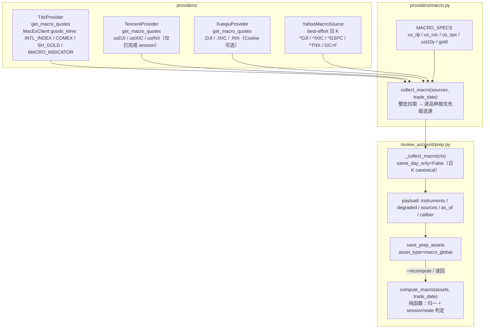
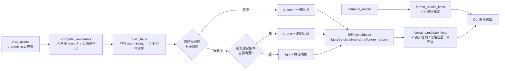

# prep 宏观扰动采集 + 近三日龙头逐只参与判定 — 技术方案

> **口径已变更（2026-10-21）**：宏观资产的外围部分已由「美股三大指数」改为「日经225期指 + 富时A50期指」
> （同日口径、TDX 单源），prep 当日门禁改为 16:40，快照 `version=0.5`。
> 现行方案见 [2026-10-21-prep-macro-jp-a50-design.md](2026-10-21-prep-macro-jp-a50-design.md)；
> 本文正文保留为历史记录，不再代表当前实现。

日期：2026-10-20 · 分支：feat/reviewa-account-op · 状态：历史方案（宏观口径已被 2026-10-21 方案替代）
上游调研：[docs/research/2026-10-20-prep-macro-sources.md](../research/2026-10-20-prep-macro-sources.md)
前置方案：[docs/solutions/2026-10-20-prep-3day-window-design.md](2026-10-20-prep-3day-window-design.md)

## 1. 背景与目标

上一版 `prep` 已把复盘窗口扩为 `[T-2, T-1, T]`，CLI 默认输出 4 行市场级摘要。用户确认真实需求是：
**盘后复盘不仅要看宏观/情绪/资金，还要针对近 3 日龙头标的逐只判断「明日是否值得参与」**。

本方案做两件事：

1. **宏观扰动采集**：新增 `macro_global` 原始资产，采集外围美股（道指/纳指/标普）、美债 10Y、
   黄金（COMEX/沪金），并把摘要并入 CLI 的「买入理由」。
   **canonical 取值 = 日 K 中日期 `< trade_date` 的最后一根已完成 bar（T-1 口径）**，
   不随运行时刻漂移，`--recompute` 可重放。
2. **逐只参与判定**：对候选池每只标的输出 `强烈建议 / 轻仓博弈 / 忽略` 三档 + 维度明细；
   忽略组只给一句技术性原因。CLI 变为「4 行市场摘要 + 空行 + 标的清单」。

### 1.1 阶段 0 已确认决策（不得偏离）

| # | 决策 |
|---|------|
| D1 | 宏观扰动调研新增免费数据源（外围/美债/黄金），纳入 prep 采集；排除东财 |
| D2 | 「忽略」原因由数据维度自动生成技术性归因（主力净流出/非主线/高位炸板/公告风险等），不接新闻/研报/舆情；cninfo 命中时附公告标题但不加主观解读 |
| D3 | CLI 保留现有 4 行市场摘要，下方追加逐只标的清单：✅ 买入在前带维度明细，忽略在后一句原因 |
| D4 | 逐只评级**复用快照现有字段 + 规则门禁**（阈值映射三档），不新建独立评分器 |
| D5 | 不改 `position_advice` 阈值公式；不改 review-account / buy / sell 的策略消费（verdict 仅展示，不过滤候选） |
| D6 | 快照 `version` 0.3 → 0.4，只增 key；旧资产 `--recompute` 不报错 |
| D7 | 评级常量集中一处，verdict 计算是纯函数（输入资产，输出结果），进 compute 段 |
| D8 | 不新增第三方依赖；provider 新方法 transport 失败抛异常；单点失败不中断 prep |

## 2. 候选设计

### 2.1 宏观采集：三个候选

#### 候选 A（推荐）：`providers/macro.py` 门面 + 各 provider 可选方法

- `StockProvider.get_macro_quotes(specs, trade_date)` 默认 `raise NotImplementedError`。
- `TdxProvider` 用 `easy_tdx.ex.mac_client.MacExClient.goods_kline` 实现首选（日 K canonical）；
  `TencentProvider` 用 gtimg quote 实现指数回退（仅接受 `session_date < trade_date`）；
  `XueqiuProvider` 用 Cookie 实现指数第三回退；`providers/macro.py` 内置
  `YahooMacroSource`（`urllib`，best-effort 日 K，覆盖 ^TNX/指数/GC=F）。
- `MacroSpec` 自带**每品种优先级** `priority`（如指数 `tdx→tencent→yahoo→xueqiu`、
  美债/黄金 `tdx→yahoo`）；`collect_macro(sources: dict[name, source], trade_date)` 按全局源顺序
  批次处理，只把「该源在品种 priority 中且尚未满足」的品种交给该源，避免全局顺序与品种优先级冲突。
- **接线**：`_collect_all` 显式构造 `TencentProvider()` / `XueqiuProvider()` 注入 `PrepContext`；
  `YahooMacroSource` 由 prep 侧构造。源协议统一为 `get_macro_quotes(specs, trade_date)`；
  `NotImplementedError` / `ImportError` 视为「该源不可用」，记 `source_errors` 后继续，不中断。
- 采用模式：**Facade（门面）** 隔离「宏观」这个跨源横切关注点；**Strategy** 封装各源取数；
  **Chain of Responsibility** 实现「品种级回退链」。

优点：

- 不污染现有 A 股 provider 契约；新方法默认未实现，不强制 3 个 provider 立刻支持。
- 回退粒度是「品种」而非「整体」，美债无回退时不会连带丢弃指数/黄金。
- 单测可以注入假 source，完全离线覆盖回退/降级/全失败。

缺点：多一个模块 + 3 个 provider 方法；`TdxProvider` 多一个扩展行情连接（惰性，仅 prep 用）。

#### 候选 B：全部塞进 `TdxProvider`

在 `tdx.py` 内部直接 import `TencentProvider` 做回退，只加一个 provider 方法。

- 缺点：provider 之间横向依赖，破坏分层；腾讯回退逻辑无法复用给其它调用方；
  `TdxProvider` 单测要连带 mock 腾讯 HTTP；且未来换源只能改 TDX。
- 结论：**不采用**。

#### 候选 C（反直觉）：新建 `MacroProvider(StockProvider)` 并注册进 `create_providers()`

把宏观包装成一个「provider」，由编排器统一实例化。

- 缺点：宏观不是股票数据源，注册后会进入扫描生命周期（每次 scan 都实例化），
  与 `StockProvider` 的板块/个股职责不符；还会让 `create_providers()` 的契约变复杂。
- 结论：**不采用**。

#### 候选 D（已并入 A）：用日 K 代替报价，严格取「最后一根已完成 bar」

`MacExClient.goods_kline` 可取美股/黄金/美债日 K；取 `< trade_date` 的最后一根，
可同时消除「15:30 未实测」与「盘中值漂移」两个问题。

- 优点：时点语义干净；同一 `trade_date` 取值稳定、`--recompute` 可重放；历史回看也可用。
- 代价：每品种一次日 K 请求（实测 6 品种 0.27s，可接受）；美债日 K 两位小数、与独立源有 ≤1.4bp 源差，
  需标「近似」。
- 结论：**并入候选 A 的主源实现**（TDX 日 K canonical），不再单列。

### 2.2 逐只判定：三个候选

#### 候选 A（推荐）：有序规则链 + 事实归一

在 `review_account/verdicts.py` 中：

1. `build_facts(cand)` 把候选归一成事实（今日涨幅/换手、是否仍在涨停池、炸板次数、连板高度、
   主力净额/占成交额、公告风险命中、主线命中、数据可用性）。
2. `_IGNORE_RULES` 是**有序责任链**（数据不足 → 公告风险 → 高位炸板 → 主力净流出 →
   退出涨停梯队 → 综合分不足），命中即返回 `ignore` + 一句原因。
3. 未命中 ignore 时，`_BUY_RULES` 判定 `strong`（全部条件满足）或 `light`（兜底可参与）。
4. `build_dimensions(facts)` 生成 2-3 行中文维度明细。

采用模式：**Chain of Responsibility**（忽略原因优先级明确、短路）；**Strategy**（每条规则是一个函数，
常量集中）；不为每条规则建类，保持「三行相似代码优于过度封装」。

优点：规则可逐条单测；阈值集中；新增原因只需插一条规则；对 null/降级天然可控。
缺点：规则是人工先验，未经历史回测校准（方案明确标为 v1，可调参）。

#### 候选 B：加权打分的第二评分器

把综合分、资金、涨停质量、主线命中、公告风险加权成 0-100，再按阈值分档。

- 缺点：用户明确要求「复用现有字段 + 规则门禁，不新建独立评分器」；且没有标注数据校准权重，
  容易把「看起来科学」的权重当成结论。**不采用**。

#### 候选 C（反直觉）：复用 `auction/strength.py` 的竞价强度

竞价强度是四维加权 + 否决闸门，语义上很接近「明日参与价值」。

- 缺点：竞价数据是 **T+1 09:25** 才产生，盘后 prep 时不可得；强行使用会引入未来函数。
  **不采用**。

## 3. 架构与数据流

### 3.1 宏观采集数据流



### 3.2 逐只判定数据流



### 3.3 采集注册表扩展

`ASSET_COLLECTORS` 新增一行（顺序在 `cninfo_announcements` 之后，无依赖）：

```python
"macro_global": CollectorSpec(_collect_macro, same_day_only=False,
                              suspicious_check=_macro_suspicious),
```

- `same_day_only=False`：canonical 是「`< trade_date` 的最后一根日 K」，对同一 `trade_date` 是
  **确定性历史数据**，补采历史日不会污染；不再加入 `_AS_OF_CHECKED`，`as_of` 直接写 `trade_date`。
  午夜后运行（`trade_date < today`）也仍可补采，不会永久降级。
- `_EMPTY_KEYS["macro_global"] = lambda p: not (p.get("instruments") or {})`
- `_MUST_NONEMPTY` 加入 `macro_global`（正常交易日不应为空）
- `PrepContext` 新增可选字段 `tencent` / `xueqiu`（默认 None，旧测试不破）；
  `_collect_all` 显式注入 `TencentProvider()` / `XueqiuProvider()`

## 4. 接口定义

### 4.1 宏观规格与 provider 方法

```python
# providers/macro.py
@dataclass(frozen=True)
class MacroSpec:
    key: str                 # us_dji / us_ixic / us_spx / ust10y / gold
    label: str               # 道指 / 纳指 / 标普 / 美债10Y / COMEX金
    kind: str                # index / yield / commodity
    price_unit: str          # points / pct / usd_per_oz / cny_per_g
    chg_unit: str            # pct / bp
    tdx: tuple[tuple[str, str], ...]   # (ExMarket 名称, code)，按优先级
    priority: tuple[str, ...]          # 该品种的源优先级（tdx/tencent/yahoo/xueqiu）
    tencent: Optional[str] = None      # 仅美股指数使用
    xueqiu: Optional[str] = None       # 仅美股指数使用
    yahoo: Optional[str] = None        # best-effort 日 K

MACRO_SPECS = (
    MacroSpec("us_dji",  "道指",   "index",     "points",     "pct",
              (("INTL_INDEX", "A_DJI"),),  ("tdx", "tencent", "yahoo", "xueqiu"),
              "usDJI",  ".DJI",  "^DJI"),
    MacroSpec("us_ixic", "纳指",   "index",     "points",     "pct",
              (("INTL_INDEX", "A_IXIC"),), ("tdx", "tencent", "yahoo", "xueqiu"),
              "usIXIC", ".IXIC", "^IXIC"),
    MacroSpec("us_spx",  "标普",   "index",     "points",     "pct",
              (("INTL_INDEX", "A_SPX"),),  ("tdx", "tencent", "yahoo", "xueqiu"),
              "usINX",  ".INX",  "^GSPC"),
    MacroSpec("ust10y",  "美债10Y", "yield",    "pct",        "bp",
              (("MACRO_INDICATOR", "8_ATY"),), ("tdx", "yahoo"),
              None, None, "^TNX"),
    MacroSpec("gold",    "COMEX金", "commodity", "usd_per_oz", "pct",
              (("COMEX_FUTURES", "GC00W"), ("SH_GOLD", "Au99.99")), ("tdx", "yahoo"),
              None, None, "GC=F"),
)
```

```python
# providers/base.py（可选方法，默认未实现）
def get_macro_quotes(self, specs: list, trade_date: str) -> dict[str, dict]:
    """批量获取宏观日 K/报价；transport 失败抛异常。返回 {spec.key: normalized_dict}。

    trade_date 用于取「日期 < trade_date 的最后一根已完成日 K」；
    quote 类回退源必须自行校验 session_date < trade_date，否则拒绝。
    """
    raise NotImplementedError(f"{self.name} 不提供宏观报价")
```

归一后的单品种记录（落库契约）：

```python
{
  "key": "us_dji", "label": "道指", "kind": "index",
  "price_unit": "points", "chg_unit": "pct",
  "price": 51966.031, "prev_close": 52002.410,
  "chg": -36.379, "pct": -0.06995, "chg_bp": None,
  "chg_bp_approx": None, "precision_note": None,
  "source": "tdx_ex", "market": "INTL_INDEX", "code": "A_DJI",
  "session_date": "2026-10-19", "raw_date": "20261019", "raw_time": None,
}
```

- `stale` **不落资产**；仅由 `compute_macro` 按 `trade_date` 重算并写入快照 `macro.instruments`。
  资产只存 `session_date/raw_date`，避免采集时判定与重算漂移。

- `kind == "yield"`：`pct=None`，`chg_bp=(price-prev_close)*100`；
  TDX 两位小数源标 `chg_bp_approx=True` + `precision_note`，Yahoo 源标 False。
- `price<=0` 或 `prev_close<=0` → 该品种视为不可用（TDX `GC00Y` 全 0 即此类）。
- `session_date` 来自日 K 的 bar 日期；`raw_date` 为紧凑格式；日 K 无 `raw_time`。
- `stale = (trade_date - session_date).days > 4`，由 `compute_macro` 计算。
- 所有数值 `float()` 归一，NaN/inf → None；不落 numpy 标量。

### 4.2 门面

```python
_SOURCE_ORDER = ("tdx", "tencent", "yahoo", "xueqiu")

def collect_macro(sources: dict[str, object], trade_date: str,
                  specs=MACRO_SPECS) -> dict:
    """按源顺序批次拉取；每个源只接收「priority 含该源且尚未满足」的品种。

    返回 {"trade_date", "as_of", "caliber", "instruments", "degraded",
          "sources", "source_errors"}。
    所有源都失败且无任何品种 → raise RuntimeError（采集器记 error）；
    部分品种缺失 → degraded=[key...]，不抛。
    NotImplementedError / ImportError 视为源不可用，记 source_errors 后继续。
    """
```

`as_of = trade_date`（canonical 日 K 的归属日），不是采集时刻；`caliber =
"last_completed_daily_bar_before_trade_date"`。

### 4.3 计算段

```python
def compute_macro(assets: dict, trade_date: str) -> dict:
    """宏观资产 → 展示/快照用归一结果（纯函数，无 I/O）。

    缺失/畸形 → {"available": False, "instruments": {}, "degraded": ["macro_global"], ...}
    session: "overnight" | "intraday" | "mixed" | None（仅由美股指数 session_date 推断）
    stale: 由 (trade_date - session_date).days > 4 计算，资产内不落 stale
    """

def evaluate_candidates(candidates: list, main_boards: list, trade_date: str) -> list:
    """给每只候选追加 verdict / verdict_label / dimensions / ignore_reason。纯函数。

    - 只读 cand["facts"]（compute_candidates 已写），不猜顶层缺失字段。
    - 逐只 try/except：单只字段畸形 → verdict="unrated" + ignore_reason="评级字段异常"，
      候选保留，绝不因单只异常清空整份 candidates。
    """
```

### 4.4 展示层

```python
def build_advice_reason(sentiment, main_boards, trade_date=None, macro=None) -> str
def format_advice_lines(result) -> list[str]          # 仍是 4 行
def format_candidate_lines(result) -> list[str]       # 新增：空行 + 标的清单
```

## 5. 逐只评级规则（v1，常量集中）

### 5.1 常量（`review_account/verdicts.py` 顶部）

```python
VERDICT_STRONG, VERDICT_LIGHT, VERDICT_IGNORE = "strong", "light", "ignore"
VERDICT_UNRATED = "unrated"    # 字段异常/无法评级；候选仍保留
VERDICT_LABELS = {"strong": "强烈建议", "light": "轻仓博弈",
                 "ignore": "忽略", "unrated": "未评级"}

STRONG_SCORE_MIN = 75.0        # 强烈建议：五维综合下限
STRONG_MAX_OPEN_NUM = 1        # 强烈建议：今日炸板次数上限
LIGHT_SCORE_MIN = 50.0         # 轻仓博弈下限；与 review_account.min_score 默认值同源，
                               # 但语义独立（展示评级 vs 交易过滤），改动需同步评估
CROSS_DAY_LIGHT_MIN_PCT = 3.0  # 非涨停候选：今日涨幅达到该值才可轻仓
IGNORE_FLOW_RATIO = -0.05      # 主力净额/成交额 ≤ -5% 视为明显流出
IGNORE_DROP_PCT = 3.0          # 非涨停且今日涨幅 < 3% → 退出梯队
IGNORE_BROKEN_OPEN_MIN = 3     # 高位炸板：炸板次数下限
IGNORE_BROKEN_HEIGHT_MIN = 3   # 高位炸板：连板高度下限
ANNOUNCEMENT_RISK_DAYS = 3     # 公告风险窗口（自然日）
# 关键词分两级，见 §5.3（HARD 忽略 / SOFT 仅降档）
ANNOUNCEMENT_HARD_KEYWORDS = (...)
ANNOUNCEMENT_SOFT_KEYWORDS = (...)
ANNOUNCEMENT_NEGATIONS = (...)
```

- `LIGHT_MIN_PCT` 已删除（未使用）。
- `main_net_amount` / `t_amount` 单位按 TDX `Quote` 约定为**元**；用实盘样本核对后写入
  共享 `_fmt_money`（0/负值/None 均单测）。`flow_ratio = main_net / t_amount` 仅当
  `t_amount > 0` 时计算，否则 None（不除零）。

### 5.2 事实归一（`compute_candidates` 写 `cand["facts"]`，`build_facts` 只读它）

**数据契约修订（回应 CRITICAL-1/2）**：`compute_candidates` 每只候选新增 `facts` 子块
（只增 key），把评级所需事实一次算清并落快照；`evaluate_candidates` 只读 `cand["facts"]`，
不再从缺失的顶层字段猜。**`in_pool_today` 与候选入选日解耦**：只看「今日 THS 池是否含该 code」，
因此 T-2 入选、T 日再涨停的龙回头也能 strong。

```python
cand["facts"] = {
    "pool_available": True,        # THS 池资产可用且 rows 非空
    "in_pool_today": True,         # code 命中今日池（与入选日无关）
    "t_pct": 9.99,                 # 今日涨幅：今日池 change_rate，缺失回退 fund_flow quote.pct
    "t_turnover": 21.99,           # 今日换手：今日池 turnover_rate，缺失回退 quote.turnover_rate
    "t_amount": 2.0e9,             # 今日成交额：fund_flow quote.amount（元）
    "open_num": 0,                 # 今日炸板次数（今日池）
    "high_days": "3天3板",          # 今日连板高度文本（今日池）
    "limit_up_type": "换手板",      # 今日板型（今日池）
    "first_limit_up_time": "09:32:00",
    "limit_up_suc_rate": 1.0,      # 今日封板成功率 0-1（今日池）
    "main_net_amount": 1.2e8,      # 今日主力净额（元）
    "flow_available": True,        # fund_flow 资产可用且该 code 有条目
    "announcements_available": True,  # cninfo 资产可用且该 code 有条目
    "announcement_count": 2,
    "risk_announcement": None,     # {"level":"hard"|"soft","title":...} 或 None
}
```

| 事实 | 来源 | 缺失语义 |
|------|------|----------|
| `pool_available` | THS 涨停池资产可用且 rows 非空 | False = 池数据缺失（≠「未进池」） |
| `in_pool_today` | 今日池 `pool_by_code` 含该 code（**与候选 `trade_date` 无关**） | 池缺失 → False |
| `t_pct` | 今日在池：THS `change_rate`；否则/缺失：T 日 quote `pct` | None = 未知 |
| `t_turnover` | 今日在池：THS `turnover_rate`；否则/缺失：quote `turnover_rate` | None |
| `t_amount` | T 日 fund_flow quote `amount`（元） | None/<=0 → `flow_ratio=None` |
| `main_net_amount` | T 日 fund_flow quote（元） | None = 资金数据缺失 |
| `open_num` / `high_days` / `limit_up_type` / `first_limit_up_time` / `limit_up_suc_rate` | **今日池**同名字段 | None = 未知（不伪造 0） |
| `board_height` | `high_days` 解析（N天M板 → M） | None |
| `mainline_hit` | `concepts` / 今日池 `reason_type` 与 `main_boards` 前 3 名称匹配（§5.6） | main_boards 为空 → None（未知） |
| `risk_announcement` | cninfo 公告标题/类型命中 HARD/SOFT 关键词，且日期 ≥ T-3（§5.3） | 公告资产不可用 → None（未知） |
| `flow_available` / `announcements_available` | 资产可用且该 code 有条目 | False |

**风险公告在 facts 内一次算清**：`compute_candidates` 调用
`verdicts.find_risk_announcement(announcements, trade_date, available)`，
把 HARD/SOFT 结果写入 `facts.risk_announcement`；`evaluate_candidates` 不再重新解析公告。
`facts` 随快照落库（只增 key），便于审计「为什么这只被忽略」。

**THS 字段名已用真实 payload 核对**（2026-10-20 实测 key）：
`change_rate` / `turnover_rate` / `limit_up_suc_rate` / `high_days` / `open_num` /
`limit_up_type` / `first_limit_up_time` / `reason_type` 均存在；`limit_up_suc_rate` 为 0-1。
若某日 payload 缺这些键，`t_pct`/`t_turnover` 自动回退 quote，封板质量字段保持 None。

**未知 != 0/False**：资金缺失不当作「无流入」，公告缺失不当作「无风险」，
池缺失不当作「未涨停」。`announcements_available=True` 且列表为空 = 「确认无公告」，
可参与 strong；`False` = 数据降级，strong 降档。

### 5.3 公告风险分级（回应 MAJOR-5）

关键词拆两级，避免把「终止减持」「澄清」「为子公司担保」误判为硬风险：

```python
ANNOUNCEMENT_HARD_KEYWORDS = (
    "立案", "调查", "行政处罚", "处罚", "警示函", "监管函", "退市", "预亏",
    "预减", "业绩下滑", "减值", "违规", "诉讼", "仲裁", "冻结",
)
ANNOUNCEMENT_SOFT_KEYWORDS = ("减持", "质押", "担保", "澄清", "延期回复", "终止")
ANNOUNCEMENT_NEGATIONS = ("终止减持", "不减持", "不存在", "未涉及", "不属实", "撤销")
```

- 命中 HARD 优先（通用否定词不抑制 HARD，避免复合标题漏判）；仅
  「撤销退市风险警示」这类具体利好短语抑制 HARD。
- SOFT 命中任一 `ANNOUNCEMENT_NEGATIONS` → **整条跳过**（终止减持/减持计划终止/不属实等）。
- 多条命中时 HARD 优先，同级别取较新。
- HARD → `risk_announcement={"level":"hard","title":...}` → 忽略。
- SOFT → `risk_announcement={"level":"soft","title":...}` → **只把 strong 降为 light**，
  维度行附 40 字内标题；不忽略。
- `title` 为空/None → 跳过该条，不把 `None` 拼进原因；统一 `_clean` + 截断。
- 日期不可解析 → 视为窗口外（未知不伪造风险）；有效日期须 ≥ `T-3`（自然日）。

### 5.4 忽略原因责任链（按顺序，命中即短路）

1. **数据不足**：`not in_pool_today` 且 `t_pct is None` →
   池可用时 `今日行情缺失，且未进入涨停池，无法判定`；池不可用时 `今日行情与涨停池数据均缺失，无法判定参与价值`
2. **HARD 公告风险**：`risk_announcement.level == "hard"` →
   `近 3 日公告「{title}」，按公告风险规则忽略`
3. **高位炸板**：`in_pool_today` 且 `board_height >= 3` 且 `open_num >= 3` →
   `高位 {high_days} 今日炸板 {open_num} 次，封板承接转弱`
4. **非涨停 + 主力净流出**：`not in_pool_today` 且 `main_net < 0` 且
   `flow_ratio <= -5%` →
   `今日涨幅 {t_pct:+.2f}%、主力净流出 {金额}（占成交额 {x}%），资金离场`
   （涨幅是否 ≥3% 只影响文案中的涨幅值，不改变归因；`t_amount` 为 None/<=0 →
   `flow_ratio=None`，本规则不触发）
5. **退出涨停梯队**：`pool_available` 且 `not in_pool_today` 且 `t_pct is not None` 且 `t_pct < 3%` →
   `今日涨幅 {t_pct:+.2f}%，已退出涨停梯队（入选日 {trade_date}）`
6. **综合分不足**：`composite_score < 50` →
   `五维综合 {score:.1f} 低于参与阈值 50`
7. **兜底**：`今日强度不足，未达参与阈值`

**资金流出真值表**（回应 MAJOR-4，锁定「涨停股资金流出只降级不忽略」）：

| `in_pool_today` | `t_pct` | `flow_ratio` | 结果 |
|---|---|---|---|
| True | ~10% | ≤ -5% | **不忽略**；strong 失败（main_net≤0）→ light |
| False | <3% | ≤ -5% | ignore（规则 4） |
| False | <3% | > -5% 或 None | ignore（规则 5，退出梯队） |
| False | ≥3% | 任意非负/None | light |
| False | ≥3% | ≤ -5% | ignore（规则 4，原因含涨幅与流出） |

### 5.5 买入档位

**强烈建议（strong）必须全部满足**：

- `in_pool_today`（今日仍在 THS 涨停池，与入选日无关）；
- `composite_score >= 75`；
- `open_num <= 1`；
- `main_net > 0`；
- `flow_available` 且 `announcements_available`（数据不完整不冒充强烈建议）；
- `risk_announcement` 不是 hard；soft 公告存在时降为 light；
- `mainline_hit is not False`（主线数据缺失时按未知放行；明确未命中则降为轻仓）。

**轻仓博弈（light）**：

- `composite_score >= 50`；
- `in_pool_today`：未触发 ignore 且未达 strong（含「非主线」「封板质量一般」「资金缺失」）；
- 非 `in_pool_today`：`t_pct >= 3%` 且 `main_net is None or main_net >= 0`。

其余落 ignore（由兜底规则给原因）。

### 5.6 主线匹配（回应 MAJOR-9）

`mainline_hit` 不做跨源语义映射，只做**可解释的归一化字面匹配**：

1. `_norm_board(text)`：去空白/全角空格，剥离后缀「概念/板块/指数/行业」，保留原始中文。
2. 候选 token：`concepts`（TDX）+ 今日池 `reason_type` 按 `+`/`、`/`，` 切分。
3. 只取 `main_boards` 前 3（已按 `limit_up_num` 降序）。
4. 匹配顺序：精确相等 → 双向子串（最短长度 ≥2）。
5. 命中 → `(True, name, rank)`；板块数据可用但未命中 → `(False, None, None)`；
   `main_boards` 为空 → `(None, None, None)`（未知，strong 放行）。
6. 不做同义词表；若线上假阴性明显，再以样本驱动补映射（列入 §11 后续项）。

### 5.7 维度明细（2-3 行，省略规则明确）

```text
质量维度：五维综合 82.0（排名 3）；题材：低空经济（今日主线第 2）
涨停维度：换手板 2天2板，首封 09:32，炸板 0 次，封板成功率 100%
资金维度：主力净流入 1.23 亿（占成交额 4.1%）
```

**今日在池**（无论入选日是哪天）第 2 行用涨停维度；**未在今日池**的候选第 2 行改为：

```text
今日维度：涨幅 +4.21%，未进入涨停池（入选日 2026-10-19）
```

若 `pool_available=False`，第 2 行改为 `今日维度：涨幅 +4.21%，涨停池数据缺失（无法确认封板质量）`；
若池可用但 `in_pool_today=False`，写 `今日维度：涨幅 +4.21%，未进入涨停池（入选日 2026-10-19）`。

**省略规则（回应 MINOR-7）**：

- 质量行恒输出；`rank` 缺失时省略「（排名 …）」；concepts 为空时省略「；题材：…」。
- 第 2 行恒输出；`limit_up_type` 缺失用「涨停」；`high_days`/`first_limit_up_time`/
  `limit_up_suc_rate` 各自缺失时省略对应片段，**绝不输出 `None%` 或空占位**。
- 资金行恒输出；`main_net is None` → `资金维度：主力净额缺失（数据降级）`。
- 最少 2 行、最多 3 行；任何组合下不产生空行。
- soft 公告存在时，质量行末尾追加 `；公告：{title}（风险关注）`。
不把数据缺失写成「未进入涨停池」，避免误判为退出梯队。

资金缺失时第 3 行：`资金维度：主力净额缺失（数据降级）`；主线缺失时不显示「未命中」，
只在质量行末尾省略主线片段。

## 6. 宏观并入买入理由

`build_advice_reason` 在情绪因子前追加宏观片段（纯函数）：

```text
外围：道指 -0.07%、纳指 +1.11%、标普 +0.41%（隔夜收盘）；美债10Y 5.15%（较前值 +6bp，近似）；COMEX金 -0.63%
```

- 美股 `session` 由 `session_date` 与 `trade_date` 比较：
  - 全部 `< trade_date` → `（隔夜收盘）`
  - 任一 `== trade_date` → `（盘中）`
  - 其余（含日期缺失/异常）→ `unknown`，不加括号
- `stale=True` 时追加 `（数据较旧，N 天前）`；N = `trade_date - session_date` 的天数。
- 美债用 `price`（%）+ `chg_bp`；TDX 源 `chg_bp_approx=True` → 文案带「近似」，
  Yahoo 源 `chg_bp_approx=False` → 不带「近似」。绝不把收益率相对变动当涨跌幅。
- 黄金保留来源口径（COMEX / 沪金），文案按 `label` 区分。
- 单品种缺失：`macro.degraded` → `sentiment.degraded` 追加 `macro_partial`；
  整体缺失追加 `macro_global`。**统一复用 `advice.py` 现有的 degraded 拼接**
  （「数据降级：…，结论可信度下降。」），不在 §6 再追加第二句。
- `DEGRADED_LABELS` 增加：`macro_global → 宏观数据缺失`、`macro_partial → 宏观部分品种缺失`
  （未登记会原样打印英文 code）。
- 宏观**不进** `position_advice` 公式（只观察，不改阈值）。

## 7. CLI 输出

### 7.1 默认（非 --verbose）

```text
是否建议买入：是
建议仓位：50%
建议等级：一般
买入理由：复盘日 2026-10-20；外围：道指 -0.07%、纳指 +1.11%、标普 +0.41%（隔夜收盘）；美债10Y 5.15%（较前值 +6bp，近似）；COMEX金 -0.63%；涨停 59 家；……。涨跌停家数处中性区间，建议仓位 50%。

✅ 科森科技-强烈建议
- 质量维度：五维综合 82.0（排名 1）；题材：低空经济（今日主线第 2）
- 涨停维度：换手板 3天3板，首封 09:32，炸板 0 次，封板成功率 100%
- 资金维度：主力净流入 1.23 亿（占成交额 4.1%）

✅ 美格智能-轻仓博弈
- 质量维度：五维综合 68.0（排名 4）；题材：机器人（非今日主线）
- 涨停维度：换手板 1天1板，首封 10:15，炸板 2 次
- 资金维度：主力净流入 3200.00 万（占成交额 1.8%）

风华高科-忽略：今日涨幅 +1.20%、主力净流出 1.20 亿（占成交额 -6.2%），资金离场
```

- 候选为空 → 第 6 行 `无参与复盘标的`。
- 买入组排序：`strong` 在前、`light` 在后；组内 `(-composite_score, rank, code)`。
- 忽略组排序：`(-composite_score, code)`；每只**只输出一行**原因。
- 名称/原因统一去 C0/C1 控制字符。
- `--verbose` 输出完整 JSON（含 `macro`、`candidates[].verdict/dimensions/ignore_reason`）。

### 7.2 兼容

- `format_advice_lines` 仍返回 4 行（现有测试/消费方不变）。
- 候选缺 `verdict`（仅可能出现在手工/旧数据直接调展示层的防御路径；正常 `prep`/`--recompute`
  都会重算 verdict）→ `format_candidate_lines` 归入「未评级」组，输出
  `名称-未评级：评级字段缺失`，不伪造评级。
- `evaluate_candidates` 单只字段畸形 → `verdict="unrated"`，候选保留，CLI 归入「未评级」组，
  原因 `评级字段异常`；整份 candidates 不清空。

## 8. 快照结构（version 0.4）

只增 key，旧 key 语义不变：

```json
{
  "trade_date": "2026-10-20",
  "version": "0.4",
  "sentiment": { "...": "...", "degraded": ["macro_partial"] },
  "main_boards": [ "..." ],
  "macro": {
    "available": true,
    "as_of": "2026-10-20",
    "session": "overnight",
    "caliber": "last_completed_daily_bar_before_trade_date",
    "instruments": {
      "us_dji": { "key": "us_dji", "label": "道指", "kind": "index",
                  "price_unit": "points", "chg_unit": "pct",
                  "price": 51966.031, "prev_close": 52002.410, "chg": -36.379,
                  "pct": -0.06995, "chg_bp": null, "chg_bp_approx": null,
                  "source": "tdx_ex", "code": "A_DJI", "market": "INTL_INDEX",
                  "session_date": "2026-10-19", "raw_date": "20261019",
                  "raw_time": null, "stale": false },
      "ust10y": { "...": "...", "price_unit": "pct", "chg_unit": "bp",
                  "price": 5.15, "prev_close": 5.09, "chg_bp": 6.0,
                  "chg_bp_approx": true, "precision_note": "TDX 两位小数日频快照，bp 为近似值",
                  "pct": null, "source": "tdx_ex" },
      "gold":   { "...": "...", "label": "COMEX金", "price_unit": "usd_per_oz" }
    },
    "degraded": [],
    "sources": { "us_dji": "tdx_ex", "ust10y": "tdx_ex", "gold": "tdx_ex" }
  },
  "candidates": [
    { "code": "002881", "name": "美格智能",
      "trade_date": "2026-10-19",
      "facts": {
        "pool_available": true, "in_pool_today": true,
        "t_pct": 9.99, "t_turnover": 21.99, "t_amount": 2.0e9,
        "open_num": 0, "high_days": "2天2板", "limit_up_type": "换手板",
        "first_limit_up_time": "09:32:00", "limit_up_suc_rate": 1.0,
        "main_net_amount": 1.23e8, "flow_available": true,
        "announcements_available": true, "announcement_count": 1,
        "risk_announcement": null
      },
      "verdict": "strong", "verdict_label": "强烈建议",
      "dimensions": ["质量维度：...", "涨停维度：...", "资金维度：..."],
      "ignore_reason": null,
      "...": "原有字段（reason_type/open_num 等仍为入选日归因，跨日候选为 null）" },
    { "code": "000001", "name": "异常样本",
      "facts": { "...": "..." },
      "verdict": "unrated", "verdict_label": "未评级",
      "dimensions": [], "ignore_reason": "评级字段异常" }
  ],
  "dragon_source": { "...": "..." }
}
```

旧资产 `--recompute`：

- 无 `macro_global` → `compute_macro` 返回 `available=false`、`degraded=["macro_global"]`；
  `sentiment.degraded` 追加 `macro_global`；CLI 理由显示「宏观数据缺失」；不报错。
- `candidates` 仍按新规则重算 verdict/facts（输入字段都在旧资产里，缺失的按未知降级；
  旧资产无今日池 → `in_pool_today=False`、`pool_available=False`，按数据不足/降级处理）。

## 9. 错误处理与降级

| 场景 | 行为 |
|------|------|
| TDX 扩展行情连接/解析/写盘失败 | provider 内 `get_macro_quotes` 抛 RuntimeError（不吞）；门面记录 `source_errors.tdx`，按 spec priority 转下一源 |
| 腾讯 HTTP 失败 | 同上抛 RuntimeError；门面记录后转 Yahoo/雪球 |
| 雪球无 Cookie | 返回 `{}`（配置缺失，不记 `source_errors`，不算 transport 失败） |
| 雪球 HTTP 非 200/超时/JSON 解析失败 | **抛 RuntimeError**；门面记录后继续 |
| 雪球符号无数据（quote 空） | 返回 `{}`（不是故障） |
| 单品种无数据（如美债） | 该品种缺失 → `degraded`，其余照常 |
| 全部品种缺失 | collector 抛 RuntimeError → `collection_report.status=error` → compute 降级 |
| 行情价格为 0/负 | 视为该品种不可用，不落 0 |
| 公告/资金资产降级 | `facts.flow_available/announcements_available=False`；不伪造「无风险/无流入」；strong 自动降为 light |
| 今日未进池但今日池可用 | `in_pool_today=False`；走退出梯队/资金规则；不伪造涨停 |
| **THS 池 truncated → `empty_suspicious`** | `_prepare_assets` 整份剔除 → 所有 `in_pool_today=False`，strong 全部降档。**已知运营悬崖**（大涨日最可能触发），维度行显示「涨停池数据缺失」，列入 §11 风险 |
| 候选字段畸形 | `evaluate_candidates` 逐只隔离 → `verdict="unrated"`，候选保留，不清空整份列表 |
| 展示层异常 | CLI 捕获：摘要失败提示 `--verbose`；清单失败仍打印 4 行摘要；快照已落库 |

## 10. 测试策略

### 10.1 宏观采集

- `collect_macro`：
  - TDX 全部命中 → 5 品种，source=tdx_ex；
  - TDX 连接抛异常 → 腾讯补指数，Yahoo 补美债/黄金 → 5 品种或 `degraded`；
  - TDX 部分品种空值（GC00W 0）→ 黄金走 SH_GOLD 备选；
  - 腾讯 quote `session_date >= trade_date` → 拒绝该品种；
  - 全部源失败 → RuntimeError；
  - 雪球无 Cookie → 不抛、不计 error；
  - Yahoo 429/超时 → `source_errors.yahoo`，其它源继续。
- `TdxProvider.get_macro_quotes`：假 `MacExClient`/假 DataFrame → 日 K canonical（`< trade_date` 最后一根）、
  取前一根算 pct/chg、yield 的 `chg_bp` + `approx`、`session_date`、0 值剔除、numpy/NaN 清洗；
  盘中 bar 存在时被 `< trade_date` 排除。
- `TencentProvider.get_macro_quotes`：假 HTTP 文本 → 专用解析美股字段；`session_date >= trade_date` 拒绝。
- `YahooMacroSource`：假 chart JSON → 取 `< trade_date` 的最后一根与前一根；429/超时抛异常。
- `_collect_macro` 采集器：假 ctx → payload 结构 + degraded；整体失败 → collection_report error。
- **JSON 原生性**：`json.dumps(macro_payload, allow_nan=False)` 不抛；NaN/inf → None 单测
  （`assets_db._dumps` 用 `allow_nan=False`，NaN 会让整次资产落库回滚）。
- **端到端全失败**：全源失败 → `collection_report.macro_global.status=error` →
  `sentiment.degraded` 含 `macro_global` → 第 4 行理由含「宏观数据缺失」。

### 10.2 verdict 规则

- **数据契约**：`compute_candidates` 输出 `facts` 块，字段齐全；真实 THS payload key
  （`change_rate`/`turnover_rate`/`limit_up_suc_rate`）存在时被消费；
  缺失时 `t_pct`/`t_turnover` 回落 quote。
- **in_pool_today 解耦**：T-2 入选、T 日再涨停的候选 → `in_pool_today=True`，可 strong；
  其 `reason_type` 等入选日归因仍按既有契约（跨日为 null）。
- strong：今日在池 + 综合≥75 + 炸板≤1 + 主力净流入 + 主线命中 + 无 HARD 公告；
- strong 降 light：非主线 / 资金缺失 / 公告资产缺失 / 炸板 2 次 / SOFT 公告；
- light：非涨停但今日涨幅≥3% 且资金非负；
- ignore 各原因各一条：数据不足、HARD 公告、高位炸板、非涨停+主力流出、退出涨停梯队、综合分不足、兜底；
- **同日涨停 + 主力净流出 → light，不 ignore**（真值表回归）；
- 优先级：同时命中 HARD 公告与主力流出 → 公告原因；
- **公告正反例**：HARD「预亏」→ ignore；SOFT「减持」→ light；否定「终止减持」「澄清不属实」→ 不触发；
  `title=None` 不拼 None；
- null/畸形安全：THS 跨日 null、fund_flow 缺失、cninfo 缺失、main_boards 为空均不崩、不伪造；
  `composite_score=None/str`、`open_num="x"`、`high_days` 畸形 → 单只 `unrated`，候选保留；
- 主线匹配：精确 / 子串 / 后缀归一 / 未命中 / main_boards 为空 五组；
- 排序：strong 在 light 前，组内综合分降序；unrated 独立组。

### 10.3 计算/CLI/兼容

- `compute_macro`：有资产/缺失/畸形/部分品种；session=overnight/intraday/None；
  `stale` 计算（session_date 落后 >4 天）；`chg_bp_approx` 保留。
- `build_advice_reason(macro=...)`：三类片段、部分缺失、隔夜标签、宏观降级标签。
- `format_candidate_lines`：买入在前、忽略一句原因、空候选、unrated 组。
- `_compute_all`：version=0.4；macro key 存在；sentiment.degraded 合并。
- **verdict 不过滤候选**：`market.collect_candidates` 在快照含 `verdict="ignore"` 时仍返回同一集合
  （回归测试，锁定非目标）。
- `--recompute`：旧资产（无 macro/facts/verdict）不报错，输出新 verdict + macro degraded。
- 全量 `python -m unittest discover -s tests` 必须绿。

## 11. 风险与缓解

| 风险 | 缓解 |
|------|------|
| TDX 扩展行情服务器不稳定/列表变化 | 腾讯/雪球/Yahoo 回退；单品种降级；全失败不中断 prep |
| 美债无稳定回退 | TDX 日 K 主源 + Yahoo best-effort；仍失败则 `degraded=["ust10y"]`；不伪造 |
| 美债两位小数/源差 | `chg_bp_approx=true` + `precision_note`；文案「近似」；只观察不进公式 |
| Yahoo 429/不可达 | 单品种单次尝试、5s 超时；失败记 `source_errors.yahoo`，不重试、不阻断 |
| 时区/收盘语义混淆 | canonical 日 K `< trade_date`；原样保存 `session_date/raw_date`；只对美股指数用「收盘」标签 |
| 腾讯美股 `[30]` 是纽约时间 | 宏观解析不复用 `Quote.timestamp`，只取价格/昨收/涨跌幅 |
| 腾讯美股行含空字段（如 `[45]`），复用 `_parse_gtimg_quote` 会因 `float("")` 返回 None | 宏观用**专用轻量解析**，只取 `[1][2][3][4][31][32][33][34][30]`，不构造 `Quote` |
| 腾讯日 K 只返回 1 根 | 腾讯只作 quote 回退（且要求 `session_date < trade_date`），不作日 K 回退 |
| 黄金口径混用 | 记录 `price_unit/market/code/label`；COMEX 与沪金不合并成一个数 |
| `from_best_host` 写 `~/.easy_tdx` | provider 内写盘失败 → `raise RuntimeError`（不吞）→ 门面记 `source_errors.tdx` 并回退；列入 AGENTS 风险 |
| 节假日 `session_date` 滞后 | `stale = (trade_date - session_date).days > 4` → 展示「数据较旧」 |
| 评级规则未回测 | 常量集中、v1 明确标注；后续用 review/回测校准；不改仓位公式 |
| 公告关键词误伤 | HARD/SOFT 分级；HARD 优先且仅具体利好短语抑制；SOFT 否定整条跳过；标题截断；窗口限 T-3 |
| THS 池 truncated（大涨日） | 池资产被判 `empty_suspicious` → 全量 strong 降档；维度行明示「涨停池数据缺失」；列入已知运营悬崖，后续可改为「保留行 + 标记不完整」 |
| 主线字面匹配假阴性（TDX 概念 vs THS 题材） | 归一化 + 精确/双向子串；未命中只降 light，不 ignore；后续用样本补同义映射 |
| 50 分阈值与 review_account.min_score 漂移 | 代码注释标明「同源默认但语义独立」；改动需同步评估；不共享配置以免耦合 |
| verdict 被误用为交易过滤 | 方案明确 verdict 仅展示；review-account 仍消费全部 candidates；加回归测试 |
| 旧资产 recompute 缺字段 | 全部按 None/未知降级；不抛异常；测试覆盖 |
| 宏观采集拖慢 prep | 一次扩展行情连接 + 一次腾讯批量 GET；实测 <0.5s；失败才回退 |

## 12. 开放设计点（本期取舍）

1. **是否补采 T-1/T-2 的 THS 池以充实跨日归因**：
   本期仍只采 T 日。理由：3 倍 THS 请求触发 403 风险；跨日候选的 verdict 已有 T 日 quote
   与真实入选日，null 归因按未知降级即可；后续确有分析需求再扩展。
2. **是否把宏观做成独立 CLI 命令**：不做。宏观只服务 prep 的买入理由，避免命令面膨胀。
3. **是否让 macro 影响仓位**：不做。未回测参数不推广，保持「只观察不进公式」。
4. **是否在 verdict 里纳入 `max_return_5d` 等 review 字段**：不做。回测字段是事后信息，
   盘后复盘不能用未来函数。

## 13. 改动文件清单（预估）

新增：

- `dragon_quant/providers/macro.py`（规格 + 门面 + `YahooMacroSource` best-effort 日 K）
- `dragon_quant/review_account/verdicts.py`（规则链 + 维度文案）
- `tests/test_macro.py`（宏观采集）
- `tests/test_verdicts.py`（评级规则 + CLI 清单）
- `docs/research/2026-10-20-prep-macro-sources.md`（已完成）
- 本方案

修改：

- `dragon_quant/providers/base.py`（`get_macro_quotes` 默认未实现）
- `dragon_quant/providers/tdx.py`（`MacExClient` 实现）
- `dragon_quant/providers/tencent.py`（gtimg 宏观解析）
- `dragon_quant/providers/xueqiu.py`（指数第三回退）
- `dragon_quant/review_account/prep.py`（采集注册 + compute_macro + **candidates facts 块** +
  verdict 接线 + version 0.4）
- `dragon_quant/review_account/advice.py`（宏观理由 + `format_candidate_lines` + degraded 标签）
- `dragon_quant/cli_commands.py`（4 行 + 空行 + 清单）
- `tests/test_prep.py`（version/输出断言更新 + 新兼容用例）
- `AGENTS.md` / `README.md`（资产类型、0.4、CLI 结构、宏观时点语义）
- 可选：`dragon_quant/review_account/ASSETS_ARCHITECTURE.md`（资产注册图补 macro）

## 14. 验收标准映射（实现后回填）

| # | 验收标准 | 方案落点 |
|---|----------|----------|
| 1 | 宏观资产按推荐链采集落库，单品种/整体缺失降级不中断 | `providers/macro.py` + `_collect_macro` + `compute_macro`（TDX 日 K canonical + 回退） |
| 2 | 宏观摘要并入买入理由 | `build_advice_reason(macro=...)`（美债变动标「近似」） |
| 3 | candidates 每只含 verdict + 维度 + 忽略原因 | `compute_candidates` 写 `facts`；`verdicts.evaluate_candidates` 逐只隔离（含 `unrated`） |
| 4 | CLI 4 行 + 清单（✅ 在前/忽略一句） | `format_advice_lines` + `format_candidate_lines` + `_cmd_prep` |
| 5 | THS 跨日 null/宏观缺失/降级不伪造不崩 | `in_pool_today` 解耦 + `facts` availability 布尔 + 规则链 null/畸形隔离 |
| 6 | version 0.4 只增 key；旧资产 recompute 兼容 | `_compute_all` + `compute_macro` 缺失分支 |
| 7 | 单测 + 全量绿；文档同步；调研/方案落 docs | 测试计划 + AGENTS/README |
