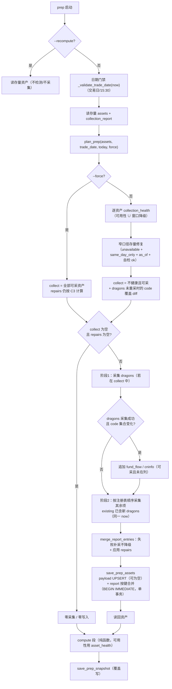

# prep 增量重跑与 collection_report 状态语义 — 技术方案（v2）

日期：2026-10-21 · 分支：feat/reviewa-account-op · 状态：待复审
v2 修订：吸收 solution-reviewer 首轮 findings（1 CRITICAL / 6 MAJOR / 7 MINOR），逐条处理见 §13。

## 1. 背景与问题定性

### 1.1 现象

用户 2026-10-20 23:45 完整采集成功；2026-10-21 00:59 再次运行 `prep`（同一复盘日 2026-10-20）：

- 3 个 `same_day_only` 采集器（`market_breadth` / `fg_boards` / `fund_flow`）因为
  `trade_date < today` 被 `_collect_all` 跳过；
- 但跳过的同时把 `collection_report` 整日覆写为 `{"status": "unavailable"}` ×3；
- `_prepare_assets` 只信 report 不信幸存的完好 payload → 这三个资产被当作缺失，
  快照降级：仓位无法判断、逐只候选显示「今日行情缺失」。

### 1.2 根因（一句话）

**「本次运行跳过了采集」（运行遭遇）被错误持久化为「该资产不可用」（资产属性）。**

`collection_report` 原先由 `save_prep_assets` **整日整表覆盖**，天然只能表达「本次运行的遭遇」；
而 compute 段把它当作「该日期资产可用性」消费。两段式管线的「资产 = 可重放输入」契约因此被运行时刻污染。

### 1.3 本方案要解决的边界

- 同一交易日内多次运行（含跨零点后的次日凌晨重跑）不得互相降级；
- 历史日**首次补跑**仍要能采的照采、不能采的如实降级（不得伪造）；
- 资产缺失/损坏时才触网补采，完好时零采集（含本地 `db.get_dragons` 读取）；
- 快照 schema 不变（`version=0.4`），只改变运行行为与 report 语义；
- 旧版本已经写坏的历史日 report（`unavailable` 但 payload 完好）可被**窄口径修复**（§5.5）。

**「采集」口径（用于 AC1 验收）**：`ASSET_COLLECTORS` 中任一 `collect` 被调用、或 `db.get_dragons`
被调用、或 `save_prep_assets` 被调用。日期门禁的 TDX 指数日K 调用（`_validate_trade_date`）是
prep 既有契约（D7 明确不绕过），**不计入**采集口径；离线环境下零采集路径仍会因门禁失败，这是既有行为。

## 2. 阶段 0 已确认决策（不得偏离）

| # | 决策 |
|---|------|
| D1 | 「完好」判定复用 `_prepare_assets` 的可用性语义，抽成共享谓词（payload 存在 + report 状态非 `error/unavailable/empty_suspicious` + 必然非空资产非 `empty` + 三类 `as_of==trade_date`）。compute 与增量检测共用唯一语义来源。 |
| D2 | 默认 `prep` 改为**增量模式**：先读存量资产 + report → 逐资产健康判定 → 全健康则**零采集**直接 compute 覆盖快照；否则只补采不健康且可采的 asset_type。 |
| D3 | diff 粒度 = asset_type；`fund_flow` / `cninfo_announcements` 额外做 **code 覆盖 diff**（`quotes` / `items` 未覆盖当前龙头并集 codes → 不健康）。龙头并集 codes 取自存量（或本次新采）dragons payload。 |
| D4 | **依赖级联**：本次若重采 `dragons`**且 code 集合发生变化**，则 `fund_flow` 与 `cninfo_announcements` 一并补采（可采前提下），因为它们的输入 codes 来自龙头并集。 |
| D5 | **可采性矩阵**：`same_day_only` 仅 `T == today` 可采；历史日缺失 = 永久降级，**不尝试采集、不写 report**。原 `_collect_all` 的「跳过 + 写 unavailable」整体移除。 |
| D6 | `collection_report` **逐条合并**：只更新本次实际执行的 collector 条目，其余沿用存量；整日零采集时 report 完全不动。语义 = 「该日期资产当前最佳状态」。`save_prep_assets` 支持部分 assets + 部分 report 的单事务合并写入。 |
| D7 | 新增 `prep --force`：强制重采全部**可采**资产（历史日 `same_day_only` 仍不采）；**不**绕过 15:30 当日门禁与交易日校验。 |
| D8 | `--recompute` 保持现状：零检测零采集，直接基于存量资产重算并覆盖快照。 |
| D9 | `dragons_partial` / `dragons_window_short`（`_window_degradations`）视为 dragons **采集不健康** → 触发 dragons 重采（纯本地 DB 读取，零网络；支持「后来补跑 scan 想纳入新一天」）。**注意**：它是「可用但告警」，compute 仍消费 dragons（§5.1 两层谓词）。 |

### 2.1 v2 补充决策（复审吸收，属 D1/D4/D6 的语义闭环，不改变阶段 0 方向）

| # | 决策 |
|---|------|
| C1 | 健康判定拆两层：`asset_health`（**可用性**，决定 compute 是否消费，与现 `_prepare_assets` 完全等价）与 `collection_health`（= 可用性 ∪ 窗口降级，决定采不采）。窗口降级**不得**让 dragons 从 usable 中剔除。 |
| C2 | **失败补采不降级**：collector 抛异常（未产出 payload）时，若存量条目健康且 payload 通过自检，保留存量状态，另写 `last_attempt` 审计；只有「本次成功但数据可疑」才用新状态覆盖（payload 与状态自洽）。 |
| C3 | **窄口径存量修复**：`status=="unavailable"` ∧ `same_day_only` ∧ 历史日（不可采）∧ 存量 payload 存在 ∧ `as_of==trade_date` ∧ 按 `_classify_payload` 自检为 `ok` → 判定为旧版本跳过覆写造成的污染，把 report 条目修复为 `ok`（不采集）。这是「report = 当前最佳状态」的直接应用。 |
| C4 | 级联条件细化为「dragons **code 集合变化**」而非「dragons 被采集」：窗口天然缺日时不再重复下载 cninfo 公告；补跑 scan 纳入新 code 时仍级联。 |
| C5 | `_collect_all` 的 `asset_types` 改为**必填**并对「不可采类型」显式抛 `ValueError`；`now` 贯穿门禁 / plan / 采集，`PrepContext.today` 与 as_of 使用同一时钟。 |
| C6 | 写路径事务用 `BEGIN IMMEDIATE`（report 读-改-写），避免 WAL 下 DEFERRED 读快照升级失败。 |
| C7 | **repairs 必须有落库路径**：落库条件 = `collect 非空 ∨ repairs 非空`；仅 repairs 时 `payloads={}`，report 走同一次 `save_prep_assets`（单事务），随后读回再 compute。 |
| C8 | `--force` 只影响 `collect`（全部可采资产），**不抑制 repairs**：历史日 `same_day_only` 的 C3 修复在 `--force` 下同样生效。 |
| C9 | C2 不变量的前提：`_collect_all` **先校验 payload 为 dict、再分类、最后才加入 `payloads`**；`_classify_payload` 必须 total（不抛），异常/非 dict 一律走失败分支且不写 payload。 |

## 3. 候选设计

### 候选 A（推荐）：健康谓词共享 + 增量编排 + report 逐条合并 + 失败不降级

把 `_prepare_assets` 的可用性判定抽成 `asset_health()` 纯函数（compute 唯一语义来源），
`collection_health()` 在其上叠加窗口降级（采集决策）；`plan_prep()` 基于「存量资产 + report +
可采性矩阵 + 依赖/覆盖 diff」产出 `PrepPlan(collect, repairs)`；`_collect_all` 退化为「只跑给定类型」的
哑执行器（入口断言不可采类型）；`save_prep_assets` 的 report 参数改为**按键合并**（`BEGIN IMMEDIATE`）。

- 优点：compute 与采集决策共用同一可用性谓词，不会出现「compute 认为可用、采集认为缺失」的分裂；
  零采集路径不触碰任何 collector；report 语义从「运行遭遇」升级为「资产状态」；schema 不变。
- 缺点：`_collect_all` 新增 `asset_types` / `existing` / `now` 参数；`run_prep` 在 dragons 重采时
  拆成两阶段（先 dragons、再判 code 变化决定级联）；存量污染修复只覆盖 `unavailable` 一种旧标记。

### 候选 B（非常规）：采集事件日志（event sourcing）

新增 `prep_collection_events(trade_date, asset_type, run_id, status, at)` 表，每次 collector 执行追加一条事件；
`collection_report` 改为「读时投影 = 每个 asset_type 取最新事件」，跳过不产生事件。

- 优点：运行历史完整可审计，「本次遭遇」与「资产状态」在物理上分离；天然不会用失败事件覆盖健康状态。
- 缺点：需要新表 + 迁移 + 读时聚合，`get_prep_assets` 的返回结构被迫变化（或每次多一次投影查询）；
  对单用户本地工具属于过度设计。按全局约定「不为假设的未来需求引入抽象」，**不采用**；
  但其「失败事件不覆盖成功状态」的性质以 `last_attempt` 字段吸收进候选 A。

### 候选 C（最小修复）：跳过时不写 report

只把 `_collect_all` 的「跳过」分支从「写 unavailable」改为「不写该条目」，`save_prep_assets` 仍整表覆盖
（但 report 里根本不含被跳过的键 → 覆盖仍会丢状态）。

- 若再改成「读旧 report 合并」，则等价于 D6，但仍缺 D2 的增量能力。
- 结论：只能修 AC3，无法满足 AC1/AC2（完好重跑仍会全量采集），**不作为实现**。

### 候选 D（反直觉）：内容指纹去重

在 report 中为每个资产存 `payload_sha256 + collector_version`，增量判定改为「指纹未变则跳过」。

- 缺点：指纹只能证明「内容相同」，无法表达「该资产此刻是否可用」；report 状态本身仍会被运行时刻污染；
  还要处理窗口类资产（dragons 依赖日期窗口）的指纹漂移。与 D1 的语义目标背道而驰，**不采用**。

### 候选 E（payload-as-truth，复审补充）

compute 完全不以 report 的 `unavailable` 为否决条件，report 降级为纯审计日志；可用性只由
`payload + as_of + 非空` 判定。

- 优点：从结构上消灭「运行遭遇污染资产属性」，并顺带修复存量污染；改动面比 A 小。
- 缺点：`error` / `empty_suspicious` 这类**质量信号**会失去否决力——而这正是 D1 明确要求保留的
  （残缺数据绝不进入 position_pct）。若只对 `error`/`empty_suspicious` 保留否决，则退化为候选 A 的
  `asset_health` + 窄口径修复（C3），没有额外收益。
- 结论：**不采用**；其「修复存量」的目标由 C3 以可证明安全的最小条件实现。

### 推荐

采用**候选 A**：改动集中在 `prep.py` + `assets_db.py` 两个文件与 CLI 参数，语义单一、可测试、无 schema 迁移。

## 4. 架构与数据流

### 4.1 新的 `run_prep` 数据流



> 关键分支：`collect=[]` 但 `repairs` 非空（用户 10-20 场景）仍走 `MR → SAVE → RB → compute`，
> 不会短路成「零写入」；只有两者皆空才是真正的零采集零写入（AC1）。

### 4.2 collection_report 语义对比（before / after）

| 维度 | 旧语义（v2.0 之前） | 新语义（本方案） |
|---|---|---|
| 表达对象 | 本次运行的采集遭遇 | 该日期资产的当前最佳已知状态 |
| 写入方式 | `save_prep_assets` 整表覆盖（含 skip→unavailable） | 只合并本次实际执行的条目（按键替换） |
| 跳过采集 | 写 `unavailable` → compute 降级 | 不产生条目；存量条目原样保留 |
| 补采失败 | 写 `error` → 覆盖旧状态 | 存量健康时保留旧状态 + `last_attempt` 审计 |
| 历史日 `same_day_only` | 每次补跑都写 `unavailable` | 不尝试、不写；compute 按缺失降级 |
| 旧版本污染 | — | 窄口径修复（C3） |

> 这不是状态机，而是**字段语义**的前后对比，故用表格而非 `stateDiagram`。

### 4.3 增量决策矩阵

| 资产状态 \ 日期 | `T == today` | `T < today` |
|---|---|---|
| 可用（`asset_health=None`）且无窗口降级 | 不采集 | 不采集 |
| 不可用（缺/坏/畸形/as_of 不符） | 采集 | 非 `same_day_only` 采集；`same_day_only` 永久降级 |
| `dragons` 窗口降级（可用但告警） | 重采 dragons（本地）；codes 变化才级联 | 同左 |
| code 覆盖不足（fund_flow/cninfo） | 采集 | 仅 `cninfo_announcements` 可采；历史日不修复 |
| 旧版本 `unavailable` + payload 自检 ok（`same_day_only`） | 走正常采集（成功即覆盖） | 修复 report 为 ok，不采集 |
| `--force` | collect=全部可采资产；repairs 仍按 C3 计算并落库 | collect=全部**可采**资产（`same_day_only` 除外）；repairs 同上 |

## 5. 接口定义

### 5.1 `review_account/prep.py` — 健康/计划

```python
def asset_health(asset_type: str, payload, status, trade_date: str) -> Optional[str]:
    """可用性谓词（compute 的唯一语义来源）：返回 missing / malformed / error /
    unavailable / empty_suspicious / empty / as_of_mismatch；None = 可用。

    - 非 dict payload → "malformed"（畸形数据不进入 compute）；
    - dragons 的 payload 是 dict 且 rows 存在但非 list → "malformed"（归属 compute 层）；
    - report 条目非 dict → status 视为 None（防御式读取）。"""


def collection_health(asset_type: str, payload, status, trade_date: str) -> Optional[str]:
    """采集谓词 = asset_health ∪ 窗口降级（仅 dragons）。

    仅用于「采不采」；dragons 窗口降级时仍保持可用（compute 继续消费）。"""


def is_collectable(asset_type: str, trade_date: str, today: str) -> bool:
    """可采性矩阵：same_day_only 仅 T == today 可采；未知类型不可采。"""


@dataclass(frozen=True)
class PrepPlan:
    collect: list[str]          # 本次要执行的 collector（注册表顺序）
    repairs: dict[str, dict]    # 本次要修复的 report 条目（不采集）


def plan_prep(assets: dict, trade_date: str, today: str,
              *, force: bool = False) -> PrepPlan:
    """产出采集计划：

    - force：collect = 全部可采资产；repairs 仍按 C3 计算（force 不抑制修复）；
    - 默认：collect = collection_health 不健康且可采的资产；
      dragons 不在 collect 时追加 code 覆盖不足的 fund_flow/cninfo；
      same_day_only 且不可采、但满足 C3 的旧 unavailable → 进 repairs。
    级联（dragons codes 变化 → fund_flow/cninfo）在 run_prep 采集 dragons 后处理。
    """


def _prepare_assets(assets, trade_date):
    """两段式：对 `ASSET_COLLECTORS ∪ assets 键 ∪ report 键` 逐个 asset_health 判可用性，
    可用的塞入 usable；对 **usable 的 dragons** 额外把 `_window_degradations` 追加到 degraded
    （仅用于报告，不剔除 dragons）。窗口标记必须继续由本函数产出，否则现有窗口降级用例失效。"""
```

### 5.2 `_collect_all` — 哑执行器

```python
def _collect_all(trade_date: str, *, window_trade_dates: list,
                 asset_types: list[str],                 # 必填，注册表顺序
                 window_days: int = WINDOW_TRADING_DAYS,
                 tdx: Optional[TdxProvider] = None,
                 existing: Optional[dict] = None,
                 now: Optional[datetime] = None) -> tuple[dict, dict]:
    """只执行 asset_types 指定的 collector，逐项隔离异常。

    - 入口断言：任一 asset_type 未知或不可采 → 抛 ValueError（不静默跳过，
      防止历史日写入 T 日实时数据）；
    - 不做 same_day_only 跳过、不为跳过项写 unavailable；
    - 「本次执行列表」= 本次调用的 asset_types；dragons 不在其中时，若 existing 的 dragons
      经 asset_health 可用且 rows 是 list，则预热 ctx.dragons_rows（PrepareContext.dragons_ready=True）；
    - `_DRAGON_DEPENDENTS`（fund_flow/cninfo）在 ctx.dragons_ready=False 时不执行，
      记 error 条目（不产出空 payload，避免覆盖健康存量）；
    - 每个 collector：payload 必须是 dict → `_classify_payload`（total，不抛）→ 通过后才写入
      payloads；任何异常/非 dict 走失败分支并 `payloads.pop(type, None)`（C2 不变量）；
    - ctx.today / payload.as_of 与 run_prep 的门禁共用同一个 now。
    """
```

**两阶段实现约束（run_prep）**：

1. 入口捕获一次 `now`，门禁 / plan / 两次 `_collect_all` 共用同一实例（跨零点不产生不同 as_of）。
2. `to_run = list(plan.collect)`（不原地修改 `plan`；`on_plan` 已在采集前消费）。
3. 阶段 1 只跑 `["dragons"]`（若在 `to_run`）；成功后比较新旧 code 集合。
4. 级联集合 = `[t for t in ASSET_COLLECTORS if is_collectable(t) and t not in to_run]` 中属于
   `_DRAGON_DEPENDENTS` 的项（按注册表顺序，天然去重；首采历史日不会重复入列）。
5. 阶段 2 按 `ASSET_COLLECTORS` 注册表顺序执行 `to_run \ {dragons} ∪ 级联`，`existing={**stored, **payloads}`。
6. dragons 阶段 1 失败 → 不级联；阶段 2 的依赖项因 `dragons_ready=False` 不执行，交合并层保留存量。

### 5.3 `run_prep` — 编排

```python
def run_prep(trade_date: str, recompute: bool = False, *,
             force: bool = False, now: Optional[datetime] = None,
             on_plan: Optional[Callable[[PrepPlan], None]] = None) -> dict:
    """正常模式：门禁 → plan →（dragons 两阶段采集 + code 变化级联）→
    report 合并（失败不降级 + repairs）→ 读回 → compute → 覆盖快照。

    落库条件 = `plan.collect 非空 ∨ plan.repairs 非空`：仅 repairs 时 payloads={}，
    report 只带修复条目，仍走同一次 save_prep_assets（单事务）并读回；
    两者皆空时零写入，直接 compute（AC1）。
    recompute：零检测零采集（现状不变）。force/recompute 互斥由 CLI 保证。"""
```

### 5.4 `storage/assets_db.py`

```python
def save_prep_assets(trade_date: str, payloads: dict[str, dict],
                     report: Optional[dict] = None) -> None:
    """单事务（BEGIN IMMEDIATE）：payloads UPSERT；report 非空时读取存量
    collection_report 后逐键合并再 UPSERT。

    契约：report 为 None 或 {} → 不触碰 report 行（整日零采集时原样保留）；
    出现的键整体替换（合并规则由 prep 层决定，存储层只做按键覆盖）；
    存量 `collection_report` 非 dict（畸形 JSON/手工改库）→ 视为空 dict 重建，
    并在合并结果写入 `report_reset="malformed"` 审计键；
    payloads 与 report 皆空 → 直接 no-op（不 BEGIN）；
    任一序列化/写入失败 → 整体回滚。"""
```

### 5.5 report 合并与存量修复（prep 层）

```python
def merge_report_entries(stored: dict, report: dict, payloads: dict,
                         trade_date: str, now: datetime) -> dict:
    """本次执行结果 → 待落库 report。

    - 成功（asset_type in payloads）：用新条目（payload 与状态自洽，含 empty_suspicious）；
    - 失败（不在 payloads）：若存量资产按 asset_health + _classify_payload 判定健康，
      保留存量条目并追加 last_attempt={status,error,at}；存量条目缺失时新建**仅含
      `last_attempt`**（不含 status）的条目——asset_health 读到 status=None 仍判可用；
    - last_attempt.at 用注入 now 的 Asia/Shanghai 时间串（与门禁同源）。
    """

def plan_repairs(assets: dict, trade_date: str, today: str) -> dict[str, dict]:
    """C3 窄口径修复：status=='unavailable' ∧ same_day_only ∧ 不可采 ∧
    payload.as_of==trade_date ∧ _classify_payload(payload).status=='ok'。
    返回 {asset_type: {'status': 'ok', 'restored': 'legacy_unavailable'}}。
    与 force 无关：force 只影响 collect，repairs 始终计算并落库。"""
```

修复只针对旧版 `unavailable`（旧代码 `continue` 分支从不写 payload，因此「同日 as_of 的完好 payload +
unavailable」只可能是跳过覆写）；**不扩散**到 `error` / `empty_suspicious`（它们可能对应真实坏数据）。

### 5.6 CLI（`cli.py` / `cli_commands.py`）

```text
dragon-quant prep [--date YYYYMMDD] [--recompute | --force] [--verbose]
```

- `--force` 与 `--recompute` 用 argparse `add_mutually_exclusive_group` 互斥；`--force` 不改变日期门禁。
  help 文本显式写明「与 `scan --force` 不同：不绕过 15:30 / 交易日校验，仅重采全部可采资产」。
- `_cmd_prep` 通过 `on_plan(plan)` 把决策写到 **stderr**（stdout 四行摘要契约不变）：
  - 无采集无修复：`资产已就绪（无需采集），直接重算快照`
  - 仅采集：`增量补采 N 项资产：a, b, c`
  - 仅修复：`资产已就绪，修复 N 项历史状态标记：a, b`
  - 两者：`增量补采 N 项资产：…；修复 M 项历史状态标记：…`
- cron 只按退出码判失败，stderr 不改变退出码；`--verbose` 时 stdout 仍是纯 JSON。

## 6. 数据模型

无表结构变更。`prep_assets` 仍是 `(trade_date, asset_type)` 单行 JSON：

- payload schema 全部不变（dragons / ths_* / breadth / fg / fund_flow / cninfo / macro）；
- `collection_report` 条目新增可选审计字段：
  - `last_attempt: {status, error?, at}`：本次补采失败但保留健康状态时的尝试记录；
  - `restored: "legacy_unavailable"`：C3 修复写入的标记；
  - `note` / `error` 等既有字段语义不变。
- 语义变化（文档必须写明）：
  - 旧：「该交易日本次运行的采集结果（含 skipped→unavailable）」；
  - 新：「该交易日各资产当前最佳已知状态；未在最近一次运行中执行的键沿用历史状态」。

## 7. 错误处理与降级

| 场景 | 行为 |
|---|---|
| 单个 collector 抛异常 / 分类异常 / 返回非 dict | 不写 payload（`payloads.pop`），记 `error`；若存量健康则保留存量状态 + `last_attempt`；其余 collector 继续 |
| 采集成功但 `empty_suspicious` | payload 与状态一起更新（自洽）；compute 按缺失降级（C2 的有意例外，§9 R9） |
| `collect` 与 `repairs` 皆空 | 不调用 `_collect_all`、不调用 `save_prep_assets`；payload/report 零写入；直接 compute（AC1） |
| `collect` 为空但 `repairs` 非空 | 不采集；`payloads={}` + 修复条目走同一次 `save_prep_assets`，读回后 compute（C7） |
| 历史日 `same_day_only` 不健康 | 不进 collect、不写 report；compute 按 `_prepare_assets` 降级 |
| 旧版污染（unavailable + payload 自检 ok） | 历史日写 repair 条目（不采集）；当日走正常采集；`--force` 下同样修复 |
| `_collect_all` 收到不可采类型 | 抛 `ValueError`（调用方缺陷，不吞） |
| dragons 采集失败 | 记 error；不级联依赖；阶段 2 的 fund_flow/cninfo 因 `dragons_ready=False` 不执行；compute 按无 dragons 降级 |
| `--force` 重采失败 | 存量健康 → 保留旧状态 + `last_attempt`（不因一次网络抖动降级快照） |
| `--recompute` 无资产 | 保持现状：`PrepError`，不写空快照 |
| 畸形 payload / report 条目 / 存量 report 整体非 dict | `asset_health` 返回 `malformed` / status=None；存储层把非 dict 存量视为空并写 `report_reset`；均不抛异常 |

## 8. 测试策略

沿用 `tests/test_prep.py` 的 unittest + `MagicMock` + 临时 SQLite 模式，全部本地、零网络。

### 8.1 新增/重写用例

| 类 | 覆盖与关键断言 |
|---|---|
| `TestAssetHealth` | 谓词矩阵：missing / malformed（payload=list/str、dragons.rows 非 list）/ error / unavailable / empty_suspicious / empty（must-nonempty vs 允许空）/ as_of mismatch / report 条目非 dict / 健康；malformed 时窗口标记不再产出（预期） |
| `TestPlanCollection` | 全健康→`collect=[]`；仅坏项；历史日 same_day_only 不入选；dragons 窗口降级→dragons 入选但 compute 仍产出 candidates；C3 修复命中/不命中（payload 自检 bad、as_of 不符、error 状态）；`--force` 下 repairs 仍生效；code 覆盖不足；force 当日/历史；注册表顺序 |
| `TestReportMerge` | 成功覆盖；失败保留健康条目 + `last_attempt`；存量无条目+失败 → 仅 `last_attempt`（status=None 仍可用）；**先坏后好**（error → ok 无残留）；repairs 覆盖旧条目 |
| `TestRunPrepIncremental` | AC1：零 collector、`db.get_dragons` 未调用、`save_prep_assets` 未调用、report 不变、快照内容与上次一致、`save_prep_snapshot` 仍被调用（零采集≠零 compute）；AC2：仅补采坏项，健康项 report 条目**逐字不变**（无 `last_attempt` 残留）；AC3：00:59 跨日（`now` 注入）零采集、as_of==trade_date、快照完整；AC4：历史日首采（same_day_only 不调用、report 无其条目、sentiment.degraded 含 market_breadth/fg_boards/fund_flow、CLI 理由含对应中文标签）；AC5：`--recompute` 不调用 plan/collect/save；AC6：`--force` 全量可采、历史日不写 same_day_only 条目、但 repairs 生效；**M1 端到端**：`collect=[] + repairs 非空` → `save_prep_assets` 调用一次、report 落库 `status="ok"` + `restored`、读回后 degraded 不再含修复项；**阶段 1 dragons 失败** → 依赖项不产出空 payload、存量条目保留；**首采历史日** → 级联项不重复入列 |
| `TestCollectionGate`（重写） | `_collect_all(asset_types=...)` 只执行指定类型；不可采类型抛 `ValueError`；collector 返回 list / 分类异常 → 不写 payload + status=error；异常隔离不变 |
| `tests/test_assets_db.py` | report 逐键合并（存量 X + 本次 Y → X/Y 都在）；空 report 不动；部分 payload 写入保留 report；存量 report 非 dict → 视为空 + `report_reset`；回滚原子性（含 report 合并阶段）；payloads/report 皆空 → no-op |
| `TestCmdPrepOutput` | `--force` 帮助与互斥；`on_plan` 四种提示文案走 stderr；stdout 四行契约（首行「是否建议买入」）不变；AC4 理由文本经 `format_advice_lines` 断言 |

### 8.2 回归保护

- 现有 `test_historical_day_skips_same_day_only` 不删除语义，改写为
  `test_historical_day_plan_excludes_same_day_only`（验证**决策层**而非采集层跳过）。
- 现有 compute/降级/窗口/血缘/畸形 payload 用例全部保持通过，证明行为分层未被破坏。
- `degraded == []` 的现有用例（`test_ok_status_keeps_values` 等）在 `_prepare_assets` 改遍历注册表后
  仍成立（`_assets()` 为 8 类都提供 payload）。

## 9. 风险与缓解

| # | 风险 | 影响 | 缓解 |
|---|---|---|---|
| R1 | fund_flow 某 code 长期无 quote → 每次运行都补采 | 小额网络开销 | 与 D3 字面一致；**有意接受**，文档写明；`batch_get_quotes` 通常覆盖全部请求 code，极端个案可接受 |
| R2 | `dragons_partial/window_short` 天然缺日时每次重读 dragons | 本地读取，零网络 | C4 已把级联绑到「codes 变化」，不再重复下载 cninfo |
| R3 | C3 修复的判定边界（旧版 unavailable 语义） | 误把真实不可用修复为 ok | 条件收窄到 same_day_only + as_of + `_classify_payload==ok`；旧代码 skip 分支从不写 payload，故组合只可能来自污染 |
| R4 | plan 与采集之间并发（两个 prep 同时跑） | 后写覆盖先写 / report 合并丢更新 | `_lock` + `BEGIN IMMEDIATE` + WAL busy_timeout；单用户本地工具，保持现状 |
| R5 | 日期门禁仍需 TDX 指数日K（网络） | 离线零采集路径失败 | 门禁是既有契约；已在 §1.3 定义「采集」口径 |
| R6 | 默认增量下，同日更晚的数据变化不会被重新采集 | 快照可能落后于当日最新数据 | `--force` 显式刷新；README/AGENTS 写明 |
| R7 | `--force` 与 `scan --force` 语义不同 | 误用 | help/文档显式说明「不绕过门禁」 |
| R8 | 已被污染且 payload 自检不通过的历史日 | 仍降级 | 诚实降级（不是本 bug 的可修复范围）；文档说明 |
| R9 | 采集成功但 `empty_suspicious` 会覆盖既有健康状态 | 瞬时质量异常可能让当日快照降级 | C2 的**有意例外**：新 payload 已落库，状态必须与 payload 自洽；否则会「旧状态 + 新坏数据」。保留 `last_attempt` 不适用（本次是成功采集） |

## 10. 设计模式

- **Strategy**：`CollectorSpec` + `ASSET_COLLECTORS` 注册表；新增 `asset_health` / `collection_health` /
  `is_collectable` 三个纯函数策略，隔离「是否可用」「是否采集」「如何采集」的变化。
- **Template Method**：`_collect_all` 固定「遍历 → 隔离异常 → 分类状态」骨架。
- **Chain of Responsibility（轻量）**：`asset_health` 按「缺失 → 畸形 → 坏状态 → 必填空 → as_of」短路。
- **Memento（审计字段）**：`last_attempt` 记录失败尝试而不改变权威状态，等价于「事件不覆盖快照」。

不引入新抽象层（健康策略类/依赖图容器）：规则是数据驱动的常量集合，纯函数 + 集合最简。

## 11. 用户未考虑但影响设计的点

1. **report 语义变更会让旧快照的 `degraded` 文案变化**：历史日重算时，从未采集的资产类型会稳定出现在
   降级列表（`market_breadth` / `fg_boards` / `fund_flow`），理由会变长但更诚实（符合 AC4）。
2. **默认增量意味着同日盘后首次采集后不会自动刷新**；需要最新数据必须 `--force`。
3. **dragons 窗口降级会每次本地重读 dragons**（零网络），只有 code 集合变化才触发 cninfo 网络补采。
4. **零采集路径仍做日期门禁网络调用**；「采集」口径已在 §1.3 定义。
5. **旧单日口径资产（`window_days=1`）不会自动升级为三日窗口**：健康即跳采；升级用 `--force`。
6. **`--force` 失败不再降级快照**（C2），但 `last_attempt` 会留在 report 中供审计。
7. **C3 修复只处理 `unavailable`**，`error`/`empty_suspicious` 的存量坏状态仍需人工判断。

## 12. 文档同步清单（实现阶段同一批）

必须点名替换的现存原文：

1. `AGENTS.md`「盘后复盘 `prep`」段：
   - 快速使用块（第 60-63 行附近）补 `prep --force`；
   - 「两段式」bullet 补「默认增量 + report 逐条合并 + 失败不降级」；
   - 「可采性/时点门禁」原文「`same_day_only` 资产…补跑历史日自动 `unavailable`」改为「历史日不采集、
     不写 report；compute 按缺失降级」；
   - 「错误契约」bullet 补「补采失败不覆盖既有健康状态，记 `last_attempt`」；
   - 表结构段 `prep_assets` 行补一句 `collection_report` 新语义。
2. `README.md`「`prep` — 盘后复盘」段：
   - 用法代码块与参数表补 `--force`（并注明不绕过门禁）；
   - 采集段说明补增量行为（健康跳过 / 仅补采不健康项 / report 合并）；
   - 删除/改写「补跑历史日时自动跳过并标记 `unavailable`」的表述（当前第 168 行附近）。
3. `dragon_quant/review_account/ASSETS_ARCHITECTURE.md` §2：两段式执行流补「增量决策 + report 语义」一句。
4. `dragon_quant/cli.py` 的 `prep` `usage=` / `description` / `epilog`（代码内帮助文本属 CLI 契约）。
5. `dragon_quant/review_account/prep.py` 模块 docstring（same_day_only / 增量 / report 语义）。

## 13. 首轮 findings 处理对照（v2）

| # | severity | 处理 |
|---|----------|------|
| R-1 | CRITICAL | **采纳**：C2「失败补采不降级」+ `merge_report_entries`，健康条目保留并写 `last_attempt`；只有成功产出的 payload 才用新状态覆盖。新增先坏后好/失败不降级用例。 |
| R-2 | MAJOR | **采纳**：拆 `asset_health`（可用性）与 `collection_health`（采集），窗口降级不再剔除 dragons；新增「窗口降级仍产出 candidates」用例。 |
| R-3 | MAJOR | **采纳**：`asset_types` 必填 + 入口断言不可采类型直接 `ValueError`；新增对应用例。 |
| R-4 | MAJOR | **采纳**：`now` 贯穿门禁/plan/`_collect_all`/`PrepContext.today`/as_of；AC3 断言跨零点注入时 `as_of==trade_date`。 |
| R-5 | MAJOR | **采纳（窄口径）**：C3 只修复 `unavailable + same_day_only + 历史日不可采 + as_of + 自检 ok`；不扩散到 error/empty_suspicious。用户 10-20 数据在下次普通 `prep --date 20261020` 时自动修复。 |
| R-6 | MAJOR | **采纳**：C4 级联条件改为「dragons code 集合变化」，两阶段采集实现；窗口天然缺日不再重复下载公告。 |
| R-7 | MAJOR | **采纳**：`_prepare_assets` 遍历 `ASSET_COLLECTORS` 全集（缺席即 degraded）；AC4 断言 fg/fund_flow 标签出现。 |
| R-8 | MINOR | **采纳**：`BEGIN IMMEDIATE`；`report=None` 与 `{}` 等价（不写），docstring 写明；补合并用例。 |
| R-9 | MINOR | **采纳**：`asset_health` 防御式类型收敛（非 dict payload → malformed；report 条目非 dict → status=None）；补三个畸形用例。 |
| R-10 | MINOR | **部分采纳**：dragons `rows` 非 list → `malformed` 不健康；**不采纳**「期望/缺失 code 持久化收敛」——与 D3 字面冲突且增加状态，R1 已在 §9 明确为有意接受。 |
| R-11 | MINOR | **不采纳改名**：D7 明确要求 `--force`；改为在 help/文档显式说明与 `scan --force` 的差异（R7）。 |
| R-12 | MINOR | **采纳**：§4.1 补 `--force` 分支与级联边；§4.2 改为语义对比表（不再用 stateDiagram）。 |
| R-13 | MINOR | **采纳**：§8.1 补齐 (a)-(f) 用例与断言点。 |
| R-14 | MINOR | **采纳**：§12 点名到文件/段落/原文。 |

## 14. 第 2 轮 findings 处理对照（v2.1）

| # | severity | 处理 |
|---|----------|------|
| M1 | MAJOR | **采纳**：C7 明确 repairs 落库路径；§4.1 分支改为「collect 为空 **且** repairs 为空 → 零写入」，仅 repairs 时仍走 `MR→SAVE→RB→compute`；§7 表格同步；§8.1 增加端到端用例。 |
| m1 | MINOR | **采纳**：C9 + §5.2「先 dict 校验 → `_classify_payload`（total）→ 才写 payloads」，失败分支 `payloads.pop`，确保 C2 不变量成立。 |
| m2 | MINOR | **采纳**：§5.5 明确「存量条目缺失 + 失败」写仅含 `last_attempt` 的条目（不含 status，`asset_health` 仍判可用）；§8.1 增加用例。 |
| m3 | MINOR | **采纳**：§5.2 写死两阶段 6 条约束（`dragons_ready`、预热校验、级联去重、不原地改 plan、注册表顺序、同一 now）；§8.1 增加 dragons 失败与首采不重复入列用例。 |
| m4 | MINOR | **采纳**：§5.1 把 `_prepare_assets` 定义为「可用性判定 + 对 usable dragons 追加窗口标记」两段式；dragons `rows` 非 list 的 malformed 归属 `asset_health`（compute 层）；§8.1 补用例。 |
| m5 | MINOR | **采纳**：§5.4 存量 `collection_report` 非 dict → 视为空 dict 并写 `report_reset="malformed"`；补存储层用例。 |
| m6 | MINOR | **采纳**：C8 明确 `--force` 只影响 collect，repairs 始终计算并落库；§4.1/§4.3/§5.1/§8.1 同步。 |
| D6 | — | **采纳**：§8.1 补 (i) collect=[]+repairs 端到端、(ii) prep 层 degraded + CLI 理由文本断言、(iii) AC1 断言 `save_prep_snapshot` 仍调用、(iv) AC2 健康条目逐字不变。 |
