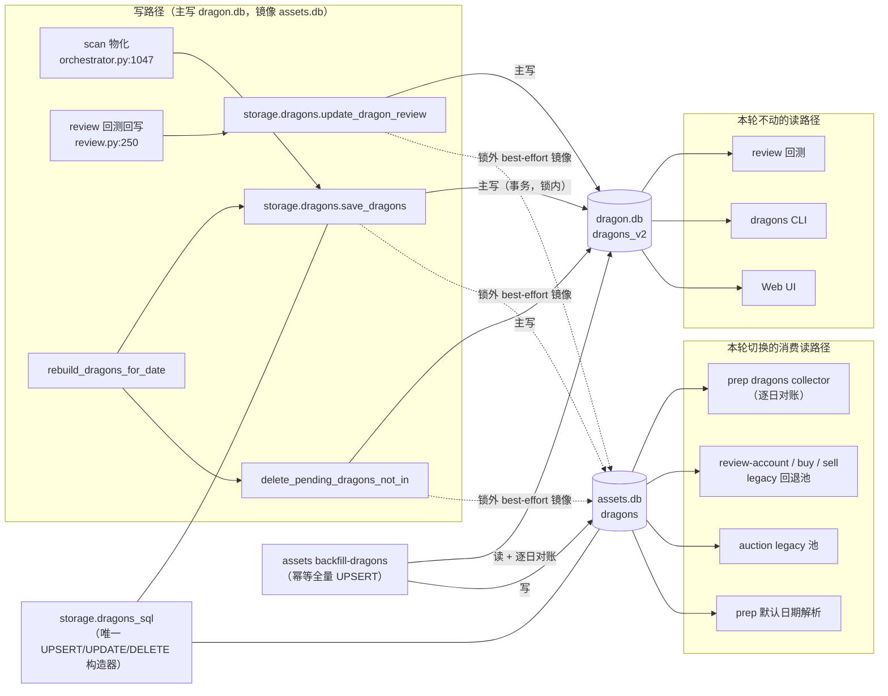
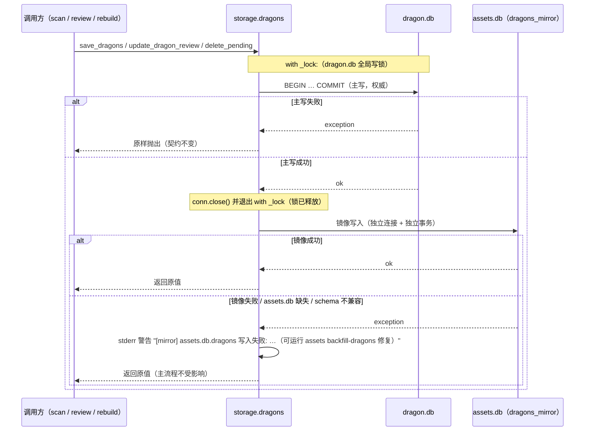
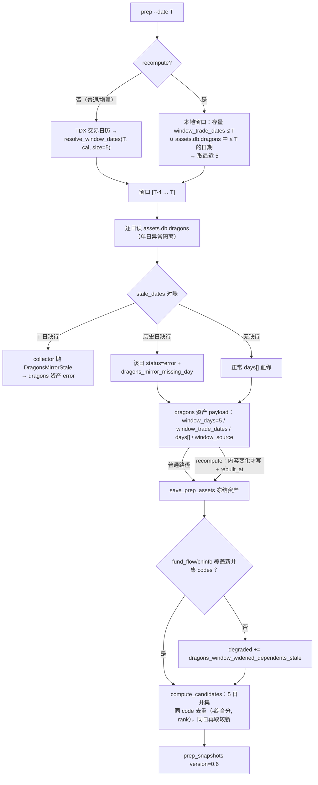

# 技术方案：dragons 全量镜像 + prep 5 日窗口 + 一键 build 全部因子

- 日期：2026-10-23
- 版本：v3（首审 REVISE 后大修 → v2；末审 APPROVE 后采纳 1 MAJOR + 2 MINOR → v3；见 §12/§13）
- 分支基线：`feat/factor-framework`（含未提交的 M6 `assets_sync` 全表同步改动）
- 阶段：阶段 2（技术方案）
- 关联需求：R1 prep 窗口 3→5 日 / R2 dragons_v2 镜像到 assets.db 双写 + 回填 / R3 消费方读源切 assets.db / R4 `factor build --all`
- 验收标准：AC1 – AC8（见 §1.3）

---

## 1. 背景与目标

### 1.1 系统现状（已核实的事实）

| 事实 | 位置 | 影响 |
|------|------|------|
| dragons 物理表按 source 分表：`dragons_v1` / `dragons_v2` | `storage/db.py:36-44` `_tables()` | 镜像只需 v2 |
| dragons 全部写入口集中在 `storage/dragons.py`：`save_dragons` / `update_dragon_review` / `delete_pending_dragons_not_in`（`rebuild_dragons_for_date` 组合前两者）；全仓无第四处直写 | `storage/dragons.py:9,98,127,454` | 双写只有一个 choke point |
| 三个写函数均在模块级 `with _lock:` 内（dragon.db 全局唯一 `threading.Lock`，非可重入） | `storage/dragons.py:15,100,463`、`_base.py:32` | 镜像 fan-out 必须放在锁外（见 §4.3 规则 6） |
| `storage/_base.py` 在模块级 import `storage.db` | `_base.py:13` | 镜像模块不得模块级 import `_base`/`db`（会形成 `db → dragons → dragons_mirror → _base → db` 的脆弱环），改用函数内惰性 import |
| dragons 调用方（写）：scan 物化、review 回写、rebuild | `orchestrator.py:1047`、`review.py:250` | 均经存储门面，无需改调用点 |
| dragons 调用方（读）：`prep` 采集器、review-account / buy / sell 回退池、auction legacy 池、`dragons` CLI、Web UI、review 回测、prep 默认日期解析 | `prep.py:141`、`simulator.py:80`、`live_trade/trader.py:119,189`、`cli_commands.py:936,952-956`、`cli_commands.py:307`、`cli_commands.py:384`、`web_ui/*`、`review.py:182` | 前五类切库，后三类不动 |
| `review-account` / `buy` 仍暴露 `--source {v1,v2}`，loader 调用会把 `cfg.source` 透传给 `loader(date, top_n=None, source=...)` | `cli.py:315,715`、`market.py:304` | 纯镜像 loader 会在 `--source v1` 时抛错，必须显式分派（§4.5） |
| prep 窗口常量 `WINDOW_TRADING_DAYS = 3`，一处常量驱动 `resolve_window_dates` / `_collect_all` / `PrepContext` | `prep.py:53,116,485-492,520` | 改常量 + 语义校验 |
| prep 快照 `version="0.5"` 为纯展示血缘，无消费者按版本分支 | `prep.py:1331`；`factors/engine.py:388` 仅透传 `snapshot_version` | 升 0.6 向后兼容 |
| 窗口降级标记 `dragons_window_short` / `dragons_partial` 同时驱动「采集计划重读」与「因子空值降级」 | `prep.py:427-442,690-707`；`factors/engine.py:309-310` | 新增标记须同步消费方 token 集 |
| `_window_degradations` 对 `window_days <= 1` 早退（旧单日资产不产生降级） | `prep.py:696-698` | 单日旧资产的自愈策略需显式决策（§4.6 改动点 3） |
| `_prepare_assets` 只做可用性过滤，**不校验 fund_flow / cninfo 的 code 覆盖**；`_uncovered_assets` 仅服务于采集计划 | `prep.py:744-758,660-690` | 窗口加宽后评级降档缺降级标记（§4.6 改动点 6） |
| `_legacy_candidates` 用 `cfg.candidate_lookback_days`（默认 3），loader 由调用方注入 | `market.py:297-312`、`models.py:49` | 改默认值 + 换 loader |
| auction legacy 默认 `days = days_arg or 3`，回退路径直接 `db.list_dragon_trade_dates` + `db.get_dragons`；候选池异常已被 try 包裹并回退 legacy | `cli_commands.py:904,933,937-941,951-957` | 改默认值 + 换读源 + 守卫行为需逐消费方定义 |
| buy 的候选池调用无 try 包裹；sell 有 try 且降级为「仅持仓判定」 | `trader.py:118,188-192` | 守卫行为必须逐消费方定义（§4.5） |
| `factor build` 的 `--only` 解析为显式名单；`names=None` 表示「仅 default_enabled」 | `factors/service.py:76-80`、`registry.py:205-232` | `--all` 必须传显式全量名单 |
| 含 fin spec 时**无条件** `finance.load_trade_calendar`（TDX 指数日K=网络） | `factors/service.py:81-93` | 「不触网」需本地预检（§4.8） |
| `build_date` 的 `ok` 只把 `status=="error"` 视为失败；`missing_source` 不置 false | `factors/engine.py:791-816` | 无财务数据时 `--all` 仍 exit 0 |
| assets.db 现有 14 张表；`TABLE_SPECS` 12 单元 + prep/auction 2 个 legacy 适配器 | `storage/assets_db.py:68-258`、`assets_sync/tables.py:62` | 新增 dragons = 第 15 表 / 第 15 单元 |
| `storage clear --all` **不删除任何 .db** | `storage/manager.py:20,124-131` | 无 `clear` 导致的镜像丢失风险 |
| 跨库写在 WAL 模式下**不是原子**的（SQLite 多库原子提交不支持 WAL） | — | 否决 ATTACH 单事务双写 |

### 1.2 需求拆解（阶段 0 已确认）

- **R1**：prep 窗口 `[T-2,T] → [T-4,T]`；review-account / auction legacy 回退池同步 5 日（`auction --days` 默认 3→5）；快照 `version 0.5→0.6`，`window_days` 语义扩展；旧资产 `--recompute` 按 5 日重放，旧版单日口径（`window_days=1`）的 recompute 语义保留。
- **R2**：assets.db 新增 `dragons` 表（列 schema 与 `dragons_v2` 一致）；存储层全量双写；幂等历史回填入口。长期废弃 `dragon.db.dragons_v2`（本轮不做）。
- **R3**：`review-account` / `buy` / `prep` / `auction` 的 dragons 读取切 assets.db；scan 主写、review 回测、`dragons` CLI、Web UI 维持 dragon.db。
- **R4**：`factor build --all` 构建全部注册因子（含默认关），绕过 `--only` 限制；fin 无数据按 fail-closed 空跑，不触网、不跑 `fin sync`。

### 1.3 验收标准

| ID | 标准 |
|----|------|
| AC1 | prep 候选池 = 含 T 最近 5 交易日真龙并集；`window_days=5`；旧资产 `--recompute` 按 5 日重放。**口径范围**：新采资产 + 3 日资产；`window_days=1` 的旧单日资产在普通 prep 下自动升级（`dragons_window_stale` 触发本地重读），`--recompute` 仍按单日口径重放（保 R1 既有语义） |
| AC2 | review-account / auction 回退池默认最近 5 日并集 |
| AC3 | scan 双写两库；review 回写双写；同 `(trade_date, code)` 两库业务列一致 |
| AC4 | 幂等历史回填入口 `dragon.db.dragons_v2 → assets.db.dragons` |
| AC5 | 四消费方的**候选/池读取** 100% 来自 assets.db（v2 生产路径）。**显式例外**：① `--source v1` 历史兼容读 `dragons_v1`（镜像只承载 v2，§4.5）；② 逐日对账 / `ensure_populated` 会只读龙源库做行数核对（零网络、不取数据） |
| AC6 | assets.db 15 表全部纳入 assets_sync（新表 TableSpec，date 分区，`volatile=True`） |
| AC7 | `factor build --all` 构建全部注册因子，区间可用 |
| AC8 | 全量测试通过；AGENTS.md / README.md 同步更新 |

### 1.4 非目标

不废弃 `dragon.db.dragons_v2`；不切 review / Web UI / `dragons` CLI 读源；不回填历史 prep 快照；不改五维评分与买卖决策逻辑；不引入新第三方依赖；不做 git 操作。

---

## 2. 候选设计与取舍

### 2.1 R2/R3：双写与读源切换

**方案 A（推荐）存储门面双写 + 独立镜像域模块**
在 `storage/dragons.py` 的三个写函数内追加镜像写入（主写 `dragon.db` **提交并释放锁后**，best-effort 写 `assets.db.dragons`），镜像实现放新模块 `storage/dragons_mirror.py`，读 API 也由它提供；两个库共用同一份 UPSERT 构造器（`storage/dragons_sql.py`），杜绝 SQL 复制。

- 优点：单点覆盖全部写路径（scan / review / rebuild），未来新增写入口自动继承；读 API 与 `db.get_dragons*` 签名兼容；SQL 规则只有一份。
- 缺点：同一业务操作跨两个连接，无法原子提交，需定义失败语义（§4.3）。

**方案 B 调用点显式双写**
在 `orchestrator.py` / `review.py` 各自显式写两库。
- 缺点：规则复制 3 处，新增写入口必然漏写；与项目「规则只有一份」的既有约束冲突。**否决。**

**方案 C 单写 dragon.db + 每次 prep/消费前增量同步**
- 优点：无跨库一致性问题。
- 缺点：消费方读到的是「上次同步时刻」的数据，review 回写后的 `max_return_5d` 会滞后；需调度与水位；R2 明确要求双写。**否决。**

**方案 D（非常规/反直觉）立刻翻转主从：assets.db.dragons 做主表，dragon.db.dragons_v2 降级为兼容影子表**
- 优点：一步到位对齐长期方向，回填变成一次性「重放写」。
- 缺点：review / UI / `dragons` CLI 的可用性将依赖 assets.db；回滚成本高；本轮非目标明确「不废弃 dragons_v2」。**本轮不采用**，记录为下一里程碑候选。

**方案 E（非常规）SQLite `ATTACH` 单事务双写**
- 期望跨库原子性。**否决**：SQLite 文档明确 WAL 模式下不支持多库原子提交，两个库均为 WAL（`db.py:213`、`assets_db.py:315`），只能得到「分别提交」的假原子。

> 结论：方案 A。

### 2.2 R2：历史回填入口形态

| 方案 | 评价 |
|------|------|
| **A（推荐）新增 `assets backfill-dragons` 子命令** | 显式、可 `--dry-run`、可区间化、幂等；与 assets.db 生命周期命令族同域；不污染日常热路径 |
| B 挂到 `storage` 命令下 | `storage` 语义是「本机文件管理」，与数据迁移不贴合 |
| C（非常规）首次启动自动迁移 | 隐式长生事务、启动变慢、失败难观测；破坏 `prep`/`buy` 的「不触网不写库」契约。**否决** |

> 结论：方案 A；若 reviewer 认为命名混淆，可平移为 `storage backfill-dragons`（实现零改动）。

### 2.3 R1：5 日窗口与旧资产 `--recompute` 重放

问题：`--recompute` 契约是「零检测零采集，用已存资产重算」（`prep.py:1391-1399`），而旧资产的 `prep_assets.dragons` 冻结的是 3 天数据。要「按 5 日重放」且不破契约，必须有一个**本地、确定、零网络**的 dragons 来源——正是 R2 镜像提供的能力。

| 方案 | 评价 |
|------|------|
| **A（推荐）recompute 从 `assets.db.dragons` 本地重建 5 日窗口并回写资产** | 零网络；窗口可解析；回写保证「快照 = 资产纯函数」，且后续普通 prep 不退回 3 日 |
| B 纯重放冻结资产（3 日资产仍按 3 日重算） | 实现最省，但不满足 AC1；快照长期停留旧口径 |
| C recompute 也走 TDX 交易日历 | 违反「recompute 不触网」契约；离线不可用 |

> 结论：方案 A；普通（非 recompute）路径仍用 TDX 日历解析窗口，两路径共用同一 payload 构造函数。

### 2.4 R4：`--all` 的语义实现

| 方案 | 评价 |
|------|------|
| **A（推荐）`--all` → 展开为显式全量名单传给 `resolve_specs`** | 复用既有 `names` 通道；`--all` 与 `--only` 互斥；`enabled_only` 只在 `names is None` 时生效 |
| B 给 `resolve_specs` 加第三态 `enabled_only=False` | 三态参数可读性差，`engine.build_date` 也须同步改，扩散面大 |
| C（非常规）翻转默认：`build` 默认全量、`--default-only` 收窄 | 静默改变所有历史脚本与 CI 行为，默认关因子突然产出。**否决** |

> 结论：方案 A。

---

## 3. 总体架构

### 3.1 读/写依赖方向



### 3.2 分层与新增模块

```
storage/
├── db.py                 # 仅加门面再导出（无逻辑变更）
├── dragons_sql.py        # 新增：表名参数化的 UPSERT / UPDATE review / DELETE pending（唯一 SQL 规则源）
├── dragons.py            # 写函数内「锁外」追加镜像调用（+ 3 处 fan-out）
├── dragons_mirror.py     # 新增：镜像写/读/逐日对账/回填/差异检测（assets.db 域）
└── assets_db.py          # 新增 dragons DDL + 形状探针 + 连接（无业务逻辑）

assets_sync/
├── tables.py             # + DragonsAssetSource / TABLE_SPECS 一行
└── sources.py            # + SOURCE_CLASSES 注册一行

review_account/
├── prep.py               # 窗口 5 / 读源切镜像 + 逐日对账 / window_stale / recompute 重建 / 覆盖度降级 / 0.6
├── models.py             # candidate_lookback_days 3→5
├── market.py             # docstring+兜底默认 5；新增 candidate_loader(source) 分派
├── simulator.py          # loader 换 candidate_loader(cfg.source)
└── live_trade/trader.py  # 同上（buy/sell 两处）

factors/
├── service.py            # --all 展开 + 与 --only 互斥 + fin 日历按需加载
└── engine.py             # _PREP_DRAGONS_DEGRADED_TOKENS 增加 window_stale / mirror_missing_day / dependents_stale
```

**导入约束（精确表述）**：`dragons_mirror` 在模块级只 import `storage.assets_db` 与 `storage.dragons_sql`；读取源库行数时在**函数内**惰性 `from dragon_quant.storage import db`（此时 `db` 已完整初始化），不模块级 import `db`/`_base`，避免 `db → dragons → dragons_mirror → _base → db` 的环依赖。无新增第三方依赖。

---

## 4. 详细设计

### 4.1 数据模型：assets.db `dragons`

列 schema 与 `dragons_v2` 完全一致（含 `id` / `source`），保证「同一行语义可直接对拷」；一致性测试用 `PRAGMA table_info` 做列集合相等断言（§6 AC3）。

```sql
CREATE TABLE IF NOT EXISTS dragons (
    id                    INTEGER PRIMARY KEY AUTOINCREMENT,
    trade_date            TEXT NOT NULL,
    code                  TEXT NOT NULL,
    name                  TEXT,
    scan_id               TEXT,
    rank                  INTEGER,
    composite_score       REAL,
    board_count           INTEGER,
    open_px               REAL,
    close_px              REAL,
    high_px               REAL,
    low_px                REAL,
    pct                   REAL,
    turnover_rate         REAL,
    amount                REAL,
    market_cap            REAL,
    concepts_json         TEXT,
    report_text           TEXT,
    is_true_dragon        INTEGER,
    version               TEXT DEFAULT '',
    created_at            TEXT DEFAULT (datetime('now','localtime')),
    buy_date              TEXT,
    buy_price             REAL,
    max_return_5d         REAL,
    max_drawdown_5d       REAL,
    max_return_hold_days  INTEGER,
    review_status         TEXT DEFAULT 'pending',
    source                TEXT DEFAULT 'v2',
    UNIQUE(trade_date, code)
);

CREATE INDEX IF NOT EXISTS idx_assets_dragons_date   ON dragons(trade_date);
CREATE INDEX IF NOT EXISTS idx_assets_dragons_code   ON dragons(code);
CREATE INDEX IF NOT EXISTS idx_assets_dragons_review ON dragons(review_status, trade_date);
```

约定：

- `id` 本地自增，与源库同名主键不保证相等；不参与一致性判定、不进入 assets_sync 语义列。
- `created_at` 为各库本地写入时间，同样排除在一致性判定外（`created_at` 语义见 §4.6 改动点 5）。
- `_REQUIRED_COLUMNS` 增加 `"dragons": ("trade_date", "code", "name", "composite_score", "review_status")`，用于 wrong-DB 识别；写路径全量断言自动继承。
- 读路径 `_connect(create=False)`：assets.db 不存在时返回 `None`，绝不因查询建库（沿用既有契约）。

### 4.2 `storage/dragons_sql.py` + `storage/dragons_mirror.py` 接口

**`dragons_sql.py`（唯一 SQL 规则源，两个库共用）**

```python
def upsert_dragons(conn, table: str, trade_date: str, dragons: list[dict],
                   version: str, source: str) -> None:
    """与 dragons_v2 语义逐字对齐：不覆盖 review 字段，价格列 COALESCE。"""

def update_review(conn, table: str, trade_date: str, code: str, *,
                  buy_date=None, buy_price=None, max_return_5d=None,
                  max_drawdown_5d=None, max_return_hold_days=None,
                  review_status: str = "completed") -> int:
    """返回 rowcount；0 行 = 目标库缺行。"""

def delete_pending_not_in(conn, table: str, trade_date: str,
                          keep_codes: set[str]) -> int: ...
```

`storage/dragons.py` 改为调用本模块（主库连接），`dragons_mirror` 也调用本模块（镜像连接）→「两表列语义漂移」在结构上不可能发生；再加列集合相等测试兜底。

**`dragons_mirror.py`**

```python
class DragonsMirrorEmpty(RuntimeError): ...      # 镜像整体为空且源库有行
class DragonsMirrorStale(RuntimeError): ...      # 某日源库有行而镜像 0 行（取数故障）
class DragonsMirrorSourceError(ValueError): ...  # source != "v2"

# ── 写（供 storage/dragons.py 锁外调用；失败向上抛，由门面转警告）──
def save_dragons(trade_date: str, dragons: list[dict],
                 version: str = "", source: str = "v2") -> int: ...
def update_dragon_review(trade_date: str, code: str, **fields) -> int: ...
def delete_pending_dragons_not_in(trade_date: str, keep_codes: set[str]) -> int: ...

# ── 读（供四消费方；签名与 db.* 兼容，source 只接受 v2）──
def get_dragons(trade_date: str, source: str = "v2") -> list[dict]:
    """纯读取（不抛 stale）：prep 逐日读用它，由调用方做对账。"""
def get_dragons_by_date(trade_date: str, top_n: int = 5,
                        source: str = "v2") -> list[dict]:
    """池 loader：0 行且源库该日有行 → DragonsMirrorStale（fail-fast）。"""
def list_dragon_trade_dates(source: str = "v2") -> list[str]: ...

# ── 对账 / 回填 ──
def stale_dates(dates: Iterable[str]) -> dict[str, int]:
    """逐日对账 → {date: source_row_count}，只含「源有行、镜像 0 行」的日期。
    零网络、每日期最多 2 次 COUNT（两侧 trade_date 均有索引）。"""
def ensure_populated() -> None:
    """镜像 0 行且源库有行 → DragonsMirrorEmpty（附可执行命令）。"""
def backfill_dragons(*, date_from=None, date_to=None, dry_run=False,
                     prune=False, db_path=None) -> dict: ...
def diff_dragons(*, date_from=None, date_to=None, db_path=None) -> dict: ...
```

返回 dict 形状与 `db.get_dragons` / `db.get_dragons_by_date` **键完全一致**（含 `trade_date`、review 字段、`is_true_dragon: bool|None`、`concepts: list`、`source="v2"`）。

### 4.3 双写契约与失败语义



规则：

1. **`dragon.db` 是权威**。镜像失败绝不回滚/阻断主写，也绝不吞掉主写异常。
2. **镜像失败可自愈**：`assets backfill-dragons` 幂等全量 UPSERT，重跑即收敛。
3. **`update_dragon_review` 镜像影响 0 行** → 记 `mirror_missing_row` 警告（回填可补）。
4. **`delete_pending_dragons_not_in` 必须同步删除镜像**，否则镜像残留被删的 pending 行，会污染候选池。
5. **一致性判定口径**（AC3）：同一 `(trade_date, code)` 的业务列逐列相等；`id` 与 `created_at` 排除。
6. **锁序与临界区（强制）**：镜像 fan-out 必须在 `with _lock:` **退出之后**执行（主写 `finally: conn.close()` 后）。声明锁序「**禁止**持 `dragon._lock` 时调用任何 assets.db 写」；镜像函数内部只取 `assets_db._lock`。理由：`dragon._lock` 是全库唯一不可重入锁，若把 `assets.db`（`busy_timeout=5000`）的写纳入临界区，最坏会让整库写入阻塞 5 秒，并引入未声明的跨库锁序。测试用「注入慢镜像（sleep）」验证并发 `save_dragons` 不被阻塞。
7. **并发**：`assets.db` 已设 `busy_timeout=5000`（`assets_db.py:316`），prep/auction 定时任务与 scan 重叠时由 SQLite 等待吸收；镜像失败走规则 1。

### 4.4 逐日镜像对账（首审 CRITICAL 的修复）

**问题**：镜像写失败是 best-effort，只留一条 stderr 警告。若失败发生在**当日**（T），prep 会把它读成 0 行，`_collect_dragons` 记 `status="empty"`（`prep.py:153`），`_window_degradations` 再把任意 empty 折叠为 `dragons_partial`（`prep.py:704-706`）——与「该日真的没有真龙」完全同形，`collection_health` 的本地重读读的仍是同一份缺行镜像，**不收敛**。这违反项目既有契约「绝不把取数故障伪装成无龙头」（`prep.py:165-166`）。

**修复：按日期而不是按整体/部分划分严格度。**

1. `_collect_dragons` 读完窗口后调用 `dragons_mirror.stale_dates(window)`。
2. 对每个 stale 日：
   - 把 `days[]` 对应项改写为 `{"trade_date": day, "count": 0, "status": "error", "error": "mirror_stale_day: 源库有行而镜像缺行"}`（**不得**保留 `empty`）；
   - 该日不贡献候选行（镜像本来就没读到）。
3. **目标日 `day == trade_date` 为 stale → 先短重试一次（200ms 后重核对），仍 stale 再抛 `DragonsMirrorStale`**（沿用现有「并集为空且有 error 才 raise」的相邻语义，但更早、更明确）：`_collect_all` 记 dragons 资产 error，其余资产照常，prep 继续产出「无候选 + 降级」快照；CLI 理由行可见。重试窗口覆盖「scan 主写已提交、镜像尚在写入」的毫秒级并发窗口（见 §7 R-14）。
4. **历史日（`day < trade_date`）stale** → 不硬失败，但降级标记从 `dragons_partial` 拆出独立 token `dragons_mirror_missing_day`（`_window_degradations` 按 `days[].error` 前缀区分），使「数据丢失」与「真实空日」在快照与 CLI 可区分。
5. `_PREP_DRAGONS_DEGRADED_TOKENS` 增加 `dragons_mirror_missing_day`，维持因子层 fail-closed（不 DELETE 历史因子行）。
6. 池 loader（`get_dragons_by_date`）对单日同样 fail-fast：0 行且源库该日有行 → `DragonsMirrorStale`，消息含回填命令。理由是候选池缺一天会静默减少买点，比报错更危险。
7. **枚举型读路径也必须对账**（末审补充）：`prep` 默认日期解析与 `auction` legacy 直读块不是「按日 loader」，而是先枚举 `list_dragon_trade_dates()` 再逐日读；某日镜像整体缺行时该日**根本不出现在日期集合里**，窗口会自动前移一天、池静默换日 + 变小，且 `get_dragons` 不抛 stale。因此：
   - 拿到 `recent_dates` 后各调用一次 `stale_dates(recent_dates)`（成本同量级）；
   - **prep 默认日期**：最新日期 stale → 直接报错（消息含 `assets backfill-dragons`），**不静默回退到上一交易日**；
   - **auction legacy**：stale 日 → `ctx["degraded"]` 追加 `dragons_mirror_missing_day`、`fallback_reason="mirror_stale_day"`，按既有「不硬失败」策略继续。

成本：每次 prep ≤ 5 个日期 × ≤2 次 COUNT；每次池 loader 每日最多 1 次额外 COUNT（仅在该日镜像为空时）；两处枚举路径各 ≤5 日的同类对账。


### 4.5 读源切换与守卫行为（AC5）

| 调用点 | 现状 | 目标 |
|--------|------|------|
| `prep._collect_dragons` | `db.get_dragons(day, source="v2")`（`prep.py:141`） | `dragons_mirror.get_dragons(day)` + `stale_dates` 对账 |
| `review_account/simulator.py:80` | 注入 `db.get_dragons_by_date` | 注入 `candidate_loader(cfg.source)` |
| `live_trade/trader.py:119,189` | 同上 | 同上 |
| `cli_commands.py:936` | 同上（auction prep 池） | 同上 |
| `cli_commands.py:952-957` | `db.list_dragon_trade_dates` + `db.get_dragons` | `dragons_mirror.list_dragon_trade_dates` + `get_dragons` + **`stale_dates(recent_dates)` 对账**（异常回退已由外层 try 覆盖，legacy 直读块需补 try） |
| `cli_commands.py:384` | prep 默认日期 `db.list_dragon_trade_dates` | `dragons_mirror.list_dragon_trade_dates` + **最新日期 stale → 报错**（镜像空 / 最新日缺行均不得静默回退） |
| `review.py` / `cli_commands.py:300-307` / `web_ui/*` | `db.*` | **不变** |

**`--source` 分派（既有 CLI 能力不得被破坏）**：`review-account` 与 `buy` 仍暴露 `--source v1`（`cli.py:315,715`）。在 `review_account/market.py` 新增

```python
def candidate_loader(source: str = "v2"):
    """v2 → assets.db 镜像；v1 → dragon.db.dragons_v1（历史兼容例外，镜像不承载 v1）。"""
    if (source or "v2").lower() == "v1":
        from dragon_quant.storage import db
        return db.get_dragons_by_date
    from dragon_quant.storage import dragons_mirror
    return dragons_mirror.get_dragons_by_date
```

调用点统一 `candidate_loader(cfg.source)`。`--source v1` 属 AC5 的**显式例外**（v1 已废弃，仅历史查询），并在 AGENTS/README 写明。

**消费方 × 守卫行为表（禁止「一句话统一处理」）**

| 消费方 | 镜像整体为空 | 当日 stale | 历史日 stale | 失败可见性 |
|--------|--------------|-----------|--------------|-----------|
| `prep` | dragons collector error | collector 抛 `DragonsMirrorStale` → dragons error | 该日 `error` + `dragons_mirror_missing_day` 降级 | 快照 `sentiment.degraded` + CLI 理由行 |
| `buy` | loader 抛出 → 命令失败 | 同左 | 同左（该日池构造失败） | exit 1 + 回填命令（`trader.py:118` 无 try，保持现状） |
| `sell` | loader 抛出 → 既有 except 降级为「仅持仓判定」 | 同左 | 同左 | `degraded` 增加 `candidate_pool_unavailable: <msg>`（补显式文案，不静默） |
| `auction` | 现有 try 回退 legacy → legacy 直读也失败 → 记 `degraded` | 同左 | 同左 | 不硬失败（auction 本就有回退路径），输出 `fallback_reason` + `degraded` |
| `review-account` | `collect_candidates_ex` 上抛 → 回测中止 | 同左 | 同左 | exit 1 + 回填命令；不产出部分结果（与 `DataCoverageError` 既有语义一致） |
| `prep` 默认日期（枚举） | 无日期集合 → 报错并提示回填 | **最新日期 stale → 报错**（不得回退到上一交易日） | 不适用（只取最新） | stderr + 非零退出；不落快照 |
| `auction` legacy（枚举） | 无日期集合 → 既有「最近 N 日无龙头」提示 | `degraded += dragons_mirror_missing_day`、`fallback_reason="mirror_stale_day"` | 同左 | 不硬失败；`--json` 的 `degraded`/`fallback_reason` 可见 |

每格配一条测试（§6）。

### 4.6 R1：prep 5 日窗口 + recompute 重放



改动点：

1. `WINDOW_TRADING_DAYS = 3 → 5`（`prep.py:53`）；所有默认参数自动跟随。
2. 抽出 `build_dragons_payload(window, window_days, *, window_source, stale=…) -> dict`（把 `_collect_dragons` 的逐日循环、`days[]` 构造与 §4.4 对账提为纯函数），`_collect_dragons` 与 recompute 重建共用。错误信息 `f"{len(window)}日龙头读取失败：…"`。
3. **窗口口径落后检测**：`_window_degradations` 改为

   ```python
   wd = payload.get("window_days")
   if not isinstance(wd, int) or isinstance(wd, bool):
       return []                       # 旧资产无口径信息：不假设
   marks = []
   if wd < WINDOW_TRADING_DAYS:
       marks.append("dragons_window_stale")   # 含 window_days==1 的旧单日资产
   ```
   该标记同时满足两个目的：`collection_health` 判 dragons 需重读（零网络，`same_day_only=False`），使普通 prep 重跑历史日升级到 5 日；快照 `sentiment.degraded` 如实暴露口径落后。
   **单日旧资产策略**：普通 prep 会自动升级（本地重读）；`--recompute` 对无 `days[]` 的单日资产**不重建**，按单日口径重放（保留 R1 既定语义）。
4. `factors/engine.py` 的 `_PREP_DRAGONS_DEGRADED_TOKENS` 增加 `"dragons_window_stale"`、`"dragons_mirror_missing_day"`、`"dragons_window_widened_dependents_stale"`。
   **同时更新 `review_account/advice.py::DEGRADED_LABELS`**（末审补充）：补三个中文标签，并把既有写死数字的文案 `"dragons_partial": "近三日龙头窗口缺日"` / `"dragons_window_short": "交易日历不足三日"` 改为不含数字的通用文案（如「龙头窗口缺日」「交易日历不足以填满窗口」），避免常量改 5 日后文案变成事实性错误、以及将来再次随常量漂移。未知 token 原样展示（`advice.py:224`），不改该约定。
5. **recompute 重建 + 审计**：`run_prep(recompute=True)` 读存量资产后调用

   ```python
   refreshed = rebuild_dragons_for_recompute(trade_date, stored_assets)
   if refreshed is not None:
       assets_db.save_prep_assets(trade_date, {"dragons": refreshed})
       assets = assets_db.get_prep_assets(trade_date)
   ```
   跳过条件：存量 dragons 资产无 `days[]`（旧单日口径）或资产缺失。`refreshed` payload 增加只增审计键 `rebuilt_at` / `rebuilt_from_window_days` / `window_source="local"`。不写 `collection_report`（避免把「本地重建」伪装成「采集健康状态」）；`created_at` 语义据此明确为「该资产行最后刷新时间（采集或本地重建）」，写入 AGENTS。
6. **依赖资产覆盖自检**：窗口加宽会让新入候选的 `fund_flow` / `cninfo_announcements` 为 `flow_available=false`，`verdicts.py` 会因此失去 strong 资格并标「数据缺失，评级降档」（`verdicts.py:321-322,368-369`）。`_prepare_assets` 对 dragons 资产额外调用 `_uncovered_assets(assets, _asset_codes(payload), set())`，命中则追加 `dragons_window_widened_dependents_stale`（不伪造资金数据，只让降级原因可见）。该检查在 compute 段，不影响采集计划。
7. 快照 `version="0.6"`（`prep.py:1331`）。`dragon_source` 结构不变（`window_days` 自然变 5）；资产 payload 增加只增字段 `window_source`（`calendar` / `local`）。

### 4.7 R1：回退池 5 日

- `StrategyConfig.candidate_lookback_days: 3 → 5`（`models.py:49`）；`market.py:299` 的 `getattr` 兜底同步改 5。
- `cli_commands.py:904` `days = days_arg or 5`；`auction --days` 帮助文本与 AGENTS 文档同步。
- 影响面：`_legacy_candidates` 取 `candidate_dates(calendar, day, lookback)[-5:]`；`calendar_start` 用 `max(40, lookback*4)` 仍为 40 天，无需改。
- **研究基线声明（强制文档）**：回退池默认 5 日 = 策略默认参数变更，`review-account` 历史 run 与 3 日基线**不可直接比较**；复现旧基线请显式 `candidate_lookback_days=3`。写入 AGENTS 与 `review_account/STRATEGY.md`。prep 命中路径不受该参数影响。

### 4.8 R4：`factor build --all`

- CLI：`factor build` 增加 `--all`（`action="store_true"`，帮助文案注明「构建全部注册因子，含默认关；与 --only 互斥」）。
- `service.build(..., all_factors=False)`：

  ```python
  names = parse_only(only)
  if all_factors:
      if names is not None:
          raise ValueError("--all 与 --only 互斥")
      names = list(spec_names())          # 显式全量 → enabled_only 不再生效
  specs = resolve_specs(names, enabled_only=names is None)
  ```
- **触网边界（精确表述）**：现有 `service.build` 只要含 fin spec 就无条件 `finance.load_trade_calendar(...)`（TDX 指数日K=**网络**），用于财务 stale 判定。改为**本地预检**：仅当 `storage.finance.has_any_fin_data()`（`fin_report_records` / `fin_observed_snapshots` 任一有行）为真才加载；否则 `calendar=()`。
  - 于是「不触网」准确含义 = **无财务数据时不触网**；已有财务数据时仍读 TDX 日历（失败只 `warning`，不阻断）。
  - 该改动同样影响 `--only fin_*`（无数据时不再加载日历、不再出现 `stale_calendar_missing`），属既有行为收敛，写入 AGENTS。
  - 无财务数据时 fin 因子返回 `missing_source`（既有 fail-closed），`build_date.ok` 不置 false（`engine.py:791-797`），退出码 0。已核实所有 `lookback != 0` 的因子不存在（fin 系 `lookback=0`），跳日历不会让其它因子落到 `insufficient_data`。
- 区间模式：`--all --from/--to` 逐日展开复用 `_resolve_dates`，无需改动。

### 4.9 R2：assets_sync 纳入（AC6）与恢复收敛

`TABLE_SPECS` 增加一行（注册表模式，`CompositeTableSource` 模板方法零改动）：

```python
TableSpec(
    source="dragons", asset_type="mirror", table="dragons",
    partition_kind="date", partition_column="trade_date",
    columns=("trade_date", "code", "name", "scan_id", "rank", "composite_score",
             "board_count", "open_px", "close_px", "high_px", "low_px", "pct",
             "turnover_rate", "amount", "market_cap", "concepts_json",
             "report_text", "is_true_dragon", "version", "buy_date", "buy_price",
             "max_return_5d", "max_drawdown_5d", "max_return_hold_days",
             "review_status", "source"),
    identity=("trade_date", "code"),
    side_columns=("created_at",), json_columns=("concepts_json",),
    order_by=("code",), volatile=True,
    clock_column="created_at",
    size_expr="LENGTH(COALESCE(report_text,''))"
              "+LENGTH(COALESCE(concepts_json,''))",
)
```

`class DragonsAssetSource(CompositeTableSource): name = "dragons"`，注册进 `SOURCE_CLASSES`（`sources.py:249`）。

- **`volatile=True` 的依据**：review 回写只 `UPDATE` buy/review 列，不刷新 `created_at`（`dragons.py:469-480`），水位 `max(created_at)|count|bytes` 不前进；AC6 亦明确要求 volatile。强制重读后由内容哈希判等，无变化时仍零 blob PUT。成本见 R-11。
- assets.db 表数 14 → 15；`status.summary.tables` 自动出现 `dragons:mirror`；`not_synced` 保持 `{}`。
- **恢复与收敛（首审 MAJOR 修复）**：`dragons` 单元是**本地权威表的镜像**，就地 `pull` 会把远端 manifest 里「源库已删」的 pending 行重新插回（行级恢复只做 insert/update，从不 delete）。因此：
  1. 唯一受支持的恢复路径 = `assets pull --target-dir`（隔离恢复，不污染主 assets.db）；
  2. 若确需就地 pull：收敛命令是 `backfill-dragons --prune`（**不是**裸 backfill）。`--prune` 的安全性论证：prune 只删「`dragon.db.dragons_v2` 中不存在」的镜像行，源库是权威，不存在「误删不可再生资产」的风险——dragons 行可由源库重建，这与 prep/auction 的不可再生资产性质不同；
  3. `--dry-run` 输出区分 **`missing_rows`**（源有、镜像无）与 **`orphan_rows`**（源无、镜像有），让运维判断该 prune 还是该补；
  4. 主库 `pull --force` 的既有禁令继续适用。

---

## 5. 接口与契约汇总

### 5.1 CLI

| 命令 | 新增/变更 | 契约 |
|------|-----------|------|
| `assets backfill-dragons [--from D] [--to D] [--dry-run] [--prune] [--json]` | 新增 | 默认人读摘要；`--json` 稳定顶层键：`ok/mode/dry_run/from/to/dates/rows_source/inserted/updated/unchanged/missing_rows/orphan_rows/pruned/failed/warnings`；退出码 0 成功 / 1 部分日期失败 / 2 参数错误或库不可用 |
| `factor build --all` | 新增开关 | 与 `--only` 互斥（argparse 后校验 → `ValueError` → exit 2）；`--json` 顶层键不变（`ok/mode/dates/build_ids/reports/warnings`） |
| `auction --days` | 默认 3→5 | 帮助文本更新；prep 池成功时仍输出 `days_ignored` |
| `prep --recompute` | 语义扩展 | 零采集、零网络；本地重建 dragons 资产并回写（仅 dragons 资产行 + `rebuilt_at` 审计键） |

**错误通道（与项目既有契约一致）**：`backfill-dragons` 默认模式错误（参数错误 / assets.db 不可用）写 stderr 并以 exit 2 退出；`--json` 模式错误以 `{ok: false, error: "..."}` 写 **stdout** 且退出码仍为 2；单日失败（exit 1）在两种模式下都输出完整汇总（含 `failed[]`）。

### 5.2 Python API

- `storage.dragons.save_dragons / update_dragon_review / delete_pending_dragons_not_in`：**签名与返回值不变**；内部「锁内主写 → 锁外镜像」。
- `storage.dragons_sql.*` / `storage.dragons_mirror.*`：见 §4.2。
- `review_account.market.candidate_loader(source)`：v1/v2 分派（§4.5）。
- `review_account.prep.build_dragons_payload(window, window_days, *, window_source)`、`rebuild_dragons_for_recompute(trade_date, assets)`、`_prepare_assets` 覆盖度自检：新增/改造。
- `storage.finance.has_any_fin_data(*, db_path=None) -> bool`：新增只读探针。

### 5.3 错误处理

| 场景 | 行为 |
|------|------|
| 主写 dragon.db 失败 | 原样抛出（不变） |
| 镜像写失败 | stderr 警告（锁外），主流程继续；回填可修复 |
| 镜像缺行（review 回写 0 行） | 警告 `mirror_missing_row`，不抛 |
| 镜像整体为空且源库有行 | `DragonsMirrorEmpty`（消费方入口），消息含修复命令 |
| 某日源有行、镜像无行 | `DragonsMirrorStale`（池 loader / prep 当日）或 `dragons_mirror_missing_day`（prep 历史日） |
| `source != "v2"` 传给镜像读/写 | `DragonsMirrorSourceError`；`--source v1` 由 `candidate_loader` 分派到源库，不触发该错误 |
| assets.db schema 形状不符 | 写路径 `AssetsDbSchemaError`，镜像层转警告 |
| 回填单日失败 | 记 `failed` 继续；退出码 1 |
| `--all` + `--only` | `ValueError` → exit 2 |
| prep 单日 dragons 读失败 | 该日 `status=error`，其余日继续；并集为空且有 error → collector 抛错（不变） |
| recompute 无存量 dragons 资产 | 跳过重建，按既有「资产缺失」降级路径重算 |

---

## 6. 测试策略（逐 AC 映射）

| AC | 测试文件 | 关键断言 |
|----|----------|----------|
| AC1 | `tests/test_prep.py`（改+增） | `WINDOW_TRADING_DAYS==5`；`resolve_window_dates(size=5)`；payload `window_days=5` 且 `days` 5 条；5 日并集去重；`_window_degradations`：3 日资产→`dragons_window_stale`、`window_days=1`→`dragons_window_stale`（普通 prep 可升级）、无 `window_days` 键→`[]`；`run_prep(recompute)` 用临时 assets.db 把 3 日资产重建为 5 日并写回（含 `rebuilt_at`/`window_source="local"`）；旧单日资产 recompute 仍 `window_days=1`；快照 `version=="0.6"`；**`advice.py` 文案**：三个新 token 均有中文标签、既有标签不再含「三日」字样（同步 `test_window_degraded_labels_are_rendered`） |
| AC2 | `tests/test_review_account.py`、`tests/test_auction_pool.py`、`tests/test_live_trade.py` | `StrategyConfig().candidate_lookback_days==5`；`_legacy_candidates` 取 5 个日期（loader 记录调用日期）；`auction` legacy 默认 5 日；显式 `candidate_lookback_days=3` 可复现旧基线 |
| AC3 | `tests/test_dragons_mirror.py`（新）、`tests/test_storage.py` | `save_dragons`/`update_dragon_review`/`delete_pending_dragons_not_in`/`rebuild_dragons_for_date` 后两库业务列逐列相等（排除 id/created_at）；**`PRAGMA table_info` 列名集合相等**；镜像异常注入 → 主库已落、不抛、警告；慢镜像（sleep）不阻塞并发 `save_dragons`（锁外验证） |
| AC4 | `tests/test_dragons_mirror.py` | 回填两次 → 第二次 `inserted=updated=0`；`--dry-run` 不写且区分 `missing_rows`/`orphan_rows`；`--prune` 只删源库不存在的行；`--from/--to` 过滤；review 字段被完整复制 |
| AC5 | 同上 + 静态检查 | 四个消费方读由 `dragons_mirror` 提供（注入 loader 的 mock 断言 `db.get_dragons_by_date` 未被调用，v2 路径）；`candidate_loader("v1")` 返回源库 loader；`ensure_populated` 空镜像抛错且消息含命令；`get_dragons_by_date` 对 stale 日抛 `DragonsMirrorStale`；静态检查覆盖 `prep.py`/`simulator.py`/`trader.py`/`cli_commands.py`；**逐消费方守卫行为**（prep error、buy exit 1、sell degraded、auction fallback、review-account 中止）各一条；**枚举路径**：prep 默认日期最新日 stale → 报错且不回退；auction legacy 枚举 stale 日 → `degraded` + `fallback_reason="mirror_stale_day"` |
| AC6 | `tests/test_assets_sync_tables.py`、`tests/test_assets_sync_full_sync.py`（改） | `TABLE_SPECS` 含 `dragons:mirror` 且 `volatile=True`；`test_covers_every_new_table` 的精确表集合加入 `dragons`；`test_volatile_set_is_explicit` 加入 `dragons:mirror`；`SOURCE_CLASSES` 含 `DragonsAssetSource`；LocalDirBackend push/pull 往返；「pull 插回已删行 → `--prune` 收敛」用例 |
| AC7 | `tests/test_factors_registry.py` 或新增 `tests/test_factors_build_all.py` | `build(all_factors=True)` 的 `reports` 键集合 == `spec_names()`；`--all --only` → `ValueError`；**无** fin 数据时不调用 `load_trade_calendar`（mock 断言）且 fin 因子 `missing_source`、`ok=True`；**有** fin 数据时调用日历且失败不阻断；区间 `--all` 逐日展开 |
| AC8 | 全量 | `pytest -q` 全绿；AGENTS.md / README.md 同步更新（同一 commit，实施阶段执行） |

另需覆盖的降级断言：3 日资产 + 5 日镜像 recompute 后，新入窗口候选的 `flow_available=false` 必须伴随 `dragons_window_widened_dependents_stale`（不得静默降到 light）。

测试基建沿用既有约定：临时目录 patch `storage.paths.DB_PATH / ASSETS_DB_PATH`（或 patch `_connect`）、`LocalDirBackend`、无网络。

---

## 7. 风险与缓解

| # | 风险 | 影响 | 缓解 |
|---|------|------|------|
| R-1 | 双写非原子（WAL 不支持跨库原子提交） | 镜像落后/缺行 | 权威= dragon.db；幂等回填；镜像失败显式警告；逐日对账把「缺行」与「空日」分开 |
| R-2 | 镜像成为四消费方单点 | assets.db 丢失 → buy/review-account 不可用 | 空镜像守卫 + 明确修复命令；源库仍在，回填可完全恢复 |
| R-3 | 部分日期未回填 | 池静默变小 | 逐日对账 fail-fast（当日）+ 历史日独立降级 token；`--dry-run` 体检；发布清单强制先回填 |
| R-4 | `assets pull` 恢复造成两库漂移 | UI/review 与 buy 看到不同数据 | 恢复只走 `--target-dir`；就地 pull 后必须 `backfill-dragons --prune`；维持 `pull --force` 禁令 |
| R-5 | 5 日窗口扩大候选池 | prep 同日 fund_flow/cninfo 请求数上升 | 可接受；批量接口不变；跨日候选归因仍为 null（既有语义） |
| R-6 | recompute 本地窗口推断（跳过无数据日）与真实日历不完全一致 | 快照口径略有差异 | payload `days[]` + `window_source="local"` 自描述；缺日标 `dragons_window_short` |
| R-7 | 新增降级 token 扩散 | 消费方漏判 → 因子误删/误留 | 三个 token 同步进 `_PREP_DRAGONS_DEGRADED_TOKENS`；新增测试覆盖 |
| R-8 | 回填大表耗时/内存 | 升级时常 | 按 `trade_date` 分事务、批 1000 行；`--from/--to` 可分段 |
| R-9 | 窗口加宽导致依赖资产覆盖不足 → verdict 降档 | 新入候选被低估 | `dragons_window_widened_dependents_stale` 显式标记；不伪造资金数据；文档说明 recompute 历史日不可补采 |
| R-10 | 镜像读路径新增 COUNT 对账 | 可忽略（每 prep ≤10 次 COUNT，走索引） | 只在窗口/池构造时调用，逐行读不重复 |
| R-11 | `volatile=True` 使 push 全量重读 dragons（含 `report_text`） | push 时长随被处理 date 分区数线性增长 | AC6 明确要求 volatile；内容哈希判等保证零 blob PUT；实施阶段实测并在 AGENTS 记录；后续可收窄到最近 N 日 + 全量兜底（增加 mirror 旁路时钟列会破坏「列 schema 与 dragons_v2 一致」，本轮不做） |
| R-12 | `--all` 首次大规模产出 prep_*/auction_* 因子 | 大量 `missing_source` 警告 | 属预期（`auction_*` 结构性零产出、历史无快照日无 prep 因子）；文档说明 |
| R-13 | **孤儿行（镜像有、源库无）**：delete fan-out 失败时只留警告，`stale_dates` 当前只检测「源有镜像无」 | 孤儿 pending 行可能被窗口当作候选 | 孤儿行会滞留到下一次 `backfill-dragons --dry-run` 被发现（`orphan_rows` 计数）或 `--prune` 清除；实施阶段在 AGENTS 的运维段写明「对账是单向下限，不是双向一致」；如需双向，后续把 `stale_dates` 扩展为 `diff_dates`（本轮不做） |
| R-14 | **prep 与 scan/rebuild 并发**：fan-out 在锁外，主库已提交而镜像未写入的毫秒级窗口 | T 日被误判 stale → dragons 资产 error、快照退化为无候选 | T 日 stale 先 200ms 短重试一次再判错（§4.4 第 3 条）；并在 AGENTS 运维段声明「prep 不与 scan/rebuild 并发运行」 |

---

## 8. 设计模式与动机

| 模式 | 落点 | 动机 |
|------|------|------|
| **门面（Facade）** | `storage/dragons.py` 单一写门面；`storage/assets_db.py` assets.db 门面 | 双写收敛一处，调用方零改动 |
| **唯一规则源 + 参数化** | `storage/dragons_sql.py`（表名参数化） | 消灭 UPSERT 复制，两表列语义不可能漂移 |
| **注册表（Registry）** | `TABLE_SPECS` + `SOURCE_CLASSES` 各加一行/一类 | 复用 M6 扩展点，「新增表 = 加规格」 |
| **模板方法（Template Method）** | `CompositeTableSource` | dragons 只提供 `TableSpec`，骨架零改动 |
| **策略（Strategy）** | `partition_kind` / `merge_granularity` / `volatile` | 声明式表达分区/合并/新鲜度 |
| **代理/适配（Proxy/Adapter）** | `dragons_mirror.get_dragons_by_date` 与 `db.*` 签名对齐；`candidate_loader(source)` 分派 | 消费方只换注入对象 |
| **纯函数化** | `build_dragons_payload(...)` | 普通采集与 recompute 共用窗口/血缘构造 |

刻意**不引入**：事件总线 / outbox 表 / 定时对账进程 / 双写事务管理器——双写只发生在两库各一条语句，outbox 的复杂度与收益不成比例（遵循「优先简单」）。

---

## 9. 变更文件清单

### 生产代码

| 文件 | 变更 |
|------|------|
| `dragon_quant/storage/assets_db.py` | `BASE_SCHEMA` 增 `dragons` DDL + 3 索引；`_REQUIRED_COLUMNS` 增条目；docstring 表职责 |
| `dragon_quant/storage/dragons_sql.py` | **新增**：表名参数化的 upsert / update_review / delete_pending（唯一 SQL 规则源） |
| `dragon_quant/storage/dragons_mirror.py` | **新增**：镜像写/读/逐日对账/回填/diff/守卫（§4.2） |
| `dragon_quant/storage/dragons.py` | 改用 `dragons_sql`；三个写函数「锁内主写 → 锁外镜像」fan-out；docstring 双写/锁序契约 |
| `dragon_quant/storage/finance.py` | 新增 `has_any_fin_data()` |
| `dragon_quant/review_account/prep.py` | `WINDOW_TRADING_DAYS=5`；`build_dragons_payload` 抽取 + 逐日对账；读源切镜像；`dragons_window_stale` / `dragons_mirror_missing_day` / 覆盖度降级；`rebuild_dragons_for_recompute`；`run_prep` recompute 分支；快照 `0.6` |
| `dragon_quant/review_account/models.py` | `candidate_lookback_days` 3→5 |
| `dragon_quant/review_account/advice.py` | `DEGRADED_LABELS` 补 3 个新 token；既有「近三日 / 不足三日」改为不含数字的通用文案 |
| `dragon_quant/review_account/market.py` | 兜底默认 5；新增 `candidate_loader(source)`；docstring |
| `dragon_quant/review_account/simulator.py` | loader 换 `candidate_loader(cfg.source)` |
| `dragon_quant/live_trade/trader.py` | buy/sell loader 换 `candidate_loader`；sell 降级文案 |
| `dragon_quant/cli_commands.py` | auction 池读源 + `days` 默认 5 + legacy 直读块补 try；prep 默认日期切镜像；新增 `_cmd_assets_backfill_dragons`；factor build 传 `all_factors` |
| `dragon_quant/cli.py` | `assets backfill-dragons` 解析器；`factor build --all`；`--days` 帮助文本 |
| `dragon_quant/factors/service.py` | `build(all_factors=…)` + 互斥校验 + fin 日历按需加载 |
| `dragon_quant/factors/engine.py` | `_PREP_DRAGONS_DEGRADED_TOKENS` 增三个 token |
| `dragon_quant/assets_sync/tables.py` | `DragonsAssetSource` + `TABLE_SPECS` 一行 |
| `dragon_quant/assets_sync/sources.py` | `SOURCE_CLASSES` 注册 |
| `AGENTS.md`、`README.md` | 窗口 5 日；镜像表与读源矩阵（含 `--source v1` 例外）；`assets backfill-dragons`（含 pull→prune 收敛）；`factor build --all`（触网边界）；assets 15 表；`prep --recompute` 改写 dragons 资产 + `created_at` 语义；回退池 5 日基线不可比声明 |
| `review_account/STRATEGY.md` | 回退池 5 日与基线可比性声明 |

### 测试

| 文件 | 变更 |
|------|------|
| `tests/test_dragons_mirror.py` | **新增**（AC3/AC4/AC5 主体、锁外验证、对账） |
| `tests/test_factors_build_all.py` | **新增**（AC7） |
| `tests/test_prep.py` | 窗口 3→5、stale 标记（3 日 / 1 日 / 无键）、逐日对账、recompute 重建、旧单日保留、覆盖度降级、0.6 |
| `tests/test_review_account.py` | lookback 默认 5、loader 分派 |
| `tests/test_auction_pool.py` | legacy 默认 5 日、读源切换、fallback 行为 |
| `tests/test_live_trade.py` | loader 分派、sell 降级文案、buy 硬失败 |
| `tests/test_storage.py` | 双写一致性、列集合相等 |
| `tests/test_assets_sync_tables.py` / `test_assets_sync_full_sync.py` | 新 spec、精确表集合、volatile 集合、15 表、pull→prune 收敛 |
| `tests/test_cli.py` | `assets backfill-dragons` 错误通道与 JSON 契约、`factor build --all` 标志与互斥 |
| `tests/test_factors_prep_auction.py` | 新降级 token 的 fail-closed 行为 |

---

## 10. 用户未考虑到的设计影响（主动指出）

1. **双写不可能原子**：两个库都是 WAL，SQLite 不支持跨库原子提交。必须有显式权威结论（本方案：dragon.db），否则抖动时会出现「两库各成功一半」的假象。
2. **DELETE 路径最易漏**：只镜像 INSERT/UPDATE 时，被删的 pending 行会留在镜像里，被 5 日窗口重新当成候选 → 静默污染买入信号。已纳入双写与一致性测试。
3. **升窗口 = 数据口径升级**：旧 3 日资产在增量模式下「健康」不会自动重采。没有 `dragons_window_stale` 判定，历史日重跑仍是 3 日，AC1 只在 recompute 生效。
4. **recompute 需要一个离线窗口来源**：原契约「零采集」与「5 日重放」冲突，镜像补上该缺口；代价是 recompute 窗口为「本地可见数据推断」，需 `window_source` 血缘。
5. **快照版本不是兼容开关**：当前无消费方按 `version` 分支（已核实），0.5 快照在 0.6 代码下仍可用。
6. **`assets pull` 会制造漂移**：恢复只写 assets.db；就地 pull 会把源库已删的 pending 行插回，裸 backfill 收敛不了，必须 `--prune`。
7. **镜像成为交易链路单点**：assets.db 损坏会直接阻断 `buy`/`review-account`（以前只读 dragon.db）。守卫必须给出可执行命令，回填必须幂等可重入。
8. **「缺一天」比「全空」更危险**：全空会立刻暴露，缺一天只会让当日收益机会消失。因此守卫按日期划分严格度，而不是按整体。
9. **`--all` 的「不触网」只在无财务数据时成立**：已有财务数据时仍要读 TDX 日历取 stale 基准。
10. **窗口加宽会改变 verdict**：新入候选因 `fund_flow`/`announcements` 覆盖不足被降档，必须显式标记，否则用户会误判为资金面变差。
11. **`--source v1` 是既有 CLI 能力**：纯镜像 loader 会让它中途崩，必须显式分派或显式废弃（本方案选分派）。
12. **回退池 5 日是不可比基线**：与 3 日历史 run 不能直接比较，需在 AGENTS/STRATEGY 声明。

---

## 11. 发布与验收顺序（供实施阶段执行）

1. 代码 + 表结构（`assets.db.dragons` 在首次写路径访问时自动建表）。
2. `python -m dragon_quant assets backfill-dragons --dry-run`：核对 `rows_source` 与源库行数一致、`missing_rows`/`orphan_rows` 为 0。
3. `python -m dragon_quant assets backfill-dragons` 全量灌入。
4. `python -m dragon_quant prep --date <近端交易日> --recompute`：验证 5 日窗口、`version=0.6`、无 `dragons_mirror_missing_day`。
5. `python -m dragon_quant factor build --all --date <同日>`：验证全部因子报告与退出码。
6. 次日 `scan` → `backfill-dragons --dry-run` 应全 `unchanged`（两库一致）。
7. `python -m dragon_quant assets push --from <首日>`：确认 `dragons:mirror` 单元进入 manifest，`status.summary.tables` 覆盖 15 表。

> 全程不执行任何 git 写操作（分支/commit/push 由用户控制）。

---

## 12. 修订记录（v1 → v2，对应首审 findings）

| 首审 finding | 处置 | 落点 |
|--------------|------|------|
| CRITICAL：部分缺日守卫按整体/部分划分，当日镜像写失败被伪装为 empty | 已修：新增 `stale_dates` 逐日对账；当日 stale → collector 抛错；历史日 stale → 独立 token `dragons_mirror_missing_day`；池 loader fail-fast | §4.4、§4.5、§4.6 流程图、§5.3、§6 AC1/AC5 |
| MAJOR：`--source v1` 路径会崩 | 已修：`candidate_loader(source)` 分派（v1 → 源库），AC5 显式例外 + 测试 | §1.3 AC5、§4.5、§5.2、§6 AC5 |
| MAJOR：pull 后裸 backfill 收敛不了 | 已修：恢复只走 `--target-dir`；就地 pull 收敛 = `backfill --prune`；dry-run 区分 `missing_rows`/`orphan_rows` | §4.9、§5.1、§6 AC4/AC6、§7 R-4 |
| MAJOR：窗口加宽 → 依赖资产覆盖不足 → 静默降档 | 已修：`_prepare_assets` 覆盖自检 + `dragons_window_widened_dependents_stale` | §4.6 改动点 6、§6、§7 R-9 |
| MAJOR：UPSERT 复制风险 + 导入论断不精确 | 已修：抽出 `storage/dragons_sql.py` 唯一 SQL 源；列集合相等测试；导入约束改为函数内惰性 import | §3.2、§4.2、§6 AC3、§9 |
| MAJOR：镜像 fan-out 在锁内 | 已修：锁外执行 + 禁止跨库锁序 + 慢镜像并发测试 | §4.3 规则 6、§6 AC3 |
| MAJOR：四消费方守卫行为不一致 | 已修：新增「消费方 × 守卫行为」表 + 每格测试 | §4.5、§6 AC5 |
| MINOR：prep 默认日期仍读源库 / AC5 静态检查覆盖不足 | 已修：`cli_commands.py:384` 切镜像；AC5 措辞限缩为「候选/池读取」并登记两处例外；静态检查加入 `cli_commands.py` | §1.3 AC5、§4.5、§6 AC5 |
| MINOR：recompute 回写资产的 `created_at` / report 语义 | 已修：payload 增 `rebuilt_at` / `rebuilt_from_window_days`；明确 `created_at` = 最后刷新时间；AGENTS 记录 | §4.6 改动点 5、§9 |
| MINOR：`--all` 「不触网」表述过宽 / 影响 `--only fin_*` | 已修：精确化为「无财务数据时不触网」；点明 `--only fin_*` 行为收敛；补两条测试 | §4.8、§6 AC7 |
| MINOR：回退池默认变更缺基线声明 | 已修：AGENTS + `review_account/STRATEGY.md` 写明不可比与复现方式 | §4.7、§9 |
| MINOR：`volatile=True` 成本未评估 | 已修：登记 R-11 并说明为何不引入旁路时钟列（列 schema 必须一致） | §4.9、§7 R-11 |
| MINOR：`--json` 错误通道未定义 | 已修：补错误通道契约 + 测试 | §5.1、§6 AC8/CLI |
| MINOR：AC1 与 `window_days<=1` 冻结冲突 | 已修：AC1 口径限缩；普通 prep 自动升级单日资产，recompute 保留单日重放语义 | §1.3 AC1、§4.6 改动点 3 |

---

## 13. 修订记录（v2 → v3，末审 APPROVE 后采纳的非阻塞项）

末轮 verdict = APPROVE（0 CRITICAL / 1 MAJOR / 2 MINOR）。以下三条不阻塞门禁，但均为实现前应补齐的具体缺口，已在交付前采纳（纯文档补充，未改架构选型）：

| 末审 finding | 处置 | 落点 |
|--------------|------|------|
| MAJOR：守卫表对 auction 的断言在枚举型读路径上不可达；`prep` 默认日期 `dates[-1]` 会静默回退 | 已修：§4.4 新增第 7 条「枚举型读路径也必须对账」；守卫表补 `prep 默认日期（枚举）` / `auction legacy（枚举）` 两行；prep 最新日 stale → 报错不回退；auction stale 日 → `degraded` + `fallback_reason`；AC5 补两条测试 | §4.4、§4.5、§6 AC5 |
| MINOR：新增降级 token 未进 `advice.py::DEGRADED_LABELS`，且既有「三日」文案随窗口改 5 日变错 | 已修：§4.6 改动点 4 补标签与文案去数字；§9 增 `review_account/advice.py`；AC1 测试断言文案 | §4.6、§9、§6 AC1 |
| MINOR：prep 与 scan 并发的毫秒级窗口可能误判 T 日 stale | 已修：T 日 stale 先 200ms 短重试一次再判错；登记 R-14 并在 AGENTS 运维段声明「prep 不与 scan/rebuild 并发」 | §4.4 第 3 条、§7 R-14 |

附带采纳：孤儿行（镜像有、源库无）不纳入本轮双向对账，登记为 R-13，并明确「对账是单向下限，孤儿行靠 `backfill-dragons --dry-run` 的 `orphan_rows` 或 `--prune` 发现」。
