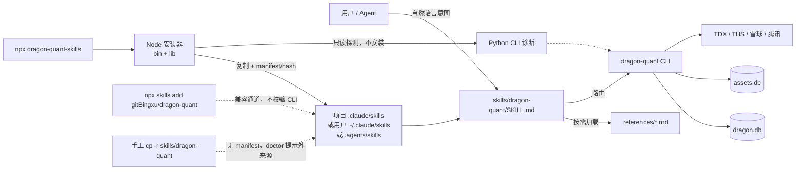
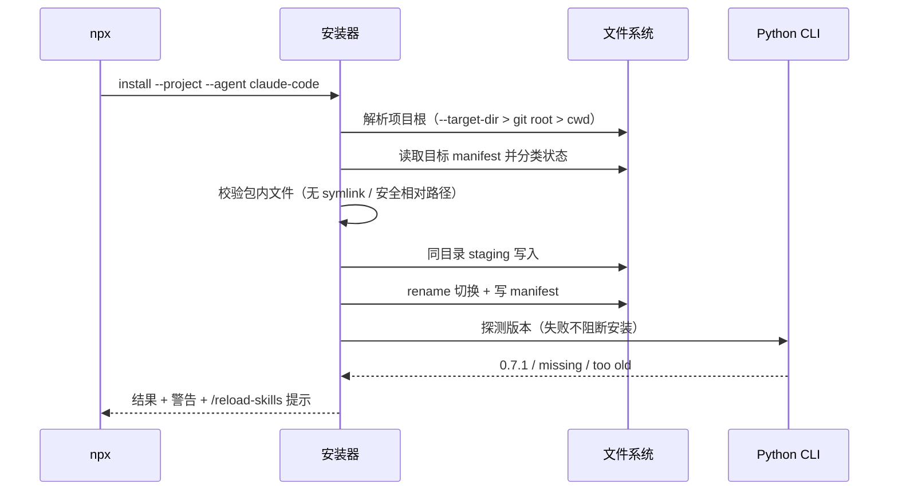
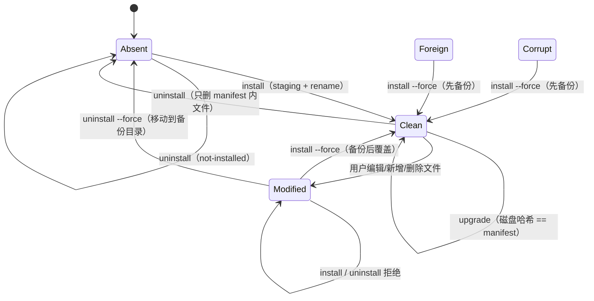

# 技术方案：dragon-quant Agent Skill 包（issue #29）

- 日期：2026-10-24
- 版本：v2（solution-reviewer APPROVE，无 CRITICAL；已修订 6 MAJOR + 9 MINOR）
- 阶段：阶段 2（技术方案 + 实现计划；本阶段不写生产实现、不创建 SKILL.md）
- 关联需求：GitHub issue #29 — 为 dragon-quant CLI 提供标准化 Agent Skill 包
- 上游调研：`docs/research/2026-10-24-agent-skills-distribution-research.md`（research-reviewer APPROVE）
- 实现计划：`docs/superpowers/plans/2026-10-24-agent-skills.md`
- 分支基线：`feat/skills`（当前仓库无根 `package.json`、无 CI workflow）

---

## 1. 背景与目标

### 1.1 已核实事实（薄封装的事实来源）

| 事实 | 位置 | 对本方案的影响 |
|---|---|---|
| Python CLI 是唯一业务入口，`dragon-quant = dragon_quant.cli:main` | `pyproject.toml` `[project.scripts]` | skill 只路由到已安装 CLI，不复制业务逻辑 |
| 当前 Python 包版本 `0.7.1`，要求 Python >= 3.10 | `pyproject.toml` | 安装器做 CLI 版本预检，不安装 Python 包 |
| 顶层命令：`scan` / `logs` / `data` / `blacklist` / `review` / `review-account` / `dragons` / `prep` / `auction` / `assets` / `factor` / `buy` / `sell` / `vpa` / `storage` | `dragon_quant/cli.py` | 路由表与安全矩阵必须覆盖全部顶层命令 |
| `scan` 实时模式无 `--json`；`scan --date` 读历史记录并输出 JSON，缺失时输出 `{"error": ...}` | `cli_commands.py:32,49` | skill 不得声称实时扫描有 JSON；结构化结果优先 `dragons` |
| `sell` 无 `--json`；`buy --json` 才有 `details[].checks` | `cli.py:732-770` | 输出解读按命令区分 |
| `prep` 默认人读 4 行摘要 + 标的清单，`--json` 输出完整快照；当日运行需 >= 16:40 | `cli_commands.py:371`、`review_account/prep.py:82,583` | 前置门禁与输出翻译必须写进 skill |
| `auction` 当日 09:25 后可用，默认读 T-1 prep 快照；`--recompute` 不触网但写快照 | `auction/registry.py:28`、`cli.py:370` | 时间门禁、池来源、`unverified` 解读 |
| `buy` / `sell` 历史回放必须 `--date` + `--at`；`--force` 只放宽午休/收盘，不放开 09:30 前 | `live_trade/trader.py:52-61`、`cli.py:732-770` | 运维契约与禁忌 |
| `review-account` 无 CLI JSON，结构化结果经 Web UI/API；`data_quality` 三态 | `review_account/simulator.py:184-208` | 不要臆造终端 JSON |
| `assets` 的 `pull` 默认 dry-run，`--apply` 才写；`push` 外发；`backfill --prune` 删除镜像孤儿 | `cli.py:398-530`、`AGENTS.md` | 写/外发/破坏性分级 |
| `factor build` / `fin sync` / `fin calibrate` 写 `assets.db`；`factor eval` 的 `insufficient_data` 是有效结论（exit 0） | `cli.py:533-730`、`factors/*` | 安全分级与输出解读 |
| 仓库当前无根 `package.json`、无 `skills/`、无 CI workflow | `ls` / `.github/` | 本 feat 新增 npm 包与 skill 源目录 |
| 实测 CLI 版本漂移：PATH 上 `0.7.0`，venv 内 `0.7.1` | 调研附录 A | 安装器与 doctor 必须做版本预检 |
| `npx skills add ./pkg.tgz` 不解包本地 tarball | 调研附录 A | 本地 tarball 验证只能走自定义安装器 |

### 1.2 需求拆解

- **R1 意图路由**：把中文/英文意图映射到 `scan` / `prep` / `auction` / `buy` / `sell` / `review` / `review-account` / `assets` / `blacklist` / `storage` / `dragons` / `factor` 等命令，并给出最常用参数与禁忌。
- **R2 前置自检**：Cookie、交易日/时段门禁、`dragon.db` / `assets.db` / 快照就绪度、CLI 版本。
- **R3 输出解读**：JSON 契约、`prep` 四行摘要/仓位等级、`auction` verdict/`is_weak`/`unverified`、`buy` `ranking_mode`/四类 `checks`、`review-account` `data_quality`。
- **R4 异常 playbook**：Cookie 缺失/失效、THS 403、停牌/日K兜底、空池回退、快照缺失、版本漂移。
- **R5 运维契约**：T+1 至少运行一次 `sell`、每日峰值刷新、历史回放 `--date` + `--at`、回放写库、并发限制。
- **R6 安全边界**：只读命令可执行；写库/外发/破坏性操作必须用户显式确认；不能把 `scan`/`prep`/`auction`/`review`/`review-account`/`factor build`/`fin sync`/`assets backfill` 等误判为只读。
- **R7 分发安装**：仓库内置 `skills/dragon-quant/SKILL.md`；根目录零运行时依赖 npm 包 `dragon-quant-skills`；`npx` 本地 tarball 可安装；默认 project scope，`--global` 显式开启；安装与 Python CLI 诊断解耦。
- **R8 权威与薄封装**：`AGENTS.md` 是规则权威，`review_account/STRATEGY.md` 是策略权威；skill 不复制评分权重、策略参数数值、表结构；`scan` 全流程不得要求读完整 AGENTS。

### 1.3 验收标准

| ID | 标准 | 验证方式 |
|---|---|---|
| AC1 | 仓库内置 `skills/dragon-quant/SKILL.md`，frontmatter 合法（`name` 与目录同名、`description` 覆盖中英文触发词），skill 可被 Claude Code 项目/用户路径发现 | 结构测试 + 独立 agent smoke |
| AC2 | 用户说“今天有哪些真龙/扫一下/盘后复盘/竞价怎么样/能不能买/回测一下”等意图时，skill 触发并路由到正确命令 | 路由表测试 + 独立 agent smoke |
| AC3 | 不读 `AGENTS.md` 全文也能完成 `scan` 的“前置检查 → 执行 → 结果解读”；SKILL.md 明确列出“何时读哪个 reference” | 闭卷结构测试 + 独立 agent smoke |
| AC4 | 写操作清单完整：覆盖全部顶层命令与关键子命令，区分只读 / 写库 / 外发 / 破坏性；写操作要求显式确认 | 安全矩阵完整性测试 + 人工复核 |
| AC5 | `AGENTS.md` 权威；skill 只做薄封装，不复制评分权重、策略参数数值、表结构；引用文件有体量上限与内容边界测试 | 禁用模式测试 + 体量测试 |
| AC6 | `npx dragon-quant-skills install` 默认安装到项目 `.claude/skills/dragon-quant`；`--global` 才写用户目录；`--dry-run` 不写盘 | Node 路径/安装测试 + 本地 tarball E2E |
| AC7 | 安装幂等；区分“未修改可升级 / 用户已修改冲突 / 非本安装器目录冲突”；manifest 记录内容哈希与包版本；卸载不删除用户改过的文件 | Node 状态机测试 + E2E |
| AC8 | 安装 skill 与 Python CLI 诊断解耦：Python/CLI 缺失或版本过低时安装仍成功并给清晰提示；`doctor` 失败并给修复建议 | 注入式 `detectCli` 测试 |
| AC9 | 路径穿越与 symlink 防护：拒绝 `..`、绝对路径逃逸、NUL、symlink 目标；卸载只删 manifest 内文件 | 安全测试 |
| AC10 | 多 scope 同名安装可检测并提示遮蔽；首次创建 skills 目录提示 `/reload-skills` 或重启会话 | doctor 测试 |
| AC11 | npm 包零运行时依赖、无 postinstall、`files` 白名单只含安装器/skill/必要文档；`npm pack` 后本地 tarball 可 `npx` 执行 | `npm pack` 内容测试 + E2E |
| AC12 | Node engines >= 22.20.0；本机 Node 24 实测通过；Node 22 兼容性通过 API 选择与文档声明约束 | `package.json` 测试 + 本机测试记录 |
| AC13 | 最终实现同 commit 更新 `AGENTS.md` / `README.md` / `CHANGELOG.md`；不改业务逻辑、不引入 Python 依赖 | 最终 diff 核对 |
| AC14 | 不执行 `npm publish`、不 git commit/push/PR；远端 `npx skills add` 未实测项如实列为残余风险 | 交付报告核对 |

### 1.4 非目标

- 不做 npm publish、GitHub Release 自动化、provenance 发布流程。
- 不做自动更新守护、后台检查、遥测。
- 不打包 `dragon-quant` Python 包；Node 不参与业务运行。
- 不做多 skill 拆分、MCP server、Claude-only plugin marketplace。
- 不实现 Python 原生 `dragon-quant skills install`（保留为后续 fallback）。
- 不复制评分权重、策略参数、SQLite 表结构到 skill 正文。
- 不改任何 Python 业务逻辑（只新增测试与文档；`MANIFEST.in`/`.gitignore` 属打包配置）。

---

## 2. 候选设计与取舍

### 2.1 方案 A（推荐）：单一主 skill + references 渐进披露 + 自定义零依赖 npx 安装器

- 一个 `skills/dragon-quant/SKILL.md`，下挂 `references/commands|outputs|playbooks|operations|safety.md`。
- 根目录 `package.json`（`name=dragon-quant-skills`），`bin/` + `lib/` 为零运行时依赖 ESM 安装器。
- `install` / `doctor` / `uninstall` / `--dry-run` / `--project|--global` / `--agent` / `--force` / `--json`。
- 默认复制安装，manifest + 内容哈希，三态升级，冲突拒绝，卸载保护用户修改。
- 兼容通道：`npx skills add gitBingxu/dragon-quant`（不校验 Python CLI）与手工复制（无 manifest）。

**优点**：触发面单一，上下文成本低；一份路由/安全/权威顺序；安装器可做版本预检、幂等、冲突检测与诊断；本地 tarball 可验证。
**缺点**：新增 Node 工具链与安装器维护成本；需要维护 agent 路径表；Windows 需后续实测。

### 2.2 方案 B：按命令族拆多个 skill（scan / prep / auction / trade / assets / factor）

**优点**：每个 skill 的 `description` 更窄，触发更精确；按需加载更细。
**缺点**：前置检查、权威顺序、安全门禁会在 6 个 skill 中重复或分叉；跨命令工作流（scan → prep → auction → buy）需要额外编排；6 个常驻 `description` 增加上下文；测试面 6 倍。**不推荐**。

### 2.3 方案 C（非常规/反直觉）：不维护静态命令目录，运行时以 `-h` + 生成式 CLI surface 为准

做法：SKILL.md 只保留意图路由、前置检查、安全分级与输出解读；不写具体参数列表；agent 每次先运行 `dragon-quant <cmd> -h` 再拼命令；可选地在安装时生成 `cli-surface.json`。

**优点**：参数零漂移；始终匹配已安装 CLI；文档量最小。
**缺点**：CLI 缺失时无法路由；`-h` 输出较长，增加上下文与往返；`-h` 不区分读写/外发，安全矩阵仍必须手写；输出解读仍无法生成；安装时生成需要执行 Python，违反“安装与 Python 解耦”。**结论：不采用为架构，但采纳其合理内核**——SKILL.md 明确“参数以 `dragon-quant <cmd> -h` 为准；不确定时先查 help”，静态 `commands.md` 只保留最小示例与关键参数。

### 2.4 方案 D：纯文档 / 仅 `npx skills add`，不做自定义安装器

**优点**：实现最少；无 npm 包维护；天然跨 agent。
**缺点**：无法在安装时校验 Python CLI 版本；无 manifest/幂等/冲突/安全卸载；本地 tarball 不支持；来源是 git 仓库而非版本化 npm 包；无法给出 doctor 修复建议。**不推荐为主通道**，仅作兼容通道。

### 2.5 方案 E：Python 原生安装器 `dragon-quant skills install`

**优点**：无 Node 依赖；版本与 Python 包天然一致。
**缺点**：与用户“偏向 npx”的取向不一致；扩大 Python CLI 命令面；skill 文案更新需发 PyPI；Windows 路径测试成本。**保留为后续 fallback，不在本期实现**。

### 2.6 方案对比与结论

| 维度 | A 单 skill + npx 安装器 | B 多 skill | C 运行时 `-h` 生成 | D 纯文档 / 通用 skills | E Python 原生 |
|---|---|---|---|---|---|
| 触发精度 | 好（单入口 + 中英关键词） | 很好 | 好 | 好 | 好 |
| 上下文成本 | 低 | 高（6 个 description） | 低 | 低 | 低 |
| 参数漂移 | 低（关键参数测试 + `-h` 兜底） | 低 | 极低 | 中 | 中 |
| Python 版本预检 | 可做 | 可做 | 不可做 | 不可做 | 天然 |
| 安装幂等/冲突/卸载 | 完整 | 完整 | 完整 | 无 | 完整 |
| 本地 tarball 验证 | 可 | 可 | 可 | 不可（实测） | 可 |
| 额外运行时 | Node >= 22.20（仅安装） | 同 A | 同 A + Python | Node + 第三方 `skills` | 无 |
| 维护成本 | 中 | 高 | 中 | 低 | 中 |
| 结论 | **推荐** | 不采用 | 仅采纳“`-h` 兜底” | 兼容通道 | 后续 fallback |

**结论：方案 A**；C 的 `-h` 兜底规则写入 SKILL.md；D 作为 README 中的兼容/手工通道；E 记录为后续增强。

---

## 3. 推荐架构

### 3.1 仓库文件布局

```text
dragon-quant/
├── package.json                         # 新增：name=dragon-quant-skills, files 白名单, bin, engines>=22.20.0
├── MANIFEST.in                          # 新增：Python sdist 排除 npm/skill 产物
├── bin/
│   └── dragon-quant-skills.mjs          # CLI 入口：install / doctor / uninstall / version
├── lib/
│   ├── paths.mjs                        # agent/scope → 目标目录、项目根解析、安全路径
│   ├── skill-package.mjs                # 读取包内 skill 文件、frontmatter、哈希
│   ├── manifest.mjs                     # manifest 读写、安装状态分类、差异
│   ├── install.mjs                      # fresh / no-op / upgrade / conflict / force-backup
│   ├── uninstall.mjs                    # 安全卸载 / 备份式 force 卸载
│   ├── python.mjs                       # Python CLI 探测与版本比较（不安装）
│   └── doctor.mjs                       # 完整性、CLI、多 scope、外来源 lock 检查
├── skills/
│   └── dragon-quant/
│       ├── SKILL.md                     # 150–250 行；单主 skill
│       └── references/
│           ├── commands.md              # 意图 → 命令 + 最小参数 + 写类 + 输出模式
│           ├── outputs.md               # 人读/JSON 输出解读与错误 JSON
│           ├── playbooks.md             # Cookie/403/停牌/兜底/空池/版本漂移
│           ├── operations.md            # T+1、峰值、历史回放、并发、资产同步
│           └── safety.md                # 只读/写/外发/破坏性矩阵与确认话术
├── test/                                # 新增：node:test，零依赖
│   ├── helpers.mjs
│   ├── paths.test.mjs
│   ├── skill-package.test.mjs
│   ├── manifest.test.mjs
│   ├── install.test.mjs
│   ├── uninstall.test.mjs
│   ├── python.test.mjs
│   ├── doctor.test.mjs
│   ├── cli.test.mjs
│   └── packaging.test.mjs               # npm pack + 本地 tarball E2E
└── tests/                               # 既有 pytest；新增 Python 侧内容/路由测试
    ├── test_skill_content.py
    ├── test_skill_routes.py
    └── test_skill_package.py
```

### 3.2 总体架构



### 3.3 安装流程（sequence）



### 3.4 安装 / 升级 / 卸载状态机



状态定义：

| 状态 | 判定 |
|---|---|
| `absent` | 目标 skill 目录不存在 |
| `foreign` | 目录存在、无自有 manifest（可能是手工复制或 `npx skills` 安装） |
| `corrupt` | manifest 不可解析、schema 不支持、路径非法 |
| `clean` | manifest 存在，磁盘所有文件哈希 == manifest，且没有额外文件 |
| `modified` | manifest 存在，但有文件缺失/哈希不符/symlink/额外文件 |
| `up-to-date` | `clean` 且 manifest 版本/文件哈希与当前包一致 |

### 3.5 设计模式与动机

- **Facade / Adapter（skill 层）**：SKILL.md 把 CLI 的复杂命令面适配成“意图 → 命令”，不承载业务规则。动机：消除第二份规则，避免与 AGENTS/STRATEGY 漂移。
- **Registry（数据表驱动）**：agent 路径、路由、安全矩阵都以表/映射维护，不用 if/else 堆叠。动机：新增 agent/命令时只加一行，测试可直接遍历。
- **Strategy（冲突策略）**：默认 `refuse`，`--force` 切换为 `backup-then-replace`；卸载同理。动机：把危险行为显式化，默认不破坏用户文件。
- **State Machine（安装生命周期）**：`absent/foreign/corrupt/clean/modified/up-to-date` 单一分类函数驱动 install/uninstall/doctor。动机：三个命令共享同一判定，避免各自实现分叉。
- **Chain of Responsibility（预检）**：skill 的前置检查按“CLI → Cookie → 交易日/时段 → 数据就绪 → 输出模式”短路；doctor 的检查项同理。动机：失败早停、错误信息可定位。
- **Progressive Disclosure（上下文管理）**：SKILL.md 只放路由/门禁/原则，细节按需加载 references。动机：常驻 context 成本可控，同时保留完整操作细节。
- **刻意不用的模式**：不为两个 agent 目标引入类继承或插件框架；不用 YAML 解析库、不用 `tar` 依赖；不把安装器做成通用包管理器。遵循“优先简单”。

---

## 4. 安装器接口

### 4.1 CLI 契约

```bash
npx dragon-quant-skills install   [--project|--global] [--agent NAME[,NAME...]]
                                  [--target-dir DIR] [--python PATH]
                                  [--dry-run] [--force] [--json]
npx dragon-quant-skills doctor    [--project|--global|--all-scopes] [--agent NAME[,NAME...]]
                                  [--target-dir DIR] [--python PATH] [--json]
npx dragon-quant-skills uninstall [--project|--global] [--agent NAME[,NAME...]]
                                  [--target-dir DIR] [--dry-run] [--force] [--json]
npx dragon-quant-skills version   [--json]
```

- **默认 scope = project**；`--global` 必须显式传入。`--project` 是显式默认值。
- `--global` 与 `--target-dir` 互斥；`--target-dir` 只对 project 生效。
- `--agent` 默认 `claude-code`；支持 `claude-code`、`agents`、`all`（展开为前两者）。未知 agent → exit 2。
- `--target-dir` 语义 = **项目根**（最终目录为 `<DIR>/.claude/skills/dragon-quant` 或 `<DIR>/.agents/skills/dragon-quant`），不是最终 skill 目录；`--dry-run` 必须打印最终绝对路径。
- `doctor` 默认扫描全部已知 scope（global + project）用于遮蔽检测；`--json` 稳定输出。
- 不提供 `--symlink`；默认复制。若未来增加，必须打印“npx 缓存清理后失效”的风险。

`--json` 稳定结构（只增键，不改已有类型）：

```json
{
  "ok": true,
  "command": "install",
  "scope": "project",
  "agents": [
    {
      "agent": "claude-code",
      "path": "/repo/.claude/skills/dragon-quant",
      "state": "installed",
      "actions": ["created 7 files"],
      "warnings": []
    }
  ],
  "warnings": [],
  "backup_path": null
}
```

错误：

```json
{
  "ok": false,
  "command": "install",
  "error": {
    "code": "conflict",
    "message": "target has user modifications",
    "hint": "re-run with --force to back up and replace"
  }
}
```

`doctor --json`：

```json
{
  "ok": true,
  "command": "doctor",
  "checks": [
    {"id": "install.integrity", "status": "pass", "detail": "...", "fix": null}
  ],
  "installs": [
    {"agent": "claude-code", "scope": "project", "skillDir": "...", "state": "clean"}
  ]
}
```

### 4.2 退出码

| 码 | 含义 |
|---|---|
| 0 | 成功、no-op、`not-installed`、doctor 全部通过 |
| 1 | 冲突、完整性失败、预检失败（doctor）、IO/权限失败 |
| 2 | 参数错误、未知 agent、互斥参数、Node 版本低于下限 |

### 4.3 scope / agent / 项目根解析

| agent | project 目录 | global 目录 | MVP 状态 |
|---|---|---|---|
| `claude-code` | `<projectRoot>/.claude/skills` | `~/.claude/skills` | 官方文档路径；本机实测安装 |
| `agents` | `<projectRoot>/.agents/skills` | `~/.agents/skills` | 通用 `.agents/skills` 约定；本机实测安装 |

- `resolveProjectRoot(cwd)`：从 `cwd` 向上找第一个包含 `.git`（目录或 worktree 文件）的目录；找不到则返回 `cwd`。不调用 git 可执行文件，避免额外依赖。
- `--target-dir` 优先于 git root / cwd；`--dry-run` 打印解析结果。
- **不声明** Cursor/Gemini/Copilot 等客户端支持；只说明“可通过 `.agents/skills` 或通用 `npx skills` 通道尝试”，未实测不宣称。
- 多 scope 遮蔽：Claude Code 同名优先级为 Enterprise > personal（global）> project；`doctor` 报告同一 skill 在所有 scope 的版本/哈希，`install` 检测到另一 scope 存在同名安装时打印警告（例如 global 低版本会遮蔽 project 新版本）。

### 4.4 manifest 数据模型

安装目录内 `.dragon-quant-skill.json`：

```json
{
  "schema": 1,
  "installer": "dragon-quant-skills",
  "skill": "dragon-quant",
  "agent": "claude-code",
  "scope": "project",
  "package_version": "0.7.1",
  "skill_version": "0.7.1",
  "min_cli_version": "0.7.1",
  "installed_at": "2026-10-24T12:00:00Z",
  "source": "npm:dragon-quant-skills@0.7.1",
  "files": {
    "SKILL.md": "<sha256>",
    "references/commands.md": "<sha256>",
    "references/outputs.md": "<sha256>",
    "references/playbooks.md": "<sha256>",
    "references/operations.md": "<sha256>",
    "references/safety.md": "<sha256>"
  }
}
```

规则：

- `files` 只含包内 skill 文件的**相对 POSIX 路径**；不含 manifest 自身。
- 哈希 = 文件原始字节的 SHA-256；升级/卸载/doctor 全部以它判定“用户是否改过”。
- `package_version` 是分发版本；`skill_version` 是 skill 内容版本；`min_cli_version` 是唯一兼容契约。
- `installed_at` 每次实际写入更新；no-op 不更新。
- manifest 路径非法（绝对路径、`..`、NUL、symlink）→ `corrupt`，拒绝操作。
- manifest 文件权限 0644；不写入任何凭据。

### 4.5 `package.json` 契约

```json
{
  "name": "dragon-quant-skills",
  "version": "0.7.1",
  "description": "Agent Skills for the dragon-quant A-share dragon scanner CLI",
  "type": "module",
  "license": "MIT",
  "bin": { "dragon-quant-skills": "bin/dragon-quant-skills.mjs" },
  "files": ["bin/", "lib/", "skills/", "README.md", "LICENSE"],
  "engines": { "node": ">=22.20.0" },
  "scripts": { "test": "node --test" },
  "keywords": ["agent-skills", "dragon-quant", "a-share", "cli"],
  "repository": { "type": "git", "url": "https://github.com/gitBingxu/dragon-quant.git" }
}
```

- **零 `dependencies` / `devDependencies`**；无 `preinstall` / `postinstall`。
- `files` 白名单只含安装器、skill、README、LICENSE；不打包 Python 源码、数据、Cookie、`assets.db`、`tests/`、`docs/`、`node_modules/`。
- 根目录 `package.json`（main 阶段 1 决策），不是 `npm/` 子目录；`npx skills add` 也能扫描到根 `skills/`。
- `MANIFEST.in` 排除 npm/skill 产物，避免 Python sdist 夹带：
  ```text
  exclude package.json
  prune bin
  prune lib
  prune skills
  prune test
  prune node_modules
  ```

### 4.6 Node 支持策略

- `engines.node >= 22.20.0`（与 `skills` CLI 生态一致；Node 20 已结束支持）。
- 只使用 Node 22 可用的 stdlib：`node:fs`、`node:path`、`node:crypto`、`node:util.parseArgs`、`node:test`、`node:assert/strict`。
- 本机 Node 24.21.0 实测；Node 22.20 作为下限写入 `engines`。若运行时低于下限，安装器打印明确错误并 exit 2。
- 不做 Node 18/20 兼容承诺；不引入 Babel/TypeScript/打包器。

### 4.7 版本策略（唯一推荐）

**推荐：npm 分发版本与 Python 包“次版本同步、补丁独立”。**

- 首发 `0.7.1`，与当前 Python 包 `0.7.1` 对齐。
- npm `MAJOR.MINOR` 必须跟随 Python 包 `MAJOR.MINOR`；skill 文案修订可单独 bump npm `PATCH`（如 `0.7.2`），不强制发 PyPI。
- **兼容性唯一契约是 `metadata.min-cli-version`**，不是版本相等。
- `doctor` 同时显示：npm 包版本 / skill 版本 / min CLI 版本 / 探测到的 CLI 版本与路径。
- 测试约束：`package.json.major.minor == pyproject major.minor`；`skill_version == package version`；`min_cli_version <= skill_version`。
- 反例：npm `0.8.x` 不得与 Python `0.7.x` 并存发布；skill 文案修改不得改变 `min_cli_version`，除非确实依赖新 CLI 能力。

### 4.8 Python CLI 探测（只诊断，不安装）

探测顺序：

1. `--python PATH` → `[PATH, "-m", "dragon_quant", "-v"]`
2. `DQ_PYTHON` → 同上
3. `dragon-quant -v`（PATH）
4. `python3 -m dragon_quant -v`
5. `python -m dragon_quant -v`

规则：

- 每次调用 5 秒超时；失败不抛栈，返回 `{found:false, error}`。
- 解析 `dragon-quant X.Y.Z`（stdout 或 stderr 均可）。
- `install` 只打印警告，**exit 0**；`doctor` 将缺失/过低标为 `fail`，**exit 1**。
- 错误提示包含修复命令（venv + pip），安装器**绝不**执行 pip。
- Windows 的 `.cmd` shim 未实测；列为残余风险。

---

## 5. Skill 内容设计

### 5.1 权威顺序与薄封装

SKILL.md 顶部明确：

1. `AGENTS.md` — 项目规则与命令语义权威。
2. `dragon_quant/review_account/STRATEGY.md` — 策略/买卖规则权威。
3. 本 skill — 只做路由、前置检查、输出翻译、异常分流、写操作门禁。
4. 冲突时以更高权威为准；skill 不复制权重/参数/表结构。
5. 不提供投资建议；不承诺收益；不把 skill 用于非 dragon-quant 仓库的通用选股。

### 5.2 SKILL.md 结构（150–250 行）

1. frontmatter（`name` / `description` / `license` / `compatibility` / `metadata`）
2. 概览：一句话定位“CLI 的薄路由层”
3. 权威顺序
4. 执行前检查（5 项，短路）
5. 意图路由表（紧凑版，细节链接 `commands.md`）
6. 输出翻译原则（先结论、再关键字段、再降级提示；不倾倒 JSON）
7. 写操作门禁（只读自由；T1/T2 确认；细节链接 `safety.md`）
8. 运维契约清单（只列条目 + AGENTS 锚点，不复写数值）
9. 异常分流（链接 `playbooks.md`）
10. reference 索引：每个文件的“何时读”
11. 禁止事项（不伪装执行、不自动写、不读整篇 AGENTS 才能 scan）

**description 触发词**（中文 + 英文，不总结工作流）：

- 中文：龙头、真龙、扫榜、扫描、盘后复盘、复盘、集合竞价、竞价、回测、账户回测、买卖信号、持仓、数据资产、同步、黑名单、因子。
- 英文：dragon, scan, prep, auction, review, backtest, signal, buy, sell, assets sync.
- 排除：通用选股、投资建议、非 dragon-quant 仓库。

### 5.3 reference 内容边界与加载时机

| 文件 | 何时加载 | 必须包含 | 禁止包含 |
|---|---|---|---|
| `SKILL.md` | 触发后始终 | 权威顺序、5 项预检、紧凑路由、输出原则、写门禁、reference 索引 | 完整参数表、完整 JSON 字段、评分权重、策略参数、表结构 |
| `commands.md` | 需要确定命令/参数/禁忌时 | 意图 → 命令、最小示例、关键参数、写类、输出模式、常见误用 | `-h` 全文、参数默认值抄写、评分/策略细节 |
| `outputs.md` | 解读人读/JSON 结果时 | 顶层键与含义、错误 JSON、降级/回退字段、结论表达模板 | 完整 JSON schema、所有嵌套字段、数值阈值 |
| `playbooks.md` | 出现错误/降级/空池时 | 症状 → 诊断命令 → 处理 → 停止条件 | provider 实现细节、重试算法、内部函数名 |
| `operations.md` | 日常调度/历史回放/并发/备份时 | T+1 sell、峰值刷新、`--date`+`--at`、回放写库、并发限制、资产同步节奏 | 策略规则/仓位公式/评分参数 |
| `safety.md` | 任何非只读命令前 | 三级矩阵、命令/关键 flag、确认话术、秘密处理、禁止操作 | `allowed-tools` 预授权、策略权重 |

体量约束：

- `SKILL.md` ≤ 300 行；每个 reference ≤ 300 行；全部 references 合计 ≤ 1200 行。
- 引用只允许一层深度（`references/*.md`），不嵌套子目录。
- 每个 reference 顶部写“何时读我”的一行触发条件。

### 5.4 路由表机器可读格式（防漂移）

`commands.md` 内使用标记区块承载路由表，供测试解析：

```markdown
<!-- routes:start -->
| intent | command | key_flags | write_class | output | notes |
|---|---|---|---|---|---|
| 扫描今日真龙 | dragon-quant scan | --top --force --no-cache | T1 | human | 实时模式无 JSON |
| 查询历史扫描 | dragon-quant scan --date | --date --top | T0 | json | 仅 YYYYMMDD；格式错 stderr 报错但 exit 0；错误 JSON 含 available_top_n |
| 导出龙头 | dragon-quant dragons | --date --true-only | T0 | json | 结构化结果优先 |
| 盘后复盘 | dragon-quant prep | --date --recompute --force --json | T1 | human/json | 当日 >= 16:40 |
| 集合竞价 | dragon-quant auction | --pool --days --recompute --json | T1 | human/json | 当日 >= 09:25 |
| 买入信号 | dragon-quant buy | --date --at --force --json | T1 | human/json | 必须确认 |
| 卖出信号 | dragon-quant sell | --date --at --force | T1 | human | 必须确认；T+1 |
| 龙头回测 | dragon-quant review | --date --source | T1 | human | 回写 review 字段 |
| 龙头回测 UI | dragon-quant review --ui-only | --ui-only --port --no-browser | T0 | human | 长驻；可能初始化/校验 schema |
| 账户回测 | dragon-quant review-account | --from --to --capital --config | T1 | human | 无 CLI JSON |
| 账户回测 UI | dragon-quant review-account --ui-only | --ui-only --port --no-browser | T0 | human | 长驻；可能初始化/校验 schema |
| 资产只读 | dragon-quant assets status/verify/pull | status/verify/pull（默认 dry-run） | T0 | human/json | pull 不加 --apply 不写 |
| 资产探测 | dragon-quant assets doctor | --profile --samples | T1 | human/json | 在 `_doctor/` 前缀 PUT/DELETE 探针 |
| 资产推送 | dragon-quant assets push | --from --to --all --allow-shrink | T2 | human/json | 先 --dry-run |
| 资产恢复 | dragon-quant assets pull --apply | --from --to --apply --target-dir | T2 | human/json | 主库 --force 禁止 |
| 资产回填 | dragon-quant assets backfill-dragons | --from --to --dry-run | T1 | human/json | --dry-run 为 T0 |
| 资产回填清理 | dragon-quant assets backfill-dragons --prune | --prune | T2 | human/json | 删除镜像孤儿 |
| 黑名单查看 | dragon-quant blacklist list | list | T0 | human | 只读 |
| 黑名单写 | dragon-quant blacklist add/remove | add/remove | T1 | human | 确认 |
| 存储查看 | dragon-quant storage status/size | status/size | T0 | human | 只读 |
| 存储清理 | dragon-quant storage clear | --all --cache --results --logs --days | T2 | human | 不删 .db，但删缓存/结果/日志 |
| 因子只读 | dragon-quant factor list/query/status/eval | list/query/status/eval | T0 | human/json | eval 的 insufficient_data 是有效结论 |
| 因子构建 | dragon-quant factor build | --date --from --to --only --all | T1 | human/json | 写 factor_* |
| 因子导出 | dragon-quant factor export | --from --to --name --out | T1 | human/json | 写用户指定文件 |
| 财务同步 | dragon-quant factor fin sync | sync | T1 | human/json | 写 fin_* |
| 财务校准 | dragon-quant factor fin calibrate | calibrate | T1 | human/json | 写校准表 |
| 财务只读 | dragon-quant factor fin status | status | T0 | human/json | 只读 |
| 日志查询 | dragon-quant logs tail/query/list/summary | tail/query/list/summary | T0 | human | 只读 |
| 日志清理 | dragon-quant logs clear | --days | T2 | human | 删除日志 |
| 原子数据只读 | dragon-quant data sector/components/kline/minute/quote/batch-quote/cookie-status | 见 `-h` | T0 | human | 触网只读 |
| 凭据写入 | dragon-quant data cookie-fetch/cookie-set | cookie-fetch/cookie-set | T2 | human | 写凭据；禁止回显秘密 |
| 量价分析 | dragon-quant vpa | --code --source --days | T1 | human | 默认写 vpa_analysis |
| 量价分析不落库 | dragon-quant vpa --no-save | --no-save | T0 | human | 不写库 |
<!-- routes:end -->
```

规则：**每行只能有一个 `write_class`**；同一命令的不同子命令若分级不同，必须拆行。测试会拒绝 `T0/T1` 这类混合值，避免快速路由表给出“整行只读”的错误暗示。`scan_v2` 是隐藏兼容别名，不在路由表展示，安全等级同 `scan`（T1）。

测试只校验表中列出的 `command` 顶层命令与 `key_flags` 是否仍存在于 `argparse` help；不校验 help 文案、默认值、全部参数。这样参数新增/文案调整不会误报，只有关键命令/参数被删才失败。安全矩阵测试使用 `safety.md` 的 `<!-- safety:start -->` 区块做**顶层命令集合相等**校验，而不是子串包含。

### 5.5 输出解读原则

统一表达顺序：

1. **结论**：是否建议执行/是否有信号/是否降级。
2. **关键字段**：日期、池来源、排序模式、数据质量、否决/回退原因。
3. **风险/降级**：`data_quality`、`fallback_reason`、`unverified`、`degraded`、`suspended_codes`。
4. **下一步**：需要用户确认的写操作或需要修复的前置条件。
5. 不原样倾倒 JSON；不把错误 JSON 当空数据；不把“未验证”说成“已验证”。

各命令的解读要点：

- `prep`：默认 4 行摘要（是否建议买入/仓位/等级/理由）+ 标的清单；等级/仓位来自快照，仅供人工参考，不参与下单；`--json` 才看 `sentiment`/`main_boards`/`macro`/`candidates`/`dragon_source`。
- `auction`：`snapshots[]` 的 `strength`/`direction`/`level`/`is_weak`/`unverified`/`reject_reason`；`unverified=true` 时不得把强度当决策依据；`pool_source`/`fallback_reason` 说明池来源；空池不是“无信号”。
- `buy`：`action`、`buys[]`、`details[].checks`（四类买点，状态 `passed/failed/pending/window_closed/unavailable/skipped`）、`ranking_mode`（`auction`/`auction_unverified`/`prep_only`/`legacy`）、`fallback_reason`、`data_quality`、`sentiment_pct`、`forced`、`vetoed_signal`、`buy_eval_skipped`。
- `sell`：无 JSON；按人读输出解释卖出/减半/继续持有；T+1 不卖当日仓；`--force` 只回放，不伪造收盘成交。
- `review-account`：无 CLI JSON；`data_quality` 三态 `strict_5min`/`mixed`/`daily_fallback`，另看 `fallback_days`/`suspended_days`/`unavailable_days`/`data_degraded`/`ranking_mode(s)`；保守近似不等于真实成交。
- `dragons` / `scan --date`：结构化结果优先 `dragons`；`scan --date` 的 `{"error":...}` 要区分“无记录”和“top_n 不匹配”，后者含 `available_top_n`。
- `assets`：`pull` 默认 dry-run，`--apply` 才写；`status` 的 `dates_drift` 是弱信号；`verify` 定性；退出码 0/1/2。
- `factor`：`query` 输出 `resolved_versions`；`eval` 的 `insufficient_data` 是有效结论（exit 0），不是失败；因子缺失不等于 0/中性。
- `storage`：`status/size` 只读；`clear` 不删 `.db` 但会删缓存/结果/日志。

### 5.6 安全矩阵（完整）

**分级定义**

- **T0 只读**：不写业务记录、不改变远端业务状态；可直接执行（`--ui-only` 可能初始化/校验本地 SQLite schema；长驻 UI/server 需说明会阻塞）。
- **T1 写本地状态或远端临时探测对象**：写 `dragon.db` / `assets.db` / 本地文件 / 凭据，或向远端写入可清理的临时探测对象；执行前必须得到用户显式确认（用户本轮明确点名该操作可视为确认）。
- **T2 外发/破坏性/高风险**：上传业务数据、覆盖主库、删除数据、写入凭据、强制覆盖；必须先 dry-run/预览并二次确认；不得自动执行。

`safety.md` 用 `<!-- safety:start -->` / `<!-- safety:end -->` 包裹**顶层命令表**，表头固定为 `| command | flags | tier | notes |`，`command` 列只放顶层命令名；测试用该区块做顶层命令集合相等校验。`-h/-v`、隐藏别名 `scan_v2` 与安装器 `install/uninstall`（非 `dragon-quant` CLI 顶层命令）放在表外说明。

| 命令 / 子命令 | 关键 flag | 分级 | 说明 |
|---|---|---|---|
| `-h` / `-v` | — | T0 | 帮助/版本 |
| `dragons` | `--date` `--true-only` | T0 | 只读 JSON |
| `scan` | `--top` `--candidates` `--workers` `--force` `--no-cache` | T1 | 写 `scans_v2`/`scan_stocks_v2`/`dragons_v2`，触网 |
| `scan --date` | `--date` `--top` | T0 | 读历史扫描记录 |
| `logs tail/query/list/summary` | 见 `-h` | T0 | 只读 |
| `logs clear` | `--days` | T2 | 删除日志 |
| `data sector/components/kline/minute/quote/batch-quote/cookie-status` | 见 `-h` | T0 | 触网只读 |
| `data cookie-fetch` | — | T2 | 写 Cookie，启动浏览器，触网 |
| `data cookie-set` | `--cookie` | T2 | 写凭据；禁止回显秘密 |
| `blacklist list` | — | T0 | 只读 |
| `blacklist add/remove` | `name` | T1 | 写配置；remove 需确认 |
| `review` | `--date` `--top` `--force` `--source` `--ui` | T1 | 回写 `dragons_v2` review 字段 |
| `review --ui-only` | `--port` `--no-browser` | T0 | 只读启动本地 Web UI（长驻；可能初始化/校验 schema，不写业务记录） |
| `review-account` | `--from` `--to` `--capital` `--strategy` `--config` `--ui` | T1 | 写 `review_account_*` |
| `review-account --ui-only` | `--port` `--no-browser` | T0 | 只读启动本地 Web UI（长驻；可能初始化/校验 schema，不写业务记录） |
| `prep` | `--date` `--recompute` `--force` `--json` | T1 | 写 `assets.db`；当日 >= 16:40 |
| `auction` | `--pool` `--days` `--recompute` `--json` | T1 | 写 `assets.db`；当日 >= 09:25；recompute 不触网 |
| `assets doctor` | `--profile` `--samples` | T1 | 连通性/元数据回环；会向远端 `_doctor` 前缀写入并删除临时探测对象，不上传业务数据 |
| `assets push` | `--from` `--to` `--all` `--allow-shrink` | T2 | 上传数据到云端；先 `--dry-run` |
| `assets push --dry-run` | `--dry-run` | T0 | 不写远端 |
| `assets pull`（默认） | `--from` `--to` `--pick` | T0 | dry-run，只读远端 |
| `assets pull --apply` | `--apply` `--target-dir` | T2 | 写本地库；主库 `--force` 禁止 |
| `assets pull --force` | `--force` | T2 | 覆盖语义列；主库禁止 |
| `assets status` | `--all` `--orphans` | T0 | 只读 |
| `assets verify` | `--from` `--to` `--samples` `--deep` `--md5` | T0 | 只读校验（`--deep` 下载） |
| `assets backfill-dragons --dry-run` | `--dry-run` `--json` | T0 | 只读体检 |
| `assets backfill-dragons` | `--from` `--to` | T1 | 写 `assets.db.dragons` |
| `assets backfill-dragons --prune` | `--prune` | T2 | 删除镜像孤儿行 |
| `factor list/query/status/eval/fin status` | 见 `-h` | T0 | 只读/计算 |
| `factor build` | `--date` `--from` `--to` `--only` `--all` | T1 | 写 `factor_*` |
| `factor export` | `--from` `--to` `--name` `--out` | T1 | 写用户指定文件；确认路径 |
| `factor fin sync` | `--snapshot` `--backfill` `--force` | T1 | 写 `fin_*`，触网 |
| `factor fin calibrate` | `--sample` `--period` | T1 | 写校准表 |
| `buy` | `--date` `--at` `--force` `--json` | T1 | 写 `buy_sell_signals`；必须确认 |
| `sell` | `--date` `--at` `--force` | T1 | 写 `buy_sell_signals`；必须确认；T+1 |
| `vpa` | `--code` `--source` `--days` | T1 | 默认写 `vpa_analysis` |
| `vpa --no-save` | `--no-save` | T0 | 不写库 |
| `storage status/size` | — | T0 | 只读 |
| `storage clear` | `--all` `--cache` `--results` `--logs` `--days` | T2 | 删除缓存/结果/日志；不删 `.db` |
| `scan_v2`（隐藏别名） | 同 `scan` | T1 | 兼容别名，按 `scan` 处理 |
| `install`（安装器） | 见 §4.1 | T1 | 写 skill 文件；`--force` 先备份 |
| `uninstall` / `uninstall --force`（安装器） | 见 §4.1 | T2 | 删除或移动 skill 目录；`--force` 移入备份，不删用户修改 |

**确认话术模板**

- T1：`将执行 <command>，会写入 <dragon.db / assets.db / 本地文件>，范围 <日期/代码/文件>。是否继续？`
- T2：`该操作会 <上传/覆盖/删除> <范围>。建议先运行 <dry-run 命令> 预览。确认继续？`
- 用户本轮明确说“执行 scan/prep/buy...”可视为 T1 确认；T2 仍需二次确认或 dry-run。
- 不因“上次同意过”而自动执行下一次写操作。

**禁止操作**

- 主库执行 `assets pull --force`（恢复用 `--target-dir`）。
- 未确认执行 `buy`/`sell`/`blacklist add|remove`/`storage clear`/`assets push`/`assets pull --apply`/`backfill --prune`。
- 回显 Cookie、token、`assets_sync` 凭据。
- 在 `prep` 与 `scan`/`rebuild` 并发时运行 `prep`。
- 用 `--force` 绕过交易日/09:30 前门禁；`--force` 不放宽数据/日期校验。
- 把 `--ui-only` 说成“会写库”；把 `review --ui-only` 与 `review` 混为一谈。
- 自动安装/升级 Python 包或执行 `npm publish`。

### 5.7 渐进披露与上下文预算

- `description` 常驻；SKILL.md 触发后加载；references 按需加载。
- `description` 控制在 500 字符以内（尽量），确保 Claude Code 的 1536 字符截断线内仍保留中英文触发词。
- SKILL.md 目标 150–250 行，不超过 300 行；references 每个不超过 300 行。
- 不在 SKILL.md 内嵌大段 JSON/参数表；用“何时读哪个文件”索引。

---

## 6. 安装 / 升级 / 卸载行为

### 6.1 安装与升级

**fresh install**

1. `resolveProjectRoot` / global home。
2. 校验包内文件：无 symlink、无特殊文件、相对路径安全、`SKILL.md` 存在且 frontmatter 可解析。
3. 在 skills root 下创建 staging 目录 `<skillsRoot>/.dragon-quant-staging-<pid>-<rand>`。
4. 写入所有文件（0644）**和 manifest**（manifest 也写入 staging；文件哈希在写入前计算）。
5. `rename(staging, skillDir)` 一次原子替换；若失败清理 staging，目标目录不会出现“有文件无 manifest”的半成品。
6. 输出路径、版本、CLI 探测结果、`/reload-skills` 提示。

**no-op**

- `inspectInstall` = `up-to-date`（文件哈希与当前包一致，无额外文件）→ 不写盘，输出“已是最新”。

**upgrade（clean）**

1. 预检磁盘哈希 == manifest（否则进入 modified 冲突）。
2. staging 写入新包全部文件**和新 manifest**。
3. 将旧 skill 目录 rename 为 `<skillsRoot>/.dragon-quant-backup-<timestamp>`。
4. staging rename 为 skillDir。
5. 成功后删除备份；若 rename 失败，恢复旧目录并保留 staging 供诊断。manifest 已是 staging 的一部分，不存在“rename 成功但 manifest 写失败”的窗口。

**冲突**

- `foreign` / `modified` / `corrupt` 默认拒绝，exit 1，输出：
  - 冲突类型；
  - 具体文件（modified）；
  - 修复建议（`--force` 备份后覆盖 / 先 `npx skills remove` / 手动处理）。
- `--force`：先把现有目录整体移动到备份路径，再 fresh install；绝不原地逐文件覆盖用户修改。
- 备份路径打印到 stdout 与 JSON；不自动删除。

### 6.2 多 scope 遮蔽与可见性

- `doctor` 扫描 global + project 的每个 agent 目标，列出同名安装的路径、版本、哈希、状态。
- 若 project 安装被更高优先级 global 同名 skill 遮蔽：
  - doctor 标 `warn`，说明 Claude Code 优先级 Enterprise > personal > project；
  - install 在检测到另一 scope 同名安装时打印警告；
  - 不自动删除/修改另一 scope。
- 首次创建 `.claude/skills` 或 `.agents/skills` 顶层目录时，输出：
  `首次创建 skills 目录：请在 Claude Code 运行 /reload-skills，或重启会话。`
- 升级后也提示 reload（当前会话可能仍持有旧内容）。
- 不宣称 `/reload-skills` 在所有客户端存在；仅对 Claude Code 给出该提示。

### 6.3 包卫生与供应链

- `files` 白名单；`npm pack --dry-run` 测试断言内容。
- 零运行时依赖、零 postinstall、零 telemetry。
- 不打包 `.env`、Cookie、`assets.db`、`dragon.db`、`node_modules/`、`docs/`、`tests/`。
- `npm publish` 不在本期执行；不添加发布 token；不写 GitHub Actions 发布流程。
- 若未来发布：启用 `--provenance` / Trusted Publishing，发布前人工审查 `npm pack` 内容。

### 6.4 兼容通道

- **`npx skills add gitBingxu/dragon-quant`**：README 标为“兼容通道”；不校验 Python CLI 版本；依赖第三方 `skills` CLI；安装来源是 git 仓库；可能写 `skills-lock.json` / `.skill-lock.json`。安装器检测到外来源 lock 或无自有 manifest 时提示，不静默覆盖。
- **手工复制**：`cp -r skills/dragon-quant <skillsRoot>/`；README 标为“最少依赖 fallback”；无 manifest、无升级/卸载/版本检查；doctor 会标 `foreign`。
- 本地 npm tarball：必须用 `npx dragon-quant-skills install`，通用 `npx skills add ./pkg.tgz` 实测不解包。

---

## 7. 错误处理

| 场景 | 行为 | 退出码 |
|---|---|---|
| Node < 22.20.0 | 启动时打印明确错误与升级建议 | 2 |
| 参数互斥/未知 agent/缺参数 | 打印 usage，不写盘 | 2 |
| 包内 `SKILL.md` 缺失/frontmatter 非法 | 完整性错误，不写盘 | 1 |
| 目标目录 `foreign` / `modified` / `corrupt` | 拒绝，列出冲突文件与修复建议 | 1 |
| `--force` 覆盖/卸载 | 先移动到备份目录；备份失败则不删除原目录 | 1 |
| 路径穿越/symlink/NUL/保留字符 | 拒绝并指出路径；不跟随 symlink | 1（manifest/包内）；2（CLI 参数） |
| 权限/IO 失败 | 保留 staging/备份，打印路径 | 1 |
| Python CLI 缺失 | install 成功 + 警告；doctor fail | install 0 / doctor 1 |
| Python CLI 版本过低 | install 成功 + 警告；doctor fail | install 0 / doctor 1 |
| 多 scope 遮蔽 | doctor warn；install warning；不阻断 | 0 |
| 外来源 lock/手工复制 | doctor warn；install 视为 foreign 冲突 | 0 / 1 |
| `doctor` 任一必需检查失败 | 输出逐项 pass/warn/fail 与修复建议 | 1 |
| skill 运行期 CLI 报错 | 按 `playbooks.md` 分流；不伪造成功 | 由 CLI 决定 |

---

## 8. 测试策略

### 8.1 Python：skill 内容 / 路由 / 安全完整性

新增 `tests/test_skill_content.py`：

- frontmatter：`name == "dragon-quant"` 且与目录同名；`description` 含中文与英文触发词；`license` 存在；`metadata.min-cli-version` 可解析。
- 版本规则：`skill-version == package.json version`；`min-cli-version <= skill-version`（由 `tests/test_skill_content.py` 校验）；npm major.minor == pyproject major.minor（由 `tests/test_skill_package.py` 校验）。
- 文件存在且链接有效：SKILL.md 中引用的每个 `references/*.md` 都存在；只允许一层深度。
- 体量：SKILL.md ≤ 300 行；每个 reference ≤ 300 行；references 合计 ≤ 1200 行。
- 内容边界（禁用模式）：
  - 五维权重组合（如“带动性 + 数字 + %”等）不得出现；
  - `StrategyConfig` 参数名不得出现：测试从 `dragon_quant.review_account.models.StrategyConfig` 的 dataclass 字段程序化生成禁用词表（排除与 CLI `--source` 冲突的 `source`），避免手工枚举漏项；
  - 止损/止盈/峰值的百分比数值不得出现；
  - `CREATE TABLE` / `PRIMARY KEY` / `FOREIGN KEY` / 列清单不得出现；
  - 真实 Cookie/token 不得出现。
- 正向断言：SKILL.md 出现 `AGENTS.md`、`STRATEGY.md`、权威顺序；出现“只读/写/外发/确认”关键词；出现“不提供投资建议”。

新增 `tests/test_skill_routes.py`：

- 解析 `commands.md` 的 `<!-- routes:start -->` 区块；每个 `command` 顶层命令必须存在于 `dragon-quant -h`；每个 `key_flags` 必须出现在对应 `dragon-quant <cmd> -h` 中。
- 只校验表中列出的关键命令/参数，不比较 help 文案/默认值/全部参数。
- 安全矩阵完整性：解析 `safety.md` 的命令表；顶层命令集合必须等于当前 `dragon-quant -h` 的命令集合（新增顶层命令时测试失败，强制更新安全矩阵）。
- 每个命令恰好一个分级（T0 或 T1 或 T2；混合子命令拆行）；`buy`/`sell`/`storage clear`/`assets push`/`assets pull --apply`/`backfill --prune`/`logs clear`/`data cookie-*` 必须为 T1/T2。

新增 `tests/test_skill_package.py`：

- `package.json` 存在；`name=dragon-quant-skills`；`engines.node >=22.20.0`；无 dependencies/devDependencies；无 pre/postinstall；`files` 白名单符合预期。
- 版本规则：npm major.minor == pyproject major.minor；`skill-version == package version`；`min-cli-version <= skill-version`。
- `MANIFEST.in` 排除 `package.json` / `bin` / `lib` / `skills` / `test` / `node_modules`。

### 8.2 Node：安装器单元测试（`node:test`，零依赖）

- `paths.test.mjs`：project/global、`--target-dir`、git root 向上查找、无 git 回退 cwd、未知 agent、路径穿越/绝对路径/NUL/保留字符。
- `skill-package.test.mjs`：读取 fixture skill；SHA-256 正确；frontmatter 解析；symlink/特殊文件拒绝。
- `manifest.test.mjs`：absent/foreign/corrupt/clean/modified/up-to-date 六态；缺文件/多文件/哈希不符；非法 manifest 路径。
- `install.test.mjs`：fresh；no-op；clean upgrade 删除旧文件；modified 拒绝；force 备份；foreign 拒绝/force；staging 失败不留下目标；manifest 写入 staging 后一次 rename；skill 目录与 `references/` 目录 symlink 均拒绝；dry-run 零写入且报告绝对路径。
- `uninstall.test.mjs`：clean 只删 manifest 文件；modified 拒绝；force 移动到备份；foreign 拒绝；不删除父目录；文件级与 `references/` 目录级 symlink 拒绝。
- `python.test.mjs`：注入 fake exec；`--python` > `DQ_PYTHON` > PATH > `python3 -m` > `python -m`；缺失/低版本/解析失败；超时不抛栈；版本比较。
- `doctor.test.mjs`：安装存在/缺失；完整性；CLI 缺失/过低；多 scope 遮蔽；外来源 lock；`--json` 稳定结构。
- `cli.test.mjs`：spawn bin；install/doctor/uninstall/version；`--json`；互斥参数 exit 2；冲突 exit 1；no-op exit 0；默认 project；dry-run 绝对路径；install 跨 scope 警告。
- 测试全部使用 `fs.mkdtempSync` 临时目录；global 测试设置隔离 `HOME`。

### 8.3 打包 E2E（`test/packaging.test.mjs`）

1. `npm pack --json` 到临时目录；断言 tarball 只含 `package.json` / `README.md` / `LICENSE` / `bin/` / `lib/` / `skills/`。
2. `npm exec --yes --package=<tgz> -- dragon-quant-skills install --dry-run --json`：exit 0，不写盘，输出最终路径（解析 stdout 最后一个 JSON 对象，容忍 npm 通知）。
3. 隔离 `--target-dir` 真实安装：文件齐全、manifest 正确、`SKILL.md` 内容一致。
4. 再次 install：`up-to-date`、无备份。
5. 修改 `SKILL.md` 后 install：exit 1，提示 modified；`--force` 备份后覆盖。
6. `uninstall`：clean 删除；modified 拒绝；`--force` 移动到备份且用户修改仍在备份中。
7. `doctor --json`：Python 缺失时 install 仍 0、doctor 1；版本过低同理。
8. 断言 tarball 不含 `dragon_quant/`、`assets/`、`.env`、`*.db`、`tests/`、`test/`、`docs/`、`node_modules/`。

### 8.4 独立 agent smoke（人工/半自动，不触网不写库）

在隔离目录安装 skill 后，用独立 agent 执行以下提示（明确“只给方案，不执行”）：

1. “今天有哪些真龙？我该怎么扫？” → 应触发 skill，给出 `scan` 前置检查 + 命令 + 写操作确认，不要求读 AGENTS 全文。
2. “收盘后帮我复盘一下，现在 15:30。” → 应识别 16:40 门禁，建议等待或说明历史日限制。
3. “把竞价结果解读一下。” → 应路由 `auction --json`，解释 `unverified`/`is_weak`/`pool_source`。
4. “这些持仓今天要不要卖？” → 应路由 `sell`，确认写信号，说明 T+1。
5. “把数据推到云端。” → 应要求确认范围、先 `assets push --dry-run`，不自动执行。
6. “清一下信号库/存储。” → 应识别 `storage clear` 为破坏性，要求二次确认并说明不清 `.db`。

验收：skill 触发；不凭空发明命令；不把写操作当只读；不要求读整篇 AGENTS；不实际执行网络扫描或写库。

### 8.5 不做的测试

- 不触发真实 `scan`/`prep`/`auction`/`buy`/`sell` 网络请求。
- 不运行 `npm publish`、不推 git、不创建 PR。
- 不把 `skills-ref validate` 作为运行时依赖；如 CI 使用，必须单独安装并实测，失败不阻断本地开发。
- 不做 Windows/CRLF 自动化实测（列为残余风险）。

---

## 9. 风险与缓解

| 风险 | 影响 | 缓解 |
|---|---|---|
| skill 与 AGENTS/STRATEGY 漂移 | agent 按旧口径执行 | 权威顺序；references 只放路由/解读；禁用模式测试；最终同 commit 更新文档 |
| `description` 过宽/过窄 | 误触发/漏触发 | 中英文关键词；6 条独立 agent smoke；不总结工作流 |
| PATH 上 CLI 版本过旧 | 新命令不存在/契约不同 | install 警告 + doctor fail；`min-cli-version`；多候选探测 |
| Python 未安装 | skill 无法执行 | install 仍成功；doctor 给 venv/pip 修复；skill 预检提示 |
| 覆盖用户修改 | 丢失自定义 | manifest + 哈希；默认拒绝；`--force` 整目录备份 |
| 手工复制/`npx skills` 安装 | 无 manifest，卸载/升级冲突 | 识别 `foreign` + lockfile；提示 `--force` 迁移或先 remove |
| 多 scope 遮蔽 | 用户以为新版本生效 | doctor/install 扫描 global + project；提示优先级；提示 reload |
| symlink/路径穿越 | 写到目标目录外 | 安全相对路径校验；`lstat`/`realpath`；不跟随 symlink；只删 manifest 内文件 |
| npm 供应链 | 恶意包/篡改 | 零依赖、files 白名单、无 postinstall、pack 内容测试；发布由用户控制 |
| 写操作被自动执行 | 误写信号/清库/外发 | 三级安全矩阵；T1/T2 确认；T2 dry-run；不设 `allowed-tools` |
| `assets doctor` 需要写权限 | 只读凭据下 doctor 失败 | 归为 T1；只向 `_doctor/` 前缀写临时探针并自清理；在 playbook 中说明可改用只读的 `assets status/verify` 检查已有对象 |
| Node 版本差异 | npx 失败 | engines >=22.20 + 启动检查 + 明确错误 |
| Windows 路径/权限/CRLF | 安装失败或文件哈希差异 | 本期 macOS 实测；列为残余风险；不宣称 Windows 已支持 |
| 远端 `npx skills add owner/repo` | 兼容通道不可用 | 标为未实测；主通道是自定义安装器 |
| 各客户端 global 路径差异 | 装错目录 | MVP 只承诺 Claude Code + `.agents/skills`；其余不宣称 |

---

## 10. 验收标准 → 实现 / 测试映射

| AC | 实现位置 | 验证方式 |
|---|---|---|
| AC1 | `skills/dragon-quant/SKILL.md` | `tests/test_skill_content.py` 结构测试；独立 agent smoke |
| AC2 | SKILL.md `description` + `commands.md` 路由表 | `tests/test_skill_routes.py`；6 条 smoke |
| AC3 | SKILL.md 预检/输出原则 + `outputs.md` | 闭卷结构测试；smoke 1（scan 不读 AGENTS） |
| AC4 | `references/safety.md` | 完整性测试（顶层命令集合相等 + 写命令分级） |
| AC5 | SKILL.md 权威顺序 + 禁用模式测试 + 体量限制 | `tests/test_skill_content.py` |
| AC6 | `bin/` + `lib/paths.mjs` + `lib/install.mjs` | `paths.test.mjs`、`install.test.mjs`、E2E |
| AC7 | `lib/manifest.mjs` + `install.mjs` + `uninstall.mjs` | 六态状态机测试、E2E |
| AC8 | `lib/python.mjs` + `bin` | 注入式测试；E2E 缺失/低版本 |
| AC9 | `lib/paths.mjs` + `manifest.mjs` + `uninstall.mjs` | 路径穿越/symlink/只删 manifest 测试 |
| AC10 | `lib/doctor.mjs` + `bin`（install 跨 scope 警告） | doctor 多 scope/lockfile/reload 测试 + cli 跨 scope 测试 |
| AC11 | `package.json` + `MANIFEST.in` + `test/packaging.test.mjs` | `npm pack` 内容断言 + tarball E2E |
| AC12 | `package.json.engines` + Node stdlib | 本机 Node 24 测试；Node 22 API 选择审查 |
| AC13 | `AGENTS.md` / `README.md` / `CHANGELOG.md` | 最终 diff 核对 |
| AC14 | 交付报告 | 无 publish/commit/push；残余风险清单 |

---

## 11. 实施计划摘要

详细 TDD 步骤见 `docs/superpowers/plans/2026-10-24-agent-skills.md`。任务顺序：

1. 基线 agent 场景（RED）：记录无 skill 时的错误行为。
2. `package.json` + `MANIFEST.in` + 版本规则测试。
3. `lib/paths.mjs` + 测试。
4. `lib/skill-package.mjs` + 测试。
5. `lib/manifest.mjs` + 六态测试。
6. `lib/install.mjs` + 测试。
7. `lib/uninstall.mjs` + 测试。
8. `lib/python.mjs` + 测试。
9. `lib/doctor.mjs` + 测试。
10. `bin/dragon-quant-skills.mjs` + CLI 测试。
11. `SKILL.md` + `commands.md` + 内容/路由测试。
12. `outputs.md` + `playbooks.md` + 边界测试。
13. `operations.md` + `safety.md` + 完整性测试。
14. 独立 agent smoke（GREEN/REFACTOR）。
15. `npm pack` + 本地 tarball E2E。
16. 文档同步 + 全量验证。

---

## 12. 残余风险与未验证项

- **Windows / CRLF / 权限**：本期在 macOS 实测；Windows `%USERPROFILE%`、`.cmd` shim、目录 rename 行为未验证；不宣称 Windows 已支持。
- **远端 `npx skills add owner/repo`**：阶段 1 只实测本地路径；远端克隆安装未实测，README 标为兼容通道。
- **各客户端 global 路径**：只承诺 Claude Code `~/.claude/skills` 与通用 `~/.agents/skills`；Cursor/Gemini/Copilot 等未实测。
- **`skills-ref validate`**：仅作为可选 CI 校验，未纳入运行时依赖；若使用需单独实测。
- **`assets doctor` 写权限**：doctor 会在远端 `_doctor/` 前缀写入并删除探针对象，需要可写凭据；只有只读凭据时改用 `assets status/verify`。本期不提供只读 doctor 变体。
- **打包 E2E 依赖 npm/npx**：`npm pack` 与本地 tarball 安装需要 npm/npx 可用；若 CI 环境未安装 Node/npm，该测试应显式跳过而不是失败。
- **Node 22.20 实测**：本机 Node 24.21.0；Node 22.20 仅通过 `engines` 与 API 选择约束，未在 22.20 上跑测试。
- **npm publish / provenance**：不在本期；发布权限与 Trusted Publishing 未配置。
- **skill 触发效果**：独立 agent smoke 是行为验证，不是统计意义上的评测；不同客户端/模型可能有差异。
- **Windows 文件哈希**：CRLF 转换可能导致哈希不一致；安装器按二进制读取，但 Windows 工具链未实测。

---

## 13. main 阶段 1 验收决定落实表

| # | main 决定 | 本方案落点 |
|---|---|---|
| 1 | 根目录 `package.json`，files 白名单不打包 Python/数据/secrets | §4.5、§6.3、§8.3 |
| 2 | 默认 project scope，`--global` 显式 | §4.1、§4.3、§6.2 |
| 3 | SKILL 正文中文，description 中英触发，不复制两份 | §5.1、§5.2 |
| 4 | Node engines >=22.20.0，零运行时依赖，测试考虑 22/24 | §4.6、§8.2、§12 |
| 5 | 安装与 Python CLI 诊断解耦 | §4.8、§6.1、§7 |
| 6 | 复制安装、幂等、三态升级、manifest 哈希、卸载保护、路径/symlink 防护 | §4.4、§6.1、§6.2、§7、§8.2 |
| 7 | MVP Claude Code 项目/用户路径；`.agents/skills`/通用通道；多 scope 遮蔽 + reload 提示 | §4.3、§6.2、§6.4 |
| 8 | 安全清单完整保守，覆盖落库/外发命令 | §5.6 |
| 9 | 权威锚定 AGENTS/README/STRATEGY，不复制权重/参数/表结构；scan 不读整篇 AGENTS | §5.1、§5.2、§5.3、§8.1、§8.4 |
| 10 | 不 publish/provenance；本地 tarball 可验证 | §1.4、§6.3、§8.3、§12 |
