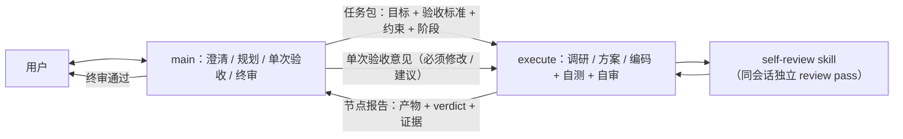

# 自审工作流重构方案（2026-10-24）

> 状态：已实施。范围仅限 `~/.claude` 与全局 / 项目 `AGENTS.md` 的工作流治理配置，不改产品代码。

> **2026-10-27 更新（supersede）**：D1「三份 §4 逐字一致、拒绝仓库仅留指针」已被用户决策取代——工作流正文唯一 owner 为父级 `AGENTS.md` §4，`~/.claude/CLAUDE.md` 与项目 `AGENTS.md` 不再复制正文。本文其余内容保持 2026-10-24 的历史记录；现行规则见 `archived_md/agents/2026-10-27-workflow-single-owner-design.md`。

## 1. 背景与问题

原 §4 采用三层审查门禁：main 规划与终审、execute 执行、research / solution / code 三个 reviewer 只读把关。执行层每完成一个阶段都要派生一个 reviewer subagent，带来三类成本：

1. **通信开销**：reviewer 是无状态会话，需重述完整审查对象与项目清单；execute 再解析 YAML findings 并回报 main，一次小改动也要跨三个会话。
2. **判断漂移**：reviewer 与 execute 使用相近模型，重复率止损规则频繁触发，收敛轮次的实际收益有限。
3. **配置复杂度**：§4 常驻全局上下文约 150 行，reviewer 委派规则、severity 映射、复审 delta 等细节占据主提示词预算。

目标：把审查责任收回 execute 会话，用**可加载的 self-review skill** 固化原 reviewer 的审查契约，保留高级别门禁与证据要求，同时显著缩短常驻工作流。

**非目标**：不删除 `~/.claude/agents/*.md`（保持字节级不变）；不安装第三方包、不复制外部代码；不引入 artifact 哈希 / sidecar 等强制交付机制；不改产品功能、README 与仓库 git 历史。

## 2. 候选设计比较

| 维度 | A. 保留三层 reviewer（现状） | B. 两角色 + 同会话 self-review（推荐） | C. 取消门禁（非常规） |
|------|------------------------------|----------------------------------------|------------------------|
| 角色 | main / execute / 3 reviewer | main / execute | main / execute / 用户 |
| 审查独立性 | 跨会话，天然独立 | 同会话切换对抗视角，靠契约与证据约束 | 无独立 review pass |
| 每节点会话数 | 2+（execute + reviewer） | 1 | 1 |
| 高级别门禁 | 有 | 有（CRITICAL / BLOCKER） | 无 |
| 上下文成本 | 高（委派 + 复述） | 中（按需加载 skill） | 低 |
| 主要风险 | 开销与漂移 | 自查盲区 | 缺陷直接进入终审 |
| 结论 | 放弃 | **采用** | 放弃 |

**推荐 B 的理由**：保留「审查维度 + 证据 + 严重级 + 输出契约」这些真正产生质量的部分，去掉「跨会话派生」这一成本来源；用 skill 单文件承载详细检查表，使常驻 §4 可以精简。C 虽然最省，但失去高级别缺陷的早拦截，且把全部压力推给 main 终审与用户，不可接受。

设计模式（动机）：

- **Strategy**：三个阶段各自选择 `research-self-review` / `solution-self-review` / `code-self-review`，审查维度与输出契约不同，调用方（execute）只依赖统一入口，新增审查类型不改阶段骨架。
- **Template Method**：每个 self-review 共享固定骨架——前置证据 → 逐维审查 → findings（severity / evidence / recommendation）→ verdict → 轮次与 delta 规则；各 skill 只填充维度与专用字段。
- 不为未来阶段预留抽象：三个 skill 是三个独立单文件，不引入公共库或继承机制。

## 3. 目标架构

阶段流转：

`阶段0(main × 用户) → 阶段1(execute 调研 + research-self-review → main 单次验收) → 阶段2(execute 方案 + solution-self-review → main 单次验收) → 阶段3(execute 编码 + 自测 + code-self-review → main 单次验收) → 阶段3.5(main 终审 → 用户)`

不触发调研时阶段 0 直进阶段 2。execute 每个会话只闭环一个节点；main 的「必须修改」直接执行，只有高优先级约束冲突或客观不可行才 `NEED_DECISION`。用户显式要求独立审查时，main 可例外调用现有 reviewer。

## 4. 节点与门禁契约

| 阶段 | execute 动作 | 自审 skill | verdict | 严重级 | 最大轮次 |
|------|--------------|-----------|---------|--------|---------|
| 1 调研 | 报告（来源可验证） | research-self-review | APPROVE / REVISE / REJECT | CRITICAL / MAJOR / MINOR | 2 |
| 2 方案 | 方案（≥2 候选含非常规 + Mermaid） | solution-self-review | APPROVE / REVISE / REJECT | CRITICAL / MAJOR / MINOR | 2 |
| 3 代码 | 实现 + 自测证据 | code-self-review | SAFE_TO_MERGE / NEEDS_CHANGES / BLOCK | BLOCKER / WARNING / NIT | 2 |
| 3.5 终审 | — | main | — | 必须修改 / 建议 | 1 |

共同规则：`REVISE` 仅在含 CRITICAL 时触发返工，最多「首审 + 1 次复审」，复审只核 delta；`REJECT` 属于根本性错误，停止执行并以 `NEED_DECISION` 上报，不伪装成普通两轮返工；代码阶段仅 BLOCKER 触发返工；提前收敛；复审后仍有高级别问题 → `NEED_DECISION`；低级别 finding 进 `known_issues` 由 main 终审裁决；`rejected_findings` 只用于 execute 对自审 finding 的不采纳说明。main 的「必须修改」必须落实，「建议」级可不采纳并记录理由。

## 5. Self-review Skill 契约

| skill | 触发（description） | 核心维度 | 证据要求 |
|-------|--------------------|----------|----------|
| `research-self-review` | 调研报告完成 / 修订后 | 需求覆盖、候选完整性、事实准确性、对比公正性、风险识别、可行动性 | 外部断言必须有来源；无来源 → CRITICAL |
| `solution-self-review` | 技术方案完成 / 修订后 | 架构、扩展性、安全、可维护性、一致性、发散度、配图与模式 | CRITICAL / MAJOR 必带 `change_my_mind` |
| `code-self-review` | 代码或配置变更完成 / 修订后 | 方案一致性、逻辑、安全、性能、可测试性、规范 | 必附真实自测输出；缺失 → BLOCKER |

统一约束：在当前 execute 会话内执行；**不得调用 Agent / Task 或其他 subagent**；Skill 工具不可用时 Read 对应 `SKILL.md` 降级；单文件、无外部依赖；输出 YAML 契约与原 reviewer 保持同构（`review_type` / `round` / `verdict` / `findings` / `scorecard`）。

## 6. 配置与文件变更

1. 新增三个 skill 目录与 `SKILL.md`（见上表）。
2. `~/.claude/CLAUDE.md`：替换 §4，删除三层 reviewer 与 general-purpose 委派描述。
3. `$HOME/AGENTS.md`：同 §4 替换（保留其 `.Codex` 同步入口差异）。
4. `<repo>/AGENTS.md`：原文件没有 §4，在「开发注意事项」下新增同一份 §4 正文。三份配置的 §4 正文逐字一致，仅标题按文件层级微调；**拒绝仓库仅留指针**——指针会让项目级会话失去自洽规则（已于 2026-10-27 取代，见文首）。
5. `~/.claude/agents/*.md` 全部保持字节级不变；`README.md` 无此工作流且不涉及产品功能，不修改。
6. `~/claude-config/sync.sh` 已执行 `cp -R ~/.claude/skills`，新 skill 会随同步进入私有仓库；本次不执行同步、commit、push。

关键决策：

- **D1 三份 §4 逐字一致**：避免全局与项目规则分叉；标题层级差异是唯一允许的差异（已于 2026-10-27 取代，见文首）。
- **D2 节点报告精简**：只要求产物路径、verdict、高级别 findings、自测证据、`known_issues`、`deviations`、验收映射、`main_acceptance`；**不引入** artifact 哈希、reviewed / delivered sha256、sidecar 数量或体积门限。
- **D3 §4 体积收敛**：常驻正文约 100 行（原约 150 行），详细检查表下沉到 skill；Mermaid 保留。
- **D4 治理配置例外**：`~/.claude/**` 与全局工作流文件禁止快速通道，必须 execute + 自审 + main 验收。
- **D5 MUST-FIX 不可拒绝**：main 验收意见不再走 reviewer 式「不认可可不改」；只保留客观阻塞的 `NEED_DECISION` 通道。
- **D6 原创提炼**：三个 skill 的维度与规则提炼自现有 reviewer agent 文件，不安装包、不复制外部代码。

## 7. 验证策略

| 检查项 | 方法 | 通过标准 |
|--------|------|----------|
| skill 可发现 | 会话 skill 列表 / YAML 解析 | 三个 skill 均出现且 frontmatter 合法 |
| 契约完整 | 人工核对三份 SKILL.md | 维度、证据、severity、轮次、输出契约齐全 |
| 无派生指令 | grep `Agent` / `Task` / `subagent` | 仅出现禁止性表述 |
| 三份 §4 一致 | 提取正文并标准化标题后 sha256 | 完全相同 |
| 旧流程无残留 | grep reviewer / general-purpose | 仅剩禁止派生条款 |
| agent 文件不变 | 前后 sha256 对比 | 7 个文件全部一致 |
| 仓库变更范围 | `git status --porcelain` | 仅方案文档与项目 AGENTS |
| 同步覆盖 | 阅读 `sync.sh` | `skills` 目录被 `cp -R` 覆盖 |
| 产品回归 | 不跑 pytest | 无产品代码变更，不虚构测试结果 |

## 8. 风险与缓解

| 风险 | 影响 | 缓解 |
|------|------|------|
| 自查盲区：同会话倾向确认自己的产出 | 高级别缺陷漏检 | 固定对抗视角、强制 evidence、`change_my_mind`、main 终审抽样 |
| 自审流于形式（只写 APPROVE） | 门禁失效 | 输出契约要求 scorecard 与逐维结论；main 在 3.5 核对 findings 质量 |
| 两种尺度混用（CRITICAL vs BLOCKER） | 返工判断错误 | §4 明确阶段映射；skill 内固定刻度 |
| 项目 AGENTS 新增 §4 造成上下文变长 | 项目会话成本上升 | 正文精简、细节在 skill；仅在需要时加载 |
| 用户要求独立审查 | 绕开新流程 | 保留显式例外：由 main 调用 reviewer，不恢复为默认路径 |
| 同步遗漏新 skill | 配置仓库不完整 | 已确认 `sync.sh` 覆盖 `skills`；终审后由 main 统一同步 |

## 9. 实施清单与验收映射

1. 新建 `~/.claude/skills/{research,solution,code}-self-review/SKILL.md`。
2. 替换 `~/.claude/CLAUDE.md` 与 `$HOME/AGENTS.md` 的 §4；为项目 `AGENTS.md` 新增同正文 §4。
3. 本方案文档与最终配置保持一致，不保留旧字段（指针式 §4、强制哈希 / sidecar、旧三层流程）。
4. 自测与自审后向 main 提交 `READY_FOR_FINAL_REVIEW` 节点报告。

## 10. 残余风险

- 同会话自审的独立性弱于跨会话 reviewer，长期效果需用后续几个 feat 的漏检率观察。
- 旧 reviewer agent 文件保留但不再是默认入口；若用户或外部配置仍显式调用，会与新流程并存，需在团队约定中说明。
- 三份配置靠人工保持逐字一致，未来修改需同步三处；本次未引入自动校验脚本（避免为低频变更增加维护面）。
- `$HOME/AGENTS.md` 是 Codex 侧配置，Skill 工具可能不可用；§4 已要求此时 Read `~/.claude/skills/<name>/SKILL.md` 降级执行，但跨工具的 skill 自动发现未实测。
