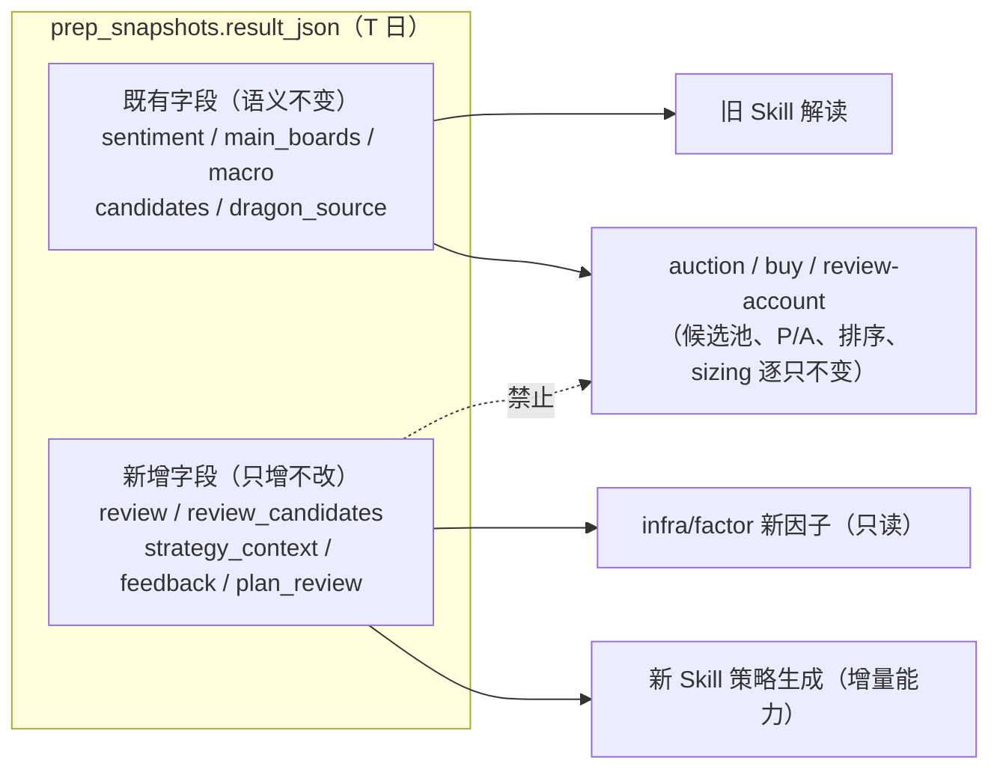
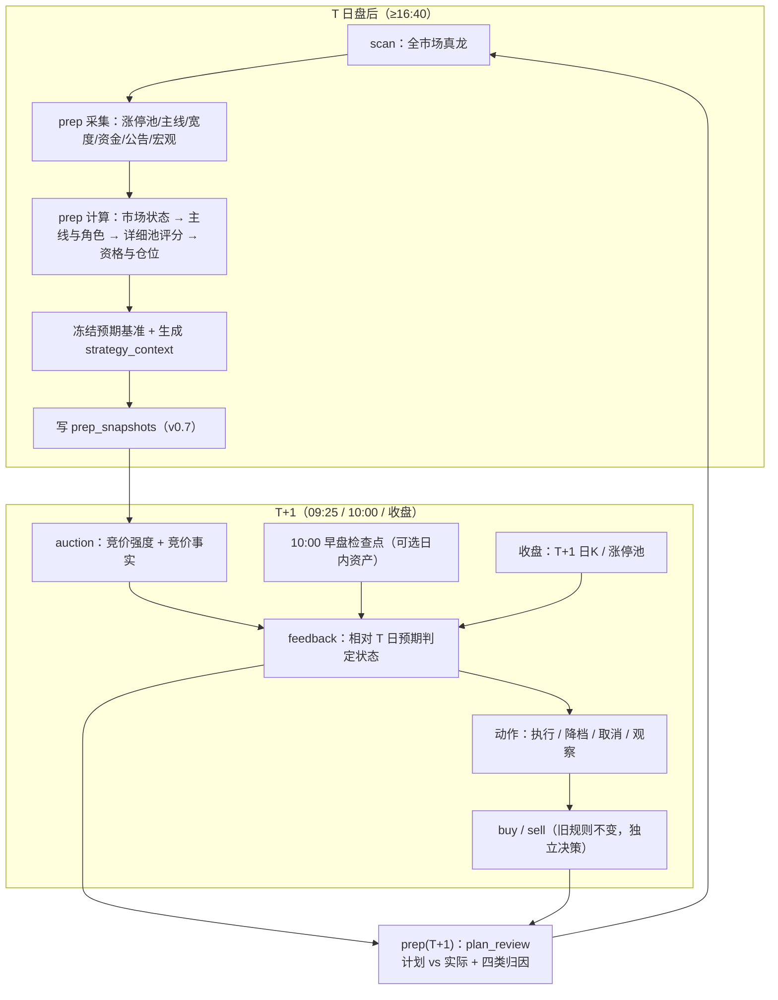
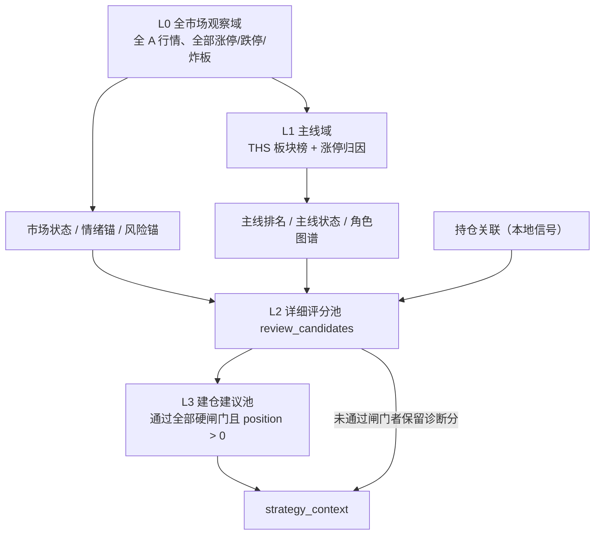
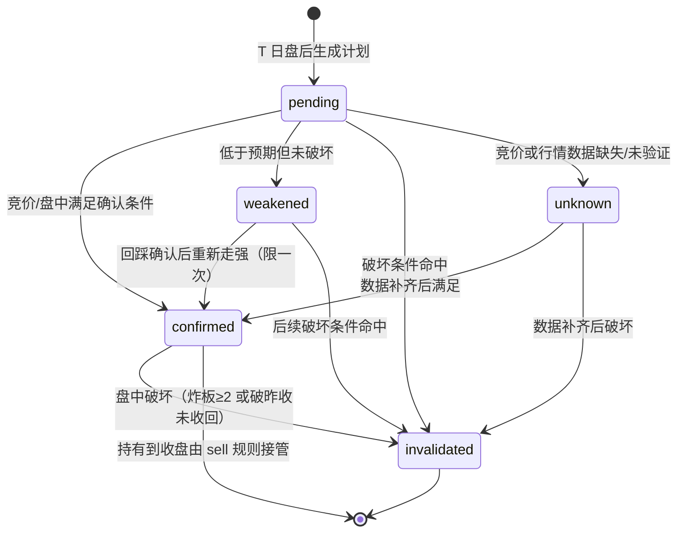

# prep 盘后复盘升级 · 产品方案

> 日期：2026-10-28｜阶段：2（产品 + 技术方案）｜状态：阶段 3.5 已通过，待用户确认
> 配套技术方案：`docs/solutions/2026-10-28-prep-review-technical-design.md`
> 调研依据：`docs/solutions/2026-10-28-prep-review-research.md` 及其 workspace 笔记
> 本文件是**开发期产物**：阶段 3.5 通过且用户确认合入时再归档（见全局 `AGENTS.md` §6）。
>
> **全文所有数字均为「待验证产品基线」**：它们来自方法论文档的经验口径与工程可计算性推导，
> **没有被样本外、交易成本与可成交性验证**。任何数字都不构成收益承诺或有效性声明。
> 唯一允许的默认消费方式是**影子输出**（见 §16）：旧 `buy` / `sell` / `auction` / `review-account`
> 行为逐只不变。

---

## 0. 术语与口径（先读）

| 术语 | 定义 | 明确不是什么 |
|---|---|---|
| **T 日复盘分**（`review_score`） | T 日收盘后，个股「今天是否仍值得准备建仓」的 0–100 分 | 不是入选日五维分、不是 T+1 触发信号、不是收益预测 |
| **入选日五维分**（`composite_score`） | 该股被 `scan` 选为真龙那天的五维综合分（既有字段，语义不变） | 不是 T 日分；本方案**不消费**它进入 `review_score` 公式 |
| **旧评级**（`verdict`：strong/light/ignore/unrated） | 既有 4 档展示评级，`candidates[]` 内字段，语义不变 | 不是新评级，不改义、不改阈值 |
| **新评级**（`review_grade`：S/A/B/C/D） | 基于 `review_score` 的新档位，只出现在 `review_candidates[]` | 不替换 `verdict`，不参与旧候选过滤 |
| **旧市场仓位**（`sentiment.position_pct`） | 市场情绪 → 总仓位启发式（80/5/30/10 阈值，语义不变） | 不是单票仓位 |
| **单票建议仓位**（`position_pct`） | 该标的建议占**账户总资产**的百分比，三态语义 | 不是组合权重，不做归一 |
| **T+1 反馈**（`feedback.state`） | T+1 竞价/盘中相对 T 日冻结预期的实际结果 | 不回写 T 日分，不改变 T 日资产 |
| **数据置信度**（`confidence`） | 「这个结论有多少数据支撑」的 0–1 值 | 不是分数，不参与 `review_score` 加总 |
| **详细池**（`review_candidates`） | 分层后的详细评分对象集合 | **不是** `candidates`；`candidates` 范围完全不变（见 §3.1） |

**四类输出永不混义**（本方案的硬性产品约束）：

1. 市场状态（`review.market`）——「能不能承担风险」；
2. 主线状态（`review.mainlines`）——「资金主战场在哪、在增强还是衰减」；
3. 个股 T 日复盘分（`review_candidates[].review_score`）——「这只票今天值不值得准备」；
4. 数据置信度（`confidence` / `market.confidence`）——「我有多少把握知道」。

T+1 反馈是**第五类、另一时点**的结果，只追加在 T+1 的记录里。

---

## 1. 目标 / 非目标 / 反目标

### 1.1 目标

- **G1 每只详细标的有量化总分**：覆盖个股龙头质量、主线地位、涨停/封板质量、资金与流动性、
  筹码/位置、持续性/股性六个维度，输出维度分、原始因子值、逐因子贡献与缺失原因。
- **G2 明确「是否值得建仓」与「单票建议仓位」**：仓位以账户总资产百分比表达，三态可判定。
- **G3 明确市场与主线结构**：情绪锚、风险锚、主线及其强度状态、主线内角色（龙头/先锋/中军/
  容量核心/跟风）、角色关系与判定证据。
- **G4 盘后只出「预备建议」，T+1 正负反馈决定生效/降档/取消/退出**：T 日冻结预期基准，
  T+1 用可观察、可计算、带时点的条件判定，缺数据即 `unknown`。
- **G5 给 Agent Skill 版本化结构化上下文**：Agent 只组织语言与执行计划，**不编造数值、
  不发明阈值、不推翻硬否决**。
- **G6 闭环**：记录「昨日计划 vs 今日实际」，区分市场判断、模式、执行与数据四类错误。
- **G7 兼容**：旧 `candidates` / `verdict` / `composite_score` / `position_pct` 语义与消费方
  逐只不变；新能力全部为新增字段与新增池。

### 1.2 非目标

- 不做多标的组合归一、风险平价、行业中性化或账户级组合优化（单票仓位彼此独立）。
- 不做自动下单、券商对接、资金划转。
- 不提供收益承诺、胜率保证或「必涨」结论。
- 不做盘中实时交易引擎。**本阶段实际计算只有 T+1 盘后一次**；09:25 竞价、10:00 早盘、收盘
  是冻结 playbook 的对照时点，供人工/Agent 对照，不宣称已完成实时计算。
- 不覆盖港股、ETF、可转债、北交所独立口径（北交所数据保留但默认不进详细池，见 §15）。
- 不改变旧 `buy` / `sell` / `review-account` / `auction` 的决策路径与默认参数。
- 不重建不可重建的历史盘口/竞价/封单时序（见技术方案 §9）。

### 1.3 反目标（明确要避免的错误做法）

- **反 A**：把市场分、主线分、个股分、置信度混成一个「大总分」（调研明确指出的最危险做法）。
- **反 B**：让 Agent 拥有阈值、权重或否决权（会产生第二套不可回测的策略）。
- **反 C**：数据缺失时给中性分、0 分或 50 分（会把「不知道」伪装成「一般」）。
- **反 D**：用 T+1 或更晚的数据回填 T 日分数（未来函数）。
- **反 E**：把详细池直接塞进旧 `candidates`，导致 `auction`/`buy` 池与 P/A 行为静默改变。
- **反 F**：把供应商算法值（主力资金、筹码）当成交易所事实展示。
- **反 G**：默认依赖东财、登录态或 OCR 才能走通主路径。

---

## 2. 用户故事

| # | 用户故事 | 验收要点 |
|---|---|---|
| US1 | 作为盘后复盘者，我想看到今天每只重点票的量化总分、六个维度分和逐因子贡献，这样我知道它强在哪、弱在哪 | 每只 `review_candidate` 有 `review_score`、`dimensions{score,weight,sub}`、`contributions[]`、`missing_dims[]` |
| US2 | 作为交易者，我想知道这只票「值不值得建仓」和「建议买多少」，而不是只看到一个等级 | `eligibility` + `position_pct`（null / 0 / >0）+ `position_basis[]` |
| US3 | 作为交易者，我想知道今天的主线、主线龙头和先锋/中军/容量/跟风是谁，以及依据 | `review.mainlines[]`、`review.roles`、`role_basis`、`role_competitors[]` |
| US4 | 作为交易者，我想在开盘前知道「什么情况执行、什么情况降档、什么情况取消」，而不是收盘后一句「明天买」 | `strategy_context.feedback_plans[]` 含状态条件与动作枚举 |
| US5 | 作为复盘者，我想知道昨天的计划今天兑现了没有、错在市场还是错在模式还是错在执行 | `plan_review` 四类归因 |
| US6 | 作为 Agent，我只被允许引用结构化上下文里的数值与枚举，不得自造阈值 | Skill 契约（§13）+ 内容测试禁止权重数字出现在 skill |
| US7 | 作为旧链路使用者，我希望升级后 `auction`/`buy`/`review-account` 的候选集合和行为完全不变 | R8 / AC-P11：`candidates` 逐只不变 |
| US8 | 作为研究者，我希望新分数能被因子层评估，而不是写死在策略里 | 新因子注册 + `factor eval` 可跑（技术方案 §12/§13） |

---

## 3. 端到端流程

### 3.1 关键兼容边界（先看这张图）



`candidates` 保持**近 5 日真龙并集**这一旧范围与旧字段；详细池一律进 `review_candidates`。
下游消费方零改动即保持逐只一致。

### 3.2 一日闭环



**时点不变量**：T 日快照一旦写入，其 `review` / `review_candidates` / `strategy_context` 不可被
T+1 数据修改；T+1 只写 T+1 自己的快照与 `feedback` / `plan_review`。

### 3.3 分层：算全量、评详细、只建议少数



| 层 | 内容 | 用途 | 是否进 `candidates` |
|---|---|---|---|
| L0 | 全 A 行情、涨跌停、炸板、成交额 | 市场状态、锚 | 否 |
| L1 | 板块榜、板块内涨停成员（当日 PIT 快照） | 主线、角色 | 否 |
| L2 | 近 5 日真龙 ∪ T 日主线核心 ∪ 正/负锚 ∪ 持仓关联 | 逐只评分与仓位 | **否**（进 `review_candidates`） |
| L3 | L2 中通过硬闸门且仓位 > 0 | Agent 策略主清单 | 否 |

**详细池构造规则（确定性，待验证）**

```
R = dragons_window_codes            # 近 5 日真龙并集（既有窗口）
  ∪ mainline_core_codes             # 前 3 条主线当日涨停成员
  ∪ positive_anchor_codes           # 市场总龙头 + 各主线龙头
  ∪ negative_anchor_codes           # 昨日涨停今日跌幅前三 + 高标炸板（height≥3 且 open_num≥3）
  ∪ holdings_codes                  # 本地持仓/信号关联
若 |R| > 60：保留 dragons ∪ holdings ∪ anchors 全部，
             主线核心按（主线分, 高度, 成交额）降序截断至总数 60，标 truncated=true
```

剔除规则：ST（`is_st` 可判定时）、上市 < 20 个交易日、停牌、非 A 股主板/创业板/科创板标的。
北交所默认剔除并计数 `excluded_bse`（待验证是否纳入后续版本）。

---

## 4. 因子 taxonomy

### 4.1 三层可信度（必须分开表达）

| 层 | 含义 | 例子 | 表达方式 |
|---|---|---|---|
| **A 交易所/公告原文** | 官方披露或官方行情 | 日 K、涨跌停价、龙虎榜、公告标题与时间 | 原始值 + `source` |
| **B 供应商行情与算法值** | 供应商计算，非交易所事实 | 主力净额、封板资金、筹码分布、涨停原因 | 原始值 + `source` + `caliber` 说明 |
| **C 本地派生 / 主观证据** | 本项目算法或 AI/人工判断 | 市场状态、角色、`review_score`、题材故事持续性 | 派生值 + `model_version`；主观证据单列 |

**C 类不得伪装成 A 类**：主力资金、筹码一律标注「供应商/模型估计」；题材故事、社会传播、
消息兑现单独存为 `subjective_evidence[]`（见 §4.3）。

### 4.2 因子清单（按维度归属）

#### 市场层（全量，不进个股分）

| 因子 ID | 原始/派生 | 数据源（默认） | 口径与单位 | 时点 | 缺失语义 |
|---|---|---|---|---|---|
| `mkt.limit_up_cnt` | 原始 | THS 涨停池 `total` | 家数（含 ST，标注） | T 日 | 缺失 → 市场状态 `unknown` |
| `mkt.limit_down_cnt` | 原始 | TDX 全 A 扫描 `sell_price_limit` 触及 | 家数 | T 日（same_day_only） | 缺失 → `unknown` |
| `mkt.broken_cnt` | 原始 | TDX 全 A（触涨停但收盘未封）或涨停池 `open_num>0` | 家数 | T 日 | 缺失 → 维度 `null` |
| `mkt.broken_rate` | 派生 | `broken_cnt / (broken_cnt + limit_up_cnt)` | 0–1 | T 日 | `null` |
| `mkt.up_cnt/down_cnt/flat_cnt` | 原始 | TDX 全 A 扫描 | 家数 | T 日 | `null` |
| `mkt.total_amount` | 原始 | TDX 全 A 成交额求和 | 元 | T 日 | `null` |
| `mkt.yesterday_premium_pct` | 派生 | FG「昨日涨停」成员 `close/pre_close-1` 均值 | % | T 日 | `null`（FG 缺失） |
| `mkt.promotion_rate` | 派生 | 今日连板家数 / 昨日涨停家数 | 0–1 | T 日 | `null` |
| `mkt.max_board_height` | 原始 | 涨停池/板块榜 `high_num` | 板数 | T 日 | `null` |
| `mkt.max_board_height_d3` | 派生 | 近 3 日 `max_board_height` 序列 | 板数 | 需 T-1/T-2 快照 | `null` |
| `mkt.lhb_cnt` | 原始 | FG「昨日上榜」 | 家数 | T 日 | `null` |
| `mkt.risk_anchor.level` | 派生 | 跌停家数 + 高标炸板 + 高度压缩 | 枚举 | T 日 | `unknown` |

#### 主线层

| 因子 ID | 原始/派生 | 来源 | 口径 | 缺失语义 |
|---|---|---|---|---|
| `ml.board_name` | 原始 | THS 板块榜 `name` | 文本 | 板块榜缺失 → 主线不可用 |
| `ml.limit_up_num` | 原始 | THS `limit_up_num` | 家数 | `null` |
| `ml.high_num` | 原始 | THS `high_num`（回退解析 `high`「N天M板」） | 板数 | `null` |
| `ml.continuous_plate_num` | 原始 | THS `continuous_plate_num` | 天数 | `null` |
| `ml.concentration` | 派生 | `limit_up_num / mkt.limit_up_cnt` | 0–1 | `null` |
| `ml.members` | 原始 | THS `stock_list`（**当日成员快照 = PIT 依据**） | code 列表 | 缺失 → 角色不可判 |
| `ml.mainline_score` | 派生 | §6.1 公式 | 0–100 | `null` |
| `ml.state` | 派生 | 跨日对比 | 枚举 | `unknown` |

#### 个股层（六维）

| 维度 | 因子（原始 → 归一） | 默认来源 | 缺失语义 |
|---|---|---|---|
| **D1 龙头质量** | `height`（板数）、`intra_board_rank`（板块内排序名次）、`board_limit_up_num` | 涨停池 + 板块成员 | 板块成员缺失 → 排名 `null`，D1 由剩余子项重算 |
| **D2 主线地位** | `mainline_rank`、`attr_match`（涨停原因/概念与主线名匹配）、`mainline_days` | 板块榜 + 涨停池 `reason_type` | `mainline_days` 缺失 → 子项 `null` |
| **D3 封板质量** | `first_seal_time`、`open_num`、`seal_amount`（封单额）、`seal_ratio`（封单额/成交额） | 涨停池 `first_limit_up_time`/`order_volume`/`fund` 类字段 | 任一缺失 → D3 子项 `null` 并重算 |
| **D4 资金与流动性** | `main_net_amount`、`amount`、`turnover_rate` | TDX quote | `main_net` 缺失 → 子项 `null` |
| **D5 筹码/位置** | `distance_high60`、`chip_concentration`、`profit_ratio` | 本地日 K + 本地筹码模型 | 日 K 不足 60 根 → D5 `null` |
| **D6 持续性/股性** | `limit_up_cnt_20d`、`next_day_up_rate_20d`、`days_in_mainline` | 本地历史日 K + 快照 | 历史不足 → D6 `null` |

#### 主观证据（独立，不进公式）

```json
{
  "type": "theme_story",
  "summary": "题材是否有持续催化/官媒传播/社会扩散",
  "source_url": "…",
  "captured_at": "2026-10-28T16:05:00",
  "producer": "human | ai",
  "confidence": 0.6,
  "expires_at": "2026-11-04",
  "affects": "evidence_only"
}
```

`affects` 只允许 `evidence_only`；**主观证据不得进入硬闸门，也不得改变 `review_score`**。

### 4.3 不允许出现在公式里的东西

- `composite_score`（入选日五维分）——只作 `legacy_composite_score` 展示证据；
- 任何供应商「主力成本/建仓/出货」推断；
- 任何无法标注来源的新闻标题或 OCR 文本；
- 市场状态（只做仓位系数与档位上限，不进个股分，见 §9.2 决策记录）。

---

## 5. 市场状态、情绪锚与风险锚

### 5.1 市场分（0–100，待验证）

```
market_score = 0.22*LU + 0.18*LD + 0.18*PRE + 0.14*PRO + 0.10*HGT + 0.08*BRK + 0.10*LIQ
```

分段线性插值（相邻锚点之间线性），锚点全部待验证：

| 子分 | 输入 | 锚点（输入 → 分） |
|---|---|---|
| LU | 涨停家数 | 15→0；80→90；120→100 |
| LD | 跌停家数 | 0→100；5→90；10→70；30→20；50→0 |
| PRE | 昨日涨停溢价 % | -5→0；-2→30；0→55；+2→80；+5→100 |
| PRO | 晋级率 | 0.05→10；0.15→50；0.25→80；0.40→100 |
| HGT | 最高板 | 2→20；3→50；4→70；6→90；8→100 |
| BRK | 炸板率 | 0.10→100；0.20→75；0.30→45；0.45→10；0.60→0 |
| LIQ | 全市场成交额（亿元） | 5000→10；7000→40；10000→75；15000→100 |

**缺失处理**：`LU` 或 `LD` 缺失 → `market_score=null`、`state=unknown`（这两个是判定基座，
不可用其余分项拼凑）。其余子分缺失 → 在当前权重内归一化重算，并标
`partial=true` + `missing_inputs[]`。

### 5.2 市场状态（四态 + 未知，待验证）

| 状态 | 条件 | 仓位系数 | 语义 |
|---|---|---|---|
| `strong` 强势 | `market_score ≥ 70` | 1.00 | 可承担风险，允许按计划建仓 |
| `neutral` 中性 | `50 ≤ score < 70` | 0.80 | 结构性参与，仓位收敛 |
| `weak` 偏弱 | `30 ≤ score < 50` | 0.60 | 只做最强主线龙头，降档 |
| `ice` 冰点 | `score < 30` | 0.40 | 以观察为主，仅保留试错仓 |
| `unknown` 未知 | 关键输入缺失 | 0.50 | 不宣称状态，按保守系数 |

**不宣称周期**：本方案只输出状态 + 证据 + 变化方向，**不输出「退潮后必修复」这类确定性阶段机**
（调研明确否定）。

### 5.3 情绪锚与风险锚

| 锚 | 定义 | 输出字段 |
|---|---|---|
| **正向情绪锚** | 市场总龙头（全市场最高板，并列取主线分高者）、各主线龙头、昨日涨停溢价 | `review.anchors.positive[]` |
| **负向情绪锚** | 昨日涨停今日跌幅前三、高标炸板（height ≥ 3 且 open_num ≥ 3）、跌停家数 | `review.anchors.negative[]` |
| **风险锚** | `limit_down_cnt`、`broken_rate`、`max_board_height` 三日变化（压缩）、外围期指/美债（`macro`） | `review.anchors.risk` |

每个锚必须带 `evidence`（数值 + 来源）与 `unknown_reason`（不可判定时）。
负锚标的**自动进入详细池**，即使它不在近 5 日真龙里。

---

## 6. 主线定义、主线分与主线状态

### 6.1 主线分（0–100，待验证）

```
mainline_score = 0.35*N + 0.25*H + 0.20*C + 0.20*S
N = min(limit_up_num / 10, 1) * 100            # 板块涨停家数（10 家封顶）
H = min(high_num / 6, 1) * 100                 # 板块最高板（6 板封顶）
C = min(continuous_plate_num / 3, 1) * 100     # 连续在榜天数（3 天封顶）
S = min(concentration / 0.15, 1) * 100         # 涨停集中度（15% 封顶）
```

取 `mainline_score` 前 3 名为**当日主线**，第 4–5 名进 `watchlist`（观察，不给角色）。
并列时按（`limit_up_num` desc, 板块名升序）稳定排序。

### 6.2 主线状态（待验证）

与 T-1 快照前 5 名对比：

| 状态 | 条件 |
|---|---|
| `new` 新生 | T-1 不在前 5，T 日进前 3 |
| `strengthening` 强化 | 排名上升 ≥1 或 `mainline_score` 环比 +10 以上 |
| `stable` 稳定 | 排名与分数变化在 ±1 名 / ±10 分内 |
| `weakening` 衰减 | 排名下降 ≥2 或分数环比 -10 以上 |
| `unknown` | 无 T-1 快照或 T-1 板块榜不可用 |

**不宣称「主线前三才可做」为全局真理**：三主线并列、多线轮动是合法形态（调研分歧点）。
只输出 `new/strengthening/stable/weakening` 证据，动作由 §11 的 playbook 决定。

### 6.3 主线证据

每条主线输出：`board_name`、`category`（hy/gn/dq，如实记录）、`mainline_score`、`state`、
`limit_up_num`、`high_num`、`continuous_plate_num`、`concentration`、`members_sample`（前 10 只）、
`role_map`（角色 → code）、`evidence[]`、`unknown_reason`。

---

## 7. 角色定义与竞争规则

### 7.1 五个角色

| 角色 | 定义（待验证） | 判定证据 | 典型仓位上限 |
|---|---|---|---|
| **龙头** `leader` | 主线板块内**高度最高**的涨停股；高度并列取成交额大者，再并列取首封更早者 | `height`、板块内名次、成交额 | 15% |
| **先锋** `vanguard` | 主线板块内**最早非一字涨停**的股票（剩余候选中） | `first_seal_time`、`limit_up_type` | 10% |
| **中军** `mainstay` | 主线板块内涨停且**流通市值 ≥ 200 亿** | `float_market_cap` | 12% |
| **容量核心** `capacity` | 主线板块内涨停、**成交额 ≥ 10 亿**且高度 ≤ 2 | `amount`、`height` | 12% |
| **跟风/补涨** `follower` | 主线板块内其余涨停股（含高度 ≥ 3 的非龙头，见 `height_tier`） | 兜底 | 5% |

**判定顺序（责任链，命中即停）**：龙头 → 先锋 → 中军 → 容量核心 → 跟风。
一只股票当天只有一个 `role`；其余可能的角色写入 `role_competitors[]` 作为证据。

**非主线标的（`role=null`）**：负锚或持仓关联标的不属于任何主线板块时**不赋予任何角色**
（尤其不得借用「跟风」）。它们使用独立的诊断权重 profile `diagnostic_non_mainline`
（见 §9.1），只用于评分展示与风险说明，不参与角色竞争、不获得跟风仓位上限。

### 7.2 竞争规则

- **同板块多个候选**：按 `(height desc, first_seal_time asc, amount desc)` 排序，
  第 1 名若 `height ≥ 2` 判龙头；若板块内全为首板（`height == 1`），第 1 名仍判龙头但
  `role_confidence="low"`、`role_basis="first_board_earliest"`。
- **跨板块归属**：一只股票在多个主线板块出现时，按「涨停原因 token 匹配数 → 板块 `mainline_score`」
  选唯一主归属，其余进 `also_in_boards[]`，并在 `role_competitors[]` 记录冲突。
- **市场总龙头**：全市场 `height` 最高者（并列取主线分高者），可同时是某主线龙头。
- **未知不猜**：板块成员缺失 → 角色 `null` + `unknown_reason="board_members_missing"`；
  首封时间缺失 → 先锋不可判，跳过该角色继续下一条规则（不猜测）。

### 7.3 角色差异（为什么必须角色化）

不同角色对「高度、成交额、市值、封板时间」的合理区间不同。同一把尺子会把
「200 亿中军涨停」判成低分（高度低），也会把「小市值 3 板跟风」判成高分（高度高）。
因此 `review_score` 的**维度权重按角色不同**（§9.1），且单票仓位上限按角色不同（§10.3）。

---

## 8. 个股复盘分：维度、公式与缺失语义

### 8.1 六个维度（各 0–100）

所有子分先映射到 0–100，再做维度加权；维度权重按角色（§9.1）。

**D1 龙头质量**
```
D1 = 0.40*H + 0.35*L + 0.25*B
H = min(height, 6) / 6 * 100
L = (1 - (intra_board_rank - 1) / max(board_limit_up_num - 1, 1)) * 100
B = min(board_limit_up_num / 8, 1) * 100          # 带动性代理：板块涨停家数
```

**D2 主线地位**
```
D2 = 0.50*M1 + 0.30*M2 + 0.20*M3
M1 = 主线排名分：1→100, 2→80, 3→65, 4-5→40, 非主线→0
M2 = min(attr_match, 2) / 2 * 100                 # 涨停原因/概念与主线名匹配数
M3 = min(mainline_days, 3) / 3 * 100              # 该主线连续在榜天数
```

**D3 封板质量**
```
D3 = 0.35*T + 0.25*O + 0.25*S + 0.15*R
T = 首封时点分：≤09:35→100；09:35–10:00→85；10:00–11:30→65；13:00–14:00→45；>14:00→25
O = 炸板分：0 次→100；1→75；2→50；≥3→20
S = min((seal_amount / float_market_cap) / 0.01, 1) * 100      # 封单额占流通市值 1% = 100
R = min(seal_ratio / 0.5, 1) * 100                            # 封成比（封单额/成交额）50% = 100
```

**D4 资金与流动性**
```
D4 = 0.40*F + 0.35*V + 0.25*Q
F = 主力净额率（main_net / amount）线性映射：-10%→0，0→50，+10%→100
V = min(amount / 20亿, 1) * 100
Q = 换手健康分：<2%→20；2–5% 线性 50→100；5–20%→100；20–35% 线性 100→50；>35%→20
```

**D5 筹码/位置**
```
D5 = 0.40*P + 0.30*C + 0.30*X
P = 距 60 日高点回撤：≤5%→100；5–20% 线性 100→60；20–40% 线性 60→30；>40%→10
C = 筹码集中度 (P90-P10)/P50：<10%→100；10–20% 线性 100→60；>30%→20
X = 现价/平均成本 - 1：<0→60；0–10%→100；10–25% 线性 80→50；>40%→20
```

**D6 持续性/股性**
```
D6 = 0.50*S1 + 0.50*S2
S1 = 近 20 日涨停次数分：0→0；1→30；2–3→60；4–5→85；≥6→100
S2 = 近 20 日「涨停次日收涨」比例 * 100（样本 < 3 次 → null）
```

**子分缺失规则（全维度统一）**：任一子分为 `null` 时，该维度在**剩余子分权重内归一化重算**；
若剩余子分权重合计 < 0.5，则该维度整体为 `null`（不猜）。例如 D6 的 `S2` 缺失时
`D6 = S1`，而不是 `D6 = 0.5*S1`。

### 8.2 总分与贡献

```
available = {D1..D6 中非 null 的维度}
coverage  = Σ_{i∈available} w_i                        # 0–1
review_score = round( Σ_{i∈available} (w_i * D_i) / coverage , 1 )
contribution_i = (w_i / coverage) * D_i                # 各项之和 = review_score（可核对）
```

- **缺失即剔除并重算**（不对缺失维度打 0 或 50）；`missing_dims[]` 记录被剔除项。
  这是「缺失≠中性」在个股层的实现。
- `coverage < 0.80` 时，`review_score` 仍输出（供诊断），但 `confidence` 降档且**禁止给出仓位**
  （见 §10.2 的 `confidence_coef`）。`coverage < 0.50` 时 `review_score=null`。
- **逐因子贡献**同时输出可读形式：
  `contributions[] = [{dim, weight_norm, dim_score, points, sub_factors:[{key, raw, normalized, points}]}]`，
  并给 `top_drivers` / `top_drags` 各 2 条，供 Agent 解释「为什么强/为什么弱」。

### 8.3 数据置信度（独立字段）

```
confidence = coverage * source_health
source_health: 用到的数据源全部健康 → 1.00
               1 个降级                → 0.85
               ≥2 个降级               → 0.70
               涨停池缺失（判定基座）  → 0.00
confidence = round(confidence, 2)
```

**置信度不参与分数与仓位比例以外的任何加总**；它只影响 `confidence_coef` 与展示文案。

### 8.4 新评级（`review_grade`，待验证）

| 档 | 区间 | 语义 | 默认仓位基数 |
|---|---|---|---|
| **S** | `≥ 85` | 核心准备（主线龙头/先锋 + 高质量封板） | 12% |
| **A** | `75 ≤ x < 85` | 可参与 | 8% |
| **B** | `65 ≤ x < 75` | 观察或轻仓 | 4% |
| **C** | `50 ≤ x < 65` | 暂不参与（仅诊断） | 0 |
| **D** | `< 50` | 回避 | 0 |

`review_grade` 与旧 `verdict` 并存、互不替代；二者映射关系**不做**（避免制造第二套语义）。

---

## 9. 总分构成中的设计取舍（记录）

### 9.1 角色权重矩阵（每行合计 100，待验证）

| 角色 | D1 龙头质量 | D2 主线地位 | D3 封板质量 | D4 资金流动 | D5 筹码位置 | D6 持续性 |
|---|---|---|---|---|---|---|
| 龙头 leader | 30 | 20 | 20 | 20 | 5 | 5 |
| 先锋 vanguard | 25 | 15 | 25 | 25 | 5 | 5 |
| 中军 mainstay | 20 | 20 | 15 | 25 | 15 | 5 |
| 容量核心 capacity | 15 | 15 | 15 | 30 | 20 | 5 |
| 跟风 follower | 20 | 20 | 25 | 20 | 10 | 5 |
| 诊断 `diagnostic_non_mainline`（仅 `role=null`） | 20 | 20 | 25 | 20 | 10 | 5 |

**诊断 profile 规则**：数值当前与 follower 相同，但**独立命名、独立配置项**，不得合并；
它只用于负锚/非主线标的的评分展示，**不赋予 follower 角色、不适用 follower 角色上限**，
资格仍由 G4（`mainline_hit=false`）判 0。这样后续调整跟风权重时不会意外改动诊断口径。

动机（Strategy 模式）：把「角色预期差异」隔离在权重配置里，新增角色只加一行权重，
不改评分代码。

### 9.2 两个明确决策

1. **市场状态不进 `review_score`，只做仓位系数与档位上限。**
   理由：个股分要跨日、跨市场状态可比；若乘市场系数，弱市所有票分数一起塌陷，
   无法区分「弱市里最强的票」与「弱市里一般的票」。代价：单看分数会忽略大盘风险，
   由仓位系数与 `market.state` 补偿。备选（已否决）见 §9.3。
2. **`review_score` 不消费 `composite_score`。**
   理由：`composite_score` 是入选日五维分，混入会造成「时间与语义双混义」（调研核心结论）。

### 9.3 已评估但未采用的方案

| 方案 | 描述 | 否决理由 |
|---|---|---|
| 单一总分 | 市场+主线+个股+风险混成一个 0–100 | 混淆时间与语义，无法形成正负反馈与执行计划 |
| 市场系数乘分数 | `score *= market_coef` | 破坏跨日可比性，等价于把市场风险重复计入个股 |
| 乘法打分卡 | 各维度相乘（任一低则总分暴跌） | 单维极端值主导，缺失处理不可解释；消融困难 |
| Agent 直接打分 | 让 LLM 读文本/截图判主线与仓位 | 数值血缘弱、不可回放、不可回测，只允许作证据补充 |

---

## 10. 建仓资格与单票建议仓位

### 10.1 资格闸门（责任链，顺序即优先级，命中即短路）

| # | 闸门 | 条件 | 结果 | `reason_code` |
|---|---|---|---|---|
| G0 | 数据不足 | 涨停池不可用且无 T 日涨幅；或 `coverage < 0.50` | `eligible="unknown"`, `position=null` | `data_insufficient` |
| G1 | 硬风险 | 近 3 日公告命中 HARD 关键词（立案/调查/处罚/退市/预亏等） | `position=0` | `hard_risk` |
| G2 | 不可交易 | T 日停牌、或已公告 T+1 停牌 | `position=0` | `suspended` |
| G3a | 流动性不足 | T 日成交额 < 2 亿 | `position=0` | `illiquid` |
| G3b | 流动性偏弱 | 2 亿 ≤ 成交额 < 5 亿 | `position × 0.5`，继续 | —（`liq_coef=0.5`） |
| G4 | 非主线 | `mainline_hit=false`（含 `role=null`、跟风但不在任何主线） | `position=0` | `not_mainline` |
| G5 | 分数不足 | `review_score < 50`（D 档） | `position=0` | `score_below_floor` |
| G6 | 无仓位基数 | `review_grade ∈ {C, D}` | `position=0` | `grade_no_position` |
| G7 | 置信不足 | `confidence < 0.60` | `position=null` | `confidence_insufficient` |
| — | 一字板执行风险 | T 日 `limit_up_type` 含「一字」 | `position × 0.5` + `warning` | `one_word_execution_risk` |

**硬闸门先于仓位**：G1/G2 的否决不可被高分解除；诊断分仍保留展示。

**持仓关联标的的语义**：`holdings` 进入详细池是为了给出「是否仍值得持有/加仓」的量化视图。
对持仓标的，G4/G5/G6 判 `position=0` 只表示「**不建议新建仓**」，**不表示应清仓**；
清仓与否一律由既有 `sell` 规则决定。报告必须显式区分这两种语义。

`gate_trace[]` 记录每一步 `{gate, evaluated, passed, reason_code, detail}`，保证可审计。

### 10.2 单票仓位公式

```
base      = grade_base[review_grade]                       # S12 / A8 / B4 / C0 / D0
role_cap  = {leader:15, vanguard:10, mainstay:12, capacity:12, follower:5}
market_coef = {strong:1.0, neutral:0.8, weak:0.6, ice:0.4, unknown:0.5}
confidence_coef = {≥0.90:1.00, 0.75–0.90:0.85, 0.60–0.75:0.70}
risk_coef = {无风险:1.0, 软风险(减持/质押/担保):0.5, 硬风险:0（G1 已短路）}
liq_coef  = {≥5亿:1.0, 2–5亿:0.5, <2亿:0（G3a 已短路）}

position_pct = floor_to_half(
    base * market_coef * confidence_coef * risk_coef * liq_coef * one_word_coef,
    cap = role_cap
)
若 position_pct < 0.5 → 0（reason_code = position_below_min_unit）
```

`floor_to_half`：向下取到 0.5% 的整数倍，且不超过 `role_cap`。
结果三态：`null`（数据不足/置信不足）、`0`（明确不参与）、`>0`（可准备建仓）。

**示例（待验证，仅演示算术）**

| 例 | 角色 | 档 | base | market | conf | risk | liq | 计算 | 输出 |
|---|---|---|---|---|---|---|---|---|---|
| 1 | 龙头 | S | 12 | strong 1.0 | 0.92→1.0 | 1.0 | 15亿→1.0 | 12.0 | **12.0%** |
| 2 | 先锋 | A | 8 | neutral 0.8 | 0.80→0.85 | 1.0 | 15亿→1.0 | 8×0.8×0.85=5.44 | **5.0%** |
| 3 | 跟风 | B | 4 | neutral 0.8 | 0.70→0.70 | 软 0.5 | 3亿→0.5 | 4×0.8×0.7×0.5×0.5=0.56 | **0.5%** |
| 4 | 中军 | C | 0 | — | — | — | — | 基数 0 | **0（grade_no_position）** |
| 5 | 容量 | A | 8 | weak 0.6 | 0.55→null | — | — | conf < 0.60 | **null（confidence_insufficient）** |

### 10.3 组合边界（必须显式提示）

- 单票仓位**彼此独立，不做归一**：多只标的同时给出 `>0` 时，加总可能超过 100%。
- 当 `Σ position_pct > 100` 时，输出 `portfolio_warning="sum_exceeds_100"` 与
  `portfolio_sum_pct`，并在 Agent 报告首段提示「不可机械相加为可执行组合」。
- 产品**不提供**「优先买哪只」的组合优化结论；只提供每只标的独立资格与仓位 + 市场系数。
- 同一标的重复出现（多板块归属）只算一次，仓位取主归属结果。

---

## 11. T+1 正负反馈与可执行 playbook

### 11.1 冻结预期基准（T 日写入，T+1 只读）

| 角色 | 预期高开区间 | 预期竞价额比 | 预期封板时点 | 预期收盘 |
|---|---|---|---|---|
| 龙头 leader | +3% ~ +7% | ≥ 1.2 | ≤10:00 | ≥ +5% 或封板 |
| 先锋 vanguard | +2% ~ +6% | ≥ 1.0 | ≤10:30 | ≥ +3% 或封板 |
| 中军 mainstay | 0% ~ +3% | ≥ 0.9 | ≤14:00 | 收涨 |
| 容量核心 capacity | -1% ~ +2% | ≥ 0.8 | 不限 | 收涨 |
| 跟风 follower | -2% ~ +2% | ≥ 0.7 | 不限 | 不破昨收 |

全部为**待验证基线**。`expected_low` / `expected_high` / `expected_ratio_low` /
`expected_seal_by` 逐只冻结，T+1 不得重算。

### 11.2 反馈状态机

> **时点口径（与 main 验收一致）**：本阶段状态判定**只在 T+1 盘后计算一次**。
> 09:25 竞价、10:00 早盘、收盘是冻结 playbook 的**对照时点**（供人工/Agent 逐项比对），
> 不表示系统已在该时点实时判定。实时判定属后续里程碑。



### 11.3 判定条件（T+1，盘后统一计算；09:25/10:00 为对照刻度）

令 `gap` = 09:25 竞价价/昨收-1，`ratio` = 今日竞价成交额 / 昨日竞价成交额（昨日缺失时用 5 日均），
`sealed_by` = 首次封板时间，`close_pct` = T+1 收盘涨幅，`below_prev` = 收盘是否破昨收。

| 状态 | 条件（命中即判定，按 confirmed → invalidated → weakened 顺序评估） |
|---|---|
| `confirmed` | `gap ≥ expected_low` 且 `ratio ≥ expected_ratio_low` 且（`sealed_by ≤ expected_seal_by` 或 `close_pct ≥ +3%`） |
| `invalidated` | `gap < expected_low - 3%`；或 `close_pct < -2%`；或 收盘破昨收且未收回；或所在主线跌出前 3；或 炸板 ≥ 2 次 |
| `weakened` | 非 above 两者，且（`gap < expected_low` 或 `ratio < expected_ratio_low`） |
| `unknown` | 竞价补采失败 / `unverified=true` / 无 T+1 行情 |

`weakened → confirmed` 允许一次：回踩后重新站上前日收盘且量能回升（`ratio ≥ 1.0`）。

### 11.4 动作表

| 状态 | 动作 | 上限 | 备注 |
|---|---|---|---|
| `confirmed` | **执行预备计划**：首笔 ≤ 计划仓位 60%，封板/站上分时均线后补足 | `position_pct` | 不追高于 `expected_high + 3%` |
| `weakened` | **降档**：仓位 × 0.5，只做回踩确认，不追高 | `position_pct × 0.5` | 破 MA5 即取消 |
| `invalidated` | **取消建仓**；已持仓交由 `sell` 规则 | 0 | 不改 `sell`，只提示 |
| `unknown` | **不新建仓**，保留观察；已持仓交由 `sell` | 0（新建） | 明确写「数据不足，不做判断」 |

**动作是建议枚举，不是下单指令**：`buy` / `sell` 的决策链与默认参数不变（§16）。

### 11.5 三情景演练（产品验收用）

| 情景 | T 日 | T+1 实际 | 期望输出 |
|---|---|---|---|
| **正常** | 龙头 A，S 档，12%，预期 +3~+7% | 高开 +4.5%，竞价额比 1.3，09:52 封板 | `confirmed`，动作=执行，首笔 ≤7.2% |
| **正反馈超预期** | 先锋 B，A 档，6.8% | 高开 +8%，竞价额比 2.1，09:33 封板 | `confirmed`，提示「高于预期上沿，不追高」，首笔 4.0% |
| **负反馈** | 中军 C，B 档，4% | 低开 -4%，竞价额比 0.6，10:20 未封板 | `invalidated`，动作=取消；若持仓提示由 `sell` 处理 |
| **Unknown** | 跟风 D，B 档，4% | `auction_assets` 缺失 | `unknown`，动作=不新建仓，报告写明数据缺口 |

---

## 12. 计划执行复盘（闭环）

每次 T+1 盘后（第二次 `prep` 运行时）产出 `plan_review`：

| 字段 | 含义 |
|---|---|
| `plan_date` / `eval_date` | 计划日 / 评估日 |
| `items[]` | 逐只：`code`、`planned_action`、`planned_position`、`feedback_state`、`actual_entry_price`、`actual_position`、`outcome_pct`（T+1 收盘相对开盘） |
| `attribution` | 四类错误计数与清单：`market`（市场状态判错）/ `pattern`（个股与主线判错）/ `execution`（计划正确但未执行/执行偏离）/ `data`（数据缺失导致 unknown） |
| `no_trade` | 计划外未参与（含 `invalidated` 正确回避，记为「正确回避」而非错误） |

**归因判定（待验证）**：

- `market`：T+1 实际 `market_state` 与 T 日预期差 ≥ 1 档，且组合层面多数标的同向偏移；
- `pattern`：`confirmed` 但 `outcome_pct ≤ -3%`，或 `invalidated` 但当日涨停；
- `execution`：计划 `>0` 且 `feedback=confirmed` 但 `actual_position=0`；
- `data`：`feedback=unknown` 且事后可判定存在数据缺口。

归因只用于策略迭代，**不回写历史分数**，也不自动改参数。

---

## 13. Agent Skill 契约与用户报告

### 13.1 输入（`strategy_context`，版本化）

`dragon-quant prep --json` 的 `strategy_context` 顶层：

| 键 | 内容 |
|---|---|
| `context_version` | `"sc_v1"` |
| `trade_date` / `frozen_at` | 复盘日 / 冻结时间 |
| `market` | `state`、`score`、`coeff`、`anchors`、`evidence[]`、`unknown_reason` |
| `mainlines[]` | 名称、状态、分数、角色映射、证据 |
| `positions[]` | **全部** `review_candidates`（含 `position=0` / `null` 与 `reason_code`，不得只给建仓清单）：标的、角色、`review_score`、`review_grade`、维度分、贡献、`eligibility`、`position_pct`、`gate_trace`、`confidence` |
| `feedback_plans[]` | 逐只冻结预期 + 状态条件 + 动作枚举 |
| `portfolio` | `sum_pct`、`warning` |
| `data_quality` | `degraded[]`、`missing[]`、`confidence` 汇总 |
| `enums` | 所有允许的枚举值（state/role/action/reason_code） |
| `disclaimer` | 固定免责声明文本 |

### 13.2 Agent 允许 / 禁止

| 允许 | 禁止 |
|---|---|
| 用已给数值与枚举组织中文叙述 | 新增/修改任何阈值、权重、仓位数字 |
| 解释「为什么强/弱」（引用 `contributions`） | 推翻 `eligibility=false` 或 `reason_code` |
| 按 `feedback_plans` 生成条件化语句 | 生成「无条件买入」 |
| 提示数据降级与 Unknown | 把 Unknown 说成「一般」或「无风险」 |
| 给出「不可机械相加」的组合提示 | 做组合加总或推荐优先买入顺序 |
| 引用 `review.market` 与 `review_candidates[].position_pct` | 把旧 `sentiment.position_pct`（市场总仓位）当单票仓位或市场分使用 |

> **语义防混**：旧 `sentiment.position_pct` 是「市场总仓位」启发式，新 `position_pct` 是
> 「单票占总资产」。二者同名不同义，Skill 报告必须显式写全称（「市场参考仓位」/「单票建议仓位」），
> 禁止简写为「仓位」造成混淆。

Skill 只做路由/解读，**不复制权重、阈值、表结构**（内容测试强制）。

### 13.3 用户可读报告示例

```
【2026-10-28 盘后复盘 · 市场】
市场状态：strong（分数 71.0，系数 ×1.0）
情绪锚：涨停 63 家、跌停 7 家、炸板率 22.1%、昨日涨停溢价 +1.4%、最高 4 板
风险锚：高位炸板 2 只（XX 5板炸板2次）、跌停 7 家、外围 A50 -0.8%
数据：市场宽度正常；个股公告缺失 2 只（置信度下调）

【主线】
1. 机器人（概念，强化）：涨停 11 家、最高 4 板、集中度 17.5%
   - 龙头 A（4板，首封 09:41，封单/流通 1.3%）→ review 86.6 S
   - 先锋 B（1板，首封 09:33）→ review 78.6 A
   - 中军 C（流通 235 亿，1板）→ review 72.1 B
2. 算力（概念，稳定）：涨停 8 家、最高 3 板 …
3. 消费电子（行业，衰减）：涨停 5 家 …

【单票建议（每只独立，不可相加）】
✅ A（龙头）：review 86.6 / S 档；单票建议仓位 12.0%
   依据：封板 09:41 未炸板、封单/流通 1.3%、主力净流入 2.1 亿（占成交 8.4%）
   风险：位置距 60 日高点仅 3%，筹码集中度偏低
   明日：高开 +3%~+7%、竞价额比 ≥1.2 → 执行（首笔 ≤7.2%）；低开 <-2% → 取消
⚠️ B（先锋）：review 78.6 / A 档；单票建议仓位 6.8%（置信 0.85）
   …
⛔ C（中军）：review 72.1 / B 档；单票建议仓位 1.7%（软风险 ×0.5）
   原因：近 3 日有减持公告，降档后仅剩试错仓
⛔ D：当日行情与涨停池均未覆盖该股，无法判定（单票建议仓位 = null）

【组合提示】
有效建议合计 20.5%（≤100%，未触发提示）。单票仓位彼此独立，不代表应同时买入。

【昨日计划 vs 今日实际】
A：计划 confirmed → 实际高开 +4.5%、09:52 封板 → 正确；执行到位
B：计划 invalidated → 实际 -3.1% 未封板 → 正确回避（不计错误）
C：计划 1.7% → 实际未参与（反馈 unknown，数据缺失） → 数据问题 1 例

【免责】以上为量化复盘与条件化预案，不构成投资建议；所有阈值均为待验证基线。
```

---

## 14. 产品验收标准

| ID | 验收标准 | 验证方式 |
|---|---|---|
| AC-P1 | 每只 `review_candidate` 都有 `review_score`（或 `null` + 原因）、六维 `dimensions`、`contributions`、`missing_dims` | 固定 fixture 快照逐字段断言 |
| AC-P2 | `review_score` 等于各维贡献之和（误差 ≤0.1），且维度权重按角色取 §9.1 | 单测：权重表 × 边界分 |
| AC-P3 | 每只标的都有三态 `position_pct` 与 `position_basis[]`；`0` 与 `null` 语义可区分 | 单测：G0/G1/G5/G7 各一例 |
| AC-P4 | 硬风险标的即使 `review_score=95` 也 `position=0` 且 `reason_code=hard_risk` | 单测：高分 + 立案公告 |
| AC-P5 | 市场状态四态 + unknown 可从快照复算；关键输入缺失 → unknown（不得回落 neutral） | 单测 + 属性测试 |
| AC-P6 | 每条主线输出角色映射与 `role_basis`；成员缺失 → 角色 `null` + `unknown_reason` | 单测：成员缺失 fixture |
| AC-P7 | `feedback_plans` 含冻结预期（low/high/ratio/seal_by）与四态条件；T+1 不回写 T 日 | 集成：跑 T 与 T+1 两次 prep，断言 T 快照 hash 不变 |
| AC-P8 | `unknown` 情景动作恒为「不新建仓」，且文案不得出现「一般/无风险」 | 契约测试：枚举 + 禁用词 |
| AC-P9 | `review_score` 与 `composite_score` 语义隔离：前者不读后者 | 代码审查 + 单测（构造 composite 极端值不改分） |
| AC-P10 | 缺失维度不写 0/50，`null` 显式可辨；`coverage < 0.5` → 分数 `null` | 单测 |
| AC-P11 | **旧 `candidates` 逐只不变**：同资产输入下，code 集合、`verdict`、`verdict_label`、`dimensions`、`ignore_reason` 与升级前完全一致 | golden 对照 + 集成测试 |
| AC-P12 | `auction` / `buy` / `review-account` 的池来源、P/A、排序、sizing 默认参数不变（无新增读取） | 下游快照回归 + 代码审查 |
| AC-P13 | `strategy_context` 与 `review` 数值零漂移（同一纯函数派生） | 属性测试：逐字段相等 |
| AC-P14 | 默认 CLI 输出：旧 4 行摘要与逐只清单**逐字不变**，其后追加「复盘摘要」段（市场状态/主线/逐只 `review_score`、`eligibility`、单票 `position_pct` 与原因）；golden 更新属批准行为变更 | CLI golden：旧前缀逐字相等 + 新段结构断言 |
| AC-P15 | 组合和 >100% 时输出 `sum_exceeds_100` 警告 | 单测 |
| AC-P16 | 详细池每只标的的资金/公告/日 K 字段均「有值或显式缺失」，且在**首采缺失、补采失败、主线换血**三种情况下持续成立（独立 review 覆盖修复；失败下轮自动重试）；补充代码**不得改变旧资产健康状态**（旧 `collection_health`/分类只按 dragons 子集计算） | 集成测试：旧 candidates/report 不变的回归两例 + 修复三例（新增/失败重试/换血） |
| AC-P17 | 持仓标的被判 `position=0` 时，报告明确写「不建议新建仓」而非「应清仓」 | 契约测试：文案禁用词「清仓」（除 `sell` 上下文） |
| AC-P18 | `role=null` 使用独立 `diagnostic_non_mainline` 权重 profile，不获得 follower 角色或仓位上限；G4 仍按 `mainline_hit=false` 判 0 | 单测：profile 选择 + 权重表独立 |
| AC-P19 | T+1 反馈对 `prev_plan` 中未被现有竞价资产覆盖的代码做同日 TDX 竞价补采；只有补采失败/未验证才 `unknown`（标 `auction_backfill_failed`） | 集成测试：补采成功（state 可判）与补采失败（unknown+reason）两例 |

---

## 15. 边界场景清单

| # | 场景 | 期望行为 |
|---|---|---|
| E1 | 涨停池整体缺失 | 市场状态 `unknown`；详细池候选 `review_score=null`、`position=null`；不得输出「市场弱」 |
| E2 | 某只标的无当日涨幅且不在池内 | `data_insufficient`，`position=null`（不是 0） |
| E3 | 一字板（T 日或 T+1） | 标 `one_word_execution_risk`，仓位 ×0.5，提示「可能买不到」 |
| E4 | T 日停牌 / T+1 公告停牌 | `suspended`，`position=0` |
| E5 | 公告标题含「终止减持」「撤销退市风险警示」 | 否定词不误判 HARD（沿用既有否定逻辑）；仅提示 |
| E6 | 同一股票属于 3 条主线 | 唯一主归属 + `also_in_boards[]` + 角色竞争者记录 |
| E7 | 多条主线分数并列 | 稳定排序（`limit_up_num` desc、名称升序），不随机 |
| E8 | 涨停家数 > 150（极端日） | 详细池截断至 60 并标 `truncated`；市场分按上限 100 |
| E9 | ST / 新股（上市 < 20 日）/ 北交所 | 剔除并计数（`excluded_st` / `excluded_new` / `excluded_bse`） |
| E10 | 候选既非涨停也无当日行情 | D3 全 `null`；若剩余覆盖 < 0.5 → 分数 `null` |
| E11 | 主线成员表缺失（板块榜有行无 stock_list） | 角色不可判；主线仍展示分数但标 `unknown_reason` |
| E12 | 现有竞价资产未覆盖计划代码 | 先同日 TDX 补采；成功则可判定，失败才 `feedback=unknown` + `auction_backfill_failed`；动作=不新建仓 |
| E13 | 持仓关联读取失败 | `holdings=[]` + 降级标记；不影响其余候选 |
| E14 | 详细池为空（如市场全停） | 明确输出「无详细复盘标的」+ 原因（空 ≠ 数据缺失） |
| E15 | 同一标的在 `candidates` 与 `review_candidates` 同时出现 | 两份独立记录；旧池字段不被新字段污染 |
| E16 | 公告资产降级 | 风险判定为「未知」而非「无风险」；`confidence` 下调 |

---

## 16. 默认影子输出与迁移节奏

| 阶段 | 行为 | 下游影响 |
|---|---|---|
| P0（本方案落地首版） | `review` / `review_candidates` / `strategy_context` 写入快照；默认 CLI 在旧 4 行摘要**之后追加**复盘摘要段（旧前缀逐字不变） | 交易零影响；人读新增信息 |
| P1 | Skill 读取 `strategy_context`，生成报告 | 人工阅读，无交易影响 |
| P2 | 新因子注册（默认关）→ `factor eval` 评估 | 零（默认关） |
| P3 | 影子期（建议 ≥ 20 个交易日）后评估是否进入排序/仓位 | 需用户显式决策 + 新方案 |

**迁移开关**（技术方案 §17.3 详述）：`review_v2_enabled` / `review_assets_enabled`
**默认 `true`**（P0 即影子输出）；显式 `false` 仅用于故障回退与性能保护。
关闭契约：只写 `review = {"enabled": false, "reason": "disabled"}` 这一最小状态对象，
不写 `review_candidates` / `strategy_context` / `feedback` / `plan_review` 四个内容键；
旧快照键完全不变。

---

## 17. 待验证基线与后续跟进

| 类别 | 待验证项 | 建议验证方式 |
|---|---|---|
| 权重 | 六维权重（5 角色 × 6 维）、市场分 7 项权重、主线分 4 项权重 | 消融 + 滚动样本外（技术方案 §13） |
| 阈值 | 档位 85/75/65/50、仓位基数 12/8/4、系数档位、流动性 2/5/10/20 亿 | 敏感性扫描（`plateau_scan`） |
| 角色 | 中军 200 亿、容量核心 10 亿、先锋「最早非一字」 | 角色分组的次日收益分布对比 |
| 反馈 | 各角色预期高开区间与竞价额比 | 分组统计 + 混淆矩阵 |
| 语义 | 「一字」判定、封单额字段口径、涨停原因 token 匹配 | 实盘抽样校准（≥ 5 个交易日） |
| 数据 | 历史板块成员、历史涨停原因、芯片/筹码窗口 | 按技术方案 §9 的可重建边界执行 |

**明确不做**：以上任何一项在验证前都不得进入 `buy` / `sell` 默认路径。

---

## 18. 与其它模块的边界声明

| 模块 | 本方案的关系 |
|---|---|
| `scan` 五维评分 | 只读 `composite_score` 作展示证据，不修改、不重算、不替换 |
| `auction` | 复用 `auction_assets` / `auction_snapshots` 作为 T+1 反馈输入；不修改其评分与输出契约 |
| `buy` / `sell` | **零改动**；`position_pct` 与 `feedback` 只是建议，不进决策链 |
| `review-account` | 候选池仍读旧 `candidates`；仓位/情绪口径不变 |
| `infra/factor` | 只读快照新增 review 块；不得 import `review_account/*`（硬约束） |
| Skill | 新增消费 `strategy_context`；不复制权重/阈值 |
| `assets` 同步 | 新 asset_type 自动纳入既有分区与水位（行级合并），无需改同步协议 |
