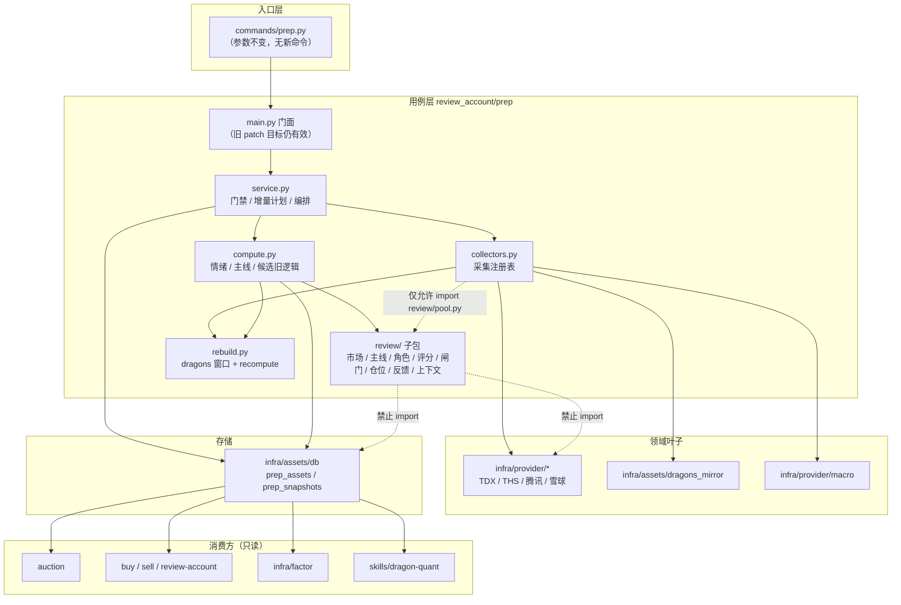
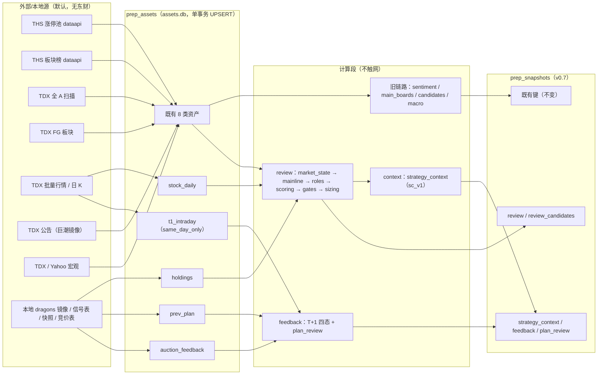
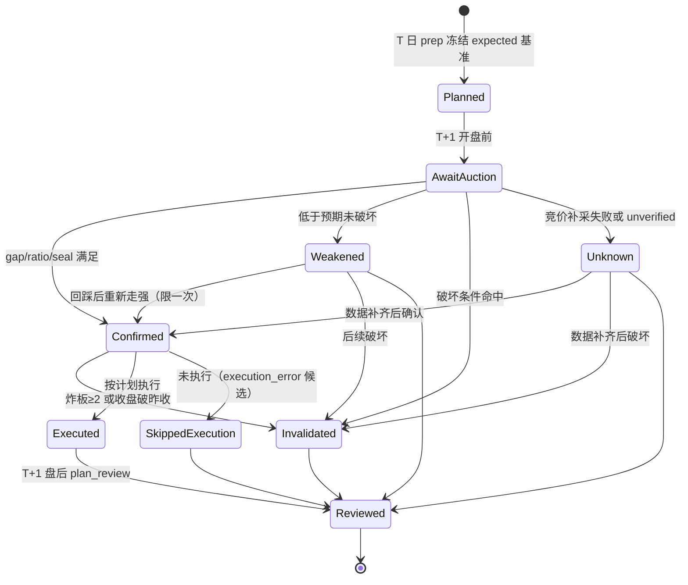
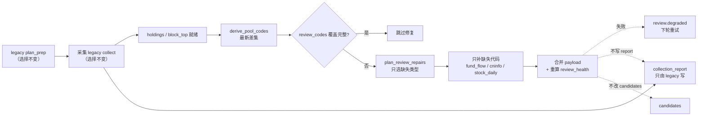

# prep 盘后复盘升级 · 技术方案

> 日期：2026-10-28｜阶段：2（产品 + 技术方案）｜状态：阶段 3.5 已通过，待用户确认
> 配套产品方案：`docs/solutions/2026-10-28-prep-review-product-design.md`（下称《产品方案》）
> 上游调研：`docs/solutions/2026-10-28-prep-review-research.md`
> 本文件是开发期产物，阶段 3.5 通过且用户确认合入时再归档。
>
> **前置约束（全文不可违反）**
> 1. `candidates` 保持近 5 日真龙旧范围与旧字段，下游 `auction`/`buy`/`review-account` 逐只不变；
>    详细池一律进 `review_candidates`。
> 2. 默认主路径**不依赖东财**、不依赖登录态、不依赖 OCR。
> 3. 快照 = 资产的纯函数；`infra/factor/*` 只读快照，禁止 import `review_account/*`。
> 4. 不新增顶层 CLI 命令；不改变旧 `buy`/`sell` 默认行为。

---

## 1. 目标与技术边界

| 项 | 内容 |
|---|---|
| 交付形态 | `prep` 快照新增 `review` / `review_candidates` / `strategy_context` / `feedback` / `plan_review` 五个顶层键；采集段新增 5 类资产 |
| 快照版本 | `0.6` → `0.7`（纯新增键；旧键语义与结构不变） |
| 新代码位置 | `dragon_quant/review_account/prep/review/`（子包）+ 现有 `collectors.py` / `compute.py` / `service.py` 的最小增量 |
| 新依赖 | 无第三方新增；复用 `tmdx` / 现有 provider |
| 新表 | 无 DDL：沿用 `prep_assets`（`asset_type` 新取值）与 `prep_snapshots`（JSON 加键） |
| 默认影响 | 下游零变化；默认 CLI 旧 4 行摘要与逐只清单**逐字不变**，其后追加「复盘摘要」段；`--json` 新增键 |
| 性能预算 | 单次 prep 额外 ≤ 120 次 HTTP（详细池 ≤ 60 代码），额外耗时目标 ≤ 60s |

---

## 2. 关键设计取舍（候选方案对比）

每个决策给出 ≥2 个候选，标 `★` 为采用项，标 `◇` 为非常规路径。

### D1 详细池落在哪里

| 方案 | 描述 | 评价 |
|---|---|---|
| A | 直接扩展 `candidates`，保留旧 `verdict` 字段 | **否决**：即使字段保留，`auction`/`buy` 的池集合、P/A、排序、sizing 都会变（它们读 `snap["candidates"]`），违反兼容硬点 |
| **B ★** | 新增 `review_candidates` 独立数组；`candidates` 完全不动 | 采用。隔离彻底、可分别做 golden、回滚只需忽略新键 |
| C ◇ | 新建独立表 `prep_review_snapshots` | 隔离更彻底，但多一套读写/同步/回滚路径，且 `assets sync` 分区与水位要扩展；收益不抵成本 |

**结论**：B。判据：如果某方案在同一份 JSON 里改变下游可观察的池集合，即违反 D1。

### D2 T+1 反馈的承载位置

| 方案 | 描述 | 评价 |
|---|---|---|
| A | 扩展 `auction` 命令输出 `feedback` | `auction` 是 T+1 早晨跑的，天然对齐；但要改 `auction` 的 JSON 契约（25 个顶层键逐字段不变）与 CLI 渲染 |
| **B ★** | T+1 盘后 `prep` 读取本地已存的 `auction_assets` + T-1 快照（物化为 `prev_plan` 资产），在 `prep` 内计算 | 零新命令、零新参数；保持「快照=资产纯函数」；时点天然正确（盘后） |
| C ◇ | 新增隐藏子命令 `prep-feedback` | 违反「不新增顶层命令」；且 E2E 覆盖映射（51 节点/15 命令）要扩展 |

**结论**：B。代价：T+1 反馈在盘后 16:40 才生成（不是盘中实时），产品已明确接受
（《产品方案》§1.2）；09:25/10:00 仅作对照刻度，不宣称实时计算。

### D3 总分构成

| 方案 | 描述 | 评价 |
|---|---|---|
| **A ★** | 角色化线性加权 + 缺失维度剔除重算 | 可解释、可消融、缺失语义清晰 |
| B | 乘法打分卡（维度相乘） | 单维极端值主导，缺失不可解释，消融困难 |
| C ◇ | 学习式排序器（LambdaRank / 小模型） | 无样本、无标签，冷启动完全不可用；且会引入不可解释与过拟合 |

**结论**：A。C 留作 M6 之后的长期方向，前置条件是 ≥ 250 个交易日的可成交标签。

### D4 市场状态如何进入决策

| 方案 | 描述 | 评价 |
|---|---|---|
| **A ★** | 只做仓位系数 + 档位上限，不进个股分 | 个股分跨日可比；弱市仍能区分「最强」与「一般」 |
| B | `review_score *= market_coef` | 弱市所有票分数一起塌陷，破坏可比性，且市场风险被重复计入 |
| C ◇ | 独立市场状态机（regime switching）驱动不同权重表 | 理论上更贴合，但需要状态标注与转移概率估计；当前样本不足以标定，列为后续 |

**结论**：A。C 需要至少 2 年标注样本，纳入 M6 后续研究项（非本期）。

### D5 详细池代码在哪个阶段解析

| 方案 | 描述 | 评价 |
|---|---|---|
| **A ★** | 采集阶段用已采资产（dragons/pool/block_top/holdings/fg）解析池代码，再采 `stock_daily` | 与现有「dragons codes → fund_flow/cninfo」模式一致；只采必要代码 |
| B | 计算阶段发现缺 K 再回头采 | 违反两段式（计算段不触网），会破坏 `--recompute` 可重放 |
| C | 全市场日 K 预采 | 6000+ 代码，成本与限速不可接受 |

**结论**：A。

---

## 3. 架构

### 3.1 分层与依赖方向



**依赖规则（可测试的硬约束）**

| 规则 | 说明 |
|---|---|
| `service → collectors → rebuild → compute → review/*` 单向 | `review/*` 不得 import `service` / `collectors` / `compute` / `rebuild` |
| `review/*` 纯函数 | 不得 import `infra.provider.*`、`infra.assets.*`、`sqlite3`、`requests`、`socket`；不得有文件/网络 I/O |
| `infra/factor/*` 只读快照 | 不得 import `review_account.*`（既有硬约束，测试已存在） |
| 不新增根级模块 | 全部落在 `review_account/prep/review/` 内 |

### 3.2 设计模式与动机

| 模式 | 落点 | 动机 |
|---|---|---|
| **Adapter** | 新 provider 方法（`batch_get_daily_klines` 等）与测试替身 | 隔离 TDX/THS/腾讯的字段、单位、鉴权差异，评分层只依赖统一结构 |
| **Strategy** | `review/config.py` 的角色权重表 + `scoring.py` | 五种角色不同权重；新增角色只加配置，不改算法 |
| **Chain of Responsibility** | `review/gates.py` 的有序闸门 | 硬风险优先短路，高分不能解除否决 |
| **State Machine** | `review/feedback.py` 的 T+1 四态 + 迁移 | Agent 不得自行编造状态；迁移条件是数据 |
| **Template Method** | `orchestrator.py` 固定「市场→主线→角色→评分→闸门→仓位→上下文」骨架 | 子步骤可替换（如角色策略），骨架不重复 |
| **Registry** | `ASSET_COLLECTORS` 追加采集器；`SPECS` 追加因子 | 新增资产/因子不改流水线骨架 |
| 不采用 | Observer / DI 容器 | 现有直接调用足够，避免过度抽象 |

---

## 4. 数据流：采集 → 资产 → 计算 → 快照 → 消费



**关键数据流规则**

1. `review_candidates` 的代码集合在**采集段**解析并写入 dragons 相邻的 `stock_daily.requested_codes`，保证「采了什么」可审计。
2. 计算段只读 `prep_assets`；`--recompute` 重放完全一致（新资产已在库）。
3. `strategy_context` 由 `review` 纯函数派生（同一份计算结果），并有测试断言两者数值零漂移。
4. `feedback` / `plan_review` 由 T+1 的 `prev_plan` + `auction_feedback` + `t1_intraday` 计算，**不读写 T 日快照**。

---

## 5. T → T+1 状态机



**状态与动作的强制映射**（Agent 只能引用，不能扩写）：

> **计算时点声明**：本阶段 `feedback` 只在 **T+1 盘后**由 `compute_feedback` 计算一次
> （数据来自已落库的 `auction_feedback` 与 T+1 日 K）。09:25 竞价、10:00 早盘、收盘
> 是冻结 playbook 的**对照刻度**，用于人工/Agent 比对与后续里程碑，不声称已实时判定。

| state | allowed_actions | 语义 |
|---|---|---|
| `confirmed` | `execute_plan` / `execute_partial` | 执行预备计划 |
| `weakened` | `downgrade_half` / `wait_pullback` | 降档、只做回踩 |
| `invalidated` | `cancel_entry` / `exit_via_sell_rules` | 取消；持仓交由 `sell` |
| `unknown` | `observe_only` | 不新建仓 |
| `pending` | `wait` | 未到时点 |

---

## 6. 导航契约

| 层 | 位置 | 职责 | 不做什么 |
|---|---|---|---|
| **入口** | `dragon_quant/commands/prep.py` | 参数解析、错误通道、人读/JSON 渲染（含新增复盘摘要段） | 不含业务计算；不新增参数 |
| **装配** | `dragon_quant/__main__.py` / services bundle（既有） | provider bundle 注入（`run_prep(services=…)`） | 不做业务决策 |
| **公共入口** | `dragon_quant/review_account/prep/main.py` | 门面 + 旧 patch 目标 + 导出 | 只做绑定 |
| **用例** | `prep/service.py::run_prep` | 时点门禁、增量计划、采集→计算编排、落库 | 不做评分 |
| **用例（新）** | `prep/review/orchestrator.py::compute_review` | 资产 → review / review_candidates / context | 不触网、不读写库 |
| **实现** | `prep/review/{market,mainline,roles,scoring,gates,sizing,feedback,context}.py` | 各自的纯函数 | 不互相反向依赖（只允许 `orchestrator` 组合） |
| **数据访问** | `infra/assets/db.py`（既有） | 资产/快照读写 | 不含业务逻辑 |
| **消费** | `review_account/market.py`、`infra/factor/engine.py`、`skills/*` | 只读快照 | 不写 prep 表 |

**调用链**

```
commands/prep.py::handle
  → review_account.prep.main.run_prep
    → service.run_prep
      → _validate_trade_date (门禁)
      → plan_prep / _run_collection (采集段，写 prep_assets)
      → _compute_all
          → compute_sentiment / compute_main_boards / compute_candidates / evaluate_candidates / compute_macro
          → review.compute_review(assets, trade_date)      # 新增，纯函数
      → assets_db.save_prep_snapshot(..., version="0.7")
```

### 6.1 公共导出 delta

| 文件 | 变化 | 兼容性 |
|---|---|---|
| `prep/main.py` | `__all__` 追加 `"compute_review"`、`"REVIEW_VERSION"` | 纯新增；旧 patch 目标（`ASSET_COLLECTORS`、provider 类、`_collect_all` 等）全部保留 |
| `prep/review/__init__.py` | 新包公共面：`compute_review`、`compute_feedback`、`REVIEW_VERSION`、`CONFIG`、`CONFIG_VERSION`、`config_hash` | 新 |
| `prep/review/pool.py` | **唯一**的详细池代码解析实现（纯函数）；`collectors.py` 只允许 import 这一个 review 模块 | 新（防两处解析漂移） |
| `prep/collectors.py` | `PrepContext` 追加 `collected: dict`（供下游采集器读本次已采 payload）、`review_only: bool` / `review_codes: list`（修复模式）；`ASSET_COLLECTORS` 追加 5 项；新增 `plan_review_repairs` | 字段新增带默认值，旧构造不破 |
| `prep/service.py::PrepPlan` | 追加 `review_collect: list[str] = field(default_factory=list)`（与 legacy `collect` 完全分离） | 默认空，旧构造与测试不受影响 |
| `prep/service.py` | 版本字符串 `0.6 → 0.7`；`_compute_all` 追加 5 个键（`review` / `review_candidates` / `strategy_context` / `feedback` / `plan_review`，后两者按前置资产存在性可选） | 旧键不变 |
| `infra/factor/engine.py` | `_load_prep_source` 返回体追加 `review` / `review_candidates`（只读透传） | 旧因子不受影响 |
| `commands/prep.py` | 人读模式：旧 4 行摘要 + 逐只清单**原样输出**，其后调用 `format_review_lines(result)` 追加复盘摘要段（纯展示函数，可失败降级） | 旧前缀零改动；新增段落 = 批准的行为变更 |

### 6.2 禁止依赖（测试强制）

- `review/*` → `dragon_quant.review_account.{service,collectors,compute,rebuild,market,strategy}`：禁止。
- **唯一允许的反向引用**：`collectors.py → review.pool`（`pool.py` 是无任何项目内依赖的纯函数叶子），
  用于「采集哪些代码的日 K」与「计算哪些代码的评分」共用同一解析实现。
- `review/*` → `dragon_quant.infra.provider`、`dragon_quant.infra.assets`、`sqlite3`、`requests`：禁止。
- `infra/factor/*` → `review_account/*`：禁止（既有测试 `test_architecture_rules`）。
- `compute.py` → `review/*`：只允许 `from .review import compute_review`（单向）。
- 不得在 `review/*` 里复制 `compute.py` 的 `SHANGHAI` 时区常量来源以外的时间逻辑（时间一律由入参传入）。

---

## 7. 新资产类型与采集器

| asset_type | 采集器 | same_day_only | 依赖 | payload 要点 | 失败语义 |
|---|---|---|---|---|---|
| `stock_daily` | `_collect_stock_daily` | 否 | dragons + ths_limit_up_pool + ths_block_top + holdings | `{as_of, trade_date, requested_codes[], rows{code:[{date,open,high,low,close,volume,amount,turnover}]}, coverage{requested,returned,missing[]}, truncated}` | 单 code 失败记 `missing`，不写假 K；覆盖 < 80% → `empty_suspicious` |
| `holdings` | `_collect_holdings` | 否 | 本地信号/持仓表 | `{as_of, codes[], sources[], degraded[]}` | 读取失败 → `codes=[]` + `degraded=["holdings_unavailable"]`，**不**判 error 中断 |
| `prev_plan` | `_collect_prev_plan` | 否 | 本地 `prep_snapshots` T-1 | `{source_trade_date, context_version, context_hash, positions[], feedback_plans[]}` | 无 T-1 快照 → `empty`（合法空，表示首日无计划），不写 error |
| `auction_feedback` | `_collect_auction_feedback` | **是** | 本地 `auction_assets` / `auction_snapshots`（同日）+ 可选 TDX 同日竞价 | `{as_of, rows_by_code{code:{price,amount,matched,unmatched,source,verified}}, sources[], backfill{attempted,ok,failed[]}, unverified_count}` | 覆盖缺口先补采；真实失败/未验证 → 该 code `unknown` + `auction_backfill_failed` |
| `t1_intraday` | `_collect_t1_intraday` | **是** | stock_daily 池 + TDX 5 分钟 | `{as_of, rows{code:[{time,close,volume}]}, checkpoint}` | 缺失 → 反馈降级为 `close_only` |

**注册顺序**（`ASSET_COLLECTORS`，顺序有意义）：

```
dragons → ths_limit_up_pool → ths_block_top → market_breadth → fg_boards
→ holdings → fund_flow → cninfo_announcements → macro_global
→ stock_daily → auction_feedback → prev_plan → t1_intraday
```

**依赖未就绪规则**（沿用既有 `_DRAGON_DEPENDENTS` 语义）：

- `stock_daily` 在 dragons 或涨停池不可用时**不执行**，记 `error` 并保留存量，
  绝不以空 codes 覆盖健康资产。
- `t1_intraday` 的代码集合 = **`prev_plan.positions[].code`**（不是当天新解析的池）；
  无 `prev_plan` 时不执行。否则会用今天的池去评估昨天的计划，反馈必然错配。
- 依赖 dragons 代码集合的采集器在 dragons 重采且 **code 集合变化**时必须级联重采：
  `_DRAGON_DEPENDENTS` 由 `("fund_flow", "cninfo_announcements")` 扩展为
  `("fund_flow", "cninfo_announcements", "stock_daily")`，
  `_CODE_COVERED_KEYS` 追加 `{"stock_daily": "rows"}`。否则窗口加宽后新候选永远缺日 K，
  D5/D6 静默为 `null`（会被误读成「数据源没这项」）。

**池代码解析（采集段，唯一实现）**

`prep/review/pool.py::derive_pool_codes(assets, config) -> dict` 是唯一实现，返回
`{codes, sources, truncated, excluded{st,new,bse,suspended}}`。`collectors._collect_stock_daily`
用其 `codes` 决定采哪些日 K；`orchestrator` 用同一结果决定评分对象。**禁止**在采集器里
另写一份池规则（两处漂移会让「采到的代码」与「评分的代码」不一致，产生静默缺维）。

```
pool_codes =
   dragons_rows codes
 ∪ ths_limit_up_pool.rows codes
   ∩ (ths_block_top 前 3 主线 stock_list)
 ∪ positive_anchor(最高板) ∪ negative_anchor(昨日涨停今日跌幅前三 / 高标炸板)
 ∪ holdings.codes
→ 排除 ST / 上市<20 日 / 停牌 / 北交所
→ 若 > review_max_codes(60)：按上述优先级截断，truncated=true
```

**既有资产代码集扩展（兼容性关键，含健康状态作用域隔离）**

现行 `_collect_fund_flow` / `_collect_cninfo` 只覆盖 **dragons 候选 codes**；详细池里的
主线核心、正/负锚不在 dragons 中，若不扩展，D4 资金维度与 G1 公告风险对它们恒为
`null`/`unknown` ——「每只详细标的都有量化分」将不成立。

但**不能**只做超集：`_fund_flow_suspicious` 是**全表判据**（全 None/0 → `empty_suspicious`），
补进来的详细池代码会反向改变旧资产的健康状态，进而改变旧 `candidates` 的
`flow_available` 与 `verdict`。因此采用**同资产、双作用域**：

- payload 结构（两个资产同构）：
  ```
  fund_flow  → {as_of, quotes{code:{...}}, legacy_codes[], review_codes[],
                review_health:{status, note}}
  cninfo     → {as_of, items{code:{...}}, legacy_codes[], review_codes[],
                review_health:{status, note}}
  quotes/items 是超集；legacy_codes 是 dragons 并集；review_codes 是补充的详细池差集
  ```
- **旧链路健康隔离**：`_EMPTY_KEYS`（`fund_flow`/`cninfo` 的空判据）、`_classify_payload`、
  `_fund_flow_suspicious`、`asset_health`、`collection_health` 一律**只对 `legacy_codes` 子集**
  计算状态与 note（`legacy_codes` 缺失时退化为「全键」，兼容旧 payload）。因此旧资产的
  `ok`/`empty`/`empty_suspicious`、`as_of` 判定与升级前逐位一致。
- **详细池健康独立**：`review_health` 只对 `review_codes` 计算，写入 payload 并只由
  `review.degraded` 消费；**不进入** `prep_assets.collection_report` 的既有条目，
  也不参与 `plan_prep` 的补采决策（否则会让旧资产的补采计划变化）。
- **消费方不变**：`compute_candidates` 仍 `flow.get(code)` / `anns.get(code)`；超集不改变
  任何既有 code 的取值。
- **两类强制回归**（缺一即 BLOCKER）：
  1. legacy 子集全 `None/0` + 补充代码健康 → 旧 status 仍 `empty_suspicious`，
     旧 `candidates.flow_available=false` 且 `verdict` 逐字段不变；
  2. legacy 子集健康 + 补充代码全 `None` → 旧 status 仍 `ok`，旧 `candidates` 不变，
     `review.degraded` 出现对应条目。
- `_CODE_COVERED_KEYS` 的覆盖校验保持按「当前 dragons 并集」判定（不因详细池扩张而
  触发无谓补采）。

**独立 review 覆盖修复计划（保证 AC-P16 持续成立）**

只做「首采超集」不足以覆盖三种真实情况：①首采时某只详细池代码的字段缺失；②补采失败；
③主线换血后详细池代码集合变化（旧 `stock_daily.requested_codes` 过期）。
因此必须有一个**独立于 legacy 采集计划**的 review 修复计划：



- **计划函数**：`collectors.plan_review_repairs(assets, trade_date, today) -> ReviewRepairPlan`，
  步骤固定为
  1) `pool = derive_pool_codes(assets)`（最新池，含 holdings 与主线换血后的成员）；
  2) 逐类型求差：`missing[t] = pool.codes - covered(t)`，
     `covered` 分别取 `fund_flow.quotes` / `cninfo.items` / `stock_daily.rows` 的键集合；
  3) `types = [t for t, m in missing.items() if m and is_collectable(t, trade_date, today)]`；
  4) 不可采（历史日的 `same_day_only` 类型）记入 `unavailable[]`，只进 `review.degraded`。
- **执行方式**：`_run_collection` 在 legacy 采集与 report 合并**之后**执行 review 修复，
  用 `PrepContext(review_only=True, review_codes=missing[t])` 调用对应采集器；采集器只请求
  `review_codes`，并与存量 payload **按键合并**（不改 `legacy_codes`）。
- **硬隔离**：
  - 修复类型**不进入** `plan.collect`（`review_collect` 是独立字段），legacy 采集选择逐位不变；
  - 修复**不写** `collection_report`（report 仍只由 legacy 采集写）；
  - 修复**不触碰** `candidates`、`fund_flow.legacy_codes`、`cninfo.legacy_codes`；
  - 修复失败只把 `review_health[t] = {status:"error", error, missing[]}` 写进 payload，
    由 `compute_review` 映射为 `review.degraded`。
- **可重试**：失败后 payload 的覆盖缺口仍在，下一轮 `plan_review_repairs` 会重新得出同一
  `missing[t]` 并再次尝试；**不允许**写任何「已修复」标记来阻止重试。
- **换血语义**：`stock_daily.requested_codes` 每次更新为最新池；`rows` 可保留旧代码（不进入
  任何 legacy 判断），仅当行数超过 `review_max_codes × 2` 时按最近使用裁剪并记 `pruned`。
- **关闭开关**：`review_assets_enabled=false` 时整个修复计划不生成，行为等价于本期未上线。

**T+1 竞价覆盖补采（消除 auction_pool_miss 系统性缺口）**

`auction` 命令的池是「T-1 快照中 `verdict != ignore`」的代码；而 T 日计划可能包含
`verdict=ignore` 或池外代码。若只读 `auction_assets`，这些代码的反馈**必然** unknown。
因此 `_collect_auction_feedback` 必须补齐：

```
codes = prev_plan.positions[].code
1) 先读同日 auction_assets / auction_snapshots → 命中即用（source="auction_assets"）
2) 未命中的 code → 调 TDX 同日竞价（get_auction_snapshot），same_day_only，仅当前日
3) 合并为 rows_by_code，逐 code 标 source / verified
4) 仍缺失或未验证 → 该 code unknown + unknown_reason="auction_backfill_failed"
```

- **不改变** `auction` 命令、其候选池、其 JSON 契约；补采只发生在 `prep` 的采集段。
- 补采上限：≤ `review_max_codes` 次；纳入 §10.3 的 ≤120 请求预算。
- 历史不可补：`auction_feedback` 标 `same_day_only=True`，历史日不采集、不写 report；
  `--recompute` 用已存资产重放（若当日未采到则保持 unknown）。
- 只有「真实补采失败 / 未验证」才 unknown，不得因为池过滤而系统性 unknown。

T-1 对比（主线状态、股性）不新增采集：`prev_plan` 已冻结 T-1 的 `mainlines` 与候选；
T-2 及更早由 `stock_daily` 与历史快照提供，缺失即 `unknown`。

---

## 8. 快照数据模型（v0.7）

### 8.1 顶层结构

```
prep_snapshots.result_json
├── trade_date            (既有)
├── version               "0.7"              ← 0.6 → 0.7（纯新增键）
├── sentiment             (既有，字段不变，不改义)
├── main_boards           (既有，不变)
├── macro                 (既有，不变)
├── candidates            (既有，范围/字段/语义完全不变)
├── dragon_source         (既有，不变)
├── review                (新) 市场 / 主线 / 锚 / 配置版本 / 降级
├── review_candidates     (新) 详细池逐只评分与仓位
├── strategy_context      (新) Agent 输入视图（sc_v1）
├── feedback              (新，可选) 仅当 prev_plan 存在且同日有竞价数据
└── plan_review           (新，可选) 仅当 T-1 计划存在
```

**不变量**

- `candidates` 的计算代码路径（`compute_candidates` + `evaluate_candidates`）**一行不改**。
- `review` / `review_candidates` 只读资产；**唯一**允许从 `candidates` 读取的是 code 集合，
  用于生成只读证据 `legacy.in_candidates`。`composite_score` / `verdict` 只作展示证据，
  **不得进入** `review_score`、闸门或仓位公式（AC-P9）。
- `strategy_context` 是 `review` 的**投影**：不得包含 `review` 之外的新数值。

### 8.2 JSON 示例（节选，字段真实可用）

```json
{
  "trade_date": "2026-10-28",
  "version": "0.7",
  "sentiment": {
    "limit_up_cnt": 63,
    "limit_down_cnt": 7,
    "broken_rate": 0.221,
    "position_advice": "正常",
    "position_pct": 0.5,
    "degraded": []
  },
  "main_boards": [
    {"board_name": "机器人", "limit_up_num": 11, "high": "4天4板", "dragon_count": 1}
  ],
  "macro": {"available": true, "session": "same_day", "instruments": {}, "degraded": []},
  "candidates": [
    {
      "code": "600001", "name": "样例A", "trade_date": "2026-10-24",
      "composite_score": 82.5, "rank": 2, "concepts": ["机器人"],
      "verdict": "strong", "verdict_label": "强烈建议",
      "dimensions": ["质量维度：五维综合 82.5（排名 2）；题材：机器人（今日主线第 1）"],
      "ignore_reason": null,
      "facts": {"pool_available": true, "in_pool_today": true, "t_pct": 9.98,
                "t_turnover": 12.3, "t_amount": 1520000000.0,
                "main_net_amount": 210000000.0, "flow_available": true,
                "announcements_available": true, "risk_announcement": null}
    }
  ],
  "dragon_source": {"trade_date": "2026-10-28", "window_days": 5, "dates": []},
  "review": {
    "config_version": "review_baseline_v1",
    "config_hash": "3f9c1a7d2b04",
    "market": {
      "state": "strong", "score": 71.0, "coeff": 1.0, "partial": false,
      "sub_scores": {"LU": 66.5, "LD": 82.0, "PRE": 72.5, "PRO": 68.0,
                     "HGT": 70.0, "BRK": 68.7, "LIQ": 65.7},
      "inputs": {"limit_up_cnt": 63, "limit_down_cnt": 7, "broken_rate": 0.221,
                 "yesterday_premium_pct": 1.4, "promotion_rate": 0.21,
                 "max_board_height": 4, "total_amount": 920000000000.0},
      "evidence": ["涨停 63 家 / 跌停 7 家", "炸板率 22.1%", "最高 4 板"],
      "unknown_reason": null
    },
    "mainlines": [
      {"board_name": "机器人", "category": "gn", "mainline_score": 91.7,
       "state": "strengthening", "limit_up_num": 11, "high_num": 4,
       "continuous_plate_num": 3, "concentration": 0.175,
       "members_sample": ["600001", "600002", "600003"],
       "role_map": {"leader": "600001", "vanguard": "600002", "mainstay": "600003"},
       "evidence": ["涨停 11 家", "最高 4 板", "集中度 17.5%"]}
    ],
    "anchors": {
      "positive": [{"code": "600001", "reason": "市场总龙头 4 板"}],
      "negative": [{"code": "600009", "reason": "昨日涨停今日 -6.2%"}],
      "risk": {"limit_down_cnt": 7, "broken_rate": 0.221, "height_d3_change": -1}
    },
    "degraded": []
  },
  "review_candidates": [
    {
      "code": "600001", "name": "样例A", "trade_date": "2026-10-28",
      "role": "leader", "role_confidence": "high",
      "role_basis": "主线内最高 4 板且成交额第一",
      "role_competitors": ["vanguard"],
      "mainline": {"board_name": "机器人", "rank": 1, "state": "strengthening"},
      "review_score": 86.6, "review_grade": "S", "confidence": 0.92,
      "dimensions": {
        "D1": {"score": 91.2, "weight": 0.30, "sub": {"H": 66.7, "L": 100.0, "B": 100.0}},
        "D2": {"score": 86.0, "weight": 0.20, "sub": {"M1": 100.0, "M2": 100.0, "M3": 100.0}},
        "D3": {"score": 86.1, "weight": 0.20,
               "sub": {"T": 85.0, "O": 100.0, "S": 100.0, "S_raw": 0.013, "R": 42.0}},
        "D4": {"score": 88.0, "weight": 0.20, "sub": {"F": 92.0, "V": 76.0, "Q": 100.0}},
        "D5": {"score": 70.0, "weight": 0.05, "sub": {"P": 100.0, "C": 55.0, "X": 60.0}},
        "D6": {"score": 75.0, "weight": 0.05, "sub": {"S1": 60.0, "S2": 90.0}}
      },
      "contributions": [
        {"dim": "D1", "weight_norm": 0.30, "dim_score": 91.2, "points": 27.36},
        {"dim": "D2", "weight_norm": 0.20, "dim_score": 86.0, "points": 17.20},
        {"dim": "D3", "weight_norm": 0.20, "dim_score": 86.1, "points": 17.22},
        {"dim": "D4", "weight_norm": 0.20, "dim_score": 88.0, "points": 17.60},
        {"dim": "D5", "weight_norm": 0.05, "dim_score": 70.0, "points": 3.50},
        {"dim": "D6", "weight_norm": 0.05, "dim_score": 75.0, "points": 3.75}
      ],
      "top_drivers": ["封板质量 86.1（09:41 首封未炸板）", "资金 88.0（主力净流入占比 8.4%）"],
      "top_drags": ["筹码位置 70.0（距 60 日高点 3%，集中度偏低）"],
      "missing_dims": [],
      "eligibility": "eligible",
      "position_pct": 12.0,
      "position_basis": [
        {"factor": "grade_base", "value": 12.0},
        {"factor": "market_coef", "value": 1.0},
        {"factor": "confidence_coef", "value": 1.0},
        {"factor": "risk_coef", "value": 1.0},
        {"factor": "liq_coef", "value": 1.0},
        {"factor": "role_cap", "value": 15.0}
      ],
      "gate_trace": [
        {"gate": "G0_data", "passed": true},
        {"gate": "G1_hard_risk", "passed": true},
        {"gate": "G3_liquidity", "passed": true}
      ],
      "warnings": [],
      "legacy": {"in_candidates": true, "verdict": "strong", "composite_score": 82.5},
      "expectations": {"gap_low": 3.0, "gap_high": 7.0, "ratio_low": 1.2, "seal_by": "10:00"}
    },
    {
      "code": "600009", "name": "样例N", "trade_date": "2026-10-28",
      "role": null, "role_confidence": "unknown",
      "weight_profile": "diagnostic_non_mainline",
      "role_basis": "非主线标的（负锚），不参与角色竞争",
      "mainline": null,
      "review_score": 60.5, "review_grade": "C", "confidence": 0.72,
      "dimensions": {
        "D1": {"score": 52.0, "weight": 0.20},
        "D2": {"score": 60.0, "weight": 0.20},
        "D3": {"score": 60.0, "weight": 0.25},
        "D4": {"score": 70.0, "weight": 0.20}
      },
      "contributions": [
        {"dim": "D1", "weight_norm": 0.2353, "dim_score": 52.0, "points": 12.24},
        {"dim": "D2", "weight_norm": 0.2353, "dim_score": 60.0, "points": 14.12},
        {"dim": "D3", "weight_norm": 0.2941, "dim_score": 60.0, "points": 17.65},
        {"dim": "D4", "weight_norm": 0.2353, "dim_score": 70.0, "points": 16.47}
      ],
      "missing_dims": ["D5", "D6"],
      "eligibility": "not_qualified",
      "position_pct": 0,
      "reason_code": "not_mainline",
      "gate_trace": [{"gate": "G4_mainline", "passed": false, "detail": "mainline_hit=false（role 为空）"}]
    }
  ],
  "strategy_context": {
    "context_version": "sc_v1",
    "trade_date": "2026-10-28",
    "frozen_at": "2026-10-28T16:52:10+08:00",
    "market": {"state": "strong", "score": 71.0, "coeff": 1.0},
    "positions": [
      {"code": "600001", "role": "leader", "review_score": 86.6, "grade": "S",
       "position_pct": 12.0, "eligibility": "eligible", "confidence": 0.92}
    ],
    "portfolio": {"sum_pct": 12.0, "warning": null},
    "data_quality": {"degraded": [], "missing": []},
    "enums": {
      "state": ["strong", "neutral", "weak", "ice", "unknown"],
      "role": ["leader", "vanguard", "mainstay", "capacity", "follower"],
      "action": ["execute_plan", "execute_partial", "downgrade_half",
                 "wait_pullback", "cancel_entry", "exit_via_sell_rules", "observe_only", "wait"]
    },
    "disclaimer": "量化为复盘与条件化预案，不构成投资建议；阈值均为待验证基线。"
  },
  "feedback": {
    "source_plan_date": "2026-10-27",
    "checkpoint": "auction+close",
    "items": [
      {"code": "600001", "state": "confirmed", "gap_pct": 4.5,
       "auction_ratio": 1.3, "sealed_by": "09:52", "close_pct": 9.98,
       "allowed_actions": ["execute_plan"], "unknown_reason": null}
    ],
    "degraded": []
  },
  "plan_review": {
    "plan_date": "2026-10-27", "eval_date": "2026-10-28",
    "items": [{"code": "600001", "planned_action": "execute_plan",
               "planned_position": 12.0, "feedback_state": "confirmed",
               "actual_entry_price": 12.10, "actual_position": 10.0, "outcome_pct": 5.4}],
    "attribution": {"market": 0, "pattern": 0, "execution": 1, "data": 0}
  }
}
```

> 说明：`D3.sub.S_raw=0.013` 是封单额/流通市值的**原始比率**（即 1.3%），归一后
> `S = min(0.013 / 0.01, 1) * 100 = 100`；维度分用归一后值。JSON / 公式 / 注释统一用比率口径，
> 展示层才乘 100 显示为百分数。
> 第二个候选 `coverage = 0.20+0.20+0.25+0.20 = 0.85 ≥ 0.50`，故仍输出分数；`D5/D6` 缺失只降低覆盖率与置信度。
> `strategy_context.positions` 必须收录**全部** `review_candidates`（含 `position=0/null` 与 `reason_code`），
> 示例只列 1 条属节选；只给建仓清单会让 Agent 无法解释「为什么不买」。
> 示例只演示结构与血缘，数值不是验证结论。

---

## 9. 配置版本、纯函数契约与缺失语义

### 9.1 配置即代码（单一真源）

`prep/review/config.py`：

```python
CONFIG_VERSION = "review_baseline_v1"

@dataclass(frozen=True)
class ReviewConfig:
    role_weights: Mapping[str, Mapping[str, float]]   # 6 profile（5 角色 + diagnostic_non_mainline）× 6 维，每行和 = 100
    grade_thresholds: tuple            # (85, 75, 65, 50)
    grade_base_pct: Mapping[str, float]# S12/A8/B4/C0/D0
    role_cap_pct: Mapping[str, float]
    market_state_coef: Mapping[str, float]
    confidence_coef_bands: tuple
    liquidity_thresholds: tuple        # (2e8, 5e8, 1e7, 2e8)
    expectations: Mapping[str, Mapping[str, float | str]]
    weights_market: Mapping[str, float]
    weights_mainline: Mapping[str, float]
    ...
CONFIG = ReviewConfig(...)

def config_hash(cfg=CONFIG) -> str:
    """canonical JSON（sorted keys, 固定小数位）→ sha256 → 前 12 位。"""
```

**规则**

1. 任何评分/仓位/反馈数字**只能**来自 `CONFIG`，禁止散落在函数里。
2. `config_hash` 写入快照 `review.config_hash`；`--recompute` 用同一资产 + 同一代码版本应得同分。
3. 修改任一数字 → hash 变化 → 新因子 `params.review_config_hash` 变化 → 因子版本自动 bump（§12）。
4. 单元测试断言：六个 profile（含 `diagnostic_non_mainline`）权重行和 = 100；所有区间左闭右开
   且无空洞/重叠；`grade_base` 与 `role_cap` 合法。
5. **`role=null` 必须显式选择 `diagnostic_non_mainline`**（不得回退到 follower 键）；
   两者数值可相同，但必须是独立配置项——单测断言「改 follower 权重不影响 diagnostic 结果」。

### 9.2 纯函数签名

```python
# prep/review/orchestrator.py
def compute_review(assets: dict, trade_date: str, *,
                   config: ReviewConfig = CONFIG) -> dict:
    """返回 {"market":…, "mainlines":…, "anchors":…, "review_candidates":[…],
             "portfolio":…, "degraded":[…], "config_version":…, "config_hash":…}"""

# 各模块
def compute_market_state(assets: dict, prev: dict | None) -> dict
def compute_mainlines(assets: dict, prev: dict | None) -> list[dict]
def assign_roles(pool_rows, block_rows, config) -> dict[str, dict]
def score_candidate(cand: dict, ctx: dict, config) -> dict
def evaluate_gates(cand: dict, ctx: dict, config) -> dict
def size_position(scored: dict, market: dict, config) -> dict
def compute_feedback(prev_plan: dict, auction: dict, intraday: dict | None,
                     daily: dict, trade_date: str) -> dict
def build_context(review: dict, config) -> dict
```

`_compute_all` 在 `compute_review` 之后，若 `assets` 同时含 `prev_plan` 与 `auction_feedback`，
再调用 `compute_feedback`；两者互不依赖，任一失败只影响自身键（`review_*` 或 `feedback`）。

**纯函数硬约束**：入参只有普通 dict/list/标量；不读环境变量、不读时间（`frozen_at` 由调用方注入）、
不写文件、不发请求、不 import `sqlite3`。`feedback` 的时间比较全部用入参日期字符串。

### 9.3 缺失 / 异常处理矩阵

| 情况 | 处理 | 禁止 |
|---|---|---|
| 维度子分缺失 | 子分 `null` → 维度按剩余子权重重算；全缺 → 维度 `null` | 填 0 / 50 |
| 维度缺失 | 从总分中剔除并重算 `coverage` | 用中性分补齐 |
| `coverage < 0.5` | `review_score = null`，`reason_code=data_insufficient` | 输出低分误导 |
| 关键基座缺失（涨停池） | 市场 `unknown`；候选 `review_score=null` | 用 FG T-1 冒充 T |
| 资产 payload 畸形 | 逐候选隔离，异常条目 `unrated` + `unknown_reason` | 清空整个 `review_candidates` |
| 单只字段类型错误 | 该只 `review_score=null`，其余不受影响 | 抛异常中断 prep |
| 板块成员缺失 | 角色 `null`，主线仍展示 | 猜角色 |
| 公告资产降级 | 风险 = `unknown`（不是 `none`） | 当作无风险 |
| 竞价缺失 | 反馈 `unknown` | 当作 confirmed/weakened |
| 现有竞价资产不含计划代码 | 同日 TDX 补采并合并，标 `source="tdx_same_day"`；可判定则不 unknown | 用历史或邻近标的代替 |
| 补采失败 / 未验证 | `unknown` + `auction_backfill_failed`，动作 `observe_only` | 当作 confirmed/weakened |
| 重复代码 | 按主归属去重一次 | 重复计分/重复仓位 |

**异常分层**：`compute_review` 内部逐候选 `try/except`；整体异常在 `_compute_all` 的 `_guard`
内被隔离为 `review.compute_error`，**绝不中断旧链路**（旧 `sentiment`/`candidates` 仍产出）。

---

## 10. 数据源映射、provider 接口与口径校准

### 10.1 字段映射（默认主路径，无东财）

| 目标因子 | provider 方法 | 原始字段 | 单位/转换 | 校验 |
|---|---|---|---|---|
| `height` | `THSProvider.get_limit_up_pool` | `high_days`（`"N天M板"`） | 取 M；解析失败 → `null` | `M ≥ 1`；`M ≤ N` |
| `first_seal_time` | 同上 | `first_limit_up_time`（epoch 秒） | → `HH:MM:SS`（Asia/Shanghai） | 在 09:30–15:00 |
| `open_num` | 同上 | `open_num` | 整数 | ≥ 0 |
| `seal_amount` | 同上 | `order_volume × limit_up_price × 100` | 元（`order_volume` 单位=手，**待实测校准**） | `> 0` 且 ≤ 流通市值 |
| `limit_up_type` | 同上 | `limit_up_type` | 文本（含「一字」判定） | 非空 |
| `limit_up_suc_rate` | 同上 | `limit_up_suc_rate` | 0–1 比率 | [0,1] |
| `reason_type` | 同上 | `reason_type` | 文本 → token 切分 | 非空 |
| `board_members` | `THSProvider.get_block_top` | `stock_list` | code 列表 | 成员数 ≥ 涨停家数 |
| `board_high_num` | 同上 | `high_num`（回退 `high`） | 板数 | ≥ 1 |
| `amount/turnover/float_cap` | `TDXProvider.batch_get_quotes` | `Quote.amount/turnover_rate/float_market_cap` | 元 / % / 元 | 非负 |
| `main_net` | 同上 | `Quote.main_net_amount` | 元；`None`=未知 | 与成交额同量级 |
| 详细池资金/公告覆盖 | 同上（扩展 codes，双作用域） | `fund_flow.quotes` / `cninfo_announcements.items` | 超集（dragons ∪ 详细池）+ `legacy_codes/review_codes` | 每个详细池 code 有键；旧健康只按 legacy 子集 |
| T+1 竞价补采 | **新增** `get_auction_snapshot` | 09:25 匹配价/匹配量/未匹配量 | 元 / 股 / 股 | 仅当前日；与 `auction_assets` 同值时以本地为准 |
| `daily_k` | **新增** `batch_get_daily_klines` | OHLCV + turnover | 元 / 股 / % | 行日期升序且末行 = T |
| `index_daily` | **新增** `get_index_daily` | OHLC | 点 | 末行 ≤ T |
| `breadth` | 既有 `get_market_breadth_rows` | close/pre_close/limit prices | — | `sample_n ≥ 3000` |
| `macro` | 既有 `collect_macro` | 日 K canonical | — | `session_date ≤ T` |

### 10.2 provider 接口 delta（必须用默认 `NotImplementedError`，不得 `@abstractmethod`）

```python
# infra/provider/base.py
def batch_get_daily_klines(self, codes: list[str], days: int = 120,
                           end_date: str | None = None) -> dict[str, list[KBar]]:
    """批量日 K；transport 失败抛异常，成功但无数据返回 {}。"""
    raise NotImplementedError(f"{self.name} 不提供批量日 K")

def get_index_daily(self, code: str, days: int = 120) -> list[KBar]:
    raise NotImplementedError(f"{self.name} 不提供指数日 K")

def get_5min_kline_for_date(self, code: str, date: str) -> list[KBar]:
    raise NotImplementedError(f"{self.name} 不提供指定日 5 分钟 K")

def get_auction_snapshot(self, code: str) -> dict | None:
    """当前交易日的 09:25 竞价终态（价/量/未匹配量）；非当日或不可用返回 None。"""
    raise NotImplementedError(f"{self.name} 不提供竞价终态")
```

**动机**：`create_providers()` 会一次实例化 4 个 provider，若用 `@abstractmethod` 会直接崩
（AGENTS.md 硬约束）。TDX 覆写前两个；第三个仅在 `t1_intraday` 需要时由 TDX/THS 覆写，
缺失即降级为 `close_only`。

### 10.3 限速、重试与预算

| 源 | 限速 | 重试 | 熔断 |
|---|---|---|---|
| THS dataapi（涨停池/板块榜） | 现有 `rate_limit.py` 规格（0.3–0.6s 随机）；分页 ≤10×200 | 3 次指数退避 | 403/连续失败 → 该资产 `error`，不再重试 |
| TDX 批量行情 | 每批 50 codes | 2 次 | 失败 → `fund_flow` error |
| TDX 日 K（新） | 每 code 0.05s；≤60 codes | 1 次 | 单 code 失败进 `missing` |
| TDX 5 分钟（新） | 每 code 0.05s；仅 `t1_intraday` | 1 次 | 缺失即 `close_only` |
| 宏观 Yahoo 回退 | 既有 | 既有 | 429 → 降级（既有行为） |

**单次 prep 预算**：新增 HTTP ≤ 120 次，构成为
①首采 `stock_daily`（≤ `review_max_codes`=60 个代码）+ 资金/公告超集（按批）；
②review 覆盖修复（只补缺失代码，≤ 缺失数 ≤ 60）；③T+1 竞价补采（≤ 计划代码数 ≤ 60）。
`review_max_codes` 默认 60（配置项，便于压测下调）。超预算时优先保证
`review_codes` 的资金/公告覆盖，其次日 K，其次竞价补采；被推迟的项标
`deferred_by_budget` 并在下一轮修复计划中重试。

### 10.4 原始响应保存

- 只保存**结构化行**（JSON），不保存 HTML、截图或原始报文。
- 每个新资产 payload 必含：`as_of`、`source`、`api_date`（如适用）、`requested_codes`、
  `returned_codes`、`missing_codes`、`coverage_ratio`、`truncated`。
- 失败只写 `collection_report`（`status=error` + `error`），**不写 payload**（沿用既有语义）。
- 凭据（Cookie/token/api-key）永不进入 payload、日志或快照。
- `holdings` 只存 `codes[]` 与来源表名，**不存**持仓数量、成本、账户金额等敏感字段
  （反馈与评分只需要代码集合）。

### 10.5 单位与口径校准清单（实施前必须实测并固化）

| 项 | 风险 | 校准方法 | 失败处理 |
|---|---|---|---|
| `order_volume` 单位（手/股） | 封单额偏差 100 倍 | 与页面「封板资金」或成交额比对照，误差 > 20% 判未校准 | 标 `seal_amount_estimated=true`；D3.S 置 `null` |
| `first_limit_up_time` epoch 时区 | 首封时间错位 | 抽样 10 只与分时首根涨停时刻核对 | 偏移 → 该子项 `null` |
| `high_days` 文本 | 「首板」无「N天M板」 | 正则匹配失败计数 | `height=null`，不猜 1 |
| `limit_up_suc_rate` 比率/百分数 | ×100 偏差 | 断言 ∈[0,1] | 越界 → `null` |
| 板块成员含 ST/停牌 | 角色误判 | 与池内 `is_st` 交叉 | 剔除并计数 |
| 日 K 复权 | 位置/筹码失真 | 统一用不复权 + 明确的复权因子字段 | 缺复权因子 → 标 `fq_unverified` |

---

## 11. 登录 / headless / OCR 边界（默认全部不依赖）

| 能力 | 主路径 | 若启用 | 约束 |
|---|---|---|---|
| 涨停池/板块/宽度/资金/宏观 | 结构化接口（THS dataapi + TDX） | — | 无需登录 |
| 竞价 | 本地 `auction_assets`（TDX 明细） | — | 仅当日，不可历史回补 |
| 公告 | TDX 公告接口（巨潮镜像） | — | 标题/类型/日期/URL |
| 同花顺复盘长图（题材逻辑） | **不启用** | 可选 Adapter（DOM 优先，OCR 兜底） | 需来源 URL + 截图 sha256 + OCR 置信度；**只作 `subjective_evidence`**，不得进硬闸门/评分 |
| 问财 DDE / 复合查询 | **不启用** | 需用户合法 Cookie + headless 刷 `hexin-v` | 凭据不入库不入日志；单列为用户决策项 |
| 交易所动态表（宏观/停复牌） | 不启用（现有 TDX/Yahoo 主路径） | headless DOM | WAF/403 不绕过 |

**硬规则**：任何 OCR 文本命中「立案/处罚」等词，**只能**产生 `subjective_evidence` 提示，
不得触发 `G1_hard_risk`；硬风险必须以结构化公告（标题+日期+来源）为准。

---

## 12. 历史 PIT 与可重建边界

| 资产 | same_day_only | 历史可重建 | 重建条件 | 结论 |
|---|---|---|---|---|
| `dragons` | 否 | 是（本地镜像逐日冻结） | 镜像有行 | 可重放 |
| `ths_limit_up_pool` | 否 | **否**（旧日期可能返回空池或参数不合法） | 仅真实采集日 | 只能从采集日起验证 |
| `ths_block_top` | 否 | **未证实** | 仅真实采集日 | 同上 |
| `market_breadth` | 是 | 否 | 无 | 缺失=永久降级 |
| `fg_boards` | 是 | 否 | 无 | 同上 |
| `fund_flow` | 是 | 否 | 无 | 同上 |
| `cninfo_announcements` | 否 | 部分（按公告日期回溯） | 查询窗口 [T-7,T] | 可补近窗 |
| `macro_global` | 否 | 是（日 K canonical） | 日 K 可得 | 可重放 |
| `stock_daily`（新） | 否 | **是**（长历史日 K） | TDX/雪球日 K | D5/D6 可长历史 |
| `holdings`（新） | 否 | 是（本地历史信号） | 本地表 | 可重放 |
| `prev_plan`（新） | 否 | 是（快照复制） | 快照存在 | 可重放 |
| `auction_feedback`（新） | 否 | 仅已采集日 | 本地竞价表 | 不可补 |
| `t1_intraday`（新） | 是 | 否 | 无 | 缺失降 `close_only` |

**校验规则（防「假重建」）**

1. 日期型资产（pool/block_top）采集后必须校验「实际行日期/覆盖」：
   `rows` 非空且 `api_date == trade_date`；空 → `error`（不是法定空）。
2. `as_of` 校验沿用既有 `_AS_OF_CHECKED`（`market_breadth`/`fg_boards`/`fund_flow`），
   新增 `t1_intraday` 加入该集合。
3. 回补（显式 flag）必须写 `backfill=true` + `backfill_verified=false`，且**不得**用于回测结论。
4. 回测起点 = 首日所有必需资产 `collection_report` 均 `ok` 的交易日（自动计算 `backtest_eligible_from`）。

**未来函数防护**

- 个股评分只用 `date ≤ trade_date` 的 K 线与当日快照；
- 主线状态用 T-1 及更早；
- 反馈只用 T+1 及之后；
- `--recompute` 不改变 `available_at`（沿用 factor 层 derived 语义）。

---

## 13. 因子注册与版本

新增因子（`infra/factor/builtin/prep_review.py`，全部 `default_enabled=False`）：

| 因子 | unit | direction | phase | 取值/映射 | 说明 |
|---|---|---|---|---|---|
| `prep_review_score` | score | higher_better | prep | 0–100；`null` 不写行 | 主分 |
| `prep_review_grade` | score | higher_better | prep | S4/A3/B2/C1/D0（params mapping） | 档位 |
| `prep_position_pct` | pct | higher_better | prep | `>0` 写值；`0` 写 0；`null` 不写行 | 单票仓位 |
| `prep_market_state` | score | higher_better | prep | strong3/neutral2/weak1/ice0；unknown 不写行 | 市场状态 |
| `prep_mainline_rank` | count | lower_better | prep | 1–5；非主线不写行 | 主线名次 |
| `prep_role` | score | neutral | prep | leader5/vanguard4/mainstay3/capacity2/follower1；`role=null` 不写行（diagnostic 不是角色） | 角色 |
| `prep_dim_d1..d6` | score | higher_better | prep | 0–100；缺失不写行 | 六维 |
| `prep_seal_ratio` | ratio | higher_better | prep | 封单额/成交额 | 封板质量子项 |
| `prep_main_net_ratio` | ratio | higher_better | prep | 主力净额/成交额 | 资金子项 |
| `prep_turnover_health` | score | higher_better | prep | 0–100 | 换手健康子项 |
| `prep_distance_high60` | pct | neutral | prep | 距 60 日高点回撤 % | 位置子项 |
| `prep_chip_concentration` | ratio | lower_better | prep | (P90-P10)/P50 | 筹码子项 |
| `prep_feedback_state` | score | neutral | **close** | confirmed2/weakened1/invalidated0；unknown/缺失不写行 | T+1 反馈 |

**版本规则**

- `src/identity` 使用 `impl_key`（如 `builtin.prep_review.score.v1`）。
- `params` 必含 `review_config_version` + `review_config_hash`；权重/threshold 变更 → params 变 →
  注册表版本哈希变 → `factor query` 自动解析新版本（既有机制）。
- 源适配：`_load_prep_source` 返回体追加 `review` 与 `review_candidates`（只读透传，不改既有键）。
- 缺失语义：`null`/`unknown` 一律「无行」，绝不写 0（`ignore` 在旧族才写 0）。
- **计数分母**：既有 `FactorContext.codes` 仍来自 `candidates`；新因子族必须用
  `len(review_candidates)` 作为自己的分母与 `expected_empty` 判据（否则「全池缺失」会被
  误算成「全 unrated」而告警错位）。`factor_values` 写入不受 `ctx.codes` 过滤，超出
  `candidates` 的代码可正常落行。

**重复计数警告（必须写入 `docs/agent/factor.md`）**

| 组合 | 问题 | 建议 |
|---|---|---|
| `prep_review_score` ↔ `five_dim_composite` / `prep_composite` | 三个「综合分」语义不同，混用会制造双计分 | 生产模型只选一个；`prep_composite` 仅诊断 |
| `prep_review_score` ↔ `prep_dim_d1..d6` | 主分是六维线性组合 | 用主分**或**六维，不得并存 |
| `prep_position_pct` ↔ `prep_review_score` + `prep_market_state` | 仓位是分数与市场状态的函数 | 仓位只作执行建议，不进选股模型 |
| `prep_feedback_state` ↔ `auction_*` | 反馈含竞价事实 | 同一信号只取一次（推荐 feedback 用于执行评估，不进选股） |

---

## 14. 评估与回测

### 14.1 标签与可成交口径

```
entry  = T+1 开盘价（若 09:25 竞价价存在且可成交，用竞价价）
exit   = T+N 开盘价（N ∈ {1, 3, 5}）
cost   = 佣金 0.03%/边（最低 5 元）+ 印花税 0.05%（卖出）+ 过户费 0.001%
         默认往返 0.13%（可配置 backtest_cost_bps）
前向收益 fwd_ret_N = exit/entry - 1 - cost
```

**不可成交剔除**：T+1 一字涨停开盘（开盘=涨停价且无成交）→ 不计入买入样本，计 `unfillable_one_word`；
停牌 → `suspended`；成交额 < 2 亿 → `illiquid`（与 G3a 一致）。

### 14.2 滚动样本外

复用 `review_account/evaluation.py::walk_forward`（4 窗口）：
报告每窗口 IS/OOS 指标、OOS/IS 效率比；比值 < 0.5 或为负 → 标 `oos_decay`。
`compare_strategies(trial_count)` 记录试验次数，> 20 标 `overfitting_risk`。

### 14.3 消融与基线

| 实验 | 变量 | 目的 |
|---|---|---|
| 维度消融 | 逐个去掉 D1–D6（权重归零并重算） | 哪些维度真正贡献 IC |
| 角色权重消融 | 用统一权重替换角色权重 | 验证「角色化是否必要」 |
| 闸门消融 | G3b/G4/G7 分别关闭 | 闸门是提升还是误杀 |
| 市场系数消融 | `market_coef` 全置 1.0 | 验证市场择时层 |
| 基线 A | 六维等权 | 权重是否过拟合 |
| 基线 B | 旧 `composite_score` 排序 | 新分是否优于旧分 |
| 基线 C | 旧 `verdict`（strong/light） | 新分是否优于旧评级 |
| 基线 D | 随机/全池等权 | 下限对照 |

**判定标准（待验证）**：新分在 ≥ 3 个滚动窗口的 RankIC 与命中率同时不低于基线 B/C，
且 OOS 效率比 ≥ 0.5；否则不进入任何决策路径。

### 14.4 前向影子验证

- 连续 ≥ 20 个交易日，每日记录 `strategy_context` 与实际 T+1 结果（不参与任何决策）。
- 指标：`confirmed` 命中率、`invalidated` 正确回避率、`unknown` 占比（区分
  `auction_backfill_failed` 与其他原因）、计划仓位与可实现仓位偏差、组合和告警频率。
- **预算校准指标**（用于验证 60/120）：实际新增 HTTP 次数、详细池截断率
  （`truncated` 天数占比）、`review` 竞价覆盖率（有值 / 计划代码数）。
- 输出 `shadow_report.json`（脚本级，不进快照），供 M6 复盘。

### 14.5 统计注意

- RankIC 用 Spearman + Newey-West（`nw_lag = horizon-1`）；
- 有效独立样本 `≈ days / horizon`，日频 naive t 标 `pseudo_independent`；
- 财务/因子多版本混用禁止（沿用 `factor eval` 口径）。

---

## 15. 测试策略

### 15.1 单元测试（纯函数，无 I/O）

| 文件 | 覆盖 |
|---|---|
| `tests/test_review_config.py` | 五角色权重行和=100；区间无空洞；hash 稳定；改一个数字 hash 必变 |
| `tests/test_review_market.py` | 分段插值边界；LU/LD 缺失 → unknown；部分缺失 → 归一化 + `partial` |
| `tests/test_review_mainline.py` | 主线分公式；并列稳定排序；T-1 对比五态；无 T-1 → unknown |
| `tests/test_review_roles.py` | 五角色判定顺序；全首板场景；成员缺失 → null；跨板块归属 |
| `tests/test_review_pool.py` | 池代码解析确定性；四类来源并集；排除项计数；截断优先级；采集与计算同一实现 |
| `tests/test_review_scoring.py` | 六维边界（0/100/越界）；缺失剔除重算；贡献之和=总分；`coverage<0.5` → null；`role=null` 选 diagnostic profile |
| `tests/test_review_gates.py` | 闸门顺序与短路；高分+硬风险 → 0；`null` vs `0` 可辨 |
| `tests/test_review_sizing.py` | 五角色上限；系数组合；0.5% 下限；`>100` 组合告警 |
| `tests/test_review_feedback.py` | 四态判定；优先级（confirmed→invalidated→weakened）；weakened→confirmed 限一次；unknown 不动作 |
| `tests/test_review_context.py` | `strategy_context` 与 `review` 数值零漂移；枚举完整；无 `null` 泄漏成 `"null"` |

### 15.2 集成测试（假资产 → 快照）

`tests/test_prep_review_integration.py`：

1. 构造固定 `assets` dict（含全部新老资产）→ `run_prep(recompute=True)` 类路径 → 断言快照结构。
2. **兼容核心**：同一 fixtures 下，`candidates` 的 `code` 集合、`verdict`、`verdict_label`、
   `dimensions`、`ignore_reason` 与升级前 golden **逐字段相等**。
3. `review_candidates` 包含 `candidates` 之外的代码（主线核心/负锚），且 `candidates` 未因此扩张。
4. **健康作用域回归 A**：`legacy_codes` 对应行情全 `None/0` + `review_codes` 全健康 →
   `collection_report.fund_flow` 仍 `empty_suspicious`，旧 `candidates.flow_available=false`、
   `verdict` 逐字段不变。
5. **健康作用域回归 B**：`legacy_codes` 全健康 + `review_codes` 全 `None` →
   `collection_report` 仍 `ok`，旧 `candidates` 不变，`review.degraded` 含资金/公告降级标记。
6. `review` 计算抛异常时，`sentiment`/`candidates` 仍正常产出（异常隔离）。
7. `--recompute` 两次结果逐字节一致（确定性）。
8. `prev_plan` + `auction_feedback` → `feedback` / `plan_review` 正确；T 日快照未被修改（hash 不变）。
9. **竞价补采**：计划代码不在 `auction_assets` 时，补采成功 → state 可判定且 `source="tdx_same_day"`；
   补采返回 None → `unknown` + `auction_backfill_failed`；两种情况下 `auction` 命令与其池不变。
10. **独立修复 A（新增代码）**：legacy 全部健康 + 详细池新增 code →
    仅 `review_collect` 触发（断言 legacy collector 未重跑），`collection_report` 与
    `candidates` 逐字段不变；新 code 在 `fund_flow.quotes` / `cninfo.items` / `stock_daily.rows` 均有键。
11. **独立修复 B（失败可重试）**：修复采集抛异常 → legacy、report、`candidates` 均不变，
    `review.degraded` 含对应条目；用同一 fixtures 再跑一次 `plan_review_repairs`，断言该类型
    仍在 `review_collect`（没有被「已修复」标记挡住）。
12. **独立修复 C（主线换血）**：T 日池变化导致 `requested_codes` 改变 →
    `stock_daily.requested_codes` 更新为新池，新 code 有日 K；旧 code 不进入 `candidates`、
    不改变 `fund_flow.legacy_codes`，旧链路逐字段不变。

### 15.3 CLI / golden

- 默认人读输出：旧 4 行摘要与逐只清单**逐字不变**（前缀断言），其后追加「复盘摘要」段；
  golden 需**追加更新**（批准的行为变更，单独 commit 记录）。
- `--json` 新增 5 个顶层键 → `scenario_prep` golden 更新（同一批准变更）。
- `coverage-map.json`：**不新增命令/parser 节点**，51 节点 / 15 命令不变；测试应保持通过。

新增段落示例（前缀为既有输出，保持不变）：

```
是否建议买入：是
建议仓位：50%
建议等级：一般
买入理由：复盘日 2026-10-28；…（既有文案不变）

✅ 样例A-强烈建议
- 质量维度：五维综合 82.5（排名 2）；题材：机器人（今日主线第 1）
- 涨停维度：换手板 4天4板，首封 09:41，炸板 0 次，封板成功率 100%
- 资金维度：主力净流入 2.10 亿（占成交额 13.8%）

（新增）复盘摘要：市场 strong（71.0，×1.0）｜主线 机器人（强化）、算力（稳定）、消费电子（衰减）
（新增）详细池 12 只：S 1 / A 3 / B 4 / C 2 / D 2；可准备建仓 2 只
（新增）600001 样例A leader 86.6 S 单票建议 12.0%（驱动：封板 86.1、资金 88.0）
（新增）600002 样例B vanguard 78.6 A 单票建议 6.8%
（新增）600003 样例C mainstay 72.1 B 单票建议 1.7%（软风险 ×0.5）
（新增）600009 样例N 非主线 60.5 C 0（not_mainline）
（新增）数据：1 项降级（公告缺失），置信度下调
```

渲染契约：`format_review_lines(result)` 为纯展示函数；`review` 缺失或 `enabled=false` 时
只输出一行「复盘摘要不可用（<reason>）」，**不得**影响旧 4 行与清单的逐字输出。

### 15.4 因子 / Skill / 安全

| 类型 | 文件 | 断言 |
|---|---|---|
| 因子 | `tests/test_factors_prep_review.py` | 新因子默认关；`null` 不写行；config hash 变更 → 版本 bump；`review` 缺失 → `missing_source` 不删旧行 |
| 因子架构 | `tests/test_architecture_rules.py`（扩展） | `review/*` 不 import provider/storage/service；`infra/factor/*` 不 import review_account |
| Skill | `test_skill_content.py` | skill 内禁止出现权重/阈值数字 | 
| Skill | `test_skill_routes.py` | `references/outputs.md` 覆盖 `strategy_context` 新字段 |
| 安全 | `tests/test_review_security.py` | 快照/日志不含 Cookie/token/api-key；OCR 证据只进 `subjective_evidence` |
| 纯函数 | `tests/test_review_purity.py` | import 期与调用期无 `open`/`socket`/`sqlite3`（monkeypatch 抛错） |
| 文档 | `tests/test_docs_consistency.py` | 版本断言 `0.7` 三处同步（见 §17） |

### 15.5 回归门禁命令

```bash
.venv/bin/python -m pytest dragon_quant/tests -q \
    --ignore=dragon_quant/tests/e2e --ignore=dragon_quant/tests/smoke
.venv/bin/python -m pytest dragon_quant/tests/e2e -q
.venv/bin/python dragon_quant/tests/e2e/harness/runner.py --self-check
npm test
```

---

## 16. 实施切片（每片可独立验收与回滚）

| 切片 | 交付 | 验收 | 影响面 |
|---|---|---|---|
| **M1 配置 + 纯评分骨架** | `review/{config,util,scoring}.py`；单测；不接快照 | 六维/贡献/缺失单测绿；config 不变量绿 | 零（未接线） |
| **M2 市场 + 主线 + 角色** | `review/{market,mainline,roles}.py` | 状态五态、角色五类、并列/缺失单测绿 | 零 |
| **M3 详细池 + 新资产 + 快照 0.7** | `stock_daily`/`holdings` collectors；`plan_review_repairs` + 修复合并；`orchestrator`；`review_candidates` 写入 | 集成测试：`candidates` 逐字段不变；`review_candidates` 覆盖四类来源；修复三例（新增/失败重试/换血）通过 | `--json` 新增键与默认 CLI 新增段（golden 更新） |
| **M4 闸门 + 仓位 + 上下文** | `review/{gates,sizing,context}.py`；`strategy_context` | 闸门/仓位/组合告警/上下文零漂移单测绿 | `--json` |
| **M5 反馈 + 计划复盘** | `{prev_plan,auction_feedback,t1_intraday}` collectors；`feedback.py`；`plan_review` | T→T+1 集成测试；未知态动作；T 快照 hash 不变 | `--json` |
| **M6 因子 + 评估 + 影子 + 文档** | `builtin/prep_review.py`；消融脚本；影子报告；owner 文档同步 | `factor eval` 可跑；架构/内容/文档测试绿 | 因子表（默认关） |

**每片的完成定义**：代码 + 单测/集成测试 + 文档同步 + 回滚开关验证 + 交付报告证据。

---

## 17. 迁移、回滚与文档同步

### 17.1 迁移（无 DDL）

| 变更 | 迁移动作 | 风险 |
|---|---|---|
| 新 asset_type（5 个） | 仅 `asset_type` 新取值；`UNIQUE(trade_date, asset_type)` 自动容纳 | 无 schema 变更 |
| 快照加键 | `result_json` 加键 | 旧键不动 |
| `version 0.6 → 0.7` | 改 `service.py` 常量 | **必须同 commit 更新**：`tests/test_docs_consistency.py`（`assert version == "0.7"`）、`docs/agent/prep-auction.md`（`version=0.7`）、`README.md`（`version=0.7`） |
| `PrepContext.collected` | 带默认值的 dataclass 字段 | 旧构造兼容 |
| provider 新方法 | 普通方法 + `NotImplementedError` | 4 provider 实例化不破 |

### 17.2 兼容性回归清单（必须全绿）

1. `auction` 池来源、P/A、`fallback_reason` 不变（`collect_candidates_ex` 只读 `candidates`）。
2. `buy` 的 `ranking_mode` / `checks` / `buys` 不变。
3. `review-account` 的 sizing / 情绪读取不变。
4. `candidates` 逐字段 golden 相等。
5. 旧因子（`prep_*`/`auction_*`）行为不变（`_load_prep_source` 只增键）。
6. **review 修复不改变 legacy 采集选择**：`plan.collect` 与 `review_collect` 分离；
   `collection_report` 只由 legacy 采集写；修复失败可重试且不写「已修复」标记。

### 17.3 回滚

| 层级 | 手段 | 效果 |
|---|---|---|
| 运行时（新计算） | `review_v2_enabled=false`（`ReviewConfig`/env） | **只写** `review = {"enabled": false, "reason": "disabled"}` 最小状态对象；不写 `review_candidates` / `strategy_context` / `feedback` / `plan_review`；旧链路的键与取值完全不变 |
| 运行时（新采集） | `review_assets_enabled=false` | `plan_prep` 过滤 5 类新资产；不触网 |
| 数据 | 无需回滚：全部为新增键/新增 asset_type | 旧代码忽略未知键 |
| 代码 | 回退版本后 `--recompute` 会用旧代码覆盖快照（丢新键，资产仍在） | 重新升级后可重建 |
| 因子 | `default_enabled=False` + 不进入模型快照 | 零影响 |

**开关语义（唯一契约，与《产品方案》§16 一致）**：`review_v2_enabled` 与
`review_assets_enabled` **默认 `true`**（P0 即影子输出）。显式置 `false` 是回滚手段，
不是默认运行态。关闭计算时：**只写 `review = {"enabled": false, "reason": "disabled"}`
这一个状态键**，其余四个内容键（`review_candidates` / `strategy_context` / `feedback` /
`plan_review`）完全不写；旧键完全不变。下游据此区分「未启用（disabled）」与
「计算失败（compute_error）」——二者都不得伪装成「无标的」。

### 17.4 文档同步（同 commit 强制）

| 文档 | 更新内容 |
|---|---|
| `docs/agent/prep-auction.md`（owner） | 新资产类型、快照 `version=0.7`、新键语义、影子输出、可采性矩阵新增 same_day_only 项 |
| `docs/agent/factor.md` | 新因子族、`review` 源适配、重复计数警告、评估口径 |
| `docs/agent/architecture.md` | `prep/review/` 子包与依赖方向（若该文档维护目录树） |
| `skills/dragon-quant/references/outputs.md` | `strategy_context` / `feedback` 字段解读与新枚举 |
| `README.md` | 默认输出新增复盘摘要段、`--json` 新键集合、版本号 `0.7` |
| 根 `AGENTS.md` | **不改**（无新跨模块硬约束） |

**禁止二次复制**：owner 文档与 Skill 只**引用**本文档章节（如「见技术方案 §9.1 权重表」），
不得把权重表/阈值表复制第二份——否则任何调参都会立刻产生两份真相。

---

## 18. 风险与缓解

| 风险 | 影响 | 缓解 |
|---|---|---|
| 详细池扩张导致采集时间/请求量上升 | prep 变慢、触发限速 | `review_max_codes=60`；批量 K；预算熔断；可选关闭 |
| 历史不可重建导致回测样本短 | 结论不可信 | 明确 `backtest_eligible_from`；只报告可达区间；不用回补数据下结论 |
| 角色/权重过拟合 | 上线后失效 | 消融 + 滚动 OOS + 前向影子 ≥20 日；默认影子 |
| 数据源字段漂移（THS 字段/单位） | 分数失真 | 单位校准表 + `seal_amount_estimated` 标记 + 越界置 null |
| 兼容被破坏（池扩张泄漏到 candidates） | 交易行为静默改变 | `review_candidates` 隔离 + golden 逐字段 + 代码审查 |
| 因子层循环依赖 | 架构腐化 | `test_architecture_rules` 强制 |
| 快照体积增长 | 存储/同步成本 | 只存派生结果（不存原始 K 全量入快照）；K 在 `prep_assets` 单资产行 |
| Agent 越权解释 | 生成第二套策略 | 枚举白名单 + 内容测试 + 禁止词校验 |
| 版本断言遗漏 | CI 红 | §17.1 三处同步 + 文档一致性测试 |

---

## 19. 验收映射（对照 main 阶段 2 关注点）

| main 关注点 | 本方案落点 | 证据 |
|---|---|---|
| 真正满足「量化分 + 单票仓位 + 次日策略」 | §3 架构、§8 数据模型、§9 纯函数 | 集成测试 + JSON 示例 |
| 不混淆旧五维分 / T 日分 / T+1 反馈 / 置信度 | §2 D3、§8.1 不变量、§9.3 缺失矩阵 | `test_review_scoring`、`test_review_context` |
| 完整可执行基线 + 明确未验证 + 默认影子 | 《产品方案》§5–§11、§16；本文件 `CONFIG_VERSION` | `test_review_config` + 影子期 |
| 不错误依赖东财/登录/OCR | §10.1 映射、§11 边界 | 数据源表 + 架构测试 |
| 保持旧交易行为与依赖方向 | §6.2 禁止依赖、§17.2 回归清单 | golden + `test_architecture_rules` |
| 图表/数据可得性/登录清单/验证证据 | §3/§4/§5 Mermaid、§10.4、§11、§15 | 本文 + 测试门禁 |

### 19.1 产品验收 → 技术实现映射

| 产品 AC | 技术实现 |
|---|---|
| AC-P1 / P2 | `scoring.py` + `contributions` 定义（§9.2）+ `test_review_scoring` |
| AC-P3 / P4 | `gates.py` + `sizing.py` + `test_review_gates` / `test_review_sizing` |
| AC-P5 | `market.py` + `test_review_market` |
| AC-P6 | `roles.py` + `test_review_roles` |
| AC-P7 / P8 | `feedback.py` + `test_review_feedback` |
| AC-P9 | 代码审查：`scoring.py` 不读 `composite_score`；单测构造极端值 |
| AC-P10 | `scoring.py` 缺失剔除 + `coverage` 门槛 |
| **AC-P11 / P12** | **`candidates` 路径零改动** + `test_prep_review_integration` 逐字段 golden + §17.2 回归清单 |
| AC-P13 | `context.py` 投影 + `test_review_context` |
| AC-P14 | 默认 CLI golden：旧前缀逐字相等 + 新增复盘摘要段结构断言（§15.3） |
| AC-P15 | `sizing.py` 组合和 + 告警 |
| AC-P16 | §7「健康作用域隔离」+「独立 review 覆盖修复计划」+ 集成测试回归 A/B 与修复三例（第 10–12 条） |
| AC-P17 | `sizing.py` 持仓语义标记 + 报告文案契约测试 |
| AC-P18 | `config.py` 独立 `diagnostic_non_mainline` + `scoring.py` profile 选择 + 单测 |
| AC-P19 | §7「T+1 竞价覆盖补采」+ `get_auction_snapshot` + 集成测试补采两例 |

---

## 20. main 验收结论（已确认）与后续口径

main 单次验收已对以下 4 项作出决定，本文档按此执行：

| # | 事项 | 决定 |
|---|---|---|
| 1 | 详细池上限 60 / 单次新增 ≤120 请求 | **接受**，作为待验证基线；由影子指标校准（§14.4） |
| 2 | 快照 `0.7` + 三处文档同步 + golden 行为变更 | **批准** |
| 3 | T+1 反馈仅在盘后计算 | **接受**；09:25 / 10:00 明确为对照刻度（§5、《产品方案》§1.2） |
| 4 | M6 注册新因子 | **允许**，`default_enabled=False` |

验收意见中的 6 项必须修改已全部落实：开关契约（§17.3）、默认 CLI 追加摘要（§6.1/§15.3/§17.4）、
资金/公告健康作用域隔离（§7）、`role=null` 诊断权重 profile（§9.1）、T+1 竞价补采与口径
（§7/§9.3/§10.1–10.3）、`D3.S_raw` 比率口径（§8.2）。

实现时以本文档章节为唯一引用源；owner 文档与 Skill 只引用、不复制权重表（§17.4）。
